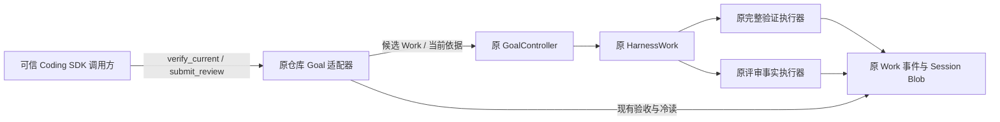

# CODING-KD-GOAL-04：低 token 的 Goal 收尾

- Authority: proposed；Design status: draft；Implementation status: not-started。
- Revision: R2，2026-11-01。Owner：Coding；协作：HarnessWork Goal/Work、Harness Transcript/Blob；不改变共享组件边界。
- 源码基线：`06a8033d6620efe2effba4c3a87eac9cb8384025`；方法：干净本地 archmethod master `0f9bd3ff51afabeaaf76cc38dff1ceb279b7d37e`。
- 用户目标：控制有限预算，安排花费 token 小的 Goal 收尾闭环。实施前按既有重要工作件检查点提交用户评审。

## 1. 本次 Goal 与成功条件

在独立的新 Goal 中，对上轮真实 Kimi 已修好的候选代码执行原完整验证与可信宿主评审，关闭后冷读得到 `completed / current`。**试验新增模型调用上限为 0；正常路径最多 2 个新 Work：verify_all、review。** 不重新规划或重做修复，不自动追加预算。旧 Goal 及其 `paused / not_satisfied` 结论原样保留。

这验证低成本收尾能力，不宣称原试验变为成功，也不宣称本轮重新证明动态重规划或在线 inherit。上轮遗留候选必须经过本轮实际完整验证，不能用旧候选的 verify_all 或最新 check(regression) 代替。

## 2. Current 与问题

| Current 源码事实 | 对本次设计的约束 |
| --- | --- |
| `_goal_planning_shared.py` 已把 limits、remaining 写入规划输入；每个实施动作目前由单次规划响应提供 | 不是缺少预算提示；不要再建设预算账本或把所有问题归于提示措辞 |
| `_goal_repository.py` 的 verify_all 使用原 VerifyCodingCommand；不调用模型；只有当前完整验证和匹配的独立批准支持完成 | 执行确定性验收不需要再让模型决定一次；完成标准不变 |
| submit_review 是可信宿主入口，通过原 Work 记录评审；模型不能提供此权限 | 可用同一责任方式提供直接验证入口，不能把评审工具暴露给模型 |
| Coding profile 固定 Work 总额度 20、仓库规划额度 8；耗尽规划后普通 resume 被拒绝 | 本切片不放宽、重置或迁移旧额度；新试验的 2 Work 上限由固定驱动控制，不能声称共享 runtime 总额度已改为 2 |
| GoalController 在原 advance 中核对当前状态、basis、总 Work 数、受理/执行与完成证据 | 新入口必须进入此路径，不能直接调用 verifier 后自行标记 Goal 完成 |

本轮取舍：采用可信宿主显式请求 `verify_current`，随后原 `submit_review`。不采用增加 8 次额度、要求模型在最后一步猜中 verify_all、复用 check 结果改称完整验证、或新增自动收尾调度器。后续可讨论 Product 自动选择收尾时机；本轮不实现自动抢占模型计划。

## 3. 环境与组件协作

没有新增运行组件。Product 拥有验证选择和固定任务包；GoalController 仍拥有目标状态与受理；Work 拥有执行及事实；原 verifier 产生验证结果；可信宿主拥有评审决定。模型、子 Session 和 Method 不参与本次收尾执行，已有能力不被移除。

## 4. 最小接口与交互候选

私有仓库 SDK 增加 `verify_current(goal_id, *, command_id, revision, epoch, expected_inventory)`。调用方先取得当前候选清单，明确授权对此清单执行完整验证。该入口不接任意命令、check 类型、验收规则或模型计划。

1. 复用 owner 的 busy/closed 防护及原输入核查；核对 Goal 当前 revision/epoch、任务摘要和文件清单。暂停、终态、未收敛执行、清理残留或输入不一致均拒绝；不隐式 resume。
2. 构造短命的宿主验证请求，在原 policy.prepare 中只为本次调用提供原 verify_all 候选；仍调用原 controller.advance。请求在 finally 清除，不成为第二条队列或持久状态机。
3. 复用原 verification 候选构造器、Work envelope、report/validation 步骤和 Blob。不得伪造模型 proposal 或把宿主请求记为模型推理。新增候选的 source 显式记录 `host_verification` 版本 1 及完整请求（goal_id、command_id、revision、epoch、expected_inventory）；live/cold 共用核对其与原 batch、basis、inventory 的对应，未知版本拒绝。
4. 先核对持久身份再判断新调用状态：只有同 command_id、同完整请求且有匹配原 host verification intent，才可读取原回执；改参拒绝，原回执尚未形成时保留原未收敛语义，不补发执行。已占用命令 id 却无匹配 intent（含 command_received 后、intent 前中断）明确拒绝重试及改义，保留原事实；不能仅靠核心 advance 的空 data 证明请求相同。普通 advance 与宿主入口互拒命令串用。完成后合法查询原回执仍成立；submit_review 原合同保持。
5. prepare/confirm 继续核对当前依据和 Work 额度。新验证至少要求剩余 2 个 Work 名额，给验证及评审留位置；intent 后二次 confirm 只将匹配自己的暂定 intent 计回准入余额，初始剩 2 可执行并留下 1。不得把其他 intent 计回。这是准入检查，不是跨进程预留。已有当前成功验证等待评审时，新 verify_current 拒绝为 review_required，不重复验证；原普通 advance 同样不能继续规划。若验证失败，本试验立即停止，不调用模型、不提交批准。
6. 完整验证成功后，由可信宿主对同一 inventory、验证 operation/run 和任务摘要进行独立评审。存在实质问题则记录 rejected 并结束；只有无未解决问题时才能 approved。源文件变更导致原评审身份失效，不能完成。
7. 原验收器决定完成；关闭原 owner，再走原冷读。取消、append 不明、进程中断、cleanup 失败沿原语义保留事实和清理凭据；不得自动重发验证或丢弃 owner。

`host_verification` 只是 Product 决策来源标记，不扩展 Goal/Work 核心 schema，也不改变验收证据格式。旧历史不补写；旧默认模型规划入口保持。当前 reader 校验新标记；保留原 policy 版本，因为来源标记不承载新的完成权限，旧 reader 即使忽略此附加标记，仍须按同一完整验证和独立批准事实验收。旧版本不能使用新命令入口；不承诺旧版本理解新来源审计字段或主动续跑。

## 5. 有界验证安排

| ID | 必须验证的行为 |
| --- | --- |
| LC-01 | 使用拒绝任何模型调用的 stream，直接完整验证、批准、完成、关闭与冷读；模型调用计数为 0 |
| LC-02 | 有匹配 intent 的同命令重试不新增 Work；改参、错 revision/epoch/inventory、入口串用拒绝；command_received 后 intent 前中断不重发；完成后合法回执查询仍成立 |
| LC-03 | 验证失败、评审拒绝、验证后改文件、未知标记、证据损坏均不能完成；check 不升级为 verify_all |
| LC-04 | 规划额度耗尽但 Goal 仍 active 时，明确宿主验证可受理；已 paused 的旧 Goal 不隐式恢复；精确剩 2 可受理且剩 1 留给 review，剩 1 不新增 Work；intent 后确认不能误扣两次 |
| LC-05 | busy、取消、未收敛与清理凭据沿原控制路径；覆盖 intent 前、受理后与 append 不明的注入；不新增模型权限、队列或后台自动执行 |
| LC-06 | 原模型规划、同 Session、reuse/fresh/inherit 与旧冷读保持；仅覆盖改动接缝，不重复已通过的全部平台测试 |

先完成确定性离线 SDK 合同，再对上轮候选在独立 worktree 运行一次真实 verifier。运行前固定：目标源文件摘要、原缺陷基线、RC-01—06、原始测试集合、原 verifier/Method、任务包摘要、新实现 SHA、0 次模型调用、最多 2 个 Work。只为当前新任务构建独立 manifest；不改旧任务包，不把候选当前字节当成期望测试答案。

不使用 Kimi 凭据、不启动在线模型。独立检查实际新模型调用为 0；为零调用的本次收尾报告“新增模型 token 为 0”，不把此前 Kimi 花费或本次设计/评审对话成本算作零。不增加 token 计量组件。失败保留证据并结束，不启动第二轮付费试验。

## 6. 评审与接受

三视角：职责与复用；运行与失败；数据与兼容。每位 reviewer 仅核查本稿与必要源码，限制输出为阻断、关闭条件及结论；不运行模型、不扩散任务。具体 findings 与固定修订记在相邻评审记录。

用户需评审的关键决定：可信宿主可直接请求原完整验证，无需消耗模型规划次数；Goal 完成仍要求独立评审且受原 Work 总额度限制。本次只验收新 Goal，不恢复或改写上轮暂停的 Goal。
