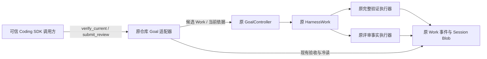

# CODING-KD-GOAL-04：低 token 的 Goal 收尾

- Authority: normative；Design status: accepted；Implementation status: implemented。
- Revision: R2，2026-11-01。Owner：Coding；协作：HarnessWork Goal/Work、Harness Transcript/Blob；不改变共享组件边界。
- 源码基线：`06a8033d6620efe2effba4c3a87eac9cb8384025`；方法：干净本地 archmethod master `0f9bd3ff51afabeaaf76cc38dff1ceb279b7d37e`。
- 用户目标：控制有限预算，安排花费 token 小的 Goal 收尾闭环。用户于 2026-11-01 明确“确认，请继续”，接受已评审 R2 并授权实施及固定预算收尾试验。

## 1. 本次 Goal 与成功条件

在独立的新 Goal 中，对上轮真实 Kimi 已修好的候选代码执行原完整验证与可信宿主评审，关闭后冷读得到 `completed / current`。**试验新增模型调用上限为 0；正常路径最多 2 个新 Work：verify_all、review。** 不重新规划或重做修复，不自动追加预算。旧 Goal 及其 `paused / not_satisfied` 结论原样保留。

这验证低成本收尾能力，不宣称原试验变为成功，也不宣称本轮重新证明动态重规划或在线 inherit。上轮遗留候选必须经过本轮实际完整验证，不能用旧候选的 verify_all 或最新 check(regression) 代替。

## 2. Current 与问题

| Current 源码事实 | 对本次设计的约束 |
| --- | --- |
| `_goal_planning_shared.py` 已把 limits、remaining 写入规划输入；每个实施动作目前由单次规划响应提供 | 不是缺少预算提示；不要再建设预算账本或把所有问题归于提示措辞 |
| `_goal_repository.py` 的 verify_all 使用原 VerifyCodingCommand；不调用模型；只有当前完整验证和匹配的独立批准支持完成 | 执行确定性验收不需要再让模型决定一次；完成标准不变 |
| submit_review 是可信宿主入口，通过原 Work 记录评审；模型不能提供此权限 | 可用同一责任方式提供直接验证入口，不能把评审工具暴露给模型 |
| Coding profile 固定 Work 总额度 20、仓库规划额度 8；耗尽规划后普通 resume 被拒绝 | 本切片不放宽、重置或迁移旧额度；新试验的 2 Work 上限由固定驱动控制，不能声称共享 runtime 总额度已改为 2 |
| GoalController 在原 advance 中核对当前状态、basis、总 Work 数、受理/执行与完成证据 | 新入口必须进入此路径，不能直接调用 verifier 后自行标记 Goal 完成 |

本轮取舍：采用可信宿主显式请求 `verify_current`，随后原 `submit_review`。不采用增加 8 次额度、要求模型在最后一步猜中 verify_all、复用 check 结果改称完整验证、或新增自动收尾调度器。后续可讨论 Product 自动选择收尾时机；本轮不实现自动抢占模型计划。

## 3. 环境与组件协作

没有新增运行组件。Product 拥有验证选择和固定任务包；GoalController 仍拥有目标状态与受理；Work 拥有执行及事实；原 verifier 产生验证结果；可信宿主拥有评审决定。模型、子 Session 和 Method 不参与本次收尾执行，已有能力不被移除。

## 4. 最小接口与交互

私有仓库 SDK 增加 `verify_current(goal_id, *, command_id, revision, epoch, expected_inventory)`。调用方先取得当前候选清单，明确授权对此清单执行完整验证。该入口不接任意命令、check 类型、验收规则或模型计划。

1. 复用 owner 的 busy/closed 防护及原输入核查；核对 Goal 当前 revision/epoch、任务摘要和文件清单。暂停、终态、未收敛执行、清理残留或输入不一致均拒绝；不隐式 resume。
2. 构造短命的宿主验证请求，在原 policy.prepare 中只为本次调用提供原 verify_all 候选；仍调用原 controller.advance。请求在 finally 清除，不成为第二条队列或持久状态机。
3. 复用原 verification 候选构造器、Work envelope、report/validation 步骤和 Blob。不得伪造模型 proposal 或把宿主请求记为模型推理。新增候选的 source 显式记录 `host_verification` 版本 1 及完整请求（goal_id、command_id、revision、epoch、expected_inventory）；live/cold 共用核对其与原 batch、basis、inventory 的对应，未知版本拒绝。source.basis 与原 replay 已校验的 batch_intent.data.basis 作 canonical 全字段比较，包含 scope、Session 与 policy 身份，且区分布尔与整数。
4. 先核对持久身份再判断新调用状态：只有同 command_id、同完整请求且有匹配原 host verification intent，才可读取原回执；改参拒绝，原回执尚未形成时保留原未收敛语义，不补发执行。已占用命令 id 却无匹配 intent（含 command_received 后、intent 前中断）明确拒绝重试及改义，保留原事实；不能仅靠核心 advance 的空 data 证明请求相同。普通 advance 与宿主入口互拒命令串用。完成后合法查询原回执仍成立；submit_review 原合同保持。
5. prepare/confirm 继续核对当前依据和 Work 额度。新验证至少要求剩余 2 个 Work 名额，给验证及评审留位置；intent 后二次 confirm 只将匹配自己的暂定 intent 计回准入余额，初始剩 2 可执行并留下 1。不得把其他 intent 计回。这是准入检查，不是跨进程预留。已有当前成功验证等待评审时，新 verify_current 拒绝为 review_required，不重复验证；原普通 advance 同样不能继续规划。若验证失败，本试验立即停止，不调用模型、不提交批准。
6. 完整验证成功后，由可信宿主对同一 inventory、验证 operation/run 和任务摘要进行独立评审。存在实质问题则记录 rejected 并结束；只有无未解决问题时才能 approved。源文件变更导致原评审身份失效，不能完成。
7. 原验收器决定完成；关闭原 owner，再走原冷读。取消、append 不明、进程中断、cleanup 失败沿原语义保留事实和清理凭据；不得自动重发验证或丢弃 owner。

`host_verification` 只是 Product 决策来源标记，不扩展 Goal/Work 核心 schema，也不改变验收证据格式。旧历史不补写；旧默认模型规划入口保持。当前 reader 校验新标记；保留原 policy 版本，因为来源标记不承载新的完成权限，旧 reader 即使忽略此附加标记，仍须按同一完整验证和独立批准事实验收。旧版本不能使用新命令入口；不承诺旧版本理解新来源审计字段或主动续跑。

## 5. 有界验证安排

| ID | 必须验证的行为 |
| --- | --- |
| LC-01 | 使用拒绝任何模型调用的 stream，直接完整验证、批准、完成、关闭与冷读；模型调用计数为 0 |
| LC-02 | 有匹配 intent 的同命令重试不新增 Work；改参、错 revision/epoch/inventory、入口串用拒绝；command_received 后 intent 前中断不重发；完成后合法回执查询仍成立 |
| LC-03 | 验证失败、评审拒绝、验证后改文件、未知标记、证据损坏均不能完成；check 不升级为 verify_all |
| LC-04 | 规划额度耗尽但 Goal 仍 active 时，明确宿主验证可受理；已 paused 的旧 Goal 不隐式恢复；精确剩 2 可受理且剩 1 留给 review，剩 1 不新增 Work；intent 后确认不能误扣两次 |
| LC-05 | busy、取消、未收敛与清理凭据沿原控制路径；覆盖 intent 前、受理后与 append 不明的注入；不新增模型权限、队列或后台自动执行 |
| LC-06 | 原模型规划、同 Session、reuse/fresh/inherit 与旧冷读保持；仅覆盖改动接缝，不重复已通过的全部平台测试 |

先完成确定性离线 SDK 合同，再对上轮候选在独立 worktree 运行一次真实 verifier。运行前固定：目标源文件摘要、原缺陷基线、RC-01—06、原始测试集合、原 verifier/Method、任务包摘要、新实现 SHA、0 次模型调用、最多 2 个 Work。只为当前新任务构建独立 manifest；不改旧任务包，不把候选当前字节当成期望测试答案。

不使用 Kimi 凭据、不启动在线模型。独立检查实际新模型调用为 0；为零调用的本次收尾报告“新增模型 token 为 0”，不把此前 Kimi 花费或本次设计/评审对话成本算作零。不增加 token 计量组件。失败保留证据并结束，不启动第二轮付费试验。

## 6. 评审与接受

三视角：职责与复用；运行与失败；数据与兼容。每位 reviewer 仅核查本稿与必要源码，限制输出为阻断、关闭条件及结论；不运行模型、不扩散任务。具体 findings 与固定修订记在相邻评审记录。

用户已接受的关键决定：可信宿主可直接请求原完整验证，无需消耗模型规划次数；Goal 完成仍要求独立评审且受原 Work 总额度限制。本次只验收新 Goal，不恢复或改写上轮暂停的 Goal。

## 7. 实施与验证记录

实现仅在原 `_goal_repository.py` 增加可信宿主入口、短命请求和来源核对；将原 verification 候选构造提取为同一私有方法供两入口复用。共享 GoalController/Work、队列、Session 生命周期和完成规则均未修改。原 Work.wait 的取消路径会取消并收敛原 run；宿主重复请求保留原回执，不补发。

完整仓库 Goal 离线回归 40 passed（309.59 秒），覆盖新入口及原模型规划、同 Session、reuse/fresh/inherit、冷读；Ruff 与原生成式架构依赖检查通过。最后严格类型、来源序号与零模型 SDK 冷读定向复验 2 passed（15.02 秒）；文档检查 9 项通过。固定候选真实验收已按下述预算完成。

### 固定候选的真实收尾结果

2026-11-01，运行源码固定为 `919191f7de7aa6f2fb2b3e7e6f14fe8f86bb18a4`。独立试验工作树从原缺陷基线 `5eadeb91c` 建立，仅复制上轮已修复的两个候选文件；RC-01—06、原独立 verifier、Method 与原始回归测试保持。新任务包 SHA256 为 `a8fa347a43c9a93372abe414c85ef7ae63d950a1936975494f8e4f0027eea056`。

| 实际证据 | 结果 |
| --- | --- |
| 原完整 verify_all | 21 项合同、318 项回归通过，均无跳过/错误 |
| 可信宿主独立评审 | approved；仅两文件改变，16 个原顶层测试/辅助定义未改；先前非普通文件字节读取问题已关闭，无未解决发现 |
| 新 Work | 恰好 2：verification、review；无 planning/repair Work |
| 新模型调用 | provider 与原 logical-call 计数均 0，planning_intents 为 0；试验模型入口禁用 |
| 原 owner 关闭后冷读 | completed / current；reason 为 repository_contract_and_review_satisfied；进程退出 0 |

因此，本次收尾试验新增模型 token 为 0；此数字不包含旧 Kimi 实施费用，也不包含本次设计、开发、测试与评审对话成本。没有扩大旧 8 次规划额度，没有使用新的在线 Kimi 调用，也没有把旧 paused Goal 改写为成功。这是可信宿主零模型收尾的验证，不是新的自主规划成功试验。

候选源码、分支切点、任务包、评审与冷读证据保留在产品树外的本轮架构分析目录；完整运行资料保留于独立临时根。实验补丁不合入产品分支。实现代码三视角复核及唯一来源校验修复见[评审记录](goal-low-token-closeout-review.md#实施代码三视角复核与关闭)；交付沿用现有 PR 检查。

## 8. 同一 Goal 的离线连续闭环验证

2026-11-01，用户授权先完成离线集成验证。基线 `f5277c3d8`；本轮仅扩展原 `test_repository_method_executes_original_write_tool_then_independent_verifier` 测试和验证记录，不调整上述设计、运行组件、权限或预算政策。

同一 Goal、同一 Session 内先由确定性离线模型适配器提出 implement 计划，再通过原 Method、SessionTurnExecutor 与 write 工具实际修改候选文件。宿主随后调用原 verify_current 与 submit_review，关闭 owner 后冷读原记录；规划与实施阶段不使用在线模型。保留原模型提出 verify_all 的路径作为对照。

| 路径 | Work 顺序与数量 | 结果 |
| --- | --- | --- |
| 模型选择验证，对照 | planning → repair → planning → verification → review，共 5 个 | completed/current；2 次规划，离线适配器调用 4 次 |
| 宿主接手成功收尾 | planning → repair → verification → review，共 4 个 | completed/current；1 次规划，离线适配器调用 3 次，收尾阶段不再调用模型 |
| 实施结束但完整验证失败 | planning → repair → verification，共 3 个 | verification Work failed；拒绝批准请求；Goal active/not_satisfied，冷读保留失败事实 |
| 完整验证通过但独立评审拒绝 | planning → repair → verification → review，共 4 个 | Goal active/not_satisfied，reason=review_rejected；冷读保留评审发现 |

四条路径均校验最终事实与冷读投影一致，无未收敛执行。宿主路径额外核对：实施前的旧 inventory 被拒绝且不新增 Work；验证依据绑定到实际修复后的 inventory、同一 Goal/Session 以及准确的 verification operation/run；验证成功仍等待宿主评审，不能提前完成或继续规划；重复验证命令返回原回执，保留原 Work/规划计数。原 profile 的总 Work 额度仍为 20，没有重置目标、修改 epoch 或清空历史；本轮证明上述实际消耗，额度临界值合同仍由原 host_verification_capacity_and_source_contract 覆盖。

验证结果：4 passed、39 deselected（53.20 秒）；既有额度/来源合同复验 1 passed、42 deselected（4.88 秒）；Ruff 与 9 项文档检查通过。该证据验证既有能力在同一 Goal 内的衔接及失败语义，不是在线模型表现或实质动态重规划成功的证明。没有新增在线模型调用，没有启动新的真实仓库试验。

## 9. 有界真实任务试验：未进入实施

2026-11-01，用户授权交付上一节离线验证并进行一次小型真实任务试验。离线验证已由 PR #834 合并。真实任务选取新的窄缺陷：read 超长行提示的 Bash 命令未引用路径，特殊文件名无法按提示读取。未复用旧 #125/#121 的完成候选；仅允许修改 read.py 的 imports 与 _first_line_too_large_notice。

独立合同在干净主线基线 `f5277c3d8` 上为 14 failed、3 passed，覆盖空格、单引号、分号、变量符号、反引号、中文、换行及两个 offset。任务包冻结摘要 `38736b418fc98d60675e389f42fcc257f3598bc2c1dcfbeef1291ff40dccaf72`，运行源码 `3ee6f0edd`。为避免给新任务错误背景，原规划提示移除写死的旧 issue 编号与“两文件”数量，改为引用当前任务及 allowed_files；未改变动作、权限或受理合同。已有四条离线集成路径在修订上复验通过（52.56 秒）。

试验驱动上限为 2 个 planning、1 个 repair、1 个 verification、1 个 review，总数最多 5 Work；单次模型输出上限 2048，保留原 Work 内调用/重试上限，试验总时长上限 600 秒。该局部驱动只允许有效计划直接进入 implement；不把这些局部约束冒称共享 Goal 的预算合同。

实际 Kimi Coding 首次提出 inspect(reader)，其 planning Work 正常完成。驱动因没有给 inspect 留位置而停止，没有执行检查、实施、验证或评审，没有重新发起付费试验。冷读为 active/not_satisfied，reason=repository_verification_required，execution_unresolved=false。候选源码完全未变。原 Transcript 记录 1 次 invocation、1 次 provider attempt：input=7847、output=588、cacheRead=0、cacheWrite=0、totalTokens=8435。

此结果不是闭环成功，也不是运行时异常。原 planning_material 提供要求、允许路径和检查目标，不提供源码正文；源码通过 inspect 或后续实施材料取得，因此模型先选择检查合理。本轮驱动预算未覆盖这条正常路线，且其局部动作限制未完整进入原模型的 limits/remaining（仍为 profile 的 20 Work/8 planning）。这是试验设置与现有规划输入之间的缺口，不能据此判模型违规或新增底座调度器。

下一轮需先明确初始证据及局部预算如何向规划者表达，并给允许的 inspect 路径分配名额，或明确已有实施材料足以直接开工；本次未批准或开展第二次在线试验，也未声称实质动态重规划已证明。原始任务包、来源切点、日志和用量记录归档在产品树外，临时干净工作树可在归档后移除，冷读结论作为移除前的时点证据保留。
