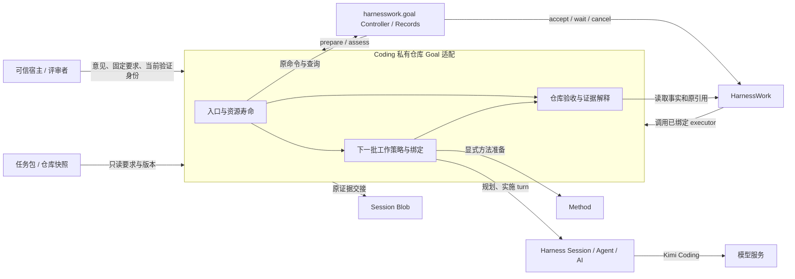
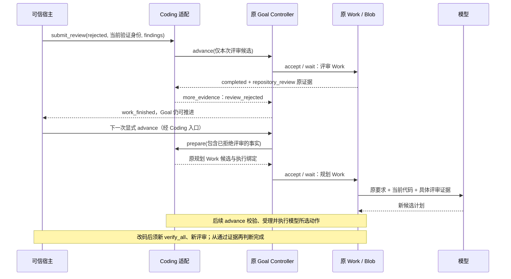

# CODING-KD-001：真实仓库 Goal 的评审反馈与重规划

## 状态与范围

- Revision: R1，2026-10-28。
- Authority: normative for this local SDK slice；Design status: accepted；Implementation status: in-progress。
- Owner: Coding Product；与 `harnesswork.goal` 协同，不改变共享 Goal/Work 合同。
- 源码基线：`5eadeb91ccee4e69618d99cf531f94739c76a453`。
- 方法：本地干净 archmethod master `0f9bd3ff51afabeaaf76cc38dff1ceb279b7d37e`。
- 工作分支：`feat/goal-review-replanning`；具体验收见[执行计划](../../../plans/2026-10-28-goal-review-replanning.md)，技术复核见[评审记录](goal-review-feedback-review.md)。

承接[模型逐批规划交付](../../goal-method-work/model-planning-implementation.md)与
[Goal 协作职责](../../goal-method-work/README.md)。用户已授权准备并实施本任务，但仍
保留对重要架构工作件的评审：用户于 2026-10-28 在审阅本 R1 后明确“确认，继续”，接受本 R1 的环境、交互和数据合同，实施已启动。
既有逐批规划可用，不等于已完成 GP-03 实质动态重规划验证。

本次只支持本地 SDK、一个仓库/分支、一个活动 Goal、显式逐批推进，以及可信宿主
提交的评审。首个任务为真实 [issue #125](https://github.com/zhnt/loushang/issues/125)。
不增加公共 repository-profile API，不扩展 AppHost/AppService 接入，不升级共享日志耐久性。

## 问题、Current 与候选选择

上次真实任务中，自动检查通过后，宿主评审发现原要求中的文件消失竞态仍然错误。
旧私有适配器只把意见保存在内存 `review_ref`：它能阻止完成，却不能把拒绝理由
交给下一次模型规划；未被完成证明引用的拒绝意见也不能冷读恢复。
该适配器位于旧任务工作树，未合入本基线，不能算作已交付公共能力。

| Current 事实 | 源码依据 / 约束 | 本次候选增量 |
| --- | --- | --- |
| Goal Controller 受理不可变 WorkCandidate，记录 batch intent/association，等待 Work 后再验收 | `harnesswork/goal/controller.py` 的 `advance`；`contracts.py` 的候选快照 | 评审作为一个原 Work 批次进入原 Goal 关联 |
| Work 允许 executor 发布领域事实，但拒绝终态后发布 | `harnesswork/runtime.py` 的 `_publish_domain_fact` | 新建普通评审 Work，不能给已完成验证 Work 补写事件 |
| Coding 已有嵌套证据事实、Blob 引用校验和按原 Work 投影 | `coding/adapters/_work_evidence.py`、`_goal_planning_work.py:publish_report` | 私有 role `repository_review` 与私有 v1 内容；不增加共享事件 kind |
| 现有规划只在最新批次是有效 planning 时执行该提案 | `coding/adapters/_goal_planning.py:prepare` | 评审批次使旧计划不能直接续用；拒绝进入下一次 planning 的 evidence |
| Goal 的 advance 命令去重只认识原请求数据，不认识私有评审内容 | `harnesswork/goal/controller.py:_cached` | 私有入口先核对评审内容指纹与命令种类，不能把缓存回执当作新意见已保存 |
| Work JSONL 使用 PROCESS_LOCAL_JOURNAL | `harnesswork/event_log.py` | 保持单 writer 使用约定；不宣称进程间锁、断电耐久或自动恢复执行 |

选择比较：仅扩充 `review_ref` 无法恢复；新建评审日志会增加另一份关联与恢复权威；
向原验证 Work 追写违背终态边界；选择复用普通 Work + Session Blob，并由 Coding
解释领域结论。代价是每次评审占一个 Work 配额，且完成依赖原有日志和 Blob 都可读。

## 系统环境与责任

这是候选运行协作图，不是 import 图。三个 Coding 责任单元沿用私有仓库适配的
边界：入口拥有 open/close 与互斥；策略准备和绑定原 Work；验收解释版本、测试和
评审证据。评审编解码、指纹、筛选都是这些单元的内部模块，没有独立生命周期。
共享 Goal 仍拥有目标状态、要求修订和 Work 关联；共享 Work 仍拥有执行事实。

模型可以阅读评审并提出修复，不能调用可信评审入口或生成具有审批权的事实。
宿主可以接受独立 agent 的分析，再对照快照提交结构化意见；一段模型自评文本
不直接成为通过证据。宿主负责访问控制、评审材料脱敏及 reviewers 身份来源；
同 UID 文件摘要只检测变更，不提供抵御恶意同 UID 进程的隔离保证。

## 评审交接合同

私有 `submit_review` 是一次有等待结果的宿主调用，不是后台任务或队列。
入口冻结参数、校验当前身份，取得与普通 advance 共用的入口互斥，再向策略提供
仅本次调用有效的候选，调用原 `GoalController.advance`。`finally` 清除临时绑定；
关停、取消和未知执行沿用原 owner 的处理。模型动作集合中没有 `submit_review`。

评审内容使用私有 v1 JSON，至少包含：

| 字段组 | 含义和校验 |
| --- | --- |
| `version`, `review_id`, `command_id`, `decision` | 版本精确整数 1，拒绝 bool；ID 非空；decision 仅 approved / rejected |
| `scope_id`, `session_id`, `goal_id`, `revision`, `epoch` | 与原 Goal header、要求版本及当前执行世代一致 |
| `task_sha256`, `inventory` | 固定任务包摘要、受检仓库完整受保护清单及允许修改文件的实际摘要 |
| `verification_operation_id`, `verification_run_id` | 原 Goal 已关联的最近一次完整 verify_all，当前代码版本一致且结果已知 |
| `reviewer`, `reason`, `coverage`, `findings` | 可信入口提供的评审来源与依据；coverage 引用固定要求 ID；拒绝必须有具体失败要求、可定位证据和预期/实际结果 |

approved 只可提交给完整验证已通过的当前版本，并覆盖宿主负责的 RC-05/06；
rejected 允许引用已结束且结果已知的完整验证，包括验证失败。进程异常、日志缺失、
用量/网络限制、测试收集错误都不是已知业务失败，不冒充 rejected。
第一次完整验证之前发现的问题先由 inspect/check 事实提供，本切片不增加任意时刻评审。

评审 Work 的 `source` 保存 phase、评审内容指纹和上述身份；不可变候选中的内容
提供给可信 executor。executor 再查快照，把内容写入原 Session Blob，通过
`WorkEvidenceReported` 的嵌套 evidence 发布 `repository_review`；不平铺 plan/step 等保留键。
运行后再核验快照；任一校验失败则评审不可用。投影必须同时匹配 Goal batch、Work
envelope、source 指纹、Blob 原引用与内容，且评审 Work 为 completed。
`reported_step_id` 只是领域报告，不单独证明身份或验收覆盖。

review Work completed 表示交接成功，decision=rejected 仍是不通过。
只有当前版本的 verify_all 通过、完整可信评审 approved、范围和原断言保留检查通过，
领域验收才能返回 satisfied。shared Goal 据此保存完成依据；Work 不裁决目标完成。

## 拒绝之后如何继续

评审 Work 本身不发起模型调用；宿主继续原显式推进。没有当前评审时，入口报告
review_required 并等待可信输入；有有效拒绝时，返回 more_evidence 而非 needs_user，
把 findings、原验证和源码身份放入下一份规划输入。旧 planning 尾部不直接执行。
模型可选择 inspect、check、implement、verify_all 或 stop；适配不写死“被拒绝就修补某行”。

在进展统计中，首次出现且带可定位反例的拒绝意见可贡献一次新知识，以原评审内容
指纹去重；交接成功本身不算业务进展。重复或仅改写措辞的同一问题不增加进展，
不能绕过已耗尽的预算或未知执行处置。一次拒绝最多引出下一次正常规划机会，
并不授予额外调用额度。

拒绝的内容和来源必须保留在后续规划历史，即使代码已变更也不能静默删除；过期
意见作为历史事实，不是当前版本的裁决。每次规划引用精确的证据事件/Blob 与候选
basis，受理时重新核对。新评审改变批次序列，因此不能沿用评审前的规划候选。

本切片不处理对同一份被拒绝代码的申诉改判：相同代码重新验证不会抹去拒绝；
宿主需要更正错误评审时应暂停试验并记录原因，不能偷偷换成 approved。
正常闭环是修改候选代码、重新完整验证、再评审。该限制仅是本次验证范围，不成为通用 Goal 终态。

## 并发、失败、重试与兼容

| 情况 | 规定结果与责任 |
| --- | --- |
| advance 与 submit_review 并发 | Coding 单入口互斥，另一调用立即拒绝 busy；不排队；底层仍保留原 Controller 校验 |
| 同 review_id / command_id 重试 | 私有入口核对原 batch 中命令种类、内容指纹；完全相同返回已有结果，不新建 Work；异内容拒绝。普通 advance 也不能借用评审命令 ID |
| 只写出 command/intent，未能确认 Work | 返回原未决状态，不把新意见当成功；保留原 operation 身份，不创建替代 Work。崩溃后无记录则按原状态重新受理 |
| Blob 写成、事件追加失败或结果不明 | 不删共享 Blob，不盲重试 publish；沿用原未知结果和 fence，停止自动推进，核查原日志 |
| 评审 Work 失败、取消、orphaned | 不能据其中部分证据完成，也不把它视为业务拒绝；先处理执行状态 |
| Blob 缺失/损坏、未知版本、身份不符 | 明确 evidence_unknown / 拒绝验收；不得回退到更早的 approved |
| 同版本多条意见 | 完全相同重试不产生新记录；冲突意见拒绝受理，不采用“最后一条覆盖” |
| 评审后代码、要求或任务包改变 | 原通过意见失效；源码变化要新验证与评审；受保护包变化停止当前试验。要求版本变更须走原 Goal 机制，不在本试验中制造新要求 |
| 冷读 | 仅从原 Goal 关联、Work 事实和 Blob 重建意见及有效性，不依赖 review_ref；读不全则未知，不重放执行 |
| 超预算 / 无进展 | 本任务限定 20 个 Work intent（含评审）、8 个 planning intent；calculator 当前上限为 10，本任务收紧不改变其默认值；invalid=3、no-progress=2 保留；重复意见不重置限制，宿主发现无进展即停止 |

三个存储之间没有新事务或 exactly-once 保证。保留现有 intent→accept→association
顺序和未知结果处置；评审的局部成功不能补造全局完成。单 writer 是宿主部署约定，
backend 不提供跨进程排他；多 writer 不受本切片支持。

不迁移、覆盖或继续旧试验。旧 review_ref 没有原证据链，不能自动升级为可信评审。
新包使用独立 policy/profile 标识及私有内容版本；现有 calculator profile 与共享
Goal/Work/Blob 格式不变。若实现发现必须改变共享合同，回到本设计协同复核。

## 验证与接受

| ID | 需要证明的行为 | 方式与当前状态 |
| --- | --- | --- |
| RF-01 | 原 Goal 关联的评审 Work + Blob 可冷读；无内存意见仍得到同一结论 | 待实现离线验证 |
| RF-02 | rejected 阻止完成，但允许下一次规划，规划输入包含原 findings | 待实现离线验证 |
| RF-03 | approved 与当前代码、当前完整验证及要求匹配才可完成；重验同一被拒绝代码不能洗掉拒绝 | 待实现离线反例 |
| RF-04 | 重试不重复；冲突、并发、缓存命令碰撞明确拒绝 | 待实现离线反例 |
| RF-05 | 丢 Blob、未知追加、取消及过期证据均不能误报完成 | 待实现故障验证，沿用现有取消/未知事实 |
| RF-06 | 原 calculator profile 与原 Goal/Work 行为保持兼容 | 待迁移私有适配后跑受影响原测试 |
| RC-01…06 | 真正解决 #125，保持范围、分类与原测试 | 21 场景固定合同基线 9 失败 / 12 通过，已有回归另记于执行计划 |
| GP-03 | 新事实导致实质改计划、变更动作被受理执行，最终任务通过独立验收 | 尚未证明；真实 Kimi 试验待设计接受、实现与离线验证通过 |

GP-03 按旧计划的未执行剩余部分与新计划作语义比较，必须有证据驱动的动作、范围
或依赖变化并实际执行。仅新 proposal ID、解释改写、消耗原计划尾部不算。
任务一次成功仍是有效交付，但不是动态重规划证明；不得故意退化源码或制造评审拒绝。

实施者负责 RF 验证与包冻结，可信宿主负责评审真实性和 GP-03 证据对照，用户评审
本 R1 的结构与交互。R1 接受时只有静态源码核查和业务基线；实现和试验结果另记执行计划，不把设计接受当作反馈闭环或真实模型验证已完成。
