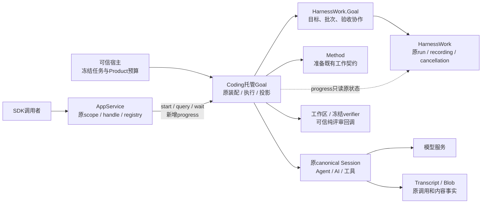
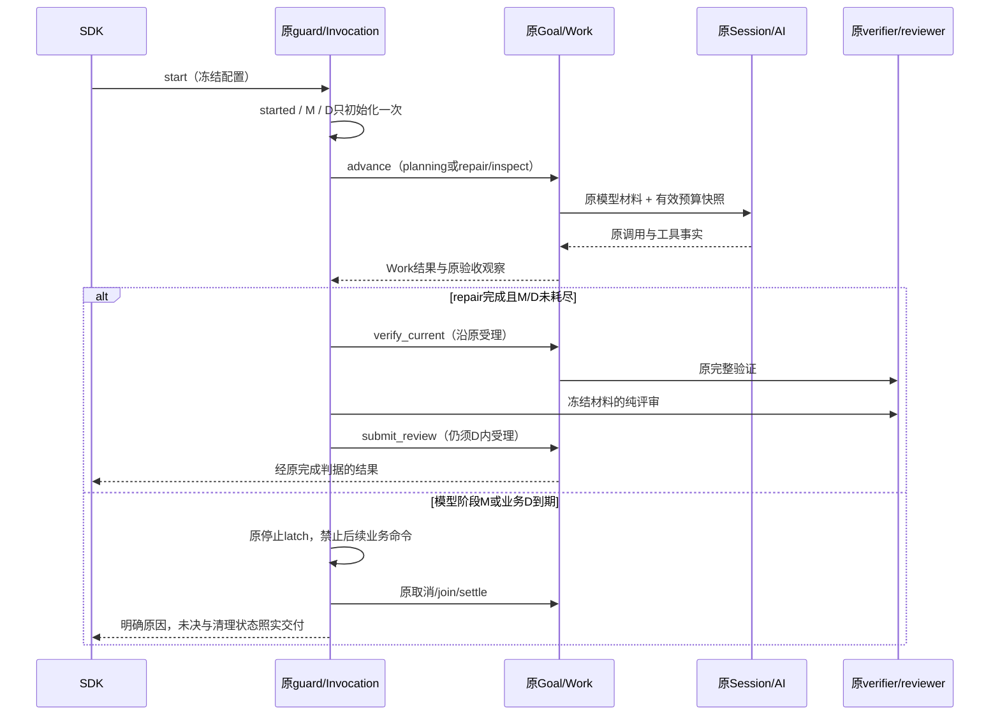

# COD-KD-HG-003：托管 Goal 的有效预算与进度观察

## 状态与范围

- Authority: normative — accepted R1 amendment；Design status: accepted；Implementation status: implemented — offline verified and independently reviewed; integration follows actual Git/PR state。
- Revision: R1，2026-11-02；Owner: Coding Product；协同责任：AppService/AppServer、HarnessWork、Harness Session/Agent/AI。
- 基线：`497e386a3bbb8fd40810dd7d1be0db9f21e616eb`。方法：本地干净archmethod master `0f9bd3ff51afabeaaf76cc38dff1ceb279b7d37e`。
- 关联决定：[ARD-020](../../decisions/accepted/ARD-020-hosted-goal-budget-and-observation.md)。本稿增量修订[HG-001](hosted-goal-loop.md)、[HG-002 R2.1](hosted-repository-goal.md)的预算与观察合同，其余合同及[Work/Transcript责任](../../decisions/accepted/ARD-019-work-facts-and-transcript-sharing.md)保持有效。
- 用户接受：2026-11-02，呈交R1及三项核心决定后，用户回复“同意，继续”，接受本专项并开始实现；本地实现后，用户再次同意“独立代码评审后收尾交付”。三视角独立代码评审与修订现已完成，见[评审记录](hosted-goal-budget-observation-review.md)。在线试验不在本次授权范围。

本文“候选”标题保留R1提交时的结构；以下合同已获上述接受。Current表仍对应设计基线，新增实现及验证另见[实施记录](hosted-goal-budget-observation-implementation.md)。

## 1. 问题、需求与裁剪

2026-11-02一次真实托管仓库试验：4次模型调用耗时合计约86.9秒，规划到实施之间约15.4秒；完整verifier前检约21.6秒。120秒业务期限不足以覆盖这个组合，最终planning/repair完成，Goal paused/not_satisfied、execution_unresolved=false，没有verification/review。它没有证明在线成功闭环，也没有调用额或配额耗尽证据。

原规划输入的Work预算6/2是正确的，但repair_calls=12/provider_attempts=3未表达托管全程6调用/单次尝试1的更严约束，未表达剩余时间。两个Work产生约20.8 MB记录，约99%为ContentDelta；这是后续事件选择问题，不在本次删改日志。只读测量发现全量Work query约0.6秒，原Transcript读取约0.03秒，当前code lane全仓inventory热读约0.5秒；这是事后局部测量，不是原15秒的完整归因。

原始试验、冻结任务及分析保留在产品树外 `architecture-analysis/hosted-repository-goal-live-824-20261102/`；产品设计只引用去环境化结论，不复制原运行材料。

| ID | 需求与质量场景 | 优先级 / 难度 |
| --- | --- | --- |
| BO-01 | 模型拿到本批有效限额与剩余额度快照，受理继续由原owner强制执行；不能把profile宽限当有效额度 | 高 / 中：跨准备、受理和模型证据 |
| BO-02 | 有限任务可由可信Product选择总时限与收尾预留；超时、取消和迟到结果不能偷偷延长执行 | 高 / 中：合作取消及边界竞争 |
| BO-03 | 频繁看进度不读工作区、不重放Work正文、不触发业务验收；不得声称依据仍current | 高 / 中：旧查询兼容与字段含义 |
| BO-04 | 保留完整query/wait、完成依据、撤权检查、原recording/cancellation权威及原Session收尾 | 高 / 中：组合走查 |
| BO-05 | 旧calculator、本地SDK、旧任务/记录继续按原合同工作；新功能显式协商，无存储迁移 | 高 / 中：增量接口 |

按“能力合同变化”裁剪：更新Coding专项、共同父级ARD和参与方阅读入口；展示环境关系与关键交互。物理部署仍为同进程SDK、Linux/POSIX仓库任务，不设计远程wire、跨进程恢复、多writer或长任务调度。三视角覆盖职责/复用、运行/失败、数据/兼容；没有新增部署机制需要部署图。

## 2. Current：源码事实与约束

| 事实 | 源码与影响 |
| --- | --- |
| calculator配置deadline默认/上限120；repository继承它 | `coding/_hosted_goal_config.py`、`_hosted_repository_config.py`。这是Product样例约束，不是HarnessWork限制 |
| 一份调用额度 | `adapters/_goal_planning_limits.py:PlanningCallAllowance`在await前计入total_calls/calls，失败不返还；hosted覆盖输出上限和provider尝试为1 |
| 两类模型材料 | `_goal_planning_shared.py:_planning`构造规划input；`_goal_repository.py:_implementation`通过原Method提供实施材料。设计基线尚无托管有效预算块 |
| 同一执行owner计时及收尾 | `_hosted_goal_work.py:GoalInvocation`持有deadline/latch；原guard负责settle，超时后不把清理失败当业务成功 |
| 公开query为完整业务观察 | `appservice/goal.py:query/wait` → `coding/hosted_goal.py:query_goal` → `adapters/goal.py:query` → policy.assess；不是廉价进度读取 |
| busy之前也检查仓库 | `_goal_repository.py:assess_now`先_current_inputs/task.snapshot，再检查facts.busy；外层循环及原advance多次评估 |
| Work DTO辅助器会展开历史步骤 | `_hosted_work_observation.py:observe_work_run`调用runtime.query + plan projection；轻量路径不能直接复用这个完整辅助器 |
| 已有常量成本读口 | `WorkRuntime.get_run(run_id)`读取原内存状态/历史投影；get_recording读原确认观察器。get_cancellation对当前owner的run读取原状态，对历史run可能query日志，故不能无条件称为轻量 |
| 原事实可重复查，非追加索引缺失 | event_log已有operation/run/session索引；query递归校验/复制选中的payload。WorkRecordingPolicy只控制持久性要求，不提供流式内容过滤开关 |

## 3. 候选系统环境与职责

图中Coding内部仍是原setup、GoalInvocation、PlanningCallAllowance和hosted facade的职责分工，不新增预算服务、controller、线程、队列、日志或进度缓存。AppHost仍拥有canonical Session与应用寿命；AppService做权限与交付，不能替Product估算时间或验收代码。

| 参与方 | 本次候选责任 | 不承担 |
| --- | --- | --- |
| 可信宿主 / Coding配置 | 选择有限总时限T、收尾预留R和原C/O限额；配置冻结一次 | 客户端或模型临时加额 |
| 原GoalInvocation | 从单调时钟导出业务D、模型阶段M；同一latch和原settle路径处理截止 | 第二scheduler、墙钟恢复 |
| 原PlanningCallAllowance | 原计数、每调用强制限额；提供只读额度快照 | token原始账本、完成判定 |
| 原RepositoryProfile/Policy | 组合模型材料中的有效预算；保留prepare/confirm/assess权威检查 | 修改Method或用户要求 |
| 原Coding hosted facade | 完整query保持；新增progress投影原Goal/Work/recording事实 | 缓存验收结果并冒称实时current |
| AppService/AppServer | 可选进度能力、同process DTO语义；复用既有撤权/身份检查 | 工作区访问、provider或领域策略 |

## 4. 有效预算合同（候选）

### 4.1 配置与权威

仅repository允许可信宿主显式选择更长的`deadline_seconds=T`；仍要求有限正数、拒绝bool/NaN/Infinity，不在core换成另一个普适数字。缺省仍120，calculator仍保留其120上限；原Work≤6、planning≤2、总调用C≤8、单次输出O≤1024不扩大。具体真实任务的T须由宿主按模型耗时、验证时间及余量冻结；本稿不批准任何在线任务或时间数值。

repository新增候选配置`closeout_reserve_seconds=R`，缺省0保留旧行为；要求有限实数且`0 ≤ R < T`。有R的任务将模型阶段截止定义为`M = started + T - R`，业务总截止为`D = started + T`。两者由原Invocation在run开始时一次导出，包含Goal初始化；状态查询、重试清理不延长时钟。

R是“最多允许模型阶段占用到何时”的分配，不保证后续一定成功，不是另一个任务/Work槽位。R=0保持同一总截止。新真实仓库试验若需要收尾预留，应显式选R并记录verifier/reviewer估算；不能把0当已作可行性论证。

配置选中后的静态值作为version=1的`hosted_execution_limits`附加到该新Goal原metadata，并在创建时冻结，至少包含T/R/C/O/provider_attempts=1及现有profile标识。原`planning_limits`仍表达原任务的profile合同，不混入时变值。Policy受理核对配置与自身冻结元数据一致；模型不能写此字段。没有新的持久账本；旧Goal无此字段按原profile解释，不补写。

单调时钟的绝对值不落盘，不承诺重开进程后继续使用剩余时间。金额与输入token硬上限不在本切片；原Transcript继续提供实际用量。

### 4.2 传给模型的快照

原规划JSON的`limits`改为**本次有效模型上限投影**，不修改Policy内部profile限额或旧Goal.metadata.planning_limits：provider_attempts=1，repair_calls=min(profile.repair_calls,C)，planning_calls=min(profile.planning_calls,C)，Work阶段限额取原任务与宿主更严值。额外`hosted_budget` version=1说明总调用C、已用total_calls、剩余额度、O、总时限T、R及捕获时的模型阶段/业务剩余秒数。

原`remaining`继续含Work名额，增加当前快照的`model_calls_remaining_including_next_call=max(0,C-total_calls)`。在planning与repair准备材料时分别取原额度/Invocation快照，通过原input Blob/Transcript进入原来源证明；repair通过既有Method请求材料传递，Method仍决定所选工作的契约。

Work剩余名额取原Goal剩余与宿主命令剩余的更小值：`min(goal.limit - 已有批次, max(0, max_advances - advances_including_current_command + 1))`。原Invocation在准备前已计入当前命令，故此处加1表示包含正在准备的planning Work；不凭批次数推定已消费命令数。各阶段名额还须同时满足这个总剩余约束，静态候选路线不是执行授权。

快照声明“在本批准备时采样、含下一次调用”；时间向下取整、不得负数，批内工具往返后模型所持数字可能过时。**本切片不承诺每次工具往返重写提示或每token更新余额。** 实际每次调用仍由原Allowance在首次await前核对并计数，模型材料不会取得授权作用。不得为了更新预算替换prepared committer、篡改已提交Model Input或重写来源证明。

若准备与受理之间时间/额度减少，执行owner按实际值拒绝或停止；不会因模型快照显示尚有额度而豁免。有效O是上限，模型能力/已有CallOptions可进一步收紧，provider实际账单仍以原记录为准。此快照适用于当前单Goal单Session有界profile，不覆盖子Session聚合。

### 4.3 推进、截止与竞争

原guard的business run负责等待当前阶段的截止；沿原超时取消和settle路线工作，不能在外层timeout返回后遗留未接管的Work。planning、inspect、repair均受M约束，verification/review受D约束。原Invocation在命令边界检查；模型阶段耗尽用稳定码`goal_model_stage_deadline_exceeded`，总时限用原`goal_deadline_exceeded`。

原Allowance的stream入口在计数、调用provider之前同步询问同一Invocation的截止检查；该检查不另持时钟、任务或额度。这样即使同步工作推迟事件循环处理timeout，也不能在已观察到M到期后开始下一次provider调用。已在进行的调用仍由原取消/收尾机制处理，不宣称provider远端副作用可被硬抢占。Current尚无此截止检查，这是本稿要求的增量。

同一检查点先保留已经锁定的停止原因；尚未锁定时先检查D，再在模型阶段检查M。因此R=0且两者同时到期仍使用原总时限码。阶段切换与停止检查在同一owner的无await段完成，不允许另一执行对象补发后续命令。

若M到期时repair已完成但其命令尚未返回/通过边界检查，本轮停止并保留completed Work，不追授验证权限。若模型阶段正常返回并在M之前通过边界检查，才转入收尾阶段，后续使用D。边界判断只在同一owner内进行，不把模型文字或流结束当作阶段完成。

同步文件检查不可抢占、协作取消及settlement可超出业务期限，HG-002的物理限制继续成立。已进入原命令的内部受理边界也不升级为硬实时保证；观察到截止后不再发起下一条业务命令。取消、错误、录制未知、清理失败仍用原保留/重试合同；retry_settlement不消耗新模型调用、不重建D/M、不启动验证。时间预留不允许删验收或自动通过。

## 5. 轻量进度合同（候选）

新增可选同进程`ScopedGoalClientV1.progress(control, handle)`与对应Product port能力。`GoalCapabilityV1`尾部增加缺省false的`supports_progress`；旧port不声明则返回既有unsupported，**禁止悄悄退回完整query**。原query、wait、retry_settlement的返回及完整验收语义不变，旧调用者不需修改。

Product的progress方法定义为单独的可选扩展协议，不给原HostedGoalPortV1增加必需成员；capability为true且同一port实现扩展时才调用。声明true却缺少扩展属于配置错误，在绑定解析时拒绝，不能在查询时换选另一owner。

progress复用`GoalQueryV1/GoalObservationV1`，不是第二个Goal记录模型：

| 字段 | progress含义 |
| --- | --- |
| execution | 原registry在交付点读取的状态；其终态仍由原guard发布 |
| goal_id/status/revision/epoch/sequence | 当前owner的原Goal记录投影；completed表示已有完成记录，不表示外部工作区刚被验证 |
| validity | 成功读取时固定`not_checked`，即未复核业务完成依据；缺失/录制不明用unknown。progress永不返回current |
| batches / work | 原batch identity与其已记录run_receipt；只投影run id/session/status/current_step，`steps=()`明确表示此接口不展开历史步骤，不表示原Work没有步骤；完整步骤仍由query提供 |
| recording / cancellation | 原Work确认观察器与本owner run状态；携带原basis/observed_sequence，不伪造持久事实 |
| execution_unresolved | 已受理run缺失、原取消未知或core fenced等照实true；false表示当前未观察到执行结果不明，不能据此断言已停止、已完成或验收通过；运行是否结束另读execution/work.status |
| advances/model_calls | 原Invocation/Allowance的计数，无派生写入账本 |
| reason_code | 原停止/初始化码优先；推进中使用中性advancing并结合Work current_step，避免repair却显示planning |

只支持本应用本owner受理的run；使用batch.run_receipt与原`get_run`，未关联或矛盾时标明尚不可观察/unknown，不调用带历史回退的operation查找来凑完整。get_cancellation仅在确定是本owner的run时使用；不为历史run触发日志投影。边界数量取已冻结任务限额，超出不截断成“完整进度”，而报告不可用。

该投影复用原recording/cancellation DTO和内容白名单，但**不走observe_work_run的完整步骤展开分支**：该分支会重放步骤日志。实现以原Coding投影函数的progress模式分离轻量读取与完整步骤展开；原默认模式不变，不增加组件、run映射或状态cache。progress先要求原get_recording返回acknowledged且run一致，再读取取消；loaded或无法确认时不触发历史取消投影。

权限仍沿原_target/_resolve；Product投影在一次不含await的读取段完成，不包含Git、工作区stat/hash、Blob、Transcript读、event_log.query、plan projection或policy.assess。AppService在await前后照原规则核验scope/controller/owner，重新取registry状态再交付；调用方随后任何动作仍重新授权。数据带原各自水位，不能宣称跨领域全局事务快照或交付后永不变化。

复杂度目标为O(B)，B为本Goal批次数；repository B≤6，calculator B≤8，不随token流量或20 MB历史正文增长。验收用“不调用上述重放/业务路径”的可观测断言，不用未经机器基线校准的固定毫秒门槛。未来若需要跨进程进度或完整步骤缓存须另评；本切片不扩大到远程wire。

## 6. 架构协同、兼容与不做的改变

| 对象 | 保持有效 | 本稿提出的增量 |
| --- | --- | --- |
| HG-001 calculator | 原120/8/1024配置及默认入口；query/wait完整语义 | 可选progress协商，不要求旧port支持 |
| HG-002 repository | 同canonical Session、6/2、内容白名单、原验证与纯reviewer、原停止清理 | 可信宿主显式T/R；预算快照；独立progress |
| AppService/AppServer | scope、handle、registry、原旧DTO字段与同进程边界 | capability尾部可选能力，新增方法复用旧值类型 |
| HarnessWork.Goal / Work | 目标状态、operation→run、确认水位、取消、验收合同 | 无新调度/日志/缓存/公有执行合同；轻量消费者使用现有读口 |
| Session/Transcript/AI | 原工具循环、prepared输入来源、实际用量 | 既有材料增加Product快照，原stream仍执行强约束 |
| 旧持久记录 | 原schema和读法，不迁移、不补写、不要求清状态 | 新hosted元数据只作新运行配置证据；旧reader不承诺理解或执行新预算 |

新增预算元数据的版本未知时，新写/执行入口拒绝而非忽略；历史只读可保留原事实，不借此宣称新预算已经落实。当前hosted仍不支持跨进程执行恢复，故不设计旧进程以新deadline续跑。回滚代码后保留新原始记录，不删除Session或Blob；再次执行应走已支持的新运行入口，不能重放旧外部动作。

本轮**保留全部ContentDelta与持久事实、原完整query/业务重复复核**。先把进度轮询从重路径移走；不会声称这已消除规划→实施的15秒间隔。记录粒度、历史复制优化留待实际消费者与不可变边界另行决策；共享primitive的正确性保护不可为“快”而删除。

## 7. 验证计划与评审事项

| ID | 离线验证与关闭条件 | 追溯 |
| --- | --- | --- |
| BV-01 | 严格T/R/C/O边界；calculator仍拒绝>120，repository显式允许有限T；R=0旧行为、R≥T与非有限值拒绝 | BO-02/05 |
| BV-02 | 规划与实施捕获同一owner有效预算；profile 12/3在hosted投影成更严值；快照后预算下降仍由原受理拒绝；失败/取消不返还 | BO-01 |
| BV-03 | M前完成转收尾；M前已受理但M后返回停止；D到期迟到评审不进入新Work；清理重试不重置计数或时钟 | BO-02/04 |
| BV-04 | progress不调用inventory、policy.assess、event_log.query、Blob/Transcript或步骤projector；小/大历史相同run数走同一路径 | BO-03 |
| BV-05 | 工作区在完成记录后被修改：progress仍not_checked，完整query撤销current；旧wait仍完整query；记录未知不伪绿 | BO-03/04 |
| BV-06 | 撤权、旧handle、关闭竞争拒绝交付；旧port supports_progress=false时unsupported；run尚未关联不触发历史回退 | BO-04/05 |
| BV-07 | 旧calculator、本地repository、Method、Transcript来源及DTO材料边界保持；不将metadata增量误算成旧记录迁移 | BO-05 |

这些是计划，不是已通过测试；仅使用既有离线路由，若新增/扩大PR门禁另按工作区审批规则处理。本轮只运行文档检查。性能报告保留相同样本/设备信息、调用次数和局限，不把一次基准变成平台保证。

用户已接受的关键选择：A）repository的显式T/R与旧缺省兼容；B）预算作为本批快照而非每工具轮次动态重写；C）新增progress且永不返回current，原query/wait不降级。接受不等于独立三视角评审通过；具体技术核对及实现证据分开记录。
