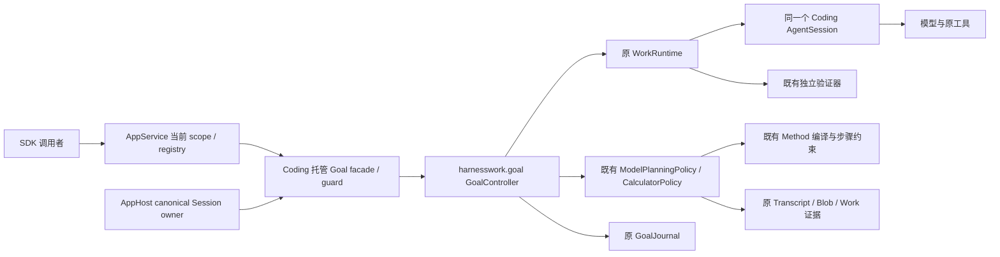

# COD-KD-HG-001：托管 Goal 最小业务闭环

- Authority: proposed；Design status: draft — R2；Implementation status: not-started。
- Owner: Coding；协同 AppService/AppHost/HarnessWork。#824 第二切片。
- 方法：本地 archmethod master `0f9bd3ff51afabeaaf76cc38dff1ceb279b7d37e`，干净；采用 key-design/review 方法。
- 本轮授权：用户要求完成交付收尾、专项设计及三视角评审、实现纵向闭环。以下为待技术评审设计，不伪称用户已逐条评审。

## 1. 问题、事实与范围

HG-01：通过同一应用内托管 SDK 启动一个目标，模型逐批提出行动，Method约束修复，原Work执行，独立验证决定完成。
HG-02：不新建Session、执行队列、Goal状态机、Work引擎或证据账本；复用第一切片托管装配/registry/guard。
HG-03：提交、查询、中断与关闭必须受当前scope/Session授权；断开客户端不能丢失owner。
HG-04：固定小任务和预算；模型输出不能扩大任务、工具或完成判据。业务失败与清理失败分开。

Current：第一切片固定Method SDK已有原canonical Session、registry去重、guard清理与内存Work观察。`harnesswork.goal.GoalController`直接调用原WorkRuntime的accept/wait/cancel与事实查询；它没有远程Work端口。`coding.adapters.CodingGoal`已有calculator模型规划、原Method编译、验证命令、GoalJournal/Work/Blob记录，但open自行创建SDK Session。`PlanningCallAllowance`已有每Work调用限制和阶段隔离，尚无本次托管总调用限额。

首轮固定使用已接受calculator任务包；不是任意仓库Goal，也不重复证明动态重规划。仅应用内SDK、一个fresh canonical Session、一个Goal、一次有界自动推进。工作区与data_root、canonical Transcript各scope目录、application root必须解析后互不包含；配置准入拒绝重叠，不把记录落在calculator冻结文件集合内。

无进程恢复、远程wire、追加目标、resume/改要求/子Session切换。既有本地CodingGoal与普通prompt/Method入口语义不变。

## 2. 系统环境与责任

物理位置：均在同一进程；模型为外部服务或测试合成transport；Session/Goal/Work/Blob在该应用的显式私有目录。客户端只读白名单投影，不能指定日志路径或模块。AppHost仍是Session物理owner。

| 组件 | 本次职责 | 禁止承担 |
| --- | --- | --- |
| AppService Goal SDK bridge | 借用原scope/registry做去重、权限、wait/interrupt/retry；提供typed Goal观察 | 规划、验收、直接读文件、第二执行队列 |
| Coding hosted Goal facade | 冻结服务器选定任务；装配原CodingGoal到canonical Session；guard持有一次推进任务 | 第二Session、把Goal完成等同Work完成 |
| CodingGoal borrowed-session装配 | 复用原policy/verification/journal；仅借用外部Session，关闭自己的Work与记录 | dispose AppHost Session或创建另一个SDK |
| GoalController / WorkRuntime | 原目标状态与关联/执行、取消事实 | 托管鉴权与Sessionowner |
| AppHost / real binding | 唯一Session创建、lease、资源收尾 | Goal决策 |

取舍：不把每个Goal批次重新提交为外层Method SDK Work（会产生两套Work身份）；复用第一切片的托管执行入口及装配，内部仍由原GoalController直接驱动唯一WorkRuntime。也不把AppService改成Goal scheduler。原CodingGoal仅增加内部borrowed-session装配接缝，默认open仍自建/自持有。

## 3. 受理、推进、查询

1. 服务端显式创建Goal application，选固定calculator profile、工作区及私有data_root。canonical Session只允许fresh创建一次，禁止第二profile抢执行owner。
2. 构造时给Session注入原PlanningCallAllowance及PlanningToolPolicy，后者与原策略最严格合并；仅read/edit/write可激活，原验证命令仅在独立验证阶段获准。关闭自动retry/compaction。不在构造后偷偷替换Agent的私有stream/policy。
3. facade同步构造时先持有inert CodingGoal实例，不在resolver内异步open Goal。唯一guard.run进入后，才在同一实例上初始化borrowed Session、原GoalJournal/WorkRuntime/policy/controller和calculator目标。初始化失败的实例仍由facade/guard持有，settle关闭已获取的Goal依赖；清理失败留在原registry债务链，不把GoalConstructionError简化成丢失owner的错误。borrowed Goal绝不dispose外部Session；只有Goal依赖close成功后才能委托原base关闭Sessionlease。未初始化/初始化中/失败初始化分别观察not_started/initializing/unavailable，不捏造Goal。
4. `scope.goal_client.start` 只有稳定submission id，无任意prompt/方法/路径。原registry/guard受理一次execution；一execution包含最多8次原advance，**每次advance最多一Work**。原operation/run身份不改写为execution id；execution是整体推进请求，Goal记录持有原operation关联。
5. guard持有推进任务。每轮读取原Goal状态和revision/epoch，以execution id+轮次形成原Goal command id；调用原advance，直到completed/paused/失败/预算停止。完成必须原Goal验收通过且无unresolved，不能以模型自报、Work completed或guard成功替代。
6. `query` 返回typed Goal状态、是否执行未收敛、原Work概要（原run/operation、步骤、recording/cancellation分离）及当前execution；无原始metadata、prompt、证据字节或服务器路径。Goal查询不新增模型调用、不运行验证命令；只消费原证据检查。跨await重验scope；handle含service instance和owner随机观察锚，锚不授权。
查询白名单：Goal id/status/revision/epoch/history sequence、validity、execution_unresolved；固定profile与预算数值；关联batch/operation/run及Work步骤、recording/cancellation水位。reason只用稳定码，禁止原GoalState.reason/metadata/acceptance、CodingGoalView.reason及planning_trace直接穿透。当前Work/Goal证据unknown和原execution cleanup未收敛分别观察，不能相互推导。

7. `wait`只等待原registry，再重新鉴权query；客户端scope detach不取消应用持有任务。新scope可按原submission查找并查询；memberclose旧权限失效。close_session=False保留原Goal/Work直至真正owner关闭。

## 4. 中断、关闭与失败

- 只允许whole-execution中断。latch/checkpoint禁止下一次advance；取消推进任务时沿原controller/Work.wait取消当前Work。无Work正在执行的模型规划也属于原Work，不另建裸Agent loop。
- settle完整join原推进任务、controller settle_work和原Session.settle_execution。清理失败保留原invocation/Session/Goal/Work依赖，registry保持busy；retry只清理，绝不重新推进。
- 中断在候选结果形成后到达，沿既有guard规则不推翻已确定结果。业务Goal未完成可返回failed/interrupted，原controller仍mutable时才用原control暂停；若记录错误已fenced，保留原状态和未知/不可用观察，不能写伪paused。pause写入失败与物理清理分开，不能因写不出pause就遗漏Session收尾。
- 最终关闭：guard收敛→借用CodingGoal关闭controller/work/reader/journal→AppHost真实Session/lease关闭→断开记录图。任何步骤失败保留下一次close凭据。borrowed Goal不自行dispose Session。
- 日志/记录确认不可用：保留查询/清理，停止后续推进；不重提原operation。Goal和Work持久记录虽存在，本切片不允许重开推进；冷读不等于恢复承诺。
- 旧prompt、steer/follow-up和单turninterrupt在AppService入口及Product拒绝；不向模型注入控制文本。默认普通配置/Method配置不受影响。

## 5. 固定试验与预算

复用 `examples/coding/goal_calculator` 原要求/测试/Method/验证driver。初始失败→模型提出check/repair/verify行动→Method修复→独立验证完成。不得修改测试、Method或目标判据；只改calculator.py，原policy验证文件集合。

托管额外限制：最多8次advance，8次逻辑模型调用；每次输出最多1024 tokens，provider单次尝试；推进业务期限120秒（从guard.run开始用单调时钟计时，包含初始化；到期设置停机latch并取消原推进task，然后脱离业务deadline完整join/settle，不能声称120秒内物理释放）。总8次调用在同一个原PlanningCallAllowance中作为可选owner总限额叠加；在首次await前消耗，planning+repair共计，失败或取消不返还，cleanup retry不重置。默认不启用额外限制；原Goal.limit=20、metadata.planning_limits和全局LIMITS不变。provider单次尝试与output上限在原stream准入前构造CallOptions，保留prepared committer/cancellation等原字段。达到上限暂停/失败并保持事实，不能自动增加预算。原profile更严的限制仍生效。这不是输入token或金额硬限。

先跑确定性合成transport，实际AppHost/Session/Work/验证器全部真实，不使用付费模型；因此只证明托管集成，不重复宣称模型自主能力已新增验证。真实Kimi额外试验不在本次必须重跑范围。

## 6. 验证与演进

| 场景 | 可观察断言 |
| --- | --- |
| H1闭环 | 原Goal completed且validity current；有失败检查、模型计划、Method修复和成功独立验证；全部Work只有同一canonical Session |
| H2去重 | 同submission重复返回原execution，不重复advance；其它submission在单Goal入口拒绝 |
| H3权限寿命 | 失效scope/错误owner拒绝；detach后重连查询原任务；第二profile拒绝不损伤原owner |
| H4预算/拒绝 | 无效计划、调用/advance耗尽、期限停止，不伪成功、不放宽工具 |
| H5中断/清理 | 当前Work取消后无下一批；cleanup失败保留依赖，retry不增加模型调用；真正close释放图 |
| H6兼容 | 原CodingGoal自有Session路径、Method切片与普通hosted执行聚焦回归 |

三视角：职责与复用；运行与失败；数据/权限/兼容。评审只依据本文和源码，不用合理猜测填合同。技术阻断关闭后提交用户评审。会话既有要求“系统环境图等重要工作件需要我评审”，#824也保留这一条件；本次完成1/2/3授权不伪造对尚未展示新方案的逐条接受。用户接受本方案后实施第3项；此前继续独立完成第1项交付。
