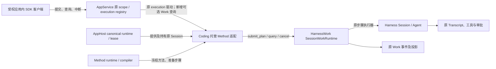
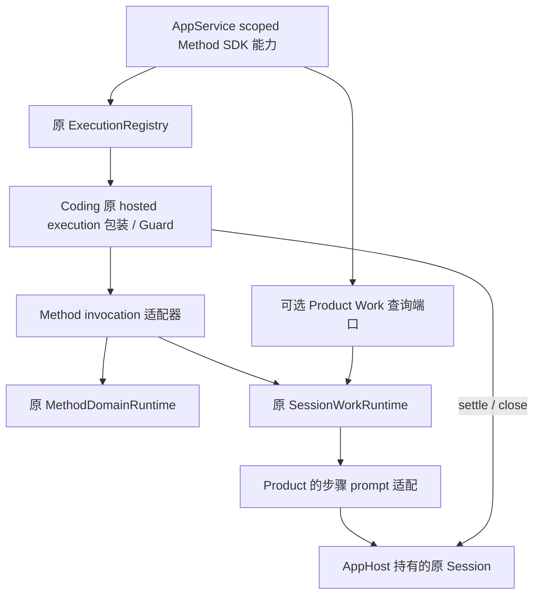
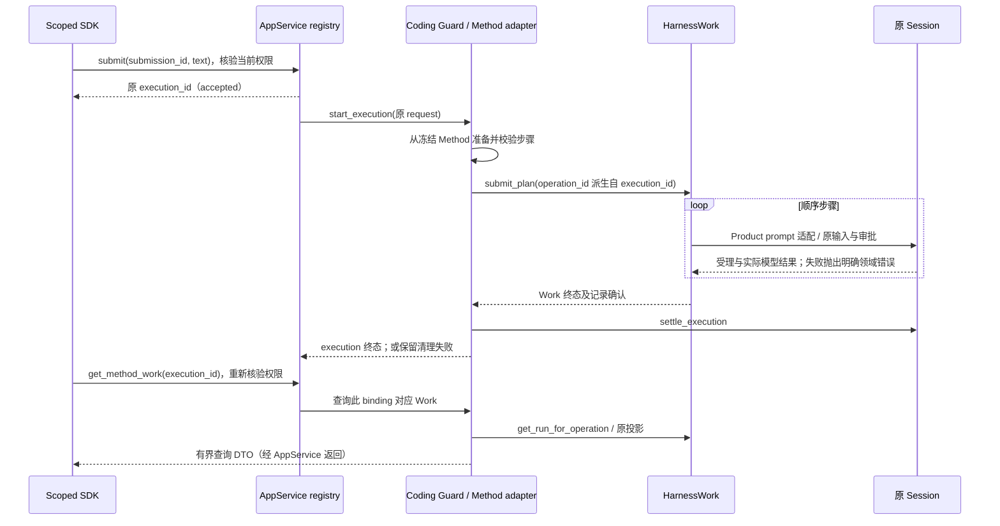

# 托管 Method → Work 执行与查询

## 1. 状态与范围

- ID: COD-KD-HMW-001；Revision: R2。
- Authority: normative — accepted first slice；Design status: accepted；Implementation status: implemented — local SDK slice，验证范围及未完成检查见交付记录。
- 议题：[GitHub #824](https://github.com/zhnt/loushang/issues/824) 的第一切片。
- 设计负责人：Coding Product；协同责任：AppService 执行/受权查询、AppHost 生命周期、Method 与 HarnessWork 的既有合同。
- 源码基线：`914cf3ac84935c8bbd2855e660505b3b31eba2ef`。
- 方法：本地 archmethod master `0f9bd3ff51afabeaaf76cc38dff1ceb279b7d37e`；按 key-designs / architecture-review 开展。
- 用户于 2026-11-01 在 R2 三视角评审汇报后回复“同意，继续推进”，接受本切片的环境图、组件及范围并授权实施；接受不扩展到远程协议、Goal托管或恢复。

目标：一个受权应用内 SDK 客户端，向 AppHost 已持有的 Coding Session 提交一个显式配置的 Method，执行其顺序步骤，并通过 AppService 查询对应 Work 的实际状态。复用现有 execution 受理与清理、Method 编译、Session 输入和 HarnessWork 事实权威。

本轮选一个 **opt-in 的固定 Method 托管配置**：服务端在应用装配时选择、冻结一个 Method；客户端提交任务文本。这个配置的 execution 明确表示执行该 Method，不是普通 prompt 的隐式改写。普通托管配置保持原行为。暂不设计动态选 Method、Goal 调度、子 Session、CLI/stdio/网络协议、进程重启续跑或远程证据下载。

## 2. Current 与缺口

下表保留设计基线的源码事实和当时缺口，不是本轮实施后的 Current 清单。路径相对仓库根目录。实施后的行为及证据见[交付记录](../../../plans/2026-11-01-hosted-method-work.md)。

| 证据 | Current | 本轮缺口 |
| --- | --- | --- |
| E1 `coding/hosted_application.py`（均在 `src/loushang/` 下） | resolver 经 AppHost 取得 canonical Product/Session 和 lease，执行包装借用既有 binding | 不能调用 `CodingGoal.open()` 另建 Session 来接入托管 |
| E2 `coding/hosted_execution.py`、`coding/_hosted_execution_work.py` | ExecutionGuard 驱动一次 Coding prompt；后者虽名含 Work，却不是 HarnessWork；工厂只收到 text | 工厂需得到原 execution 身份，选择 Method 执行适配；保留原 prompt 分支 |
| E3 `appservice/execution_service.py`、`execution_registry.py` | scope 每次核验 attachment/generation/member、实例身份；registry 管理 submission 去重、执行身份、忙状态和历史；去重摘要只覆盖 text | 新查询须复用相同受权入口；不另建请求账本 |
| E4 `method/runtime.py`、`compiler.py` | 显式 Method 选择、编译及逐步 prompt 准备；静态 `plan:{descriptor.id}`；约束/audit 字段不代表执行保证 | 冻结服务端所选描述符与支持范围；不把 plan_id 当运行唯一身份 |
| E5 `coding/adapters/harnesswork.py`、`harnesswork/integrations/session.py` | 可以将既有 Session 装配成 SessionWorkRuntime；`submit_plan` 顺序执行；WorkRuntime 负责 operation→run | 需要托管生命周期内的装配与原 execution 关联；不建另一执行器 |
| E6 `harnesswork/runtime.py:261-270`、`recording.py` | Work `wait` shield 内层执行，但捕获自身 CancelledError 后已调用 `cancel`；有取消观察、recording 确认及 run/plan 查询 | 复用已有取消桥；仅取消另一个 shield 外的观察者不会自动取消其保留的 submit task；活动状态不等于记录确认 |
| E7 `coding/_hosted_execution_work.py`、`appservice/execution_guard.py` | 原 prompt helper 检查输入受理/模型结果；guard 保留 settle 失败的清理工作 | Method 步骤不能仅按 prompt 正常返回认定成功；保留完整 Session settlement |
| E8 `appserver/ports.py` | `AppServerProductPortsV1.work` 是泛型装配槽，不是现成 Work 查询协议 | 新增可选、窄的查询合同，而非宣称已有此能力 |
| E9 `appservice/client_scope.py:221-228`、`runtime.py:1157-1167` | 现有 execution_client 仅依据 registry 存在性开放；close_member 可关闭 registry binding 而保留 Session | Method 专用能力路由及旁路拒绝是新增集成工作；不能误称现成支持，也不能把三种寿命混用 |

## 3. 需求与边界

| ID | 本轮可验收的结果 |
| --- | --- |
| MW-01 | 只有显式选择 Method 配置的应用启用；默认 prompt 托管不变 |
| MW-02 | 原 AppHost Session、原 execution registry、一个 SessionWorkRuntime 执行全部步骤 |
| MW-03 | 同 submission + 同 text 重取原 execution；不同 text 冲突；不重复执行 |
| MW-04 | 能受权查询 execution→operation→run、Method/步骤及记录确认，不暴露服务器路径或原始事件 payload |
| MW-05 | 步骤真实失败阻止后续步骤；Work 完成不等于 Goal 完成 |
| MW-06 | whole-execution 中断停止后续步骤并收尾；清理失败可重试且不重跑业务 |
| MW-07 | 关闭前保留清理凭据及 Session 依赖；已观察、明确未提交、无法确认须区分；关闭后原权限失效，不承诺历史 Work 查询 |
| MW-08 | 不扩 CLI/网络协议，不建立第二个队列、账本、Method 编译器或跨进程调度器 |

## 4. 系统环境图（已接受的第一切片 Target）

此图以“Coding 托管 Method 适配”为设计对象；外围均为已有系统，标注新增接缝。

AppService 不依赖 Coding/Method/HarnessWork 实现；通过 contract-only DTO 和 Product port 访问。AppHost 不理解 Method 步骤，也不执行 Work。现有审批、工具权限、模型配置仍由 Product/Session 执行。

## 5. 子组件、装配与依赖

这是职责分解，不要求每个方框成为独立服务或公共类。

| 责任 | 所在边界与复用方式 |
| --- | --- |
| 固定 Method 配置 | Coding 装配根选择可信描述符，冻结内容、版本、metadata/frontmatter 等全部执行输入及摘要；仅 frozen dataclass 不足以冻结内部 Mapping；同一 canonical Session/服务实例不热换方法 |
| SDK 能力与受权查询 | AppService 的可选 scoped 能力复用原 `_resolve` 所表达的检查；内部抽取共用检查，不从 Product 绕过 scope |
| 请求与 execution | 原 registry/guard；不新增 admission 队列或 execution 历史 |
| Method invocation 适配 | Coding 内部模块，满足原 `ExecutionWorkV1.run/settle`；获得原 request.execution_id；借用本 binding 的唯一 SessionWorkRuntime |
| Method 编译与步骤投影 | 原 MethodDomainRuntime，注入冻结的 descriptor；不复制 compiler；准备后用原 SessionWorkTurn 投影 |
| 步骤执行 | 原 SessionTurnExecutor；Product prompt 适配在原 Session 上调用既有输入机制，并复用 Coding 的受理/Agent 结果判定 |
| Work 事实 | 原 WorkRuntime、event log 与 run/plan/recording/cancellation projection |
| 生命周期 | 此服务唯一的 hosted execution owner 持有 Work runtime；关停先停止新受理、完成执行清理、dispose Work runtime，再关闭原 binding/释放 lease；引用释放见下文 |

第一切片仅支持一个 fresh canonical Session 的显式配置；不改变现有 resume 行为或要求用户清理历史。配置关闭后重建不视为同一 Work 历史的恢复。Method 描述符不可由客户端传本地路径选择。

此处 live-binding 精确定义为此应用服务持有的唯一 hosted execution owner，不是客户端 SDK attachment，也不是每次查询的 lease。多个 SDK scope 复用原 member/owner，不创建 Work runtime。AppHost 本身支持多 attachment；本专用配置在 Product 装配边界拒绝同 canonical Session 的第二个执行 wrapper/profile，且不向另一服务导出原 Session 控制。这个新增独占检查不是 AppHost 现成保证。若要开放多 profile/跨服务共享执行，须将执行 owner 提升为 canonical Product 持有并另评；本轮不默许多个 guard 各自管理同一 Session。

SDK scope 关闭只撤销观察，不能据此清空 Work。close_member(close_session=False) 可退休原 registry binding，但不释放 Session/Method owner 或其事实；原 member 权限随之失效。事实保留至真正 hosted owner 关闭；本轮不支持借重新装配 member 读回这些历史事实。

配置能力描述向 SDK 明示 method_id、内容摘要、支持的步骤类型及 live-binding 保留范围。新增可选 typed Method SDK 能力，内部委托原 scoped execution 实现；这个专用配置不对外开放普通 execution_client 和 legacy `start_turn`、steer/follow-up、原始 Session 控制。需要在 AppService 能力装配与 Product 实际入口两处实现明确的 unsupported 路由，不能只靠文档劝调用者不用。普通配置仍返回原 execution_client，不返回 Method 能力。原 execution port 作为服务内部委托端口，仍用原 registry/guard；不复制这些实现。客户端关闭 scope 只释放观察权，不自动取消后台执行。

特别是 scoped/unscoped 的 AppService.start_turn 当前可能直接调用 registry.start_legacy，绕过 Product.start_turn；因此 AppService 必须在受理前应用此配置的通用输入能力策略，拒绝 legacy submit/steer/follow-up/单 turn interrupt，且 unsupported 不得 fallback 到 Session.prompt。AppService 理解的是输入能力，不执行 Method 策略。V4 覆盖这两类真实入口，断言 registry、Work 和 Session 均无副作用。

这里复用原 `ExecutionRequestV1(execution_id, text)` 和 text 去重合同：方法是不可变配置，不是隐含的可变请求参数。若未来支持每次请求选方法，必须另评带类型的请求与完整去重摘要，不能沿用 text-only 去重假装足够。

## 6. 执行、查询与身份合同

### 身份及受理

- 一个 execution 对应零或一个 Work run；准备失败时为零。每个 run 包含冻结 Method 的多个步骤。
- operation_id 直接取原 execution_id，无需前缀扩长或额外映射表；operation→run 解析权威仍是 HarnessWork。不同运行时的事实必须连同其 owner 查询，不能按裸 operation_id 跨库拼接。
- SDK 提交返回带 `expected_work_binding` 与 execution_id 的观察句柄；binding 值每个 Method owner 新建且不复用，只是观察锚，不能代替权限。查询先经原 scope/registry，再匹配当前 owner；不同则 `binding_changed`，不查询新 owner 冒充旧 owner。若中间 await，返回前再次核验相同 scope/owner。
- DTO 同时带 service_instance_id、当前 Work binding、Session identity、execution_id、operation_id、run_id；method_id/plan_id 只用于解释，步骤键是 `(run_id, step_id)`。原 registry 历史只带 canonical identity，不能作为原 Work binding 的证明；本轮不扩其历史索引。
- registry 的重复请求先返回原 execution。查询原 execution 必须先经过 registry 身份检查，不能用任意 operation_id 查询别人的运行。
- 冻结 Method 必须非空、步骤身份唯一、仅使用此配置声明的执行种类；首轮只接受不含未实现的 constraint/audit/approval-gate 承诺的方法。提示指导可以存在，但不宣称其是强制验收。准备/支持检查失败时 execution failed，明确 Work 未提交。
- Method 运行期间不允许同 Session 存在第二个输入驱动者；这个约束在 Product 装配时成立，不依赖调用者自觉。

### 查询 DTO（contract-only 数据合同）

可选端口返回不可变 DTO；不把 HarnessWork Python 类型泄露给 AppService，也不再建事实索引。DTO 放在 AppServer 合同边界；Product 做有损、安全投影。

| 字段组 | 语义 |
| --- | --- |
| execution | 原 registry 状态与 revision；Work 查询不改它 |
| work_presence | `present`；`not_yet_observed`（当前仍可能受理）；`not_submitted`（原 invocation 保有明确未提交证明）；`unknown`（没有足够事实，含历史负证据已不保留、Product 未进入或记录异常）。原权限失效/owner 改变走受权错误，不伪造 not_retained 数据 |
| work | operation/run/method/plan 身份、run 状态、当前步骤、有限步骤状态；不含 prompt、步骤指导正文、自由格式 metadata 或 title |
| recording | 原 contract 的 version/capture/retention/require_persistence、basis、observed_sequence、source_event_id 及已确认 run 状态；读取 unavailable/格式错误保留为查询错误，不拿活动状态代替确认 |
| cancellation | 原 observation 的 status、reason_code、reported_status、basis、observed_sequence、source_event_id；不输出 exception 或领域任意 reason 文本；未知/未来版本不得降为 settled |
| errors | 稳定错误码；不默认返回 prompt、工具参数、任意事件 payload、服务器路径、未经筛选的异常文本 |
| observation | execution 与 Work 是两个观察面，分别注明来源；本轮不保证跨 owner 原子快照，不凭二者拼出全局 revision |

ID 使用各自合同：execution/submission/service 沿用原校验器；Work binding 为新建随机标识的稳定文本投影，不暴露现有私有 object token；Method/plan/step ID 允许原 Method 的冒号等字符，不能套 execution 的 grammar。此配置准入时限定每个 Method/plan/step ID 不超过 1024 字符、步骤数不超过显式 `max_steps`；不截断 ID。DTO 步骤仅投影指定 run 的身份及状态。未来需要超界方法时先调整公开能力限制，不能静默截断或扩表。

存在性判断不得把“查询没有看到”改写成“肯定没有执行”。registry 在 Product start 前中断、guard 在 invocation 进入前中断、start 失败，都可能产生 terminal execution 且零 Work；不能仅以 terminal+无 run 推 not_submitted。只有仍保有该 invocation、其受理已经封闭且证明未调用 Work 受理时才报 not_submitted；否则报 unknown（原 execution 终态仍可展示）。不为补齐否定历史建立第二份账本。Work 已终态但 execution 仍 running/待清理是合法状态；只有原 guard 完成 settlement 才释放执行槽。Work completed 仅说明本批步骤合同结束，不是 Goal 验收。

第一切片使用既有内存 Work backend 与 recording v1；事实查询需要当前受权 member 和原 Method owner，不承诺进程重启或磁盘耐久。registry 内部历史可能还在，并不表示旧 SDK 权限可继续查询；member 关闭后原查询按现有 stale/not-found 合同拒绝，应用关闭为 service closed。当前查询不能通过一个新 binding 找旧 Work。不从 Transcript 反推出已执行 Work，也不自动重放。

Product 配置显式限定 Method 步骤数和执行提交配额，沿用 registry 原容量机制；步骤列表有界。原始 Work 事件总字节不因此获得硬上限：本轮不承诺无限期常驻/无界工具输出的内存预算，不额外预建事件分页或磁盘索引。具体本地验收为两步 Method、一个 execution；实施时提供有限配置值及容量拒绝测试。

现有 WorkRuntime.dispose 只取消活动 run，既会抑制取消异常，也不清空事件、states 或投影。因此它既不是收尾成功证明，也不是内存释放证明。执行清理确认后，真正关闭 hosted owner 时断开查询/订阅，清除 retained invocation 对 runtime/backend 的强引用，释放 runtime/backend；registry 保留 ExecutionRecord 不得继续持有这批 Work 记录。关闭任何一步失败仍保留必要 owner 与依赖供重试，不提前丢失清理凭据。资源测试覆盖持有已关闭 SDK/服务对象时的引用释放。

## 7. 失败、取消和关闭

| 触发 | 必须发生的行为 |
| --- | --- |
| 无此能力/权限过期/跨 Session 查询 | 在原 scope/registry 入口拒绝；无 Product 副作用，不能以日志路径绕过 |
| 重复提交、并发新提交 | 前者返回原身份；后者遵守原 busy/容量行为；无第二个 Work |
| prompt 未受理、模型失败但函数正常返回 | Product 步骤适配检查真实受理/结果，令该步骤失败并停止后续步骤；复用原 Coding 判定，不能只 await prompt |
| 取消到达 Work accept 前后 | 原 guard 保留 invocation；适配器在一个无 await 的受理段内保留唯一 submit_plan task/operation 身份。它是整份 plan task，不是 accept-only task。取消先锁定 cancellation latch、取消这个原 task，复用其 WorkRuntime.wait→cancel 传播，再 join；禁止先 join 整份 plan 才取消 |
| Work 已受理后的 whole-execution 中断 | 如果取消未抵达 Work.wait，按原 operation 查询已受理 run 并调用原 Work.cancel；已传播则不再启动第二条取消流程。before_turn 与实际 prompt 的 checkpoint 同时观察原 guard/latch，阻止取消后的下一步及输入副作用。join 原 submit/Work 后再完整 Session.settle_execution |
| Work cancellation unsupported/failed | 保留真实 observation；不能仅凭 Work cancelled 声称领域副作用已收尾。Session settlement 不能确认收尾时保留 guard 清理失败；retry_settlement 只继续清理 |
| 查询时写入结果不明 | 返回原记录确认/错误或 presence unknown；不承诺未执行，不自动重提。内存 backend 首轮不新增持久化恢复协议 |
| 执行完成但 settlement 失败 | Work 终态保持，execution 清理未完成且下一请求仍被挡住；重试清理不重新编译或执行 Method |
| scope 断开 | 终止观察，原 registry/owner 继续持有执行；本轮 SDK 语义不能推导 stdio EOF 或 detachable 合同 |
| 应用/Session 关闭 | fence 新输入→中断/收敛原 execution→重试必要 settlement→dispose Work runtime→释放原 Session lease；失败则保留 owner、依赖和清理凭据 |

`SessionTurnExecutor.cancel_and_wait` 的 abort/wait_idle 不替代完整 `Session.settle_execution`。适配器必须在跨步骤取消、accept 中断、清理重试时保留同一个执行及 Session 依赖。legacy 单 turn 中断不作为该配置的 Method 中断入口。

accept 当前实现无悬挂 I/O；本设计仍不把一次 await 的返回当作“未受理”证明。submit task 未进入即被取消时可由原 invocation 确认无提交；若无法证明是否受理，settle 沿原 operation 检查并保留未知状态，不能重提。正常完成的 execution outcome 必须依据最终 Work 状态和记录确认；failed/cancelled/确认不可用不能返回 succeeded。无需将 Work 的业务失败永久保留成清理失败：业务 outcome 与是否仍有未收敛执行分别判断。

实施复核补充：终态 append 失败可能使公开 run.status 看似 completed，但原 runtime 仍持有活动执行；清理以原 `active_runs()` 为准。记录无法确认后，该 Method owner 的 capability 返回 `accepting=False`，AppService 在原 registry 受理前拒绝新 submission；旧 submission 仍沿原 registry 去重、查询和清理，不建立第二份去重记录。该收窄不增加重放或恢复承诺。提交 task 已结束而无 run 时，清理尚未完成也不能继续报告 `not_yet_observed`，缺少未提交证明则为 `unknown`。

继承原 guard 的完成/中断竞争规则：run 尚未形成候选 outcome 时，中断传播给原任务；候选结果已形成、正在 settle 时，中断只记录 interrupt_requested，不重写候选结果、不向清理重复注入取消。因而 Work completed + execution running/settling + interrupt_requested 可以最终 succeeded；失败的 settlement 重试也保留原候选结果。每个 Method 步骤独立采集受理/Agent outcome，不能沿用上一步缓存；模型 aborted 要保留中断语义，不能归为成功。

## 8. 取舍及架构协同

| 选择 | 理由与代价 |
| --- | --- |
| 应用内 AppService SDK 先行 | 确实经过 AppHost/Service 权威；无网络 DTO/CLI 放大；尚不证明远程可用 |
| 一个固定 Method 专用配置 | 原 text 请求与去重可直接复用；代价是暂不能每个请求任意选方法，需要显式能力说明和禁用旁路 |
| 可选查询端口 | 扩展现有 Product port 接缝；不用 raw runtime/磁盘路径；有新增 DTO 投影成本 |
| 一个 SessionWorkRuntime 借用原 Session | 不新建 Session/Agent loop/队列；与原执行 owner 共寿命，必须统一关闭顺序 |
| 原 execution + Work 两层状态 | 请求受理/清理与领域步骤不同；不合并类型，也不创建第三套状态机 |
| 内存 Work 事实 | 先证明一个托管执行闭环；耐久、跨进程与远程证据留到后续专项，不能冒称已交付 |

协同文件：[AppService execution 合同](../../appservice/execution-contract.md)、[AppHost 架构](../../apphost/README.md)、[Goal/Method/Work 架构](../../goal-method-work/README.md)。本方案是用户接受的窄范围增量，不改变既有普通配置、远程入口和恢复合同。

后续 Goal 通过 Product 集成复用这个受权执行/查询接缝；Goal controller 仍在 harnesswork.goal，目标状态、计划调整与验收另有权威。本轮不迁移 controller、不建立 hosted Goal 的自动唤醒承诺。

## 9. 验证设计与实施顺序

| 场景 | 需求 | 验证证据（实施后提供；当前未执行） |
| --- | --- | --- |
| V1 原配置普通 prompt | MW-01/08 | 原 hosted execution conformance 保持行为；无 Method 能力 |
| V2 新配置两步 Method | MW-02/04/05 | 真实 AppHost/Service/Session 装配 + deterministic fake model，受理、运行中、终态查询；两个步骤共享原 Session，单 run |
| V3 duplicate / conflicting text / busy | MW-03 | 同身份只执行一次；冲突/忙无新增 Work；固定方法摘要不变化 |
| V4 受权与旁路 | MW-01/04/08 | stale generation、跨 member/Session、旧实例、scoped/unscoped legacy及unsupported fallback均不触发副作用；拒绝第二执行owner；默认配置不受影响 |
| V5 步骤失败 | MW-05 | 输入未受理、正常返回的模型失败均停止后步；不假通过 |
| V6 cancel 在 registry/guard 进入前、accept/步骤/settle | MW-06/07 | 零 Work 的 interrupted/启动失败有诚实 presence；已提交取消先 cancel 再 join，不启动下一步；cleanup fail→retry，无二次执行；依赖保留 |
| V7 attachment/member/owner 关闭 | MW-04/07 | SDK detach 不清 Work；member 关闭旧权限失效；owner 替换观察锚不匹配；close_session=False 不误清 Session 事实；真正 owner 关闭释放记录 |
| V8 两层观察与记录确认 | MW-04/05 | Work 终态先到、execution 仍清理及 late interrupt 可解释；重试保留候选结果；旧 invocation 被后续覆盖后无 run→unknown；recording 落后/不可用及未知取消不假通过；不泄露路径/metadata；含冒号合法 ID 可用 |

实施拟分三步：明确可选 capability/DTO 与装配；接原 Method/Work 和取消清理；补上述离线纵向验证及一个应用内 SDK 示例。复用现有 AppService/Coding/Work 测试路由，不增加 PR gate。无需重新跑已证明的本地 Goal/Kimi 动态重规划试验，也不使用付费模型证明这条接线。

## 10. 评审与用户检查点

三视角 R1 已独立执行：职责与复用；运行与失败；数据、权限与兼容。R2 已经原评审者复核关闭全部阻断，结论见[评审记录](hosted-method-work-review.md)。其后用户明确接受并授权实施，不能倒写为内部评审代替用户接受。

已接受检查点：①应用内受权 SDK 与固定 Method 配置；②原 Session/Execution/Work 的职责及图；③事实只保留当前 owner、暂不远程或恢复的切片边界。此次实施仅落实这些检查点；扩展须另评。
