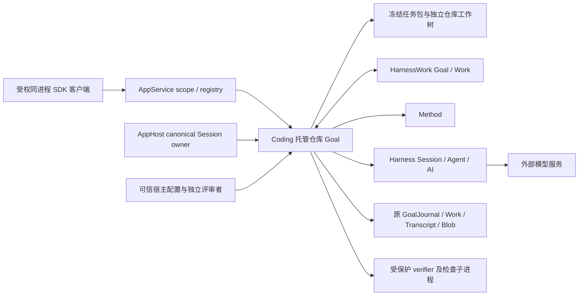
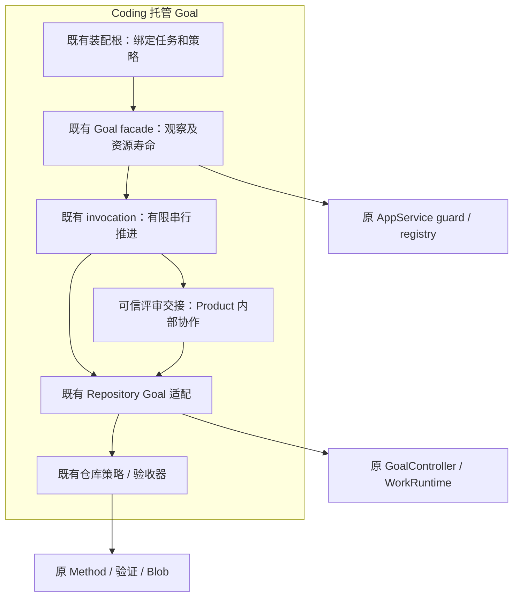
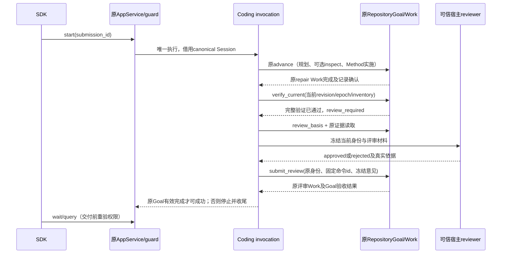

# COD-KD-HG-002：托管真实仓库 Goal 的有界接入

- Revision: R2.1，2026-11-02。
- Authority: accepted target；Design status: accepted；Implementation status: implemented — focused offline verified。
- Owner: Coding；协同 AppService/AppHost、Harness Session、HarnessWork Goal/Work、Method。
- 源码基线：`40c4c2b69cf4c70df1b3d56fb31a8e6a082d42a5`，已交付 #841/#842。
- 方法：本地干净 archmethod master `0f9bd3ff51afabeaaf76cc38dff1ceb279b7d37e`，采用 change tailoring、key design、architecture review。此路径是既有能力合同的增量；决定、机制和验证合并在本专项内。
- 授权：用户于2026-11-02明确“接受R2.1, 开始实现”。接受的设计原稿SHA256为 `d36185ec154d03f3458ae2c84dfea707086e0930649809cec2160fedcb764ae4`；本次仅更新状态及实施证据，不改动已接受合同。

## 1. 目标、范围与不变项

让受权同进程 SDK 调用者启动一个由服务端选定的真实仓库任务，模型按已有小预算规划、Method 约束实施、原完整验证与可信宿主评审建立完成依据。无需 SDK 调用者接触工作区路径、原 Goal owner 或评审写入口。

第一切片只接入已实现的 [6 Work / 2 planning 有界收尾模式](goal-closeout-budget.md)，支持直接实施或先 inspect 再实施。这是托管接入验证，不重新证明动态重规划。真实评审拒绝会进入原事实链并阻止成功；该模式最多一次实施与评审，拒绝后结束本轮，不额外规划、不扩预算。原本地 SDK 的多次实施/拒绝后重规划合同继续有效。

保留 [HG-001](hosted-goal-loop.md) 的单应用、单 fresh canonical Session、单 Goal、单 execution、原 registry/guard、whole-execution interrupt 和收尾责任。没有远程 wire、跨进程恢复、任意上传任务包、子 Session 或第二个执行队列。默认 calculator、普通 prompt、Method SDK 与本地 repository Goal 均保持。

| 要求 | 可观察结果 |
| --- | --- |
| HRG-01 服务端绑定任务 | start 仍只接受 submission id；客户端/模型不能指定路径、方法、命令、验收或评审者 |
| HRG-02 原能力闭环 | planning → 可选 inspect → Method repair → 原 verify_current → 原 submit_review；最终原 Goal completed/current 且记录可确认 |
| HRG-03 评审权限与身份 | approved 来自可信宿主，绑定当前任务摘要、候选摘要及原验证 operation/run；测试通过不能自动生成批准 |
| HRG-04 预算与失败 | 原 6/2 限制与模型输入一致；超时/失败/拒绝停止，不重开 Goal 或偷偷加额 |
| HRG-05 生命周期与兼容 | 权限撤销、detach、中断、初始化/清理失败沿现有 owner；旧入口与记录不变 |

场景优先级：误批准及越权（业务高/技术中）、取消后评审或工具仍写入（高/高）、任务包/候选在等待期间变化（高/中）、两种合法小预算路线（高/中）、历史扫描成本（低/低，本切片最多6个intent，保留既有读取，不加缓存索引）。用户需求来自本次授权与既有冻结验收/有限预算要求；尚未选定下一次在线任务，不以模拟评审代替真实利益相关者意见。

## 2. Current：可复用事实与真实接缝

| 事实及源码位置（基线相对路径） | 含义 |
| --- | --- |
| `coding/hosted_goal_application.py:create_coding_goal_application`、`_hosted_goal_config.py:HostedGoalSetup` | 目前固定 calculator 提示、policy、配置，不能把 workspace 换成仓库就获得 repository 语义 |
| `coding/hosted_goal.py:CodingHostedGoalSessionV1`、`_hosted_goal_work.py:GoalInvocation` | 同步预持有 inert CodingGoal，guard 内借用初始化；create/query/control 的 goal_id 硬编码 calculator，驱动只调用普通 advance |
| `appservice/goal.py:ScopedGoalClientV1.start` | 去重和授权已复用 registry，但提交的内部 text 为 calculator；`appserver/goal.py:GoalCapabilityV1.profile` 已有字符串字段，默认 calculator |
| `coding/adapters/goal.py:_initialize_borrowed`、`_initialize_session` | 前者固定 calculator planning policy_id；后者已有 profile 选择、原 journal/Work/verification 装配。不能直接调用 open_repository_goal，否则另建 Session |
| `coding/adapters/_goal_repository.py:RepositoryProfile/_RepositoryGoal` | 原 profile/tool policy、advance、verify_current、review_basis、submit_review、同入口互斥与幂等均已实现；review_required 时普通 advance 明确拒绝 |
| `coding/adapters/_goal_repository_task.py:RepositoryTask` | expected_digest 校验 manifest/protected；snapshot 检查 Git tracked + nonignored 文件集合、不允许变更的文件及允许文件的普通文件/大小边界。不是任意仓库的通用 schema 校验或 OS 隔离 |
| `RepositoryTask.material`、`_goal_repository.py:RepositoryReport.execute` | 宿主直接读取read_files/inspect_files，内容进入模型材料或报告，不经过文件工具策略；Current没有校验inspect为read子集，也没有封闭只读文件及祖先symlink边界。本稿新增的hosted准入须覆盖这些接缝 |
| `coding/_hosted_work_observation.py:observe_work_run`、`method/compiler.py` | 当前投影原样交付Method/Plan标识；仓库Method ID来自task，plan ID从它派生，不能据原安全reason码推出这些标识可公开 |
| `_goal_repository.py:_repository_limits`、`_goal_planning_shared.py` | 冻结预算进入原 Goal metadata、规划输入及受理；6/2 模式对 verify/review 留额度。不需要第二预算账本 |
| `_goal_repository.py:submit_review`、`_goal_repository_review.py` | 原评审身份、内容指纹、32 KiB内容界限及原 Work/Blob 证据。review completed 与 approved 是不同事实；拒绝不会被后来同候选验证抹掉 |
| `_goal_repository_driver.py` | 原受保护 verifier 调用固定 pytest selector、收集真实报告、处理子进程组。当前使用 POSIX signal/killpg，不能由 calculator 的三平台验证推出仓库托管的三平台保证 |

已有本地真实任务及动态重规划的证据见[评审反馈设计](goal-review-feedback.md)与[低成本收尾](goal-low-token-closeout.md)。本轮只静态核查；下述新增装配和自动评审交接尚无运行证明。

## 3. 系统环境、组件与物理边界

系统环境图将 Coding 托管仓库 Goal 视为一个黑盒；各外部系统保持自己的权威。

组件图只展开 Coding 责任单元；不是为每个文件创建组件。

| 责任单元 | 拥有与协作 | 不拥有 |
| --- | --- | --- |
| Coding 装配根 | 将宿主指定的 manifest+摘要、私有记录根、可信评审回调编译为内部固定 setup；在 canonical Session 创建时注入同一 allowance/tool policy | 客户端可选插件注册表、第二 Session |
| 原 facade/invocation | 保留唯一执行 task；按原批次事实选择继续规划、宿主验证或评审交接；只读投影阶段/错误码 | 原计划、Goal状态、Work执行与评审事实权威 |
| 原 Repository Goal/Policy | 任务要求、不可变候选确认、Method绑定、原完整验证、评审写入及验收 | AppService鉴权、Session物理寿命 |
| 可信评审者（宿主依赖） | 只对完整冻结材料作有界判定；返回原 approved/rejected 内容，真实来源由宿主配置固定 | Goal/Work写入、候选修改、模型工具入口、额外执行资源或清理owner |
| AppService/AppHost/Harness | 继续各自承担 scope/registry/guard、Session lease、Agent/工具及资源清理 | 仓库任务解释、自动批准、第二调度器 |

物理首轮只承诺同机 Linux/POSIX、同进程 SDK；模型可以在外部服务，verifier 子进程继承现有受控检查路径。任务工作树、任务包、Goal data、canonical Transcript、application root和专用检查临时根必须明确配置，解析后彼此不包含；根目录别名按同一物理路径处理。模型材料来自宿主组装和原文件工具两条路径，两者均受§5的同一文件集合约束。验证程序/Method/测试包是宿主信任代码，测试会执行候选代码；不能把工具策略或摘要校验声称为防恶意同 UID 写入、验证进程沙箱或通用多租户隔离。

## 4. 关键决定（R2.1已接受）

| 决定 | 选择、理由与代价 | 不选方案 / 重议条件 |
| --- | --- | --- |
| HRG-D1 任务接入 | 新增 Coding 服务器侧显式 repository 配置/装配入口，内部复用已有 facade/guard/borrowed 初始化；只接受有界收尾任务包 | 不把任务内容放进 start，不通用化为任意profile插件。不复制一套 hosted runtime；出现第二类真实仓库模式再评估通用配置 |
| HRG-D2 可信评审 | 宿主构造时注入一次调用、合作取消且不取得额外资源的异步判定；invocation在原完整验证之后调用，再经原 submit_review 写事实 | 不新增 AppService 评审命令/权限，不让模型自评，不以测试成功自动 approved。需要人工长等待、模型评审或资源owner时另设计交接合同 |
| HRG-D3 有限驱动 | 复用 closeout 6/2：repair完成后宿主 verify_current；验证通过后评审；拒绝结束 | 不照抄 calculator 不断 advance，也不硬编码模型必须直接 implement。不增加本轮多次重规划义务 |
| HRG-D4 状态与兼容 | 无新持久schema、队列或原始账本；仅扩展既有服务器装配及白名单阶段码，旧默认值保持 | 不把临时 callback 请求当事实，不创建 review索引或 shadow operation→run 映射 |

D1/D2 是 Coding 对现有协作的增量，不改变 GoalController 在 HarnessWork 的归属。AppService 不依赖 Coding 仓库类型或读取任务文件。评审 codec 继续在原 repository review 内部；没有独立 codec 组件。三个视角需合并核查配置、借用生命周期、评审权限和预算共同成立，不能只逐模块认可。

## 5. 装配、数据与权限合同

服务器侧候选入口名为 `create_coding_repository_goal_application`，配置为 `CodingHostedRepositoryGoalV1`；名称可在实现时按既有风格收敛，责任不变。输入只来自可信宿主：manifest路径、expected_sha256、记录根、预算上限和reviewer。不接受已打开 Goal owner、客户端脚本、任意class/factory或模型输出路径。

1. 在调用原RepositoryTask构造/verify之前，先从匹配expected_sha256的同一份manifest字节完成hosted私有准入；不能先沿未经检查的protected路径读文件。核对accepted/version、唯一RC-01…06要求、原closeout_budget（总Work≤6、planning≤2）、下述成员与物理边界，再核对protected摘要。缺失预算的默认20/8任务在新入口拒绝。本切片不把旧私有manifest扩成公共上传schema；宿主对所选可执行检查内容承担信任责任。
2. 宿主固定独立工作树及初始inventory；本切片启动时所有允许文件也须匹配workspace_start，并冻结其初始内容，供后续独立评审对照。setup从匹配摘要的字节私有构造任务/profile/policy，不保留外部可变task.config作为配置权威、不向SDK暴露可变对象。内部配置只读或深复制隔离，重复检查以原摘要字节为准；guard内初始化及每次原命令继续原recheck，包变化不得继续执行。
3. facade同步预持有 inert `_RepositoryGoal`，内部设置同一个 RepositoryProfile；borrowed初始化扩展为按该固定profile的policy_id/requirements/policy选用原 `_initialize_session`。不调用 `open_repository_goal`、不另建SDK、不启用delegation或Transcript新增保留契约；canonical Session仍由原AppHost建立/关闭。
4. Session创建时注入profile.system_prompt、同一profile.tool_policy和同一PlanningCallAllowance，保留most_restrictive、原工具集和执行准备失败退休桥。不能构造后替换私有Agent字段。calculator的旧默认装配不变。
5. capability.profile 明确为 `repository-closeout`，goal_id由Product固定为 `repository`。同一owner的profile不可变。现有AppService start的calculator内部标识改为来自服务器capability的固定profile标识，calculator保持原值；标识中不放路径/任务内容/reviewer身份，它只是registry原请求内容，不是任务选择接口。binding仍是原随机观察锚，不能提升为权限或任务账本；原policy_id仍为coding-repository-review/v1，原review scope_id不是客户端scope或goal_binding。
6. query复用GoalObservationV1及原Work事实查询，新增稳定reason语义如 preparing_repository、planning、verifying、awaiting_review、review_rejected、review_unavailable、task_changed。repository专用交付投影将method_id/plan_id置None，不向SDK披露任务派生字符串，不改变原Work事实或另建别名映射。step_id/current_step_id只交付固定词汇planning、inspect、repair、report、validation、review；未知值不原样返回，标记相应观察不可用。保留原operation/run/session关联；原calculator与Method SDK投影不变。不得透传原reason、manifest内容、文件路径、findings、源码或Blob字节；无新客户端评审写入方法。跨await重验scope/owner规则保持。

逐文件准入是新增hosted边界，不是Current保证，也不全局收紧旧本地API：

- allowed_files、read_files与inspect_files各组只接受规范仓库相对文件名；拒绝绝对路径、空/点/父目录段、非规范别名和重复物理文件。allowed是read子集，inspect各组也是read子集，全部成员必须出现在workspace_start。逐成员lstat及父链检查拒绝symlink，解析后仍须位于同一工作树；文件为有界普通单链接文件，单文件≤1 MiB。不能只检查根目录或只复用工具策略。
- protected必须覆盖实际使用的method.json、driver.py、test_contract.py及任务另行声明的受保护输入；包内成员同样拒绝绝对/父目录、symlink及祖先symlink，并须属于包根。所选Method仍是原唯一repair步骤，非任意执行器。检查选择器限宿主声明的仓库内相对文件/目录，拒绝命令行选项、路径逃逸和symlink别名；解释器由可信宿主固定。
- 原material()/RepositoryReport的宿主读取接缝必须在hosted模式下使用同一已准入集合，读取前重核物理归属，读取字节后核对摘要：允许文件对应本次候选snapshot，其他只读文件对应workspace_start。构造模型请求/报告或评审材料之前再次检查包与候选。调用原Blob/verification reader建立报告身份，不能另读任意stdout JSON替代。可复用Task/Report内部校验方法，不增加材料存储、持久索引或权限组件。
- 评审请求中的初始内容必须匹配冻结起点，候选内容匹配identity.inventory；嵌套identity/inventory与宿主持有值深度隔离，不能只冻结最外层对象。整份评审材料（初始/候选内容、要求、验证摘要）最多4 MiB，超限拒绝而非静默截断。真实试验选足够小的任务；当前原snapshot仍可能扫描更大Git清单，不据材料上限声称全仓扫描有硬上限。

以上防止错误任务配置及已检测的文件替换越界；不承诺对恶意同UID竞态读的原子快照。若需要更强隔离，应另设计受控文件访问/进程边界，不能把两次摘要检查宣传成隔离。

事实归属不变：任务摘要/要求/limits在原Goal metadata；候选及评审由原Goal关联的Work+Blob证明；Transcript记录原模型与工具；托管execution只描述本次受理及收尾，phase是内存运行观察。回调未返回或返回未入原Work不产生持久评审事实；查询不能靠回调内存结果声称通过。

## 6. 正常交互与评审交接

驱动规则：普通advance只用于已有规划/inspect/repair；从原batch source与原run状态识别repair（不能仅凭step名字或最新模型文本）。repair未成功或记录不可确认则停止；没有repair时按原策略继续至预算/stop。repair完成后不再消耗模型规划完整验证，调用原verify_current一次；verify_all通过后调用reviewer一次，再调用原submit_review一次。每次原入口最多一个原Work，无额外外层Work。成功条件保持Goal completed/current、无未收敛执行、所有相关Work记录可确认。

评审依赖是受信任的Product本地接口，不是新模型工具：

- 调用前用原review_basis获得身份和passed；必须是当前完整验证通过，并检查recording/证据可读。原review_basis只返回identity/passed，材料组装仍须复用RepositoryDomain._verification、原Work证据投影和SessionBlobStore校验读取。冻结请求含原完整identity、RC要求、§5校验过的初始与候选内容/摘要、原验证结果摘要及受保护范围核查。允许文件摘要必须与identity.inventory一致；原任务摘要绑定完整受保护基线，inventory本身仅是允许修改文件的摘要图，不能称为整个仓库快照。
- 原要求和实际候选由宿主提供给有权reviewer，不通过通用SDK DTO散发；不提供任意路径解析或整个Transcript。身份及允许文件材料经原任务/Blob读取再核对，校验失败停止。首轮只面向有权读取该工作树的同进程可信reviewer，不承诺对恶意回调的隔离。
- 返回内容使用原decision/reason/coverage/findings；reviewer字段由宿主配置填充，回调自报不同身份明确拒绝。完整identity来自宿主独立持有的冻结请求，回调不能替换或原地修改。冻结返回数据后用原review_value校验大小/字段并交给原submit_review；不重写其验证器或codec。评审依赖须对具体RC要求和差异作独立核查，禁止只把passed映射为approved；这仍是可信宿主的业务责任，不是编解码器提供的评审质量保证。
- command_id/review_id由原execution及唯一review阶段派生，评审者不能选择；verify命令同理，且与planning命令不重名。原入口仍检查缓存回执/指纹/候选身份；暂存回调结果不构成重放日志。
- 等待期间阶段为awaiting_review，execution仍running，Goal仍active；没有新的持久waiting状态。callback返回后先查cancel/deadline与当前task/候选，再submit_review。过期、异常、无意见返回均不能冒称rejected/approved，结束为review_unavailable或task_changed。
- approved且原评审Work completed/记录确认后才查询原验收；rejected写入原评审Work，原Goal不完成，托管以review_rejected失败并按原可写条件pause。允许未来其它profile复用原拒绝事实重规划，不在本切片自动实现。

## 7. 预算、取消、失败与资源责任

| 限额 | 权威与范围 |
| --- | --- |
| Work≤6、planning≤2；inspect/repair/verification/review各≤1，check=0 | 原冻结closeout_budget编译、原Goal intent及Policy准入，失败/未提交intent仍计数，不按epoch重置 |
| 托管原命令调用≤6 | 原invocation内防无进展循环的临时上限，advance/verify_current/submit_review均计入；成功查询不占命令，不另计为原Work账本 |
| 逻辑模型调用≤8、每次输出≤1024、provider尝试1 | 同一原PlanningCallAllowance，planning+实施共享，首次await前扣减，取消/失败不返还。不是总输入token/金额硬限 |
| 业务截止配置≤120秒 | 从guard.run含初始化、模型、验证、评审；是协作式受理截止/停机期限，不是任意同步I/O下的硬实时上限；到期停新工作并完整settle |
| reviewer调用≤1、无额外执行资源 | 只判断传入冻结材料，无文件/网络I/O、模型调用、线程、子任务、子进程及跨调用资源/清理句柄；有界计算及时让出控制。需要这些能力须另定合同 |

默认使用6/2，原有允许更小额度的提前停止语义保持；宿主配置只能收紧8调用/1024输出/120秒，不能放宽原任务。两个合法路径分别是4 Work（planning、repair、verification、review）及6 Work（planning、inspect、planning、repair、verification、review）。至多一次完整验证和评审；没有通过证据就停止，不以剩余模型预算绕过已用完的Work额度。

reviewer只消费冻结值并产生判定，没有需要Goal接管的外部资源或残留效果。正常返回、异常或取消完成均意味着该回调已无待收尾效果；普通异常是review_unavailable，不制造reviewer cleanup debt，也不新增reviewer cleanup/retry接口。配置提供者负责满足这一可信代码合同；通用allowance并不能拦截恶意回调另起模型，第一切片不接收此类不可信回调。

取消通过同一drive task传播，invocation必须join它退出；即使回调吞取消后返回，也先检查latch和绝对截止，丢弃迟到意见，不受理review Work。没有结果的中断不写评审；原评审Work已受理时沿原Work取消/记录语义处理。原Goal/Session实际资源失败仍留在原guard债务链，retry_settlement只重试这些已有收尾，不再次调用reviewer/模型/验证。

原task.snapshot含同步Git及全仓库文件哈希，asyncio计时器不能抢占它，也不能终止任意同步阻塞Python。每个原命令及评审交接边界前后均核对绝对截止/latch；驱动一旦观察到截止，不再发起后续原命令，迟到reviewer结果不得进入submit_review。已进入的单次原命令可能在内部同步prepare/confirm返回后、计时器得到调度前受理最多一个原Work；本切片不承诺该内部受理的物理时间必定早于截止，不在GoalController插入另一套定时器。下一可观察取消点沿原Work取消/settle，已产生的事实不回滚。物理settlement可超过业务截止。首轮依赖正常工作的本机文件系统/Git与及时让出的受信任代码；真实任务可行性须包含初始化、重复snapshot、完整检查和评审计算。若要求故障I/O下硬实时停机或严格按时刻拒绝内部Work受理，应重新设计对应隔离/准入合同，不在本切片加watchdog或历史索引。

| 失败路径 | 规定结果 |
| --- | --- |
| 包/路径/预算准入失败 | 创建执行前拒绝；无模型/Work，已取得的AppHost资源沿原close责任释放 |
| borrowed prepare/startup或仓库初始化失败 | 原inert owner留在facade，Goal依赖与原Session退休先收尾；失败留债务，不遗失凭据 |
| 验证不通过、超时/收集异常 | 不批准、不继续模型。保留原验证事实；业务失败与执行未知/记录不可用分开 |
| callback异常、取消、候选已变 | 不制造review Work成功或业务rejected；停止，保留已有Work，清理后可查询 |
| review publish/recording失败 | 原未知/fence处理；停止，不盲目重发、删除Blob或自动重开Goal |
| retry_settlement | join原drive、原Work/Session执行收尾；失败保留已有资源债务，成功后仍保留Goal/记录以便查询。不续跑、不重新评审 |
| 真正owner关闭 | guard收敛→Goal依赖关闭→原AppHost Session lease关闭→断开记录图；失败保留凭据，不越过依赖释放 |
| SDK detach/member关闭 | 沿HG-001：detach不取消应用任务；旧scope撤权，新受权scope只观察原执行；close_session=False保留事实直至真正owner关闭 |

原日志策略和single writer约定不变。允许沿原本地inspect工具核查历史，不据此承诺托管重开/恢复。工作区原地变更是实际任务结果，取消不自动回滚文件或Git提交。

## 8. 验证、兼容与后续边界

下列为设计接受时的验证计划，实际结果见[实施与验证记录](hosted-repository-goal-implementation.md)；优先确定性离线模型 + 真AppHost/Session/工具/Work/verifier，不重跑既有Kimi动态重规划试验。

| ID | 验证断言 / 对应要求 |
| --- | --- |
| HRG-V1 | 4/6 Work两条路径completed/current；原review证据可读；唯一canonical Session，原operation/run身份，无第二SDK/Work；HRG-01/02 |
| HRG-V2 | 无reviewer/非法任务/摘要变更/路径重叠/缺closeout预算拒绝；inspect越过read集合、只读/祖先symlink、重复物理文件、遗漏必需protected、起点不匹配拒绝；启动后包/外部config变化不改合同，宿主读取后的字节仍绑定摘要；HRG-01/04 |
| HRG-V3 | 检查通过但reviewer拒绝仍不完成；异常不是rejected；旧/原地篡改identity、候选变化、伪造reviewer、错coverage/过大材料或返回内容不能批准；模型工具无评审入口；HRG-03 |
| HRG-V4 | 在review调用/返回后受理前/review Work执行中注入取消，迟到结果不执行；verification及review的append/observer未知阻止成功；初始化及原Goal/Session cleanup债务重试只清理。无资源reviewer仅测试取消/join/异常，没有虚构的reviewer释放重试保证；HRG-03/05 |
| HRG-V5 | 6/2规划输入/实际准入/计数一致；callback无模型；deadline含review等待；不足额度停止且无额外Work；HRG-04 |
| HRG-V6 | 跨scope/instance/owner拒绝、跨await撤权、去重、detach、member保留；含路径/内部任务名Method ID不出现在最终SDK DTO，未知step不回显，原operation/run仍可关联；白名单无任务/源码/评审泄露；HRG-01/05 |
| HRG-V7 | 原calculator的profile/goal_id/预算默认、Method/普通prompt及本地repository 20/8/子Session路径不变；新私有接缝不改变旧持久schema；HRG-05 |

一次真实试验另在实施与离线通过后冻结：选已有任务，不重开已解决问题；固定基线/允许文件/RC判据/Method与verifier摘要、独立工作树、6/2及8调用预算、完整验收选择器、可信reviewer与其可执行核查、120秒可行性。若完整检查无法在预算内运行，换更小的任务或回到设计评议，不删减验收凑通过。失败保存材料并停止，不自动第二次付费调用。本稿不冻结具体任务，不产生在线运行授权。

不新增PR gate。职责边界的精确清单若受实现影响需按实际依赖更新，不扩大豁免或扫描范围。默认calculator不迁移；首轮repository profile明确是新选项。若需要公开任务包schema、远程评审、任意长期任务、多writer/多Session或reviewer模型预算，重新评议对应合同，不在本切片预建。

本轮交付包括本专项、[三视角评审记录](hosted-repository-goal-review.md)与[实施证据](hosted-repository-goal-implementation.md)。实施者负责源代码核对和未来V1–V7；可信宿主负责任务与评审依据；用户评审本稿的环境、职责与合同。已按用户接受开始实现；离线验证与代码评审另记录，不启动在线试验。
