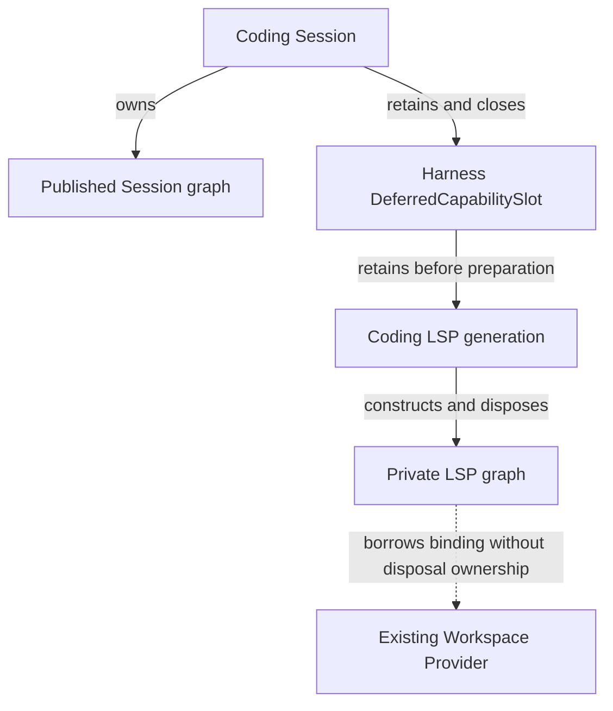

# ARD-010: Defer a selected Capability Provider behind a managed slot

## Status

- ID: `ARD-010`
- Scope: Loushang (Harness Capability Graph and Coding Product)
- Parent: Loushang
- Authority: normative candidate
- Design status: draft
- Implementation status: partial (default and receipt-backed resume wired; Linux Product vertical verified; acceptance audit pending)
- Owner: Loushang architecture
- Tracking: [#798](https://github.com/zhnt/loushang/issues/798)
- Method revision reviewed: `0f9bd3ff51afabeaaf76cc38dff1ceb279b7d37e`

## Background and drivers

The default `coding.lsp=on_demand` delays language-server process startup but
still resolves the first-party Plugin, issues activation approval, and binds its
Provider during Session startup. `CodingCapabilityPluginCompositionPreparation`
and `AgentSession._ensure_session_graph_prepared` currently make that sequence
eager. Disabling LSP removes about two seconds from the observed warm startup,
but removes the capability altogether. The requested behavior is to admit a
dormant capability at startup and perform Plugin selection, approval, and
Provider construction only after explicit demand.

The existing graph is sealed at publication. An ordinary tool wrapper that
creates a Provider outside graph ownership would bypass the graph's owner,
retirement, and admission contracts. The existing activation decisions expire
after 300 seconds and are single use, so a dormant component cannot retain a
startup-issued decision for later use.

## Options

| Option | Benefit | Cost and constraint |
| --- | --- | --- |
| Keep eager composition and tune evidence reads | Small local change | Cannot deliver requested Provider deferral; startup retains LSP admission work. |
| Put a Coding-only lazy tool proxy outside the graph | Fast startup | Loses Capability graph ownership and atomic Provider/tool publication. |
| Predeclare a Harness-owned deferred slot in the sealed plan, then activate a child generation on demand | Preserves graph authority while moving Plugin work out of startup | Requires a new graph-owned lifecycle and exact rollback, cancellation, and retirement rules. |
| Session retains the Harness slot alongside the parent graph, then closes child before parent | Reuses the existing slot and sealed child graph without changing parent planning or model-input authority | Session must retain parent dependencies when child retirement fails and retry the same candidate. Selected for this bounded ownership/retirement scope. |

## Recommended contract

Use a **Session-owned Harness deferred Provider slot**, retained alongside the
parent graph. The slot records a Product-owned capability identity, expected
facets and tool identities, an activation factory, and a retirement owner. It
does not contain a Plugin selection, Provider value, approval decision, or open
revision handle while dormant. The Session owns both parent and child lifetimes;
the slot is not a node in the parent plan. Activation binds a separately sealed child generation and
publishes its Provider facets and admitted Tool registrations together. The
parent graph's provider map and sealed plan are never mutated.

Coding supplies a first-party LSP slot declaration for `on_demand`. The static
tool identities are discoverable but remain inactive. `/tools on` or an
equivalent explicit Session activation invokes the slot before exposing those
tools to the Agent. `/lsp status` only observes the slot. `disabled` declares no
slot or tools. `always` continues to prepare an active Provider and active Tool
definitions at startup, preserving its current model-visible behavior.

Activation performs fresh selection, Definition evaluation, owner admission,
activation approval, ImportRealm execution, graph binding, and Tool staging
inside one owned attempt. It rereads current management enablement and source
trust. Approval is issued at activation time; it is not extended from startup.
The child generation becomes visible only after Provider and Tool registration
both commit. A failed attempt rolls back staged tools, closes graph and Plugin
evidence, and reports a stable failure without exposing a half-active tool.

The slot states are `DORMANT`, `ACTIVATING`, `ACTIVE`, `FAILED`, `CLOSING`, and
`CLOSED`. Concurrent callers await one owned activation task. Cancelling one
waiter does not cancel that task. Session close joins activation,
then retires active Tool and Provider generations in reverse dependency order.
If child retirement fails, Session close raises and retains the original child
cleanup handles and parent dependencies. A subsequent close retries the same
candidate before releasing the parent; it never replaces a failed retirement
with a fresh activation. The closing slot rejects activation. Session work is
already stopped by the existing shutdown owner even while resource cleanup
remains incomplete.
`FAILED` is terminal until an explicit retry creates a fresh attempt and fresh
approval. Demand after a long idle period performs the same fresh transaction.

Synchronous package and filesystem evidence work must run outside the TUI event
loop. The activation owner remains on the event loop, retains cancellation and
publication authority, and joins its worker before rollback or close.

## Validation needed before acceptance

1. A fake Provider proves dormant startup does not invoke selection, approval,
   ImportRealm, or factory, while tool identities remain discoverable.
2. A fake clock advances more than 300 seconds before first demand; activation
   succeeds with a new exact journal decision, and an expired old decision is
   rejected.
3. One hundred concurrent demands yield one child generation. Cancelling one
   waiter leaves the activation owned; shutdown and failure leak no process,
   registration, revision handle, or durable use.
4. A Product test covers `disabled`, `on_demand`, and `always`, including
   observational status and the second-use fast path.
5. A fake-terminal test keeps input and Working frames responsive while slow
   evidence work runs, and local startup/first-LSP benchmarks check both sides
   of the latency trade-off.

## Source-backed feasibility notes (2026-10-20)

`SessionCapabilityCompositionInputs` requires an exact one-to-one mapping from
resolved Providers to Component requests. `AgentSession` builds the initial
plan from those inputs, and `_prepare_candidate_session_graph` constructs all
requested Components before binding it. The published Model Call Consumer is
generation-pinned (`require_current_capability_component_activations`). Adding
LSP to that published graph later through the Binder's generic rebind operation
would invalidate the active Session Consumer and violate its one-time
publication contract. The child graph therefore needs its own runtime and
generation, retained by the Session-owned slot; the original Session graph must
stay unchanged.

`CodingLspToolOwner._stage` already stages Tool registrations through a
`RegistrationScope` after capturing `CODING_LSP_TOOL_RUNTIME_REQUIREMENT`.
`RuntimeCapabilityGraphBinder.bind` commits its own registration scopes before
publishing a graph generation. A private child graph can bind first, then the
LSP Tool owner can capture its runtime facet and stage into the Session Tool
registry. Tool scope commit and slot-pointer publication must run in one
event-loop turn with no await between them; failure must roll back the Tool
scope and dispose the private child graph. This is a feasible publication seam,
but no existing owner coordinates the two transactions or exposes a dormant
Tool descriptor. That owner, and a close path that joins any activation before
Session graph retirement, are implementation prerequisites.

The current LSP status value can represent a dormant enabled capability as
`LspSessionStatus(enabled=True, servers=())`; disabled remains
`enabled=False`. `CodingLspToolOwner` presently needs a live graph capture to
construct ToolDefinitions, so dormant `/tools` discovery needs a separate
Product-owned static descriptor. Activation must replace that descriptor with
the admitted Tool generation before the Agent can execute it.

A synthetic hosted Session measurement on this branch took 4.724 seconds to
construct the Session (4.431 seconds process CPU) and 1.060 seconds for first
Model Call preparation. The startup profile places the dominant synchronous
cost in Capability Plugin preparation, especially managed selection and
finalization. Deferring only LSP may not achieve the requested 50% total
startup reduction; measure the remaining Arch/base work after LSP is dormant.

## Review state

The source review identified a feasible private-child publication seam. The
prototype below has passed focused tests; the contract remains a draft until
Product and durable resume paths are fully audited.

The Harness now has an inert `DeferredCapabilityDeclaration` and a
`DeferredCapabilitySlot` that retains its candidate before preparation, owns
one activation task, publication, explicit retry, and close. Focused tests
cover 100 concurrent callers, cancellation of one waiter, close during
preparation, publication rollback, failed cleanup retry, and cancellation of a
close caller. A Coding LSP candidate has also bound a freshly selected real
first-party Provider into a private child graph and staged its admitted Tool
generation. Focused tests prove approval after a 301-second idle period,
Tool publication/retirement, and rollback after injected Tool staging failure.

New default `on_demand` Coding Sessions now declare the slot and defer catalog
discovery, Plugin selection, approval, and child graph binding until explicit
Tool activation. Dormant descriptors are visible to `/tools`; `/lsp status` is
observational. `always` remains eager and `disabled` has no LSP slot. The
first-party fake-server vertical slice passes through real Tool execution and
retirement. A validated startup receipt with no LSP selected revision allows a
persisted Session to reopen dormant, including after deferred activation.
Historical eager receipts and history without a startup receipt keep the eager
route to preserve their owner evidence. A Product-selected deferred generation
captures Desired State and selected-manifest evidence at activation and rechecks
both before publication and during later Session preparation. The Linux
Product-selected activation and persisted-resume vertical case passed in
[PR #801](https://github.com/zhnt/loushang/pull/801): the targeted report has
six passing LSP cases with no skips. The new case executes the selected Provider
before and after reopening a dormant receipt, preserves the parent graph
snapshot, and retires both server generations. See the
[measurement and native verification record](../../harness/issue-798-performance-evidence-2026-10-20.md#native-actions-verification).
This supported-platform evidence does not by itself complete the publication,
freshness, and lifecycle acceptance review; draft/partial status is retained.

In an isolated local A/B, the previous default `on_demand` path took
4.50–4.97 seconds to construct and prepare a Session; the deferred path took
0.72–0.86 seconds. The disabled path was about 0.73 seconds in the same run.
These measurements are startup-only and do not claim to reduce the first LSP
activation cost.

## Acceptance audit finding: actual slot ownership (2026-10-27)

This section records the pre-fix finding; its ownership and close-order issue is
resolved by the bounded acceptance below, not by acceptance of the whole ARD. The
implementation agent compared revision `7cc4a76b36aaf62ebe831a0d999a392ef819bcb9`
with the existing CLA0 construction gate using local archmethod master
`0f9bd3ff51afabeaaf76cc38dff1ceb279b7d37e`. One reviewer covered ownership,
runtime/failure, and compatibility; this was not an independent multi-agent review.

The difference is more than an omitted constructor in a test. The recommended
contract above puts the slot in the sealed parent plan and makes the parent
graph its owner. Current code keeps the slot on
`src/loushang/coding/session/agent_session.py::AgentSession.install_deferred_lsp_slot`.
`AgentSession._dispose_session_runtime_profile` closes it before invoking parent
Session cleanup. The graph planner/runtime does not register a deferred slot in
the parent plan. The Harness `DeferredCapabilitySlot` owns activation and
candidate retention, while the Coding candidate constructs and disposes its own
private graph. In particular, `CodingDeferredLspGeneration.prepare` is an extra
`RuntimeCapabilityGraphRuntime` construction site compared with the existing
CLA0 rule. The Binder is also supplied by a dataclass `default_factory`; a
call-site-only inventory does not establish a complete factory inventory.

Observed ownership (Current, not accepted Target):

The review disposition is:

| View | Finding and required closure |
| --- | --- |
| Ownership/reuse | Retaining the original parent graph avoids a second Session model-input authority, but Session ownership and parent-graph ownership are different contracts. Select one explicitly before registering this construction site as accepted. |
| Runtime/failure | The slot retains the candidate before `prepare`, owns one activation task, and joins it before disposal. The candidate stages Tool generations and disposes them before its graph. Reuse the existing concurrency, rollback, expired-approval, and close tests; audit partial publication and failed child cleanup together with parent cleanup before acceptance. |
| Data/compatibility | The existing dormant receipt and eager-history routes must remain distinguishable. Native Product/resume evidence cited above is useful, but does not by itself settle ownership or every failure path. |

One concrete failure-order question remains: the current Session disposer catches
a failure from `deferred_lsp.close()` and still invokes
`super()._dispose_session_runtime_profile()`. The child can retain a failed
retirement while borrowing the Workspace binding. The isolated slot tests prove
cleanup retention/retry, but do not establish whether parent cleanup in this
combined failure can invalidate that borrowed dependency. Resolve and verify
this interaction before accepting either ownership option.

The proposed clarification for review is **Session-owned parent and child
lifetimes**: keep the sealed parent graph unchanged; let the Session retain the
Harness slot and close its child generation before the parent; let Coding supply
the LSP selection/admission policy without introducing another shared graph
manager. Compare this against implementing the originally proposed parent-plan
slot before accepting it. If selected, update the recommended contract, the
Session/model-call ownership description, and the exact parent/child construction
inventory together. Preserve an explicit answer for child-retirement failure
and parent disposal; do not infer it from the happy-path diagram.

For this option, the proposed failure contract is: Session close fences new
work through its existing lifecycle owner, joins child activation, and retires
the child before releasing the parent Workspace dependency. If child retirement
fails, retain both its original cleanup handles and the parent dependency; report
an incomplete close without claiming the Session is disposed. A subsequent close
retries that same retirement, then releases the parent. It must not create a new
child generation or discard the retained failure. Before acceptance, a combined
Session test must prove parent disposal is not invoked after an injected child
retirement failure, new activation remains refused, and a successful close retry
retires the original child and parent exactly once. This is a proposed contract
and verification condition, not a new test gate or an implemented guarantee.

The six existing `tests/harness/capabilities/test_deferred_slot.py` cases and the
two deferred-generation cases in `tests/coding/lsp/test_plugin_opt_in.py` passed
in this audit. They support the slot and generation mechanics above; they do not
close the combined parent/child failure question.

At this audit baseline the CLA0 constructor assertion remained unchanged and this finding was open.
Adding the Coding constructor to its allowlist alone would hide this design
discrepancy. The proposed clarification is an architecture workpiece for user
review under the current task's reserved review requirement; it does not change
default activation, lifecycle code, or ARD status.

## Accepted Session-owned retirement contract (2026-10-28)

The user accepted: “LSP 还没清理完，就先保留它依赖的资源；下一次关闭时接着清理”.
This confirms the reviewed Session-owned parent/child lifetime option and its
failure/retry behavior. Acceptance is limited to that scope: the broader
publication, freshness, performance, and supported-platform audit remains
draft/partial. It is not acceptance of all ARD-010 claims.

The implementation removes the catch-and-continue path around the deferred
child close in `AgentSession._dispose_session_runtime_profile`. Failure now
propagates before Worker Tool, parent graph, Plugin evidence, or sandbox cleanup
can release the child's dependencies. The original Harness slot already keeps
the candidate on failure, rejects activation while closing, and retries its
retirement. No new slot state, journal, graph manager, or automatic retry is
introduced. Retry means calling `Session.dispose()` again on the retained owner
in this process; this does not promise recovery of live objects after process exit.

The implementer reviewed the bounded change from three views (one reviewer,
not an independent multi-agent review):

| View | Resolution |
| --- | --- |
| Ownership/reuse | Session retains the existing slot and parent graph; Coding owns LSP policy and candidate; Harness owns slot mechanics. The parent remains sealed, with one model-input authority. CLA0 records the exact existing child constructor; its direct-call AST scope is unchanged, and the Binder default factory is documented separately. |
| Runtime/failure | Close errors propagate before parent cleanup. The retained candidate, including already-retired partial progress, is reused on retry. New activation is refused, and successful child close precedes parent cleanup. Existing cancellation-atomic slot/Session owners are reused. |
| Data/compatibility | No persistent format or receipt changes. `always`, `disabled`, dormant resume, and eager-history behavior retain their existing routes. A failed close reports incomplete cleanup rather than successful disposal. |

The regression
`tests/coding/lsp/test_plugin_bootstrap_vertical_slice.py::test_session_close_preserves_parent_until_deferred_lsp_retry_succeeds`
uses a real Coding Session and deferred LSP generation through public
`Session.dispose()`. Both injected failures (before child retirement and after
retirement but before successful return) fail against the original source,
which still invokes parent cleanup. With the fix they preserve the parent,
reject activation, retry the identical candidate, and then close the parent.
The synchronized ownership descriptions live in the CLA0 baseline and the
Session model-call closure boundary; registering this constructor does not
authorize any other Product graph constructor or expand a PR gate.

Validation after the fix: 259 cases passed across the Coding LSP suite, Coding
AgentSession suite, Harness deferred-slot and Session-operations suites, and the
three affected architecture inventory modules. This includes the two new
failure/retry cases and existing close-cancellation and dormant-resume coverage.
Documentation (9 checks), Ruff, generated package dependency freshness, and
`git diff --check` passed. Tests ran outside the managed sandbox with `not live`
and `--skip-host-runtime`; no live model calls or full repository rerun occurred.
