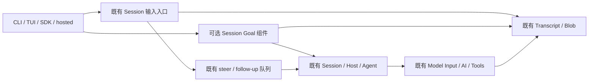

# ARD-018: Goal 复用现有执行与输入组件

## 状态与决策问题

- ID: ARD-018；Scope/Parent: Loushang，涉及 Harness、Agent、AI 和产品适配器。
- Authority: normative — candidate decision；Design status: proposed。
- Implementation status: not-started；Owner: Loushang architecture / Harness Session。
- 基线：本地 main `2de1359c31d540913df11a7f4705f5a1b54624ba`，未核验远端。
- 方法：本地干净 archmethod master `0f9bd3ff51afabeaaf76cc38dff1ceb279b7d37e`。
- 本文是候选设计，不把拟新增接口写成 Current；设计评审不是功能验收。

2026-10-24 用户进一步要求先区分既有能力与新增保证，并设计清楚 Method/Work
协作。当前澄清见 [Goal、Method、Work 协作方案](../../../plans/2026-10-24-goal-method-work-design.md)。
本文件保留首轮候选供评审追溯；不能把其未闭合的机制当作已决定实施的方案。
新协作方案尚未复评，功能开发继续暂停。

用户要求废弃累计实现，从 main 重新架构设计和评审。旧源码在产品仓库外留作
历史素材，不继承旧实现、旧测试通过数、旧工期/完成率、旧存储格式或旧接口方案。
保留[原功能要求 G01–G13](../../../plans/2026-10-17-goal-component-design.md#2-需求与验收口径)
及“原文和图片先落盘、确认后处理、User 确认后记录对应关系、覆盖空闲和运行中追加”。
GC-R2 的 v5 装配、具体协议及内部机制是旧候选选择，不等于这些功能要求本身。

决策问题：怎样交付完整可选 Goal，同时复用已存在的执行、输入、日志及用量权威，
把必要增量限制在真正缺失的合同，而非重新实现这些能力？

## Current：已核实的能力与缺口

以下链接对应本分支的 main 基线；没有据此声称它们已实现 Goal。

| 现有能力 | 源码事实 | 本方案复用 / 必要增量 |
| --- | --- | --- |
| 普通 prompt、text/image、steer/follow-up | [PromptController](../../../../../src/loushang/harness/session/prompt_controller.py)、[QueueController](../../../../../src/loushang/harness/session/queue_controller.py) | 保持既有队列和行为；新增持久输入受理/关联，不重写队列 |
| 单 Host run、空闲后执行、合并 deferred handle | [HostRuntime](../../../../../src/loushang/harness/runtime/execution.py) | 复用 run/defer/abort；补同步准入谓词和执行收尾观察 |
| Session 收尾、重试及压缩 | [SessionRuntime](../../../../../src/loushang/harness/session/runtime.py) | 复用 settle_runs + event_bus.drain；补执行组/输入水位，不能把 agent_end 当完整 settled |
| 图像 Blob、固定 User 提交及确切查询 | [Product transcript](../../../../../src/loushang/harness/transcript/product_session.py)、[committer](../../../../../src/loushang/harness/transcript/committer.py) | 原图像 codec/Blob/UoW；不新增 writer、图像仓库或通用事务引擎 |
| 原子单记录追加、固定 ID extension 提交 | [UoW](../../../../../src/loushang/harness/transcript/unit_of_work.py) | 复用；不假设多记录事务，unknown 仍经原后端查询 |
| 实际 Model Input、usage/outcome | [model_call](../../../../../src/loushang/harness/session/model_call.py)、[usage](../../../../../src/loushang/harness/transcript/model_usage.py) | Goal 做归属/聚合；原记录继续权威；无第二用量账本 |
| 模型 transport 提交屏障 | [prepared_request](../../../../../src/loushang/ai/prepared_request.py) | commit 前后已有 Session current 检查；补实际最终派发的同步检查 |
| 工具授权和执行 | [ToolExecutionHost](../../../../../src/loushang/harness/tools/execution.py) | 复用 approval/sandbox；补审批后、handler 入口的执行代次检查 |
| 命令清单、分代注册和 dispatch | [command_controller](../../../../../src/loushang/harness/session/command_controller.py) | 加一个可选 Goal typed executor；不另建 registry/loader |

## 需求、驱动与方案选择

首要约束是完整目标不缩水、用户输入优先、不重复未知效果、权限不扩大及存量会话
可继续使用。维护成本和较小改动是重要设计偏好，不作为删除功能要求的理由。

| 方案 | 满足性 / 成本 | 结论 |
| --- | --- | --- |
| 产品自行循环 prompt | 实现短，但目标状态/收尾/预算/恢复在各产品重复 | 不选 |
| 只在 agent_end 订阅里再次 prompt | 不能证明完整收尾，也没有输入竞争和最终派发顺序 | 不选 |
| Goal 负责另一套执行、队列、存储证明体系 | 能扩大控制面，但重复权威、耦合和恢复状态显著增加 | 不选 |
| Session 可选 Goal 组件 + 原 owner 的小型通用合同增量 | 目标策略集中；实际执行、存储、记账继续复用 | 推荐，详见下述合同 |

不设“最多几行代码”作为正确性门槛。新增模块/状态必须能指出负责的需求和原组件
确实不能承担的理由；输入恢复增强单列，不能按它的测试数量报告 Goal 核心完成率。

## 组件与职责

Goal 是一个 Session 生命周期组件，内部按四个职责组织，不要求四个独立服务：

| 职责 | 拥有 | 不拥有 |
| --- | --- | --- |
| 目标模型与纯投影 | 目标原文、requirement revision、状态、事件 reducer、只读 view | 执行权限或运行中的 Task |
| 控制服务 | set/view/edit/replace/pause/resume/clear、用户身份、operation ID/CAS | 自造权限、原工具审批或第二 writer |
| 推进协调 | settled 后判断继续/等待/阻塞/完成候选，保留一个原 Host deferred handle | Agent loop、输入队列、provider retry |
| 进展和完成审计 | 完整要求与证据映射、反空转、当前输入水位、完成候选校验 | 任意事实的“真理证明”、领域执行器 |

输入受理属于 Session；原模型用量属于 Transcript/AI；执行组与取消属于 Session/
Host；产品仅做控制/展示/领域 validator。Work/Method 状态不直接改变 Goal 完成。
默认关闭，不装配组件、不注册 Goal observer；纯历史读取不要求启用。
启用配置只选择组件，显式用户 set/resume 才授权推进。首版随宿主发布，无新插件
制品或 loader。通过独立可选 Goal port 暴露控制，不偷偷扩大既有 v4 closed facets。

## 原 owner 的必要增量与执行合同

这些是拟新增的合同，不是 main 已有保证。实现只在所列 owner 中补齐。

1. **Session 执行组。** 每次被授权的 Goal 推进绑定 `(goal_id, control_revision,
   execution_id)`；retry/compaction 和子会话携带同一归属，独立 side question 不继承。
   原 owner 跟踪该组的原 handle、待记录结果和用量。`settled(group)` 要求这些实际
   执行结束且必要记录确认；某个 child 不可观测时结果是 unknown，不是已收尾。
   跨 Session 通过既有 child-session owner 传递归属和结果引用，不建 Goal 子代理引擎。
2. **同一循环的准入。** 用户输入入口先同步增加 `input_revision` 和在途受理计数，
   再做任何 await。所有退出（命令消费、preflight、取消、失败）均退出计数并通知。
   原 Host 在 idle→running 的无 await 切换处检查组件有效、控制版本、当前输入水位、
   受理计数、既有队列和执行组；失败返回 busy/superseded，不重试轮询。Goal 只等待
   下一次原 owner 状态变化，使用原 deferred key 合并通知。
3. **取消和最终派发。** pause/clear/edit/replace/disable 首先同步撤销执行代次，
   然后持久控制并沿原 abort/settle 收尾；控制写失败也不恢复旧许可。AI 在实际
   adapter 入口前及工具在 approval 返回后/handler 入口检查相同代次。等待期间到达
   的撤权要能拒绝尚未派发请求；已发生效果如实结算。Agent 的 before_tool 回调
   不是这项最终保证。操作回执区分控制已保存、stopping 和 settled，不自等待。
4. **模型上下文和用量。** Session preparer 在冻结原 Model Input 时贡献当前 Goal
   数据和执行归属；上下文不成为系统权限。用量从原 attempt facts 归属聚合；没有
   terminal/完整组件的调用是 unknown。有限预算串行准入，known >= limit 或有未知
   未结消费时拒绝新调用；在途可能超过上限，停止后不额外调用模型总结。late usage
   仍归原 goal_id；主会话/重试/压缩/后代都不能通过改归属规避限制。
5. **完成提交。** 模型提交候选，不立即 complete，不等待自身收尾。候选绑定目标/
   requirements/control revision、实际 Model Input、水位、证据及 validator 结果。
   实际执行组 settled 后，Session 在与用户受理共享的同步临界段验证无新相关输入、
   未知效果/用量、未处理队列或撤权；随后经唯一 writer 提交 complete。若提交期间
   有新输入，完成提交与输入受理必须串行排序；不能只在 await 前检查一次。

这些增量独立命名为执行/输入合同，不能把全部功能塞入 Goal 或输入协调器。
没有跨进程共享的内存锁；本地 Session 单 writer 是持久化前提。多客户端控制在
服务端同一个 Session owner 上串行并做 CAS。已有 Session writer 争用仍由原机制拒绝。

## 真实输入：复用队列，新增持久受理

原文保留是独立于 Goal 的 Session 能力；显式选择该策略后覆盖普通 prompt、直接
steer/follow-up 和命令入口，不能只包一个 TUI 方法。未选择时保持现有行为。

同一条输入只需要一份 raw 内容和这些可观察事实：

| 顺序 | 原 owner 的动作 | 失败/进程退出后的含义 |
| --- | --- | --- |
| 接收 | 在任何扩展、preflight、命令处理前冻结原文本/图片，分配 ingress_id | 这是新用户输入身份，不由后续内容相等判断 |
| raw confirmed | 原 Blob owner 保存正文/图片；原 UoW 保存 raw receipt 引用，确认后才报告已持久受理 | raw 写入 unknown 不进入处理；原图文可供诊断和恢复 |
| processing started | 保存处理开始，再调用既有命令/扩展/preflight | 处理开始后崩溃，不能自动重放可能有副作用的 callback |
| effective User confirmed | 用现有固定-ID User 提交，保留 ingress 元数据；真实后端 ACK/确切查询确认 | 预先固定的同一个 record 可查询；不能猜文本、位置或重新分配 ID |
| bound / handled / failed | User 确认后追加关联；命令/handled 无 User 则记录真实处理结果 | 缺 binding 不能视为已绑定；不能由 command 输出推导成功 |

raw 是隐藏 ExtensionData 引用的私有 Blob 内容，不伪造成另一条 User，不注入模型
上下文，也不因为 raw 存在获得 Goal 执行权。沿原图像编码、Blob 和单记录提交；
为这一有限 receipt schema 补显式 Blob 收集/复制/导出规则，不另建资源图系统。
关联事件指向完整 User 记录及摘要，读取需要同一 Session/合法 ancestry。raw receipt
和 User 的关联不是执行/消费/模型响应证明，后者沿原 Model Input/outcome。

运行中追加依旧进入原 steer/follow-up 队列。队列条目携带 ingress_id；异步 raw
保存必须在现有处理入口前等待。入队不等于已经持久受理，现有同步直调 API 的
返回语义维持“排队请求”，新增明确的异步持久受理回执供产品采用。clear/取消保留
已保存 raw，记录不再交付；不把删除队列解释成 handler 已执行。

拒写、丢 ACK 和取消保留同一固定写入身份，原 committer 查询后才决定继续。
只有原后端证明原事实已确认，且当前执行权限重新取得，才能补缺失关联/继续。
未知处理效果或 provider 派发不自动重放；显式修复/重新授权不能宣称旧效果不存在。
先行 receipt 和原 User 之间没有跨记录原子性承诺；不把批量 append 当事务。

## 状态、数据和兼容

Goal 状态保留 active/paused/blocked/budget_limited/usage_limited/complete 和无当前
目标；stopping/recovery_required 是操作/可用性投影。edit 后 paused，replace 新 ID，
clear 保留历史，complete 不被 resume 复活。恢复 active 历史不自动激活。

单份 Goal 事件保存在原 Transcript ExtensionData；reserved namespace 由原 UoW
限制写入来源，普通扩展 append 不能伪造控制记录。使用与废弃历史不冲突的 schema
标识；旧格式保存为 opaque 历史而非默默接受。事件含固定 operation ID、完整目标、
control revision、来源和执行/审计引用。缓存可重建，无第二 authoritative JSON/SQLite。
数据缺失或版本未知只禁用 Goal/持久输入能力并诊断，普通历史读取仍可用；不能将
未能解析当作空目标或零消费。原宿主/插件/v4 Session 路线不要求重置。

Goal 控制按 Session 控制序列读取，不因分支导航撤销 pause/clear；完成审计绑定
特定 lineage。导航使未终结目标需重新审计，不能重置预算。fork/import 不继承执行
许可；copy/export 必须保留原文图片和可解释历史，并重写类型化本地引用。unknown
外部操作可保持 blocked，不用“自动恢复全部历史对象”替代安全的人工处理路径。

CLI/TUI/SDK/hosted 使用同一 typed 控制。headless create/resume 持有原 Session 到
停因，不在首轮 finally 退出；非交互审批不可回答时明确 blocked。hosted 显式协商
Goal 能力，服务端绑定 actor/session；不支持时返回 unsupported，不降级成普通 prompt。

## 风险、验证与重新决策条件

| 高优先场景 | 验证要求 | 对应功能 |
| --- | --- | --- |
| 输入先到、准入竞争和最终完成竞争 | 每个 await 边界注入原输入/暂停；无双启动、无漏处理或旧候选完成 | G03/G04/G05，V03/V04/V08 |
| 原图文处理顺序 | idle/steer/follow-up 实际 handler 入口前读到完整 raw；User ACK 前无 binding | 本线程完整输入目标，V01/V03/V05 |
| 模型/工具派发与撤权 | 使用实际适配器/授权返回窗口，撤权后零新派发，原权限不变 | G04/G08，V04/V15 |
| 原用量/子执行/未知效果 | 原调用、重试、压缩和 child 的累积归属；unknown 不按零；不重放 | G06/G07，V05/V06/V07 |
| 完整中立纵切 | 实际 Product 组装：两轮、输入打断、pause/resume、重开、预算和审计 complete | G01/G02/G12，V01/V02/V13/V18 |
| 入口和兼容 | 同一构建下 CLI/TUI/SDK/hosted、disabled、旧 workspace/plugin、分支及转移 | G09/G10/G11/G13，V10–V17 |

进展分类只接受实际状态变化、可复核证据或真实运行 handle 的 wait；重复计划不算
进展。三次同一阻塞/无进展的规则属于推进策略，不增加 run 队列。完成要求逐项
证据；模型评估明确标注，领域 validator 不获得额外执行权限。

每项增量先以少量关键纵切验证，再按被改变的合同补故障测试；不重跑超时矩阵来
衡量开发进展。不新增/扩大 PR gate，不承诺未实测的耗时或完成百分比。详细功能
G01–G13/V01–V18 保留为验收索引，但旧方案专属结构断言应改为等价功能断言。
必要合同若必须引入另一套执行/队列/原始用量/存储权威，应退回本决策评审，而非
在实现中悄悄扩张。源文件体积是复审信号，不是通过/失败的机械行数门槛。

## 评审与接受

当前未接受。拟按职责/复杂度、运行/失败、兼容/交付三个视角独立评审本固定文本，
查验主线接口可行性、输入和完成的串行点及全部功能映射。阻断项须有处置和复评；
Root 仅在受托架构职责内记录实际接受，不制造用户接受声明。实现和运行验收另记。
