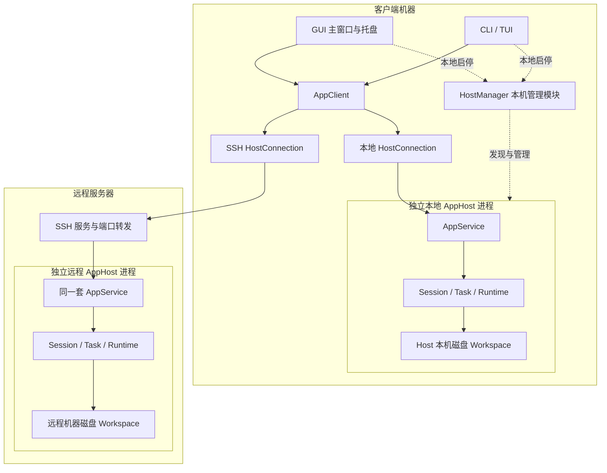
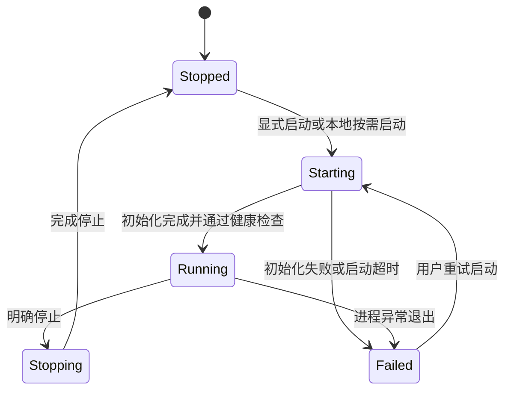
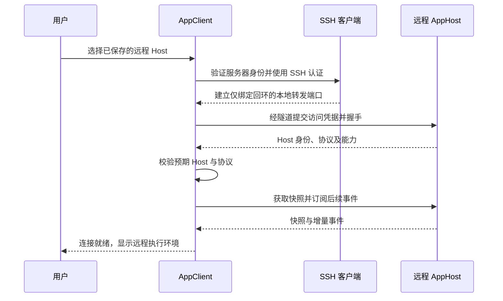
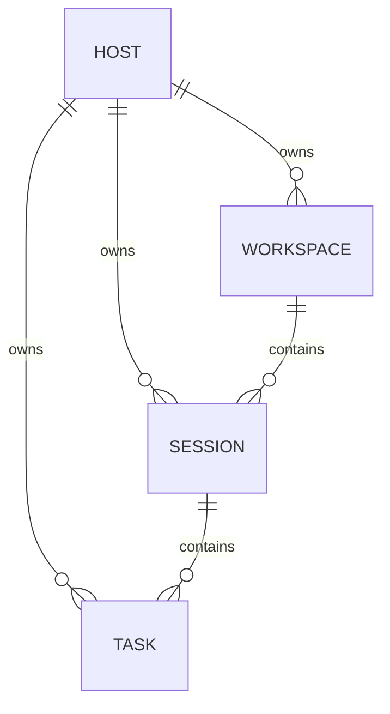
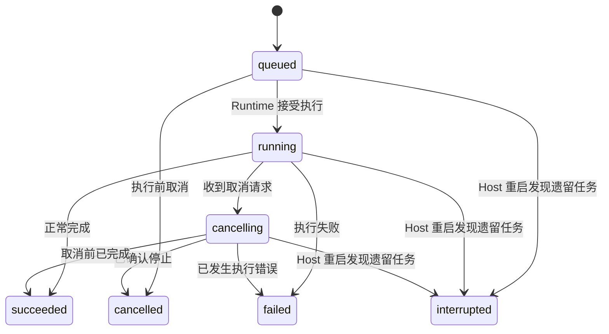
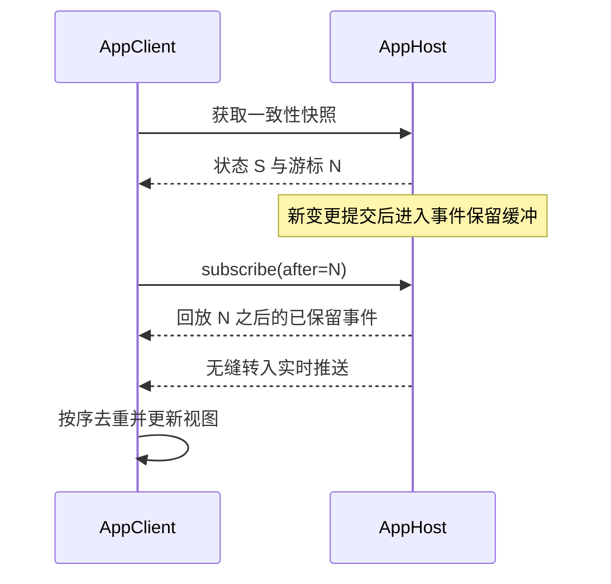

# Loushang 软件形态与运行架构设计

- 文档版本：0.0.1
- 编写日期：2026-11-06
- 状态：首版实现设计基线
- 适用范围：单用户、多客户端，本地与 SSH 远程 AppHost
- 依据：已确认的 Loushang 产品架构讨论及本次文档要求

> 本文把已确定的产品边界固化为可实施、可验证的设计。接口名、字段名、命令行形式及存储组织是建议契约，不代表现有代码已实现；实现时可适配已有 AppService，但不得改变归属、生命周期和恢复语义。本文不假定具体桌面框架、后端语言或数据库。

> 0.0.1 补充说明：本文作为 `lane/gui` 的目标设计基线保存，保留原文结构，并纳入本次讨论确认的 Host 唯一业务事实来源、前端按需启动、目录并发保护及未确认请求恢复要求。全部发行形态均保留。统一托管 TUI 是本文的目标方向，与[保留内嵌 TUI 的旧提案](appservice-embedded-tui-hosted-boundary-plan.md)存在方向差异，不表示现有实现已完成迁移。本文 Task 指一次提交对应的执行；与既有 GUI 的 Run / execution / Task 术语映射须在实现时明确，不直接替换现有协议。Web 暂缓，远程自动启动尚未确认，暂沿用本文“预先启动、仅连接”的边界。

## 目录

1. [目标与设计原则](#1-目标与设计原则)
2. [软件形态与职责](#2-软件形态与职责)
3. [整体运行架构](#3-整体运行架构)
4. [AppHost 生命周期](#4-apphost-生命周期)
5. [GUI、托盘与终端交互](#5-gui托盘与终端交互)
6. [HostManager 与 HostConnection](#6-hostmanager-与-hostconnection)
7. [本地连接与 SSH 远程连接](#7-本地连接与-ssh-远程连接)
8. [Host 身份与多 Host 切换](#8-host-身份与多-host-切换)
9. [Workspace、Session、Task 与文件边界](#9-workspacesessiontask-与文件边界)
10. [单用户多客户端一致性](#10-单用户多客户端一致性)
11. [协议握手与能力协商](#11-协议握手与能力协商)
12. [快照、事件订阅与断线恢复](#12-快照事件订阅与断线恢复)
13. [命令幂等与结果不确定性](#13-命令幂等与结果不确定性)
14. [接口契约与错误模型](#14-接口契约与错误模型)
15. [配置、数据与凭据归属](#15-配置数据与凭据归属)
16. [部署、发行与升级](#16-部署发行与升级)
17. [实施阶段与交付物](#17-实施阶段与交付物)
18. [验收标准](#18-验收标准)
19. [暂不实现范围](#19-暂不实现范围)
20. [实现约束与开发检查表](#20-实现约束与开发检查表)

## 1. 目标与设计原则

### 1.1 首版要解决的问题

Loushang 由客户端与执行服务组成。用户可以在本机或远程服务器运行 AppHost，通过 GUI、CLI 或 TUI 使用同一套业务能力。任务的执行位置由当前选中的 Host 决定。

首版必须跑通以下闭环：

1. 不打开 GUI，也能独立启动 AppHost。
2. GUI、CLI、TUI 可以连接已经运行的 AppHost。
3. 关闭客户端、关闭主窗口、网络断开，不中断 Host 上的任务。
4. 客户端重新连接后，能恢复会话、任务状态及可用的执行记录。
5. 本地客户端能通过 SSH 隧道连接远程 AppHost。
6. 用户可保存多个 Host 并切换执行环境，切换不影响原 Host 的任务。
7. Host 与客户端可独立安装，桌面发行包也可捆绑 Host。

### 1.2 必须保持的架构原则

| 原则 | 具体约束 |
| --- | --- |
| Host 独立 | AppHost 为独立进程，其存活不依赖 GUI、托盘、CLI 或 TUI |
| Client 统一 | 各客户端通过 AppClient 调用同一 AppService 业务契约 |
| Host 为唯一业务事实来源 | Workspace、Session、Task、待处理交互和执行配置由所属 Host 管理；各前端展示其投影并提交操作 |
| 执行位置明确 | 任务和文件操作发生在目标 Host 的 Workspace 中 |
| 连接与管理分离 | HostConnection 管连接，HostManager 只管理本机进程 |
| 按需启动 | 使用本地能力时才考虑启动本地 Host；仅连接远程不启动本地 Host |
| 显式停止 | 断开连接和退出客户端不等于停止 Host |
| 恢复有边界 | 保证客户端重连后的状态恢复，不承诺 Host 重启后的任务续跑 |
| 首版实现克制 | 复用现有 AppService、Runtime 和存储能力，只补齐独立运行所需机制 |

### 1.3 “长期运行”的准确含义

AppHost 在正常运行、用户登录环境允许且机器可用的条件下持续提供服务。它不受客户端连接数量影响，零客户端连接时仍可执行任务。

“长期运行”不表示进程永不失败，也不表示默认安装系统服务、默认开机启动或自动恢复执行。机器休眠会暂停执行；用户注销、操作系统退出和 Host 被停止可能结束进程，具体取决于部署方式。

## 2. 软件形态与职责

### 2.1 核心组成

| 组成 | 职责 | 不承担的职责 |
| --- | --- | --- |
| AppHost | 承载 AppService、管理执行状态、文件及任务运行 | 窗口、托盘、客户端偏好 |
| AppService | 提供 Workspace、Session、Task、配置及事件契约 | UI 渲染、本机客户端进程管理 |
| Agent Runtime | 在 Host 中执行任务，调用 Host 侧工具和模型 | 依赖 GUI 存活、客户端连接恢复 |
| AppClient | 封装调用、握手、能力协商、重连及状态同步 | 成为任务执行主体、保存权威执行状态 |
| HostConnection | 建立和维护一个目标 Host 的通信通道 | 自动停止 Host、远程部署服务 |
| HostManager | 发现、启动、查询、停止和重启本机 Host | 远程 Host 的进程控制 |
| GUI 主窗口 | Host 选择、Workspace/Session 展示、任务交互 | 直接访问工作区业务文件或持有 Runtime |
| GUI 托盘 | 打开窗口、显示本地 Host 状态、提供本地管理入口 | 替代 AppHost 或充当任务保活器 |
| CLI | 一次性命令、脚本调用、Host 管理入口 | 默认随命令退出终止 Host |
| TUI | 终端中的交互式会话与任务展示 | 与 GUI 使用不同的任务执行路径 |

AppClient 是可复用的客户端访问模块，不要求单独运行一个“客户端服务进程”。HostManager 也只是本地管理模块，首版不另设常驻管理守护进程。

### 2.2 GUI：主窗口与托盘

主窗口与托盘属于同一桌面产品。可以由同一客户端进程承载，不要求额外拆分托盘进程。它们都不是 AppHost 的生命周期容器。

- 主窗口负责主要业务交互。
- 托盘提供便捷入口和本地 Host 管理。
- 托盘不可用的平台仍应可通过窗口和 CLI 完成必要操作。
- 托盘可显示本地 Host 状态；远程 Host 在 GUI 中提供连接状态，不提供启停按钮。

### 2.3 CLI / TUI

CLI 与 TUI 通过同一 AppClient 使用 AppService。CLI 可以执行单次查询或提交任务；TUI 可以持续订阅事件。

GUI、CLI、TUI 在用户开始使用本地能力时均可发现并按需启动本地 Host，启动就绪后再连接。脚本可显式选择“仅连接、不启动”，此时缺少 Host 返回明确错误。各前端复用 HostManager，不分别实现启动规则。任何自动启动都必须遵守本机范围，不能自动部署或启动远程服务。

### 2.4 未来 Web 的边界

Web 只是未来可增加的客户端形态，首版不交付 Web 应用或浏览器接入服务。现阶段只要求 AppService 不依赖桌面窗口对象，AppClient 的业务契约不把本地进程句柄、桌面 IPC 对象或本机路径当成公共数据。

浏览器无法直接执行 HostManager 或建立本机 SSH 隧道。首版不为未来 Web 增加接入层、浏览器认证或部署组件。

## 3. 整体运行架构



本地与远程运行同一套 AppHost 核心实现。区别是进程所在机器、连接参数和运维方式，而不是业务 API、任务模型或状态语义。

客户端侧组件之间的分层可以是代码模块，不要求逐层部署。首版不增加中心 Host 注册服务或独立控制平面。

## 4. AppHost 生命周期

### 4.1 运行方式

AppHost 应支持以下模式：

| 模式 | 用途 | 生命周期来源 |
| --- | --- | --- |
| 前台运行 | 开发调试、手动运行、被操作系统服务托管 | 当前前台命令或服务管理器 |
| 本地后台运行 | 桌面/终端按需启动 | HostManager 启动独立进程 |
| 可选自启 | 用户明确启用后的登录或系统启动运行 | 操作系统提供的自启机制 |

自启默认关闭。“登录后启动”和“开机后无用户登录运行”是不同语义，安装界面必须说明当前支持哪一种。首版至少提供支持平台上的用户级自启；无登录系统级服务不作为跨平台首版承诺。

不能同时让两个机制争抢同一实例。自启和 HostManager 必须使用相同实例标识、数据目录和重复启动保护。由系统服务管理器托管时，启停应委托该管理器，避免服务被停止后立即被另一方重新拉起。

### 4.2 本地按需启动流程

1. 用户选择本地 Host。
2. HostManager 查找该实例的运行信息，并进行实际健康检查。
3. 已运行且身份匹配：直接连接。
4. 未运行：由当前前端通过 HostManager 按需启动；若显式选择“仅连接、不启动”，则返回明确错误。
5. Host 读取配置、打开存储、完成必要迁移、建立监听。
6. Host 原子写出就绪信息；HostManager 在限定时间内等待就绪。
7. AppClient 完成握手及状态同步后才允许提交业务操作。

后台启动必须真正脱离客户端生命周期。需要处理进程组、退出信号、标准输入输出以及桌面框架对子进程的默认清理行为；不得只在窗口启动逻辑中创建一个随父进程退出的子进程。

按需启动由用户开始使用本地能力触发，不由连接重试循环触发。用户明确停止 Host 后，已连接的前端不能因自动重连将其重新拉起；用户再次发起本地使用时可以重新启动。

### 4.3 实例发现与防重复启动

每个本地 Host 数据目录对应一个实例。首版默认使用一个本地实例；客户端可以保存多个远程 Host 配置，无需提供复杂的本机多实例编排 UI。

建议使用操作系统级排他锁，并配合受保护的运行信息文件：

```typescript
interface LocalHostRuntimeInfo {
  hostId: string;
  instanceId: string;       // 本次进程启动身份，重启后变化
  pid: number;
  startedAt: string;
  endpoint: string;         // 仅回环地址
  protocolMajor: number;
}
```

- PID 只用于辅助诊断，不能单独证明进程身份。
- 启动锁覆盖初始化阶段，避免 GUI 与 TUI 同时启动两个实例。
- 发现信息必须通过健康检查和握手验证，不能相信残留文件。
- PID 被复用时，不得误杀其他进程。
- 启动超时应显示诊断入口，不能无限拉起新进程。
- 监听端口冲突时明确报错，不能静默连接到未知服务。

### 4.4 生命周期状态



“连接断开”是 HostConnection 状态，不是 Host 进程状态。无法连接远程 Host 时，客户端只能显示连接不可达，不能断言远程进程已停止。

### 4.5 停止与重启

停止 Host 会影响该 Host 的所有客户端及任务，必须与“断开连接”“退出桌面客户端”分开。

首版停止语义：

1. 进入停止状态，拒绝新任务及其他执行类写入。
2. 对活动任务发起取消，给 Runtime 与工具子进程有限的退出时间。
3. 尽可能写入任务终态、日志和停止原因，关闭监听并退出。
4. 超时后允许用户明确执行强制停止；由 HostManager 验证目标实例后处理。
5. 重启等于停止再启动，不意味着恢复原任务执行。

GUI 在有活动任务时应显示明确确认及任务数量；CLI 可要求显式选项以确认影响。取消、停止超时和强制终止不能被展示为任务成功完成。

### 4.6 崩溃与重新启动

首版持久化已确认的 Session、Task 元数据和关键执行记录。客户端断线不会影响运行，但 Host 崩溃、被强制结束或机器重启后：

- 原来的 Runtime 不保证继续存在或续跑。
- Host 启动时将遗留的非终态任务标为 `interrupted`，并记录原因。
- 即使进程或外部工具可能已产生副作用，也不自动重新执行原任务。
- 用户可查看历史后明确创建新任务。
- 不把 `interrupted` 伪装成 `cancelled` 或 `succeeded`。

工具子进程应纳入 Host 的进程树清理策略；无法确认的外部副作用应在记录中说明，不能依靠重试隐藏不确定性。

## 5. GUI、托盘与终端交互

### 5.1 退出行为

| 用户动作 | 客户端行为 | AppHost 行为 |
| --- | --- | --- |
| 关闭主窗口，托盘可用且启用 | 隐藏窗口，托盘保留 | 继续运行 |
| 关闭主窗口，无托盘或未启用 | 按桌面偏好退出客户端 | 继续运行 |
| 托盘选择“退出客户端” | 关闭桌面客户端和其连接 | 继续运行 |
| CLI 命令结束 / TUI 退出 | 关闭当前终端客户端连接 | 继续运行 |
| 断开某个 Host | 关闭连接；必要时关闭本客户端的 SSH 隧道 | 继续运行 |
| 切换 Host | 切换展示及新命令目标 | 原 Host 任务继续运行 |
| 明确选择“停止本地 Host” | 通过 HostManager 发起停止 | 按停止流程结束 |

界面避免使用一个含糊的“退出 Loushang”同时表达客户端退出和服务停止。首版可以仅提供分开的操作，不必增加“退出并停止所有服务”等复合功能。

### 5.2 执行上下文提示

主窗口、任务提交区域及文件操作界面应持续显示：

- 当前 Host 名称及本地/远程标识。
- 当前连接状态。
- 当前 Workspace，路径含义为 Host 所在机器的路径。
- 当前 Session 和任务状态。

切换或重连过程中，禁用新的执行操作；不能让按钮仍可点击而请求悄悄落到旧连接或尚未确认的新连接。

### 5.3 CLI 建议形式

以下为语义示例，不强制现有命令名称：

```text
loushang host run                     # 当前终端前台运行
loushang host start                   # 启动本地后台 Host
loushang host status                  # 查询本地实例
loushang host stop                    # 停止本地 Host
loushang host restart                 # 重启本地 Host
loushang connect --host dev-server    # 使用已保存的目标配置
loushang tui --host local             # 本地交互式使用
loushang task submit --host dev-server --session <id> --input <text>
```

`host start/stop/restart` 只操作本地实例。任务提交返回稳定 `taskId`；CLI 自身结束后任务继续执行。等待任务完成可作为显式选项，取消等待只结束观察，不隐式取消任务。

## 6. HostManager 与 HostConnection

### 6.1 职责分离

| 操作 | HostManager | HostConnection / AppClient |
| --- | --- | --- |
| 发现本机运行实例 | 是 | 使用发现结果 |
| 启动、停止、重启本机进程 | 是 | 否 |
| 查询本机启动日志与就绪状态 | 是 | 否 |
| 建立 SSH 隧道 | 否 | 是 |
| 握手、鉴权、查询能力 | 否 | 是 |
| 查询 Workspace、操作 Session/Task | 否 | 是 |
| 快照、事件订阅、断线重连 | 否 | 是 |
| 自动部署或启停远程 Host | 否 | 否 |

HostManager 可通过本机受保护控制通道请求优雅停止，但该能力不得成为通用远程 AppService 的进程控制 API。仅有业务连接凭据的客户端不因此获得任意进程管理能力。

### 6.2 最小接口建议

```typescript
interface HostManager {
  inspectLocal(): Promise<LocalHostStatus>;
  ensureLocalRunning(): Promise<LocalHostRuntimeInfo>;
  stopLocal(options: { force: boolean }): Promise<void>;
  restartLocal(): Promise<LocalHostRuntimeInfo>;
}

interface HostConnection {
  connect(profile: HostProfile): Promise<HandshakeResult>;
  disconnect(): Promise<void>;
  state(): ConnectionState;
  call<T>(request: ServiceRequest): Promise<T>;
  subscribe(options: SubscribeRequest): AsyncIterable<HostEvent>;
}

type ConnectionState =
  | "disconnected" | "connecting" | "authenticating"
  | "handshaking" | "syncing" | "ready"
  | "reconnecting" | "incompatible" | "identity_mismatch";
```

只有 `ready` 状态接受普通业务写入。`disconnect()` 必须取消该连接的后台重连循环，释放其订阅及隧道，不停止目标 Host。

## 7. 本地连接与 SSH 远程连接

### 7.1 首版传输选择

为了减少实现分支，建议首版使用回环 HTTP 请求与 WebSocket 事件通道：本地直连，远程经 SSH 本地端口转发访问同一接口。若已有传输已能满足本文语义，可沿用；不要求为本文重新开发通信框架。

- Host 默认仅监听回环地址，不监听公网或局域网所有地址。
- 本地转发端口也只绑定本机回环地址。
- 业务调用、握手、状态快照和事件均经过同一授权边界。
- 明确消息大小、上传大小、超时、心跳和订阅缓冲上限。
- 健康存活不等于业务就绪，AppClient 以握手与同步完成为准。

### 7.2 本地授权

单用户不等于没有访问控制。Host 可以执行工具与修改文件，不能只依靠“端口在本地”判断可信。

建议为每个 Host 配置随机访问令牌，凭据使用当前用户可访问的安全存储或限制权限的文件保存。发现文件不携带明文令牌，普通日志和错误消息不得打印令牌。网络端点校验授权，并拒绝未授权的浏览器来源；令牌不放在 URL 查询参数中。

首版不建设账号系统。该令牌只是对个人 Host 执行接口的访问保护，不代表引入多用户权限模型。

### 7.3 SSH 连接流程

远程 Host 由用户在服务器上预先安装和启动，客户端只负责连接。



必须满足：

1. 复用成熟 SSH 实现与其密钥/agent 能力，不自行实现加密协议。
2. 校验 SSH 服务器主机密钥，不以关闭校验作为默认配置。
3. 首次信任或主机密钥变化走明确确认/错误流程。
4. SSH 凭据与 Host 访问令牌是两类凭据，分别保存。
5. 远程 Host 令牌由用户通过已有可信通道取得并配置，不通过不受控命令输出、日志或 Session 传递。
6. 隧道成功后仍要验证 Host 身份及协议，不能把“SSH 登录成功”视为业务服务正确。
7. 隧道中断只影响连接，不向远程 Host 发送进程退出或任务取消。
8. 重连时清理失效隧道并重新建立，不累积 SSH 进程。

### 7.4 首版不提供远程启停

连接失败时显示可区分的原因：SSH 认证失败、服务器身份变化、转发失败、远程服务不可达、Host 认证失败、协议不兼容等。

远程服务的安装、启动、停止、重启由用户在服务器上完成。GUI 不通过 SSH 自动执行安装脚本或管理远程进程。远程连接断开时，不显示误导性的“Host 已停止”。

## 8. Host 身份与多 Host 切换

### 8.1 连接配置与 Host 身份分开

```typescript
type HostProfile = {
  profileId: string;              // 客户端配置标识
  name: string;                   // 用户命名
  expectedHostId?: string;        // 首次确认后绑定
  authRef: string;                // 本机凭据引用，不是密钥正文
} & (
  | { kind: "local" }
  | {
      kind: "ssh";
      sshAlias: string;           // 优先引用已有 SSH 配置
      remoteLoopbackPort: number;
    }
);

interface HostIdentity {
  hostId: string;                 // 持久身份，正常重启不变
  instanceId: string;             // 本次运行身份，重启即变化
}
```

`profileId` 不是 `hostId`，地址和转发端口也不是 Host 身份。同一 Host 可被不同客户端以不同配置名访问。Host 初次初始化时产生 `hostId` 并保存在 Host 数据目录；复制目录部署独立 Host 时必须重新生成身份，不能复制出两个同时运行、身份相同的 Host。

已绑定配置收到不同 `hostId` 时阻止自动恢复、自动重发与业务写入，提示用户核对并明确重新绑定。正常重启只变化 `instanceId`，不应触发“更换 Host”确认。

### 8.2 切换规则

首版提供一个活动 Host 展示上下文，不要求同时聚合所有 Host 的任务。

1. 切换前停止旧视图的交互，保存按 Host 隔离的草稿和当前位置。
2. 结束旧订阅或将其转为后台观察；首版可以直接断开旧连接。
3. 建立目标连接，校验身份、握手并同步状态。
4. 成功后显示目标 Host 的 Workspace、Session 和 Task。
5. 若失败，展示明确失败状态；不能把待发命令自动转交其他 Host。
6. 旧 Host 继续执行，切回后重新同步。

连接管理不得以一个全局可变 URL 作为所有操作的隐式目标。业务命令创建时即绑定目标 `hostId`、Session 和 Workspace，不能在发送时重新读取“当前 Host”。异步响应和事件还应绑定连接代次，防止旧连接的迟到结果覆盖新页面。

客户端缓存、草稿、事件游标以及最近打开位置至少使用 `hostId` 作为命名空间。Session/Task 引用使用 `(hostId, sessionId/taskId)`，避免不同 Host 的相同局部 ID 相互污染。

## 9. Workspace、Session、Task 与文件边界

### 9.1 归属模型



首版约束：

- 一个 Workspace 只属于一个 Host，对应该 Host 机器上的磁盘目录。
- 一个 Session 固定属于一个 Host 和一个 Workspace。
- 一个 Task 固定属于一个 Session，继承其 Host 和 Workspace。
- Task 创建后不改变归属，不迁移到其他 Host 执行。
- Host 校验引用链，不能只相信客户端填写的多个 ID。
- Session 历史和任务元数据可保存在 Host 状态存储，不要求放入项目目录。
- Workspace 尚有关联会话或运行任务时，首版拒绝直接删除其记录；不隐式递归删除磁盘项目。

### 9.2 最小数据模型

```typescript
interface Workspace {
  workspaceId: string;
  hostId: string;
  name: string;
  rootPath: string;              // Host 侧路径；客户端仅展示
  revision: number;
}

interface Session {
  sessionId: string;
  hostId: string;
  workspaceId: string;
  title: string;
  revision: number;
}

type TaskStatus = "queued" | "running" | "cancelling"
  | "succeeded" | "failed" | "cancelled" | "interrupted";

interface Task {
  taskId: string;
  hostId: string;
  workspaceId: string;
  sessionId: string;
  status: TaskStatus;
  revision: number;
  createdAt: string;
  finishedAt?: string;
  reason?: string;
}
```

首版建议同一 Session 只允许一个非终态任务。并发提交由 Host 串行检查并返回 `SESSION_BUSY`，不建立复杂队列调度。不同 Session 可以在现有 Runtime 支持范围内并发，但同一实际工作目录默认不同时执行可能修改项目的任务；无法可靠区分读写性质时按可能写入处理。Host 按规范化后的实际目录及其重叠关系实施互斥，不能只按 `workspaceId` 判断；冲突返回 `WORKSPACE_BUSY`，不自动排队。用户显式允许共享目录并行后，不承诺文件级事务或自动合并，界面应显示其他活动任务。打开多个 Session 本身不占用目录执行权。

### 9.3 文件操作

Workspace 文件读取、写入、目录浏览、工具执行及 Git 操作都由所属 Host 处理。即使选择本地 Host，GUI 也应走相同业务契约，避免本地直读文件形成第二套路径。

建议文件请求使用 `workspaceId + relativePath`。Host 进行规范化与权限检查，防止普通文件 API 利用 `..`、绝对路径或符号链接跳出约定边界。

这一约束不等于把 Shell 工具变为完整沙箱。首版 Runtime 使用 Host 当前操作系统用户权限，工具工作目录指向 Workspace；如现有工具没有强隔离能力，文档和 UI 不得声称“任何工具绝不可能访问工作区以外”。

### 9.4 远程文件隔离

连接远程 Host 时：

- `/srv/project` 指远程服务器上的目录。
- `read_file`、Shell、Git、Node、Python 等均在远程 Host 环境执行。
- 本地文件选择器返回的绝对路径不能当作远程文件引用。
- 远程工具默认没有本地文件读取代理。
- 不自动同步本地项目、凭据或环境变量。

若首版提供附件入口，必须显式上传：用户确认目标 Host/Workspace → 客户端读取用户选择的文件 → 通过已授权连接上传 → Host 返回附件 ID → 任务引用该 ID。上传未完成时不得提交一个只有本地路径的附件引用。

附件写入临时位置，完成校验后才发布为可引用资源；失败上传不能成为有效附件。下载也必须显式选择本地保存位置。附件大小上限、保留周期、同名处理和失败提示应作为实现参数明确配置。

如果首版尚未交付附件传输，应禁用远程拖入本地文件的入口并说明原因；不能以自动同步或直接传路径代替。

## 10. 单用户多客户端一致性

同一个人可以同时使用 GUI、CLI、TUI 连接同一 Host。所有客户端看到的是同一份 Host 状态，不创建各自独立的执行世界。

### 10.1 写入与并发

- Host 校验并执行所有业务命令。
- 客户端可以展示乐观交互状态，但最终结果以 Host 为准。
- 对修改已有资源的操作使用 `expectedRevision` 或等效条件，冲突返回 `REVISION_CONFLICT`。
- 任务创建与 Session 忙闲检查必须在同一受控提交过程内完成。
- 任务取消是请求，收到取消响应不等于 Runtime 已停止。
- 取消与自然完成竞争时，Host 根据实际完成顺序确定唯一终态。
- 任务状态一旦进入终态，不得被迟到事件回退到运行中。

### 10.2 最小任务状态流



取消请求可重复调用，返回当前状态；不能重复启动取消副作用。多个客户端对同一 Session 的操作必须遵守相同规则，不允许 GUI 通过本地捷径绕过检查。

### 10.3 审批、追问与等待用户

待审批事项、追问和选择请求由 Host 持有，以独立交互记录关联 Task，包含稳定交互 ID、当前状态、修订号及必要的展示内容；不由某个窗口持有唯一副本。

- 没有客户端连接时，任务可等待用户，不因断线自动批准、取消或失败；若配置超时，由 Host 记录实际处理结果。
- 快照包含当前待处理交互，事件通知其变化；重连后 GUI、CLI/TUI 均可展示和提交回答。
- 回答绑定交互 ID、所属 Host 和修订号，并遵守命令幂等规则。多端竞争时，Host 只接受一个有效决议，其余端读取最终状态。
- Task 终止后，其待处理交互随之失效；迟到回答不能重新启动任务。Host 重启仍遵守不自动续跑的边界。
- “客户端退出后任务继续执行”表示任务不因客户端退出而取消，不保证等待用户时仍持续推进；等待原因可独立于 Task 主状态展示。

客户端的主题、布局、未发送草稿和可丢弃缓存不构成业务事实。“已提交”“已批准”“已完成”等确定状态必须来自 Host 确认。

## 11. 协议握手与能力协商

### 11.1 软件版本与协议版本分开

GUI 和 Host 不要求软件版本号一致。能否使用由协议交集与必要能力决定。软件版本只用于展示、诊断和升级提示。

下面使用协议主版本和次版本表达兼容性：主版本改变表示不兼容语义，次版本只做可兼容增加。首版仅实现一套协议即可，但必须具有明确握手。

```typescript
interface HandshakeRequest {
  clientName: "gui" | "cli" | "tui";
  clientVersion: string;
  supportedProtocols: Array<{ major: number; maxMinor: number }>;
  requiredCapabilities: string[];
}

interface HandshakeResult {
  hostId: string;
  instanceId: string;
  hostVersion: string;
  protocol: { major: number; minor: number };
  capabilities: string[];
  eventEpoch: string;
  limits: {
    maxMessageBytes: number;
    eventReplayRetentionSeconds: number;
    idempotencyRetentionSeconds: number;
  };
}
```

能力名建议包括 `workspace.read`、`session.create`、`task.submit`、`task.cancel`、`state.snapshot`、`events.resume`。`file.upload` 等可选能力仅在实现并可用时返回。

### 11.2 协商规则

1. 认证通过后进行握手；业务方法不能在握手完成前调用。
2. 选择双方支持的公共主版本及该版本允许的次版本。
3. 没有公共版本：返回 `PROTOCOL_INCOMPATIBLE`，停止业务连接。
4. 缺少客户端核心必需能力：停止进入工作界面并说明缺失项。
5. 缺少可选能力：隐藏或禁用对应入口，不发送碰运气请求。
6. Host 实际执行请求时仍验证能力与资源，不能只依赖 UI 禁用。
7. 新增可选字段可忽略；未知且必需的语义必须显式拒绝。
8. 重连后重新握手，因为目标 Host 可能已升级或重启。

协议不兼容、认证失败、身份变化属于需要处理的明确错误，不应无限自动重试。不能因为桌面包带有新版 Host 就自动替换用户正在运行的旧实例。

## 12. 快照、事件订阅与断线恢复

### 12.1 快照与事件各自负责什么

- 快照：某一确定状态切面的完整权威状态。
- 事件：该切面之后发生的增量变更。
- 分页记录接口：任务历史输出和较大日志，避免把所有内容塞进快照。

客户端不能只依赖“从连接时开始监听”，否则会丢失断线期间的状态；也不能“先取快照再普通订阅”而没有游标，否则两步之间会出现缺口。

### 12.2 游标模型

首版建议使用单 Host 范围、严格递增的事件序号。使用字符串编码，避免跨语言大整数精度差异。

```typescript
interface EventCursor {
  epoch: string;                 // 事件流代次，重建流时变化
  seq: string;                   // 该代次中严格递增的整数
}

interface StateSnapshot {
  hostId: string;
  instanceId: string;
  cursor: EventCursor;
  workspaces: Workspace[];
  sessions: Session[];
  tasks: Task[];                  // 当前状态；大量历史另行分页
  // 实现时还须包含当前待处理交互，见 10.3；不得仅通过实时事件提供。
}

interface HostEvent {
  hostId: string;
  cursor: EventCursor;
  type: string;
  resourceId: string;
  resourceRevision: number;
  payload: unknown;
}
```

首版可在 Host 每次启动时生成新的 `eventEpoch`，重启后要求完整快照，不必跨进程恢复事件序号。Host 稳定身份仍保持不变。

### 12.3 无缺口的初始化



Host 必须保证：

- 快照内的数据与游标对应同一一致性切面。
- 已提交状态变更与其关键事件建立确定顺序。
- 从历史回放切到实时订阅时，不漏掉期间事件。
- 游标已超出保留范围时，返回 `CURSOR_EXPIRED`，不能返回一个看似正常但有缺口的流。

实现可以使用数据库事务、短时状态锁和有界事件缓冲等现有机制，不需要引入消息队列集群。为降低复杂度，快照先采用单次一致性读取；若以后分页，必须另行保证各页属于同一快照，不能简单分多次读取后拼接。

### 12.4 断线重连

1. 发现传输或心跳异常，进入 `reconnecting`，将展示状态标为可能过期。
2. 保留最后一个已应用的事件游标，暂停普通业务写入。
3. 在有上限的退避与随机抖动策略下重试，用户断开操作可随时终止重连。
4. 重新建立通道并完成认证、握手及 Host 身份校验。
5. `hostId` 一致、事件代次相同且游标可用：补齐游标之后事件。
6. 事件代次变化或游标过期：重新获取快照并订阅。
7. 对未确定结果的命令按幂等规则查询或重试，不能直接生成新请求。
8. 同步完成才恢复 `ready`。

客户端按照游标去重；事件有缺口、资源版本回退或无法识别的必要事件语义时，停止增量应用并重新同步。不同 Host 的事件与不同代次的游标不能混用。

### 12.5 慢客户端与日志保留

事件保留和每个订阅的缓冲必须有界。客户端太慢时，Host 可以关闭订阅并要求重同步，不能无限堆积内存或阻塞 Runtime。

任务状态是权威数据；实时输出属于可分页的执行记录。关键输出应在向客户端确认可恢复前写入 Host 存储。若日志因保留策略被清理，UI 明确显示截断，不能宣称所有历史输出永久完整。首版不要求逐字符输出均成为独立持久事件，可按块保存并用序号读取。

## 13. 命令幂等与结果不确定性

### 13.1 必须处理的失败场景

客户端发送创建任务请求，Host 已创建任务，但响应丢失。客户端重试时必须返回同一个任务，不能启动第二次 Agent。

`requestId` 用于一次命令的相关性与幂等，不应每次网络重试都重新生成。相同内容但由用户明确再次发起的任务，应使用新的请求 ID。

### 13.2 建议请求结构

```typescript
interface CommandEnvelope<T> {
  requestId: string;             // 客户端生成，重试保持不变
  targetHostId: string;
  method: string;
  expectedRevision?: number;
  params: T;
}
```

Host 以 `(hostId, requestId)` 作为幂等键，保存方法、规范化请求摘要及已提交结果。

- 同一键、同一参数：返回原结果或“仍在处理”，不再次创建资源。
- 同一键、不同方法或参数：返回 `IDEMPOTENCY_CONFLICT`。
- 两个并发相同请求：只有一个完成首次提交。
- 幂等记录与对应 Session/Task 创建应在同一事务或等效原子操作中持久化。
- 任务实际执行放在提交之后，由 Host 受控启动，不能在事务提交前调用外部工具。

### 13.3 Host 侧伪代码

```text
handleSubmit(command):
    verifyAuthenticatedAndReady()
    verifyTargetHost(command.targetHostId)
    digest = hash(canonicalize(command.method, command.params))

    transaction:
        previous = getIdempotency(command.requestId)
        if previous exists:
            if previous.digest != digest:
                return IDEMPOTENCY_CONFLICT
            return previous.committedResult

        verifySessionAndWorkspaceOwnership(command.params)
        verifyExpectedRevision(command.expectedRevision)
        rejectIfSessionAlreadyHasActiveTask()
        reserveWorkspaceExecutionOrRejectBusy()  // 与任务创建原子提交，终态释放
        task = insertTask(status = queued)
        updateSessionRevision()
        saveIdempotency(command.requestId, digest, { taskId: task.id })
        commit

    publishCommittedTaskState(task)
    scheduleTaskWithinCurrentHostProcess(task.id)
    return { taskId: task.id }
```

伪代码表达语义；具体实现还必须保证关键状态变更和事件发布之间的同步顺序。若提交后、执行前 Host 崩溃，重启将该任务标为 `interrupted`，不自动补执行。

### 13.4 保留窗口与查询

Host 在握手中声明幂等记录保留时长。客户端可通过 `command.getResult(requestId)` 查询结果；结果区分 `committed`、`pending` 与 `unknown`。

在保留窗口内，响应丢失后使用原请求 ID 查询或重试。超出窗口仍无法确认的命令，UI 显示“结果未知”，查询已有 Task 记录辅助核对，不自动生成新 ID 重发。`unknown` 不是“肯定未执行”。

首版承诺业务提交的幂等，不承诺外部 Shell、第三方模型或工具副作用的全局“恰好一次”。Host 崩溃后自动重跑外部操作不在本期范围。

### 13.5 客户端重启后的未确认请求

客户端发送写命令前，先持久记录目标 `hostId`、原 `requestId`、方法及核对/重试所需的最小请求信息；确认提交结果或明确拒绝后清理。记录按 Host 隔离并保护敏感内容，不保存认证密钥。客户端重启后，先向原 Host 查询结果，再按 13.4 的保留窗口规则处理，不能换 Host 或生成新 ID 自动重发。

该记录仅表达客户端尝试提交过什么，不是执行事实、离线任务队列或成功凭据；命令是否接受及 Task 最终状态仍由 Host 唯一确认。

## 14. 接口契约与错误模型

### 14.1 最小业务接口

下表为语义契约，可映射到已有 AppService 方法。

| 方法 | 主要输入 | 主要输出 / 约束 |
| --- | --- | --- |
| `connection.handshake` | 客户端信息、支持协议、必需能力 | Host 身份、协商协议、能力与限制 |
| `state.getSnapshot` | 当前 Host 上下文 | 一致状态快照及游标 |
| `events.subscribe` | `after: EventCursor` | 回放后实时事件流 |
| `workspace.list` | 无 | 该 Host 的工作区 |
| `workspace.create` | Host 侧根目录、名称、请求 ID | 经 Host 校验的 Workspace |
| `session.list` | `workspaceId`、分页参数 | 指定工作区的会话 |
| `session.create` | `workspaceId`、标题、请求 ID | Session |
| `task.submit` | `sessionId`、输入、附件引用、请求 ID | 稳定 `taskId` 与已提交状态 |
| `task.get` | `taskId` | 权威任务状态 |
| `task.cancel` | `taskId`、请求 ID | 当前状态；不表示已停止 |
| `task.readOutput` | `taskId`、输出游标、条数限制 | 输出块、下一游标、截断标志 |
| `interaction.respond` | 交互 ID、回答、修订号、请求 ID | Host 确认的交互结果；拒绝过期或已失效回答 |
| `command.getResult` | 原始 `requestId` | 已提交结果、处理中或未知 |
| `config.get/update` | 配置范围、字段、版本、请求 ID | 脱敏配置、修订号 |
| `file.read/write` | Workspace、相对路径、必要版本条件 | Host 侧文件内容或写入结果 |

文件上传、下载按可选能力提供。普通业务接口不包含 `host.stopRemote`、`host.installRemote` 等方法。

### 14.2 统一响应

```typescript
type ServiceResponse<T> =
  | { requestId: string; ok: true; data: T }
  | {
      requestId: string;
      ok: false;
      error: {
        code: string;
        message: string;
        retryable: boolean;
        details?: Record<string, unknown>;
      };
    };
```

| 错误码 | 含义 | 客户端处理 |
| --- | --- | --- |
| `AUTH_FAILED` | Host 凭据无效 | 停止自动重试，提示更新凭据 |
| `HOST_ID_MISMATCH` | 实际 Host 与绑定身份不同 | 阻止写入及旧命令恢复 |
| `PROTOCOL_INCOMPATIBLE` | 无公共协议版本 | 显示双方版本与升级提示 |
| `CAPABILITY_UNAVAILABLE` | 目标不支持该功能 | 禁用相关入口 |
| `HOST_STOPPING` | Host 正在停止 | 停止提交，保留待确认状态 |
| `RESOURCE_NOT_FOUND` | 资源不在当前 Host 或已不存在 | 刷新列表，不跨 Host 查找替代 |
| `REVISION_CONFLICT` | 并发状态变化 | 重新读取后由用户决定操作 |
| `SESSION_BUSY` | 同会话已有活动任务 | 展示活动任务，不自动排队 |
| `WORKSPACE_BUSY` | 同一或重叠工作目录已有互斥执行 | 展示占用任务，等待结束或由用户明确选择并行 |
| `CURSOR_EXPIRED` | 增量恢复所需事件已清理 | 获取新快照 |
| `IDEMPOTENCY_CONFLICT` | 同一请求 ID 对应不同命令 | 中止重试并报告客户端错误 |
| `PATH_OUTSIDE_WORKSPACE` | 文件 API 路径越界 | 拒绝，不自动修正到其他目录 |
| `RESULT_UNKNOWN` | 无法确认此前命令结果 | 提示核对，不盲目重发 |

`retryable` 只表示允许按既定规则重试，不允许改变目标 Host、丢弃幂等键或无限重试。错误详情和诊断日志必须脱敏。

## 15. 配置、数据与凭据归属

“配置和数据跟随软件”表示归属与执行位置一致，不表示把用户数据写入程序安装目录。

| 数据 / 配置 | 保存位置与所有者 | 切换 Host 时行为 |
| --- | --- | --- |
| 语言、主题、窗口布局、托盘偏好 | Client 用户配置 | 保留当前客户端偏好 |
| 已保存 Host 配置、名称、最近选择 | Client 用户配置 | 选择不同连接配置 |
| SSH 密钥引用、Host 访问令牌引用 | Client 安全存储或受限凭据文件 | 按连接配置读取，不互相复制 |
| 未发送草稿、最后打开的 Session | Client，按 Host/Session 隔离 | 显示对应 Host 的草稿和位置 |
| 已发送但结果未确认的命令记录 | Client，发送前持久保存原请求 ID 与目标 | 只向原 Host 核对，不作为执行事实 |
| 客户端事件游标、视图缓存 | Client，按 Host/事件代次隔离 | 仅用于加速恢复，可丢弃 |
| Host 稳定身份、监听及运行配置 | Host 配置目录 | 各 Host 独立 |
| Workspace 注册信息与路径 | Host 状态存储 | 各 Host 独立 |
| Session、Task、命令幂等记录 | Host 状态存储 | 各 Host 独立 |
| 待处理交互及其处理结果 | Host 状态存储 | 随所属 Host 恢复，客户端不持有唯一副本 |
| 项目文件与产物 | Host Workspace 磁盘目录 | 不自动传输 |
| 模型 Provider、Endpoint、Model | Host 配置/状态存储 | 展示和修改目标 Host 配置 |
| 模型 API Key、工具凭据 | Host 安全存储或受限凭据文件 | 不随 Client 切换自动同步 |
| Runtime / 工具执行参数 | Host 配置 | 在所属 Host 生效 |
| 执行日志与输出 | Host 数据目录 | 从目标 Host 查询 |
| 桌面捆绑的 Host 可执行文件 | 安装目录 | 不包含用户状态和密钥 |

### 15.1 配置编辑规则

GUI 可编辑远程 Host 的执行配置，但通过 AppService 写入远程 Host。界面显示“正在修改哪个 Host”，保存结果由该 Host 返回。

- 不把本机环境变量或本地模型 Key 自动同步到远程。
- 配置查询对密钥仅返回“已设置”及必要脱敏提示，不返回完整原值。
- 更新凭据使用专用字段/操作，避免把脱敏占位字符串覆盖成实际密钥。
- 配置更新返回修订号，并通过事件通知其他客户端。
- 不支持热更新的配置明确提示重启生效，不能静默重启 Host。
- 本地端点、服务启动方式等管理配置由 Host/HostManager 管理，不开放为任意远程执行配置。

### 15.2 数据目录原则

```text
Client 用户目录
├── preferences
├── host-profiles
├── drafts / view-cache
└── credential-references

Host 用户目录
├── config
├── identity
├── state-store
├── logs / task-output
├── attachments（启用上传时）
└── runtime-info / lock（可放操作系统运行目录）

Workspace 根目录
└── 用户项目文件与任务产物
```

具体路径遵守目标操作系统用户目录规范。安装更新不覆盖用户数据；删除一个 Host 连接配置只删除客户端入口，不删除远程 Host、Session 或项目文件。

## 16. 部署、发行与升级

### 16.1 发行包

| 发行物 | 内容 | 使用方式 |
| --- | --- | --- |
| Host 独立包 | AppHost、启动入口、必要 Runtime 依赖、本地诊断/管理入口 | 服务器或无界面环境独立运行 |
| GUI 客户端独立包 | GUI、托盘、AppClient、连接能力 | 连接已有本地或远程 Host |
| CLI / TUI 包 | 终端入口、AppClient、连接及本地管理能力 | 独立终端使用 |
| Desktop 捆绑包 | GUI 客户端与匹配的 Host 可执行组件 | 本地开箱使用，也可仅连接远程 |

客户端独立包没有 Host 可执行文件时，本地按需启动应说明需要安装 Host，不能下载或运行未知版本。CLI/TUI 是否与 Host 放在一个安装归档中可按发行平台决定，但逻辑依赖与生命周期必须独立。

Host 包运行不依赖桌面图形库或窗口初始化。Desktop 捆绑只是安装便利，不代表把 Host 嵌入 GUI 进程。

上述四类发行物均为本设计要求，不因分阶段实施而取消独立 GUI、CLI/TUI 或其他形态；用户级自启、升级兼容和相应验收仍属于首版范围。

### 16.2 本地桌面首次使用

1. 安装 Desktop。
2. 选择本地使用，按需启动捆绑的独立 Host。
3. 发现并握手，创建 Workspace 后执行任务。
4. 关闭 GUI 后 Host 保持运行。
5. 自启为单独可选设置，默认不启用。

如果首次使用直接选择远程 Host，则只建立远程连接，不启动本地 Host。

### 16.3 远程部署

1. 用户在服务器安装 Host 包和实际需要的运行依赖。
2. 指定 Host 数据目录、工作区目录及回环监听端口。
3. 配置 Host 访问凭据与模型执行配置。
4. 手动或通过该服务器现有服务管理方式启动 Host。
5. 本地添加 SSH 连接配置，配置 Host 凭据引用。
6. 握手确认身份后开展工作。

具体支持的操作系统和 CPU 架构由发布矩阵列明，不假定单一二进制可跨平台运行。

### 16.4 升级与兼容

- 客户端和 Host 可分别升级，以握手判断兼容性。
- Desktop 更新后如发现旧 Host 仍在运行，继续使用兼容能力，或提示用户显式重启升级。
- 不因 GUI 启动就杀死旧 Host 或中断活动任务。
- Host 状态存储迁移在启动就绪前完成，失败时不进入可服务状态。
- 迁移应有备份和明确失败提示，不自动以空数据库代替旧数据。
- 不承诺跨数据格式降级，发布说明需标注限制。
- 现有 Workspace、Session 历史、设置及 Plugin 选择须保留可继续使用的兼容入口或可恢复迁移；不能要求用户清空状态、重建工作区或重置配置。参见 [ARD-008](../decisions/accepted/ARD-008-workspace-upgrade-compatibility.md)。

## 17. 实施阶段与交付物

### 阶段 1：让 AppHost 脱离 GUI 独立运行

**交付内容**：独立启动入口；前台/后台模式；实例锁、就绪检查；本地 status/stop/restart；数据与日志目录；基本优雅停止。

**完成条件**：不启动 GUI 可以执行服务健康与业务查询；客户端退出后 Host 存活；GUI/TUI 同时启动时不会重复创建实例。

**先不做**：远程管理、托盘细节、多 Host 聚合。

### 阶段 2：统一 AppClient 与恢复契约

**交付内容**：GUI、CLI/TUI 复用 AppService；握手与能力检查；稳定 Host 身份；快照与可恢复订阅；请求幂等；多客户端冲突处理；Host 重启后的遗留任务标记。

**完成条件**：关闭再打开客户端能恢复原状态；响应丢失重试不重复创建任务；GUI 与 TUI 对相同 Session 的状态一致。

### 阶段 3：SSH 远程连接与多 Host 切换

**交付内容**：保存 HostProfile；SSH 隧道生命周期；远程凭据配置；身份绑定；按 Host 隔离缓存与草稿；活动 Host 切换；远程路径与文件错误提示。

**完成条件**：同一客户端分别在本机和服务器执行任务，切换与断线不影响旧任务；旧请求不会误投新 Host；远程服务不可达时提示准确。

### 阶段 4：桌面主窗口、托盘与按需启动体验

**交付内容**：窗口关闭策略；托盘本地状态与启停入口；本地按需启动偏好；可选用户级自启；连接/执行位置持续展示。

**完成条件**：窗口、托盘、Host 的退出语义清楚；无托盘平台可操作；连接远程时不拉起本地 Host；自启与手动启动不冲突。

### 阶段 5：分包发行与端到端验证

**交付内容**：独立 Host、客户端和 Desktop 包；部署说明；版本兼容提示；升级与日志诊断流程；下述验收场景记录。

**完成条件**：在干净本机和真实远程机器上验证，不依赖开发环境中的 GUI 或隐式文件路径。

阶段按依赖推进，可复用已有能力。第一条主线是“独立 Host → 客户端连接 → 退出后继续执行 → 重新连接恢复”，该链路验证通过后再完善发行体验。

## 18. 验收标准

以下以可观察结果为准，不能只验证进程启动或接口返回成功。网络故障和响应丢失应使用可控故障注入复现。

| 编号 | 场景与操作 | 通过标准 |
| --- | --- | --- |
| A01 | 不启动 GUI，前台启动 Host | 无图形环境依赖，握手和 Workspace 查询可用 |
| A02 | Host 未运行，GUI 选择本地 | 仅启动一个独立 Host，握手及同步后进入可操作状态 |
| A03 | GUI 与 TUI 并发按需启动本地 Host | 锁保证单实例，两者连接同一 `hostId`，不残留失败进程 |
| A04 | GUI 执行长任务后关闭主窗口 | 托盘行为符合设置，Host 和任务继续运行 |
| A05 | 完全退出 GUI，包括托盘 | CLI 查询仍可见任务进展，Host 不因客户端退出而停止 |
| A06 | 重新打开 GUI | 原 Workspace、Session 和权威 Task 状态恢复，输出按保留范围可读取 |
| A07 | GUI 与 TUI 同连一 Host | 一端操作后的状态最终在另一端一致；无双份 Session 世界 |
| A08 | 同一 Session 并发提交两个任务 | 受控提交仅接受符合规则的一个，另一个返回 `SESSION_BUSY` |
| A09 | Host 接受任务后丢弃响应，再以原 ID 重试 | 返回同一 `taskId`，Runtime 不启动第二份任务 |
| A10 | 相同请求 ID 使用不同参数 | 返回 `IDEMPOTENCY_CONFLICT`，不产生第二次副作用 |
| A11 | 断开网络，Host 继续执行，再恢复网络 | 客户端补齐事件或取新快照，最终状态与直接查询一致 |
| A12 | 取快照后、订阅建立前发生状态变化 | 新变化被回放，不出现静默缺口 |
| A13 | 重放重复事件及客户端慢读 | 重复不重复应用，缓冲有界；超限明确要求重同步 |
| A14 | 断线时间超过事件保留窗口 | 返回游标过期并自动走快照恢复，不显示假同步成功 |
| A15 | 服务器独立部署 Host，经 SSH 连接 | 在服务器 Workspace 创建 Session、执行任务和读取输出成功 |
| A16 | SSH 隧道中断或客户端退出 | 远程任务仍执行；重连不遗留多余 SSH 进程 |
| A17 | 从本地切到远程，再切回 | 两边任务独立运行；路径、草稿、会话及事件无串用 |
| A18 | 切换后旧连接迟到响应到达 | 不覆盖新 Host 界面，不向新 Host 重发旧命令 |
| A19 | 远程执行中拖入本地文件 | 已支持上传则显式传输并返回附件引用；未支持则明确拒绝，绝不直接使用本地路径 |
| A20 | 访问错误 Host ID 或归属不符资源 | 在 Host 执行前被拒绝，不跨 Host 自动寻找替代资源 |
| A21 | 地址相同但实际 Host 身份变化 | 阻止写入、自动重发和旧游标恢复，要求用户核对绑定 |
| A22 | Client 与 Host 软件版本不同但协议兼容 | 核心功能正常，可选功能按能力展示 |
| A23 | 协议不兼容或缺少核心能力 | 握手阶段失败并给出原因，不进入半可用工作界面 |
| A24 | 明确停止/重启本地 Host | 活动任务影响有提示，客户端识别断开并在启动后重新握手 |
| A25 | 活动任务期间杀死 Host 后重启 | 原任务标为 `interrupted`，不自动重跑或显示继续运行 |
| A26 | 捆绑新版 GUI 启动时旧 Host 正执行任务 | 不强杀旧实例；兼容则连接，否则提示处理 |
| A27 | 仅连接远程 Host | 本地不出现新启动的 AppHost 进程 |
| A28 | 在 GUI 中修改远程模型配置 | 配置只写入远程 Host，其他客户端看到更新；本机密钥不被自动同步 |
| A29 | 访问未授权端点、错误令牌或普通网页来源 | 执行接口拒绝访问，日志无密钥泄漏 |
| A30 | 删除 HostProfile 或退出客户端 | 目标 Host、Session、任务和文件均不被删除 |
| A31 | 开启自启，再手动打开 GUI/启动 Host | 不重复创建实例；关闭自启后不被客户端悄悄重新启用 |
| A32 | 使用独立 Host 包在无界面机器运行 | 不需要安装桌面包即可被远程客户端使用 |
| A33 | 客户端退出后任务等待审批，再由另一前端连接 | 待处理交互可恢复，多端竞争只接受一个有效决议；任务终止后的回答无效 |
| A34 | 不同 Session 向同一或重叠目录提交修改任务 | 默认拒绝冲突执行，不能通过不同 Workspace ID 绕过；显式并行选择可识别 |
| A35 | Host 接受命令但响应丢失，随后客户端崩溃重开 | 用持久保存的原 Host 和请求 ID 核对，不创建重复任务；过期未知结果不盲目重发 |
| A36 | GUI、CLI、TUI 分别在本地 Host 未运行时开始使用 | 可按需启动并等待就绪；“仅连接”模式报错；手动停止后重连循环不重新拉起 |
| A37 | 使用旧工作区、历史及配置升级 | 原数据和 Plugin 选择可继续使用，或经可恢复迁移保留，不要求重置 |

### 18.1 验收记录至少保留的信息

- Client/Host 软件版本、协商协议及能力。
- `hostId`、`instanceId`、任务 ID 与请求 ID；凭据不记录。
- 故障注入位置、断开/恢复时间和预期结果。
- Host 日志与客户端观察到的最终状态。
- 当前事件、日志和幂等保留参数，便于判断恢复是否处于承诺窗口内。

## 19. 暂不实现范围

首版明确不交付以下内容：

1. 企业版、插件体系、复杂多用户及组织权限设计。
2. 容器、网络存储等多种 Workspace 后端类型。
3. 跨 Host 的 Session/Task 迁移、Agent 调度或统一任务控制台。
4. 工作区自动同步、远程工具访问客户端本地文件的代理机制。
5. 中心 Host 注册服务、自动服务器发现及独立控制平面。
6. 远程 Host 自动安装、升级、启停和进程编排。
7. 直接暴露公网执行接口，以及为此建设的账号和接入服务。
8. Web 客户端及其浏览器接入部署。
9. Host 崩溃、机器重启后的运行中 Agent 自动续跑。
10. 外部工具副作用的分布式事务或全局恰好一次执行。
11. 完整文件系统沙箱、并发项目修改自动合并、跨客户端协同编辑。
12. 无限事件回放、无限日志保存和所有 Host 的实时聚合展示。

这些排除项不能被首版接口名称或界面提示隐含承诺。首版保留清晰职责边界和数据归属即可，不为排除项建立额外抽象层。

## 20. 实现约束与开发检查表

### 20.1 开发约束

- 复用现有 AppService 和 Runtime；先移除 GUI 生命周期依赖，再补连接恢复。
- 本地与远程使用同一业务调用路径，避免本地拥有绕过协议的特权实现。
- 不将进程对象、文件描述符、窗口对象和本机绝对路径句柄放入公共业务契约。
- HostManager 的本机管理能力与通用远程业务接口保持分离。
- 每个写命令在创建时绑定 Host，重试保留原目标与请求 ID。
- 权威状态、幂等记录及关键历史保存在 Host；客户端缓存随时可重建。
- 重连与切换取消旧订阅，处理迟到事件和响应。
- 数据目录、保留窗口、启动超时、停止超时、心跳间隔及上传限制集中配置，不散落在 UI 逻辑中。
- 只实现首版所需的一套连接与状态机制，不建立通用 Provider/Driver 框架。

### 20.2 合入前检查

- [ ] Host 可不依赖 GUI 单独运行，零客户端时任务继续执行。
- [ ] 主窗口、托盘、客户端退出与 Host 停止有不同且可验证的行为。
- [ ] 本地发现、锁、身份验证与就绪检查可抵抗并发启动和陈旧运行文件。
- [ ] 远程仅通过 SSH 隧道接入，授权、服务器身份及 Host 身份均被检查。
- [ ] 切换 Host 不迁移、不取消任务，不混用草稿、文件路径、事件与请求。
- [ ] 快照游标与订阅回放之间不存在静默缺口。
- [ ] 响应丢失重试不会重复创建任务，未知结果不会自动被当作未执行。
- [ ] 协议不兼容和能力不足在调用前明确反馈。
- [ ] Host 重启后遗留任务终态真实，不承诺续跑。
- [ ] 安装、更新、删除客户端入口不会隐式删除用户执行数据。
- [ ] 独立包及桌面捆绑包均通过真实本地与远程验收。

### 20.3 首版完成定义

首版完成意味着：同一套独立 AppHost 能在本机与服务器长期运行；GUI、CLI/TUI 通过统一 AppClient 使用它；客户端退出、切换和断线不影响 Host 执行；重新连接能获得可信状态；配置、数据和文件位置明确；发行包可以独立部署，且所有必要验收场景都有证据。
