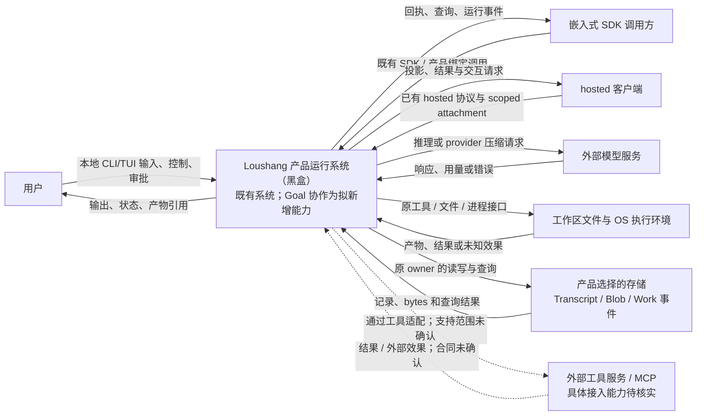
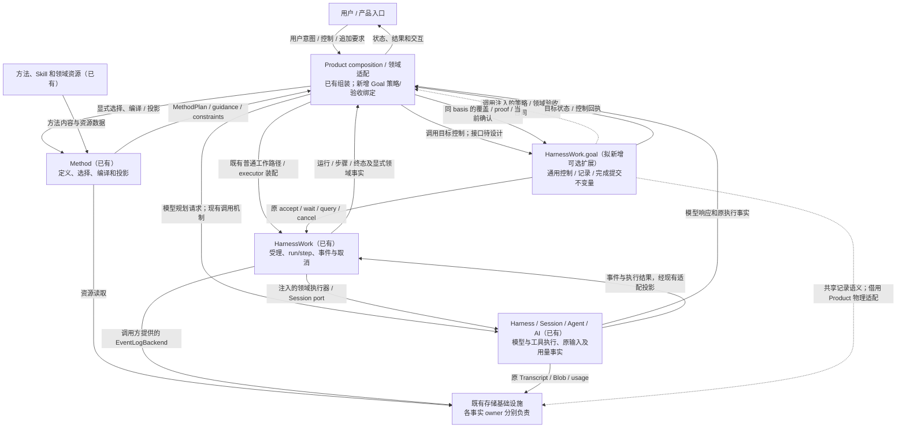

# 系统环境与已有系统关系：第一批评审稿

## 状态与评审问题

- Authority: descriptive Current + explicitly labeled candidate context。
- Design status: draft；Implementation status: not-started for new Goal collaboration。
- Owner: Loushang architecture / Product composition。
- 基线：main `372cde4ade0fe026076c8fa5e8b4486774b09cc3`，本地前置切片 `d1f418de53c58040a590683a0c499ff3de50e50d`；2026-10-26 同步 R3 Goal 归属修订。
- 证据：当前源码静态盘点；没有运行测试或验证部署，不等于功能通过。
- 用户评审：R2 本地首版的非归属内容已认可；用户明确要求按 HarnessWork 可选 Goal 归属调整并再次三视角评审。R3.1 技术结论见评审记录，不据此声称功能已实现。

本批请评审三件事：研究范围是否准确，系统外部角色/协作者是否完整，本地与
hosted 的责任划分是否符合预期。当前 Goal 组件、存储表示及控制交接见 R3；本图表达环境与合作关系，不把逻辑箭头当作 import、部署或权限授予。

## 1. 研究对象与环境层级

整体研究对象是“在 Loushang 中实现 Goal、Method、Work 协作”，不是重新建设
Loushang 平台。先用系统黑盒图确认外部环境，再放大 Goal 的邻接关系。
第二张图表达逻辑合作，不是 Python import 图，也不指定独立进程或服务。

需要区分三类标记：**已有**为 main 可定位的能力；**拟新增**为本次设计范围；
**待核实**表示当前事实不足，不因画在图上就宣称支持。图中的请求和结果箭头
不授予执行权限，也不承诺各入口具备相同的业务功能。

## 2. 整体系统环境图

CLI/TUI/SDK 是访问形式，不据此声称它们都已支持 Method 或 Goal。SDK 调用方与
库可以同处一个进程；图中的逻辑边界不自动形成网络、权限或进程隔离。
MCP 目前只能确证到部分命令标记，未核实完整 transport；本图把它作为需讨论
的环境关系，而不是已实现的安全执行链。

## 3. Goal 黑盒与既有协作者

下图中 Goal 为拟新增；其余是可复用的既有责任域。通用目标控制归属候选已按用户要求调整到 HarnessWork.goal；Product 保留方法、领域策略和资源装配，不在本批新增大型适配平台。

通用 Goal→Work 是 HarnessWork 内的单向依赖，Work kernel 不依赖 Goal；Goal 与 Product 间的策略调用是注入接口，不构成共享包 import Coding/Method。目标与多批 Work 的关系、最小合同及源数据责任已在 R3 明确；仍须按实际复核结果留证，不由图推导为已实现。

2026-10-26 保留用户已认可的本地 SDK、显式 Method、调用方显式推进范围；组件、
状态及交互见[最小闭环设计](minimum-loop-architecture.md)。该文件进一步限定一个
原 WorkRuntime 的 Product 装配、受测版本绑定及共享 Goal 记录语义；本轮重新复核归属和直接协作边界。
图中的 hosted/TUI/CLI 关系保留为全系统环境，不代表本轮开放了这些入口的 Goal
API。main 没有通用产物投影；本地未集成的 Coding 私有证据切片只是一项前置交接。

## 4. 环境接口与责任

| 连接 | 交换什么 | 主线事实 / 本批限制 |
| --- | --- | --- |
| 用户/客户端→Product | 业务输入、控制、审批答复 | 本地宿主与 hosted attachment 范围不同；source 字符串或 User role 不是自然人授权凭证 |
| Product↔Method | 选择、上下文、MethodPlan、guidance/constraint/audit 元数据 | 当前是显式选择和 single_turn/fixed 编译，不是已有模型规划器 |
| Product↔Work | WorkOperation/WorkRunSpec、查询、取消和事件 | 复用 canonical HarnessWork；旧 loushang.work 是兼容入口，不另造运行内核 |
| Work↔执行域 | 已接受步骤、原 Session prompt 和执行事实 | executor 返回会导致步骤/Work 完成，不代表 Goal 完整要求已验收 |
| 执行域↔模型 | 消息、工具 schema、推理/压缩调用、usage/outcome | provider 压缩和普通模型调用路径不同；不能假定一个现有 commit hook 已覆盖全部消费 |
| 执行域↔工具/OS | 文件、进程或其他动作及结果 | DirectExecution 和 AuthorizedExecution 不同；只对实际绑定路径说明审批，取消不承诺撤回外部效果 |
| 事实 owner↔存储 | 各自记录、Blob bytes、查询及转移 | Work event log 与 Transcript 是不同事实/耐久边界，不把一种 ACK 当成另一种保证 |
| Goal↔协作者 | 通用 Goal 核对 basis/版本/Work，Product 给出候选与领域 proof | R3 拟新增最小合同；没有当前可用的统一 Goal API，Product 领域验收与 Core 完成提交分开 |

模型和方法内容都提供数据或建议，不自行授予权限。工具审批、sandbox、文件根和
网络约束仍由既有执行域及产品配置拥有；Goal 不替代这些机制。

## 5. 本地和 hosted 的物理责任

| 环境 | 入口与执行载体 | 持久和副作用责任 | 不作的推断 |
| --- | --- | --- | --- |
| 本地 CLI/TUI | 用户机器上的 Product/Session；可委派既有子进程/worker | 产品选择的本地存储；原工具对工作区/OS 产生效果；模型可能是外部服务 | 逻辑组件不必各自部署；不把 SDK 边界当进程隔离 |
| 嵌入式 SDK | 嵌入应用持有 Product/Session 的生命周期 | 使用调用方准入的存储与执行能力 | API 可调用不等于任意外部主体都已认证 |
| hosted stdio | 显式 hosted 客户端经 Hosting 子进程、stdio framing、AppServer/AppService 到 Product Session | 服务端 Product/Session 拥有文件、工具和持久生命周期；客户端获得协议投影 | EOF/断开按该 profile 的寿命处理，不能套用 detachable 语义；已有 hosted 控制不代表已有 Goal/Method 远程业务 |
| hosted detachable local | 认证 loopback 与 scoped attachment/controller，Product runtime 寿命独立于一次客户端连接 | 存储和最终 close 归服务端 owner；客户端可 detach/reconnect | detach 不等于 owner close，也不代表任意入口都有相同恢复或控制能力 |

具体产品、入口及可部署环境是待确认范围，不在图中预造调度集群或新服务。
当前 Coding 多代理 factory 创建同进程、persist=False 的 child Session；工作树
隔离不等于进程或安全隔离。Hosting 的子进程能力是另一条既有接口，不能由存在
worker API 推出所有 child 都已有耐久执行日志或跨进程生命周期。

## 6. 现有支持差异与设计约束

| 事项 | Current | 对本设计的含义 |
| --- | --- | --- |
| Method→Work 路径 | Coding CLI 已有 prepared turns→SessionWorkRuntime.submit_plan→WorkRuntime→Session.prompt；部分分支按 prepared turns 运行 | 不称所有 Method invocation 都是同一种持久 WorkPlan |
| Method 入口 | --method 当前明确限制 TUI/RPC/Channel 等路线；可复用 SDK 组合类型存在 | 如目标需要统一入口，列作必要适配，不能写成已经支持 |
| 计划和审计 | Work 步骤在受理时固定，Method 约束/audit 元数据可携带和投影 | 不把这些字段解释成已实现动态重规划或自动验收 |
| Work 日志 | backend 由调用方提供；现有 JSONL 使用 PROCESS_LOCAL_JOURNAL，locking/flush/fsync 为 false | 新目标若要求更强耐久性，应单独决策，不能借用 Transcript ACK 证明 |
| Transcript 和图像 | 有固定 User 提交/查询、类型化图片 Blob、显式收集和转移 | 任意新增 JSON/raw Blob 引用不会自动加入已有收集/导出 |
| 新模型调用路径 | 模型输入准备有线程/owner-loop 协作；provider 压缩直接走专门 API | 后续预算/取消设计须包含实际调用种类，不继承旧基线的完整覆盖假设 |

输入原文和图片的严格留存仍是独立 Session 需求；其具体表示和启用条件留待数据
合同设计。本环境图不把它画成已实现能力，也不强制成为所有 Goal 启用的依赖。

## 7. 源码证据和证据局限

本批重新核对如下入口，不沿用旧 2de1359c 评审的源码结论：

- [Method runtime](../../../../src/loushang/method/runtime.py)、
  [compiler](../../../../src/loushang/method/compiler.py) 和
  [CLI launch](../../../../src/loushang/harness/cli/launch.py)。
- [Work runtime](../../../../src/loushang/harnesswork/runtime.py)、
  [Session integration](../../../../src/loushang/harnesswork/integrations/session.py)、
  [event log](../../../../src/loushang/harnesswork/event_log.py) 和
  [journal durability profiles](../../../../src/loushang/harness/journal/types.py)。
- [Session model call](../../../../src/loushang/harness/session/model_call.py)、
  [summarization](../../../../src/loushang/harness/transcript/summarization.py) 和
  [provider compaction](../../../../src/loushang/ai/api/compaction.py)。
- [Tool execution](../../../../src/loushang/harness/tools/execution.py)、
  [Transcript committer](../../../../src/loushang/harness/transcript/committer.py) 和
  [Blob transfer](../../../../src/loushang/harness/transcript/session_artifacts.py)。
- [Hosted client scope](../../../../src/loushang/appservice/client_scope.py)、
  [execution service](../../../../src/loushang/appservice/execution_service.py) 和
  [Coding hosted binding](../../../../src/loushang/coding/hosted_session.py)。

三路独立源码盘点原始记录保存在产品 Git 外；这是环境事实输入，不是本图的
三视角接受，更不代替用户评审。没有运行时、网络、全部插件或真实部署验证。
图中准确路径、全部入口的目标支持范围和新增组件位置仍需要后续设计决定。

## 8. 本批等待用户评审

请重点检查：

1. 图中是否准确表达了已要求的 Method 指导、模型自主规划及二者组合的协作范围。
2. 用户/产品入口、Method、Work、Harness 执行和事实存储的环境关系是否遗漏重要系统。
3. 本地、嵌入式和 hosted 的责任区分，以及 CLI/TUI/SDK/hosted 各入口的目标关系是否准确。

这些问题用于评审当前图和范围，不要求现在决定内部类、字段或存储格式。
状态保持 pending；用户未明确反馈前，不记录认可、不固定依赖此图的架构决定。
