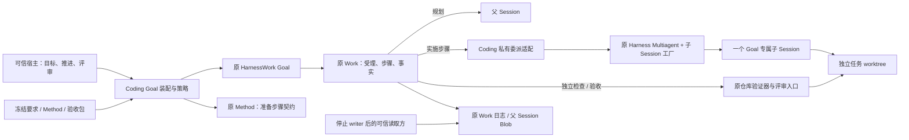
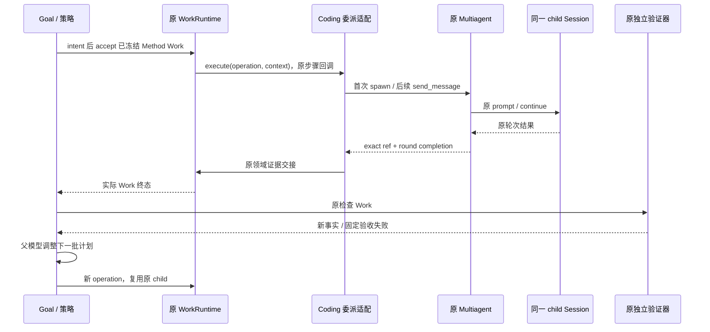

# GMW-KD-SESSION-02：Goal 专属子 Session 的多批执行

- Authority: normative candidate；Design status: proposed；Implementation status: not-started。
- Revision: R2，2026-10-31。Owner：Coding；共同父级：Loushang architecture；协作：Harness Multiagent/Session、HarnessWork、Method。
- 方法：干净本地 archmethod master `0f9bd3ff51afabeaaf76cc38dff1ceb279b7d37e`。
- 评审基线：main `64d035620`；评审时待合入子 Session 底座 `3aac81d8e`；已完成的仓库适配分支 `f024cb734`。三者尚未作为一个集成版本通过验证，不将分支能力写成 main 的 Current。
- 集成更新：底座已随 `caaff3945` 本地合入 main，见[交付记录](../../plans/2026-10-31-child-session-consolidation.md)。本稿的设计合同未因合入而改变；原仓库 profile 与新委派模式仍未完成集成。
- 用户已同意推进“一个 Goal 专属子 Session，多批 Work 复用”；按[本包检查点](README.md#用户评审检查点)，下述环境、交互和记录边界仍须以具体工作件提交用户评审。内部评审不替代该检查点。

## 1. 目标、事实与前置工作

首版在本地 Coding SDK 的真实仓库 profile 中启用可选委派执行：父 Session 规划，原 Work 执行受理批次，实施步骤委派给一个新鲜子 Session；后续实施 Work 复用同一子 Session。独立验证与可信评审仍决定 Goal 是否完成。

| Current 事实 | 本切片复用 / 尚需接通 |
| --- | --- |
| main 已有同 Session 记录与来源接入，[GMW-KD-SESSION-01](session-execution-recording.md)已实现 | 保留默认调用与冻结来源合同；不改为自动委派 |
| Harness 子 Session 工厂已抽取，评审时在独立分支、现已本地合入；Coding 只选角色、模型、工具、沙箱和 persist=False | 底座评审及本地合入已完成；沿原工厂与 SessionMultiAgentRuntime 建立执行 child |
| `feat/goal-review-replanning@f024cb734` 已有私有 RepositoryTask、RepositoryProfile、真实仓库 Goal 适配、独立验证及持久评审；main 尚无这些模块 | 接续原分支，协调其公共规划抽取与后来同 Session 来源接入；不另写 RepositoryGoal。旧验收只证明旧版本，集成后须复核 |
| SessionMultiAgentRuntime.spawn_child 会直接启动首个 prompt；send_message 可在终态 child 上开始下一轮 | 在已受理 Work 的步骤回调 execute(operation, context) 内首次创建，后续步骤使用原 send_message；不在 Goal 准备候选时启动模型 |
| Work Session 来源准备要求 operation 与真实 Session 一致；现有 child persist=False | 不把父来源绑定到子执行；首版保存父 Work/业务证据，子原始 Transcript 不作持久保证 |
| 原模型调用 allowance、Method 准备、原 Work/Goal 意图、验证和评审均已有 | 复用上述合同，只增加 Product 私有委派执行适配和报告，不增加共享 Goal 状态或计划库 |

本切片不实现跨进程自动续跑、持久子 Transcript、继承父历史、同一个可写 Session 的多 actor 并发或 AppHost 默认迁移。上述选择是范围边界，不是相应能力已被实现。

## 2. 系统环境

部署范围：同机、同用户、本地 SDK 进程。执行仓库是宿主提前创建的独立任务 worktree；父验证和子实施看到同一个任务 worktree。子 Session 独立上下文不等于文件隔离，隔离由现有工作树与工具策略提供。模型服务仍经原 AI 管线和用户授权的 Kimi Coding 配置调用。

这是协作图，不是 import 图。Goal core 和 HarnessWork 不认识 Coding 子 agent；Harness 不依赖 Work/Method。委派适配属于 Coding 私有模块，使用原 WorkExecutor 合同，不成为第二套执行器内核。

## 3. 组件职责与身份

| 责任单元 | 所有权与本次变化 |
| --- | --- |
| 原 Coding Goal owner | 拥有父 SDK/Goal/Work、子执行绑定和清理责任；此委派 profile 的 owner 终身绑定一个 Goal ID，串行 advance；不改变共享 GoalController 可顺序创建多个 Goal 的能力 |
| 原下一工作策略 | 冻结候选、Method 与权限；实现候选选择委派 executor；规划仍在父 Session，并消费原验证/评审事实 |
| Product 私有委派适配 | 在原 Work 步骤中发送已冻结的 Method prompt，观察原 child round，发布领域报告；仅保留原 AgentRef/轮次关联与进行中调用，不另设队列、树或调度器 |
| 原 Harness Multiagent / 工厂 | 拥有 child incarnation、轮次、输入、审批绑定、创建与清理；复用同一个 Agent Session Host 与队列 |
| 原 Method / Work | Method 定义所选步骤；Work 的 operation/run/step、受理及终态仍是执行批次权威 |
| 原仓库验证器 / 可信评审入口 | 核验固定要求、实际代码清单和原断言；模型报告不构成通过或用户批准 |
| 原记录 / Blob / Transcript | 各自保持已有编解码和身份规则；不增加 Goal 专用来源索引或第三份子执行事实库 |

GoalHeader.session_id 与 WorkOperation.session_id 仍指父逻辑 owner。子执行身份是原 AgentRef/incarnation、round_id 和实际 child Session ID；两种身份通过原父 Work 的领域报告关联，不改写父 header，也不双写 operation→run 映射。该报告只证明宿主观测的委派关系，不能把父身份写成模型实际调用的 Session。

首版委派 owner 首次创建 Goal 时绑定 Goal ID，直至 owner 关闭不变；相同 ID 的命令沿原幂等规则处理。Goal A 终态后也拒绝在该 owner 创建不同 ID 的 Goal B，调用方应建立新 owner。此限制由 Coding profile 承担，不修改共享 Goal 状态机。每个已绑定 Goal 只有一个实施 child。首次使用 ForkTier.none；子 Session 只收到产品系统指令、冻结任务材料与当前已授权步骤，不复制父历史。child 已完成一轮仍保持打开，后续 Work 复用它。意外关闭或身份变化使 Goal 停止推进并要求处理，不静默换成新 incarnation 伪装上下文连续。

子 Session ID 与产品配置来自原 Coding factory 的 runtime_builder 接缝。Product 的私有薄装配对象实现共享 ChildSessionRuntime 协议：create_session 调用原 SDK，完成本 profile 的权限/重试/压缩检查后交回原 Session，并记录实际 session_id；dispose_session_runtime 只委托原 SDK。它不实现资源阶段状态机，不读共享 driver 的私有字段，也不取得第二份关闭权。共享 factory 在 await create_session 前已持有该对象，因此产品检查失败仍进入同一通用清理路径。记录的 runtime/Session 仅为 owner 内部装配引用，不向模型或调用方公开。

本 profile 由 Coding owner 私有装配原 SessionMultiAgentRuntime 和原工厂，选择已有 `root_input=None`、`notice_wake_policy="discard"`；父 SDK 不另安装常规 multiagent runtime，也不注册其工具。常规 bind_agent_session_multiagent 当前固定 queue_only，不能原样调用后声称已关闭通知。完成通知仍保存在原 control 的 exact ref/round 查询中，只关闭自动父 mailbox 投递。父规划通过已交接的 Work 业务报告获得结果，不能再接受 child 的自动 ApplicationMessage 作为第二条输入。owner 负责在父 SDK 释放前调用该原 runtime 的关闭；不另造树或消息机制。

## 4. 受理、执行与停止

1. 宿主固定任务源码基线、允许修改文件、受保护要求/Method/验证器、检查选择器、模型及调用额度；用原 RepositoryTask 校验。父规划不得修改这些约束。
2. 原策略用 MethodDomainRuntime 准备步骤和原 WorkRunSpec。委派 Work 使用独立的 Product operation kind，不能伪装为父 SessionTurnExecutor 的直接执行。原 Goal 写意图、两次确认及 Work accept 次序不变。
3. 已受理 Work 首个实施步骤调用原 spawn_child，所发初始 prompt 就是该步骤的冻结 prompt；不增加“先热身一轮”。后续批次通过原 send_message。Product 适配拥有一个短投递/取消交接临界区：调用前核对绑定的 Goal ID、exact AgentRef、上轮确已收敛、子 Session 的原队列无残留输入、取消尚未受理；从检查到取得投递回执期间禁止另一驱动或取消切换。只有该私有适配可驱动 child，不开放其它输入来源。现有 deliver 先入队再返回 triggered_new_round，故返回的 ref/round/triggered 标记仅作一致性复核，不能作为投递前拒绝的替代；不一致即封住后续步骤并收敛可能已受理的动作，不盲重发。临界区不跨越模型运行或整个创建过程；创建 task 的登记、取消标记与实际交付结果的交接由同一临界区串行处理，创建本身在区外等待。
4. 每次等待绑定确切 AgentRef 和已受理 round_id，并核对原完成通知，而非仅按路径读“最新完成”。只有当前步骤对应轮次 settled 后才能进入下个步骤。子结果声明、Work 完成与 Goal 满足是三层不同事实。
5. Product 使用原 allowance 为已受理 repair Work 包裹子模型调用，同一 operation 的多步骤共用额度，不因创建 child 重置；父规划与子实施串行。child 保持原 profile 的 retry/compaction 限制；额度不是 token/金额硬保证。
6. 子运行的工具上下文由原 Coding factory、context plan 的权限收窄和任务自己的原 PlanningToolPolicy 共同配置。实施 child 仅获任务允许的 read/edit/write；没有可信评审工具、验证命令权限或进一步派生权限。父阶段的临时策略切换不会自动授予子权限，子策略实例必须独立装配并校验。

首版不向模型暴露 child 的 spawn/send/close，也不向外暴露其原始 Session。宿主控制仍走 Goal；首版委派 owner 的 steer/follow_up/clear_queue 显式拒绝，不沿现有父 Session 输入入口误投，也不静默丢弃。目标要求调整沿原 Goal 控制合同办理；若将来开放子直接输入，须再明确与冻结步骤、输入来源和取消的关系。底座原有 multiagent 功能不因本 profile 而改变。

取消从原 Goal/Work 进入委派 executor 的 cancel_and_wait。child 已运行时使用原 interrupt_agent 并等待该确切轮次停止；创建尚未交付时取消并等待原创建调用，沿原 factory 的半成品清理与 Session 保留 owner 规则收敛。适配持有进行中调用，不能仅取消等待者就返回 settled。取消与 spawn 返回竞争时，先封住新步骤，再等待已登记创建调用；若实际已交付 ref/round，必须转入该确切轮次的 interrupt 与 join，不能把创建调用结束当成子执行停止。投递调用尚未交付回执时同样先接回实际结果，再收敛已受理轮次。证据交接收敛后才释放该 operation 的 allowance 和权限范围。清理错误或身份/结果不明不冒充成功取消，不自动重试业务动作。

暂停沿用原 Goal 状态与 epoch；子上下文在当前 owner 内保留，恢复仍先经原确认再受理新 Work。关闭顺序为 Goal 禁止新动作 → 原回调/Work/交接收敛 → 原 Multiagent 关闭该 child → 来源 reader → 父 SDK → Goal/writer。子清理失败保留原 owner 和父依赖，后续 close 接着清理；本次不增加退出后自动恢复机制。完成 Goal 不等于资源已关闭，调用方仍须 await 原 owner.close。

## 5. 记录与证据合同

继续使用 recording v1、原 Work 受理/执行事实和确认；Product 选择现有记录策略，不复制或扩大底座默认审计保证。父规划可沿 GMW-KD-SESSION-01 绑定其真实父 Transcript。

实施 Work 发布原 WorkEvidenceReported，使用嵌套 evidence 和新增的 Product 私有 role `delegated_method_report`。首版沿原仓库 profile 的受保护 Method 合同：每批实施恰好一个 repair 步骤，多批复用 child；不为本次扩大为任意多步骤 Method。候选准备时校验该约束并冻结 step/plan 身份。每个成功委派 run 恰好一份 v1 报告，包含原 Goal ID/revision/epoch、operation/run/Method/step、子 AgentRef/实际 Session ID/round_id 及宿主观察结果。步骤适配在该轮次成功收敛后交接此报告，外层原 RepositoryReport 随后交接 repository_report；两个 role 各一份，后者格式不变。报告内容进入原父 Session Blob；不把子信息平铺成 Work 的保留键。中途失败或取消可以没有成功委派报告，不能虚构完整记录；已有报告也不把失败 Work 改成成功。

读取由 Coding 仓库 profile 的同一私有 decoder/投影负责，接入 RepositoryDomain 的 live observations 与原 detached 冷读路径，复用原 _report 的 operation/role 唯一性和 Blob 验证。新委派 operation kind 与候选 source 中冻结的执行模式一致时，成功 run 必须恰好一份委派报告：严格验证版本、父 Goal/operation/run、冻结 Method/step、非空实际 child Session、exact ref/round；跨批次核对同一 child 且 round 前进。仅字符串形状正确不能代替与已有受理事实核对。重复、错绑、未知版本或缺失均不能作为成功实施事实。旧 operation kind 不要求此 role，原历史不回写、不失效。

委派追溯与目标验收分别输出：新委派成功 Work 的必需报告缺失/损坏使 live assessment 不能以该批构成完整闭环；冷读保留原 Goal 终态事实，但把其当前证明投影为 unknown/error，不能继续标 current。失败/取消 Work 没有成功报告是允许的局部轨迹，不单独否定之后由完整新批次及独立验证/评审建立的完成证明。子 Transcript 的 not_declared 本身不影响 current；独立验证和可信评审仍是完成判据，委派报告只补关联与执行追溯。

首版 child 仍 persist=False。因此：

- 报告保存的是宿主观察的轮次结果；不声称已保存子原始消息、模型输入、工具流水或全部用量。
- 子自报的产物/文件引用不是已验证产物。独立验证器仍从同一任务 worktree 检查当前受测清单；原验证/评审证据是完成依据。
- 委派实施 Work 不绑定父 TranscriptSource。由现有 read_goal_work_sources 接入仓库 profile 的受支持身份分支：仅新增已验证的 coding-repository-review/v1 header，并复用原 _goal_work_facts、recording 和来源 reader 检查；不放宽为任意 policy。当前 main 还会拒绝该 policy，实施须补齐这个 Product 适配。受支持且关联有效的委派 Work 无来源声明时才返回 not_declared；不支持的 profile、损坏的记录和错绑身份仍分别报原错误。父规划的已声明来源仍须实际接入其真实父 reader 后核验，不能因新增 allowlist 就声称来源完整。
- 身份、轮次或领域报告缺失/损坏时，委派执行追溯返回未知/错误，不能因 not_declared 而把缺少的委派报告判成完整。
- 关闭只释放句柄，不删除父 Work/Blob/Transcript。保留周期按原 Product 承诺；不存在子 Transcript 的期限或跨进程执行续存承诺。

写 Blob 成功而 Work 交接失败沿原证据专项处理：不盲重发 child prompt、不跨存储回滚、不删除可能共享的 Blob。不能从 available、child completed、Work completed 或旧版本测试通过推导 Goal 完成。

## 6. 选择与验证场景

选择父 Work 委派子轮次，而非把 Goal 移进子 Session 或创建独立子 Work：保持 Goal/Work 的父会话身份及证据权威，直接复用现有控制树。代价是首版只能获得子执行的领域报告，不能提供子 Transcript 冷读；持久子历史应作为后续明确扩展，而非隐藏在一个执行 mode 中。

真实验证优先复用原已接受的 #125 仓库任务和 RC-01—06 固定合同，在独立 worktree 上使用其原始缺陷基线，并使用新的受保护宿主运行包。这是已知真实问题的模式回归，不宣称又发现新缺陷，也不把旧补丁再次合入产品。旧成功轨迹不能充当新子执行模式证据。实施前须冻结这次任务包及检查结果，确认原始基线确实失败、已验证参考修正能够通过。

原任务中有信息增量的真实检查失败可触发重规划；不得修改运行中验收、制造失败或假造评审拒绝。若模型一次修好，只能关闭执行闭环项，不能宣称证明新模式下实质动态重规划。真实调用次数、批次额度、墙钟运维上限按原 profile 与本次冻结包明确，不通过不断追加试验追求成功。

| ID | 验收要求与证据 |
| --- | --- |
| DS-01 | 默认同 Session 路径不变；child 路径只有显式选择才启用；Goal/Work/Method 不新增调度权威 |
| DS-02 | 至少两批已受理 Method Work 使用同一 child Session ID/AgentRef，round_id 持续前进；无候选准备阶段模型调用；Goal A 终态后该 owner 拒绝新 Goal B |
| DS-03 | 原 Method 冻结步骤、工具权限、额度及受保护文件约束真实生效；父规划和子实施分别使用自己的 Session；child 完成不向父 mailbox 插入消息，后续规划响应证明成立；委派 owner 的直接输入入口明确拒绝 |
| DS-04 | 保存先前计划 → 新的真实事实 → 实质改变后的计划 → 实际实施 → 当前版本独立验收的链。只改措辞、已执行前缀或未执行尾部不算通过 |
| DS-05 | 原独立验证和可信评审共同支持完成；保存被测清单。Work completed、成功委派批次必需报告缺项/损坏、旧版本通过均不能完成 Goal；失败批次缺成功报告不抹去后续完整证明 |
| DS-06 | 创建失败、创建中取消、轮次中取消、关闭等待者取消、子清理失败与重试均保留原 owner；覆盖取消与创建交付竞争、投递前 busy/错 incarnation/残留输入拒绝、回执不一致后的收敛；无旧 ref 污染，无重复业务调用 |
| DS-07 | 停止 writer 后新进程可读父 Work、原业务证据和委派报告；子 Transcript 明确未声明，冷读不执行模型或工具；新/旧 operation 分流、重复/缺失/错绑报告及未知 policy 各按上述合同处理 |
| DS-08 | 与原同 Session 记录及已接受仓库评审实现完成集成回归；独立三视角及用户对重要工作件的接受有记录 |

本稿未执行新模式测试或真实模型。部署范围仅本地 SDK，同 UID 不提供抵御恶意同用户进程的安全隔离。既有广泛套件保持其原路由；本场景不新增 CI gate 或固定超时矩阵。

## 7. 交付顺序与用户评审事项

1. 已关闭底座独立评审并本地合入本次边界明确的 Harness 抽取；保留旧 lane/harness 中无关历史和脏工作树。
2. 核验并接续 f024cb734 的已完成仓库 profile，协调后来同 Session 来源接入；保留原真实证据和历史，修正入口文档把“分支已验证”与“main 已交付”分开。
3. 本 R2 经过独立三视角并关闭技术阻断后，提交用户评审环境、身份/交互、记录及场景；未接受前保持 proposed，不启动新模式产品代码。
4. 接受后实现最小 Product 委派适配，先离线合同与真实 SDK 验证，再执行冻结的真实任务；保存全部尝试与未通过项，不外推通用可靠性。

用户须评审的具体选择：父 Goal/Work 保持权威、一个新鲜 child 复用多批；首版 child 不持久化而保存父 Work 证据；采用真实 #125 原始缺陷作为新模式回归且不重复合入旧补丁。用户对推进方向的同意不被扩大为对此处全部合同的接受。
