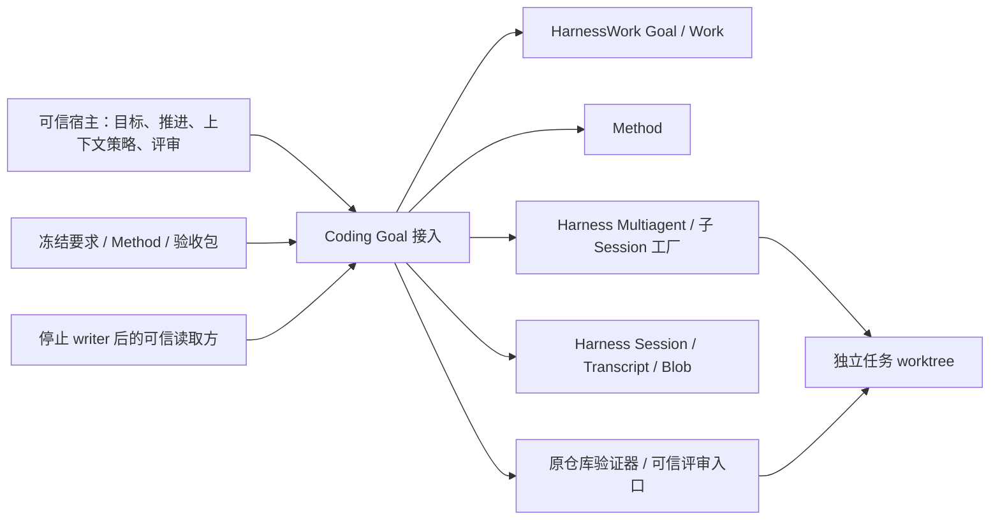
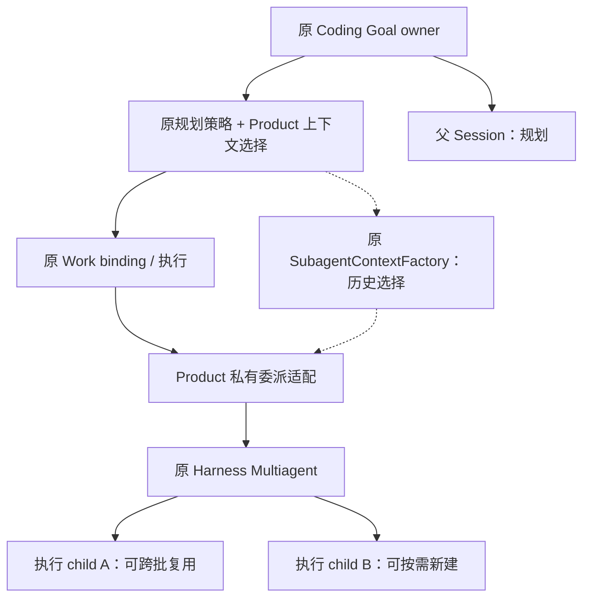
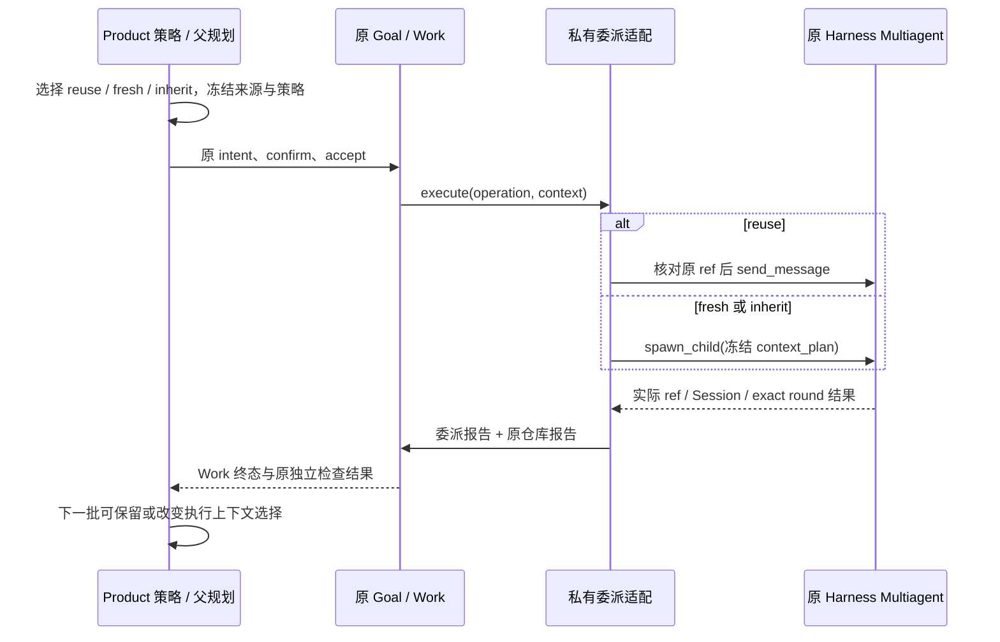

# GMW-KD-SESSION-02：Goal 批次的执行 Session 与上下文选择

- Authority: normative；Design status: accepted；Implementation status: implemented；离线验证与代码评审通过，在线完整验收 partial。
- 用户接受：2026-10-31 用户明确要求“请你开发实施R3”，并要求实施完毕后进行三视角代码评审；该授权覆盖 R3 的 reuse/fresh/inherit 两个实施切片。三视角代码复核已关闭；交付验证见末节与实施检查点。
- Revision: R3，2026-10-31。Owner：Coding；共同父级：Loushang architecture；协作：Harness Multiagent/Session、HarnessWork、Method。
- 方法：干净本地 archmethod master `0f9bd3ff51afabeaaf76cc38dff1ceb279b7d37e`。
- 设计时源码基线：本地 main `a19e5173f`，含已交付 Harness 子 Session 底座；仓库 profile 当时位于 `f024cb734` 独立分支。实施时已由 `f410f10ce` 合入任务分支；不冒称 main 已有本轮实现。
- 用户要求修订 R2 的“一 Goal 一个新鲜 child，多批必须复用”，容纳按需复用、新建独立上下文、新建并继承上下文。R3 替换候选 R2 的该项限制，不改变已接受的 [SESSION-01 同 Session 切片](session-execution-recording.md)。
- [用户工作件检查点](README.md#用户评审检查点)继续有效；三视角技术评审不代替用户对本修订的接受。设计阶段与后续授权实施记录分列；当前实现与验证状态见末节。

## 1. 目标、取舍与 Current

Goal 保存目标和完成依据，Work 是受理及执行批次；两者均不规定必须使用几个模型 Session。按任务连续性、上下文污染、隔离和成本需要，Product 为每批实施 Work 选择执行 Session，并冻结选择。多个 Session 不等于多个并行 Work，串行 Goal 推进保持。

| 决策 | R3 选择及代价 |
| --- | --- |
| 所有 Work 固定同一 child | 不作为架构约束；仅作为 Product 可选缺省策略，利于上下文连续、减少启动与重复材料成本 |
| 每批强制新 child | 不作为缺省；允许显式选择，换取独立上下文，付出启动、材料装配及额外资源成本 |
| 按批选择复用或新建，创建时再选历史 | 采用；Product 多承担一份冻结选择和关联核验，Harness/Work 各自权威不变；不建设通用模式注册表或 Session 池 |
| 多 actor 共写一个 Session | 不纳入本稿。顺序复用一个执行者/Session，与新增 actor 共享同一可写 Session 是不同合同 |

| Current 事实及源码证据 | 接入边界 |
| --- | --- |
| main 已有同 Session Goal/Work 记录及 Transcript 来源接入，见 SESSION-01 | 既有默认路径不变；本稿扩展委派 profile，不把旧调用自动改成 child |
| [AgentSessionSubagentFactory](../../../../src/loushang/harness/session/subagent.py)已通用化；CodingSubagentFactory 保留角色、模型、工具、沙箱和 persist=False | 复用共享 owner 与原 SDK；不复制创建/清理状态机 |
| [SessionMultiAgentRuntime](../../../../src/loushang/harness/session/multiagent.py)的 spawn_child 直接投递首个 prompt，send_message 可开始后续轮次；原 control/registry 保存 exact AgentRef、轮次和容量 | 新建仅发生在已受理 Work 执行期间；选择准备阶段不调用模型，不预建 Session |
| [SubagentContextFactory](../../../../src/loushang/harness/multiagent/context.py)已有 ForkTier.none/all/last、TranscriptWatermark、确定的 ForkedHistory 及 requested/effective tier；非 none 禁止 model_override，空选集会降级 none 并给诊断 | 这些是可复用原语，源码中尚无 Goal 的历史 source/mapper 装配；不能称为已完成的 Goal 继承闭环 |
| install_agent_forked_history 把 canonical Agent messages 安装进独立 child 内存状态 | 不等于已持久化 child 原文、已复用供应商缓存或已克隆文件系统 |
| 原 [ControlLimits](../../../../src/loushang/harness/multiagent/types.py)及 agent type maximum_children 限制未关闭子 agent | Product 使用原容量约束；关闭失败继续占位，不增加第二套容量账本或自动回收器 |
| f024cb734 已有 RepositoryTask/Profile、BatchPlanningPolicy、独立验证和可信评审 | 接续原实现并协调后来来源接入，见[集成检查点](../../plans/2026-10-31-goal-child-session.md)；不另写 RepositoryGoal |

范围仍为同机、同 UID、本地 Coding SDK；宿主提前建立独立任务 worktree，父验证和所有实施 child 串行访问它。上下文隔离不提供文件隔离或抵御恶意同用户进程的能力。模型经原 AI 管线与已授权配置调用。

## 2. 环境与组件职责

下图以 Coding Goal 接入为黑盒，表达环境协作；不是内部模块图或 import 图。

| 责任 | 所有权及非职责 |
| --- | --- |
| Coding Goal owner | 持有父 SDK、原 Multiagent 与 Product 装配引用；本地串行 advance。首版 owner 仍终身绑定一个 Goal ID，但一个 Goal 可关联多个 child；这不是 Goal core 的通用基数限制 |
| Product 上下文选择 | 原策略内部职责，按可信宿主配置和当前证据选 reuse/fresh/inherit，检查授权、工具/模型兼容及容量，冻结进候选；不新建 planner 或强制增加模型调用 |
| Product 委派适配 | 只驱动冻结的目标/创建请求，观察确切轮次并交接报告。其内存引用只供装配，不取代原 registry 或持久 Work 关联 |
| Harness Multiagent / Session | 提供创建、历史选择与安装、输入/轮次、审批、容量、清理；不理解 Goal 要求，不决定何时业务上值得换上下文 |
| Method / HarnessWork | Method 准备冻结步骤，Work 负责 operation/run/step、受理和事实。Goal core 不 import Coding/Multiagent，Harness 不依赖 Work/Method |
| Product 报告读写 / 验收 | 编解码仍在原 Product 证据模块内，沿 WorkEvidenceReported/Blob；独立验证及可信评审决定目标满足，不从子结果推导完成 |

共享机制具有已有缺省行为，Product 提供策略配置，不要求每个普通 Work 都显式配置上下文。默认同 Session 模式保持；委派 profile 的可选缺省为“首批 fresh，后续优先复用已确认可用的 child”。显式要求 reuse 的目标不可用时拒绝或暂停，不偷偷改为 fresh。模型如提出换上下文建议也只是建议；本切片不擅自放宽既有 proposal schema，最终选择由 Product 准入冻结。

## 3. 身份、模式和基数

AgentRef 是执行者 incarnation，Session ID 是实际执行上下文身份，历史来源是构造新上下文的材料；三者分开记录。GoalHeader.session_id / WorkOperation.session_id 仍为父逻辑 owner，不能冒称 child 的模型调用身份。

| 选择（设计语义，非承诺公开 API 名称） | 身份 / 上下文 | 适用情形与限制 |
| --- | --- | --- |
| reuse | 指定此前已建立的 exact AgentRef + child Session ID；延续其已有上下文 | 同一修复路线连续推进；必须仍开放、前轮及交接已收敛、无残留输入，策略和权限兼容。不仅按路径或“最新 child”猜测 |
| fresh | 新 AgentRef、新 Session；ForkTier.none | 独立尝试、切换关注点、避免旧上下文干扰；仍会收到产品指令和冻结任务材料，空历史不等于没有任务上下文 |
| inherit | 新 AgentRef、新 Session；ForkTier.all 或 last(n)，固定来源截点 | 需要已有背景但之后独立演进；本稿来源限定为该 owner 授权的父 Session，非任意 child、外部 Session 或未提交内存尾部 |

逻辑关系为 Goal → 多批 Work → 各批一次执行选择；不同批可指同一 child，也可指不同 child。首版继续沿原仓库单 repair 步骤 Method，每个实施 Work 只选一个 child，不在批次中间切换。多 child 可同时保留，但最多一个实施轮次活动；多 Work 并发、跨 Goal 共享 child、给新 actor 接管同一个可写 Session、任意子历史 fork 均不在本稿范围。

首次创建请求用原 operation_id 关联，不新增持久 Session 分配 ID。reuse 冻结已有 exact ref、实际 Session ID 和预期上轮；fresh/inherit 在受理前没有实际 child 身份，只冻结创建请求，实际 ref/Session/round 由运行报告交付。换 child 必须体现为后续 Work 的新选择；不得覆写历史映射、复活已关闭 ref，或把新 incarnation 冒称上下文连续。

## 4. 选择冻结与上下文继承

### 4.1 选择的冻结点

宿主固定任务、允许文件、Method、验证器、模型额度和上下文策略。原策略准备候选时，除原业务字段外，在既有 Product source 与 operation 私有 payload 内记录同一份有版本的 execution_context 描述：模式、选择理由、策略标识，以及 reuse 身份/预期轮次或新建的历史描述。两处语义必须一致；Goal batch_intent 保存前者，Work 受理记录保存后者，作用分别为意图与实际受理，非第二个来源日志。

选择适用于一次候选，不重新解释旧批次。仍经原 intent 前/后两次 confirm；策略、权限、目标/epoch、复用对象或冻结材料不再满足时走原候选过时/未提交路径。执行前再核验；受理后失败不得临时换模式、换目标或重发 prompt。准备阶段只检查原容量，不预留或创建 child；最终容量由原 spawn admission 决定，竞争导致受理后容量不足则诚实失败，不排第二条队列。

### 4.2 inherit 的额外合同

Product 在父规划已静止时从原 Transcript 读取面取得固定 watermark，装配原 SubagentContextFactory.source/mapper；沿原模型消息投影处理可继承记录并标记 turn 边界。新 glue 是 Product 的来源选择/表示适配，不复制 records_to、ForkTier 截取、消息安装或摘要算法。原始附件若不能沿原读取/投影链安全解析，拒绝该继承候选；不能静默丢图、把不完整工具结果拼成完整历史或把未知记录硬转为普通文本。

候选冻结来源 Session 身份、实际库身份（有持久来源时）、watermark、requested/effective tier、last(n) 参数、映射/过滤策略版本及原 diagnostics；内存持有本次冻结的 SubagentContextPlan。watermark 是该来源中的记录身份，不是跨 Session 唯一键。父历史后来追加不改变已冻结选集，不因为“最新 head 变了”一概拒绝；只有原截点不可读、实际映射材料变化、授权或候选业务 basis 失效才拒绝。按原消息 codec/现有 canonical 摘要工具校验材料一致性，不另造序列化或历史索引。

必须遵守现有 inherited model 约束：非 none 不允许覆写父模型；继承历史不带入新权限、审批决定或可信评审权。原工厂可能把空历史降为 none：Product 在准备阶段即保留 requested/effective 和诊断。显式要求非空继承时拒绝；只有宿主策略事先允许空历史降级才可受理，并让意图和实际报告都表明降级，不能报告为已继承。没有 rendered_prefix 不等于失败，也不承诺缓存命中或字节级 prompt 前缀复用。

固定来源与继承结果的保证是两层：原父 Transcript 可按其已有来源/留存合同核验，子已装入哪份映射材料由宿主报告说明。首版 child persist=False，不凭父 watermark 声称子原文可冷读，也不因模型缓存命中推导来源完整。继承模式必须在 Product source/mapper、附件及权限合同完成离线验证后才可开放，不能因为泛型工厂存在就宣称可用。

## 5. 执行、取消和多 child 生命周期

1. 原策略用 MethodDomainRuntime 准备 Work。新委派 operation kind 区分于父 SessionTurnExecutor 直接路径；选择 frozen 后才写原意图、确认、accept。
2. fresh/inherit 的首个已受理步骤调用原 spawn_child，初始 prompt 就是冻结的 repair prompt；工厂在首次 prompt 前安装所选历史和权限，不热身。reuse 调用原 send_message。
3. Product 用短投递/取消交接临界区，在调用前核对 exact ref、前轮和报告收敛、原队列为空、无取消，以及绑定策略仍兼容；调用后 ref/round/triggered 只作一致性复核。现有 deliver 是先入队再回报，不能拿返回值代替投递前检查。不一致时封住后续动作并收敛可能已受理的轮次。
4. 创建 task 登记、取消标记、结果接回在同一交接保护下处理；不持锁等待整个创建或模型运行。只由该私有适配驱动 child，不开放模型 spawn/send/close，不公开 child Session。
5. 原 allowance 以已受理 operation 为范围，多 Session 切换不得重置批次计数或增加额度。原 retry/compaction 限制、工具权限和保护文件规则对每个新 child 都检查；reuse 不因保留旧实例逃过当前权限校验。不兼容时拒绝 reuse，只有后续显式 fresh/inherit 候选可换实例。
6. 每次等待绑定 exact ref/round 完成通知。Product 私有装配原 SessionMultiAgentRuntime(root_input=None, notice_wake_policy=discard)，不再安装第二个父 runtime。结果由原 control 查询、Work 报告交接；不把通知自动投进父 mailbox 干扰下一轮规划响应证明。

本 profile 暂拒绝直接 steer/follow_up/clear_queue，避免沿旧入口误投父 Session；原同 Session profile 不变。目标修订、暂停、恢复沿原 Goal 合同，恢复重新检查选择而非自动重放。Goal 完成仍依赖独立验证和可信评审。

取消仍从原 Goal/Work 进入 cancel_and_wait，仅中止本批实际目标或正在创建的请求，不把其它静止 child 当成当前执行者。取消与创建/投递回执竞争时接回真实结果，若已交付轮次则 interrupt 并 join；不能把等待者取消或创建调用结束视为执行已停。业务轮次和证据交接收敛后才释放 allowance/权限范围。不明结果不盲重试。

各 child 默认保留到 owner 关闭或可信宿主显式释放。按原 ControlLimits / agent type 限额控制，容量耗尽可暂停选择并提示释放已静止 child；没有隐式 LRU、新池或后台回收。宿主释放仅在没有推进/活动 Work 时，经 Product 同一交接保护调用原 close_agent，核对 exact ref；不得关闭其它批次正在使用的实例。释放后 reuse 该 ref 明确不可用；需要继续时另选 fresh/inherit。创建/释放/清理失败保留原 owner 与占位，失败未解决不继续派发新业务。

owner.close 的次序：禁止新动作 → 当前 Work/回调/交接收敛 → 原 Multiagent 关闭全部所属 child（含 cleanup-only）→ 来源 reader → 父 SDK → Goal writer。任一 child 清理失败保留父依赖；后续 close 继续原任务，不漏掉尚未处理的其它 child。首版不要求失败后继续关闭所有独立兄弟，沿底座原保守次序；错误中必须可见剩余资源。

Product runtime_builder 的薄对象继续只做原 SDK 创建、产品配置及实际 Session ID 捕获，dispose 只委托原 SDK；共享 factory 在 await 前持有该对象。拥有多个装配引用不构成第二套 child 生命周期，原 Multiagent/工厂仍有唯一关闭权。

## 6. 记录、读取与兼容

原 recording v1、WorkEvidenceReported 嵌套 evidence、父 Session Blob 和业务报告继续使用；不修改共享事件或 Goal 状态格式。新私有 delegated_method_report v1 实施中；字段冻结为 version、operation_id、run_id、session_id（父）、context（冻结选择）、child_ref（path/incarnation）、child_session_id、origin_operation_id、round_id、terminal。context 同时保存在原 Goal intent source 与原 Work operation payload，读取时交叉核对；没有独立登记日志。不需要迁移不存在的 R2 记录。

成功委派 run 仍恰好一个 repair step、恰好一份 delegated_method_report，外层原 RepositoryReport 随后交接一份 repository_report。报告包含 Goal/revision/epoch、operation/run/Method/step、冻结 execution_context、实际 child AgentRef/Session ID/round_id、上下文创建来源及宿主观察的结果；不平铺成 Work 的保留键。inherit 的 requested/effective/source/watermark/诊断与候选一致；reuse 引用原已成功交接的创建/上下文报告，不重新声称每批都 fork 一次。

Coding 仓库 profile 的同一私有 decoder/投影用于 live observations 和 detached 冷读，复用原 _report、Work 关联和 Blob 验证。新委派 kind 必须有相符的冻结选择；旧 operation 不要求新 role，不回写历史。读取按实际 child 分组，而不是断言所有 Work 的 Session ID 相同：

- fresh/inherit 的成功创建报告必须建立新的 Session/AgentRef 组合，关联唯一创建 operation；不能拿另一批结果重复证明新建。
- reuse 必须指向本 Goal 已交接的原创建绑定，实际 Session/ref 相同、轮次严格前进，且符合该批冻结的预期前轮；关闭过的 incarnation 不复用。不声称轮次间没有任何未保存的子原文。
- 首次创建批次失败或交接未知且没有可信绑定报告时，不把该 child 纳入可复用集合；先收敛/关闭，再由后续显式新建候选继续。已存在 child 的前轮失败/报告不明也不得未经核实接着投递。
- 报告重复、缺失、版本未知、错绑或不符合模式语义不能作为成功实施事实；失败/取消 Work 可以没有两种成功报告。新委派失败分支同时处理旧 repository_report 缺失，不能被旧无条件读取挡住。

成功批次的必需报告损坏使 live assessment 不能建立完整闭环；冷读保留原 Goal 终态，但当前证明为 unknown/error，不能标 current。失败批次无成功报告不单独否定后续完整批次的独立验证/评审。执行上下文选择和轮次报告不构成产物已验证、用户批准或目标满足。

子 Transcript 仍未声明持久保留：父规划可绑定真实父来源，委派实施不得绑定父 Transcript 冒充子原文。read_goal_work_sources 按 R2 的窄适配接入仓库 policy coding-repository-review/v1，复用原关联与 reader；支持且有效的委派 Work 无来源声明才返回 not_declared。未知 policy、错绑、坏记录仍报错。父来源可读与子继承报告可核验分开说明；保留期到期不凭元数据声称材料仍可读取。

Blob 成功而事件交接失败，沿原证据合同保留不明状态，不盲重发 prompt、不跨存储回滚、不删除共享 Blob。关闭不删除父 Work/Blob/Transcript；所有冷读都不启动模型、工具或 Session。

## 7. 分阶段验证与用户评审

| ID | 验收合同 |
| --- | --- |
| DS-01 | 原默认同 Session 路径与历史可读性不变；新委派仅显式启用，不增加队列/树/执行内核 |
| DS-02 | 同一 Goal 至少两批 Work 复用 A，后续显式 fresh 使用 B；A/B 身份区分，按 child 核对轮次，不能把“必须同一 child”写进通用验收 |
| DS-03 | 父规划、子实施与原 Method、额度、工具权限分别成立；换 Session 不扩权/重置额度；无自动父 mailbox 通知，直接输入明确拒绝 |
| DS-04 | 冻结计划 → 新真实事实 → 实质变化的后续计划 → 实际执行 → 独立验收链；换 Session 本身不算实质重规划 |
| DS-05 | 成功报告双 role 唯一且关联完整；按模式检查多 Session；失败局部轨迹允许后续完整证明，Work/child 完成不自动完成 Goal |
| DS-06 | reuse busy/残留输入/旧 incarnation/策略不兼容拒绝；创建/投递与取消竞争收敛；容量耗尽、释放失败及多 child owner.close 重试不丢 owner、不释放父依赖、不重复调用 |
| DS-07 | 停止 writer 后读父 Work/证据和每批选择；子原文仍 not_declared；新旧 kind、未知版本/策略及缺项分别处理，无自动执行 |
| DS-08 | 接续原仓库 profile 与同 Session 来源实现，真实任务按新组合重新验证；三视角 findings 关闭和用户接受记录齐备 |
| DS-09 | inherit 使用固定授权来源与 watermark；父追加不改变选集，来源错绑/不可读或材料变更拒绝；all/last、空集降级、模型覆写拒绝、附件/工具历史与权限边界均有证据 |
| DS-10 | 同一 Goal 按需混用 reuse/fresh/inherit；冻结描述与实际装配一致，未支持模式在准入前明确拒绝，不静默回退；新 Goal 使用新 owner，不继承旧 Goal 的 child |

交付阶段不等于架构基数：第一实施切片接通 reuse + fresh，并验证 A→A→B；数据与读取按多 Session 建模。第二切片接通 inherit（复用原 all/last、补 Product source/mapper），完成 DS-09/10 后才启用。第一切片对 inherit 明确报未支持，不能因为配置字段存在声称已交付三种模式；两切片都须用户接受相应工作件后实施。

真实验证继续使用 #125 原始缺陷与原固定 RC-01—06，在独立 worktree 上验证新执行模式；这是已有真实问题的模式回归，不把旧补丁再次作为新修复合入。冻结任务包、参考修正、调用次数/批次额度和运维上限，保存全部尝试。不能制造验证失败或评审拒绝；模型一次修好只证明执行闭环，不能冒称实质动态重规划。离线模式切换验证与真实模型重规划验证分别结论，不强迫一次试验同时展示所有模式。

设计评审时未运行新模式测试或真实模型；后续实施证据见末节，不从原语存在外推性能或可靠性；不新增 CI gate、强行超时矩阵或上下文缓存系统。

用户已授权实施的选择：一个 Goal 可关联多个实施 Session；Product 按批选择并冻结 reuse/fresh/inherit，Harness 提供共享机制；首版先做 reuse/fresh、随后接继承；仍保留父证据而不承诺子 Transcript 持久化。R2 的三视角结论仅作历史，不自动覆盖本修订。

## 本轮实现入口与使用边界

实现位于 Coding 的私有仓库 profile；普通 `CodingGoal.open` 和未传 `execution_policy` 的 `open_repository_goal` 保持原同 Session 行为。显式传入 `_goal_execution_context.SessionExecutionPolicy()` 时，第一批实施使用 fresh，后续缺省复用最近一份成功交接对应的存活 child。可信调用方可在批次之间使用 `set_execution_context(SessionChoice(...))` 选择 fresh、指定 exact AgentRef 的 reuse，或 `inherit` 配合原 `ForkTier.all()/last(n)`；`execution_contexts()` 只返回身份与状态，不暴露可写 Session。

选择由 Product 冻结，模型规划 schema 未新增生命周期控制权；inherit 来源限当前父 Session 的已提交固定截点。权限、Method、调用额度、独立验收和可信评审均不因切换而扩大。直接 steer/follow_up/clear_queue 在委派 profile 明确拒绝。容量不足在受理前暂停，释放闲置 child 或选择已有 child 后使用原 Goal resume 合同继续。取消仍调用原 request_cancel；单独 pause 不暗含取消。

原 Harness control 提供与实际 spawn 共用的只读 check_spawn；原 TranscriptSourceReader 提供同步 read_sync/close 供既有同步冷读 API 使用，仍沿同一 admission、文件读取、身份与清理 owner。异步观察活动期间不允许同步观察；同步 close 失败保留 reader 供重试。子原文不持久化：父 Work 与双 role 报告可读，来源查询报告 not_declared 之前必须先识别有效私有 context 合同。

实现初版 `82864e9ad`，评审修正 `2a046fa3b`；三视角代码复核均无剩余阻断，具体运行证据与交付状态见实施检查点。
