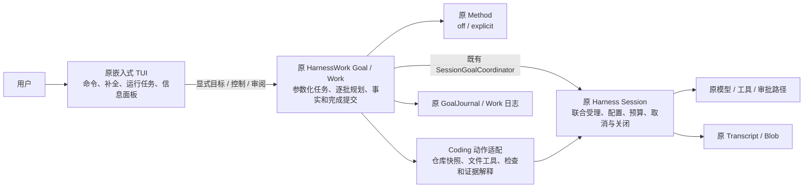

# 交互式开发 Goal 与嵌入式 TUI 接入

- ID: GMW-KD-IG-001；Revision: R2，2026-11-03。
- Authority: normative — 本轮已授权的收敛实现合同；Design status: accepted within delegated scope。
- Implementation status: implemented locally — 独立三视角阻断已关闭；远程交付见 [PR #853](https://github.com/zhnt/loushang/pull/853)。
- Owner: Loushang architecture；Harness、HarnessWork、Method、HarnessTUI、Coding composition。
- 基线：`832d7249d089586a0bd01907e1458808bf317461`，PR #852 后的本地 main。
- 方法：本地干净 archmethod master `0f9bd3ff51afabeaaf76cc38dff1ceb279b7d37e`，未核验方法远端。
- 授权：用户在阅读收敛建议后回复“同意，请收敛并实施，开发完成后进行三视角评审”。接受的是“任务参数化＋薄 TUI 接线”，不接受 R1 全部扩展。当前 agent 按此委托负责内部细化；不制造用户逐字段接受的说法。

## 1. 收敛结果

复用原 Goal Controller、BatchPlanningPolicy、PlanningWork、SessionGoalCoordinator、WorkRuntime、Session admission/overlay/scope、调用限额、Method、证据与物理存储。任意目标是用户可以输入日常开发任务文字，任务不再固定 calculator 或 RC 编号；不是任意平台/配置/工具均被支持，也不保证给定预算内成功。

R1 的多字段表单、任务编辑/合同替代 UI、通用远程 DTO、后台自动唤醒和跨进程续跑不实施。本切片只有参数化任务合同、编码动作适配、原 advance 的有限调用及原 TUI 命令/展示接线。无新顶层组件、harnessmethod、执行引擎、输入队列、事实账本或全局状态文件。

## 2. 环境与责任



本地装配在原 TUI 进程内直接调用，不绕 AppService。图表示协作，非 import 边；Harness 不依赖上层 Goal/Coding，HarnessTUI 不反向依赖 Coding。真实 lmux 接入仍不在本切片。

| 既有组件 / 本轮内部增量 | 主责与非主责 |
| --- | --- |
| HarnessWork Goal 的 tasks 内部模块 | 中立任务内容、共用批次选择上的任务证据/验收关联。目标要求仍由原 GoalState 唯一保存 |
| HarnessWork Session integration 的有限 run 适配 | 在一次用户动作中有限调用原 advance；复用 Harness ExecutionDeadline，不拥有第二个 Work/Goal 状态机或常驻调度器 |
| 原 Harness Session | 当前实例/代际、唯一受理、overlay、调用和资源收敛；既有队列与生命周期不复制 |
| Coding interactive profile | 给原 CodingGoal 借用装配注入参数化 policy；复用原规划 schema 的可配置 parser、Method 准备、SessionTurnExecutor、ScopedSessionWork、CodingVerificationExecutor |
| Coding UI binding | 薄命令解析、调用及结果措辞；同一 Session 保留原 handle，不自行推进业务或保存事实副本 |
| 原 HarnessTUI / TUI | 原活动请求 Task、local 控制路由、surface starter 与 TextPager；无新的后台 Task owner。Coding router 只补 Goal 控制和图片保留规则 |

旧 calculator/repository facade、parser 默认值、proof/prompt 及 dedicated/hosted 行为保持原解释路径。只扩展私有借用装配的 profile 注入及已有执行 wrapper 的步骤别名；原 Method step ID 仍留在实际 Work，不将记录中的步骤改名。

## 3. 使用合同

```text
/goal 修复当前项目的参数解析，并补回归测试
/goal run
/goal status
/goal review
/goal accept <本次审阅显示的 TOKEN>
```

第一条创建任务并展示目标和缺省约束，**没有模型调用**；run 才授权在原权限内开始模型/工具执行。确认不合适可 abandon，不需要额外填写 manifest 或 admission.json。可选配置直接通过命令给出：

```text
/goal new --check 'python -m pytest tests/test_parser.py -q' --method <已有方法名> --calls 8 -- <目标文字>
```

| 操作 | 含义 |
| --- | --- |
| `/goal`、`status`、`help` | 当前轻进度/帮助；状态明确 validity=not_checked，不能据此宣称当前验收通过 |
| `run` / `step` | 一次有限推进 / 一次 advance；一个活动动作，不并行排入新队列 |
| `pause` / `cancel` | 原 control 先阻止后续批次；cancel 再请求原 Work 收敛，保留 cancellation outcome 与 unknown |
| `resume` | 原 confirm_resume 后显式推进，不重置该 Goal 模型/Work 余量 |
| `review` | 展示目标、候选摘要、变化文件和检查配置，生成绑定当前身份的 token；用户应审阅实际文件 |
| `accept TOKEN` / `reject TOKEN REASON` | 对当前候选显式批准/反馈；原 Work 留证，拒绝意见作为后续规划材料，无模型调用 |
| `abandon` / `close` | 明确放弃目标 / 关闭借用 Goal 的资源；父 Session 保持原所有权，关闭失败可重试 |

文字命令不接受图片，拒绝时保留草稿与附件。运行中 Goal 控制不能被 Enter 转成 steer；run 等执行命令在运行中明确提示不可用并保留草稿。普通文字、steer/follow 和 clear 仍沿原队列，不自动修订要求。

## 4. 目标、动作、Method 与预算

用户目标保存为原 Goal 的 R1 requirement（这是任务内稳定 ID，不是固定内容）。原 metadata 保存版本化 `task_contract`：检查命令、Method 来源身份、调用额度及 `human_required` 验收模式。原文在原 Goal create 中留存；无需另一份任务库。

动作只有 inspect、execute、verify、request_review、stop。模型每次选择一项及可修订路线，仍产生一个原 planning Work，核对原回复来源并按旧通用选择器只消费一次提案。verify 只能引用用户已配置的 check ID，不能注册模型生成的任意检查为验收标准。execute 使用原文件工具；inspect 提供仓库取样，实施回合可再沿原 read 读取实际内容。

Method 继承现有 off/explicit 配置，用户可显式选择已有方法。方法的固定步骤经原编译/准备进入原 Work；模型不能改 Method 设置或在运行中改同一 MethodPlan。Skill 仍由原资源路径提供专业指导，不产生权限或完成结论。

缺省限额：每 Goal 8 次逻辑模型调用、每次输出最多 4096、provider 尝试 1；Work 24、规划 8、连续无效提案 3、连续无进展 2。创建时 `--calls` 可明确选择 1–32；单实施 Work 的调用约束沿本 profile 的 8 次阶段上限，实际仍受 Goal 总余量约束。保留最后两个 Work 槽位给零模型收尾。每个显式 run 最多 600 秒，届时停止新工作并请求原收敛，不声称能强制回滚外部效果。

模型读取同一有效约束和剩余额度。调用 limiter 是执行限额，不替代 Transcript token 用量；未承诺总 token 硬预算。再次 run/resume 共用原 Goal 计数；完成或放弃后，用户可显式在同一存活 Session 创建新 Goal，各自额度通过原执行限额句柄区分，共用一个 writer/scope/Work backend。

## 5. 验收与原执行交接

无检查项目允许人工验收，但界面与记录明确这是用户对要求的判断，不是自动证明功能。存在必需检查时，缺项、失败、未知或非当前候选的结果不能被批准跳过。Work completed、文件可读和模型自称完成都不等于 Goal completed。

沿既有 repository review 的原则组合：取当前身份 → 用户批准/拒绝 → 原 review Work → 原 GoalAcceptancePolicy → 原 Controller 完成提交。新任务不使用 repository 的固定 RC 判据。审阅身份绑定 scope/Session、Goal、revision/epoch、不可变合同及当前仓库快照；批准报告保留必需检查 operation 引用。检查依据缺失或候选后来变化时，完整 query 不能继续给出 current。

提交前与报告生成时核对候选；过期批准需重新 review，不能把用户对旧文件的批准绑定到新文件。reject 留具体反馈，不改变原目标；后续规划读取该事实。来源不明、追加结果未知及清理失败沿原查询/保留合同，不盲目重建目标。

run 的有限循环仅调用原 advance；每批仍由原 coordinator/scope 受理，不在同一 HostRuntime 内递归等待 prompt，也不再包一层相同 scope.invoke。关闭只等待原调用边界 finally，不 join 调用者外层 TUI Task。控制面板的等待沿原 surface starter，终端不串行 await 整个运行或取消。

## 6. 支持范围与兼容

首版支持标准 Coding 文件工具、可写持久 Transcript、可核对 prepared transport 及兼容 Work 后端。原配置/权限与 Goal 限制取交集，不换模型、不静默禁用扩展、不用新 Session 绕过拒绝。

旧日志绑定不同 profile 时继续原解释，不改 header、不清库；该 Session 新交互 profile 创建可被明确拒绝，普通会话和旧 Goal 不受影响。后端路径/recording 不兼容同样具体拒绝，不另建第二套 Work。非持久或执行替换扩展的普适支持未实现。

同一存活 Session 最多一个非终态交互 Goal。重启或关闭后可只读展示历史；不存在足够执行依据时不重新 attach 旧目标继续，不清零预算。真实 lmux、跨进程自动续跑、混合 policy 日志迁移、模型自动 Method 组合和完整配置 UI 留后续专项。

仓库取样在原 settled I/O worker 内执行，prepare/assess/审阅每次取得本次冻结材料，不做跨批历史索引或另建事实缓存；取消与关闭等待该 worker 收敛。Git 枚举设置 2 秒等待限额并关闭仓库 fsmonitor hook；未支持的 gitlink/submodule 明确拒绝，不能用 missing 代表其全部内容。仓库取样包含初始脏改动、非忽略新文件；不替用户提交、清理或撤回。快照是当前性依据，不是 shell 隔离或外部副作用撤销证明。轻进度不做快照/历史全文读取；候选/完整审阅边界取样有大小限制，超限具体停止，不截断后声称完整。

## 7. 验证与交付

优先离线验证两个不同的非 calculator 开发目标，经过实际 TUI controller、原模型 transport、文件工具、规划/执行/验证/评审 Work；再验证真实 screen router/surface 接线、运行中取消、过期审阅、必需检查、连续新任务、原 Method 及旧 profile 回归。不用直接 SDK-only 测试替代 UI 组合验证。

用户要求实现完成后进行三视角评审：职责/复用、运行/失败、数据/兼容。固定代码快照后分别独立评审，阻断项修正并复核；不以作者走查代替。状态与结果见[评审及实施记录](interactive-development-goal-review.md)。本轮不新增/扩大 CI 门禁，不重复付费模型试验。
