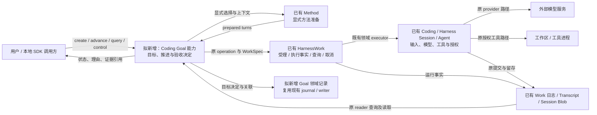
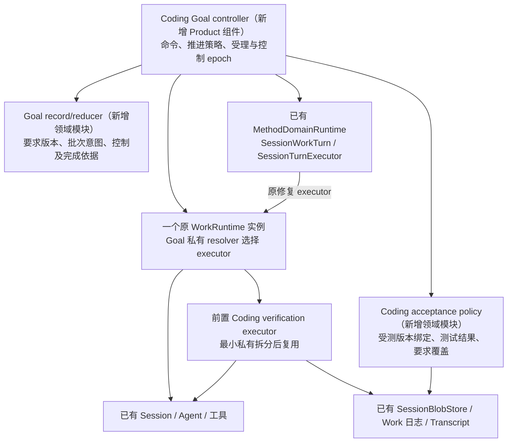
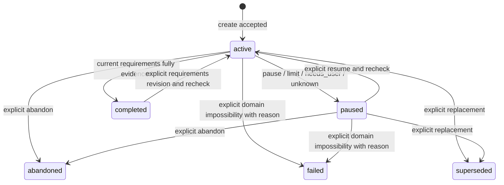
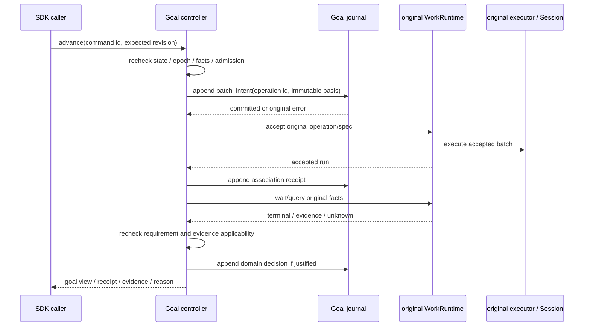

# Goal 最小业务闭环：架构设计 R2

- Authority: proposed — 本地 SDK 首版候选，不是 Current 或已接受 Target。
- Design status: draft；Implementation status: not-started。
- Owner：Loushang architecture / Coding Product composition。
- 源码基线：`372cde4ade0fe026076c8fa5e8b4486774b09cc3`。
- 本地前置切片：`feat/coding-sdk-evidence-loop` 未提交工作区；其生产源码哈希见 §12。
- 方法：本地干净 `archmethod master` `0f9bd3ff51afabeaaf76cc38dff1ceb279b7d37e`。
- 用户架构评审：pending；内部评审不能代替用户接受。
- 需求：[G-GOAL-MIN-01](../../plans/2026-10-25-goal-minimum-business-loop.md) GM-01…08。

## 1. 目标与首个场景

使一个明确的小项目从已知测试失败，经真实 Coding 修复，达到有证据的要求满足。
首版支持本地 SDK、显式 Method、调用方一次推进一批工作；模型自主规划、后台
唤醒、多目标并行、跨会话迁移和远程 Goal API 留作后续增量。模型修复仍必须真实
调用已有 Coding/Agent/工具路径，不能用固定补丁代替。

首个可重复还原项目拟采用单文件 `calculator.py`，要求修复整数减法与 clamp 边界行为；
具体初始内容、测试用例、允许修改文件、Method 和模型配置在实施前固定。完整真实
轨迹为：初始验证失败的 Work → 按 Method 修复的 Work → 再验证的 Work → 完成决定。
这已包含多批 Work 与失败证据影响下一批，不刻意诱使模型先产生一次错误补丁。
若修复后仍失败，下一次显式推进必须携带新的失败证据；达到配置的累计批次上限
或不能判明下一步时，停止派发并说明理由。

## 2. Current、前置切片与缺口

以下为源码静态核查；不是本轮运行或跨平台验收。

| 事实 | 当前证据 | 对本设计的约束 |
| --- | --- | --- |
| 显式 Method 已能产生多个 prepared turn | `method/runtime.py:MethodDomainRuntime.prepare_turns`、`method/compiler.py` | 复用选择、编译和指导；不是已有自主 planner |
| MethodPlan frozen，plan id 静态派生 | `method/types.py:MethodPlan`、`compiler.py` | Goal 计划修订另有身份；不修改活动 WorkSpec |
| Session turn executor 已执行原 prompt 并投影事实 | `harnesswork/integrations/session.py:SessionTurnExecutor` | 修复绑定直接复用该 executor，不复制模型 loop |
| Work 可按 operation 查询已有 run | `harnesswork/runtime.py:get_run_for_operation` | Goal 只记 operation 引用，避免双写 operation→run 权威 |
| SessionWorkRuntime 的并发闸门只覆盖该实例 | `integrations/session.py:accept_operation` | 不能用两个各自空闲的 runtime 推导 Session 全局空闲 |
| 验证器已在本地切片产生/消费报告和 Blob | `coding/adapters/_verification_work.py` | 尚未合入 main；目前不绑定受测代码/测试，不足以裁决 Goal |
| 证据事件及旧偏离边可分开解析 | `coding/adapters/_work_evidence.py` | 复用 v1 严格 payload/authority；旧支持引用未解析时保留 unresolved |
| Work 日志弱耐久，orphaned 是重开派生视图 | `harnesswork/event_log.py`、`runtime.py` | 不能由 Goal 的持久记录反推 Work 必已执行或安全重试 |
| 现有 journal、retained writer/rooted I/O 可复用 | `harness/journal/jsonl.py`、`_directory_lease.py`、`_rooted_io.py` | 不自建锁、fsync、路径防护；所选 retained writer 当前为 Linux 机制 |
| 原始用量由 Transcript 记录 | `harness/transcript/model_usage_types.py` | 不另建原始 token 账本；现有事实不自动给出完整 Goal 归属 |

旧环境图中的“Work→产物事实”必须读作领域交接的研究关系，不能解释为 main 已有
通用产物投影。首版只使用已明确的 Coding 私有证据切片。

## 3. 系统环境与部署边界

本图研究对象为“本地 Coding Goal 能力”，SDK 调用方是其外部操作者。所有逻辑
组件首先部署在同一本地 SDK 进程中；模型服务与工具启动的进程是外部协作者。

首个真实验证环境选用现有 retained writer 支持的 Linux 本地 profile；这是拟议
部署选择，不等于跨平台目标已接受或 Windows/macOS 已验证。数据根由可信 SDK
装配显式绑定，与 workspace/平台状态域按已有规则分离。用户代码和模型响应不能
通过事件中的路径、source 字符串或 session id 临时选择其他记录库或 Blob authority。
模型/命令执行保持原权限与审批；Goal 状态操作不授予额外文件、进程或网络权限。

## 4. 功能映射与组件

以上是职责分解，不建立三个独立服务或通用 framework。实现位置候选为
`coding/adapters/` 下的私有 Goal 模块；公开符号/API 形态在用户接受后按最小入口
落地，不提前提升到 HarnessWork core 或 Coding root facade。

| 职责 | Owner 与增量 | 不拥有 |
| --- | --- | --- |
| 创建、要求版本、推进命令、暂停/放弃 | 新增 Coding Goal controller | 输入消息队列、模型 loop、原工具授权 |
| 目标与批次意图的持久事实 | Goal record/reducer，复用 journal/writer | Work 生命周期、Transcript 原文、原始 usage |
| 下一批修复内容 | 首版固定阶段策略 + 原 Method 准备，携带最新失败证据 | 任意自主 planner、活动 Work 原地重规划 |
| 运行受理/等待/取消/查询 | 原 WorkRuntime + 既有 executor | Goal 完成裁决 |
| 验证命令和证据交接 | 原私有验证能力的领域 executor | 仅凭命令 exit 0 裁决整个 Goal |
| 要求覆盖与证据适用性 | Coding acceptance policy | 通用语义证明器、共享证据平台 |

### 单一执行装配

当前 `CodingVerificationWork` 自带 WorkRuntime，而修复的 SessionWorkRuntime 又有
独立 runtime；首版不把这两个实例直接并排装配成“全局并发安全”。候选做法是：
从私有验证 helper 最小拆出其原 executor，保留 standalone wrapper 的既有行为；
Goal 只装配一个原 WorkRuntime，私有 resolver 对修复 operation 同时将 executor
和 cancellation 绑定为原 SessionTurnExecutor，保留 abort/wait_for_idle；对验证
operation 绑定拆出的验证 executor，按原能力如实保留 unsupported 等取消分支。
不能因 executor 本身有取消方法就漏填 WorkExecutionBinding.cancellation。Method turn 的
operation/spec 转换复用 SessionWorkTurn 的现成方法，领域提示和元数据不平铺进
证据 payload。此改动只在 Coding 私有装配发生，不改 Work 端口与生命周期。

首版 Goal 装配内部调用原 Coding SDK 创建或恢复专用 Session；不接受任意现成
Session 或外部已持有的 WorkRuntime 借入。外部只取得 Goal handle、只读查询及
§9 明确的原输入转发面，不取得原 runtime/session 的可变引用或裸 prompt 入口。
普通 SDK 装配保持原行为。Python 私有成员不是安全隔离，直接反射旁路违反本
profile 合同；这里防止合法 API 无意形成两个执行 owner，不声称防御恶意同进程代码。

构造顺序固定：原持久 Session create/restore 生命周期先取得原 Transcript writer
并绑定运行 owner（`harness/transcript/writer_lifecycle.py:_build/_acquire_writer`），
再取得同会话 Goal writer，严格读取 Goal 历史，最后开放 handle。持久 writer 不
可用、已有冲突、原会话尚未退休或 Goal 历史异常时，不开放推进；第二步失败须
通过原 lifecycle 处置本次构造的 Session，不能释放其他 owner 的资源。只读历史
查询可以不创建 Session；恢复可执行 handle 必须走上述 owner 重新取得流程。
此处不借 Goal 日志锁假称 Session 全局锁，也不新增全局 owner registry。

## 5. 领域身份、状态与寿命（D1）

一个逻辑 Conversation 在首版只保留一个非终态 Goal，可查询多个历史 Goal。
Goal 身份不同于 Session、Method、Work run；本地恢复由可信装配显式选择同一会话
与存储根并走原生命周期，不按日志中的路径自行实例化 Session 或恢复模型工作。

| 领域数据 | 权威与规则 |
| --- | --- |
| Goal identity / requirements_revision | Goal 记录拥有；要求按稳定 requirement id 追加新版本，保留原始内容与变更理由 |
| selected Method / method fingerprint | 固定显式方法身份、内容及必要配置摘要；内容变化需新计划准入，不悄悄漂移 |
| Goal plan revision / batch id | 每个已受理批次引用要求版本、阶段、方法指纹、输入证据及原 operation id |
| operation / run / step | 原 Work 负责映射、状态及事件；Goal 读取引用，不双写 run 状态表 |
| acceptance decision | 绑定要求版本、control epoch、验证 operation/证据、受测输入清单及判定理由 |
| command identity | 修改命令带 command id、expected revision/epoch；同命令重试只查询原回执，不再提交工作 |

`waiting` 是 active/paused 的可查询理由，不再另造一套执行终态。Work failed 不
自动成为 Goal failed；批次上限触发 paused，不能由失败次数直接宣判目标不可能。
completed 是其要求版本的历史结论：用户显式修改要求可创建新 revision 并重新
激活，但旧完成依据保留。其他 Goal 占用活动位时，拒绝这次重新激活。

追加、修订和撤回都通过有版本检查的 SDK Goal 命令接受，递增 control epoch，使
既有计划/验收依据失去自动适用性。普通 steer 文本不会被猜测为要求修改；调用方
需显式提交目标修订。已有 Work 可继续结束，其结果标明旧版本，不能完成新要求。
“替换目标”在同一会话 Goal journal 的一条领域记录中同时终结旧目标并创建新目标，
避免跨两个文件交换活动位。原 Work 未收尾时，新目标仍不得派发新 Work。

## 6. 批次受理、Method 和未来规划（D2/D3）

首版每次 `advance` 最多受理一个批次，不含自动循环。候选阶段为 initial_check、
repair、verification：无当前失败/成功证据先验证；失败且允许继续则修复；修复
结束后必须再验证；完整通过才裁决完成。阶段由当前要求、事实和明确规则导出，
不是由模型给出的 completed 文本驱动。

修复时调用 MethodDomainRuntime.prepare_turns，显式选定方法的全部受支持步骤
通过原 SessionTurnExecutor 执行，保留 method/plan/step 元数据。最新失败报告、
要求版本、工作区版本和不可放宽的测试约束进入本批输入；只存输入引用及必要
摘要，不复制完整 Transcript。首版拒绝不支持的 executor 或不能执行的强约束；
constraint/audit 字段当前主要透传，不能以“字段存在”声称已经强制执行。

共同计划受理合同为：输入要求版本/策略来源/方法指纹/证据引用/可用能力/批次
上限 → 返回 admitted、rejected 或 needs_user 及结构化理由。受理需核对当前
状态、epoch、无活动或未知 Work、方法适用性、证据期望与剩余授权范围；现有
WorkSpec 结构校验只是最后一层，不替代 Goal 语义准入。

未来模型策略只能提出同一合同的候选计划修订，再经过相同准入、Work 和验收；
不得修改要求或绕开权限，不新增独立 executor/队列。本轮设计该协同边界，不实现
通用 planner，也不把“未来可插拔”当作已运行的两种模式。

## 7. 受测版本与目标验收（D3/D5）

前置 verification_passed 只反映命令和材料；本轮新增的是 Coding 领域要求侧的
判断。首个项目采用有明确语法域的真实 Python 纯函数项目；不是通用 Python 安全
执行器。模型实际改写工作区源码，验收执行同一源码 bytes；超出所选领域的语法
或依赖返回 needs_user/rejected，不能静默切换为信任任意源码自报的测试结果。

### 7.1 完整项目约束清单

创建时由 Product 固定整个受控项目的基线清单：所有相对路径、类型、长度及内容
摘要；只允许 `calculator.py` 内容改变，其他原文件与固定测试原文必须保持不变。
首例的目录及总字节上限也固定；不允许新增、删除、改名、类型改变或符号链接。
仅显式列出的、不能参与测试输入的临时缓存路径可排除，不能由模型新增忽略规则。
不单凭 Git status 或只读取白名单证明没有越界修改。

Product acceptance policy 在验证前、修复 Work 收尾后及完成前重新枚举整个受控
项目并比较清单。新增/删除/改名体现为路径集合差异；只读文件/测试内容变化、链接
或不能完整读取时拒绝验收，记录具体违规项，Goal 保持未完成且需要用户决定。
越界修改并不自动回滚，也不能通过更新基线消除；用户明确修订约束后才可重新准入。
首版这个有界比较不是文件监控服务；原工具权限仍独立执行，Method metadata 不
安装文件白名单。原 workspace 之外的授权范围继续由原工具/policy/sandbox 负责。

### 7.2 固定测试和可信结果的具体机制

首例源码合同为两个顶层函数 `subtract(a,b)`、`clamp(value,lower,upper)`，仅处理
确切 int 类型的有界输入。可信 driver 先检查 UTF-8 源码不超过 16 KiB，AST 节点
不超过 128、深度不超过 16；采用完整 allowlist，只准固定函数签名、参数读取、
小整数常量、加减、比较、布尔条件、if 与 return。禁止顶层副作用、import、call、
属性/下标访问、赋值/全局变量、decorator、default、annotation、lambda、推导式、
循环、幂/移位等；常量绝对值及测试输入绝对值均不超过 1000。函数和参数名称必须
与合同一致，源码不能得到测试 runner/driver 的对象引用。

通过准入的原 AST 在独立 namespace、空 builtins 下由原 Python 编译和执行；不
改写函数体或替换为预设补丁。保证来源于有限语法及数据域，不单凭 namespace
或 chmod 声称安全。首例固定测试包是含 test id、函数名、整数输入和预期输出的
受信任数据；driver 使用原 unittest runner 执行这些用例、检查返回类型并产生结果。
测试包最多 64 个唯一 test id，每项参数个数与固定函数签名一致；参数和预期输出
均为确切 int，参数绝对值不超过 1000、预期输出不超过 10000，clamp 输入需满足
lower≤upper；输入包总量上限为 64 KiB。创建时超限即拒绝，
不是到模型执行后才删除用例。领域策略 id 与这些界限绑定要求，Goal 核心不硬编码
两个函数或测试数量；本轮具体实现只交付这一明确领域策略。
测试数据、test id 集合和 driver bytes 在创建时固定为原 Blob；源码不能定义或
覆盖测试、runner、断言和结果序列化逻辑。测试原文的工作区副本同时受 §7.1 保护。

具体交接为：Product 用已绑定 SessionBlobStore 读回并核验源/测试 Blob，把完整
bytes、长度和摘要装入有界 JSON 输入，通过原 `session.execute_bash` 的 stdin
传给固定 driver；command 为装配选择的绝对 Python `-I -S` 和可信 driver 路径，
cwd/env 也由装配选择。现有 facade 已支持这些参数，私有 verification protocol
按需透传，不增加 Work 端口，不在 driver 内按 payload 的路径/Session id 选 Blob 库。
driver 重新核对输入包长度/摘要/版本并将 bytes 固定在内存后运行；不再导入可变
工作区测试、依赖或模型生成的模块。第一轮 Goal profile 不接会替换 user_bash
结果或验证工具的自定义 hook/provider；不支持的装配明确拒绝，不能伪装真实执行。

driver 将 unittest runner 文本写到有界内存流，规范结果之外不向 stdout/stderr
打印正常 runner 日志；源码有限语法也不能 print。短输出的原 SDK 文本视图因此
可承载完整 JSON，较长输出仍复用原 stdout/stderr Blob，不靠猜行或截取 PASS。
driver 仅输出一份严格领域结果：版本、输入包/源码/测试/driver 摘要、预期且实际
执行的 test id 集合、各用例结果及 fail/error/skip 计数；重复 key、额外结果、遗漏、
未知版本、类型不符或超出输出上限均拒绝。命令和 stdio 必须先满足原验证器的
完整性合同，Goal 再核对领域结果和原输入包。仅 exit 0、打印 PASS 或模型自报的
test id 不构成通过；真实结果只由固定 driver 对有限源码的实际执行产生。

### 7.3 完成决定的关联

每项 requirement id 必须在准入时映射到固定 test id 或完整项目清单上的可检查
约束，覆盖映射随要求版本保存。无法检查的文字要求返回 needs_user，不能默认
满足或让模型自行勾选。driver 输入/结果及 Goal acceptance 同时核对 Goal id、
要求版本、批次/operation、覆盖映射及测试/driver/source 指纹；跨 Goal 或旧版本
报告即使内容全通过，也不能被挪来完成当前要求。

验证前的实际源清单、完整项目约束检查、要求版本、control epoch、Method 指纹、
固定测试/driver 及输入包摘要共同形成该批不可改写的依据。修复后仍不通过则保留
真实失败结果，供下一批原 Method 输入引用。完成提交前再核对当前要求/epoch、
方法及完整项目清单；源码或只读文件漂移、必需证据不足都不能完成。

源码、测试和报告复用现有 Blob 存储，领域内容可存在原 evidence Blob 内；
WorkEvidenceReported 的 v1 envelope 不扩字段、不改通用投影。协议细化时须
绑定 input_bundle_sha256 和 test/driver/source 指纹到报告及 acceptance 记录。
reported_step_id/current_step_id 只辅助展示，不承担要求覆盖或版本证明。

可信 Product/driver 与依赖、模型源码和原 OS 权限的边界分别记录。首个 profile
要求受控项目无其他写 owner、验收目录不交给模型工具写入，修复模型仅选择现有
文件工具；验证 command 经原工具授权执行。禁止以同 UID/hash/私有成员声称
抵御恶意宿主或外部进程。对有限语法域之外的一般项目，必须选择并验证适用的
现有隔离/验收机制后再扩展，不把首例有限策略推广成通用安全保证。

旧 WorkStepDeviation.evidence_refs 保留支持关系，显式绑定同一报告时不重复计数；
未解析项为 unresolved，不单凭数量证明满足要求。缺失、损坏、未知 schema、
stdio 不完整、留存失败、report/validation 不一致均阻止完成。

历史 completed 查询展示其原要求/证据依据及当前适用性；源码后来变化时标明
outdated，不能仍声称当前工作区通过。普通只读查询不暗中追加重开或重执行事件。

## 8. 持久记录、交接与故障（D1/D5）

候选存储为每个会话一份 Goal 领域 journal，借用现有 retained writer/rooted I/O
及 JsonlJournal；不把 Goal JSON 嵌入消息原文，也不向 Work kernel 加目标状态。
Goal writer 的锁 domain 固定为 Coding Goal，authority 固定为逻辑 Conversation，
同一会话的所有 Goal 共用一份固定 journal；owner/product id 不分割物理排他域。
不能按每个 Goal 生成不同 authority 来绕过活动位。文件位于装配选择的同一可信根，
头中的 conversation/authority 必须与已选 root 及 Session 绑定一致，不从记录选库。
Goal 目录固定从所选 Session 持久数据根派生；首版 API 不提供同一会话改选另一
Goal root 的参数。清空、迁移或换根不能作为解除未知执行或重置计数的恢复方法。
retained writer 负责该装配生命周期的排他；事务内 bound-file journal 使用
locking=false 避免重复锁、flush/fsync=true；不能把既有 PROCESS_LOCAL_JOURNAL
说成提供相同保证。读取采用严格 schema/序号/身份和 partial_tail=raise，未知
版本或坏尾拒绝可变操作，不静默跳过、截断、修复或回放。
每次 load/append 前检查原 lease binding，在现有短 rooted I/O 操作内取得并使用
bound_file，不跨 await 或事务缓存该对象；lease 本身按 §9 生命周期保留。缺少
Goal journal 的旧 Session 仍可照常使用普通 SDK；明确 opt-in 创建首个 Goal 才
建立记录。指定不存在的 Goal 查询返回 UnknownGoal，不把“从未启用”当作坏历史。

记录包含 created、requirements_revised、batch_intent、batch_associated、
control_changed、acceptance_decided 等领域变化及命令回执依据。只保留 Goal 自身
事实；run 终态、消息、原用量和 bytes 仍从原 owner 查询。每条 version 为精确正
整数，bool 非版本；未知版本、事件 kind 或 required_features 均拒绝可变操作。
同版本额外可选字段只可承载不改变语义的扩展数据，保留而不猜测；需要新含义
必须增加版本或声明 required_features，不能靠读者猜“未知必要字段”。
遇到不可识别的必要语义，只能返回有限的诊断读取结果，不能投影成“有效当前
Goal”或据此派发/验收；旧非 Goal 的 Work/Transcript 格式不因 Goal opt-in 改写。

Reducer 在应用每条记录前验证以下关系，失败即拒绝继续，不由 JSONL 库代验：

- 会话/物理 authority 与头一致，sequence 连续且唯一；Goal create 先于其后记录。
- requirements revision 与 control epoch 从初值按相应命令严格递增；历史引用可
  指向过去，当前准入/完成不能引用未来、不存在或其他 Goal 的 revision/epoch。
- 每个外部 command id 只有一条受理事件；同 id 不同内容冲突，重试只读其既有
  回执。后续 association/decision 用 causation_command_id 引用已受理命令，不
  冒充第二次接受。尚无最终结果时返回 pending/unknown，不能重执行该命令。
- batch id、operation id 在本会话 Goal 领域关联中唯一；intent 必须先于 association
  及 decision，包含原 Goal、要求/计划修订、方法/依据、累计计数。不能将同一
  operation 重新关联别的 Goal、改变其要求或把两种阶段合并覆盖。
- association 只能引用已存在的 intent；其中 run 仅为查询回执，必须由所选原
  Work owner 按 operation 解析并核对会话。不同 run 的重复关联为冲突，不将缓存
  回执当作第二份 operation→run 权威。Work 不可读时保留 unresolved，不补造回执。
- acceptance 只能引用本 Goal 本要求版本的已知批次与校验过的同 Session Blob，
  完成记录必须含 §7 的领域依据，且状态/epoch/约束均满足；旧依据只能保留历史。
- 每次命令后最多一个非终态 Goal；replace 在单条记录内检查旧目标及新 id，原子
  更新活动位。累计 intent 计数只增不减；abandon/replace 不解除会话未知执行闸门。

Goal journal、Work 日志、Transcript 和 Blob 不在一个事务中。Work accept 可能在
association 落盘前已启动；intent 必须先成功，再允许有副作用的受理。

| 故障位置 | 行为与可观察结果 |
| --- | --- |
| intent 追加异常 | 本次不调用 Work accept；即使记录可能已落盘，也不得以异常后重试继续派发。该 writer 进入需核对状态 |
| Work accept / association 之间中断 | 原 operation 查询作为关联权威；存在 run 就保留/关联原运行，不新建 operation 重做。无记录不证明从未发生，重开后要求显式核对，默认暂停 |
| Blob 已有、报告事件追加异常 | 沿用原错误及后端事实；不删除共享 Blob、不重发副作用，不推断报告必然可用 |
| Work 失败、取消或 orphaned | 读取原事实与取消观察；Goal 未完成，分别报告执行失败、控制意图和效果未知；历史 orphaned 不自动重启 |
| Goal 完成决定追加异常 | 调用方得到不能确认的错误；不能返回成功。停止后续派发；重开严格读原记录并核对原依据，不补造第二次执行 |
| 损坏、未知 schema、跨 authority 或根替换 | 拒绝变更/验收并保留诊断，不能借另一同摘要引用或重新建库绕过 |

任何追加异常都先停止该 controller 的可变操作；这只是 Product 的失败处置，不
修改共享 journal 的错误语义。读历史后可能确认原决定已存在，但不会因为异常
被“解释好了”就自行恢复执行。需要人工核对的事实、明确可继续的条件和新的
显式命令必须可查询，不承诺 exactly-once 外部效果。

首版选择保守、可执行的未知恢复边界，而不提供领域 reconciliation 引擎：

| 冷读后的证据 | 允许与禁止 |
| --- | --- |
| intent 未成功、严格日志也没有 intent | 原控制流保证当次没有调用 accept；新 writer 可重新核对后接受一个新的显式命令，不声称原命令已接受 |
| intent 存在且原 operation 有明确终态/完整事实 | 按原 Work 核对会话和影响，保留原关联；已知普通失败可在显式 resume 后选择后续批次，绝不重放原 operation |
| intent 存在但 Work 查询为空、orphaned、事实不全或效果仍 unknown | 会话级 execution_unresolved；禁止 resume/advance 派发任何新批次。abandon/replace 可记录领域控制，但不能解除该闸门，换 command/Goal id 不得绕过 |
| 完成决定追加未知，冷读能确认原决定及完整依据 | 只读展示已存在决定；不补造新的执行。依据陈旧时如实显示，不因为旧 completed 就派发或宣称当前通过 |
| 日志损坏/未知 schema/authority 或根不一致 | 拒绝可变操作，仅输出有限诊断；不写入“已核对”覆盖错误 |

上述不完整/unknown 分支不能仅靠 active_runs 为空、目录看似正常或用户点击 resume 清除。
首版未提供解除 execution_unresolved 的 API；需要人工处置外部效果和后续专门
设计才能扩展其恢复范围。已知正常暂停/明确取消收尾与未知执行要分开，不能将
此限制描述成所有暂停都不能恢复。只读查询、原 live Work 的取消能力及 close
仍可使用；取消请求成功也不能单独清除历史未知。

## 9. 用户控制、并发与重开（D4/D6）

同一 owner loop 串行提交短的 Goal 状态修改；不持有 Goal 写锁等待模型、工具或
Work 结束。`advance` 在首个 await 前登记本次 in-flight/epoch；重复或并发推进
拒绝或返回同命令既有回执，不排进新执行队列。方法准备等慢步骤结束后、Work
受理前以及完成提交前，均重新核对 epoch 与要求。最后的状态/epoch 检查与
Goal 决定追加在同一 owner-loop 的无 await 短临界段内完成，避免检查后再让控制
命令插入；原文件系统外部写入不因此获得事务隔离，仍受 §7 的输入固定和适用性
边界约束。修改命令采用 expected revision 检查，过期调用不覆盖新要求。

| 控制 | 语义 |
| --- | --- |
| pause | 记录暂停并递增 epoch，阻止新批次；当前 Work 可继续，回执明确仍运行。不把暂停冒称取消成功 |
| request_cancel | 调原 Work cancel，查询取消观察；settled/unsupported/failed/unknown 分开展示，不承诺撤销既有外部效果 |
| revise | 记录追加/修订/撤回并递增 epoch；旧 Work 结果不完成新版本，等原 Work 明确收尾后再准入新批次 |
| abandon / replace | 先停后续派发，保留旧运行及未知效果；是否请求取消显式区分，不把终结 Goal 当作执行已收尾 |
| resume | 显式重新核对历史、原 Work、要求、方法、材料与余量；只允许后续 advance，resume 本身不执行一批 |
| reopen / query | 重建只读视图并标示异常/陈旧依据；不自动唤醒、重放或重新提交模型请求 |

### 原输入的受理时段

目标要求变更使用显式 Goal 命令；原文本/图片执行输入通过 handle 受控转发，
不猜测其自然语言含义来修改要求。内部原 Session 的裸 prompt 不对外开放。

| 时段 | Goal handle 的输入规则 |
| --- | --- |
| idle / 方法准备 / 准入 | 不接受普通 prompt/steer/follow-up；返回明确不可用，不私自排队。修改目标可用 revise 命令，准备返回后 epoch 复核会拒绝旧准入 |
| 修复 Work running | 允许原同步 steer/follow_up 及其 typed images，经原 Session 接口预处理并入原队列；不保存第二份消息队列、不调用会自行启动新轮的裸 prompt |
| 修复 Work 结束及验收窗口 | 先关闭输入转发时段；有待处理原消息则 paused(reason=pending_input)，由调用方通过原明确队列控制决定，不自动清除或绕过。无待处理后才准入验证 |
| 验证 / 完成提交 / closing / fenced | 拒绝新增执行输入；Goal pause/revise/cancel/query 按各自状态合同处理，不用工作区修改代替目标控制 |

输入转发的阶段/原 Work running 检查与原同步 steer/follow_up 调用在 owner-loop
同一无 await 段完成；已经 terminal 的 Work 即使等待协程尚未返回也不能再接受
输入。原同步方法的 Current 依据为 queue_controller.py:steer/follow_up，它们
同步 preflight 并 queue_prepared；不将异步 prompt preflight 当作相同合同。未来
若转发路径引入异步保存或开放外部 prompt owner，须重新评审这个交接，不能沿用
本例的无 await 保证。普通非 Goal SDK Session 的现有输入能力保持不变。

### 关闭、失败 fence 与 ownership 移交

1. 关闭开始先把 handle 标为 closing、递增 epoch，拒绝新 advance、修订和输入；
   保留只读观察及原取消操作，不能先释放 writer 让新 owner 越过仍在运行的工作。
2. 原 Work 按既有 cancel/wait 语义收束并记录实际 outcome，不把 unsupported 改
   为 settled；等待不能持 Goal 短写锁。journal 失败也执行此资源清理，但不补写
   虚假完成/暂停 ACK。未知效果留在原事实与会话闸门中。
3. 调原 Coding SDK dispose_session_runtime，使用原 Session lifecycle 关闭队列、
   执行能力及 Transcript/Blob owner。处置异常时维持 fenced/cleanup_pending，
   Goal writer 仍由本构造 owner 保有，只能重试原 close，不开放新工作。
4. 原 runtime/session 已明确退休后，才关闭 Goal writer 并结束 handle。新 controller
   只有重新通过原 Session writer 和 Goal writer admission 才可建立；原 writer
   busy/未知关闭不能被 idle 观察或异常后另造 controller 绕过。

进程退出后的新 controller 仍要冷读 §8 并应用 execution_unresolved；OS 锁已释放
不证明历史执行已知。此协议复用原生命周期，未新增执行锁或关闭工作队列。

累计批次上限为创建时显式指定的有限正整数，按已记录的 batch_intent 计数，暂停/
恢复不重置；变更上限需授权命令留证。用量继续查询原 Transcript，能从原 Work
的 invocation 事实关联时展示归属，无法关联时标 unknown；不宣称完整后代用量
或硬 token 预算已经建立。

## 10. 关键决策与备选（候选，待用户接受）

| ID | 选择及理由 | 比较过的备选与代价 |
| --- | --- | --- |
| MG-D1 | Product Goal 聚合 + 复用 journal 的领域记录，保存要求/控制/关联 | 全塞 Transcript 会混淆消息权威；复制 Work 状态产生竞争事实；通用第三账本平台超出单任务需要 |
| MG-D2 | 显式 Method，按批冻结，单个原 WorkRuntime + 原 executor | 两个独立 runtime 直接并排有闸门漏洞；新 Goal executor 引擎重复建设；修改活动 Spec 破坏历史 |
| MG-D3 | 完整受控项目清单 + 首个有限纯函数域的固定 driver/测试与 stdin 输入包 | 仅 exit 0/模型声明会误报；任意 Python 同解释器可改 runner；通用快照/证明器成本超出首例。超出有限语法域明确拒绝，不把首例策略冒称通用项目支持 |
| MG-D4 | SDK 显式一次推进一批，内部创建/恢复专用 Session，原输入按时段转发，控制 epoch 复核 | 借入有外部 owner 的 Session 无法兑现排他；后台 scheduler/跨入口自动唤醒扩大竞态及责任面；单靠 idle 不构成并发合同 |
| MG-D5 | intent-before-accept，分库查询核对；未知 intent 首版保持会话级 unresolved、无解除 API | 无 intent 无法追踪“Work 已跑但 Goal 不知道”；跨库事务/exactly-once 不符合当前基础；人工确认式 reconciliation 另设计，不以空查询或新 Goal 猜测可重试 |
| MG-D6 | 先在支持现有 writer 的 Linux SDK profile 验证，新增能力 opt-in | 默认接管所有会话破坏既有行为；无依据承诺所有平台/hosted 不可验证 |

本文件在共同父级记录相互依赖的决定，不为每个 helper 创建独立 ARD。若评审
发现必须改变 Harness/Method 的公共合同，应明确扩展责任及备选后再提交，不以
“实现细节”偷偷增加公共能力。前置验证器最小私有拆分须保留其既有验收证据并
只重验受影响路径，避免重新跑无关大矩阵。

## 11. 追溯与验证设计

| 需求 | 设计位置 | 完成所需的未来证据 |
| --- | --- | --- |
| GM-01 | §5/8 | 重开后的同一 Goal/要求版本、plan revision 与原 operation 关联；未来/悬空/跨目标引用、重复命令不同内容、倒退epoch/revision、未知版本/必需feature、可选扩展保留与同会话writer冲突/根替换均有拒绝断言 |
| GM-02 | §4/6 | 实际 Method prepared turns/约束及 Session 执行；不支持 executor/约束被明确拒绝 |
| GM-03 | §1/6/8 | 真实初始失败→修复→再验证三批轨迹；后续输入包含上批失败；重复命令/并发 advance 不重复执行 |
| GM-04 | §7 | 实际模型修复及固定测试；正确修复同时越界写/新增/删除/改名/链接也不能完成；有限语法白名单拒绝测试runner攻击、skip、伪造输出；旧版本/源变化/材料损坏阻止完成 |
| GM-05 | §5/9 | 方法准备期间暂停、运行中修订/撤回、完成提交前变更 epoch、输入窗口与 pending_input、取消 outcome 分支及无界重试防护 |
| GM-06 | §4/8/9 | 两 owner 构造/关闭移交、intent/accept/association/decision 分界中断，unknown 不被 resume/replace 绕过，严格冷读且重开零模型调用 |
| GM-07 | §2/4/9 | 受影响 Coding/Method/Work/输入合同和依赖检查；Goal opt-out 不改变普通 Session；既有用量只读复用 |
| GM-08 | §1/11/12 | 固定真实 fixture/Method/模型与权限配置，真实 SDK 记录，故障合同与三视角实现复核，结果按范围报告 |

架构阶段只做源码核查和场景走查；不会把这些当作上述运行证据。实现测试按
变更选择直接合同，真实调用与离线故障验证分开报告；遵守既有 sandbox 外 pytest
规则，不添加 PR gate 或新平台/矩阵。模型与工具可用性在实际任务执行前按已有
配置核对，不能仅凭配置名声称真实模型路径通过。

## 12. 固定输入及评审接受

前置未提交生产源码 SHA256：

- `_work_evidence.py`：`d0579ea163ef167e8bcdcc4399c5cee7082c5e2c3f085d3971e0082ad9b4c253`。
- `_verification_work.py`：`43d95ceff62e98c7c5bc4bf179bba68332ce8afca73afae7d2a1bad89a0d42e3`。
- `harness/session/bash.py`：`77dcd18dcfd89d8d28ccbd3fa63fe0269db7284fd26de4d7b9a043f69badff39`。

本轮独立评审对象为本文件、更新后的系统环境图及目标范围；三视角分别核查职责
与复用、运行与失败、数据与兼容，并做组合问题处置。原三项决策提纲是输入而
不是接受记录。固定文件哈希、发现与关闭证据保存在本轮评审记录中；所有重要
图及 MG-D1…D6 最终提交用户评审。当前只完成候选设计，未接受、未启动 Goal 实现。
