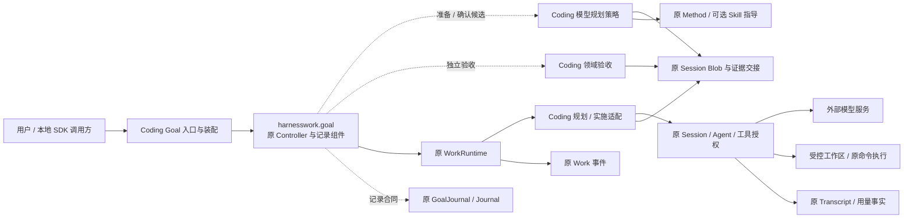
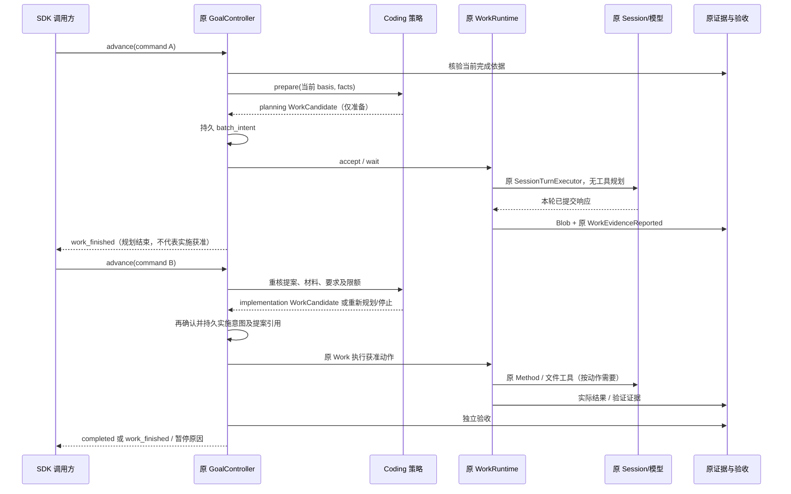

# GMW-KD-PLAN-01：模型自主规划闭环专项 R2.1

- Authority: accepted — 已有 Goal 架构上的已接受增量。
- Design status: accepted；Implementation status: in-progress。
- 用户接受：2026-10-26，在核心观点说明后用户明确“同意，请继续goal”，接受 R2.1 及配套 R1.1 场景范围并授权实施；不代表实现或真实验收已完成。
- Owner：Loushang 协作架构；Coding 负责规划与领域适配，HarnessWork 保持通用控制与记录。
- 需求：[G-GOAL-PLAN-01 / GP-01…10](../../plans/2026-10-26-goal-model-planning-loop.md)。
- 源码基线：`f3ee31319`，承接已接受的[最小闭环](minimum-loop-architecture.md)及[子系统结构](../harnesswork/goal/README.md)。
- 方法：本地干净 archmethod master `0f9bd3ff51afabeaaf76cc38dff1ceb279b7d37e`。
- 变更裁剪：跨 Coding/HarnessWork 的执行和事实交接；本专项集中记录选项、机制、场景与验证，父级只链接候选增量，不改写已接受首版。

## 1. 决策摘要与 Current

候选选择是：**规划本身也作为一批原 Work；下一次 advance 再消费提案，受理一批实施工作。**
模型在授权动作集合中选下一动作、目标范围及后续路线。系统只规定规划与实施的准入顺序，
不按测试失败类型硬编码完整修复路线。完成判断继续归原领域验收。

| 当前事实 | 可核查源码 | 对本专项的影响 |
| --- | --- | --- |
| 一次 advance 至多受理一个 Work；prepare 前后核 basis，intent 后再次确认 | `harnesswork/goal/controller.py:advance` | 不在 prepare 中偷偷执行模型；规划必须在受理之后发生 |
| 所有 batch_intent 已计入 goal.limit；not_submitted 仍计数 | 同上及 `goal/records.py:replay` | 规划、实施和未知意图都占总额度，不能把规划重试藏在调用内部 |
| 原策略按最近验证结果在修复/验证之间选择 | `coding/adapters/_goal_calculator.py:CalculatorPolicy.prepare` | 这是固定领域策略，不是 Current 自主规划 |
| SessionTurnExecutor 复用 prompt、投影 runtime facts，并支持 abort/wait_for_idle | `harnesswork/integrations/session.py:SessionTurnExecutor` | 规划/修复均可复用执行与取消；before/after hook 没有 finally 恢复保证，不能只靠 after_turn 释放临时权限配置 |
| GoalBatch.source 冻结 JSON，header 绑定 policy_id；未知 record kind 拒绝 | `goal/contracts.py:WorkCandidate`、`goal/records.py`、`coding/adapters/_goal_store.py` | 优先使用现有 source 与领域证据；不新增共享 Goal record kind |
| 原 Work 终态/取消、Blob 报告和领域 reader 已存在 | `harnesswork/runtime.py`、`coding/adapters/_work_evidence.py` | 提案报告走同一证据通道；报告可读不等于可派发或可完成 |
| Session 有提交事件、活动记录和原用量记录 | `harness/events/types.py`、`harness/transcript/session.py`、`model_usage_types.py` | 关联实际提交记录和调用身份；不能从 Work 完成或最后一条消息猜提案来源 |
| Work JSONL 为 process-local，Goal 记录更耐久 | `harnesswork/event_log.py`、`coding/adapters/_goal_store.py` | 冷读缺 Work/提案时保守 unknown，不自动重新规划或重执行 |

## 2. 比较与决定（候选）

| 选择 | 收益 | 代价 / 结论 |
| --- | --- | --- |
| 在 NextWorkPolicy.prepare 内调用模型 | 表面上一次 advance 就能规划和实施 | 规划发生在 batch_intent 前，取消、用量归属和预算需要旁路；不采用 |
| 规划与实施打包一个 Work | 推进调用少 | Work 已受理后才知道实施内容，模型结果到工具副作用间另需动态准入；首版不采用 |
| 规划 Work → 下次受理实施 Work | 复用受理、取消、计数和持久意图；迟到提案可拒绝 | 增加一次显式推进，原 Work 数上升；首版采用 |
| 新 Planner 服务/队列/日志 | 可独立调度 | 单本地场景无部署依据，会复制执行和状态管理；不采用 |

保持 GoalController、记录组件和三个协作合同。新策略及执行适配属于 Coding Product；
共享包不导入模型、Method、Coding 或文件路径。新增 policy_id 作为模式边界，原显式
Method profile 的默认行为不变，不把旧 Goal 隐式升级为模型规划模式。

## 3. 系统环境与部署

运行载体仍是 Linux 本地 SDK 进程，一个 Product owner 持有专用 Session、原 WorkRuntime、
Blob 和 writer，串行推进一个活动目标。图中的适配不是新进程、线程或安全沙箱。
模型服务经既有 provider 访问；文件/验证执行沿原工具和工作区能力；路径由 Product
可信配置提供，模型只能选动作标识和逻辑目标，不能提供存储路径或验证 shell 命令。
原 authority、workspace 权限及部署前提继续适用；不承诺恶意同 UID 并发改文件的隔离。

## 4. Product 内部职责与复用

| 逻辑责任 | 设计处理 | 不拥有的职责 |
| --- | --- | --- |
| Goal 入口/资源 owner | 在原 CodingGoal 生命周期中显式选择新 profile；保存 profile 与固定限额；关闭仍 writer-last | 不复制 Session 或 Work 状态机 |
| 下一工作策略 | 读取原批次/证据；构造规划 Work，或校验已有提案并准备对应实施 Work；同步 confirm 再核当前性 | 不在 prepare 执行模型，不自行提交 Work |
| 规划执行适配 | 为原 SessionTurnExecutor 装配无工具规划轮次；捕获本轮提交的模型结果；严格解析，发布领域报告 | 不做模型 loop，不决定 Goal 完成 |
| 实施绑定/领域验收 | 将有限动作映射到既有 Method 修复、确定性检查与验证；读取当前证据裁决要求满足 | 不把模型文字当约束执行或验收证明 |
| 私有提案编解码 | 作为规划策略/报告内部模块，校验 JSON 与引用 | 不成为独立组件或新增存储 owner |

规划执行适配与实施绑定共享原 resolver 的一次性 prepared binding；没有第二个运行注册表。
其中调用限额通过现有 stream_fn 注入处的 Coding 私有委托器实现（§7），它只在委托原
标准 AI stream 前检查额度；不自己请求 provider、消费/重组响应或实现 Agent loop。
实现优先在原 Coding 适配中提取可复用的“准备 Method 修复 / 准备验证”逻辑，避免复制
CalculatorPolicy 的整段执行和验收。共享 Core 如确需变化，须先修订本专项并复核。

## 5. 数据与信任合同

### 5.1 可信输入与模型候选

Product 构造只读输入快照：Goal id/revision/epoch、当前序列、要求与固定约束、可用动作、
已受理行动及历史路线建议摘要、最近检查/执行证据引用及摘要、当前工作区材料摘要、剩余额度。
内容经原 Blob 留存，规划 batch.source 记录快照引用和摘要。工作区文字、Skill 内容和
模型响应都是材料，不能修改允许动作集合、测试、Method 身份或额度。原始提示和输出
在 Transcript/Blob 可追溯，默认查询只返回摘要与引用，沿原访问边界读取。

候选私有 JSON v1：`next_action`、`targets`、`requirement_ids`、`rationale`、
`expected_evidence`、`remaining_route`、`change_reason`、`evidence_refs`。
首版严格单对象：拒绝重复键、未知键、非有限数字、超长内容、未知枚举和外部引用；
不递归调用模型修 JSON。响应最大 16 KiB、路线最多 6 项、理由最多 2 KiB。
Goal/Session/operation 身份、basis、候选编号、策略版本由适配添加，不接受模型伪造。

proposal_id 取原规划 operation_id；候选次序由该 Goal 的 planning batch 次序派生。
实施意图引用该候选身份，并在实施 batch.source 保存提案引用、原规划 operation、
当前 basis、前一个已受理提案身份和规范化行动；无需新增共享计划表。
remaining_route 必须是以 next_action/targets 为第一项的规范化动作列表；只验证当前
第一项的执行前提，尾部是有条件的建议，不叫“已受理路线”。下一批必须使用新事实
重新规划或重新核验。何时称当前行动已受理、何时消费候选，严格按 §5.4 派生。

### 5.2 规划结果的来源与持久交接

本 profile 的规划限定为单次逻辑模型调用，不允许自动压缩、Session 恢复重试或工具
continuation 产生第二次采样（§7）。这使来源关联可以基于已有事实严格核对，不能泛化
为任意普通 prompt 的多 invocation 关联算法：

1. executor 进入后、prompt 前取得原 leaf、活动路径 record id 集和
   `session_manager.get_model_call_invocations()` 的身份集合；订阅原 RuntimeEvent，
   只收集当前 session/stream 的 `agent.message_end` 及其 `source_record_id`。
   AgentEventRouter 在该事件分发前已经 await append_message_once；不以异步 schedule
   的 TranscriptRecordCommitted 事件是否已到齐作为截止依据。
2. 本轮 user prompt 含可信 operation 标记及输入摘要。prompt 与原 wait_for_idle 均结束后，
   用已提交活动路径核对本轮唯一 user 记录、唯一 assistant 记录，以及对应 message_end
   事件的 source_record_id/内容。原路径必须仍是前缀；首轮 leaf 为空则从已捕获集合开始。
   出现额外 user/application/tool-result、路径切换、压缩记录或缺少匹配事件即拒绝。
3. 再读取原 invocation 投影，与调用前集合做差；要求恰好一个新 invocation，其输入
   snapshots 属于本轮提交后缀，source leaf 的祖先链含本轮可信 user 记录。投影须是
   completed，有完整 ModelCallOutcome，且该 outcome 和 assistant 都为 stop_reason=stop。
   error/aborted/length/toolUse、工具块、缺终态、多 invocation 或冲突响应全部不可消费，
   即使 Work completed 或 JSON 完整也一样。原 Work completed 仍是额外必要条件。
4. 报告保存原 user/assistant record id、invocation id、snapshot ids、原 Work envelope、
   输入/输出摘要及解析结果；下一次消费重新从原记录核对。唯一性来自单调用、独占
   Session 和完整路径校验，不是已有记录天然携带 Work→response 外键。

用量按上述 invocation 查询原 Transcript；缺失则 unknown，不复制 token。provider
同一次调用的有界传输尝试沿原快照/用量保留；不接受多次逻辑调用后猜“最终一次”。
来源依据：`agent_event_router.py:handle`、`runtime.py:_normalize_runtime_event`、
`transcript/session.py:get_model_call_invocations`、`transcript/model_call.py` 及
ModelInputSnapshot/ModelInputSnapshotV2 的 source_leaf_id；实现时逐格式验证祖先链。

先写 Blob，再由原 Work context 发布既有 WorkEvidenceReported，role 为私有
`goal_planning_report`。报告含快照身份、原响应引用/摘要、解析候选或明确错误、
检查版本及初步核验结果。使用现有嵌套 evidence payload；不平铺 plan_id/step_id
等键，不改变通用投影。初步 valid 不是实施授权，最终准入在下一次 advance 重做。
要求原规划 Work completed、无取消或 unknown、唯一完整报告且 Blob 可核验，才可消费。
Blob 成功但事件失败不回滚共享内容；无完整交接即停止，不从目录扫描找材料补权威。

### 5.3 最终准入与失效

程序强制核验：当前 profile、目标 active、同 revision/epoch、原规划未被消费、规划后
无其他实施批次、材料与固定测试/Method 摘要仍匹配、动作/逻辑目标/要求引用在允许集内、
证据引用属于本 Goal 已知事实、动作必需证据不缺项且限额尚足。模型声明覆盖哪些要求
是意图，语义是否真正满足仍由领域验收判定，不宣称通用语义证明。

planning batch 的 basis 不等于下一 advance 的序列：正常 command/receipt 已推进序列。
不能直接要求旧 sequence 相等，也不能给旧提案重新贴新版本。Product 显式核对上述
语义前提后，构造绑定当前 basis 的新实施 WorkCandidate，并保留原规划 basis；
Controller 的原 intent 前后两次确认继续核材料/输入/待派发选择。最终受理事实必须
与原 Work 核对（§5.4）；被拒绝提案的原报告与后续拒绝原因留存于下一规划输入或停止回执。

暂停/修订使 epoch 或 revision 变化，旧提案保留为历史而不再消费；恢复后重新规划。
模型不能为 Goal 调用 revise/control，也不能以 stop 请求提交 completed。

### 5.4 意图、消费与受理的派生表

“消费”在本 profile 中是保守的一次性派发预约：一旦有实施 intent 引用提案，就不能
再次用它构造另一实施意图，哪怕后来 not_submitted。它不等于 Work 已受理或已执行。

| 原事实组合 | 展示 / 提案消费 | 下一步 |
| --- | --- | --- |
| 规划完整，无引用它的实施 intent | proposed / 未消费 | 当前性通过后可准备实施 |
| 实施 intent，原 run 暂不可知，无 not_submitted | dispatch_unknown / 已预约 | Core unresolved，停止；不可重发或计作已受理修订 |
| 实施 intent + not_submitted，且原 run 不存在 | not_submitted / 已消耗 | 未受理；恢复条件满足后重新规划，不复用原提案 |
| 原 run 存在、身份与 intent 一致，association 若有也一致 | admitted / 已消费 | 原 Work 管执行；association 缺失可由原 operation 查询核对，不能双写映射 |
| run 失败或取消，身份完整且效果 settled | admitted，另列执行失败/取消 / 已消费 | 不视作成功；根据新事实重新规划，不能重用原提案 |
| run orphaned、取消未收尾、身份矛盾或证据不完整 | unresolved/conflict / 不释放预约 | 停止，不能因关联丢失推导未执行 |

第二次 confirm 仅允许一个自身 intent 例外：operation、proposal 引用及 batch basis 均
与同一 candidate 完全一致，且它是 candidate.basis.sequence+1 的末条 intent；这正是
Controller 随后也检查的窗口。其他 intent 一律使提案不可消费。策略借 owner 的只读
history accessor 识别此例外，不写 Controller 私有状态、不新增共享端口。
GP-03 只使用 admitted 且有实际开始/结果事实的行动；not_submitted、unknown 和建议尾部
均不能作为已执行调整。reader 从同一判定表派生，不仅看 batch.source 是否存在。

## 6. 一次推进与交互

输入准备不得调用模型；一次显式 advance 最多受理一个 Work。初始没有可消费提案则
准备规划 Work；最近是有效未消费提案则准备其动作；最近实施已结束则准备下一规划。
验收已满足可直接完成；不为凑规划轮数再执行工作。query 纯读取/核验，不触发规划。

## 7. 规划和实施的权限、控制与关闭

规划时 Session 活动工具集为空；Product 注入的原 PolicyEvaluator 同时拒绝全部模型
工具调用，不能只靠提示说“不要用工具”。实施阶段按可信动作切换到允许的原工具，
采用与调用方 policy 的最严格组合；不得因新模式放宽调用方拒绝。允许路径由原
ToolPolicySubject 的解析路径/效果核验，未知路径或效果拒绝，验证命令由 Product 固定。
专用 Session 不对外暴露，拒绝 input、before_agent_start、tool_call、tool_result、user_bash
等能替换输入/执行的扩展 hook；不是声称一般扩展都可以在此受限 profile 下安全组合。

**空工具集不限制 Agent continuation。** `agent_loop.py` 对未知工具返回非终止错误，
因此本 profile 另使用原 SDK 的 stream_fn 注入点：Coding 私有委托器在每次调用原
`loushang.ai.stream` 前同步核当前 Work/阶段、消耗逻辑调用额度；规划每 Work 只允许
一次，repair 每 Work 至多 12 次（跨 Method 两步合计），其余动作不允许模型调用。
第二次规划调用在原 AI stream 前抛有界错误并设置本 Work 的不可用标记；即使 Agent
把异常转为普通返回，报告也只能失败。修正只能等待下一次显式 advance，计入新 Work。
未知工具重复响应因此最多使首次采样发生，不能继续向 provider 请求。

委托器遵守原 `prepared_request_conformant` 合同：合法调用完整透传 model/context/options，
特别保留 prepared-request committer、取消信号和原响应对象；不读取凭据、不自己实现
transport、不重写输入或制造终态。只接受标准 AI stream，首版不组合任意自定义 transport。
provider 的实际 retry options 必须可解析且 max_attempts≤3，否则委托前拒绝；这与逻辑
调用额度分开报告。先用原 Session 设置关闭自动 retry 和 compaction，核验实际关闭后
才激活新 profile；这些 setters 的默认 scope=session（config/agent/manager.py），
不修改全局配置。设置与工具切换、委托器的关闭标记均由同一 Product owner 管理。
Session 仍负责所有执行/取消；委托器不是另一个调度器或用量账本。任何不在当前受理
Work 期限内的采样都拒绝，取消后的额度不重置，原 wait_for_idle 未收尾不能结束阶段。

规划适配以 try/finally 包住原 executor，取消也恢复工具选择并把阶段收回到 deny。
配置恢复失败则 fence owner，不能带着错误阶段受理下一批；关闭沿原 quiesce、
settle_work、unsubscribe、Session retire、writer close 顺序，不另起清理线程。
暂停仅停止新派发；如需终止当前规划/实施，继续由原 request_cancel 调 Work 取消。
取消超时/不支持/未知不视作 settled，不为响应性许诺新增统一 30 秒矩阵。

输入窗口继承原 CodingGoal._input：只有 running repair 接受 steer/follow-up；planning、
inspect、check、verify 和两批之间明确返回 input unavailable，不入队。用户在这些阶段
可 pause/revise/request_cancel；改要求通过 revise，不能由模型或文本输入隐式改变。
因此没有“已接收的规划 steer 被消费又清空”的合法路径，也不增加输入队列或入站计数器。
raw Session 不外泄、扩展输入 hook 不允许；如果仍观察到额外输入，按 §5.2 拒绝，不能
用 pending=0 证明安全。repair 输入维持原处理；待处理输入阻止下一规划。同步的原
revision/epoch 核验覆盖 prompt 返回后到 Work 终结/下次派发之间到达的控制变化。

## 8. 有限推进、故障与恢复

首个实例固定总 Work 上限 20、规划意图上限 10、连续无效提案/规划失败上限 3、
连续未带来新知识或测试改善的实施尝试上限 2；单 Work 内调用额度另按 §7。
均作为可信 profile 元数据记录，模型不能修改。
上限是本实例的有限执行规则，不是费用或运行时长承诺；调整须显式新目标或已有用户
控制语义支持并重新核验，不能在 resume 时清空历史计数。

| 情形 | 处理与事实 |
| --- | --- |
| JSON/动作/引用无效 | 不执行模型提案；下一次 advance 可规划一次修正，原错误进入输入；每次占规划与总批次额度；达到上限暂停 |
| 规划模型调用失败 | 保留原失败 Work；只在终态和效果可判定后允许显式重试；未知则停止 |
| 无进展 | 忽略交错 planning；按报告实际内容标记已知知识，完整 check 同时建立两目标的检查知识，重复或 A/B 交替已有结果不算；repair 本身既不清零也不制造进展，随后的固定验证只有失败集合严格缩小时才算改善；纯源码 hash 变化不清零 |
| 用户暂停/修订发生于规划等待 | 原 Work 可继续或被显式取消，但输出旧 epoch/revision 不派发；恢复重新规划 |
| 在确认和 accept 之间失效 | 沿原同步 accept 窗口与 not_submitted 合同；已调用 accept 的异常不能冒称未提交 |
| 证据写入/Work 日志回执未知 | 原 Goal 意图留存，缺原 Work 或取消未收尾则 unresolved；不恢复成新调用 |
| 规划后进程退出 | 冷读 Goal/Work/Blob；只有完整原事实可展示提案；缺项 unknown。首版不承诺跨进程恢复控制或自动派发 |
| 首次规划尚未发生 | GoalJournal 可存在，Transcript 可能尚未物化；冷读 Goal 不依赖伪造 Session 文件；没有原 Session 时明确不可恢复控制 |
| 完成后文件变化 | 原完成决定保留，当前证据 validity 变 outdated；不悄悄重写历史完成或启动模型 |

连续规划失败计数：模型失败、结构/语义候选拒绝累加；仅有一批实施 Work 真正 admitted
后清零，初步 valid、not_submitted 或 pause/resume 均不清零。过期 revision/epoch 只使
提案失效，不伪装成模型质量错误；额度仍消耗。unknown 直接停止，不按零失败计算。
最终候选过期由原 candidate_outdated/not_submitted 回执留证；精确可重算原因展示为
派生诊断，缺原依据时显示 unknown，不冒称所有详细拒绝原因都已经持久记录。

计数从持久 Goal batch_intent 及可核验 Work/报告派生，无第二份计数日志；丢失事实时
保守停止，不能当零次重新开始。断电耐久不超过原各存储承诺。查询区分“规划 Work
完成”“候选可检查”“实施已受理”“Goal 完成”，不把它们合并成一个成功标记。

## 9. 首个业务 profile 与真实验收

候选先复用 calculator 两个逻辑目标与固定 23 项用例，提供可信有限动作：
`inspect(target)` 获取当前源码/测试材料、`check(target)` 完整检查并标注关注目标、
`repair` 采用原显式修复 Method、`verify_all` 执行原完整验收、`stop(reason)`
请求停止。inspect/check 的 targets 只能是 subtraction/clamp；repair 的范围固定为整个
calculator.py，不允许模型声称只授权修改其中一个函数。inspect/check 的结果也由原 Work 与 Blob
记录，不能直接由模型描述替代。stop 提案经核验转 PolicyStop，不生成实施 Work。
完整 Goal 只由 verify_all 的固定全部测试与原项目约束满足后完成，子集检查不替代它。

初始规划只携带明确要求、可用动作和当前已知事实；模型可提出带假设的剩余路线，
通过自己选的检查获得真实材料，再决定下一步读取、检查、整文件修复或完整验证。
运行代码只能检查动作合法性与
前提，不能替模型依据失败内容选择这些行动。

实质修订判据：比较两份已留存的路线建议，扣除实际执行的共同前缀后，出现
实际行动语义/读取范围/顺序的变化，并能引用其间新增的真实检查或执行事实解释；其中
至少一个变化必须进入后续 admitted 行动并有实际执行结果，不能只比较未来建议。
比较实际效果身份：所有 check(targets) 归一为 check_all；同输入的 check 与 verify_all
仅报告角色不同也不能单独证明实质调整。不同 inspect 读取范围、读取与实际检查切换、
或整文件修复在路线中的实际插入/顺序变化，才进一步核对新增事实和已执行证据。
仅消耗原计划一步、换措辞、重复检查、改了尾部又撤销或更新状态不算 GP-03。验收记录保存原响应、
规范化路线差异和支撑事实，独立复核，不只采用模型自己的 change_reason。
若真实轨迹只一次修好、没有实质调整，只能证明执行成功，不能关闭 GP-03；此时
补选有真实信息增量的小场景并在执行前固定验收条件，不篡改运行中测试或诱导错误补丁。

动作前提、Method 映射、输入输出、原始材料与判据见[场景合同](model-planning-scenario.md)。
实际 provider 配置和模型版本由实现前的真实运行清单固定，不把设计走查当模型执行。
Skill 可作为用户指定的指导输入，无需为展示概念强行添加 Skill 选择机制。

## 10. 验证、演进与待关闭项

| 需求 | 计划验证 |
| --- | --- |
| GP-01/03/08 | 真实 SDK 模型规划→行动选择→新事实→实质修订→实际修改→固定验收通过；保存可冷读轨迹 |
| GP-02/04 | 确定性无效 JSON、重复键、越界动作/路径、虚构引用、Method 被改、旧 revision/epoch 均无实施；原 Method profile 回归 |
| GP-05/09 | 提案仅来自本规划 Work 已提交响应；多响应/插入输入/缺报告/错 authority 拒绝；普通 Session 与 Goal 冷读路径分别验证 |
| GP-06 | 无效候选/模型失败/重复无进展达到固定次数即停；重开或 resume 不清零；规划均占原批次 |
| GP-07 | 控制发生于等待、输出提交、最终准入的切点；迟到提案不派发；配置恢复失败 fence，取消未知不继续 |
| GP-10 | 原接口/记录 schema 不变；新 profile 显式启用，旧 writer 拒绝不认识的 policy；静态边界和相关既有合同验证 |

新模式使用不同 policy_id/version，私有候选和报告 version 明确校验；旧模式记录不改写。
旧只读工具只能展示其能解释的原 Goal/Work 事实，不能宣称理解新规划证据或新领域验收。
不扩 CI gate、平台或测试矩阵。没有运行本专项的测试或真实模型，以上均为计划验证。

R1 的来源、调用上限、输入窗口和消费语义缺口已给出候选合同，最终固定修订的
三视角关闭证据见[评审记录](model-planning-review.md)。尚待实施证明：真实模型能产生合格调整，委托器保持 prepared
协议与取消，原事件/提交交接在故障切点符合规定；这些是计划验证，不冒称已执行。
