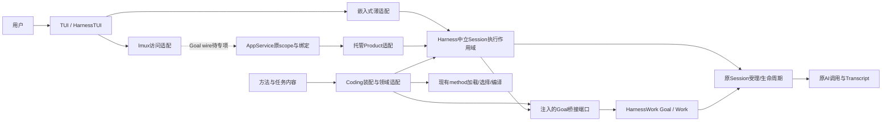

# Goal职责收敛与双入口复用重构计划

- ID: GMW-RF-001；Revision: R2。
- Authority: proposed；Design status: proposed；Implementation status: not-started。
- 源码基线：main e1601d0593085120078e3bc468c07756cb89fb8b。
- 方法：本地干净archmethod master 0f9bd3ff51afabeaaf76cc38dff1ceb279b7d37e。
- 用户授权：编写重构计划与三视角评审；未授权本轮修改运行代码。重要环境关系及交互仍待用户评审。
- 输入：[接口与职责盘点](current-session-interface-inventory.md)、[最小架构](minimum-loop-architecture.md)、[Method/Work](minimum-loop-decisions.md)、[委派合同](delegated-session-execution.md)、[托管闭环](../coding/key-designs/hosted-repository-goal.md)、[预算与进度](../coding/key-designs/hosted-goal-budget-observation.md)、[Work/Transcript](../decisions/accepted/ARD-019-work-facts-and-transcript-sharing.md)。

## 1. 目标与范围

将已开发Goal中跨产品的Session协同、执行控制与规划机制从Coding适配中提炼，保留原Goal/Work与Method权威；使嵌入式TUI和AppService适配能够复用同一底层能力，避免各自形成执行器。既有本地SDK、托管profile及持久记录保持兼容。

本计划不是重新开发Goal，不增加通用自然语言规划器、自动Method组合、后台常驻调度、跨进程自动续跑或新的预算账本。日常会话菜单与原先没有的控制动作不是纯搬迁：本计划准备共同接缝，入口能力按既有profile显式协商；普通Session安全接入须通过本计划指定专项后才实施。

| 要求 | 结果与证明 |
| --- | --- |
| RF-01 通用机制归属正确 | Harness协同、HarnessWork状态/执行、method解释、领域内容/适配分别有owner；源码依赖与结构检查 |
| RF-02 两种入口复用 | 同一配置/初始证据下，本地适配与托管适配调用同一共同机制，业务结果等价；身份/权限仍由各自适配保证 |
| RF-03 已有能力不退化 | 原本地、托管、委派、零模型收尾、来源证明、recording/cancellation合同回归 |
| RF-04 数据与公共调用兼容 | 旧API、policy id、事件kind、Goal/Work/Blob/Transcript及prompt重建兼容；旧记录冷读仍成立 |
| RF-05 运行权威唯一 | 原Session队列/受理、WorkRuntime和GoalController继续权威；无新并发driver、目标账本或operation→run映射 |
| RF-06 有界资源与清理 | 原调用计数/期限/取消收敛、borrowed/owned关闭、失败owner重试语义保留；无隐藏付费重试 |

## 2. Current与Target

Current事实见盘点第2、3、7节。尤其不能将shared命名当作通用保证，也不能把历史有限profile当作普通交互Session已支持Goal。

### 候选系统环境（待用户评审）

图中箭头表示运行调用，不代表静态import。嵌入式与application-local AppService是本轮可复用机制的两种装配；真实lmux还经过ManagedConnectionLease、LocalAppClientConnection和HostedMuxShell，其当前未提供Goal wire访问能力。虚线标出待专项的传输接缝，不以app-local等价测试冒称lmux可达；本轮不自行激活新wire。TUI/连接断开与服务端Session关闭不是同一件事，沿现有租约/owner合同处理。

### 职责单元与依赖规则

| 单元 | 职责与排除 |
| --- | --- |
| Harness中立执行组合 | 绑定确切Session实例，管理受理、作用域、预算和关闭；通过注入端口执行/停止/收敛工作，不知道Goal状态、候选、批次、完成语义；只持有自身资源，不创建另一个Session lifecycle owner |
| Harness执行控制机制 | await前限额受理、单调期限、取消与settlement；参数来自调用方，不包含calculator名称、RC编号、AppService DTO或固定provider配置 |
| Harness来源核对机制候选 | 接受原prompt/response bytes及原Transcript核对入口，只做通用调用来源关联；不得导入GoalError或Goal codec。单次规划Work、候选准备和Goal-specific装配留HarnessWork集成/策略端口；领域动作由注入合同提供 |
| HarnessWork | 原GoalController/Policy接口、WorkRuntime与原事实查询；状态、完成结构与执行事实权威不迁移 |
| method | 现有加载/选择/编译/准备；保持off/explicit。暂不建立harnessmethod；方法声明不等于执行授权或验收通过 |
| 方法/任务包 | 方法步骤、动作声明、具体约束和测试/评审期待；本次要求及验收归任务合同；权限/预算归用户或可信宿主 |
| Coding | 注册编码工具和可信适配、仓库事实/测试结果解释、配置与兼容facade。具体测试集合等内容可以来自任务包，不强制留在Coding源码 |
| AppService/托管适配 | 原execution guard、scope/registry、handle绑定、撤权、传输DTO与错误映射；不得将这些类型作为Harness内部必需参数 |
| TUI适配 | 两种路径的动作发起及观察呈现，不独自推进Goal或判定完成 |

依赖约束：遵守[现有包边界](../harnesswork/README.md)：Harness共同机制不导入harnesswork/work/method/coding、appservice/appserver或其DTO（含TYPE_CHECKING）；HarnessWork不回调Coding具体类，只经既有策略/执行端口；Coding组合共享机制。method当前loader/resources使用Harness frontmatter，故不得为便利在Harness包初始化时反向导入整个method；以调用方注入方法准备端口或局部集成避免依赖环。Harness端口不得携带GoalBasis、WorkCandidate、WorkRun、WorkExecutionBinding等上层类型；只接受自身中立合同。HarnessWork集成实现Goal驱动/观察桥接，上层装配注入；共享Goal组合不因装配在Coding就归Coding业务。具体源码目录/公共类名由切片设计确定，职责单元不要求一一创建类。

## 3. 拆分映射与兼容策略

| 当前实现 | 迁移方向 | 保留的兼容面 |
| --- | --- | --- |
| CodingGoal.open/_initialize_borrowed/close | 提炼Harness中立资源作用域、HarnessWork Goal桥接及owned/borrowed责任 | CodingGoal旧入口委托原义；公开签名不删，保留构造失败owner |
| GoalInvocation | 提炼时间/取消/额度控制；领域drive通过窄端口注入，托管outcome留原层 | 原托管Execution状态、首个停止原因、deadline与清理重试语义 |
| PlanningCallAllowance | 先分离通用计数/stream委托与Coding phase/LIMITS/hosted快照编码 | 原逻辑调用口径、同operation计数、失败不返还、prepared committer不替换 |
| BatchPlanningPolicy/PlanningWork/response proof | 去除calculator helper和事件耦合；来源核对候选归Harness，operation/run证据发布归HarnessWork集成；路线/重规划/提案一次消费保留Goal策略；领域prompt/parser注入，BatchPlanningPolicy不整类搬入Harness | 旧prompt逐字节重建、原响应proof和input Blob仍可读，不重写旧历史 |
| RepositoryDomain/RepositoryPolicy | 仓库事实及结果解释留适配；动作与验收内容可由任务包提供；通用过程调用共享机制 | 原冻结profile、Method、reviewer与原身份绑定判据不放宽 |
| hosted_goal观察与_hosted_work_observation | 共享事实取原Work/Goal查询；AppServer DTO编码与授权留托管适配 | progress不读取完整历史/工作区且不冒称current；query/wait语义不变 |
| SessionExecutionPolicy/DelegatedSessions | 复用已下沉Harness factory和ForkTier；通用组合按需提炼 | reuse/fresh/inherit、父历史截点、child清理与引用身份不变 |

既有策略版本和记录编码继续由旧兼容路径解释；新共享实现若不能精确复现旧prompt构造，必须保留旧解释器，不用新提示重算旧proof。纯重构不进行存储迁移、重编号、清零预算或批次重放。必要的合同增量需另列设计决定，不隐含在搬迁提交中。

## 4. 关键交互与失败合同

### 4.1 两入口共同执行

本地适配捕获当前Session实例和生命周期标识；托管适配先经原scope/generation/member与execution绑定检查，再定位同一服务端Session。随后均进入共同机制：检查profile能力和配置 → 原Session外层调用受理 → 原Goal候选准备/确认 → intent记录 → 原Work accept及association → 原Work执行 → 原验收策略确认 → 通过各自适配返回观察。本地/托管共享中立执行机制，Goal准备/确认/验收由注入的上层桥接调用原HarnessWork，不转交Harness。每次跨await后，在变更与交付的原边界重查目标仍当前；没有托管身份的本地调用不伪造attachment。

普通输入继续走原Session输入机制。自动续跑只能请求原受理入口，在当前操作、已排队输入、前置保存/投递、暂停、关闭、撤权或预算不允许时不抢占。HostRuntime.run_after_idle/defer_run仅为复用候选，不证明该联合判据已原子成立。详细专项须指定现有受理点、唤醒来源、去重键和销毁责任；未闭合前不启用普通会话自动续跑。

### 4.2 生命周期

borrowed模式先阻止新的Goal推进，等待或取消并收敛其Work，释放自身reader/订阅/作用域；原owner继续拥有Session。owned模式经原SDK生命周期释放Session。若子执行或reader关闭失败，保留清理owner与依赖，调用方可重试；不得因业务截止放弃清理，也不得把清理完成写成业务成功。/new、切换和关闭如何影响Goal关联，必须在S2设计中明确，不推导跨进程自动恢复。

### 4.3 预算与模型作用域

保持原计数在首次await前发生，失败消耗不返还；模型看到的是原权威计数快照而非授权。期限由同一原执行owner导出，模型阶段与收尾阶段不重置起点。作用域必须覆盖已受理Work的调用并拒绝错误关联；普通会话的调用不能误算给Goal。retry/compaction/工具/审批只能通过原配置边界作用，不修改已提交Model Input。不能安全装配时明确返回不支持，不偷偷换新Session或关闭会话能力。

### 4.4 部分失败

| 场景 | 所需行为与权威 |
| --- | --- |
| 工作已受理但调用方取消/断连 | 沿原Work/Execution确认与查询，未知保持未知，不重新提交副作用 |
| 新身份取代旧Session/托管控制权 | 旧适配停止交付与推进；是否取消服务端工作由原owner/控制合同决定，不从断连自动推断 |
| 期限与完成/取消竞争 | 保留既有锁定停止原因、原完成依据检查；业务终止与物理清理分开 |
| Blob成功、记录追加失败 | 保留原未知与fenced处理，不重复发布或删除共享Blob |
| profile拒绝/验证失败/评审拒绝 | 经原策略反馈到后续决策或有界停止；不由共享层伪造通过 |
| 历史readonly、缺来源或旧记录未知版本 | 保留只读与错误边界，不借Goal展示升级为可执行 |

## 5. 分阶段实施与退出条件

每阶段独立提交，先让旧入口通过共享机制，再切另一入口；不同时保留两个活动driver。表中权重为规划相对工作量，仅用于安排，不是完成比例或工期承诺。

| 阶段 / 权重 | 任务与输出 | 退出条件 / 回退 |
| --- | --- | --- |
| S0 合同与事实冻结 / 10% | 记录旧公共入口、profile/prompt/policy版本、owner链、原持久样本及测试覆盖；纳入既有SessionWorkRuntime/SessionTurnExecutor/SessionWorkHostPort和CLI注入接缝；不复制原始私有试验材料进产品仓库 | 冻结迁移前API符号与类型身份、profile prompt/parser/limits/codec组合、日志/锁/manifest物理路径及写入策略；准备迁移前固定记录fixture与旧reader；无运行改动可撤回文档 |
| S1 执行控制收敛 / 20% | 在Harness提炼限额/时间/取消机制，保留Coding策略和托管结果适配；旧调用路径先委托 | 源码依赖边界、旧符号身份与计数/截止竞争/prepared委托/清理重试通过；出现差异时撤回该切片，不恢复第二driver |
| S2 Session/Goal组合专项与收敛 / 30% | 先提交环境、子组件、中立端口与Goal桥接、任务/订阅/reader/Session owner表、普通Session作用域、联合受理、身份/关闭/能力探测合同给用户评审；通过后提炼owned/borrowed组合 | 复用既有SessionWorkRuntime与HostPort；同一Session不得出现两套可独立受理的WorkRuntime。选择原runtime注入/扩展或显式拒绝不兼容组合，保留原Goal accept无悬挂边界；既有profile回归；不支持组合明确拒绝。旧facade可继续委托兼容路径 |
| S3 规划与方法集成收敛 / 25% | 剥离固定calculator schema/helper；通过合同注入动作、方法准备、验证/评审与事件适配；保留method包名 | 原本地/委派/托管与旧proof冷读通过；方法内容不能扩大授权；旧解释器可保留 |
| S4 双入口复用与收尾 / 15% | 本地和AppService薄适配对共同机制做等价测试；现有托管先保持运行；补嵌入式业务入口接缝，不扩日常菜单功能 | 分S4a现有application-local两种装配的共享重构，S4b真实lmux可达性专项：明确方法列表/请求响应/观察/取消/权限/能力profile与版本，用户评审后另行接通wire。S4a不得宣称S4b完成；未获接受的会话启用/续跑不启用。删除无消费者重复机制，旧公共facade保留 |

S2仍有重要合同待设计，因此S2与S4的估算不确定性最高；不据此宣称可以立即安全迁移。具体文件切片按可回退合同拆分，禁止一次搬完再恢复测试。不存在为通过测试而扩大用户范围、预算或权限的例外。

## 6. 验证矩阵与交付约束

| 断言 | 证据与适用范围 |
| --- | --- |
| V1 职责依赖 | 原import/架构检查、源码调用链；局部本地实验允许，不新增required CI门禁 |
| V2 两入口业务等价 | 同冻结profile和独立Session fixture，确定性离线provider；比较Goal状态、要求覆盖、Work操作关联、调用数与验收结果，不比较随机ID字面值 |
| V3 身份与输入 | 排队输入/preflight、切换、旧结果、撤权、只读历史；真实原受理路径验证，不能仅mock idle返回true |
| V4 生命周期与失败 | cancel/complete/deadline竞争、初始化失败、child/reader关闭失败后重试、borrowed不关闭Session、owned通过原owner关闭；撤权×清理失败×等待方取消时服务端仍保留owner，原生命周期入口可重试；既有SessionWork host与Goal共存不得分别受理 |
| V5 历史兼容 | 使用迁移前固定样本而非同版新生成记录，对新reader读旧记录、旧reader读重构后同格式记录作双向核查；冻结prompt/parser/limits/codec；日志/锁/manifest物理路径、权限、写入策略与Blob身份不漂移；未知版本仍拒绝 |
| V6 已交付功能 | 原repository、hosted repository、预算进度、Work planning相关测试；委派reuse/fresh/inherit与零模型收尾相应回归 |
| V7 性能与成本 | progress禁止重历史与工作区读取，常数时间原run查询；有限批次下无新增全量重放和额外模型调用，不预设固定毫秒指标 |

已有271项相关回归、180项真实任务验证和一次119秒托管闭环是历史基线，不替代重构后的测试；也无需为纯搬迁重复付费试验。仅接口/组合行为有离线无法回答的新问题时，另冻预算并获授权后运行一次在线试验。各阶段使用变更选择检查，pytest按工作区规则沙箱外运行；测试scratch容量和私有祖先约束需前检，避免重现已知ENOSPC/unsafe误判。

## 7. 评审与接受

三视角分别为：A职责/复用与复杂度；B运行/失败/权限及双物理路径；C数据/兼容/迁移与验证。初评固定R1内容及SHA，修订复核固定R2内容与源码SHA，独立核实源码，不读取其他评审意见；问题记录位置、反例、影响、严重性和关闭条件。修订后逐项复核并作综合一致性检查，不能以三份报告的数量代替接受。

用户已确认通用能力下沉方向；本计划、候选环境图和新增共同合同尚未获用户接受。内部评审只能判断是否可呈交及哪些阶段有足够设计，不自动启动产品实现。后续独立评审原文与处置见配套评审记录。

## 8. R2补充的兼容与交付边界

- 保持旧导入符号和类型身份（包括异常、isinstance、注册及反序列化依赖）；必要时使用旧路径再导出同一对象，而不是造一个名字相同的替身类。
- 原Goal/Work/Blob/Transcript文件、锁、manifest路径和owner不随包搬迁改变。共享序列化不反向依赖HarnessWork canonical；由原上层codec注入或保持兼容解释器。
- 回退先停止并收敛本切片的在途工作，再卸载作用域/切回旧适配；同格式原记录可继续读，禁止同时激活两条driver。无法收敛时保留owner和原配置，不切换执行实现；未引入新格式就不需要反向数据迁移。
- RF-02拆为RF-02a共同机制在嵌入式/application-local AppService装配中的业务等价，及RF-02b真实lmux可达性。当前共享重构完成口径只覆盖02a；02b作为明确的后续合同与接入工作，不能标为已完成。S4表15%仅估02a及收尾，02b在专项设计后单独估算。
- 本轮S2普通Session接入设计仍是实施前置条件；计划描述不替代方法/工具/权限/输入/关闭的精确合同。

### 已有SessionWork接缝（S2前置）

[SessionWorkRuntime/SessionWorkHostPort](../../../../src/loushang/harnesswork/integrations/session.py)、[Coding薄适配](../../../../src/loushang/coding/adapters/harnesswork.py)及[harness agent_host](../../../../src/loushang/harness/cli/agent_host.py)已经存在。S2不能沿用Goal私有WorkRuntime构造后，仅凭同一个Session就宣称互斥：两个runtime的active_runs检查彼此不可见。必须在设计中明确原受理owner、runtime注入或不兼容拒绝、查询和关闭责任，不增加第三个管理器或operation索引。
