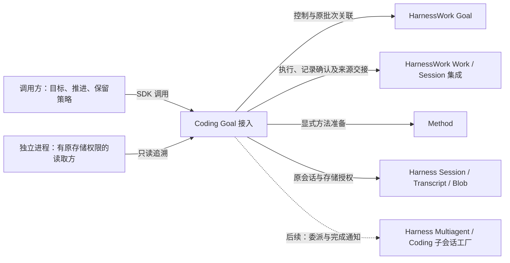
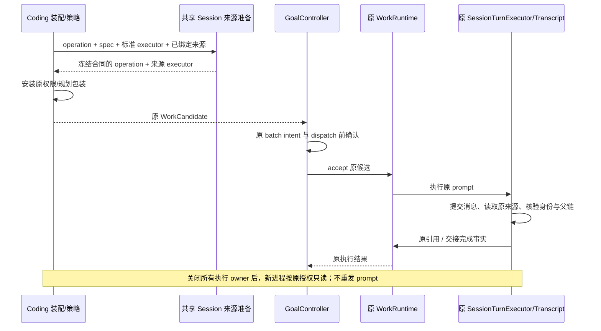

# GMW-KD-SESSION-01：Goal 执行上下文与 Work 来源记录接入

- Authority: proposed；Design status: draft；Implementation status: not-started。
- Revision: R1，2026-10-30。Owner：Coding 装配；共同父级：Loushang architecture；协作方：HarnessWork Session 集成、Harness Session/Transcript/Multiagent。
- 源码基线：`2d6ed6d64`；方法：本地干净 archmethod master `0f9bd3ff51afabeaaf76cc38dff1ceb279b7d37e`。
- 用户已同意三种执行需求、区分执行者与上下文、优先复用原 Session，再扩展子 agent；明确要求尽可能复用已有能力。本稿细化机制，重要工作件仍按[本包评审约定](README.md#用户评审检查点)交用户评审，不将原则认可扩大为全部接口接受。
- 继承 [Goal 最小闭环](minimum-loop-architecture.md)、[Goal 组件边界](../harnesswork/goal/README.md)、[HW-KD-003](../harnesswork/key-designs/fact-retention-replay.md)、[HW-KD-004](../harnesswork/key-designs/transcript-references.md) 及 [Multiagent 边界](../harness/multiagent/README.md)。不改变这些组件的状态权威。

## 1. 结果与范围

第一切片让现有本地 `CodingGoal` 的多批 Work 使用新记录合同，并可选择将规划、Method 执行的消息交接到原 Transcript 引用机制。关闭执行 owner 后，新进程能够核验这些批次的来源；原命令验证继续使用已有 Work 证据及 Blob。

三种需求不是三套 Goal 引擎，也不要求先建设通用执行模式注册表。先交付同一执行者、同一 Session；新鲜上下文和继承上下文的子 agent 依靠已有 Multiagent 能力，后续单独验证 Goal 接入及持久证据边界。本轮不启用 CodingGoal 的 multiagent，不改变“模型规划仅新建 Session、不得自动续跑”的现有限定。

本轮不裁剪 Work 正文，不迁移 TUI/AppHost 默认入口，不改完整审计、GC、跨用户共享和在线模型预算；不把计算器 profile 扩成任意仓库任务适配器。真实仓库适配后续使用同一共享接缝，不复制本稿的记录实现。

## 2. Current：复用依据与真实缺口

源码事实均指向上面的固定基线；静态核查不等于已执行集成验证。

| 能力 | 已有事实与证据 | 本轮处理 |
| --- | --- | --- |
| Goal 控制与批次关联 | [controller.py](../../../../src/loushang/harnesswork/goal/controller.py)：先冻结意图，再经原 Work accept/wait/cancel；GoalHeader 绑定 Session | 保留；不另建调度器、队列或 operation→run 表 |
| Coding Goal 装配 | [goal.py](../../../../src/loushang/coding/adapters/goal.py)：自有 SDK Session，禁用 multiagent，直接创建 WorkRuntime，未启用 recording v1 | 启用原记录机制；来源装配由 Product 持有 |
| 共享记录确认 | [recording.py](../../../../src/loushang/harnesswork/recording.py)：ACK/loaded、legacy、未知合同及不可确认状态 | 直接复用；不以旧 get_run 充当日志确认 |
| Session 消息交接 | [session.py](../../../../src/loushang/harnesswork/integrations/session.py)：SessionTurnExecutor 已实现逐 prompt 收集、读取、引用、交接完成及取消；SessionWorkRuntime.accept_operation 私有代码负责合同冻结 | 执行逻辑不复制；将受理前准备提取为同模块的窄共享函数，以适配直接 WorkRuntime 调用方 |
| 来源读取与投影 | [transcript.py](../../../../src/loushang/harnesswork/integrations/transcript.py)、[source_reader.py](../../../../src/loushang/harness/transcript/source_reader.py)：原库授权、期限、固定记录/父链与批量读取 | 保留格式和 reader，Coding 不另写 codec、摘要、引用索引 |
| Method 修复 | [_goal_calculator.py](../../../../src/loushang/coding/adapters/_goal_calculator.py)：准备原 Method 后创建 SessionTurnExecutor | 在包装 executor 之前绑定来源，不绕过 Method 与工具策略 |
| 模型规划 | [_goal_planning.py](../../../../src/loushang/coding/adapters/_goal_planning.py)、[_goal_planning_work.py](../../../../src/loushang/coding/adapters/_goal_planning_work.py)：标准 executor 外包 ScopedSessionWork / PlanningWork；规划报告另含响应及模型输入证明 | 给内部标准 executor 绑定来源；保留外层报告和权限恢复职责。普通消息引用不能代替模型输入证明 |
| 确定性检查与验证 | InspectionWork、[CodingVerificationExecutor](../../../../src/loushang/coding/adapters/_verification_work.py)：静态检查或 execute_bash，已有 WorkEvidenceReported / Blob | 无模型 prompt 时不伪造 Transcript 消息交接；使用原证据合同 |
| 新鲜 / 继承上下文 | [context.py](../../../../src/loushang/harness/multiagent/context.py)：ForkTier none/all/last、TranscriptWatermark、过滤和模型继承约束 | 直接作为后续子执行的上下文机制，不新建 Goal fork |
| 子执行创建、权限及清理 | [coding/multiagent.py](../../../../src/loushang/coding/multiagent.py)：CodingSubagentFactory 创建独立 runtime/session、委派权限、workspace lease、驱动与关闭；目前 persist=False | 复用控制树与生命周期；不声称已经具有可重开的子 Transcript 或独立子 Work |

**关键缺口不是执行机制不足，而是装配接缝不通。** `SessionWorkRuntime.accept_operation` 能冻结来源合同，但 CodingGoal 为支持验证、规划包装和原 Goal 意图顺序直接用 WorkRuntime。把它改成第二个 SessionWorkRuntime 或在 Goal 中复制交接算法，都会产生多余权威或重复逻辑。

## 3. 三种需求及正交边界

| 用户需求 | 执行者 / 上下文 | 复用机制 | 现状及本轮范围 |
| --- | --- | --- | --- |
| 多批 Work 复用原 Session | 当前执行者 / 原 Session 连续上下文 | 原 GoalController、WorkRuntime、SessionTurnExecutor | 第一切片；串行推进 |
| 新 Session，类似子 agent | 委派执行者 / 新鲜上下文 | 原 Multiagent + ForkTier.none + CodingSubagentFactory | 底座已有；Goal 接入与交接待后续设计 |
| 子 agent 复用原 Session 背景 | 委派执行者 / 固定父历史截点 | 原 TranscriptWatermark + ForkTier.all 或 last + 独立子 Session | 底座已有；共享的是历史语义，不是父可写 Session |

历史选择、工作区隔离、记录保留是三个不同问题：继承上下文不授予工具权限，也不自动共享/隔离文件；复用现有 agent type 与 workspace lease 决定文件边界。子 Session 的运行历史与父 Session 分离，但现有临时子 Session 不提供跨进程持久历史保证。`all/last` 还受原过滤和模型继承规则约束，不能承诺原始全部消息或不同模型的缓存前缀。

未来优先由父 Goal 关联父 Work，父 Work 的 Product executor 经原 Multiagent 委派任务，取得结果后再交接业务证据。子 agent 身份使用原 AgentRef/incarnation，不新造另一套树；原完成通知不自动等于 Work 完成或 Goal 验收。子执行如果要成为独立 Work、拥有持久 Transcript 或跨 Session Goal，须再设计身份、来源与保留合同；本稿不以一个 `mode` 参数隐含接受这些能力。

## 4. 系统环境与组件协作

下图以 Coding Goal 接入为黑盒，实线为第一切片依赖，虚线为后续委派需求。部署范围为同机、同一 Linux 用户、本地 SDK 进程；冷读在 writer 停止后的独立进程执行。跨进程仅共享原文件，不新增服务或 RPC。

| 已有责任单元 | 本轮变化 | 不承担 |
| --- | --- | --- |
| Coding Goal Product owner | 持有原 reader、期限与 Work 装配；执行静止后关闭 reader；提供窄的冷读装配 | fork、消息队列、来源格式、摘要、通用投影 |
| Coding 下一工作/验收策略 | 创建标准 executor 时调用共享准备函数；保留规划/验证报告和业务验收 | 新建 Work 引擎、把来源完整判为业务完成 |
| HarnessWork Session 集成 | 抽取现有准备逻辑，供普通 SessionWorkRuntime 与直接 WorkRuntime 装配共同调用 | 识别 Goal、解包任意 Product executor、决定物理路径或保留周期 |
| WorkRuntime / 记录组件 | 按原 v1 记录及返回确认依据 | Session 生命周期、子 agent 调度 |
| Harness Transcript / Blob | 原绑定、消息/父链核验及附件读取 | Goal 要求覆盖、规划路线判断 |

不增加逻辑组件。共享准备函数是 Session 集成内部职责的公开接缝，codec 仍在原记录模块内。依赖保持 Coding → HarnessWork/Harness/Method；Goal core 不 import Coding 或 Multiagent，底层 Harness 不 import HarnessWork。

## 5. 第一切片机制

### 5.1 Product 装配与默认行为

候选接口为 `CodingGoal.open(..., transcript_retained_until: datetime | None = None)`，UTC-aware 截止时间显式提供；None 保持无来源绑定。新装配的 WorkRuntime 使用原 `recording_version=1` 和持久要求，所有实际发布事实仍保留。共享机制有缺省处理，Product 不必为每批 Work 写分类器或合同。

有期限时，Product 从原 Session manager 获取实际 session_file，从同一 SDK 平台装配取得原 store_state_root；创建原 TranscriptSourceReader，再用 WorkTranscriptSource.bind 冻结身份。binding_id 固定由本 Product 命名空间和 session_id 派生，不使用模型输入。reader 一经创建即登记在 owner，后续构造失败也能经原 GoalConstructionError 保留并清理。

任务专属 data_root 的 Session、原 admission 和必要 Blob 必须在承诺截止前保留；关闭 owner 只关闭句柄，不删除文件。不接入普通 Session 自动清理，不默认永久保留。过期后禁止新受理有来源合同的工作；在已受理执行中到期沿原交接错误失败，不自动延长、不重新执行。更长的新期限只能用于后续 Work，不能修改历史冻结承诺；无期限的新装配不得把旧来源 Work 声称为仍有来源保证。

旧记录和原 Goal 格式不重写；同一日志可有 legacy 和 v1。无来源的新 Work 与旧 Work 都不得因为没有引用而标为来源完整。现有模型规划拒绝 reopen 的限制保持；固定 Method profile 的既有 reopen 按原规则处理。

### 5.2 共享准备接缝

在 `harnesswork.integrations.session` 抽取 `prepare_session_work_source`（候选名称），输入原 operation、spec、原 Session 对象、标准 SessionTurnExecutor 和已绑定 WorkTranscriptSource，返回替换后的 operation/executor。沿用现有检查：精确标准 executor、同一 Session 对象、匹配 session_id、保留键冲突、steps 与 turns 逐项对应、完整 follow-up 数量。调用 source.contract 冻结原 v1 handoffs；不读取文件、受理 Work 或执行 prompt。

`SessionWorkRuntime.accept_operation` 调用同一函数，保留其活动 Work 闸门。Coding Goal 在构造 WorkCandidate **之前** 调用它，再组装 ScopedSessionWork / PlanningWork 等包装，把最终绑定放入原 prepared 表。Goal 写入意图前所见 operation 就包含来源合同；resolver 不临时修改 payload，也不在 accept 之后补合同。包装器必须将原 operation/context 交给内层，不改变实际 prompt/steps。

不通过鸭子类型追踪 `delegate` 来自动发现执行器；Product 在装配标准 executor 的位置显式调用。无法提前冻结的动态 prompt 不纳入来源保证，若以后需要须另定合同，不能伪装为已覆盖。本轮沿原 profile 的受控输入边界；异步 steer/follow 输入不自动算作冻结清单内独立 prompt，来源交接只证明该清单中捕获并验证的记录。

### 5.3 各类 Work 的记录边界

| Work | 记录确认 | Transcript 交接 | 原业务证据 |
| --- | --- | --- | --- |
| 模型规划 | 原 WorkRecording | 为内部标准 executor 冻结一组 prompt | PlanningWork 的 input_ref、response_proof、proposal/rejection 保留 |
| Method inspect/repair | 原 WorkRecording | 按所有 steps 和 follow-up 冻结多组 | Method 身份、实际执行及后续领域验证保留 |
| 静态 InspectionWork | 原 WorkRecording | 不产生模型 prompt，不附空来源合同 | 原静态检查报告 |
| VerifyCodingCommand | 原 WorkRecording | 不将 execute_bash 伪装成模型消息交接 | 原命令结果、输出 Blob 和验证报告 |

准备、交接或追加失败保持既有 Work 错误路径；原 get_run 是运行观察，新来源查询只消费 get_recording / project_work_recording 的确认依据。此切片增加独立来源追溯，不改变 Goal 领域验收标准，也不把所有 Transcript 材料永久可读增加为隐藏的完成条件。业务 validity 与来源可验证性分别报告。

### 5.4 冷读与资源关闭

沿现有 inspect_goal 的“停止 writer 后只读”使用前提增加异步来源读取入口（候选 `read_goal_work_sources`），不改其同步业务验收接口。调用方提供原 data_root、session_id 和原 store_state_root 的可信 Product 配置；从原 Goal 批次、Work 日志及现有 Session 文件布局解析匹配，不从日志中的路径选库，不新写 binding.json 或来源索引。唯一文件选择和 conversation 核验失败时报告未知/不可验证，不搜索其他库兜底。

对每批复用 project_work_recording → project_work_transcript → resolve_work_transcript。以原冻结 binding_id/期限重建 reader 绑定并比较实际 store identity；Work 合同不能授予读取权限。不产生来源合同的批次统一报告 `not_declared`，由原 phase 说明其是否为静态检查/命令验证；不能把未知 phase 或少合同标成“完整”。已有合同缺组返回原 missing_handoffs；格式、身份、期限、来源读取错误均明确失败，不能吞掉后返回完整。

首版来源读取返回原共享投影/解析对象及批次关联，不另发持久视图格式。每个 Work 的解析沿原实现批量读同一来源；多 Work 仍可能多次读完整文件，本轮不声称一次全 Goal 扫描或消除写放大，不为此新建缓存/索引。

关闭顺序：原 begin_close → 查询/策略回调静止 → Work executor 与交接 settled → 关闭来源 reader → 关闭原 SDK/Session → retire Goal → 原 Goal writer 最后关闭。reader 关闭失败保留 owner、依赖及清理凭据，后续 close 重试；不提前释放 Session。冷读入口自身在 finally 关闭 reader，取消仍沿原 settled I/O；关闭失败保留可重试 owner，不把异常隐藏为成功。无第二套取消驱动或固定等待时间。

## 6. 取舍、风险与验收

选择提取现有准备逻辑，而非改造 GoalController 为 Session 调度器，也不新增用于所有执行者的通用桥。代价是 Product 仍需在其标准 executor 装配点调用函数，并负责原有包装与资源寿命；收益是普通 Work 和 Goal 使用同一组冻结与验证规则。

高优先风险是包装前后的执行一致性、来源交接取消时的资源寿命和历史未声明合同。多 agent 持久记录、跨工作区产物合并和跨进程自动执行不在本轮承诺内，因此本轮不修改其状态机或部署方式。需求变为独立子 Work / 持久子历史时必须重新评审，不能只切换 persist 参数。

| 验收 ID | 场景与断言 | 复用位置 / 验证方式（待实施） |
| --- | --- | --- |
| GS-01 | 同一真实 SDK Session，多批规划/Method/验证 Work；不同 operation/run、相同会话，记录确认可读 | 现有 Coding Goal 与 Work 测试；真实离线 SDK 纵向场景 |
| GS-02 | 普通 SessionWorkRuntime 与直接 WorkRuntime 使用同一准备规则；错 Session、保留键和缺步骤受理前拒绝 | 现有 HarnessWork Session 集成测试 |
| GS-03 | 模型规划与 Method 包装保留权限、取消、回复证明及所有交接；原验证不生成伪消息 | 现有 Goal planning/Method/verification 回归，不改变允许工具 |
| GS-04 | 写入成功后追加失败、取消发生于交接、部分引用、少最后一组：不得返回完整；关闭重试保留依赖 | 原注入故障与取消测试加装配回归 |
| GS-05 | 停 writer 后，新进程通过原授权读取全部有合同批次；错库/缺失/损坏/过期拒绝且没有模型或工具执行 | 原共享 reader 与 SDK 进程测试；不新增独立 decoder |
| GS-06 | legacy / 无绑定 / 绑定 v1 混合历史；新 Work 不修改旧合同或 Goal 业务完成记录；旧读者仍可读原事实 | 已有兼容 probe 与定向 Goal 检查 |
| GS-07 | 无 prompt 的验证保持原证据；来源可读与目标 current 独立，代码变化仍使业务验收过期 | 原 Goal 当前性/证据回归 |
| GS-08 | 首版不启用 child；设计明确 none/all/last、临时子 Session、权限和 workspace 的复用边界 | 源码及三视角设计评审；不宣称已完成 Goal 子执行集成 |

本次工作为设计与静态取证，未运行上述测试、未调用在线模型、未新增 PR gate。首版可用离线流验证记录与真实 SDK 资源路径；若现有模型规划 profile 禁止注入离线流，应在其已有测试接缝替换传输，不放宽产品 profile；真实模型运行另按用户已授权的实际验证范围进行。

## 7. 评审与接受

待三视角独立核查：职责与复用、运行与失败、数据与兼容；包含 Coding、HarnessWork、Harness 协作及共同父级视角。评审必须区分设计闭合和实际测试，不能替缺失机制补造解释。内部评审结果落在配套记录；本稿系统环境及资源/接口决定需用户评审后，才实施第一切片。
