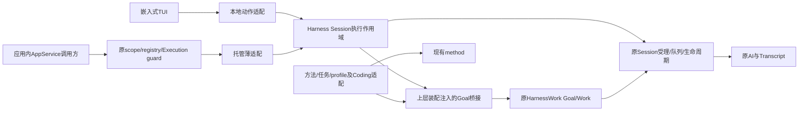
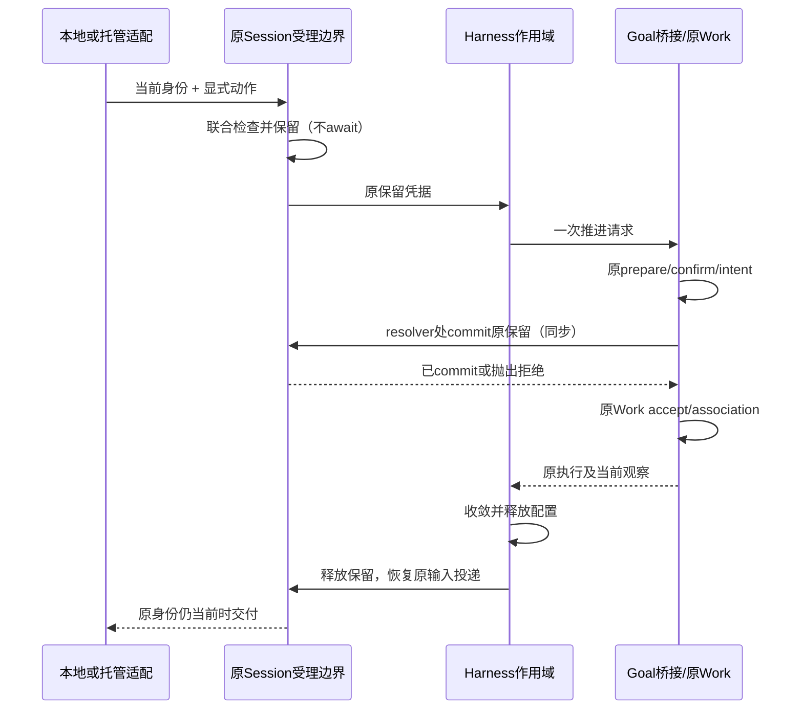

# 当前Session与Goal协同专项

- ID: GMW-KD-RF-002；Revision: R2；Authority: proposed。
- Design status: proposed；Implementation status: not-started。
- 基线：e1601d059；关联[重构计划R2](refactoring-plan.md) S2/S3/S4a与[接口盘点](current-session-interface-inventory.md)。
- 本文是用户明确要求的实施前工作件：环境关系、组件交互、联合受理、执行配置作用域及资源所有权须先经用户评审。内部评审不替代该接受。

## 1. 范围与兼容

目标是让嵌入式装配与application-local AppService复用同一Session执行协同及原Goal/Work，不再各自创建独立driver。保留既有CodingGoal.open及有限calculator/repository行为；现有普通Session不因升级被强制更换、清空或改变权限。真实lmux Goal wire另行专项，不在此宣称可达。当前尚无以下新协同合同，图表均为Target。

默认不开启Goal自动推进；由明确创建/恢复请求激活。一个确切Session实例同一时刻最多一个活动Goal绑定，不将这一约束推广为整个workspace只能有一个Goal。Goal修订仍由原Controller处理，普通聊天不会自动改写要求。历史readonly只允许原可用的观察。

## 2. 环境与职责

箭头为运行调用。静态依赖保持Harness不导入HarnessWork/method/Coding/AppService，HarnessWork不导入Coding/AI或领域Method类型。桥接持有Goal/Work类型，向Harness实现中立端口，由组合根注入；共同业务不因初期Coding装配就归Coding。

| 单元 | 拥有 | 借用 / 不拥有 |
| --- | --- | --- |
| 原ProductSessionRuntime / 生命周期owner | 当前Session创建/替换/销毁、before_release链 | Goal绑定不获得销毁borrowed Session的权利 |
| Harness执行作用域 | 自己的订阅、受理保留凭据、可撤销配置句柄、一个受追踪推进任务 | 借原Session控制；不拥有Goal记录、WorkRuntime或第二队列 |
| Session原受理边界 | 普通输入与外部执行保留的联合排斥和投递顺序 | 不解释Goal要求或判定完成；必须覆盖prompt、队列投递、生命周期切换 |
| Goal桥接 / 原HarnessWork | Controller、Work配置及原事实、候选确认、验收；桥接注册/释放自己的执行资源 | 不自行取得Session所有权；复用同一既有SessionWorkRuntime/HostPort，或明确拒绝不兼容组合 |
| profile与领域适配 | 方法内容、动作/工具限制、验证/评审、事件解释、额度参数 | 不另造执行控制；方法不能扩大用户授权 |
| AppService guard与owner | 托管控制权、原invocation与服务端收敛重试 | 客户端waiter/attachment不拥有服务端清理任务 |

## 3. 中立端口的语义边界

以下是拟议职责，不新增一个大而全公共facade；准确模块与签名须服从既有组合与公共类型规则。

- Session绑定端口返回确切实例的opaque identity与当前性检查、原控制/生命周期接缝；identity包含原runtime实例代际，不以session_id字符串相同判定仍当前。
- 受理/作用域端口提供原子reserve、commit或release；保留凭据不可从文本source字段伪造。其内部属于原Session受理边界，不是新的Work执行器或排队服务。
- 工作桥接端口提供一次受限执行、当前观察与停止/收敛；不泄漏GoalBasis/WorkCandidate/WorkRun/WorkExecutionBinding等上层类型给Harness。完成决策仍由原GoalAcceptancePolicy产生。
- 配置作用域端口声明能否安全临时组合原stream、工具/审批与retry/compaction控制；返回可重试释放的句柄，而不是让通用层直接写Agent私有字段。

能力探测明确readonly、busy、unsupported profile/configuration、stale identity与可执行。能力不足时不能偷偷新开Session、跳过审批或无限重试。新装配必须实现完整作用域和联合受理后才宣称支持普通Session Goal；不能把始终返回unsupported当作该目标已完成。

## 4. 联合受理与推进

### 4.1 原子边界

Current的HostRuntime.run_after_idle/defer_run只解决运行空闲，不覆盖QueueController的preflight/保存/投递、Session替换和多个WorkRuntime。实现时要扩展原Session的受理边界，使以下检查与执行保留之间无await：

1. 捕获的Session实例仍当前且可写；未关闭/切换/撤权。
2. 无正在受理、保存或待投递的普通输入，原Session/Work无冲突执行。
3. profile与配置作用域可用，原预算未耗尽。
4. 原受理owner取得唯一保留凭据；排队输入或新的生命周期请求可阻止后续commit，不能在旧检查后仍盲目执行。

候选prepare可能await，因此提交前再次核验凭据与Goal basis。原Controller继续按prepare → confirm → intent → Work.accept → association顺序操作；不得将Work.accept提前或变成悬挂的延迟受理。桥接对同一现有runtime完成绑定，不能仅让两个runtime分别检查自己的active_runs。

当前没有已核实满足上述联合合同的直接API。S2实施首先通过原Session runtime/QueueController/SessionWorkHostPort集成该保留能力；HostRuntime仍是原运行owner。不能在HostRuntime.run里包一整轮Goal再递归调用内部同一host的prompt，否则有嵌套受理/等待环风险。

### 4.2 普通输入优先

新的普通输入沿原preflight与原队列保存，不新增Goal队列。它阻止下一批自动推进；若Goal候选尚未commit，释放该保留，候选不得执行。已受理Work按原中断/steer能力处理，不把用户输入到达视为外部副作用已撤销。

对要求单一user/assistant来源的规划Work，普通输入可以先被原队列受理保存，但必须通过原投递边界延后到该Work与配置作用域收敛之后；不允许把普通聊天或排队消息计入Goal规划调用、破坏proof后自动重试。输入的业务语义保持普通聊天，只有明确revise命令修改Goal要求。

支持steer/follow的执行阶段仍沿原Session规则；profile不支持的阶段明确报告不可用或选择普通排队，不默默重解释为改目标。显式中断/暂停通过原取消与收敛。clear沿原队列合同，不允许已清除的preflight输入随后重新交付。

### 4.3 唤醒

只订阅原执行结束、输入已投递/清除、Goal显式激活等相关状态变化，使用原defer_run_handle的稳定句柄及去重能力作为候选基础。唤醒只是重新请求受理，不是执行授权；任一pending/关闭/撤权/预算不满足则不推进。只有一个可观测的推进任务，取消不丢句柄；无轮询常驻scheduler、无watchdog或新持久唤醒队列。

本轮共享重构可先保留显式advance和托管有界loop。普通会话自动续跑只有上述联合受理/唤醒合同实现并验证后才启用；不能用新菜单宣称它已完成。

## 5. 执行配置作用域

选择**原配置owner提供的操作级overlay**，而不是将Session全局字段改成Goal配置再比较旧快照恢复。overlay是Target能力，当前旧ScopedSessionWork的直接setter/无条件恢复不能原样推广到普通Session。

在原Session保留成功后、模型输入准备前，由原配置owner先登记可清理的overlay句柄，再发布该overlay。发布、撤销与基线配置更新有明确线性化顺序；记录句柄早于任何可能await的工具刷新/通知。若部分安装后取消或失败，调用方仍持有同一句柄，撤销自己的overlay后才释放输入隔离，不因构造异常丢掉owner。

overlay只作用于原受理凭据对应的执行，不改写Session基线设置。请求准备时由原owner合并更严限制，原委托stream、prepared committer、cancellation与Transcript路径不替换。旧strict profile继续按原合同工作；新作用域不以修改已提交Model Input达成隔离。不得把动态换写Agent私有字段当作此机制的实现。

基线设置合法变化时保留新值：尚未准备的Goal调用重新核对基线代际，不兼容则停止该批；已提交调用保持其原快照，必要时通过原取消收敛。释放只按句柄撤销自己的overlay，不把旧基线写回，因而合法配置更新不会永久阻止释放。撤销幂等；若实际撤销/刷新失败，保留同一清理句柄重试，成功且原执行收敛后恢复输入投递。必须有原生命周期owner可访问的重试入口，不能依赖已失权UI；无法撤销是需明确报告的清理失败，不伪装正常busy。

工具、审批和扩展限制与原授权取交集；不能默默禁用扩展。自动retry/compaction及输出限制经原owner的请求/执行准备接缝应用于本次作用域，普通会话基线不变。各输入源的模型调用只有持有同一执行凭据才可进入此overlay，普通调用不能误算Goal。

预算层级固定：Session实例 → 原Goal执行owner（原execution_id、Goal id及已选配置）→ Work操作 → 本批overlay句柄。额度和单调时钟属于原执行owner，overlay安装/释放不重置；同一owner的pause/resume或解绑再绑只能复用原计数和原截止。托管既有“每invocation冻结预算”的语义不改成整个thread全局计数；新invocation的预算只能沿原显式受理合同创建，不能将其冒充旧invocation续跑。原owner已销毁或计数依据缺失时不自动新建计数器继续旧执行；观察仍可冷读，跨进程恢复单列。

“已经交互中的Session”允许保留历史并在安全边界绑定，不要求清空历史或重建Session；是否满足当前profile合同通过明确探测。此目标不能通过把用户迁到新鲜child来替代。child reuse/fresh/inherit仅是已选择工作的可选执行方式，继续用原Harness factory。

## 6. 身份、切换与关闭

用户发起/new、切换或关闭时，先在原生命周期标记替换/关闭意图，阻止新保留；原before_release链停止推进并收敛已受理Work，释放子执行/reader/订阅/配置后，才允许释放父Session依赖。失败时保留原owner和重试入口，不删除记录、不把未完成Goal自动写成completed。

旧Session的Goal可按原合同记录暂停；若记录写入失败或fenced，保留unknown并报告，不伪造成功暂停。切换不等于clear Goal，不自动把旧Goal绑定到新Session；跨进程续跑不在此合同。

服务端撤权后停止来自旧控制权的新动作与结果交付，但清理由原guard/owner继续持有；失权客户端不是唯一重试入口。断连对执行的影响沿原租约/执行合同，不自动等同取消或关闭。

## 7. 验收与兼容

- 同一配置与初始状态，嵌入式和application-local AppService经共同机制，完成/暂停/失败结果、要求覆盖、调用数与原Work关联等价；随机ID不要求相同。
- 普通输入preflight/保存与Goal保留、候选await、Workaccept竞争；明确普通输入赢得下一批受理，未受理候选不会执行。
- 单Session已有SessionWork host与Goal不可各自独立受理；不创建第二runtime/队列绕过排斥。
- planning阶段排队用户输入不污染原proof，不误计Goal调用；释放后由原队列交付一次，clear不复活输入。
- 旧响应/旧attachment/切换代际不会把结果写到新目标；readonly不可执行。
- 取消/完成/截止竞争、模型阶段转收尾、失败调用不返还、后代原清理合同和撤权×关闭失败×waiter取消组合均验证。
- 旧API、policy/schema、原日志/锁路径及prompt/parser/proof解释保持；完整query仍验收，轻量progress不冒称current。
- 测试使用原真实离线Session受理与生命周期，不能只mock idle或仅测新类。独立代码评审与受影响回归通过后才能宣称实施完成。

## 8. 本轮待用户评审的决定

1. 共同机制位于Harness，Goal-specific桥接仍在上层，现有method不新增同义包；保持单向静态依赖。
2. 单一原Session受理边界增加保留/配置作用域，既有Work host与Goal共用；不在TUI/AppService增加第二执行owner。
3. 普通输入沿原队列优先；规划Work所需投递隔离与配置恢复必须安全闭合；不能静默改变普通会话能力。
4. /new、切换和关闭先停止推进并收敛，失败保留owner再重试；真实lmux wire与跨进程自动恢复单列。

这些决定获用户接受后才实施S2。若原受理边界无法无环支持，需要修订专项再次评审，不以局部idle检查或永久独占原Session替代目标。

## 9. R2精确提交与释放协议

### 9.1 保留状态与提交点

原Session受理owner持有保留状态，Harness作用域借用句柄：reserved → committed → settling → released；commit前普通输入/切换可使reserved → invalidated → released。released后重复release无副作用；任何可失败发布前均先登记句柄，不能以new owner覆盖旧清理凭据。

Goal桥接使用**同一个原SessionWorkRuntime.work_runtime**及其prepared binding槽位，扩展已有resolver的准备绑定合同，而不创建新的WorkRuntime。该扩展须保留原recording策略及事件日志身份；若原runtime不满足profile的持久要求，装配前明确协商并设计支持路径，不能悄悄换后端、放宽profile或建第二runtime。没有Work host时由原Session装配owner创建并登记唯一一个；非唯一或不兼容时不能宣称接入完成。

commit位于原WorkRuntime.accept的同步resolver边界：原Goal prepare/confirm和intent写入后，原WorkRuntime已完成重复operation/spec/recording检查，桥接resolver核对并commit Session保留，再返回原prepared executor；随后沿原accept写操作、记录run、创建执行task，无新增await。它只验证Session保留，不提前判定Goal验收或重排原Controller顺序。

- resolver前失效：抛出原可解释的受理拒绝，由原Controller记录原失败/未知语义；不伪造not_submitted，不自动重提交。
- commit后accept异常：保留凭据与原dispatch结果，沿原runtime/Controller的受理与取消观察确认是否有执行；不能因缺receipt就视为未执行。清理仍由原owner收敛，无法核实则报告unknown并保留凭据。
- 已受理task进入原Session提示入口时，由绑定executor携带不可伪造的保留能力。普通prompt/队列投递不能冒用它；原提示入口在preflight/before_start等await前后核验身份/受理代际，最终以原HostRuntime受理执行。

这要求扩展SessionWorkRuntime的prepared绑定、Session原受理入口与原queue投递控制；不是只接已有API。实现不得通过TYPE_CHECKING、文本source或ContextVar自动继承到子任务来取得权限；能力须绑定原Session实例、operation及确切已受理执行。

### 9.2 非递归唤醒

原defer_run_handle若用于去重，只能运行一个有限的通知操作：标记重新检查条件并立即返回；**不能**在该Host的active task中await Goal推进或Session.prompt。监听方在原host已结束该通知任务后才请求一次受理，且仍经9.1检查。可以直接复用原运行结束事件避免通知操作；不增加独立常驻调度器。若发现等待环，此启用路径不得交付。

### 9.3 输入与proof隔离

受理检查必须纳入PromptController尚在interceptor/preflight/before_start的请求，以及QueueController原队列中的steer/follow/mailbox、远程输入和原自动retry/compaction延迟任务。不能只看pending_message_count或is_streaming。

隔离点放在原提交/投递边界：普通输入可先保存，但原queue submit/drain不得在committed作用域内启动新的非绑定模型调用；通知preflight/投递开始即更新受理代际，阻止新的Goal commit。已提交输入的持久依据保留；clear仍使旧保存结果失效，释放隔离后原队列只投递一次。mailbox、子执行回报及side-question等不经普通文本队列的来源也要经原Session准备/执行边界核验；不兼容profile不能把它们偷接到规划Work。

正在受理的普通输入优先于reserved候选；已committed执行先按原中断合同收敛，之后放行已保存输入。由于来源证明要求单次规划调用，隔离失败不能用丢弃用户消息或忽略多余调用来“修复proof”。

### 9.4 新增验收

必须在原路径复现：候选prepare await期间preflight赢得优先；resolver commit失败与accept部分失败；绑定能力跨prompt await仍唯一；工具overlay部分发布失败、合法基线更新、撤销失败重试；mailbox/side-question/自动任务进入隔离边界；pause/resume和解绑再绑预算不重置；原defer通知结束后才推进且不存在同host递归。纯mock callback成功不足证明这些性质。
