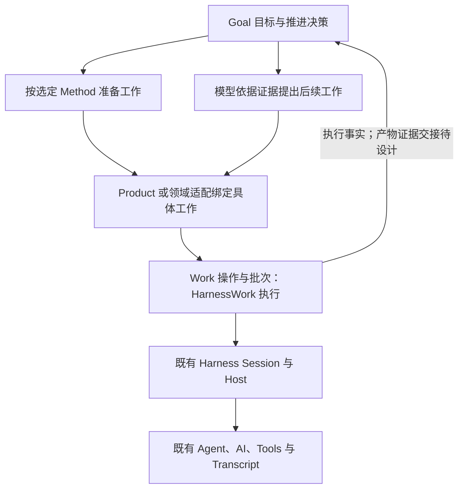

# Goal 推进所需支撑能力与复用边界

## 状态与评审范围

- Authority: proposed — capability allocation and gap analysis。
- Design status: draft；Implementation status: not-started。
- 文档修订：R3，2026-10-25；纠正 Current 产物支撑描述，补计划受理及目标修订场景。
- Current 源码基线：`11b854951125d3437fea9f43f65a9788af620933`。
- 方法咨询：本地干净 archmethod master `0f9bd3ff51afabeaaf76cc38dff1ceb279b7d37e`。
- Owner：Goal、Method、HarnessWork 与 Product composition 的共同架构责任域。
- 当前交付为能力盘点及候选责任分配，不是已接受 Target、完整接口设计或实现验收。
- 用户要求重要架构工作件亲自评审；内部三路评审不代替用户接受，功能开发继续暂停。

本文件对应[设计包 README](README.md)的 GMW-R1/R3/R4/R5/R6 部分内容。系统环境、全部组件及关键
交互仍须按[设计任务书](../../plans/2026-10-24-goal-architecture-design-brief.md)完成，
不能用本能力表替代。既有[系统环境图](context.md)仍待用户评审。

本轮评审问题：能力与场景是否遗漏、Current 事实是否有源码支持、候选职责分配
是否合理、是否重复建设，以及尚待设计的合同是否被误写成现有保证。不要求评审者
替未设计机制补全行为，也不因本文件尚未给出全部接口而宣称整体架构已完成。

## 1. 推进模型与概念

目标跨执行轮次存在；每次根据当前证据决定下一步，再交给已有执行能力。计划可以
调整，实现路线的调整不自动改变原始要求、验收条件或用户明确要求的评审。
用户有权提出目标/要求的修订、撤回或放弃；受理权限、影响范围、旧计划和验收前提
如何失效须另行设计，已执行事实保持历史身份，不因目标变化被改写。

必须分别表达以下事实：

| 概念 | 含义与候选权威 | 与其他事实的区别 |
| --- | --- | --- |
| Goal | 目标、要求、控制状态、目标级进展和验收；目标能力的责任域负责 | 一次执行完成不等于目标完成 |
| 模型任务计划 | 模型对后续工作的提议；是否为可追溯领域计划待 D2 决定 | 展示清单不直接提供执行或工具授权 |
| MethodPlan | 选定 Method 经编译形成的方法步骤与投影；Method 负责语义 | 不等于通用模型任务计划 |
| WorkOperation / WorkRun | 一次工作受理与其执行事实；HarnessWork 负责生命周期 | 多次 Work 可关联同一目标，不能因此合并两层终态 |
| Session / Host 轮次 | 既有执行上下文、输入处理和运行控制 | Session 空闲、Work 终态与整个目标静止不是同一事实 |

Goal 能力的包位置、实例寿命和持久化装配尚未决定。下述 Goal、规划、验收是候选
职责，不预设各建一个服务、执行器或顶层包。Product 负责组合与领域绑定，不因此
获得重复定义各层状态语义的权力。

## 2. 既有组件如何支撑

| 既有范围 | Current 已有支撑 | Goal 的候选使用方式 | 边界 |
| --- | --- | --- | --- |
| Harness / Session / Host | 图文输入、steer、follow-up、输入队列、执行控制、事件订阅、取消收尾，衔接 Agent/AI/Tools/Transcript | 复用正常执行与上下文，在现有运行边界组织续跑 | Harness 不反向导入 Goal、Method 或 HarnessWork；自动续跑资格不能只看一次 idle |
| HarnessWork | 操作受理、顺序步骤执行、去重检查、生命周期、取消及运行/计划/步骤事件投影；ArtifactRef 类型已定义，未发现内置产物生产与投影链 | 执行已绑定的具体工作，提供执行事实；产物证据按原 owner 补交接 | 不拥有 Goal 完成决定，不复制 Agent loop、工具授权或原始用量账本 |
| Method | 发现、显式选择、single_turn/fixed 编译、准备提示及方法事实投影 | 按用户选择的方法准备工作，保留方法/计划/步骤身份 | 模型自动选方法、通用重规划和偏离裁决不是已核实 Current；约束元数据不是执行保证 |
| Work 兼容入口 | `loushang.work` 向 canonical `loushang.harnesswork` 转发 | 保持已有导入和调用兼容 | 不建立第二套 Work 引擎、状态机或日志 |
| Product 与已有入口/展示 | 领域绑定、执行装配及 CLI/TUI/SDK/hosted 等入口 | 绑定 Goal 控制、方法、执行和展示 | 入口存在不等于每个入口已支持 Method 或 Goal；按部署 profile 核实 |

候选两条路径共用履约执行，模型规划也可以在所选 Method 的约束内进行：

这是一幅候选职责关系图，不是调用时序、进程图或装配实现。规划、验证本身若要
调用模型或工具，也须经过既有执行/权限边界；图中的规划节点不是可绕过它们的旁路。

## 3. 支撑能力清单：Current、缺口与候选归属

“新增”指目标语义缺口；“集成”指复用现有机制并补交接合同；“待核实”不等于
不存在。各项都需要设计说明，实施分期须在整体范围内另行评审，不静默删减任务书要求。

| ID | 需要支撑的能力 | Current 与证据 | 缺口及候选责任 | 复用边界 / 应形成的可审查结果 |
| --- | --- | --- | --- | --- |
| SC-01 | 目标、要求、状态跨轮次保存及受控修订 | Transcript 与 Work 事件基础存在；未核实有统一 Goal 领域状态（E1/E4/E6） | Goal 责任域拥有目标身份、要求及控制语义；区分追加、修订、撤回和放弃/替代目标；权限与影响传播待 D1/D4/D6 | S10 说明哪些计划/验收前提失效、已完成部分如何重新评估；复用存储基础，保留历史，不把普通对话文本当唯一状态 |
| SC-02 | 从当前证据决定下一步 | Session 可执行，Work 可反馈事实；没有已核实的 Goal 推进策略（E1/E2/E3） | Goal 组织推进；策略区分 Method 指导、模型规划及组合 | 明确一次决策的输入、结果与下一次唤醒来源；不另建 Agent loop |
| SC-03 | 用户输入优先与受控续跑 | Host 有 idle 后运行和执行收尾；Session 有输入队列（E1/E2） | 集成目标有效状态、用户输入、Work 收尾与续跑受理的顺序；Goal 策略消费现有 owner 能力 | S3/S4 给出实际交接点；idle 观察或一次前置检查不能充当完整合同 |
| SC-04 | 可变计划与执行批次关联 | MethodPlan 已有；WorkRunSpec 在接受时提供步骤元组（E3/E5） | 明确展示清单、模型计划、MethodPlan 的身份关系，以及 Goal→operation/run 关联；模型计划语义归属待 D2 | 优先在后续批次表达路线变化；运行中修订若有需求另评方案；不改写已执行事实 |
| SC-05 | 方法指导与偏离处理 | 方法显式选择、fixed/single_turn 编译及约束/audit 投影存在（E5） | Method 定义方法语义；Goal/领域装配组织执行和反馈；约束强制性、偏离处置待 D3 | 保持方法身份；明确必要步骤/评审与自主空间；不能仅凭 metadata 宣称合规 |
| SC-06 | 具体工作受理、执行、取消与事实 | HarnessWork 已有 accept/wait/cancel、重复身份检查及运行/计划/步骤投影；ArtifactRef 仅有类型/导出，未发现内置产物投影；Session 适配限制同时活动 Work（E3） | 主要集成：绑定现有 Work，消费已支持的执行事实；产物证据按 SC-11 补交接，不新建内核 | operation→run 查询权威留在 HarnessWork；Goal 记录目标关联、引用 run 作为证据，但不维护另一份权威解析映射；去重不等于跨存储原子受理 |
| SC-07 | 上下文、图文与运行中输入 | text/image/steer/follow-up、Transcript/Blob 能力已存在（E1/E6） | 优先复用；目标关联、追加要求与独立原文持久化需求按 S3/S8 明确 | 不把已有输入能力列为缺失；原文图片先保存、User 确认后关联等要求仍保留，但不默认为每次 Goal 的强制前置 |
| SC-08 | 暂停、恢复、失败与未知结果 | Session abort/settle；Work 取消结果和历史 orphaned 投影存在（E1/E3） | Goal 控制状态与执行控制的映射需设计；恢复先对账，再决定动作；与原 owner 协作明确导出及升级回退范围 | S4/S6 区分停止派发、停止执行、状态恢复、外部效果；Work cancelled 不单独证明领域动作已收尾，历史重建不等于可安全重放 |
| SC-09 | 目标级用量与预算策略 | 普通调用有 invocation/attempt/snapshot 用量；所查记录无专用 Work/Goal 关联字段，purpose 可区分调用用途；其他路径覆盖有限（E7） | 复用原记录，新增或绑定 Goal/Work 归属所需关联；预算归属、缺失用量、后代可见性及派发策略待 D5 | 不新建原始 token 账本；不能仅凭 Session 或 purpose 推导 run 归属；provider 压缩/非持久子执行不直接承诺全量精确硬限 |
| SC-10 | 活动、进展和等待的区分 | 已有工具/运行事件；无已核实的目标级进展判定（E1/E3） | Goal 按当前证据区分成果、仍在进行的等待、无进展和真实阻塞 | 轻量空活动保护可选；阈值另评；文本/计划更新或调用工具不能独自证明目标推进 |
| SC-11 | 目标完成验收和人工评审 | Work 完成依据 executor 返回和步骤遍历；Method 的 constraint/audit 可透传；expected_artifacts/success_criteria/approval_gates 等类型字段在所查标准路径未被填充或用于判定（E3/E5） | Goal 组织要求核验、缺项与完成决定；Product/领域验收绑定须补产物证据来源及关联，复用已有 Artifact/Blob、文件、测试等来源（E6/E9） | S5 不假定 Work 已提供标准产物事实；不强制所有证据经过 Work 或另建全局产物索引；模型建议、Work completed、用户批准分别记录 |
| SC-12 | 控制权限、可观察性与入口一致性 | 既有工具授权、入口、Work/Session 展示基础存在；Method CLI 有模式限制（E1/E3/E8） | Product 绑定控制和视图；目标控制权限与会话/工具授权的关系待 D6 | 保留无 Goal 和旧 Method/Work 路径；不能因工具已批准就推导用户有目标控制权限；展示清单不是必需执行协议 |
| SC-13 | 模型计划受理前校验与工作绑定 | Work _validate_spec 只检查步骤身份等结构，Session 适配检查共享 plan_id；未核实有覆盖目标级语义的计划准入机制（E3） | Goal 责任域定义目标覆盖/约束判据，Method 提供方法要求，Product/领域绑定组织受理；拒绝/退回/请求用户决定、预算及权限边界待 D2/D3/D5/D6 | S2 给出受理或拒绝依据；比较结构检查、提示约束及结构化核验的实际保证，不预设通用语义证明器；不替代真实动作的工具授权，也不新增 CI 门禁 |

## 4. 最小必要增量与避免重复建设

候选增量集中在：目标领域状态、推进决策、计划与工作关联、目标级证据验收，以及
这些职责与现有执行控制的交接。不是先规定模块数量或代码规模。

- 图文、steer、follow-up 继续使用现有 Session 输入；具体独立持久化需求另有合同。
- 执行、取消、步骤和 Work 事实继续由 HarnessWork 拥有，不新增 Goal 专用执行队列。
- 模型、工具权限、压缩、原用量和 Transcript 继续由已有 owner 提供；有缺口先在原
  owner 上明确影响，不在 Goal 旁路复制。
- 目标记录引用 operation/run、方法及证据身份，不镜像维护一份完整 Work 或 Transcript。
- 新增目标领域记录是否必要，以事实权威、更新/恢复合同及耐久性为依据，而非日志
  文件数量；是否需跨存储原子性或跨进程可见性须由场景驱动，不预设强一致平台。
- 用户可见清单与进展视图优先基于现有事件/投影，不要求先做通用 DAG 引擎。
- 重试分层处理：存储竞争由存储层处理；推进路线由决策处理；未知外部效果先查询，
  不因观察超时就重复提交工作。这里不新增后台服务或分布式一致性前提。

## 5. 关键场景与后续设计证据

以下是后续设计和评审必须能回答的场景，不是当前已通过的测试，也不是新增 CI 门禁。

| 场景 | 关联能力 | 后续设计应提供的证据 |
| --- | --- | --- |
| S1 创建目标，按选定 Method 推进 | SC-01/02/04/05/06 | 方法选择与工作绑定、步骤事实和验收关系；保持既有无 Goal 路径 |
| S2 模型提出或调整计划，经受理后执行下一批工作 | SC-02/04/05/06/10/13 | 从提议→核验→受理/拒绝→绑定 Work 说明判据和责任；覆盖目标、方法、能力/权限及预算能判断的范围，说明证据不足和校验失败的处理；保留调整原因与历史批次身份 |
| S3 工作运行或准备完成时用户追加图文/steer/follow-up | SC-03/07/11 | 原输入入口、追加要求何时生效、谁阻止过时派发或过时完成；不先新增全局队列协议 |
| S4 pause/interrupt/cancel/close 与执行或续跑交错，之后 resume | SC-03/06/08/12 | 各层状态与派发权的先后、原调用/子执行收尾及对用户的可观察结果；对 settled/unsupported/failed、取消到达前外部已成功分别说明事实来源和责任；按本地/hosted profile 区分 |
| S5 Work completed，仍有未验收要求或人工评审未完成 | SC-05/11 | 原要求→证据来源/引用→交接→验收结果；复用 Artifact/Blob、文件/测试等原 owner，不假定 Work 已有产物投影；区分用户批准和模型判定，Goal 不自动完成 |
| S6 重开时历史 Work 未完成，或外部结果未知；导出及升级回退 | SC-01/06/08 | 各存储耐久性和恢复范围、身份查询、哪些动作可继续/需核查/需用户决策；说明 Goal→Work/Transcript/Blob 引用在导出或回退后的解释与原 owner 协作，不默认重放副作用 |
| S7 预算接近上限，规划/压缩/子执行仍可能产生成本 | SC-02/09 | 账目来源、归属、缺失/迟到用量处理与派发约束；明确软限制或硬限制的实际保证 |
| S8 原文图文先保存、User 确认后关联，空闲和运行中追加 | SC-01/07/12 | 保留原需求；明确受理/保存/排队/关联的各自含义、权限和既有 Blob/Transcript 的复用范围 |
| S9 反复有活动但无成果，与合法等待的对照 | SC-02/03/09/10 | 走查重复改清单/只读检查、等待用户审批或已受理子执行、失败后证据无变化；分别说明进展或等待依据、下一次唤醒来源、继续/停止/请求用户决策的 owner 和预算关系，不预设通用 watchdog |
| S10 运行中修订/撤回要求，或放弃/替代目标 | SC-01/03/04/08/11/12/13 | 受理及授权、旧计划与验收前提失效的范围、在途工作处理、已完成部分重新评估、历史保留；说明目标不可达与执行失败的区别，close 属于哪一层，不预选终态枚举 |

## 6. 待作出的关键决定

| ID | 决策问题 | 需要比较或核实的选择 |
| --- | --- | --- |
| D1 | Goal 状态、生命周期、基数和存储权威 | Goal 与 Session/进程的基数和寿命，是否跨 Session；完成/放弃/替代/不可达等结果如何表达及是否终态，区别执行失败；修订/撤回的历史语义；比较已有扩展/存储或领域记录，说明一致性/耐久性驱动而不预选格式或同事务 |
| D2 | 模型计划的性质、受理及与 MethodPlan/Work 的绑定 | 计划受理/拒绝判据、核验责任及保证范围；仅展示清单或领域计划；后续批次或运行中修订；区分定义、来源修订、计划实例/修订与 operation/run。同一 Method 连用两次、改内容后再用两例解释；plan_id/step_id 不单独跨运行唯一 |
| D3 | Method 强制要求、自主空间和偏离处置 | 提示约束、结构化验证、人工评审分别负责什么；方法选择/切换的权限及兼容 |
| D4 | 输入、续跑、目标修订/控制与完成的顺序合同 | 各入口/profile 的唤醒来源、owner 和寿命；现有交接点与增量；暂停/改要求/撤回/放弃之后的派发与在途处理、旧计划/验收失效；close 的对象层级；不从缺少调度器直接推导必须新增 Product 循环 |
| D5 | 预算、恢复及演进的承诺范围 | 用量关联方式及缺失/迟到记录；是否需要更强的后代可见性与其成本；软/硬限制、部署寿命、耐久性和未知效果；导出/升级/回退及跨记录引用的兼容责任；分期留证，不另建通用迁移平台 |
| D6 | 控制权限与入口支持范围 | User/会话/目标关系、工具授权区别、CLI/TUI/SDK/hosted 的现状与目标差异 |

D1–D6 都未接受；涉及重要架构工作件仍交用户评审。本清单不自动把任何具体
API、存储格式、阈值或同步机制升级为实施要求。

## 7. Current 证据索引与限制

源码路径相对本工作树，基线见文首。以下均为静态核查，不是运行时验收。

- E1：[Session 控制与输入](../../../../src/loushang/harness/session/runtime.py)、
  [队列控制](../../../../src/loushang/harness/session/queue_controller.py)。
- E2：[Host 执行与收尾](../../../../src/loushang/harness/runtime/execution.py)。
- E3：[WorkRuntime](../../../../src/loushang/harnesswork/runtime.py)、
  [Work 类型](../../../../src/loushang/harnesswork/types.py)、
  [Session 适配](../../../../src/loushang/harnesswork/integrations/session.py)、
  [事件存储](../../../../src/loushang/harnesswork/event_log.py)。
- E4：[Work 转发入口](../../../../src/loushang/work/runtime.py)、
  [类型兼容入口](../../../../src/loushang/work/types.py)。
- E5：[Method 选择](../../../../src/loushang/method/selector.py)、
  [编译](../../../../src/loushang/method/compiler.py)、
  [准备执行](../../../../src/loushang/method/runtime.py)、
  [事实投影](../../../../src/loushang/method/projection.py)。
- E6：[Transcript 单元](../../../../src/loushang/harness/transcript/unit_of_work.py)、
  [Session 产物与 Blob](../../../../src/loushang/harness/transcript/session_artifacts.py)。
- E7：[普通模型调用与用量](../../../../src/loushang/harness/session/model_call.py)、
  [用量记录字段](../../../../src/loushang/harness/transcript/model_usage_types.py)、
  [模型输入身份与用途](../../../../src/loushang/harness/transcript/model_input_types.py)、
  [压缩策略](../../../../src/loushang/harness/transcript/summarization.py)、
  [provider 压缩适配](../../../../src/loushang/coding/compaction/adapter.py)、
  [子执行](../../../../src/loushang/coding/multiagent.py)。
- E8：[入口方法限制](../../../../src/loushang/harness/cli/launch.py)、
  [工具执行](../../../../src/loushang/harness/tools/execution.py)、
  [工作空间工具授权](../../../../src/loushang/harness/tools/workspace/authorization.py)。
- E9：[Harness 产物存储](../../../../src/loushang/harness/artifacts/store.py)、
  [子执行通知与结果读取](../../../../src/loushang/harness/session/multiagent.py)、
  [完成通知类型](../../../../src/loushang/harness/multiagent/types.py)。

重要限制：Work JSONL 当前使用 PROCESS_LOCAL_JOURNAL，不能直接宣称具备
Transcript 相同的耐久确认；历史 orphaned 是启动时重算、未回写的派生投影，不等于持久
终态或自动恢复执行；provider 压缩
与普通模型调用的用量路径不完全相同；Coding 子执行当前 persist=False。所有入口、
平台、插件、自定义适配及 hosted profile 的端到端行为并未在本轮穷举或测试。

Work 取消也有当前限制：settled 与 unsupported 都可能成为 Work cancelled；取消
终态事件没有单独投影该 outcome。因此不能仅消费 cancelled 就断言领域动作完全
收尾或外部效果已知。S4/S6、D4 后续必须按各分支说明事实来源，不在此预选新 API。

产物与验收限制：所查 HarnessWork 标准路径只有 ArtifactRef 等类型声明，没有
内置产物生产/投影链；Method/Work 的预期产物、成功条件或 approval gate 类型字段
不等于已接通的验收能力。领域可发布非保留类型 WorkEventFact，因此不能断言所有
自定义 Work 事件都不可能携带产物信息。SC-11 应按已有 Artifact/Blob 等原 owner
补证据交接，而非在 Goal 新建产物存储。

子执行限制：所查 Coding factory 使用 persist=False，未将每个子轮次绑定成独立
WorkRun；但已有 live handle、await_completion/read_completion_notice 及工具结果
查询，完成通知可带 terminal/workspace/artifact/change-set 引用。因此不是只能看到
工具级事件。子执行内部步骤/产物的完整 Work 投影、跨重启恢复和可对账用量关联
尚未建立，不能把运行期通知或汇总 token 当作耐久的后代事实账本。

## 8. 评审与接受状态

R1 已由三个独立 xhigh agent 评审，分别检查职责/复用/复杂度、运行/并发/失败、
数据/权限/兼容与验证范围，均未发现阻断交用户评审的问题。R2 补入四条非阻断
建议所需的 Current 限制、追溯及对照场景；不把补充问题当成机制已经实现。

外部独立评审随后指出 R2 的产物能力误述及计划受理、目标修订覆盖不足。R3 已按
源码与任务书修正，并收窄评审中超出证据的绝对判断；原 R1/R2 内部结论仅作为历史。
固定修订、处置与各轮复核的实际结论见[评审记录](support-capabilities-review.md)。
原始报告、快照和哈希在产品树外留证；评审者独立核查，不把能力表当成完整架构合同。
用户评审待提交；架构接受未发生；功能开发未恢复。
