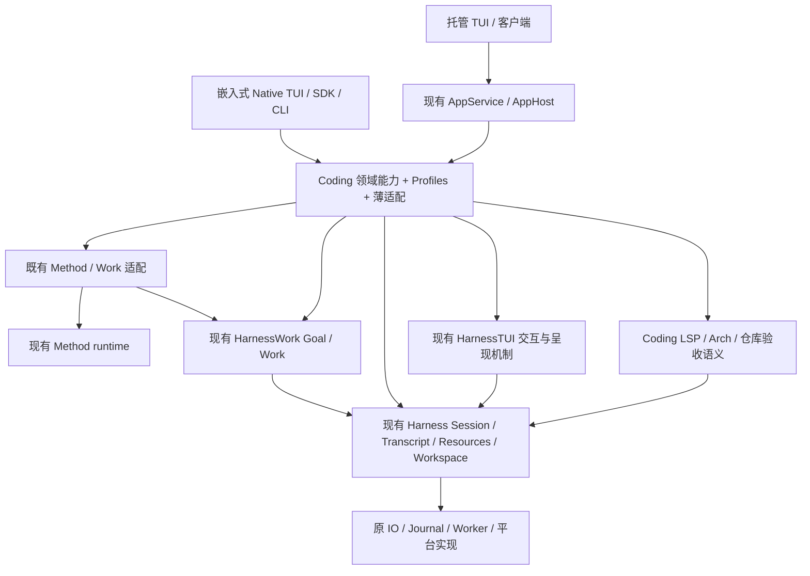

# Coding 全量职责收敛与重构方案 R1

本文件保留2026-11-06 R1分析快照。现行执行与计量见[当前Goal](coding-responsibility-convergence-goal.md)、[A72全量剩余账](coding-responsibility-remaining-audit.md)，下文旧阶段编号/行数/未实施状态不覆盖后续事实。

## 状态、目标与证据边界

- Authority: descriptive audit + proposed reconstruction；不替代 [Current Owner Map](current-owner-map.md) 或已接受合同。
- Design status: proposed，提交用户评审。用户已明确要求 Coding 只保留约 5,000–15,000 行领域能力和薄适配；具体职责分配、接口和退出决定尚未接受。
- Implementation status: not-started。此次只有分析、逐文件清单和方案文档，没有修改源代码、测试、工作流或门禁。
- Owner: Coding / Harness / HarnessWork / Method / Hosting 各原职责 owner；执行分析 Codex。
- 冻结基线：main `739f947d6099257af1aec56ae587426d8cd8ec7d`，2026-11-06。
- 方法：本地干净 archmethod master `0f9bd3ff51afabeaaf76cc38dff1ceb279b7d37e`；未声称已同步 upstream，方法不复制进入产品。
- 完整静态清点：**427 个 Coding Python 文件、145,842 个物理行、28 个职责组**。包括空行、注释和文档字符串，不含 tests/examples/docs；见[逐文件处置清单](coding-responsibility-inventory.md)。

“全量”表示每个文件都纳入计数、导入、类/函数和机制调用清点，并得到职责簇处置建议；关键入口和发现另外做源码/调用核查。它不表示逐行语义认证、动态调用穷尽、全平台验收或每个文件已获删除授权。逐文件表不是可执行迁移清单，某组的全部行数不能作为可删除量。

分析使用独立工作树 `docs/coding-responsibility-audit`。既有 Harness lane 正在做 source consolidation，其未提交改动及基线之后的提交不计为本报告的 Current。实施前必须重新核对其已合入成果；已有共享实现就直接采用，不重复开发。基线已包含 PR #877 的旧 pre-B restore/legacy runtime 清理，不将已删除代码再列为候选。

## 1. 决策摘要：重建 Product 轮廓，不做目录搬家

建议整体替换过厚的 Product 装配与基础设施实现，Coding 收敛为四个职责簇：

1. **编码领域能力**：LSP、Arch、仓库工作与验收语义。
2. **产品 Profile 与内容**：编码提示词、角色、工具/Method 选择、信任/权限/预算默认值及必要的产品记录声明。
3. **产品适配**：身份、内容投影、授权选择和公共结果转换；不自己实现共享状态机、文件存储或调度器。
4. **薄入口**：CLI/SDK/TUI/托管注册和语法；同一业务由同一执行 owner 承接。

这四项是职责分组，不要求新增四个服务、四个 runtime 或一个总控 Controller。原公开导出可继续由小的兼容转发承载，真正实现只有一份。

Profile 优先表达为现有 ProductRuntimePlan、SessionCompositionPolicy、MethodDomainProfile 和内容/选择数据的组合；不新增 CodingProfileResolver、Profile Registry 或 Profile 执行引擎。

**复用顺序是本方案的核心约束：**

1. 已有组件能直接满足合同：改调用并删除 Coding 的重复实现。
2. 已有配置、Profile、端口或回调能表达差异：只提供 Product 输入，不增加共享执行组件。
3. 仍有合同缺口：先扩充原 owner 的最小能力；必须记录具体缺口和现有能力不能满足的原因。
4. 只有上述路径均不能成立，才提出新的共享模块；新模块仍须归入唯一职责 owner，并经专项评审。

“代码不认识 Coding”只是必要条件，不足以批准新抽象。把 10 万行原样搬到 Harness、新建通用 manager、将原业务解释成任意回调，都不构成本方案完成。

## 2. 规模目标与计量口径

第一轮完成线建议取 **15,000 行上限**。相对基线，需要从 Coding 移除或削减 130,842 行，约 89.7%。5,000 行是进一步收敛方向，不假设保留全部当前领域能力就已经能达到。

| 目标职责 | 设计预算上限 | 说明 |
| --- | ---: | --- |
| LSP / Arch 编码领域能力 | 10,000 | 当前两个目录共 9,609 行；保留语义能力，底层进程/平台/通用校验仍复用共享组件 |
| 仓库 Goal / Method / 测试与评审的领域策略 | 1,500 | 保留动作许可、要求与证据的业务解释；规划、执行、预算基础机制不在此实现 |
| Product Profile、内容绑定与必要记录声明 | 1,500 | 编码默认值、身份和兼容字段；共享 codec/提交机制复用原 owner |
| CLI / SDK / TUI / 托管薄适配与兼容导出 | 2,000 | 不包含独立执行、队列、恢复、存储或协议引擎 |
| **总预算** | **15,000** | 这是待验证的设计预算，不是已证明的逐文件削减估计 |

这些预算有意紧凑。共享合同验证若发现仍有不可消除的领域代码，应明确列出它的用户价值和保留成本，再提交取舍；不能静默放宽上限，也不能删除兼容或安全合同来凑数字。将 LSP/Arch 等产品实现移到 `coding_*` 新目录、Plugin 包或数据文件后，仍计入对应产品职责预算。

每个切片必须同时记录：Coding 删除/新增行、Harness 及其它受影响层删除/新增行、tests/examples/声明资产变化、独立执行/存储实现数量、实际保留与退出的能力。行数采用当前物理行口径；不得压成单行、用生成器或配置脚本隐藏同等复杂度。公共机制搬迁与系统净减少分开报告。

历史 [Coding 5K 目标](coding-5k-reduction-goal.md)基于 2026-07 的 21,285 行切点；[旧迁移 ledger](coding-shared-layer-migration-ledger.md)是已关闭的历史波次。二者不能证明当前 145,842 行合理或已满足本次目标，本方案也不重开旧波次。

## 3. 环境、组件与交互建议

下图是待评审的依赖/调用归属，不表示创建新的进程或替代所有现有 API。

Method/Work 协作由原适配承接；图中没有引入 Method 核心对 HarnessWork 的依赖。普通 prompt 不必经过 Method/Goal。

物理部署沿用现状：嵌入式入口与 Session 可同进程；托管入口通过原本地连接进入服务进程；被准入的 Worker 仍为原受控子进程。Source Store、Transcript、Work/Goal 记录及私有数据有各自寿命，不因共享代码而合并数据目录、锁或事实日志。

| 唯一职责 | 归属与复用点 | Coding 最终保留 |
| --- | --- | --- |
| Agent Session 构造、运行和关闭 | [AgentProductConstructionRuntime](../../../../src/loushang/harness/session/bootstrap_construction.py)、[AgentProductSession](../../../../src/loushang/harness/session/agent_product.py)、[ProductSessionRuntime](../../../../src/loushang/harness/session/product_runtime.py) | Profile、领域对象和原准入/内容 hooks |
| 原输入队列、生命周期与持久提交 | 原 Harness Session / [ProductTranscriptSession](../../../../src/loushang/harness/transcript/product_session.py) / Writer | Product 字段、当前装配决定；不重建队列或提交器 |
| Plugin 选择、管理、挂载和退役 | 原 [管理装配](../../../../src/loushang/harness/plugin_management/assembly.py)、[Package Product](../../../../src/loushang/harness/package_product/product_runtime.py)、Graph/Registration/Resources | 内置内容、来源/信任/支持范围和布局策略 |
| 文件、摘要、私有目录和平台操作 | 原 rooted IO、tree validation、file sinks、native adapters；补缺口须归原 owner | 数据形状、允许范围和错误投影 |
| Worker 通用启动、状态迁移与清理 | 原 [WorkerSupervisorJournal](../../../../src/loushang/harness/worker/journal.py)、Hosting、Worker 生命周期和 Package 绑定 | 哪个 Coding 插件可运行、如何选用及批准 |
| Goal / Work 事实、计划批次与运行关联 | 原 HarnessWork controller/records/batch planning/session integration | 仓库动作、Method 选择、测试/评审判据 |
| Method 资源、编译和 Domain runtime | 原 `loushang.method` | `domain=coding`、选择策略和指导内容；不新增 harnessmethod |
| 托管会话与线协议桥接 | AppHost/AppService 的可选 Harness Session 集成 | Coding 身份、快照/事件/交互投影与注册 |
| UI 交互、Surface 和通用呈现 | 原 HarnessTUI；终端原语由 TUI 负责 | 最终产品 copy、主题和具体业务动作 |

Harness 核心继续不依赖 Coding、HarnessWork/Method、AppService/AppHost、Channel 或 UI。已有可选 Agent/AI profile 可使用其稳定值类型，不引入 provider/auth 策略。共享托管桥接应由 AppService 侧依赖 Harness，不能反向把线协议塞进 Harness。

高内聚、低耦合落实为以下边界，而不是给文件另起目录名：

- 每个机制的变化围绕同一职责和事实权威；Product Profile 是声明输入，不持有运行状态、不实现生命周期。
- 装配根可以协调多个依赖；运行期叶子只接收已准入的窄端口，不能通过一个大 Session/context/service-locator 任意访问其他 owner。
- LSP、Arch 等领域 Capability 通过原 Workspace/声明依赖交互，不为压行数新增彼此的隐式硬依赖。
- UI/协议消费者使用公共值投影与控制端口，不读取另一个 owner 的私有字段或重建其状态。
- 统一实现不等于全局单例、统一锁或统一日志；允许按 scope 构造多个实例，但同一语义事实的判定和写入只有原权威负责。

## 4. 全部 28 个职责组的处置

文件/行数是覆盖证明；“机制拆分”“条件退出”不代表整组可删除。逐文件路径、处置和源码指纹见清单；建议归属、保留项和既有 owner 按 C01–C28 与本方案责任矩阵对应。完整 CSV/AST 与指纹保存在产品树外。

| ID | 当前职责组 | 文件 | 物理行 | 建议 |
| --- | --- | ---: | ---: | --- |
| C01 | 启动、Plugin 与资源装配 | 22 | 15,308 | 统一改用既有装配入口；保留声明与原准入，删除已由共享组件覆盖的操作体 |
| C02 | 托管与受管运行接入 | 27 | 8,612 | 标准会话桥接归 AppService 集成；Product 只绑定身份和投影 |
| C03 | Resume 与 SessionManager | 15 | 4,752 | 原提交/生命周期机制复用；版本化 Product 事实和授权选择保留 |
| C04 | Continuity | 2 | 3,177 | 通用载荷/租约和 Agent Transcript Provider 机制复用；保留来源/过滤/恢复政策 |
| C05 | canary 与作者验证入口 | 6 | 4,034 | 先查生产依赖；真实 runtime 归既有 owner，纯验证材料按用途归位 |
| C06 | 其余根目录入口与策略 | 26 | 4,482 | 已共享绑定保留；将残留中性协调纳入所属纵向切片 |
| C07 | 插件 Worker | 110 | 41,167 | 按原 Harness Worker/Journal/Package 能力整体替换中性实现；只保留产品批准与 Profile |
| C08 | 插件私有数据 | 31 | 11,771 | 整体设计、优先复用；统一文件/记录机制，保留领域数据与政策 |
| C09 | 兼容、迁移与快照证据 | 34 | 10,563 | 按真实支持范围条件退出；现有拒绝、备份和显式恢复合同逐项核对 |
| C10 | 包分发与 Product 管理 | 12 | 7,164 | 复用包存储、管理和打包机制；保留内置内容与准入 Profile |
| C11 | CLI | 25 | 9,708 | 共享 host/流/启动机械流程；保留领域语法和输出选择 |
| C12 | Goal / Work / 证据适配 | 25 | 7,627 | 已共享引擎不重做；通用物理 Goal 日志适配归 HarnessWork；保留业务 Profile |
| C13 | LSP | 21 | 5,829 | 保留语义能力；进程/延迟启动/通用校验继续复用已有共享 owner |
| C14 | Arch | 13 | 3,780 | 保留语言分析与 import graph；收敛通用边界校验和文件操作 |
| C15 | AgentSession Product 绑定 | 2 | 2,398 | 对原构造/关闭链减重，保留 Coding 内容/准入 hooks |
| C16 | Native UI Product 绑定 | 14 | 2,179 | 保留 profile；不重复建设已共享的 conversation/controller/surface |
| C17 | AgentSessionRuntime 绑定 | 3 | 1,118 | 原 runtime 复用；恢复策略与中性生命周期分别归位 |
| C18 | 交互命令与预热 | 5 | 874 | 保留语法/呈现；公共观察与控制端口解耦私有字段 |
| C19 | 压缩 Profile | 4 | 440 | 已共享机制；保留编码摘要内容与标签 |
| C20 | 诊断 Profile | 3 | 233 | 已共享机制；保留产品投影 |
| C21 | Prompt | 3 | 132 | 保留编码内容；装配已共享 |
| C22 | 内置 Plugin 内容 | 6 | 124 | 保留内容与声明；Harness 承载 |
| C23 | 呈现适配 | 4 | 109 | 保留 Product 最终投影；复用原 HarnessTUI |
| C24 | Scenario 适配 | 2 | 82 | 已采用 Harness scenario；保留编码模型准备 |
| C25 | Method Domain / 兼容入口 | 3 | 72 | 已共享；保留 domain profile 和必要转发 |
| C26 | 配置兼容导出 / 路径 | 2 | 52 | 已共享；保留 Coding 路径与公开导出 |
| C27 | 版本检查 | 2 | 50 | 保留产品更新选择；不为少量绑定创建新抽象 |
| C28 | 资源命名空间 | 5 | 5 | 保留支持中的布局；空壳不计为第二引擎 |
| **合计** | | **427** | **145,842** | |

## 5. 可行动发现与原组件复用方案

### F01 私有数据操作机制大量留在 Product：优先整体替换

31 文件中有 303 个直接 `os.*` 调用点。实际实现包括 [POSIX 备份复制](../../../../src/loushang/coding/package_private_data_backup.py#L304)、[恢复 staging](../../../../src/loushang/coding/package_private_data_restore.py#L370)、[物理删除](../../../../src/loushang/coding/package_private_data_deletion_owner.py#L101)、[过期清理](../../../../src/loushang/coding/package_private_data_backup_expiry.py#L172)及对应 Windows 路径。

优先复用 Harness rooted IO、现有 tree/file 原语、[私有数据删除协调器](../../../../src/loushang/harness/plugin_management/private_data_deletion.py#L232)和[确认 Journal](../../../../src/loushang/harness/plugin_management/private_data_confirmation.py)。缺口是这些原语与当前私有数据 owner 合同之间的共享执行适配，不是“再建一套安全文件系统”。确认协调器本身只委托；不能把已有端口冒称为完整备份/恢复执行实现。

建议：共享操作算法、平台适配和通用记录机制归原 Harness owner，Coding 给出 Arch 身份、数据布局/形状和保留政策。逐项替换后删除原操作体。POSIX/Windows 的 ACL、身份、部分失败与日志耐久差异保留在窄适配中，不以统一算法削弱合同。

### F02 Worker 已有共享状态机，Product 存储/历史适配仍过厚

[Coding Supervisor Journal](../../../../src/loushang/coding/package_product_worker_supervisor_journal.py#L67)继承原 Harness `WorkerSupervisorJournal`，说明状态迁移引擎已经复用。残留 [分段历史原语](../../../../src/loushang/coding/package_product_worker_history_segments.py)、多条 opt-in/receipt/start-gate/activation 流及 Windows 原生读写，应按统一 rooted/segmented storage 合同收敛。

不要另建 Worker 引擎，也不要把每种 Journal 合成一份“统一业务日志”：启动批准、物理进程结清、声明选用和回执是不同事实。共享的是读取、codec、CAS/append、checkpoint/replay、身份固定和平台操作；Product 保留具体允许与选择政策。110 文件的 41,167 行是审查范围，不是承诺全部删除量。

### F03 四个 Journal 的重复读取与十处严格 JSON 检查

[删除](../../../../src/loushang/coding/package_private_data_deletion_journal.py#L305)、[恢复](../../../../src/loushang/coding/package_private_data_restore_journal.py#L279)、[过期](../../../../src/loushang/coding/package_private_data_backup_expiry_journal.py#L282)、[恢复确认](../../../../src/loushang/coding/package_private_data_restore_confirmation.py#L274)先调用 `load_jsonl()`，再重新打开文件逐行 `json.loads()` 拒绝重复键。私有数据文件中还有十个 `_unique_object`，主要差异是错误文本。

应在原 Journal/序列化 owner 对同一份字节完成一次严格解析，保留各记录类型的状态投影。现有通用解析并不等价提供该检查，不能直接删除第二遍、改变旧格式接受范围或扩散全局严格策略。此项是私有数据纵向切片的一部分，不单独建设 JSON 框架或全局缓存。

### F04 相同/相似底层操作应随纵向切片删除重复体

全 Coding + Harness 静态扫描找到 15 组函数体候选；忽略签名/全局绑定的相同 AST 不是自动合并证明。已核对的主要候选如下：

| 候选 | 证据 | 合并边界 |
| --- | --- | --- |
| entry existence | [Coding backup](../../../../src/loushang/coding/package_private_data_backup.py#L616)、deletion owner、Harness POSIX snapshot/materialization | 同一 `stat(dir_fd, follow_symlinks=False)`；只共享观察，不授予路径操作权 |
| link/reparse | [Coding lifecycle](../../../../src/loushang/coding/_plugin_lifecycle.py#L2100)与[Harness Journal](../../../../src/loushang/harness/journal/jsonl.py#L1229) | 共享分类，原错误/准入留原 owner |
| deletion receipt / tombstone | [POSIX Journal](../../../../src/loushang/coding/package_private_data_deletion_journal.py#L181)、[Windows transaction](../../../../src/loushang/coding/package_private_data_windows_deletion_journal.py#L139)及两处 tombstone 派生 | 共享纯记录查询/身份；锁、事务活性和持久名称不变 |
| method descriptor | [Hosted application](../../../../src/loushang/coding/hosted_application.py#L901)、[AppHost composition](../../../../src/loushang/coding/apphost_composition.py#L548) | 共用轻量验证机制；Product 端口要求保留 |
| stream TTY probe | [Coding CLI](../../../../src/loushang/coding/cli/__main__.py#L24)与[Harness host](../../../../src/loushang/harness/host/product_host.py#L321) | 复用原机制，同时保留早期启动的轻量导入约束 |
| Provider exact mapping | [Arch](../../../../src/loushang/coding/arch/_provider_api.py#L571)与[LSP](../../../../src/loushang/coding/lsp/_provider_api.py#L473) | 算法相同，`_reject` 的领域异常不同；通过已有边界校验/错误投影统一 |
| Windows Worker raw journal read | [native approval](../../../../src/loushang/coding/package_product_worker_windows_native_approval_journal.py#L305)、[opt-in](../../../../src/loushang/coding/package_product_worker_windows_opt_in_journal.py#L315)、receipt 等 | `_NAME`/上限/stream 校验可能不同，参数化原 native IO，不能删除 ACL 检查 |
| 完整写入循环 | [Coding backup](../../../../src/loushang/coding/package_private_data_backup.py#L593)、[Continuity](../../../../src/loushang/coding/continuity.py#L1240)、Harness rooted/snapshot IO | offset 续写、fsync、错误语义分别保留；复用已有写原语 |
| 私有目录准备 | [Plugin](../../../../src/loushang/coding/_plugin_lifecycle.py#L2134)与[Continuity](../../../../src/loushang/coding/continuity_bootstrap.py#L1437) | 共同准入算法；现有 `create_private_directory_chain` 不负责修改已有目录，不能直接互换 |

部分 `_bind_source` 方法只是重复的薄委托，已经调用同一 `prepare_session_work_source`；不把它升级成第二套执行机制，也不为十行转发引入 mixin/service。字符串相同的 codec 若构造不同领域记录，也只合并机械骨架，不合并事实。

### F05 私有数据树检查与 Harness 已有机制重叠

[Coding `_verify_files`](../../../../src/loushang/coding/package_private_data_backup.py#L427)自行做完整遍历、成员对照、身份/大小/摘要核验；Harness 已有 [tree validation](../../../../src/loushang/harness/resources/packages/plugin_lifecycle/_tree_validation.py#L45)、POSIX/Windows snapshot IO 与 file sinks。共享树观察和数据传输应优先用原窄端口。

私有数据还要求用户/权限、部分备份续接、目标恢复和发布身份；Package manifest 的结构也不同。应以可配置的内容/身份投影接入已有机制，不能把现有 Package 校验器当作全部替代品，更不能复写新的第三套树引擎。并行 Harness lane 的 tree-sink 收敛在实施前优先核对复用。

### F06 通用 Goal 物理日志适配仍在 Coding

[GoalJournal](../../../../src/loushang/coding/adapters/_goal_store.py#L43)使用 Harness JSONL/DirectoryWriterLease/RootedFileIO 和 HarnessWork records/codecs，实现 [GoalRecordStore](../../../../src/loushang/harnesswork/goal/contracts.py#L118)。它没有第二套逻辑 Goal 状态机，但物理后端仍由 Coding 实现；基线未发现等价共享 backend 可直接替代。

建议先以现有 `GoalRecordStore` 注入尝试装配；若确认只能由当前后端满足，则把这一个中性适配收敛到 HarnessWork 的可选 Harness 集成。Product 注入原目录、会话范围和标签，保持 `coding-goal` 锁/身份与持久路径兼容。禁止移到 Harness 核心再反向依赖 Work。

### F07 TUI 与 Goal owner 的私有状态耦合

[交互命令](../../../../src/loushang/coding/interaction/goal.py#L60)直接读取 `owner._closed`、`owner._allowances`。这不是执行引擎重复，而是观察合同不足。复用原 Goal/Session 进度与预算事实，补窄的公共只读投影，让 TUI 只依赖该投影与原控制端口；不要增加 TUI 状态权威、原始 token 账本，或为状态显示扫描全部历史。

### F08 构造和恢复的共同机制应由原组件承接

[Coding bootstrap](../../../../src/loushang/coding/bootstrap.py#L586)的 `_create_agent_session` 跨 2,196 行；[AgentSession 构造](../../../../src/loushang/coding/session/agent_session.py#L462)跨 668 行，涉及多种 Plugin/资源/Workspace/Resume 绑定。长度只是定位信号，不能据此判定重复。

应沿现有 AgentProductConstructionRuntime、SessionCompositionPolicy、RuntimePlan、Catalog/Graph/Registration 准备链逐项替换中性协调；Coding 只组装声明输入和产品 hooks。不得另建一个 CodingApplicationManager 或第三个 composer。只为保留大回调换一个包装类，也不算减重。

Resume 已有原 Transcript 提交、图片外置、固定身份 commit/lookup；Coding 保存的 intent/binding、权限扩大确认和当前装配判定是已接受的 Product 合同。应共享原 Writer/生命周期操作，不将全部字段和授权决定无条件下沉，也不重建自动恢复调度器。

### F09 标准托管 Session 桥接应归公共集成层

[CodingHostedSessionV1](../../../../src/loushang/coding/appservice_adapter.py#L124)通过原 `SessionOperationRuntime` 做 prompt/steer/follow-up，另有事件游标/订阅、模型操作和关闭。其公共 Agent Session 到 AppService 的桥接可共享；Coding 留身份校验、快照/事件/交互/恢复查询投影与错误。归属为 AppService 可选集成，复用原端口、Registry 与作用域，不在 Harness 中复制托管服务。

本项是通用实现的归位候选，不声称当前已经存在第二份等价 adapter。实际跨 Product 复用合同必须通过现有类型/端口装配验证，再删除 Coding 中对应的机械实现。

### F10 Continuity 载荷与 provider 机械流程

[Continuity staging](../../../../src/loushang/coding/continuity.py#L1111)持有私有 root/file descriptor，处理落盘和身份检查清理；应先尝试原 IO/Artifact/RunLease 机制，逐项列出不能满足的路径/寿命合同。简单以 `settled_io` 替换会丢失取消成功写入后清理的责任，不能机械操作。

目录查询、历史观察和原生命周期激活应复用 Transcript/Continuity 已有 owner；Coding 仍选择来源、scope、fallback cwd 和 Product 上限。基础 Continuity 核心不需要认识具体 Coding Session；Agent Transcript 适配放在已有可选 profile 边界。

### F11 退出与验证代码要按合同决定

legacy/canary/smoke 命名都不能作为死代码证明。旧状态拒绝、真实备份读取、显式离线恢复和 Worker 候选入口可能仍被公开命令或持久记录引用。先确认生产入口、动态导出、受支持存量与恢复需要，再决定合并、转为单独维护入口、归入验证材料或删除。

退出理由必须是无支持义务/已替代且用户接受的功能范围，而不是“严格模式拒绝一切所以不需要恢复”。不创建新的常驻开关来维持两套主动实现；每个替换切片结束应只有一个有效操作 owner，回退以受控 Git/版本兼容策略实现。

## 6. 已共享项目：不得重复开发或重复记迁移收益

| Coding 表面代码 | 实际共享 owner | 当前处理 |
| --- | --- | --- |
| 账本构造、共同 owner 输入准备 | Harness 管理 assembly / Session product assembly，D1/D2 已交付 | 复用；Continuity `_build_lifecycle` 也已委托该链，不重新抽一个装配引擎 |
| 子 Session | [AgentSessionSubagentFactory](../../../../src/loushang/harness/session/subagent.py)，Coding factory 委托 | 保留角色、工具选择与 runtime 配置；不再造 child lifecycle |
| 取消等待 | `harness.runtime.await_owned_task`，CH-01 已交付 | 直接使用；不同失败优先级的 Worker join 与原生 IO 收据仍分别保留 |
| Goal controller / 逐批选择 / Work | 原 HarnessWork controller、batch planning、Session Work | 不再重构一个 Goal 调度器/执行器/队列；只处理本方案发现的后端/观察边界 |
| 规划响应核验 | [Coding wrapper](../../../../src/loushang/coding/adapters/_goal_planning_response.py)已委托 Harness `response_proof` | 保留 Profile 错误适配；不再迁移同一算法 |
| Method | [CodingDomainApp](../../../../src/loushang/coding/domain/app.py)继承原 MethodDomainRuntime | 保留 domain/guidance；不建立 HarnessMethod |
| Prompt / Compaction / Diagnostics / Settings | 原 Harness capabilities/transcript/context/diagnostics/config | 保留内容、标签、路径和 Product copy；不是第二套实现 |
| UI conversation / action / surfaces | 原 HarnessTUI | 保留最终 Product 绑定；不迁移成 Harness UI 核心 |

## 7. 必须先回答的缺口，不准按“通用”自动新建

| 缺口 ID | 已有能力 | 未证明可直接满足的部分 | 默认处置 |
| --- | --- | --- | --- |
| G01 | 私有数据确认/删除委托、rooted IO、树核验 | 通用备份/恢复/过期执行与原域记录的完整适配 | 先组合原组件；必要时扩原执行/记录 owner，不新建文件存储系统 |
| G02 | Journal codec/load/append | 同一字节的一次性严格重复键检查与原错误兼容 | 原 codec/load 局部补齐，不改变全部 Journal 默认格式 |
| G03 | GoalRecordStore + records/codecs、Harness Journal | 中性的物理 Goal backend/锁和布局绑定 | 先验证注入；必要时收敛现有单份 backend 到 HarnessWork integration |
| G04 | AppService HostedSessionPort、Harness SessionOperationRuntime | 与 Product 无关的已准入 Agent Session bridge | AppService 侧组合原端口，Product 投影注入 |
| G05 | AgentProductConstructionRuntime / RuntimePlan / Session profiles | 哪些 Product 回调仍被原 API 强迫承担通用协调 | 逐场景配置验证；能配置就删 Coding 机制，不能配置才提出精确扩充 |

每个新增/扩充提案须给出：不能直接复用的调用点、输入/输出及失败合同、原 owner 的扩展点、被删除旧实现、公共总量变化、兼容与回退。没有这份对照，不批准把大块 Coding 代码搬入 Harness。

## 8. 大刀阔斧的实施顺序：按完整场景替换，切片结束即删旧体

| 阶段 | 主要结果 | 删除/替换完成条件 |
| --- | --- | --- |
| P0 本方案与合同冻结 | 用户评审目标职责、环境/交互、15K 预算及保留/退出能力；复核正在交付的 Harness 成果 | 所有新共享实现先过复用对照；不能把目录迁移算完成 |
| P1 私有数据纵向收敛 | 用既有确认/IO/树/记录组件贯通备份、核验、确认删除、恢复和过期的职责；平台差异归窄 Adapter | 每个已替换动作删除原 Coding 操作体；权限、身份、回执/未知结果和部分恢复合同有对应证据 |
| P2 Worker Profile 化 | 用原 Worker 状态机/Hosted 生命周期和统一存储端口替换重复持久化、平台机械流程 | Product 只保留批准、选择和 Profile；不保留第二 Supervisor/日志 engine，不把不同事实并成一个日志 |
| P3 启动、Session、Continuity、托管入口收敛 | 用同一原 Session 构造/生命周期和公共 adapter；Goal 后端归正确层，UI 使用公共观察 | 嵌入式与托管入口复用业务 owner；Coding callback 只含领域决定，旧重型 body 删除 |
| P4 入口和历史范围清理 | CLI/SDK/UI 留声明/投影，受支持语法保持；按证据退出无义务候选/历史路径 | 公开导出、原配置/状态/备份兼容核对；删掉无调用且无支持合同的实现；最终核算 ≤15K |

P1/P2/P3 是大职责切片，内部可以分成可评审的提交，但不以逐个 helper 的长期迁移替代整体目标。每轮完成一个真实纵向动作和旧体删除；避免一次同时替换所有 native/恢复路径。已有 seam 不新增 gate/平台矩阵，不重复已交付付费 Goal 验证。

## 9. 不能丢失的运行与演进合同

- 每类事实只有一个写入/恢复 owner。Work/Goal 只引用原 Transcript、Blob 与用量，不双写 operation→run 或原 token 账本；检查点/索引可重建，不冒充第二权威。
- 用户输入、steer/follow-up/image、取消和 close 沿原 Session/队列；未知提交结果先由原 owner 查证，不盲重放。不能用更严格拒绝和全局锁替代原本可工作的协作。
- 取消必须结清原被拥有任务；子组件未关闭时保留依赖与重试凭据。错误优先级、attempt/epoch/revision 身份和原失败时点保持。
- 私有数据备份/恢复的 inode/ACL/UID、允许成员、摘要、独立确认、partial/tombstone、原同步与 durable receipt 都要有映射，不把 Package GC、disable、数据删除互相替代。
- 原设置、Plugin choices、Session/Transcript、Goal/Work 文件、回执、备份及原目录可继续读/用；不要求清空状态或新建 workspace。需要退出的版本和入口单独接受，不靠删除 recovery parser 完成压缩。
- Product 默认、权限、trust、Method/Goal 策略与模型选择不会因机制复用自动改变；标准可覆盖的平台默认仍由原 Harness owner 提供。
- 公开 Python 导出、CLI/RPC 字段、错误和记录版本按原支持合同处理。持久路径/锁名/哈希域不因模块移动变更；兼容转发保持单实现，不长出另一套状态。
- Plugin factory/declaration 的载入路径、来源与指纹升级规则也属于兼容合同；不能只保留 Python 导入 alias 就假定原准入和 provenance 仍然有效。

## 10. 验证、评审与当前结论

本轮是静态架构分析，不运行产品、pytest 或模型。已检查所有 Coding 文件的导入、类/函数、源码指纹及职责覆盖；显式 AST import 扫描未发现 Harness 向 Coding/HarnessWork/Method/Hosting/UI 的禁止反向依赖候选，不能据此证明动态加载没有任何边界问题。原始 AST/导入/调用清单保存在产品树外。

由作者从三个视角自查，不称为三位独立 agent 评审：

| 视角 | 已完成的分析 | 实施前仍需解决 |
| --- | --- | --- |
| 职责、复用与复杂度 | 28 组/427 文件全覆盖；单一 owner 和复用优先顺序明确；已共享项单列；正确区分 HarnessWork/AppService/Method/UI | G01–G05 的配置/组合验证、被删除旧体与 15K 预算的实际可达性 |
| 运行与失败 | 单 writer/原提交/取消/清理、native 身份/ACL、部分失败与未知结果合同列明 | 成功和故障路径的专项设计、已有场景复用映射及每个平台实际证据 |
| 数据、兼容与演进 | 原日志/路径/版本/导出不因搬移改变；退出需真实支持范围；源代码搬移与净减少分开计量 | 所有持久流的精确合同、退出范围和接口接受；独立专项评审不得由此自查替代 |

后续专项应复用当前相关测试：私有数据的原 backup/restore/deletion/expiry、Worker 的原 journal/native/恢复、Session/Resume 与 Hosted/Goal、命令/模型/队列及旧状态重开。只为确有缺口补必要场景，不按 helper 或平台组合机械扩矩阵。新的 PR 门禁仍受现有明确授权规则约束。

**当前结论：具备进入用户架构评审的分析与方案；尚不具备直接批量删代码的授权依据。** 用户已明确要求重要架构工作件先评审，本方案不把目标认可当作具体接口和退出方案接受。评审后按上述完整职责切片实施；如果共享能力在此期间已落地主线，先复用并从待做清单中关闭。
