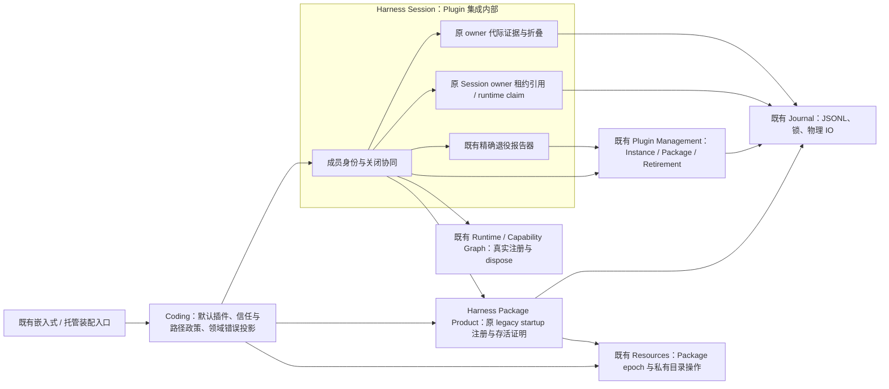
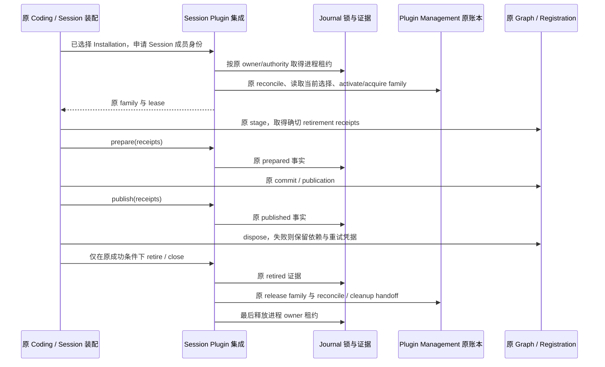

# H-COD-KD-007 R2.1：Plugin 与 Session 生命周期协同归一

- Authority: accepted key design（R2.1）。
- Design status: accepted；2026-11-08 用户明确接受本 R2.1 环境/组件职责方向并要求继续实施、完成代码三视角评审；技术合同按原 R2 三视角及 R2.1 顺序澄清接受。
- Implementation status: implemented（本专项的Plugin/Session生命周期簇）；D3、D1/D2/startup与D4完整family/退役/关闭路径已接通并获三视角有界技术接受。整个Goal的P2仍有bootstrap/AgentSession等启动装配待收敛，不据本专项完成关闭P2。
- Owner: Harness Session 负责 Session 与 Plugin 的集成；Plugin Management、Runtime、Journal、Resources 各保留原权威。
- 需求：[完整 Coding 领域化 Goal](../coding-responsibility-convergence-goal.md) P2；[当前职责图](../current-owner-map.md)；原 Tool 注册与退役集成见[既有专项](session-tool-pack-binding-convergence.md)。
- 方法：本地干净 archmethod master `0f9bd3ff51afabeaaf76cc38dff1ceb279b7d37e`。
- 起点：A11 实际未提交工作树，HEAD `8ad6b6098f1c24c8cfb6f4d9d290e99bc74d618d` 不能代替该实物。八项源指纹、原件与消费者清单保存于产品树外 `p2-plugin-session/design-start.json`。

## 1. 问题与范围

Coding `_plugin_lifecycle.py` 当前 2,165 行，`_plugin_owner_generations.py` 548 行，共 2,713 行。前者虽自称 common lifecycle adapter，仍同时承担产品默认启用、路径与旧版本身份、进程锁引用计数、Session 家族协调、启动失活恢复、跨账本退役及私有目录读取；后者保存精确 owner 代际事实及其状态折叠。不能按文件整体搬迁，也不能把这些不相同的事实并成一份日志。

本专项首先完整收敛“Session 取得 Plugin 成员身份 → 准备/发布 owner → 关闭/重试 → 原进程死亡后的恢复与退役”及其必要的构造/只读查询。后续 bootstrap、Capability 装配、AgentSession 构造仍在完整 Goal 内；本切面为它们建立共同依赖，不以本片代替全部 P2。

当前 Coding 130,062 行，系统 636,588 行；系统较 Goal 起点仍增长 1,794 行。本设计必须列出接收方与兼容成本，不以搬目录或新增桥接数量当作精简成果。

## 2. Current：已经存在的支撑及尚在 Coding 的部分

| 责任 | 已有实现与证据 | 本次处置 |
| --- | --- | --- |
| Plugin desired/management/runtime/package/retirement 账本 | `plugin_management/assembly.py` 已有 `bind_plugin_management_core`、`bind_plugin_runtime_ledgers`；原各 Ledger 是事实权威 | 直接复用；不新建 Lifecycle ledger、管理服务或事务引擎 |
| family 的 acquire/release、Instance 状态与完成 | `PluginInstanceRuntimeLedger.acquire_current_family/release_family/complete_retirement` | 协同代码只调用原方法；不能直接写 Instance 状态或自行补记成功 |
| cleanup 交接后释放 direct-host family | `PluginPackageLifecycleLedger.handoff_cleanup_and_release` 已先持久交接、再 release | 保留其幂等与恢复顺序，不造第二 cleanup handoff |
| 精确 owner 退役报告 | `session/_plugin_retirement.py::report_exact_owner_retirement` 已从原证据构造 plan/outcome | 直接复用，不将同体重新迁入新模块 |
| Registration/Graph 的实际 stage/commit/dispose | 原 `RegistrationScope`、`SessionCapabilityOwnerGenerationBinding` 与 Tool pack 桥接 | 不迁移、不再包装成新 Graph；证据记录不能代替真实 dispose |
| owner prepared/published/retired 事实 | 仍在 Code `_plugin_owner_generations.py`，复用原 JSONL，但折叠与兼容解码仍属 Code | 归 Session 的 Plugin 集成内部；Journal 管字节与锁，Runtime 管实际回执，不另复制事实 |
| 进程启动锁与同进程 Session owner 引用/claim | Code `_PROCESS_*` 表、`_ProcessSessionOwnerLease` 和函数；OS 锁已用 Journal | Session owner 引用计数与 claim 归 Session；startup 注册/registry 与失活证明归既有 Package Product 集成，见 R2 合同；两者均用原 Journal 锁 |
| 跨日志兼容读取 | Code 读 desired 与 migration，按四锁顺序固定两份 raw 后投影 | 两账本语义归 Plugin Management，物理读取优先复用 Journal；不改成独立兼容状态库 |
| 私有目录准备 | Code `_prepare_private_directory` 已调用 Resources `prepare_private_directory` | 直接复用已交付能力，禁止再搬一份目录创建算法 |
| Windows 目录句柄 | Resources 已有 `open_windows_directory`、原生属性查询和关闭；Code 仍有一份 ctypes 打开/pin | 有明确重叠，但原访问掩码、原生查询时点不同，尚非可直接替换的等价实现，见 D3 |

以上为静态事实，不声称已运行新验证。可疑重叠与确定重复分列；没有找到第二个 prepared/published/retired 家族折叠实现，不能称它为可删重复状态机。

## 3. 候选系统环境与子组件

图中的 Integration 是 Session 内部一段有界协同，不是新进程、全局调度器、万能 Product manager 或新日志。实际注册/关闭继续由原 Session/Graph 驱动；箭头表示合同依赖，不表示 Integration 自行创建或控制整个 Graph。托管协议、租户授权与连接寿命留原 AppService/AppHost；两入口复用同一 Session 合同。

候选代码位置为 `harness/session` 内的 Plugin 集成子包（名称随技术设计确定）；纯物理扩充放原 Journal/Resources 子系统。Codec 是 owner 证据记录组件的内部实现，不作为独立环境组件。与原 `_plugin_retirement` 的关系是复用和同域归拢，不能保留两份报告器。禁止新增 Harness 根目录杂项或反向导入 Coding。

## 4. 业务政策与共同机制的边界

Coding 保留产品 id、workspace scope 与已部署 Continuity 路径派生，默认一方插件选择、32 次 bootstrap CAS 政策、actor/policy/approval reference、legacy disable 来源与产品错误外观。默认 install/enable 不能因搬迁而自动覆盖用户 remove/disable；是否选择插件仍不是 Session 集成的决定。

Session 集成只连接已选中的 Installation、原账本、确切 Session family 与 owner 回执。输入为具体已绑定的原账本端口、必要身份/路径值、纯格式/错误映射；不接完整 Coding Product、bootstrap context、配置 locator，也不通过 Code IO 回调实现公共机制。持久身份生成属于原兼容数据合同，不能把新桥接对象 id 或随机 token 写入既有 family/event/operation 身份。

构造继续调用既有 bind_*；其会执行读取/恢复的边界不得被包装器偷偷提前。普通生命周期入口与 read_only 管理入口的不同保持：后者不能拿 startup lease、准备目录、create lock 或执行 management.recover；原 `partial_tail='raise', create_lock=False` 继续生效。兼容投影读取则另有原四锁/完整前缀语义，不能把它误当成完全无 IO 的查询。

## 5. 关键交互与失败合同

1. 取得 Session owner 租约仍先于 reconcile/selection；拒绝时按原 except BaseException 关闭租约。选用变动、revision stale 时的 family 释放及错误顺序保持，不用新“更严格”预检替代旧状态结果。
2. 同进程同 owner 可重入计数；不同 owner 拒绝；runtime claim 相同 id 幂等，不同 id 拒绝。authority incarnation 防止旧 wrapper 释放新租约。最终释放仍在 registry mutex 内执行 OS unlock，实际关闭后才移除权威；unlock 报错但 handle 已关闭时不可保留可引用旧状态。不能改成按进程全局串行执行全部 Session。
3. prepare 必须先于当前 writer publish；同 family 精确 receipts/ref 幂等，单组 receipts 的 generation 二元键与 handle 分别唯一；跨 family 仅按 (owner_reference, owner_generation_reference, retirement_handle) 三元组占用，含已 retired 家族，不能加严成跨家族分别唯一。**旧日志 replay 的 published-first 兼容例外仍保留**，不把当前 writer 准入规则反套历史而拒旧数据。retire 允许原已 prepared 但未 publish 的处置路线；真实 runtime 清理成功仍由原调用者负责。
4. close 先查询 owner evidence；未 retired 时继续保留 lease，不能先 release family。family release/reconcile 失败时保原重试次序，最后才退出 owner lease 并标 closed，不增加隐式补偿或删除证据。
5. 孤儿恢复仅处理原 session_membership：同 startup 不恢复；未知/V1/foreign holder 没有可证实进程身份，保原行为；V2 解码出错仍报原错误。只有原 startup 文件 lstat 与非阻塞锁正向证明失活才可 retire evidence/release family。没有“文件不见了即进程已死”推断，不从新查询自动重放任务。
6. reconcile 保原 coordination lock → inactive-family recovery → security.reconcile → intent 顺序；active 才 begin_drain，REVOKING/RETIRED 等原跳过集合不扩。原 report_exact_owner_retirement 等待尚未关闭的 Session family 后才 seal plan。succeeded retirement set 也不代表物理 cleanup 自动成功；现有 direct-host cleanup_kind 的成功语义与实际业务动作须保持，不把通用 host 都视为无操作。
7. cleanup write-ahead 后 direct family 可能已消失，原 open-family 集合为空仍允许继续同操作；保持 handoff → record attempt → complete retirement 顺序及原 operation/idempotency/outcome reference。不得再建跨这些账本的“全局事务”。
8. 兼容读取四锁仍为 coordination.lock → migration.migration.lock → desired.lock → migration.lock，锁内 capture 后再投影完整记录前缀；POSIX 与 Windows 的 create 差异、缺根 no-op、根替换/ABA、持有链与 children anchoring 保持。读取不能以缺文件为由重建已删除根。

这些是从原路径提取的保持义务，不表示上述代码已下沉或所有场景已重新实测。

## 6. 复用选择与需闭合的技术决定

| 决定 | 候选选择与理由 | 关闭条件 / owner |
| --- | --- | --- |
| D1：Session 进程租约如何复用 | OS 锁直接用原 Journal。已有 DirectoryWriterLease 是 Linux retained one-shot writer，使用自己的 lock-directory/hash/claim/FD admission，不支持原同 owner ref-count 与原 POSIX/Windows Session 锁形状；不能直接替换或借 Transcript writer 身份。先比较窄引用/claim 管理能否放原 Session 生命周期内部，不扩 Journal 的语义责任 | 给出全部 acquire/claim/release、startup 注册/异常退出映射和唯一 registry 寿命；运行视角重点审，Session owner 关闭 |
| D2：owner 代际证据落点 | 选择 Session Plugin 集成内部，复用原 Journal/Strict JSON/Runtime receipt；不放进通用 Runtime 的工具注册器，也不新建 PluginManagement 状态。原公开 Code 类型/FQN/构造与默认字段保薄外观，格式/哈希域/错误 code 保持 | 冻结旧 event/value/codec/历史 replay 的实际合同；纯绑定、具体返回类型和 caller scope 明确后关闭，数据视角重点审 |
| D3：目录与跨日志读 IO | 已交付 private-directory 准备直接复用；POSIX `read_journal_file_at` 与 Code read 核心同形但原错误类型不同，允许最小纯错误投影。Windows 原 Code 的 LIST_DIRECTORY|READ_ATTRIBUTES 与既有原语包含 TRAVERSE|SYNCHRONIZE 不等价，且原生 attribute-tag 查询在 FD 转换前；不能先声明“换现成函数即可” | 在原 Windows 原语 owner 比较 access/flags/reparse/native-query/visible-check/close 顺序，给出最小明确 profile 或保留原 profile 的理由；不得复制第三份 ctypes，职责视角重点审 |
| D4：跨账本协同范围 | Session 协同只覆盖上述 membership/owner 寿命；PluginManagement 保持状态引擎与 package handoff；Coding 保产品默认启用与内容政策。原 builder 两入口的重复绑定直接复用现有 assembly，不创建万能流程 callback | 给出原方法→具体接收方法/保留项、纯身份/错误输入与不变时点；不得凭全文件行数报收益 |

R1 曾保留 D1–D4 为实施前重点；R2 的具体选择与关闭证据见下节。R2 尚待三视角复核和用户方向评审，不声称实施就绪。D1–D4 是本轮技术设计必须回答的重点，评审应提出具体遗漏，不要求先在树外复制完整 Product。关闭会改变职责/外部关系时同步修图；用户对方向的接受不代替这些合同。

## 7. 实施、全成本与验证计划

按同一业务簇完成替换：首先固定原证据/lease/关闭/重开行为，然后一起接通 acquire→prepare/publish→dispose/retire→release/reconcile，去掉 Code 同体。可按依赖顺序分提交，但不能只迁一个 codec 或两段 lock helper 就宣布场景交付。既有 Tool 注册桥接、retirement 报告器、账本引擎不重开。

当前 2,713 行只是分析池，不是删除预算。接口定稿后固定“Code 保留成本 + 接收机制 + 薄兼容 + 平台适配”实物估算；争取 Code 大部退出、系统净减，但未给出未经验证的减行承诺。真实去重主要来自复用已存在 IO/绑定/退役机制；单份原机制正确归位单独记迁移。若新回调/配置壳吞掉收益，回到原 owner 的最小接口，不按换目录计算系统收益。整个 Coding ≤15K 与系统净减不变。

| 合同组 | 优先复用的现有测试 | 实施前补证要求 |
| --- | --- | --- |
| family/lease/claim 与跨进程/恢复 | `test_plugin_lifecycle.py` 同 Session、同 owner、unlock failure、runtime claim、startup fault、process death 等 | 确认原缺文件、busy/invalid、lost delivery 与 unlock 真正触发，记录 registry/FD/文件结果；不另造平台矩阵 |
| prepared/published/retired 精确证据 | `test_plugin_owner_generations.py` 已覆盖重开、幂等、跨 family 冲突、空 receipts、坏尾与 legacy published-first | 补固定原公开类型/字段/错误/cause、wire/hash、写入准入与历史例外；不能从新实现生成 expected |
| 关闭重试与 retired completion | 原 cleanup failure、runtime release failure、exact retry、并发 last close、retirement 等 | 真正的旧 Graph 与原 Ledger 消费，不仅对新桥接 mock；失败时凭据/依赖继续可用 |
| CLI/只读/兼容平台读 | `test_plugin_management_cli.py` 原 absent root、tail、锁序、root swap/ABA、portable/Windows 读 | Linux synthetic Windows 只证明合同与调用序，不能冒称原生 Windows 验证；保原 selectors，不开新 gate |

本次只做静态核查，尚未运行这些回归。后续按工作区规则定向、非 live、沙箱外执行，原生平台证据缺口明确记录；不因职责搬迁添加新 PR gate、全仓/30 秒矩阵、付费模型实验。

## 8. 评审与接受

分别进行职责/复用、运行/失败、数据/兼容三视角独立设计评审，综合关闭实质发现。重要系统环境图与组件归属按用户既有要求提交用户评审；在方向及关键合同接受前不启动此切面产品代码。实际代码另做三视角评审，实测成本/兼容与设计接受分开记录。整个 Goal 继续 active，不能将 R1 设计或本簇交付当成 15K 完成。

## 9. R2：按独立评审细化的接口与协同合同

R1 三视角报告按原冻结字节保存在产品树外，不能用 R2 反称 R1 已接受。R2 修正了唯一键表述，并进一步区分 startup 注册与 Session owner 两种租约。图新增的是对**既有 Package Product 子系统**的职责连接，不是新服务；该变化仍需用户评审。

### 9.1 D1：两种租约各有唯一 registry，不合并寿命

| 场景 | 归属与窄合同 | 必须保持的失败与关闭顺序 |
| --- | --- | --- |
| Session owner | Session Plugin 集成内部 `acquire_owner(path, owner_id)` 返回原 claim/exit 语义的租约；path 由原纯派生规则给出。单份进程 registry 按原 resolved path 索引，保 owner、authority incarnation、references、claim id/count | wrapper state lock → registry mutex；同 owner 递增引用、不同 owner 拒绝；同 claim 单 wrapper 幂等、不同 claim 拒绝；最后 unlock 在 registry mutex 内执行，finally 移除 authority；不把 registry 改为 lifecycle 实例字段 |
| legacy startup | Package Product 的既有 legacy registration 集成内部接原 epoch roots/store id、private bases、startup/lease path 值；`hold_startup(binding) -> bool`，已持有返回 False，**没有 refcount**；`release_startup(path)` 原 pop 后退出；`is_startup_inactive(path)` 为唯一现有进程表/文件/锁观察 | 先准备 epoch：Linux 为 authority/control 私有根，Windows 为 control 父链及 control root → register legacy admission → 准备原 state/package roots → startup OS lock；退出先 OS lock，finally 释放 registration；release 在 mutex 内 pop、mutex 外 exit，不按 Session owner 的失败留存规则统一 |
| Session 孤儿判定 | Session 接 Package Product 实现的窄 `is_startup_inactive(path)->bool` 端口；端口是实际公共 owner 的实现，不是 Code IO callback | 当前进程表命中或锁 busy 为 False；未知 holder 返回 None，仍不恢复；缺失/异常 lstat 保原 LifecycleError 与 cause，不当作死亡；原规则只核 regular/reparse/UID，不新增 mode/nlink/size 门槛 |

Code 的 `_PROCESS_*` 私有名字若仍有消费者可薄 alias 到对应原机制的**同一** registry，不复制表。原公开 `CodingPluginSessionLease` 字段与 lifecycle 引用仍留 Code；Core 不接整个该 Product 对象。Core membership acquisition 以有界 context 返回 family/原 instance/package refs 与 owner lease，Code 在该原 try scope 中构造公开 lease；只有构造或 acquisition 抛错时执行原 owner exit，正常交付后由 lease.close 保管，不能因 context 退出自动释放成功的 family。

两个 close 标记不合并：inner owner wrapper 在已丢 authority 的 unlock failure 后可能 closed，而外层 Coding SessionLease 尚未 closed；重试仍先 evidence → family release/reconcile → inner exit，不能直接跳过整个外层关闭。startup release 则保持 pop 后即使 exit 失败也不恢复旧表项。两种原状态不同，不新增一个通用 LeaseManager 掩盖。

DirectoryWriterLease 继续服务原 retained writer，不将其 lock 路径/hash/单次 acquire/claim 规则用于本合同。Package epoch 的 OS 注册/互斥与 receipt 继续用已有 owner，registry 只是原进程引用，不能替代 durable Instance 或 epoch 事实。

### 9.2 D2：证据原数据合同与有限值绑定

在 Session 内部复用原 Journal、Runtime Receipt 和 Strict JSON。Code 原 event/family dataclass 声明、字段、FQN、默认值、构造签名及 error 类保持；可用机制 mixin/具体构造类型绑定，Core 不另造一套竞争的 event/family schema，也不改 `__module__` 伪装旧名。内部 Protocol 仅静态窄视图，不放宽原运行期类型判定。

| 原状态 | 当前 writer prepare | 当前 writer publish | 当前 writer retire | 历史 replay |
| --- | --- | --- | --- | --- |
| 无 family | 写 prepared | 原冲突 | 原冲突 | 首条 prepared 或 published 允许；retired 拒绝 |
| prepared | 返回原已有值 | 写 published | 写 retired | 仅精确 published/retired 合法；重复 prepared 损坏 |
| published | 返回原已有值 | 返回原已有值 | 写 retired | 仅精确 retired 合法；再次 prepared/published 损坏 |
| retired | 返回原已有值 | 返回原已有值 | 返回原已有值 | 后续任意事件均按原规则拒绝 |

writer 的“已有值”分支先核 instance ref 与规范 receipts 相等；新的 preparation/publication/outcome reference **不在幂等分支重新校验或写入**。必须保 canonicalization 在原时点执行、错误首序及 cause，不提前构造新 event。单组 receipts 分别检查 generation 二元键与 handle 唯一；跨 family 的占用键是三元组，retired family 仍占用。原纯 `_replay` 实验确认：跨 family 同 generation 不同 handle、同 handle 不同 owner/generation 均可；相同三元组拒绝。不是授权实验。

原 hash domain 为 `loushang.coding-owner-generation-evidence/v1\0`；hash 不含 journalRevision/recordVersion，不能改 namespace。revision 拒 bool、version 仅 `!= 1`，dict/list 子类及原嵌套解码保持。查询 `family`/retired_families 继续 exclusive 锁、partial_tail=repair；尾部修复不是本轮引入的新策略。

### 9.3 D3：共同物理读与固定 Windows profile

三种加载独立：owner 证据查询为 exclusive/repair；兼容 capture 在原四锁内读取 desired/migration 两 raw，decoder 按 skip 投影完整前缀；read_only 管理 builder 才用 raise/create_lock=False 且不 recover/准备路径/取得 startup lease。POSIX 四锁 create=True；Windows 第一 coordination 锁 create=False、后三 True，原链 pin/前后可见性检查时点保持。

POSIX 不直接把旧 helper 改调 public `read_journal_file_at`：后者还拒反斜线/冒号，原 helper 仅 `Path(name).name == name`。选择在**原 Journal 内部**提取已经存在的私有 regular 文本读取共同体：借入 FD 与已按各 caller 原规则检查的名字、原 encoding、仅 metadata 拒绝时使用的纯 error factory。public Journal API 保原验证和默认异常；兼容 reader 保原形状规则。共同体保持原 no-follow/nonblock/open、缺文件空串、fdopen→fstat→metadata→read→close；其他 open/read/Unicode/native 错误原样传播，不 catch 全部 OSError。没有新增“宽松读取”公共开关。

Windows 在**现有 Resources windows_quarantine 原语 owner**增加具名 `pin` 读取 profile，与原默认 path-open 共享 CreateFile、已有 `_handle_entry_kind`、FD 转换和 close 原语。两固定 profile 不混淆：

| profile | access/query | 可见性与 custody |
| --- | --- | --- |
| 原 quarantine 默认 | 保现有 writable/read_control 参数计算、share 规则与转换后 fstat/lstat；不额外加 native query 或 expected 身份要求 | 原所有消费者次序与异常不变 |
| 原 Coding compatibility pin | 固定 access 0x81、share read/write 不 share-delete、OPEN_REPARSE_POINT/BACKUP_SEMANTICS；转换前用原 `_handle_entry_kind` 核 directory/non-reparse | 转换后核 fstat 与 expected，再执行原 private path 双 lstat/expected 检查；yield 后只按原 finally close，不额外成功后验证或 ACL/stream 准入 |

私有 metadata/path 校验随固定 profile 放 Resources，原纯 error 投影留接口；不调用 Code 读路径回调。native query 失败由 raw handle owner 关闭；调用现有 `_descriptor_from_handle` 时转移 raw custody，该 helper 转换失败已 close，不得外层再 close；成功后只由 FD owner close。body 异常同样仅 close 一次。不得用默认 profile 的额外权限请求顶替旧 0x81，不复制第三份 ctypes 或新增任意阶段回调框架。

### 9.4 D4：原方法的接收与保留映射

| 原 Code 职责 | 接收或保留 | 配置与边界 |
| --- | --- | --- |
| acquire_session、SessionLease claim/prepare/publish/retire/close 的共同机制 | Session Plugin 集成；原公开 Code 值外观保薄适配 | fixed authority bindings、原纯 identity/holder/error/值构造；不传整个 lifecycle/Product，不反向调 Code IO |
| owner evidence create/codec/append/replay/query | Session 证据组件内部，Journal 继续管物理日志 | 原 event/family 类型与 error 映射；原哈希域、文件名和幂等身份保持 |
| inactive family recovery、drain、owner report、最后 family 释放与 reconcile | Session 集成按原 coordination scope 连接 PM；report 直接用既有函数 | 原 startup 端口、五种 Ledger 等固定 collaborators；不新增 scheduler、Session loop 或状态权威 |
| prepare_gc_writer_epoch / gc_writer_epoch_ready | **原 PluginManagement assembly/已绑定 writer graph 的最小协作**，不塞 Session，也不作为永久 Code 政策留存 | 原 graph-bound/active 检查、gc_candidates、desired→instances→packages 三次 seal 次序；锁范围及原 ready 短路顺序保持；无新授权/GC engine |
| complete_ready_retirement 的 succeeded-set/family/handoff/attempt/completion | 固定协同归 PM 原 Package/Instance 集成，Session 在原 reconcile 点调用 | Coding 给原 cleanup_kind、各 operation/ref 纯身份和该 direct-host 路线的成功语义。不会通用化成“任意 host 无物理清理也成功”；其它执行型 shutdown 需原实际 owner 结清，不能复用该成功声明 |
| legacy startup registry、registration、失活锁观察 | 原 Package Product 集成，继续使用 Resources 的 epoch owner 与 Journal | Code 仅给原 epoch/root/scope/hash/平台纯输入及错误映射；不是在 Session 新造 epoch registrar |
| 两 builder 的账本装配、管理应用端口 | 复用既有 bind_*，共同读取/装配归原 PM；入口取值与 recover 顺序不改 | 只读分支不同，不能为减行统一 load policy；不提前取 runtime version 或持久引用 |
| 默认 install/enable、legacy disabled 来源、产品 scope/路径与内容选择 | Coding 保留 | 原 actor/policy/approval、32 次 CAS 与已部署 workspace identity；这些保留项不等于允许其它共同机制永久停留 |

共同 bindings 只包含实际所需的原 Ledger/锁/证据端口和纯值；其名称不形成新事实 owner。凡暂未替换的表中方法须在执行记录明确列为残留，不能把一次局部 helper 迁移称为全部 2,713 行处置完成。

### 9.5 设计验证与继续条件

八项原源指纹保持；原 `test_plugin_owner_generations.py` 的六项非 live 基线在沙箱外运行通过（7094，6 passed/0.79s），只证明未迁移起点的现有场景。另一次纯内存 replay 验证了上述跨家族键区别，无文件 IO，不当作 writer/权限证明。尚未实施 R2，未运行新平台试验或声称新实现通过。

R2 还需三视角针对以上具体合同复核，以及用户对更新环境/组件方向的评审。成本核算必须包含纯绑定/公开 façade、两个 registry、Windows 适配与接收方全部扩充。首簇以 Code 大部机制退出为方向，不因没有预写全实现而编造精确减行数；实施前固定实际替代清单，实施后逐项报告迁移、真正去重和系统净变化。

R2.1 顺序澄清：R2 运行复核要求补全 startup 注册前的 epoch 根准备，已在§9.1写明；不是把原准备统一移到 registration 后。Package Product 目前没有现成的通用 hold/release/inactive 接口，本设计是在该既有职责域最小扩充；Resources 注册/原生 IO 直接复用，不把待扩充接口列为 Current。该扩充、类型、registry 与全部薄适配均计成本。R2 的三份独立增量报告及本澄清关闭证据分别保留，不冒称旧报告审过当前新字节。

当前评审终态：R2 三视角技术合同无剩余具体阻断，R2.1 startup 前置准备澄清经运行视角关闭；实施 owner 接受此有界技术合同，用户的更新环境方向评审尚待完成。状态补记不冒称当前文档 SHA 等于原冻结对象；实际对象、接受范围与局限见[评审记录](plugin-session-lifecycle-convergence-review.md)。

## 10. 用户方向接受与实施启动

2026-11-08，用户对本专项明确回复“接受方向，继续实施并完成代码三视角评审”。所接受的是 Coding 保产品政策，Session 承接成员身份/owner 代际证据/关闭重试，Package Product 承接原 startup 注册/失活观察，原 Plugin Management/Journal/Resources 各保权威。上文历史待评审记录保留，不再代表当前方向状态；KD-008 不随此接受。

实施继续按§9已有技术合同与完整路径推进，先重核实际工作树与八源起点，保留原类型、格式、身份及失败顺序；必要的原底座变化须按当前实物重新对照，不把历史摘要冒充现状。不引入第二租约/状态机/日志或新的平台矩阵。实现状态仍 not-started，接入、删旧、全成本和实际代码三视角评审后再更新；完整15K/系统净减及P1–P4目标不变。

## 11. D3 实现接缝：完整兼容捕获路径（候选）

这是§9.3已接受技术合同的实现，不新增环境参与者。完整P2仍包括成员身份、代际证据、startup注册及关闭重试，不能将本节当P2完成。当前产品八源仍为设计原件；五源候选及原测试起点在树外implementation-r21/compatibility-capture，尚未接入。

### 职责与接口落实

- Coding只保一个真实使用的`_capture_existing_plugin_enablement_state`薄入口、原两字符串capture dataclass及纯错误投影。所有Code类（含公开layout/lease/lifecycle/error）AST不变；产品projection、过滤与默认政策也保持。旧私有物理helper退出Code，原测试改在真实接收owner注入；它们不属于公开SDK承诺，不为任意私有全局热替换保平行实现。
- Plugin Management的私有`_enablement_capture`接原五项只读路径端口、纯错误构造与capture值构造；按原native/portable条件，打开原root、按原四锁顺序捕获desired/migration raw，在原scope内yield。它不取得startup/Session租约、不创建第二Ledger或提前解码/recover。
- 原Resources/packages `_private_directory`保原leaf准备，并承接existing-root/目录链观察及pin寿命；不套用准入更强的RootedFileIO。路径与metadata的原拒绝时点保持，不以缺root创建目录，Core不调用Code IO callback。
- 原Journal只抽取`_read_private_regular_text_at`共同体。public API保原平台/名字准入，compat caller仍只核Path(name).name；两者共享原open/fdopen/fstat/metadata/read/close，纯factory仅投影metadata拒绝，其他open/read/Unicode错误原样传播。
- Windows固定pin落原windows_quarantine `_open_directory_path`的内部profile，直接复用CreateFile、`_handle_entry_kind`、`_descriptor_from_handle`及close。pin固定0x81、无share-delete、转换前native query、原expected/fstat及双lstat校验，yield后只close；default profile保原请求与验证。没有第三份ctypes或任意阶段执行框架。

原Code pin忽略CloseHandle返回False，而原quarantine close helper会据False抛错。候选显式保留这个差异：私有close/conversion原语的默认checked行为不变，固定pin才按原规则忽略该BOOL；转换调用即移交raw custody，失败已关raw时外层不得再close。它不是新的公开权限/失败配置开关，不能用“更严格”改变原异常优先级。

### 验证与门禁边界

原CLI定向基线19335：21 passed/5原native skip/30 deselected，7.92s。树外受控假WinAPI从实际旧源独占固定pin/default共20组调用/错误/FD观察，加完整性节点22203为21 passed/2.98s；不等于native Windows、ACL或内核并发证明。

首轮候选68454：78 passed/4 failed/5原skip，40.54s；失败为两个测试的旧Code注入位置，共四节点。仅更新实际接收模块及新增纯error参数的转发后，67704同四失败节点4 passed/6.85s，原全部CLI assertion AST和timeout均保持，产品五候选源未因这四失败修改。其余78与后四合计82不同节点通过/5skip，不写首轮全绿。35166五显式候选源silent-import mypy通过，非全依赖图。

原PLC9a1的10个test保持，原94条assert最终减为91条：同名锁/读取/pin等机制来源保护跟随PM、Resources/Windows接收实现；Coding原公开builder/projection保护继续留Code。三个已消失的Code局部Windows变量词法guard及候选的数值/跨行替代均删除，属明确scope reduction，保原Doc floor和全部原CLI/runtime/native断言。不合并任意模块字符串制造匹配，不新增断言、test route、PR trigger、runner或平台。位置维护及scope reduction由职责/数据视角复核后才接入，不把用户架构接受当新增gate授权。

| 完整候选成本 | 原实际 | 候选 | 变化 |
| --- | ---: | ---: | ---: |
| Code lifecycle | 2,165 | 1,768 | −397 |
| 原Journal | 1,348 | 1,371 | +23 |
| PM私有capture/端口与导入 | 0 | 182 | +182 |
| 原Resources private directory | 23 | 220 | +197 |
| 原Windows原语与fixed profile | 913 | 974 | +61 |
| **合计** | **4,449** | **4,515** | **Code−397、Core+463、系统+66** |

这不是系统净减成果；类型/端口、纯政策、代码格式与兼容全部计入。不能为一个负数压缩写法、改弱合同或排除接收体；后续完整P2将继续复用这些接缝并退出其余Code机制，系统净减目标不变。实际接通与全量manifest验证前，当前Coding126978/系统636923及本节收益0保持。

三视角实码先核此具体候选与原件（职责/复用、运行/失败、数据/兼容及原gate位置维护）；无实质阻断后接入，再核实际消费者、源码指纹与终态。回退为五源及必要旧测试位置整体回到原件，无格式/路径迁移，不保Code fallback或要求用户重建workspace。

D3 Gate澄清：候选初稿虽然assert数相同，但将旧局部变量名改为0x81和跨行share字符串会增加等价格式改写的失败条件，不能称原条件全等。经数据视角独立指出，最终只作准确接收位置维护，并删除上述三条失效词法guard；不反造生产冗余变量迎合grep，不将本地受控native试验加入PR gate。冻结首稿/报告保留，最终test/frame另冻；五生产候选源不改。

## 12. D3实际接入检查点

用户方向接受和三独立候选代码视角已闭合，最终gate只作位置维护及明确scope reduction（10个原test、94→91assert）；原临时数值/格式guard不进入产品，完整CLI行为断言AST不变。五生产源与两原测试按冻结final指纹安装，另1,881生产源逐字等A23，当前1,886生产文件，Coding126,581/系统636,989；本片Code−397/Core+463/系统+66，尚非系统净减。

接入时检查点：44698实际回归、46989类型和10361生成当时待回收；以下实际终态覆盖此历史pending。三视角实际源与终态窄核分别记录，不能把候选通过当实际交付或完整P2完成。五源、原测试/报告与先前失败对象均保留树外；后续继续成员身份、代际证据及startup实现，不以本片缩小Goal。

## 13. D3实际回归终态与有界接受

44698实际无overlay回归exit0：181 passed/5原Windows skipped，458.98s；XML为186不同节点、零failure/error。原70生命周期/owner证据/迁移、完整CLI/Journal、原PLC9a1及树外21受控native/2边界均按原selectors执行；不叠加旧/候选重复节点，不把五原native skip或假WinAPI当native平台证明。46989五实际显式源silent-import mypy、10361原生成新鲜度及实际Ruff通过，非全依赖图类型或性能基准。

三独立实际代码视角核1886实际源指纹、五源等候选/1881其余等A23、CLI全部174 assert AST及最终gate scope reduction，无本片具体静态阻断；原pending由真实终态及运行/数据窄补件关闭，原报告和候选四失败/后关闭证据不覆盖。实施owner `/root`仅接受这条D3完整兼容查询路径。Code126581/sys636989、−397/+463/+66全成本不变，完整P2及15K/系统净减目标继续active。

原owner evidence写入/回放的D2树外原型另已准备、两显式源silent类型97529通过；尚未行为验证、评审或接入，不计收益，也不借D3接受它。后续成员身份/代际证据/startup与关闭重试必须按已有合同继续完成。

## 14. D1/D2 与 startup 实际接入（回归检查点）

Session `plugin_lifecycle/` 现在持有唯一 owner 租约 registry/ref-count/runtime claim/incarnation 与原 evidence append/load/replay 程序；Journal 仍持有物理锁及日志。Code 保留原公开 event/family/error/codec 和具体返回类型、原 namespace/hash/holder 及纯错误策略；兼容私有 registry 引用与接收方是同一对象，不另建状态副本。原 inner owner lease 的 unlock-failure 与外层 SessionLease 关闭状态仍分开。

Package Product `_legacy_runtime.py` 接管原非引用计数 startup registry、registration/OS 锁和失活观察；Resources 复用原 private-directory leaf 并提供原词法 base 的 tree 准备。Linux authority/control 根或 Windows control 父链/root 仍在 registration 前，state/package 根和 startup OS 锁在后。Code epoch resolver 的 import 与纯计算均延迟到原平台分支和持锁点，重复 hold 不提前求值；原 epoch owner、Journal 与错误链不变。

本次接入七源的完整增量为 **Code−558/Core+929/系统+371**；Code126,023、四根637,360，共1,890源。原代码中这些机制已退出，但迁移与类型/兼容成本使系统增加，不能称净精简或完整P2。成员 family acquisition、reconcile、prepare/publish/retire 的调用协调、外层 close barrier，以及 GC writer pair/直接host完成协同仍在 Code，须按§9.4继续收敛。

测试只将两个 owner 故障注入点转到实际 Session owner，原307 assert AST、timeout/selector 保持，没有新增或扩大 PR gate。原CLI/架构61项通过、5原Windows skip；树外旧新版本双向续写和公开值字段合同三项通过。树外探针初稿误比较dataclass参数对象身份，单项失败后改成字段/参数合同比较，原失败保留，不记成Product缺陷。完整70项回归仍待终态，其一失败尚在核实；此检查点不预支行为接受。详细终态另补。

D1/D2/startup 实际终态：原70项批次46518为69 passed/1启动握手超时、482.40s；该原节点在静态任务结束后按原20秒超时与原断言单独复跑25797，1 passed/13.76s。原失败保留，不归因负载或声称消除了偶发风险；70不同原节点均有通过记录，但不是首轮全绿，也不冒称全部最终字节整套重跑。最终startup修正与目录树三个原消费者25247为29 passed/49.74s；交叉版本三项23782通过。最终两Code源silent类型65657、六源18007、Ruff、生成check74821、静态文档9项和diff均通过；后续Code只做isort及已独立关闭的延迟import修正，五Core字节保持原审。完整1890源中1883与D3逐字同，七源成本仍−558/+929/+371。最终代码/终态独立评审及接受范围另见[评审记录](plugin-session-lifecycle-convergence-review.md)；完整P2与Goal继续active。

## 15. D4 实际接入与本生命周期簇收尾

Session的`plugin_lifecycle/_membership.py`与`_session_lease.py`在原实际Code对象上执行family取得、owner准备/发布/退役、drain/report、最后释放与关闭重试。原Code公开dataclass自身字段、默认值、slots/构造、具体acquire返回类型保持；Mixin无新增实例状态，flag的Protocol视图指向同一对象，不复制Lifecycle或另立registry。原Code机械体退出，不留fallback；management-change投影、默认启用、scope/holder/hash和产品错误政策保留。

取得family用原BaseException屏障包围，具体CodeLease仍在该屏障内构造。随机owner id仍先于path处理；closed检查用不依赖lifecycle活性的类级配置。证据检查→family release/reconcile→inner owner退出→outer closed的次序及失败后重试保持。既有`report_exact_owner_retirement`直接复用。原路径策略中的`Path.resolve`行为保留；这不声称它是零IO词法运算，也不把配置端口扩成任意Code IO入口。

原PM `assembly.py`接管GC的graph-bound/active检查、candidates与desired→instances→packages三seal，以及ready短路。原succeeded-set/open-family→write-ahead handoff→attempt→Instance完成也归PM；Code通过私有settled-host配置明确该路线已无需额外shutdown，不推广任意Host自动成功。两builder与兼容投影完整AST保持，继续复用原bind_*，只读/修尾/create_lock与两次version/recover时点不改。

本片最终四源成本 **Code−294/Core+616/系统+322**；首个集成帧−293/+616/+323另留，最终仅相同import绑定的排序减少一行。当前Code125,729、系统637,682/1,892源，其余1,888源与上批逐字同。原2713行Code生命周期分析池现为1464行（1163 lifecycle +301 owner证据）；这不是系统净删，或整个P2/Goal完成。

实际40816原三文件**70 passed/332.46s**，本批首轮无失败。34030只读CLI/架构/边界为61过/3失败/5原Win skip；三失败均测试读已退出Code.journal_file_lock的陈旧观察入口。只将lock_at基准取实际capture组件、退出无实际分支的旧Code path观察，174原assert AST/参数/timeout保持；96929原三参数**3 passed/6.84s**。该失败历史不覆盖，不称首轮全部检查全绿。另33350最终公开字段/构造/slots/acquire/exports两项通过；与57583同集，不重复计数。四显式实际源silent mypy11273、Ruff、原生成check58845、静态文档与diff通过。最终Code仅isort，非import AST及binding集合保持，非整批重复执行全部最终字节。

三个独立代码视角分别核最终源、原像与各自终态补件，无本生命周期簇剩余具体阻断；实施owner `/root`在已接受方向内有界接受。继承方法的定义metadata及继承type-hint视图可能变化，未冒称任意私有import/monkeypatch或所有反射全等；没有新增native Win kernel/ACL/竞争承诺或PR gate。原报告与源码归档保存在树外membership-completion，完整P2启动装配及P1/P3/P4继续active。
