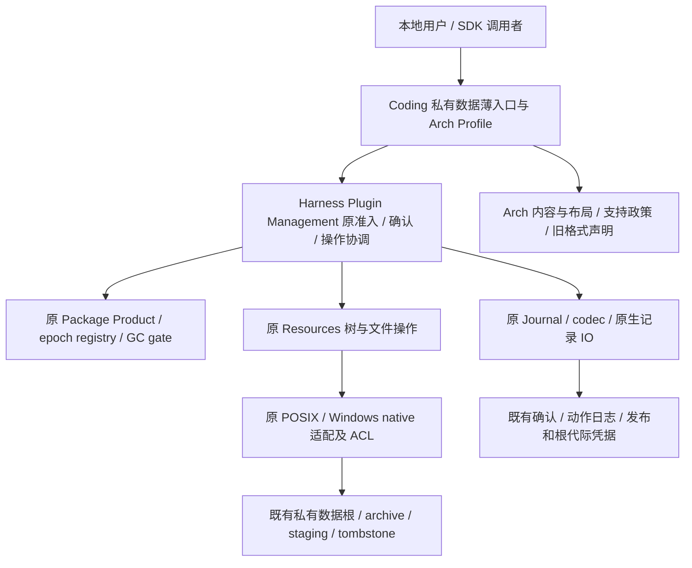

# H-PD-KD-001：插件私有数据生命周期收敛 R3

## 状态与范围

- Authority: normative design；Current 证据与本次接受的机制分别标注。
- Design status: accepted。用户于 2026-11-06 指示“实施此次goal”，接受引用本 R3 的实施 Goal；接受范围与评审指纹见 [交付记录](../private-data-convergence-delivery.md)。
- Implementation status: partial；评审时未运行产品，实施阶段证据单独见交付记录。
- Owner: Harness Plugin Management；Coding 保留 Arch 产品政策，跨层由 Loushang 架构协调。
- 源码基线：`8ad6b6098f1c24c8cfb6f4d9d290e99bc74d618d`，2026-11-06。
- 方法：本地干净 archmethod master `0f9bd3ff51afabeaaf76cc38dff1ceb279b7d37e`。
- 来源：[全量重构 R1](../coding-reconstruction-proposal.md) P1/C08、[逐文件清单](../coding-responsibility-inventory.md)。整体清点基线较早；本专项以以上新基线重新核查，已合入的 tree/file 收敛直接复用。
- 继承：[Current Owner Map](../current-owner-map.md)、[共享边界](../shared-capability-boundaries.md)、[升级兼容 ARD-008](../../decisions/accepted/ARD-008-workspace-upgrade-compatibility.md)。

本专项覆盖既有 C08 的 31 个文件/11,771 物理行，以及 CLI、装配调用点的必要薄化；不重构 Worker、不扩大支持平台、不修改备份种类、不引入新 PR 门禁。行数是审查范围，不是可直接删除量。实施按完整场景替换，每个动作结束即删除旧操作体。

## 1. 需求和决策

| ID | 要求 | 完成判据 |
| --- | --- | --- |
| PD-01 | 机制复用优先，唯一 owner | 既有组件→配置组合→原 owner 最小扩充；无第二文件存储/树遍历/确认/事务引擎 |
| PD-02 | Coding 仅保留产品语义和薄适配 | Arch 身份、内容/布局声明、支持范围和政策留 Coding；无 Coding 原生文件遍历或 journal IO 实现 |
| PD-03 | 存量可继续使用 | 原目录、ID/哈希域、JSON 字段、锁/回执、CLI/SDK、旧备份和未完成动作不因迁移失效 |
| PD-04 | 所有副作用保持原安全与恢复合同 | 独立确认、静止期/GC 排斥、原生身份、无覆盖发布、部分状态及原耐久策略有验证对应 |
| PD-05 | 大幅降低复杂度 | 记录 Coding/共享层/全系统分别增删；每切片删除旧体，不原样搬迁 31 文件、不新增全能 manager |
| PD-06 | 保留各入口的读取准入合同 | 原 POSIX read-only CLI/SDK 路径不创建锁、目录、状态、确认或自动修复；Windows 显式 candidate 保留原完整 owner/协调锁准入，不冒称已有无创建读取 |

决策问题是“私有数据通用操作如何归一”，而非“新建哪套私有数据系统”。

| 选项 | 结果 | 选择 |
| --- | --- | --- |
| 原样搬到 Harness | Coding 数量下降，重复操作与平台流程仍在 | 不选 |
| 直接套用 PackageVerifiedTreeSink/Package snapshot bundle | 改变 staging、manifest、回执和恢复规则；已有 stage 可能被拒绝或删除 | 不选 |
| 原组件组合，拆出最小可共享操作，保留独立领域事实与平台适配 | 保持唯一机制，领域身份/格式不变，可逐动作关闭旧实现 | **本次接受的选择** |
| 任意 hook 的统一事务/存储框架 | 把所有业务流程变成回调，隐藏顺序与权限，扩大抽象 | 不选 |

保留原 4 类动作（备份、删除、恢复、过期）的明确协调，不建立一套任意动作 DAG/状态机。共享操作放回原 owner 的内部模块；只有既有公共端口不能表达消费合同才扩大窄端口，不要求新建服务、Registry、数据库或后台任务。

## 2. Current 与复用对照

| Current 证据 | 能复用的部分 | 合同差异与设计处置 |
| --- | --- | --- |
| [删除 Coordinator](../../../../../src/loushang/harness/plugin_management/private_data_deletion.py#L232) 与 [Confirmation Journal](../../../../../src/loushang/harness/plugin_management/private_data_confirmation.py#L107) 已在 Harness | 独立确认、plan/receipt 验证、受权委托 | Coordinator 不执行物理删除，不把它冒称完整后端；新操作适配实现原 OwnerPort |
| [Coding backup](../../../../../src/loushang/coding/package_private_data_backup.py#L80) 自行 staging/copy/verify/publish | Harness rooted IO、原 no-replace rename、native handles/ACL | 现有 backup 是 `files`+`manifest.json`，允许确切前缀续写；不变更存储布局 |
| [新 tree observation](../../../../../src/loushang/harness/resources/packages/plugin_lifecycle/_tree_validation.py#L45) 已统一 Package 内容核验 | 原遍历、分块摘要、身份复核骨架；平台 reader 复用原 native 打开与校验 | Package manifest 仅列文件，拒绝空目录，identity 为二元；private snapshot 含目录和五元 metadata；须扩原核验的显式目录/metadata 投影，保持 Package 缺省行为 |
| [VerifiedFileSink](../../../../../src/loushang/harness/resources/packages/plugin_lifecycle/_file_sinks.py#L29) 已共享完整写入/摘要/flush | 原 writer 端口、短写处理、摘要增量计算 | create-only sink 不支持既有前缀续写；续写必须验证前缀、读取同一 fd、定位 offset、核验完整内容后 flush；不能直接替换 |
| [PackageVerifiedTreeSink](../../../../../src/loushang/harness/resources/packages/plugin_lifecycle/_tree_sink.py#L34) 已统一整树发布 | 可用的原生操作与局部算法 | 它要求 Package role/settlement，命名不同，拒绝现存 staging 且 abort 会清理；**不继承/调用其整树生命周期** |
| [RootedFileIO](../../../../../src/loushang/harness/journal/_rooted_io.py)、原 POSIX/Windows snapshot/native helpers | 路径/句柄绑定、原子文件、目录发布和原生 ACL 原语 | snapshot 工具不是 private archive 格式；共享局部操作，不写第二份 snapshot bundle，也不擅改缓存文件替换合同 |
| [删除 Journal](../../../../../src/loushang/coding/package_private_data_deletion_journal.py#L305) 等先 load_jsonl 再打开解析重复键 | 原 Journal load/append/lock 与 codec | 在原解析入口为该调用方提供严格重复键策略，对同一字节只解析一次；默认策略不变，不能只删除第二遍 |
| [只读 owner](../../../../../src/loushang/coding/package_private_data_read_owner.py#L386) 已采用 read-only quiescence/gc guard | 原 epoch/registry/GC read guard | 不把所有查询换成 writer 装配，不建立新锁；只读装配与写装配共用操作而非共用写准入 |
| [Windows candidate client](../../../../../src/loushang/coding/package_private_data_windows_backup_client.py#L286) 的 preview/verify 也打开完整 Product；[registry 协调](../../../../../src/loushang/harness/resources/packages/plugin_lifecycle/windows_lease_registry.py#L495) 使用 `create=True` 的锁 | 原 Windows native handle/ACL/transaction/record IO | 保持显式 candidate 及原写准入/协调锁副作用；没有无创建 read-only 合同。Linux 评审/测试不等于 Windows native 发布证据 |

原共享核验当前位于 Package 生命周期内部。实施时把**必要的原算法**连同窄值/端口移到既有 Harness resources/packages 内部共享模块，使 Package 和 Plugin Management 调用同一份；不让 private-data 构造假 Package role/receipt，也不复制一份遍历器。是否需要 public export 仅由实际跨包导入需要决定，不能扩大成对外文件系统 API。

PD-A 的机械内核不能依赖 Package 的 value/error helpers 再要求 private-data 伪装成 Package。原 Package 入口负责原值类型与错误投影，private-data 提供原 snapshot/错误投影；内核只消费已准入的窄值和 IO 端口。同一遍历、摘要与写入算法只有一份，原 Package 的缺省空目录/abort/reuse 合同保持不变。

## 3. 环境、职责与装配

这是本地维护场景，不新增网络服务。POSIX SDK/CLI 及显式 Windows candidate 仍各走原调用路径；TUI/托管运行不会因复用而获得私有数据删除能力。主进程/SDK 同步完成原动作，沿用原进程间锁和原生句柄。原本取得 runtime quiescence 的动作保持 active lease 非空时的拒绝；status 保留原投影路径，不新增静止期或 active-runtime 拒绝。不暂停运行中的工作、不改变普通 prompt/session 启动。

| 职责 | owner | 不拥有 |
| --- | --- | --- |
| Arch installation key、root/hash/path 声明、允许插件与备份种类、错误/输出 copy | Coding Profile；原公开构造器可薄转发 | 遍历、复制、锁、journal 扫描、原生清理 |
| 操作受理、身份绑定、独立确认及显式动作顺序 | Harness Plugin Management 原管理/OwnerPort 集成 | Arch 语义、通用 Package 安装/卸载决策、自动删除政策 |
| quiescence、epoch 当前性与 GC gate | 原 Package Product/registry/GC owner | 新私有数据全局锁 |
| bytes/tree/handle、原生发布与清理算法 | 原 Resources/native 操作 owner，Journal 记录由原 Journal owner | 代替领域确认、根据目录名猜授权 |
| 备份/删除/恢复/过期记录投影、幂等与查证 | 原动作的单一记录 owner；中性实现归 Plugin Management | 合并成新事实日志、跨记录双写、后台恢复执行器 |

拟议装配输入不是大 context：精确 installation key 与 scope、固定 root/layout、原 epoch/GC 控制端口、原动作记录端口、原确认权威、native 操作及只读 Product 选择投影。不得让叶子操作任意取用整个 Coding Session/Product 对象。Product 对选择/支持政策给出明确值或受权窄查询；写时不能仅信任 preview 缓存。

逻辑子组件沿用上表六类原组件及其内部模块，不新建 `PrivateDataManager`、`PrivateDataStore`、Profile Resolver 或能力注册中心。确认、数据操作、日志三者不合成一个 owner，也不在确认之外授予额外目录访问权。资源 lease/guard/句柄由获取者释放；外层作用域在所有内层句柄和事务关闭后退出。

Product backup topology 的判断也仍属于 Coding：闭集仅允许 `arch_private_data`；已有 Worker history 时不补造缺失 topology；owner revision/kind admission 与“Worker 无备份引用”的含义由产品给出。共享层只负责受权记录/枚举/IO，不硬编码 Coding 的 Worker-history 规则；这不扩大 Worker 重构范围。

## 4. 精确合同与交互

### 4.1 身份、记录与读取

- 原 installation key、platform owner ID、scope、root path digest、五元 metadata、target ID、backup/restore/confirmation/receipt ID、hash domain 及 canonical JSON 表达必须逐字兼容；路径映射继续由原 Coding 布局输入提供。
- 同摘要不等于同 archive、确认或目标。所有变更命令绑定确切 plan/confirmation/原动作记录，不能仅凭 bytes 相同授权继续。
- 备份是现有 `files` 与 `manifest.json`；源已删除仍可验证。原 POSIX CLI/SDK 经 `CodingArchPrivateDataReadOwner` 的预览/verify 不创建新日志/锁/目录、不 repair partial tail、不激活 Product。status 另经只读 epoch 与原 BackupReadSource 直接投影，也不创建状态，但不进入 ReadOwner 的 quiescence/GC guard。已有 writer owner 内部的观察仍沿其原受权作用域，不能一概称为无写准入。
- Windows 显式 candidate 的 preview/verify/status 仍经原完整 Product owner 与可能创建协调锁的 registry 路径；数据观察不等于无准入副作用。本切片不把该入口改成普通管理入口，也不新增 Windows no-create registry/reader；后者若有需求另行设计。所有观察均不自动执行恢复或发放新的删除/过期确认。
- JSON 去重核查作用于原 load 的**同一 raw bytes、同一 lock/identity**，保留 §4.1.1 的原错误优先级，不能在 schema 之前直接抛重复键错误。`validate_snapshot` 只见已解码对象，不能单独找回重复键信息。原错误类别、code、格式、partial-tail/repair/create-lock 策略分别保持。
- 原 POSIX JSONL 与 Windows 逐 revision/staged record/publication 的布局各自保留，不统一物理日志。原日志耐久策略逐调用保留，不以“都 JSON”合并。

#### 4.1.1 同字节单次 JSON 解析与错误兼容

设计基线中这是原 Journal 的局部缺口：四个 POSIX 调用方先完成整份 `load_jsonl`/codec，再做第二次读取的重复键检查，最后做 owner 的 phase/revision 投影。实施已在原 Journal 添加缺省关闭的 `collect_duplicate_keys` 与 snapshot 延迟拒绝；四个 Coding 调用方及原 Harness 独立确认日志均接入。新机制保持原可观察顺序，实际验证与剩余范围见[交付记录](../private-data-convergence-delivery.md)，不代表其它切片已经完成。

原 Journal 解码过程可选择收集重复键信息：JSON object-pairs 阶段只记录当前 raw snapshot 的重复键诊断，并按原 `json.loads` 的末值覆盖规则构造 mapping；不在此抛错、不重新读取或再次解析 raw。沿原顺序完成整份 mapping/codec/load-policy 处理。若任一原解析、schema/codec 或 partial-tail 判定失败，仍先返回其原异常/code；只有整个 load 原本会成功时，才在返回 owner 投影前按原 raw 行序及 object-pairs 顺序抛原调用方的重复键异常。该延迟诊断仅活在本次 load 内，不是新日志/缓存/事实权威。

原 Journal 的缺省调用不启用这个选项。此处 POSIX 兼容模式与 manifest/Windows 原生 JSON 的既有立即拒绝模式分开，后者的错误顺序不改。重复键专用异常不得被包装成 `invalid_record_json`；普通无效 JSON、非对象、schema、非法常量及 partial tail 仍由原路径判定。若实现无法在原 owner 保持这些顺序与同字节核查，暂停该优化并反馈设计，不能只删除第二遍检查或声称已完成。

必须用固定基线核对三种不同情况：只有重复键但 schema 合法→原 duplicate 异常；同一行重复键且 schema 非法→原 codec 对外 code；前行只有重复键、后行 schema/JSON/tail 非法→原后行 load 错误优先。更晚的 owner phase/revision 错误则仍在 duplicate 检查之后。错误样本不得由新实现自行生成“预期”。

### 4.2 排斥与并发

没有统一覆盖所有查询/变更的锁模板。以下是冻结源码的准入合同；共享装配必须保持逐动作路径，而非依据方法名含 preview/verify 推断锁模式。Q 表示原 exclusive runtime quiescence（检查 active leases），R 表示原 GC `read_guard()`，G 表示原 `guard()`，W 表示原 `guard(require_write=True)`。POSIX 无创建 Q 另带 `read_only=True`。

| 平台/公开动作 | 原装配和动作 scope | 源码依据 |
| --- | --- | --- |
| POSIX CLI/SDK：backup verify、deletion preview、restore preview、restore-confirmation verify、expiry preview | 原只读 epoch/ReadOwner；Q(`read_only=True`)→R→原只读 reader；无创建/修复 | [CLI 查询分流](../../../../../src/loushang/coding/cli/plugin_private_data.py#L160)、[ReadOwner.offline](../../../../../src/loushang/coding/package_private_data_read_owner.py#L386) |
| POSIX CLI/SDK：status | 原只读 epoch→BackupReadSource.snapshot；无动作级 Q/GC guard；保留 epoch 检查及保守投影 | [SDK.status](../../../../../src/loushang/coding/package_private_data_backup_sdk.py#L207)、[snapshot](../../../../../src/loushang/coding/package_private_data_backup.py#L203) |
| POSIX 原本经 DeletionPreview._offline 的 writer 动作/内部观察 | 保留完整 Product 与原 preview._offline 的 Q→G；journal 临界段与 native handles 按原动作交错，不改成长事务 | [原 offline](../../../../../src/loushang/coding/package_private_data_deletion_preview.py#L216)、[GC.guard](../../../../../src/loushang/harness/plugin_management/package_gc_reservation.py#L304) |
| Windows retain、backup verify | 原完整 candidate Product→ReadPreview._offline：Q→R | [retain](../../../../../src/loushang/coding/package_private_data_windows_backup.py#L83)、[verify](../../../../../src/loushang/coding/package_private_data_windows_backup.py#L239) |
| Windows status | 原完整 candidate Product→snapshot：R，不取得动作级 Q | [snapshot](../../../../../src/loushang/coding/package_private_data_windows_backup.py#L295) |
| Windows deletion_preview、deletion_confirm | 原完整 candidate Product→confirmation owner→ReadPreview._offline：Q→R；确认回执仍在此 scope 发布 | [confirmation owner](../../../../../src/loushang/coding/package_private_data_windows_confirmation.py#L64) |
| Windows delete_confirmed | 原完整 candidate Product→deletion journal transaction：Q→W→借用 state descriptor/transaction | [transaction](../../../../../src/loushang/coding/package_private_data_windows_deletion_journal.py#L83) |
| Windows restore_preview | 原完整 candidate Product→ReadPreview._offline：Q→R；在已借用 descriptor 下直接构造 deletion transaction 观察，不再次进入其 wrapper | [preview](../../../../../src/loushang/coding/package_private_data_windows_restore_preview.py#L63) |
| Windows restore、restore_confirm、restore_confirm_verify | 原完整 candidate Product→同一 restore journal transaction：Q→W→state descriptor/transaction；verify 也维持 W | [restore/confirm/verify](../../../../../src/loushang/coding/package_private_data_windows_restore_owner.py#L74)、[transaction](../../../../../src/loushang/coding/package_private_data_windows_restore_journal.py#L162) |
| Windows backup_expiry_preview | 原完整 candidate Product→restore journal transaction：Q→W，preview 也维持 W | [expiry preview](../../../../../src/loushang/coding/package_private_data_windows_backup_expiry_preview.py#L58) |
| Windows backup_expiry_confirm、backup_expire | 原完整 candidate Product→expiry transaction 复用一份 restore Q→W transaction | [expiry transaction](../../../../../src/loushang/coding/package_private_data_windows_backup_expiry_journal.py#L151) |

所有 Windows candidate 公开动作先走原 `_owner()`；registry coordination 可创建原协调锁，不能把 R 当作整个调用无副作用的证明。status 两个平台均不新增 Q 或 active-runtime 拒绝；与需要静止期的动作保持不同装配。POSIX 独立确认发布等未经过该 offline wrapper 的入口也不因共享而套入 Q；保持原调用边界，不把表中某个 scope 推广到其他入口。

对原本取得 Q/GC 的动作，仍先固定 scope/epoch，按原 Q→GC 顺序准入；内部 journal 与文件句柄各沿原更细顺序，不能强制“journal 锁包住整个动作”。外层已经受权时，内层复用其事务/窄端口，不递归获取 registry/GC，不把 read guard 嵌进 writer 或反向升级。具体 native句柄、journal 临界段取得者仍负责按原 finally 释放。

Writer 完成前后沿原位置复核 scope/epoch/root；只读 owner 退出也检查当前性。独立确认写入与后续执行不是一个事务：执行时重新校验原确认和事实，不能因曾 preview 成功跳过。保持已有各平台动作的更细事务顺序；若抽共享顺序会改变已接受顺序，以原平台顺序为约束，不能机械套统一模板。

### 4.3 备份与核验

1. 写入口在原 offline/GC 排斥下捕获 bounded source，现有上限保持：4096 成员、单文件 16 MiB、总内容 64 MiB；manifest 原 4 MiB。查询型 verify 不要求源存在。
2. 固定 root/ancestor/文件身份，按原政策检查 nofollow、单链接、用户/权限或 ACL/reparse/stream；元数据投影保留五元，不能退化为仅 dev/ino。
3. 原 deterministic backup ID/staging 名不变。已发布 archive 只验证并复用；已有 staging 只对同一身份和内容继续。已有文件必须是期望完整内容的前缀，超长/错前缀/外来成员拒绝，不覆盖。
4. 原 tree/file 机制完成复制与核验，显式目录/空目录完整保留，stage 与源树分别核查；写 manifest、原文件/目录 flush、原 no-replace 发布、复核 archive，返回原 receipt。保留源末次重捕获以发现过程中变化。

### 4.4 删除

调用原 Coordinator：plan + 独立 durable confirmation → 原 owner 在写 guard 下重新检查 desired selection=absent、确认权威与目标 → 同一 plan/confirmation 已完成则返回原 receipt → `started` → 原身份绑定的 no-replace rename/tombstone → `renamed` → 仅删除原快照允许的剩余子集 → `completed` 原 receipt。

源本来 absent 的既有分支不强造 renamed 事件。部分删除可以只剩允许子集，不允许额外成员/错误 inode 进入清理。rename 成功但 renamed 事件未确认时，以原 started/目标身份和 tombstone 证据查证，不重新捕获目标生成新计划，更不删除同名替代目录。原 receipt lookup 保留，不能因源消失把合法重试一律判 stale。

### 4.5 恢复与恢复确认

恢复必须保留：Installation removed、最新匹配的已完成 deletion、确切 archive/receipt/target、无其他未结清删除、原 desired revision/expected-plan 判定。源为同 bytes 不充分，必须有对应 restore start/完成或平台 publication 证明；不覆盖现有 root。

POSIX 保留原 expected_plan 可选 SDK 合同和 started/completed JSONL；Windows candidate 保留必需的精确 preview plan、publication、root generation intent/receipt 与 ACL/metadata 绑定。两者可以共享复制核验，但不能压成只检查“目录存在”。原 stage 仅在确认身份匹配时续作，失败保留可查证 stage 与原记录。恢复完成后显式 `confirm` 是**恢复结果确认**，不是删除授权，也不新增前置“恢复必须人工确认”。

### 4.6 备份过期

只操作原确切 archive，不按时间自动扫描清理。保留原 expiry preview、独立 expiry confirmation、最新删除事实、restore completion 与 restored-target/confirmation 关联，以及原 desired revision/备份保留判定。原 `confirmed → started → renamed → completed` 及平台 staged 证据不变。清理前把 archive 以原授权 rename 至 tombstone；重试对照原 snapshot/剩余子集/回执。最终 receipt 不能由“目录恰好不存在”单独推导；archive 重新出现仍按原异常处理。Package GC 或 uninstall 不替代独立过期授权。

### 4.7 部分失败、取消、未知结果

| 发生点 | 责任与结果 |
| --- | --- |
| 确认成功、执行前条件变化 | 执行重新校验，原确认不授权新目标；无副作用或保持原可查证 checkpoint |
| 文件短写/配额/中断 | 关闭内层句柄、释放 guard；保留原 owned partial/stage，不借 Package sink abort 删除可恢复材料 |
| append/rename/flush 返回异常 | 结果不能凭异常直接判未发生；在原作用域按原 log/identity/平台 staged/publication 查询；不盲 append 或自动 repair |
| 物理动作成功、完成记录未确认 | 不回滚成功发布、不删 archive/目标来凑一致；保留 started/renamed/publication，原 recovery 路径核验后结清 |
| 未持有原确认/证据的同名残留 | 不接管、不删除、不重新生成确认；沿原错误/诊断路径返回 |
| 同步维护过程取消/KeyboardInterrupt | 原同步 owner 负责句柄/事务 finally；异步调用方已有 owned-task 机制须等待副作用任务结清再释放依赖；不新增后台维护任务 |

本次不提升任意崩溃点的自动恢复承诺、不新增全局锁或“严格模式”。只保持已存在的显式查证/重试；不明历史保持原可诊断拒绝而非猜测成功。读取与重试必须区分，重开查询不自动继续副作用。

## 5. 实施切片与删除条件

| 切片 | 结果 | 旧体删除与完成条件 |
| --- | --- | --- |
| PD-A 备份/verify 纵向闭环 | 复用原 tree/file/native；仅补显式目录、metadata 投影与前缀续写缺口；原格式/profile 注入 | 删除被替换的 Coding capture/copy/verify/write body；已发布及 partial 旧 archive 可用；Package 原缺省行为不变 |
| PD-B 确认删除 | 原 Coordinator/Confirmation + 已共享 tree/native + 原动作记录适配 | 删除 Coding tombstone/递归清理/journal IO body；独立确认、原无源与 replay 分支保持 |
| PD-C 恢复/结果确认/expiry | 共享 verified transfer，平台 publication/恢复查证归原 native/操作 owner | 删除 Coding 平台协调的中性操作体；原 restore/expiry 状态、根代际和旧确认可继续查证 |
| PD-D 入口/声明收尾 | 原 POSIX read-only 与 writer 分开装配；Windows candidate 保留完整 owner 准入；SDK/CLI/Arch cache 内容薄绑定 | 31 文件按下表处置，公开兼容转发只指单实现；不维持常驻新旧双引擎 |

共享缺口按切片补足，不先建设一整套通用基础库。PD-A 是第一个实施提交组，不能以“只抽了几个 helper”认定 P1 全部完成。POSIX 实际验证与 Windows candidate 证据分开；没有 native 证据的 Windows 条款保持原 candidate，不能默认开放。

衡量每切片：Coding 净删、Harness 净变、全系统净变、独立算法/engine 数与保留合同。除非相应旧体同步删除，不接受整块迁入。Coding 最终只留 Profile/必要旧字段声明、公开导出和薄入口；本专项不以删除恢复/安全合同达到任意行数。以总体 15K 为约束，具体残留须逐文件解释。

回退按完整切片源码版本进行：同一次回退包含共享实现、全部调用者、原值/错误适配和兼容导出，不能仅回退 Coding 或只回退共享内核。由于本专项不改存储格式/路径/身份/记录语义，不安排反向数据迁移，不删除新版本已写入但原版本本就支持的记录。实施若发现必须改变这些合同，立即停止该切片并修订设计，不能仍宣称旧版本可直接回退。进程须先沿原维护协议停止/结清动作，再切换版本，不混用两个版本同时维护同一 scope。

## 6. 文件处置表

下表覆盖原 C08 全部 31 文件；“收敛”是原组件复用与旧体删除，不能解释为全文件复制。所有旧 ID/字段与公开路径保留兼容，必要声明可留 Product，运行机制不留。

| 当前文件 | 行数 | 机制复用/归属 | Coding 保留 | 切片 |
| --- | ---: | --- | --- | --- |
| [package_arch_private_cache.py](../../../../../src/loushang/coding/package_arch_private_cache.py) | 55 | 原 native/Rooted IO 原子文件操作 | Arch cache 内容与调用绑定 | PD-D |
| [package_installation_private_data.py](../../../../../src/loushang/coding/package_installation_private_data.py) | 674 | 原 epoch/native 根代际与身份记录适配 | Arch key/root/session 路径和 hash 域声明 | PD-C/D |
| [package_private_data_backup.py](../../../../../src/loushang/coding/package_private_data_backup.py) | 645 | Plugin Management backup + 原 tree/file/native | Arch layout/格式/限制输入与薄投影 | PD-A |
| [package_private_data_backup_expiry.py](../../../../../src/loushang/coding/package_private_data_backup_expiry.py) | 439 | Plugin Management expiry + 原 tree/native 清理 | Arch 支持和旧策略/错误投影 | PD-C |
| [package_private_data_backup_expiry_journal.py](../../../../../src/loushang/coding/package_private_data_backup_expiry_journal.py) | 365 | 原 Journal/native record IO + Plugin Management 对应动作投影 | 平台 owner/hash/字段/错误声明与兼容转发 | PD-B/C |
| [package_private_data_backup_expiry_records.py](../../../../../src/loushang/coding/package_private_data_backup_expiry_records.py) | 298 | 原动作 records/codec 机械规则 | 兼容字段/构造器声明或单实现转发 | PD-A/C |
| [package_private_data_backup_records.py](../../../../../src/loushang/coding/package_private_data_backup_records.py) | 115 | 原动作 records/codec 机械规则 | 兼容字段/构造器声明或单实现转发 | PD-A/C |
| [package_private_data_backup_sdk.py](../../../../../src/loushang/coding/package_private_data_backup_sdk.py) | 338 | 原 Product 读/写准入与动作装配 | 公开构造器、workspace 校验输入、薄 API/错误投影 | PD-D |
| [package_private_data_deletion_journal.py](../../../../../src/loushang/coding/package_private_data_deletion_journal.py) | 403 | 原 Journal/native record IO + Plugin Management 对应动作投影 | 平台 owner/hash/字段/错误声明与兼容转发 | PD-B/C |
| [package_private_data_deletion_owner.py](../../../../../src/loushang/coding/package_private_data_deletion_owner.py) | 335 | 原 Coordinator/OwnerPort + 原 tree/native 清理 | Arch removed 条件/owner ID 输入与薄投影 | PD-B |
| [package_private_data_deletion_preview.py](../../../../../src/loushang/coding/package_private_data_deletion_preview.py) | 360 | 原 tree observation/native identity + 动作 preview | Arch snapshot 的旧字段/ID/允许范围声明 | PD-A/C |
| [package_private_data_read_owner.py](../../../../../src/loushang/coding/package_private_data_read_owner.py) | 420 | 原 epoch/registry/GC 只读装配与动作查询 | Coding scope/layout 输入及薄投影 | PD-A/D |
| [package_private_data_restore.py](../../../../../src/loushang/coding/package_private_data_restore.py) | 536 | Plugin Management restore + 原 tree/native 发布 | 原 restore plan/confirmation 政策与薄投影 | PD-C |
| [package_private_data_restore_confirmation.py](../../../../../src/loushang/coding/package_private_data_restore_confirmation.py) | 326 | 原 Journal/native record IO + Plugin Management 对应动作投影 | 平台 owner/hash/字段/错误声明与兼容转发 | PD-B/C |
| [package_private_data_restore_journal.py](../../../../../src/loushang/coding/package_private_data_restore_journal.py) | 364 | 原 Journal/native record IO + Plugin Management 对应动作投影 | 平台 owner/hash/字段/错误声明与兼容转发 | PD-B/C |
| [package_private_data_restore_records.py](../../../../../src/loushang/coding/package_private_data_restore_records.py) | 93 | 原动作 records/codec 机械规则 | 兼容字段/构造器声明或单实现转发 | PD-A/C |
| [package_private_data_windows_archive_snapshot.py](../../../../../src/loushang/coding/package_private_data_windows_archive_snapshot.py) | 254 | 原 tree observation/native identity + 动作 preview | Arch snapshot 的旧字段/ID/允许范围声明 | PD-A/C |
| [package_private_data_windows_backup.py](../../../../../src/loushang/coding/package_private_data_windows_backup.py) | 906 | Plugin Management backup + 原 tree/file/native | Arch layout/格式/限制输入与薄投影 | PD-A |
| [package_private_data_windows_backup_client.py](../../../../../src/loushang/coding/package_private_data_windows_backup_client.py) | 344 | 原 Product 读/写准入与动作装配 | 公开构造器、workspace 校验输入、薄 API/错误投影 | PD-D |
| [package_private_data_windows_backup_expiry_journal.py](../../../../../src/loushang/coding/package_private_data_windows_backup_expiry_journal.py) | 427 | 原 Journal/native record IO + Plugin Management 对应动作投影 | 平台 owner/hash/字段/错误声明与兼容转发 | PD-B/C |
| [package_private_data_windows_backup_expiry_owner.py](../../../../../src/loushang/coding/package_private_data_windows_backup_expiry_owner.py) | 446 | Plugin Management expiry + 原 tree/native 清理 | Arch 支持和旧策略/错误投影 | PD-C |
| [package_private_data_windows_backup_expiry_preview.py](../../../../../src/loushang/coding/package_private_data_windows_backup_expiry_preview.py) | 178 | 原 tree observation/native identity + 动作 preview | Arch snapshot 的旧字段/ID/允许范围声明 | PD-A/C |
| [package_private_data_windows_backup_expiry_recovery.py](../../../../../src/loushang/coding/package_private_data_windows_backup_expiry_recovery.py) | 164 | 原 expiry/restore journal/publication 查证 | 旧关联字段/ID 声明与薄转发 | PD-C |
| [package_private_data_windows_confirmation.py](../../../../../src/loushang/coding/package_private_data_windows_confirmation.py) | 233 | 原 Journal/native record IO + Plugin Management 对应动作投影 | 平台 owner/hash/字段/错误声明与兼容转发 | PD-B/C |
| [package_private_data_windows_deletion_journal.py](../../../../../src/loushang/coding/package_private_data_windows_deletion_journal.py) | 652 | 原 Journal/native record IO + Plugin Management 对应动作投影 | 平台 owner/hash/字段/错误声明与兼容转发 | PD-B/C |
| [package_private_data_windows_deletion_owner.py](../../../../../src/loushang/coding/package_private_data_windows_deletion_owner.py) | 418 | 原 Coordinator/OwnerPort + 原 tree/native 清理 | Arch removed 条件/owner ID 输入与薄投影 | PD-B |
| [package_private_data_windows_preview.py](../../../../../src/loushang/coding/package_private_data_windows_preview.py) | 353 | 原 tree observation/native identity + 动作 preview | Arch snapshot 的旧字段/ID/允许范围声明 | PD-A/C |
| [package_private_data_windows_restore_journal.py](../../../../../src/loushang/coding/package_private_data_windows_restore_journal.py) | 835 | 原 Journal/native record IO + Plugin Management 对应动作投影 | 平台 owner/hash/字段/错误声明与兼容转发 | PD-B/C |
| [package_private_data_windows_restore_owner.py](../../../../../src/loushang/coding/package_private_data_windows_restore_owner.py) | 356 | Plugin Management restore + 原 tree/native 发布 | 原 restore plan/confirmation 政策与薄投影 | PD-C |
| [package_private_data_windows_restore_preview.py](../../../../../src/loushang/coding/package_private_data_windows_restore_preview.py) | 180 | 原 tree observation/native identity + 动作 preview | Arch snapshot 的旧字段/ID/允许范围声明 | PD-A/C |
| [package_product_backup_types.py](../../../../../src/loushang/coding/package_product_backup_types.py) | 259 | 原 Package Product/GC/记录 IO | arch_private_data 闭集、历史缺失 topology/kind/owner revision/Worker 引用政策与旧格式声明 | PD-D |

相邻调用点：`cli/plugin_private_data.py` 保留语法/输出及确认选择，删除操作装配重复；`_plugin_lifecycle.py`、`package_product_runtime.py` 只绑定原组件；Arch 的 cache writer 保留内容解释，原生原子写入复用原 native/IO owner。具体字段 codec 的归位需保持原构造器/异常/序列化表现，不扩大备份类型。

## 7. 验证与三视角评审

| 验收 ID | 断言与证据来源（计划，尚未执行） |
| --- | --- |
| EV-01 / PD-01,02,05 | 原边界检查+源码/调用核查；无 Harness→Coding；单算法/事实 owner；逐切片统计全系统增删，旧操作体消失 |
| EV-02 / PD-03,04 | 复用既有 backup/preview 测试：空目录、源 absent 后 verify、旧 archive 读取、正确/错误 partial 前缀、权限/身份变化/超限；Package 原 staging/reuse/abort 场景回归 |
| EV-03 / PD-03,04 | 原 deletion/confirmation/journal 测试：外来/缺失确认、stale plan、无源、同确认 replay、rename/日志失败、部分子集及替代 inode |
| EV-04 / PD-03,04 | 原 restore/confirmation/expiry 测试：旧 started/completed、same-bytes 缺证据、desired revision、无覆盖、restore confirmation 与删除授权分离、部分 tombstone、完成后 archive 重现 |
| EV-05 / PD-03,04,06 | Journal 原 partial-tail/strict codec 场景及 POSIX 原 read-only no-create 场景；同字节单次解析及 §4.1.1 单行/跨行/schema/tail/phase 的原错误优先级，不重新全局格式升级 |
| EV-06 / PD-03,04 | 原 Windows preview/deletion/restore/expiry/root-lineage 测试与原 candidate native 验证入口；Linux mock 仅证明逻辑，不能替代 ACL/stream/reparse/flush 原生证据 |
| EV-07 / PD-03,06 | 原 CLI/SDK/public imports/装配：错误 code、字段/IDs、旧路径/锁、POSIX 只读 no-create 与 Windows candidate 原完整 owner/协调锁路径分别核对；无普通启动副作用，无需付费模型实验 |

对应现有测试位于 `tests/coding/test_package_private_data_*.py`、`test_package_installation_private_data.py`、`test_package_private_data_windows_root_lineage.py`、`tests/harness/plugin_management/test_private_data_deletion.py` 及原 resources/journal 测试。实施前列出各切片实际调用的最窄测试；不按 helper 机械加矩阵、不新增 CI gate。pytest 从首轮在 sandbox 外运行，保留原 non-live selectors。

PD-A 起先冻结基线 `8ad6b60` 的代表性旧格式字节与预期 ID/hash/错误结果；fixture 不得由重构后的构造器临时生成预期值。覆盖旧 manifest、确认、started/renamed/completed、恢复结果确认，以及 Windows root-generation/publication/staged 布局；与实际切片相关的样本随该切片使用。原生 inode/ACL/路径身份不能在另一机器硬造为当前权威：静态 fixture 验证 codec/指纹，实际身份/恢复测试仍用本次原生临时对象和旧写入路径建立证据。保留已有测试断言，只补原测试未表达的兼容差异；不是新建一套独立回归框架。

三视角输入：本文件明确 revision+SHA256、冻结源码、原组件与上述需求；职责/复用、运行/失败、数据/兼容各由独立 agent 核查。不得从本方案“应当存在”推导 Current 已实现；阻断项先修订，再请原 reviewer 复核，最后综合检查相互影响。

设计评审阶段未运行产品/tests/model；设计评审通过只证明该 revision 的合同可实施，不证明实现已完成或 native 行为通过。评审结论与变更记录见同目录 `private-data-lifecycle-convergence-review.md`；评审时尚未记录接受；后续用户实施指令的实际接受范围见交付记录，不将其扩大到远程发布或平台开放。

R2 相对 R1：修正 Windows 无创建读取的过度概括，按平台/动作明确准入和 GC 模式；补充中性内核与 Product topology 的职责，冻结旧格式样本及完整源码切片回退。其余动作、身份、存量恢复和退出条件保持 R1 范围。

R3 相对 R2：以源码逐动作矩阵替换仍过宽的观察/锁分类，明确 status 例外与短 journal 临界段；JSON 重复键采用同次解析诊断、整份原 codec/load 成功后才按原优先级拒绝的兼容合同，补充固定错误样本。没有提升锁强度、扩大写授权、改变旧错误或增加自动恢复能力。

### R3 内部实施落位说明（A34）

Windows 确认保存与固定删除阶段分别归原 Plugin Management Confirmation／Deletion，tombstone 的中性物理查证归原 Resources Windows tree IO。Product guard、根代际、Arch identity／hash、限额与公开外观仍由 Coding 提供。原 Coordinator、Journal 编号扫描、receipt/native IO 和资源关闭负责既有合同；不新增 runtime 服务、持久格式、锁或任意阶段引擎，不改变本设计的系统环境与平台支持范围。

此说明记录已有 R3 的实现位置，不是完整 PD-B 或 Goal 验收，也不改变原数量条件。具体源码、接管成本、旧行为与评审证据见[实施记录](../coding-convergence-progress.md#windows-确认与删除的实际接管a33a34)。评审时 R3 指纹继续作为历史设计基线保留；追加本说明不回写历史指纹。

A37 将原 Windows 恢复 transaction 的固定记录／发布／确认程序接到同一 PM Restore 组件内的私有平台实现；原具体记录、Product scope 和根代际政策保留 Coding。恢复源查证与原 retained 查询直接共用原 Archive IO 的父目录读验作用域，保留原错误分支与 ACL 寿命。系统环境、存储和线协议不变；五个内部记录类型边界不构成新的运行角色。实际成本、三视角代码复核与尚未完成的物理恢复／过期／入口见[实施记录](../coding-convergence-progress.md#windows-恢复记录阶段归原组件a36a37)，不据此关闭完整 PD-C 或 Goal。

A38 在同一原组件内接入固定物理恢复程序：PM 保留动作顺序；原 Archive IO 负责已准入源复制，原 Resources Tree IO 负责 native stage／发布后视图。Code 仅以三个窄绑定提供原根代际和归档路径政策。没有环境角色、存储或线协议变化；旧 DTO／ID／hash、Q／GC／借用 FD 和写入先后保持。成本与有限验证见[实施记录](../coding-convergence-progress.md#windows-恢复物理流程归原组件a38)，原设计和完整 Goal 的完成条件未降低。

A40 将原 Windows 过期完整执行接入 PM 现有家族的私有平台实现，归档 envelope 的子集与删除接入原 Archive IO；Tree IO 的 exact manifest 核验复用原文件消费循环。Code 同一 transaction 保留原构造／借用 scope、具体记录与领域政策，公开 owner 仅保留校验、哈希及结果类型投影。内部无新增运行角色、状态存储或线协议，原 Journal／恢复／根代际权威不变；完整成本及未完成的 Journal／POSIX 过期／入口见[实施记录](../coding-convergence-progress.md#windows-过期完整执行程序接管a40)。不降低原 Goal 完成条件。

A41 接入原归档 snapshot 完整原生观察；Code 仅保留原 DTO／hash、路径及两个不可变投影，既有 Archive／Tree IO 直接复用 verify、capture、codec 与有界读取。retain／读取／捕获三消费者共用原父目录流程，原 ACL、构造及关闭后验顺序保持。R1 重复格式端口在 R2 删除；无新增运行角色、控制权、记录或存储。成本及尚未完成的动作／Journal／查询／入口见[实施记录](../coding-convergence-progress.md#windows-归档快照捕获归原组件a41)，不据此关闭完整 Goal。

A42 在原 PM expiry 组件内部完整接管 Windows Journal／固定阶段与重放，原 Code 数据身份、早期准入和 Product scope 绑定保持；两平台复用单份原阶段历史校验，物理存储仍分离。共享接口只含原 Restore 的 active／FD 与原数据构造，不新增执行引擎／存储／授权。R1 冗余转接在 R2 删除，完整接收成本仍为 +47，具体数量与验证局限见[实施记录](../coding-convergence-progress.md#windows-过期-journal-与两平台历史校验归位a42)；不据此改变原 Goal 完成线。

A43 将 POSIX 过期固定执行及 tombstone 操作归既有 PM private_data_backup，直接组合原 Journal／Tree IO／native 操作；Code 仅保留命令作用域与领域权威／映射，不新增平台执行框架。继承／独立模块草稿退役，原归档组件既有类／函数 AST 保持。实际全接收成本仍+71，不据此声称净删或整个 POSIX owner 完成；预览与其它阶段仍按原范围继续。具体证据见[实施记录](../coding-convergence-progress.md#posix-过期固定动作归原归档组件a43)。

A44 将两平台 retained-receipt 枚举归原 Archive owner；Windows复用第四个原父目录scope，名称／staging／路径政策显式留Code，原native／codec／verify直接复用。没有新组件、平台或持久合同；R1产品规则内置共享层的问题已关闭，实测接收成本仍+50。具体行为证据与尚未满足的整项条件见[实施记录](../coding-convergence-progress.md#两平台归档枚举归原-archive-ownera44)。

## A47：POSIX 过期 Journal 完整接管与共同推进

现有Windows使用不可变编号回执／stage，POSIX使用原JsonlJournal／尾修复；两者的confirm／begin重放、错误文案和相等判断也不同，本片不把两套存储强合。原PM `_private_data_expiry` 拟接管POSIX完整events／confirm／begin／advance／append／load程序，保留原JsonlJournal、私有路径检查、锁及历史判据；Coding保留公开构造与路径准入、原DTO／codec、标签、限额和工厂绑定。原Code Journal协调体退出，不新建存储、索引、queue或通用事务框架。

只有原Windows `_advance_current` 原体成为同一原PM内的无状态固定基类，两平台分别提供原scan和append。POSIX公共advance仍先验phase、再验parent、取锁，再load；其scan明确返回无stage，append适配忽略原返回值并返回原event。Windows保留原active／stage／发布查证及append返回值。所有新event继续使用原构造器缺省版本1，不以replace(prior)携带旧浮点版本；同态重放、错误优先和存量字节必须通过旧源对照。

工厂与限额绑定由Coding getter按原时点读取，保留原模块替换与创建后限额变化的有效行为；原owner仍仅有_path／_journal／_write_policy／_read_policy四个实例字段。POSIX confirmed／begin的原等号方向不借Windows逻辑改成更强判据。新基类__slots__为空，不加事务状态或root寿命。

完整三源格式化候选Code324→194（−130），Harness净+207，系统净+77。这是原组件职责接管和共同推进算法复用的成本，不是全系统净删；原Goal最终系统净减少与原C08八千行仍须满足，不改完成线。实施owner在原R3授权内接受这一有界增量；已接入实际产品代码并完成三视角终审、冻结原行为对照及相邻业务回归，不代替用户重要架构或完整Goal验收。动态量、错误与所有补偿代码均纳入最后核算。

A48 将 POSIX 恢复固定程序归同一原 Archive 组件，复用原 Tree IO 的 preflight／verified transfer、原 Restore Journal 与 FD scope。Code 的 Product／删除凭据／计划身份准入不下移；仅把冻结计划的 target_state 与窄端口交给原 owner。保留 files 关闭后复核归档、归档仍打开时 complete／构造返回值的顺序，以及一次传输只选取一次写入器。没有新环境角色、协议、持久记录、存储、锁或平台支持。Windows 原完整计划协议不移动；成本与兼容边界见[实施记录](../coding-convergence-progress.md#posix-恢复固定协调归原-archivea48)。这只是原 R3 的内部接管位置，不代表预览／确认及完整 Goal 已完成。

A50 在原 R3 组件边界内直接使用既有能力：Windows恢复／过期预览复用Archive._parent_scope，恢复Journal／过期恢复查询复用PM最新同Installation删除凭据函数。两个Core均不改；Code仍决定目标／计划／确认关联与原暂存错误，不迁移Root lineage政策或已共享DTO。原FD／错误顺序与不回借旧凭据保持，无新运行角色或存储协议；成本和验证见[推进记录](../coding-convergence-progress.md#windows-预览与删除屏障直接复用原组件a50)。完整Goal和原数量要求未改变。
