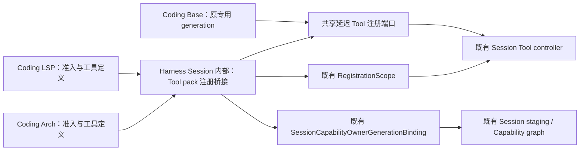

# H-COD-KD-002 R2：已准入 Tool pack 的 Session 注册桥接收敛

- Authority: accepted key design；实现状态另行记录。
- Design status: accepted；R2 三视角无剩余设计阻断，用户于 2026-11-06 明确指示“实施R2”。
- Implementation status: implemented；本地交付，本切片代码、固定合同与三视角评审已闭环，整体 Coding Goal 仍 partial。
- Owner: Harness Session Tool 集成；RegistrationScope、Capability admission/graph 与 Tool controller 各保留原权威。
- 需求依据：用户允许从 C08 扩展到整个 Coding，Coding 仅保留领域代码与薄适配；[扩围推进记录](../coding-convergence-progress.md)、[职责方案](../coding-reconstruction-proposal.md)。
- 源码基线：`8ad6b6098f1c24c8cfb6f4d9d290e99bc74d618d`，设计评审时本切片三个源文件与该基线一致；A20 仅作其它进行中变更的隔离检查点。
- 方法：本地 archmethod master `0f9bd3ff51afabeaaf76cc38dff1ceb279b7d37e`。

## 问题与现有能力

LSP 和 Arch 的 `_plugin_tool_owner.py` 分别 292、287 行，除领域 Consumer、工具定义、身份与错误投影外，均执行相同的 RegistrationScope 注册与 generation 回调。Base `_base_plugin_owners.py` 554 行，拥有第三套相同的延迟注册 Port/Slot；它的 Tool generation 另需使 GenerationBoundOperationSet 失效，Command 则经原 command registry。

原 Harness 已提供 `RegistrationScope.add/commit/rollback_commit/rollback_admission/dispose`、`registration_scope_retirement_receipt`、`SessionCapabilityOwnerGenerationBinding` 与 controller 的 `stage_runtime_tool`。缺的是已准入 Tool pack 到这些原接口的单份连接实现；没有缺少新的 registry、生命周期状态机或 general manager。

## 系统环境与归属

桥接是 Session 原组件内部的具体集成模块，不是独立运行服务。它不拥有批准、Capability graph、Tool registry 或持久事实。Harness 不导入 Coding；三个 Coding 适配依赖同一窄端口。调用仍由现有 Graph 的 capture/stage/commit/dispose 流程驱动。

## 关键决定

1. **注册端口只保留一份算法。** 在原 Session Tool 集成内提供 `SessionToolRegistrationPort` 与一次绑定的 `DeferredToolRegistrationSlot`。保留原 `stage_runtime_tool(tool, owner, enabled, source_info)` 形状；不增加批准、重试或工具解析职责。Coding 原 public Port/Slot 名称以薄类型声明保持，原错误文案由其标签声明提供。
2. **使用具体 binding factory。** `bind_admitted_tool_pack` 返回原 `SessionCapabilityOwnerGenerationBinding`，内部仅连接原 scope 的 stage、commit、rollback、dispose 与 retirement receipt。不会另建长期 owner、状态表、execution pipeline 或 callback registry。
3. **领域投影保持窄。** Coding 提供原 admission、authority gate、scope id、mode，一次性的 `definitions_from_captures(captures)`，以及原错误投影。Consumer 个数/身份/requirement、解码、工具创建与名称集合核验继续归 Coding。投影只构造定义，不批准、不发布、不驱动后续 phase。
4. **保留 Coding owner 外观和准入顺序。** 原 `CodingLspToolOwner`、`CodingArchToolOwner` 构造参数、类型、一次 bind 检查及精确 admission 校验仍在 Coding。先检查 `_bound`/port，再消耗 bind；不提前 capture、注册工具或打开新的常驻执行。
5. **临时 generation 只是原 scope 的句柄。** factory 持有私有短寿命值，附 domain-family 标记，确保 LSP/Arch 不能互认 foreign generation；同一原 domain family 的类型接受范围保持。它不新增持久身份、清理凭据或 generation 日志。scope 的真实 authority/retirement 检查继续由原组件执行。
6. **SourceInfo 归共同注册值。** 两份同形私有 SourceInfo 合并为内部不可变值，字段仍为 plugin_id、contribution_id、admission_fingerprint；不改变 controller 看到的事实。若消费方依赖类身份或呈现，须先核对并显式保留，不能只因字段相同就改变 wire 或显示。
7. **Base 只共用通用 Slot。** 其 operation_set 失效以及 Command registry 继续走原路径，不加入任意 cleanup hook 链来强行统一。后续需要更深收敛时另做有证据的切片。

## 组件交互与失败合同

- Product 构造先核验原精确身份、requirements、authority gate、mode 与 scope；新桥接不扩大接受集合。
- `bind` 仅建立原 binding。Graph 后续按原顺序提交 Consumer captures，领域投影构造并核对 ToolDefinition，再创建原 RegistrationOwner/RegistrationScope。
- 按原顺序调用 `scope.add(registration.stage_runtime_tool(...))`；`enabled` 仍仅由原 `mode == "always"` 决定，`on_demand` 不被悄悄开启。
- 任一注册失败继续保留原异常：若 scope 已 committed 则 rollback_commit；若 open 则 rollback_admission；清理报告有失败时向原异常追加原 note。rollback 本身抛错的现有优先级也须保持。
- commit/rollback/dispose/receipt 均拒绝原意义的 foreign generation。dispose 报告未结清时抛原 Coding 错误类及稳定 code，不吞错、不丢 scope 重试凭据。
- retirement receipt 仍使用原 scope、确切 contribution_ids 与 `allow_open=True`；新桥接不从构造成功推断 generation 已发布或已退役。
- Base operation_set、Command 路径、Session graph、父子资源清理顺序与现有持久 prepared/published/retired 记录均不因本切片改变。

## 原 RegistrationOwner 身份映射

新桥接必须按原表达式构造 owner，不新增前缀、不归一化 scope，不改变 generation 的类型或值：

| 字段 | 原值与必须保留的映射 |
| --- | --- |
| owner_kind | `"product"` |
| owner_id | `admission.owner_id` |
| runtime_id | `f"{scope_id}:{admission.plugin_id}:{admission.contribution_id}"` |
| generation | `admission.candidate.instance_revision_ref.revision` |

这些字段会进入原 retirement receipt、reference 与 hash；不得将临时 factory 实例 ID、绑定序号、随机 token 或新的 namespace 写入它们。generation 的 family 标记仅是内部类型隔离，不参加上述身份，不替代原 authority gate，也不得按每次 bind 生成以收紧原同域跨 owner 的接受范围。

两种 SourceInfo 的三个字段值逐项保持，需核对原 registry 值相等比较及 Tool 公共投影。Graph 保留私有 generation 与同一 scope，直至原 dispose 成功或原流程结清；“短寿命”不表示提前释放失败清理的重试凭据。原 stage rollback 失败分支只追加 note、没有返回 generation，本切片不把它描述成已经具备新 cleanup-debt 机制。

## 删除、预算与验证

旧体退出范围是两份 LSP/Arch 注册/lifecycle 与三份 Port/Slot 的机械实现；不是三个文件的全部 1,133 行。领域定义、身份、Consumer、Base 特殊清理继续存在。所有新桥接、类型、Code 配置和转发一并计入源码成本。

目标预算为 Coding 减约 350–430 行，新增 Harness 及必要适配控制在约 150–200 行，争取系统净减至少 200 行。这是需要原型实测的挑战预算，**不是已证明收益或新的 CI gate**。若引入的配置、类型或兼容壳吞掉收益，应撤回或报告较小实测值，不能排除新增行数后声称达标。

复用原 LSP/Arch opt-in、base Tool/Command、Session generation/retirement 测试，覆盖部分注册失败、默认 enabled、重复/未 bind、foreign generation、prepared receipt、dispose 失败后重试和原 error code。原有测试没有完整锁定 owner 四字段、SourceInfo 值与 generation family 接受矩阵，不能把现有套件通过当成这些合同已经验证。迁移前必须从原实现补充固定：owner 四字段及序列化退役回执/reference/hash，SourceInfo 公共投影与值相等，LSP→Arch/Arch→LSP 拒绝，以及同域不同 owner 的原接受范围；实际 foreign error/code 与同一 scope 的 dispose 失败后重试也必须对应。

改动前固定相关原行为，不以新实现生成预期；私有 helper 测试转到真实原组件，但保留全部 authority、回滚与清理负例。再做源码职责/复用、运行/失败、数据/兼容三视角独立代码评审。

完整回退按同一提交组恢复旧消费者和桥接，不并存两套主动路径，不引入常驻 fallback 开关或新的 PR 门禁。按用户接受的 R2 实施；完整代码与净减量仍须验证。

## 代码实施与评审补证

用户明确要求实施 R2 后，本地完成共享桥接、原实现合同固定及三视角代码评审。A21 的提前固定字段问题已在 A22 用三属性只读端口修复，O-A21-01/RT-A21-01 及 fixture 来源记录缺口关闭。Binding 元信息保持 bind 时点，stage 定义完成后读取当前 admission/scope，逐工具读取 mode，receipt 读取当前 contribution id；不增加生命周期驱动或 Product context。

原 41 项相关组合与 39 项固定合同/Graph 组合通过，实际 Coding −308、Harness +176、系统 **−132**，未达到争取 200 行的预算；较广 Session 装配的两项失败在原 owner 对照中同样出现，不能据此宣称所有回归通过。完整源码计数、测试与局限见[全层推进记录](../coding-convergence-progress.md#tool-pack-r2-本地交付a22)。设计评审时的 R2 原指纹绑定产品树外冻结对象；当前文档已更新实施状态并追加本补证，不冒称字节仍与原冻结稿相同。
