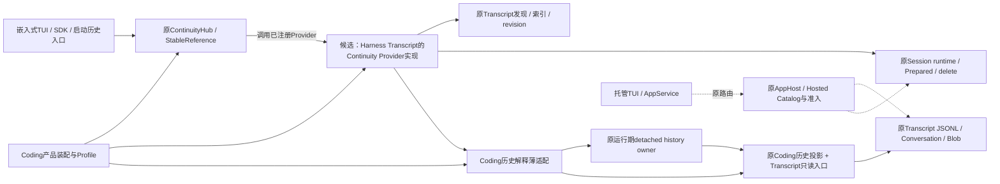
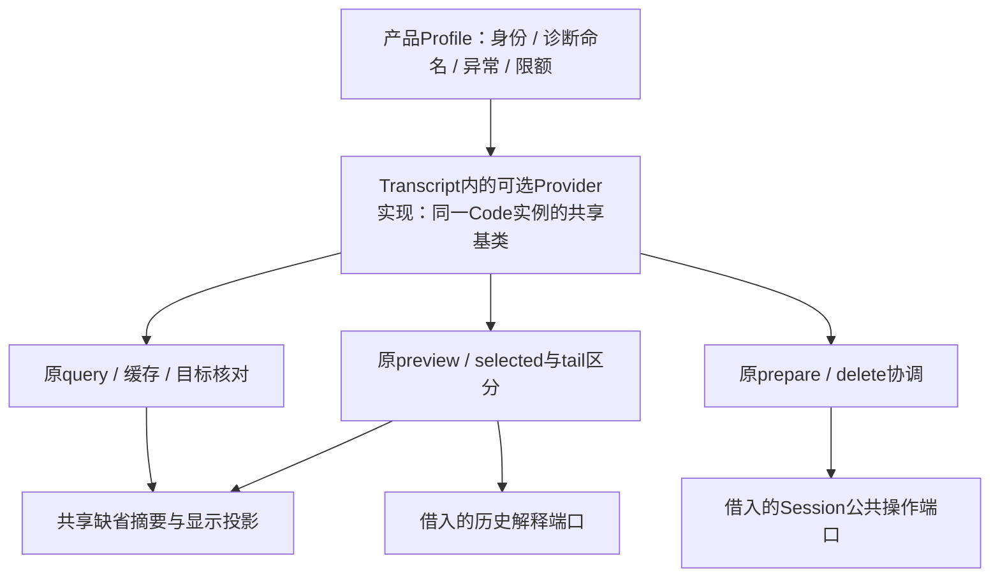

# H-COD-KD-011 R6：Transcript 实现 Continuity 导航，产品保留历史解释

- Authority: proposed focused design；下列候选不是已接受Target。
- Design status: draft R6；R4/R5的目录归属与原依赖规则冲突已在R6重定界，R6三视角增量核查无具体剩余阻断，原四项架构规则静态模型及两源类型通过。重要组件关系仍待用户评审，尚非已接受Target。
- Implementation status: not-started；产品源码未接入，树外候选不计生产收益。
- Owner: 候选导航实现归Harness Transcript，作为原Continuity Provider协议的可选实现；Continuity只持协议/Hub/引用。原Transcript与Session继续持有存储、发现与生命周期权威；Coding保产品身份、历史解释及薄装配。
- 来源：[完整Coding重构Goal](../coding-responsibility-convergence-goal.md)的P3/P4；不缩小P1–P4及Coding≤15000；成本按用户2026-11-09修订，优先复用/职责成立时允许必要适度增长，全部接收与适配照实计账。
- 当前实物：任务HEAD `2aa2f7deb8de9de5e79603f03627b3df115d0cf4`加A59已验收工作树，1950生产源，Coding119579/系统644140。原R4的14份源/测试逐SHA仍相同；R4账本及试验保留为历史，不是当前安装收益。
- 方法：本地干净archmethod master `0f9bd3ff51afabeaaf76cc38dff1ceb279b7d37e`，未核上游；原R4原件/报告在产品树外`p3-transcript-continuity-provider`；R5/R6当前补件在`p3-transcript-continuity-current-intake`。

## 1. 问题与已存在能力

[CodingContinuityProvider](../../../../../src/loushang/coding/continuity.py)目前同时承担分页查询、预览缓存、历史身份核对、读取编排、prepare/delete时的目标核对，以及Coding历史composition/Resume解释和显示。共享的是会话历史导航，不是编码工具、模型规划、文件系统或新的恢复状态机。

已有能力必须直接使用：原[ContinuityHub与StableReference](../../../../../src/loushang/harness/continuity/hub.py)拥有provider选择及引用寿命；原[Transcript Catalog](../../../../../src/loushang/harness/transcript/session_catalog.py)拥有发现/索引/authoritative revision；原Session runtime拥有restore/delete/Prepared；原[Coding历史解释](../../../../../src/loushang/coding/resume_history.py)及[运行期历史owner](../../../../../src/loushang/coding/runtime/agent_session_runtime.py)解释产品历史并保取消后native读取结清。

`TranscriptSourceReader`另为已准入store中的固定Work记录提供较窄读取，要求store identity/committed分支等保证；它不等价于旧非owned/legacy的只读发现和preview。不能为复用这个类而新增Writer、提高旧预览准入，或把tail显示当完整selected ancestry。

## 2. 候选系统环境图：黑盒协作与边界

实线表示本候选拟接通的原会话导航路径；虚线为现有托管路径，其协议及ownership不由本片替换。系统环境图是用户保留评审的重要工作件，内部技术评审不代替用户接受。

本片没有声称AppService discovery已改用该provider：原托管catalog承担token/scope/store身份与候选claim，其合同与普通Continuity导航不同。可选集成可供未来入口借用，但接通托管目录需另证映射、寿命与授权，不能直接绕过原catalog。

## 3. 候选内部职责与具体模块

这些框表示同一provider中的职责，不是新增服务、任务或全局owner。预览LRU仍仅为有界advisory cache，不是第三份历史权威、Session索引或恢复凭据。

| 位置 | 候选职责与复用 | 明确保留/退出 |
| --- | --- | --- |
| `harness/transcript/continuity.py` | 共同query、preview、目标缓存与revision核对、prepare/delete；直接复用原Hub值、Catalog、Session/Prepared与settled IO | 无Coding import；无新日志、Store、任务调度或导入器 |
| 同模块缺省显示实现 | Transcript通用标题、状态、存储/资产说明、三条readonly消息摘要 | 共同缺省实现直接使用Profile；没有现实替代消费者，R4去除额外显示替换端口，未来需要时另评，不提前承诺 |
| Code `CodingContinuityProvider` | 保真实公开类/FQN、原显式构造签名与descriptor，注入原Coding Profile及历史解释适配 | 原重型导航体退出；MRO与继承方法定义位置改变，不承诺任意私有反射或unbound-method pickle全等 |
| Code `_CodingContinuityHistory` | 绑定原Coding header/composition/Resume解释；真实runtime继续使用原detached history owner，其它原合法runtime继续旧只读解释入口 | 不迁移/复制JSONL、Blob或Conversation算法，不增加权限；不把产品composition解释塞进Kernel |
| 原Code导入bridge与bootstrap | 本片不改变bytes staging、source附件、owned/nonowned、FileCopy及prepared清理 | [KD003](continuity-bytes-import-convergence.md)仍未就绪，不能借本片接受 |

R6两份候选生产文件已在树外生成，不另建integrations包或新增初始化文件；Transcript包根不自动加载该集成。单个Code实例继承机制，保原`_runtime/_cwd/_all_sessions/_index_refresh_requested/_preview_items`；不会另建一个嵌套持资源provider。

## 4. 端口与产品合同

候选`TranscriptContinuityRuntimePort`只包含原索引查询、refresh、当前Session、restore/delete所需操作与session_dir；不传BootstrapServices、插件registry、整个AppHost或任意service locator。原Code公开Protocol/Prepared Protocol仍保自己的声明，结构上满足共同端口，不将Protocol用于新增运行期准入。该必需端口不是全部依赖枚举：原可选`cwd`、`inspect_discovered_session_assets`、`start_configured_resume_planning`仍在原位置动态读取，缺席仍走原fallback，不把它们升级为必选准入。

历史解释端口仅提供：`header(path)`和`readers(path, max_bytes)`。后者返回一次preview的snapshot/recent两种读取入口，分别返回原实际Coding历史对象的只读结构，不复制成第二份记录。这不是raw open/read/write回调；字段中的Coding composition、binding与activation解释仍归原产品。其实际实现确实会委托原文件读取，不能宣称“无IO纯函数”。评审必须确认该领域数据入口边界成立，而不是仅改名字重引Code物理实现。

reader pair在原preview内、header身份匹配之后才取得；Code原AgentSessionRuntime类型在原try位置late import一次。snapshot失败为too-large时，recent闭包复用这一类型绑定；每次调用仍在原位置判断runtime并调用原静态数据入口。没有共享可变“上一次读取”槽位、Task、后台预读或额外await。并发preview各有自己的pair。

Profile为固定配置：descriptor工厂、provider_id取值、domain IDs、产品识别/显示名、原诊断namespace、原两异常类及缓存限额。descriptor保持lazy，不能为了绑定Profile在构造时调用子类覆盖的descriptor；provider_id与缓存限额在原使用点取值。R1曾提前读取descriptor，R3已改为纯配置工厂。Profile不保存跨调用执行状态，也不授予IO或恢复权限。

原Coding身份、显示名、诊断code与消息保持；共性投影在Kernel具有缺省实现，产品只配置领域内容。R4采纳职责视角建议，删除没有实际替代消费者的六方法显示Protocol与可选替换参数，避免先造显示扩展框架。原私有显示helper在仓库内无跨模块消费者且不在公开导出合同，可随共同实现退出；不能据此删除真实公开类型/函数、持久状态或已有恢复支持。

R4另将resolve与delete中的两段逐AST相同authoritative-revision检查归并为一个私有方法，继续原Catalog/物理fingerprint判定；两个入口仍各自先完成原revision/current-session/compatibility判据，再在原位置等待这项检查。不缓存revision、不合并不同请求、不增加验证或查询次数；无await的fingerprint分支仍同步完成，有Catalog读取时仍是原to_thread。它不新增“所有IO在取消后结清”的保证。

## 5. 交互、异常与寿命

| 场景 | 必须保持的原程序 |
| --- | --- |
| Query | 取当前引用→原index query→记advisory行→原refresh/repair决策及诊断；不新增扫描/写索引/第二分页器 |
| Preview | 原缓存目标→只读header→身份相同才读取selected snapshot；仅too-large尝试tail；原header/fingerprint核对、资产观察、规划启动时点与异常分支保持 |
| Tail | 仅“不验证selected ancestry”的显示，不用于prepare/admission；空tail、changed header或fingerprint均保原行为 |
| Prepare | 先resolve并复核目标；当前Session短路仍返回原lease；否则原prepare_restore，后验stale时仍abort原candidate再抛原异常 |
| Delete | 原conflict/compatibility/revision/current-session拒绝、authoritative revision核对后才调用原delete；成功才移除缓存 |
| 取消/关闭 | 原运行期history owner继续保已提交native read并fence交付；共享provider不接管root关闭，不把waiter取消当IO已停 |
| 部分失败 | 原catch/cause、abort/close优先级保持；不修复原权限/未知写入问题，不凭preview available推导可写或恢复成功 |

原Session、runtime history和Continuity shutdown顺序保持，不把provider注册进新的Session Graph。原Hub stable引用、plugin generation和删除授权也不受此片替换。

## 6. 方案比较与完整成本

| 选项 | 判断 |
| --- | --- |
| A：原Code整体原样移动 | 不采用：会把产品composition/Resume解释及Code runtime判断直接塞进共享组件，或者形成反向依赖 |
| B：本候选，Transcript实现Continuity协议+窄历史解释端口+固定缺省显示 | 候选推荐职责方向；原权威复用且Code只留产品解释和薄绑定，但新增类型/适配成本须明确接受，不能称系统净精简 |
| C：保持当前Code实现，仅抽显示helper | 不作为完整P3收敛方案；缺少共同业务归属，不能用少量行数变化代替整个provider职责拆分 |

以下为R4冻结时点的历史成本，**不是R6当前计量**；当前完整成本见§9。

| R4历史生产成本 | 当时原点 | 当时候选 | 变化 |
| --- | ---: | ---: | ---: |
| Code continuity模块 | 1555 | 1016 | −539 |
| 可选集成初始化与全部机制/类型/配置 | 0 | 755 | +755 |
| 系统 | 638354 | 638570 | **+216** |

若采用，Coding会为123256；现在仍是123795，生产收益为0。本片主要是将唯一共同程序归位，不是删除第二份等价provider。所有Protocol、Profile、reader pair、Code薄绑定及默认投影均计入。R3为Code−539/Core779/系统+240；R4与之相比接收层真实少24行，不把24行节省冒称整个候选净减。系统仍高于Goal起点，本候选不能因此关闭净减条件，也不能承诺未来假想Product会抵消成本。评审须判断这些接缝是否必要、是否有现成更小能力可直接复用；不为全成本问题新增万能context、phase registry或“平台化”包装。

## 7. 证据与采用条件

冻结14份现有源/测试及全部1906生产SHA。原三个测试文件97278为65过/1失败21.06s；失败是clipboard完整场景在create_session时被原Transcript父目录安全检查以`transcript_writer:unsafe`拒绝，未到preview，原XML保留。不能修改权限/测试来掩盖。

树外R1经原managed pytest wrapper和原66节点得到相同65过/同1失败19.99s，三模块加载witness确认实际来自候选，产品原14源未变；两显式源silent-import类型通过。它不是后续版本证明，也未覆盖descriptor子类的lazy构造。R3的35242真实终态68过/同1失败34.00s（原66与额外3公开构造、late绑定及其它公开定义AST）；原状态/失败message逐项相同，witness三模块确来自R3。53982两R3显式源silent类型通过。R3三份设计报告保留，不改写成R4评审或实际产品接受。

R4的18467终态为68过/同1原失败43.62s、exit1，原66节点状态及failure message逐项相同，额外3项全部通过；witness确认三源均来自R4，原产品源/测试未改。46116两R4显式源silent类型通过。不新增PR gate、平台、30秒矩阵或付费调用；候选测试仍不是旧安装环境、全部公开反射/实例pickle、原生多平台或性能证明。

采用前需三视角核职责/复用、运行/失败、数据/兼容，解决实质发现并完成重要图的用户评审；本稿不制造用户接受。实物替换后再做代码三视角及原业务回归，并核整项计量。回退须恢复Code原provider和移除可选集成整体，不改变任何持久格式/路径或清空状态；原Schema/Store/Session来源寿命保持。完整P1–P4及Coding≤15000 Goal仍active，成本按现行用户准则审查。

## 8. 三视角综合与用户待审范围

R3三份原报告与R4三份增量报告均保持各自被审SHA及原字节，树外归档；实施owner `/root`综合确认技术工作件可提交用户评审，未接受安装或代用户接受重要图。

| 视角 | 已核结论与关闭项 |
| --- | --- |
| 职责与复用 | 原Hub/Catalog/Session不能等价直接替换整个导航合同；历史口承载真实Coding composition/Resume解释，原物理算法仍在Transcript。采纳N1，裁掉无实际消费者的显示扩展层；N2明确可选runtime能力不是必需端口的完整枚举 |
| 运行与失败 | 保原lazy descriptor、调用期provider/cache绑定、每preview局部reader pair、selected/tail分流与prepare/delete判据。R4共享检查内联后两方法AST同R3；未增加Task、读取次数或所有IO取消结清保证 |
| 数据与兼容 | 原Code类/FQN/显式签名、其它公开定义、实际历史对象与持久协议保持。原66节点同状态及原失败，新增3项有限合同通过；不冒称旧安装环境/全部反射或pickle等价 |

以下是R4历史待审范围，已由§9的R6评审卡替代，不构成当前安装授权。原请求为：请用户评审§2系统环境图、§3子组件与职责方向，以及§6明确的临时成本：共同导航/缺省投影归Harness Continuity可选集成，Coding保产品历史解释、身份与薄绑定；不改托管catalog权威和KD003。若接受，该片按完整三源接通、删除Code旧体并再做实际代码三视角；系统+216必须纳入完整Goal成本，不改变最终系统净减及15K条件。若成本或职责方向不接受，保当前产品并修改候选，不把树外实物计作交付收益。

## 9. 当前评审卡：R6职责方向与完整实物

**待用户接受；产品源码未接入，实际本轮精简0。** R4原14源/测试及三个候选均逐SHA
核对，没有因起点变更重做原66/69批；旧结果仍是旧结果，A58/A59的间接装配变更
不被静态相同推成运行全等。采用后须验证真实安装与受影响合同。

### 为什么调整归属

原R4把实现放在Continuity内部，直接引入AI/Conversation/Journal/Transcript。
既有两个原规则分别限制AI profile与Continuity core的存储无关性；此前三视角
业务/类型取证未覆盖这两个架构节点，不能沿“技术reviewed”原样接通。
R4在原AI规则的只读模型反例已实测失败。R5只把消息摘要放回Transcript，仍有
整体目录归属问题；作为未采用历史保留，不给core加豁免，也不转导类型藏依赖。

R6将完整同实例导航程序放在现有Transcript子系统的一个可选模块，直接实现原
Continuity协议。这样是具体历史profile依赖通用导航协议，Hub/core不反向依赖
存储或消息类型。原只读消息摘要仍留在这份Transcript实现内，原interaction模块
完全不变，不多加公共helper/API，也不再建integrations初始化包。

运行期仍是Hub调用已注册Provider；**静态依赖**是Transcript实现依赖Continuity
协议。这两种箭头含义不同，不把运行调用当作反向源码依赖。Coding实例保原真实
类/FQN/显式构造，由共享基类执行共同导航。当前§2/§3的图及表按该归属更新。

### 请评审的三项决定

1. 导航、缓存与目标核对的具体实现归`harness/transcript/continuity.py`，直接复用
   原Catalog、Session/Prepared、Hub值和只读入口；不新建索引、存储、恢复器。
2. Coding保身份、显示/诊断配置、composition/Resume历史解释与薄装配，原来源、
   owned/nonowned、托管catalog权限、KD003临时输入路线不由本片替换。
3. 两份完整候选：Code1555→1015（−540，含1行导入空白），接收754，系统+214。
   其中职责迁移−539与格式−1分列，不称整个候选系统净删；不靠未来假想消费者
   抵消成本。采用前119579/644140/1950；若接通后实测相同则119039/644354/1951。

R6原两模块的nonimport/nondoc AST与R4相同；Code只变adapter import与导入布局。
private定义module/继承MRO等既有兼容边界继续明确，不承诺任意反射/旧pickle。
R6两显式源类型61747exit0；原四项架构规则在只读候选模型中60772exit0/4过，
含AI profile、全局DAG、Work单向和Continuity core边界。R4/R5分别被原AI/core
规则实测拒绝，失败材料保留；不是删断言或加例外。R6三独立增量报告全文已读，
Root核实际指纹与XML后接受为可提交用户的重要图技术工作件；**没有接受安装**。
通过只说明静态候选技术就绪，不代用户重要图接受，也不算实际产品运行。

### 当前基线补件：原clipboard预览测试

图审等待期间只复核旧失败节点，当前原实现18227仍在create_session时被
`transcript_writer:unsafe`拒绝。源与宿主只读metadata核实：该测试LOUSHANG_HOME
放在managed pytest目录下，路径经过`/home/dev/lsspace`（0775），原状态根准入
明确拒绝这一可组写祖先；未进入Continuity。沙箱内/home的uid映射不当宿主证据。

按已有`test_agent_session_runtime.py`的原生私有TemporaryDirectory模式，仅隔离
这一个正向测试的平台状态根；原managed RunLease、图片/Transcript数据根不变，
全部断言AST保留，不修改权限、准入规则、业务源或安全负例。同原节点25548通过
（9.46秒），测试Ruff与diff检查通过。这是原实现的环境夹具修正，不算R6运行通过。

“原14源/测试相同”指本次接入复核的冻结时点。此后仅这一测试环境修正，另13份
保持；原R4失败XML和当前修正前后证据均保留，不重写旧69批或借此预报接通全绿。

### A61后的计量时点更新

§9的119579/644140是A60冻结原点。随后在已接受KD008方向内接通的Canary生命周期
与本候选独立，实际当前119111/644241/1951；本候选两源/职责与−540/+754/+214成本
未变，若后续接受并接通为118571/644455/1952。R6仍未接通、用户图审未回复，不把
该计量更新作方向接受或再次询问同一事项；旧帧/证据保持，不重复已过模型/类型。

### A63后的计量时点更新

原§9及A61数值保其历史时点。独立KD008 operator接通后实际118987/644437/1952，
本R6两源/职责及Code−540/接收754/系统+214未变；若未来接受并接通，按此时点
为118447/644651/1953。本轮只更新计量，不补造当前联接后的模型/运行结论。
用户原图审仍未答复，不重复提问、不安装或计候选收益；旧帧/实验仍保原范围。
