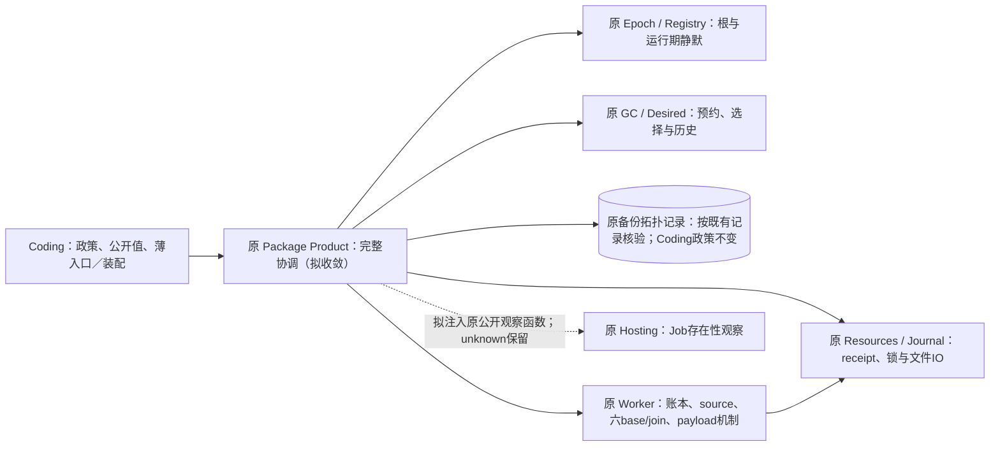

# H-COD-KD-010 R2：Windows Worker 六账本语义重建归一

- Authority: accepted bounded key design；不替代完整Goal或原生平台验收。
- Design status: accepted R2 bounded interfaces/cost；三视角技术审查后由实施owner在原KD004职责范围内接受。
- Implementation status: partial；六基线与join本片已实际接入、验证并获有界代码接受；完整Worker与Goal仍未完成。
- Owner: 原Harness Worker history；原Coding值/政策与Package Product/GC职责保持。
- 需求：[完整Goal](../coding-responsibility-convergence-goal.md)；前置：[KD004已接受职责方向](worker-history-responsibility-convergence.md)、[Current Owner Map](../current-owner-map.md)。
- 方法：本地archmethod master `0f9bd3ff51afabeaaf76cc38dff1ceb279b7d37e`；沿既有采用，不声称远程最新。
- 实物：`harness/coding-responsibility-convergence` 未提交工作树，HEAD `8ad6b6098f1c24c8cfb6f4d9d290e99bc74d618d`不是源码快照；19原源/全1895源起点在产品树外p1-windows-semantic。起点Coding125398/系统637834；实际接入终态见§11，完整Goal仍active。

## 1. 场景与选题依据

已有Windows Worker来源在原runtime quiescence、GC gate和root/ACL观察下形成source snapshot及semantic read。六个类型分别把opt-in、receipt、Supervisor、C5、launch intent、native provisioning重建成source-bound基线，并核各自retained replay；最后history join验证六者是同一个来源且attempt/receipt/native事实相合。当前这些通用校验/重建仍放在Coding，已经复用Core wire traversal与底层账本，不能把它们说成另一套物理存储。

本片完整交付从原prepared/source-bound semantic read→六个typed base→原各自replay及联合校验；不接管来源捕获、checkpoint publication/cutover或删除，也不提高Windows候选支持级别。7原文件1804行、30方法是调查池，不是已证明净删预算。所有接收字段/协议/兼容成本将在完整候选上实算，目标不得以转移目录数量替代。

本轮曾比较Catalog初次/Package Product/refresh。其资源观察、构造、Catalog投影与Graph已经复用原Harness；剩余多为来源、信任与恢复政策，整体迁移会增加大配置/控制回调。因此不把8092行装配池宣称全可删除，也不为追数量新增StartupManager。整项P2未完成，记录其保留/待分解事项后，按Goal允许调整顺序，继续此原已接受Worker内部职责簇。

## 2. 既有环境与责任

沿用KD004 §2原关系：Coding薄入口→Worker/history→原Journal/Package Product/Hosting。当前专项仅在Worker内部迁移纯语义程序，没有新环境角色、L3组件、进程、日志、全局registry、任务循环或外部调用。输入已经是原source/semantic事实，不把完整Product/Session/context交给叶子；不由重建程序重新取锁、读磁盘或探测native状态。

Coding保留产品选择、批准、session scope算法、Windows native profile/平台选择、原公开dataclass值及必要薄绑定。Package Product/GC、原来源reader与原native证据仍是唯一权威；基线可读/一致不代表获得执行、GC或删除授权。

若专项评审发现需要新增重要环境/组件连接，须先更新该工作件并提交用户评审；本内部设计接受不自动接受那些变化。未接受KD008 Canary执行协调迁移，也不顺带实施KD003 bytes替换。

## 3. 当前能力与复用判定

| 原机制 | 实际复用 | 禁止误用 |
| --- | --- | --- |
| history/_base_codec 的 `_SourceBoundBaseWireMethods` | 六基线已继承；保持唯一RecordSchema traversal、精确wire keys/bytes、digest envelope | 不新增schema DSL或第二JSON codec |
| history/_opt_in、_activation及_supervisor | 已有原fold/replay/high-water机制；Code当前纯wrapper仍绑定原错误/值类型 | 直接复用原算法；不复制一份改名Windows fold |
| history/_receipts与原Activation journal | 原record类型、fingerprint、序列/C5 state验证 | 不合并不同账本的revision/authority |
| history/_windows_recovery | 已有原native/launch/Supervisor identity投影及结清判据 | 语义基线不替代真实Job/ACL/进程证明 |
| Code preparation/semantic/source snapshot | 原对象身份、来源摘要、require_semantic_read与错误边界 | 本批不重建另一份source admission或缓存旧证明 |
| Code公开值、原RecordSchema绑定 | 既有constructor/fields/frozen/slots、字节/hash/pickle与精确type检查 | 不直接把Code类型替换成不同类的alias后称精确身份兼容 |

POSIX V2基线有first_retained_generation/sealed digest/version2；Windows source-bound基线有store/source digest、可空初始历史/version1，不能直接套同一post_init/decoder加严或放宽。只复用实际相同fold/codec，不因名称相似合并两种持久合同。

## 4. 具体接口及迁移映射

实现位置在原`harness/worker/history/`的Windows语义内部模块，按账本责任组织。优先扩充已有history原owner，不加公共Worker facade。没有新的持久对象；方法在原Code facade实例上工作。

| 原Code文件 | Core承接 | Code保留 |
| --- | --- | --- |
| windows_opt_in_base | source-bound值校验、from-semantic重建、retained replay；直接原fold | 实际Decision/Error/Replay及Prepared类型绑定、原公开值/签名与wire schema |
| windows_receipt_base | sequence/历史allow join/replay及摘要一致性 | product_id/session scope/native profile/native platform等原产品判据作为固定纯值/函数绑定，原Receipt/Decision/Replay类型 |
| windows_supervisor_base | exact record序列、Supervisor高水位/tombstone/retained replay | 公开Base/Replay与原签名、Prepared绑定；原Worker record类型不复制 |
| windows_c5_base | 原state/head摘要序列、owner存在性、retired fold与replay | Base/Replay/Prepared具体类；原Core activation算法复用 |
| windows_launch_intent_base | 原retained intent、递增revision/identity与replay | 原Intent/Error/Replay/Prepared类；已有完整bytes decoder继续用原实现 |
| windows_provisioning_base | 原record序列/阶段证据及retained attempt/base构造 | 原RetainedAttempt/Base、类型/构造/公开wire投影；原native record无替代 |
| windows_history_join | 六具体base与source一致性、observed/effect/launched关联及原join digest | 原Join及六类型/Prepared绑定，原公开入口参数及返回类型 |

拟采用既有无状态methods/Mixin方式，`__slots__=()`，不新建Core DTO副本或多个控制对象。原Code dataclass字段定义、顺序/类型/默认/metadata与实际类模块保持；继承方法与MRO/定义metadata的变化明示，不能声称任意私有反射/热patch全部相同。

固定class绑定只含原具体值/错误/Prepared/Replay类型、原纯session scope函数、原product/profile/platform值；它们不能执行IO、服务查找、权限签发或调度。需要保持Code公开`from_semantic_read`/`replay`签名时用薄声明调用Core内部程序（如`_from_semantic_read`/`_replay_retained`），不保第二份算法。返回仍由原实际Code类或Replay类构造，exact-type检查针对原类，不改isinstance或新增拒绝。

Core采用窄的source/semantic事实属性合同，优先原Core record/methods类型，不新增完整Product/context或任意factory registry。实际需要的attribute/type绑定须由30方法的自由名/字段盘点导出；候选必须列出完整类型/方法映射并通过静态检查后再实施，不能用未约束Any大对象掩盖耦合。Code原`_wire_maximum`读取原module限额的薄方法可保留，原真实消费者/测试注入不改成构造时缓存。

公开装配与正常调用链不变：原Code.from_semantic_read(prepared, semantic)→Worker内部程序→原prepared.require_semantic_read→原fold/record/codec→原Code值；原history join继续逐一构造六基线，调用/错误顺序不提前。方法调用需保持原参数求值、异常catch和构造时点，不把所有base先生成成一个无约束dict再回填。

## 5. 合同与失败界限

1. `type(...) is`、bool/int差异、tuple/list、大小边界、排序/唯一性和每种原消息/cause/判定顺序保持。Core不能用统一严格validator替换原不同接受集合。
2. Prepared exact-type拒绝在原位置；其require_semantic_read仍检查同一source/semantic digest。不得只核source id就略过历史事实或另造可信快照。
3. 原base/record JSON keys、数组顺序、canonical bytes、digest输入、退役operation/attempt/receipt集合保持。未知/损坏/重复/缺源、错revision/head与跨来源记录仍在原层报错。
4. opt-in allow关联与required组合、receipt policy、native profile等产品判据由Code固定配置，原原生平台合同不扩大。不存在额外执行授权、重放外部副作用或自动恢复。
5. 六join仍区别observed/effect/launched，Supervisor retained attempt才证明原launched集合；native settled/进程结清/历史存在不相互替代。
6. 不新增磁盘读取/全史回放次数、缓存、全局锁、Task或进程；纯函数迁移不预支性能数字。
7. 持久类/旧pickle/导出路径与Code dataclass身份先用原记录/fixture核验；若候选不能做到，不带“兼容”名义装配。原方法metadata变化属于明确限制。

## 6. 选项、全成本与退出条件

选项A整体搬文件并把Code改alias：精确类型、pickle路径和产品policy不清，拒绝。选项B新增通用BaseManager/统一账本：重复现有history机制且混合同，拒绝。选择C复用现有methods/codec/fold、原值薄外观、整个六基线与join一次收敛；若出现无法抵消的多余配置/转发，先压掉，不以系统增量当净删。

本批允许有解释的职责迁移成本；最终完整Goal仍须系统净减。候选必须报告Code原1804→实际剩余、Core新增/复用/删除、全部协议/绑定/兼容/wire与格式成本，旧方法体退出清单及完整manifest。1804行不等于可删量，当前未写候选，不给虚假节省承诺。

交付需做到7原文件逐项处置、原公开值/行为兼容、Core无反向Code依赖、原fold/schema直接复用、同一事实权威与实际三视角代码评审。完成本簇也不等于全Windows history、完整Worker、P2或15K/系统净减完成。

## 7. 验证及接受路线

先冻结19实际源与7文件30方法映射、完整1895源起点及分支切点。复用原七类base/join测试与现有wire/pickle兼容fixtures；迁前结果是基线，不算新实现通过。候选必要负例覆盖空/完整历史、来源/版本/类型/重复/高水位、receipt allow/required/native join、retired replay以及六join的不同失败分支；旧expected只读，不从迁后重录。

原Windows native/ACL/跨进程/host/live selector保持，Linux可执行的纯值和离线重建检查不称native Windows通过。保持原测试断言/超时与已有支持集合；内部候选观察不进入PR gate，不扩平台/矩阵。

三个独立视角先审职责/复用、运行/失败、数据/兼容与是否涉及新环境关系；具体接口/原行为/完整成本候选另增量审查后，实施owner按已授权KD004内部职责接受才接入。实际生产源改后再代码三视角，关闭具体阻断并记录真实运行限制，不以文档接受冒称实现完成。

## 8. R1方向评审与下一候选必答项

三个独立视角逐项核19原源/关系与复用表后，无方向性具体阻断，未发现新增用户需审的重要环境连接；实施owner `/root`仅在原KD004接受范围内接受本内部职责方向。具体接缝、实际完整候选及全成本没有因此获接受。三原报告及R1冻结字节分存树外，不随本状态补记改写。

30方法定义共1167物理行，其中12行为原动态cap getter；1804行池还含字段/接口/原schema/import。不能据1804承诺同量删除；原公开13个值类、实际factory与record类型绑定和签名/类型成本必须一并核。

- 必须给出每个全局Code类型/函数的确切处置。`method-dependencies.json`列原30方法依赖：native provisioning旧模块已是Core转发；activation fold是Core alias、projection是record_type薄绑定；opt-in fold也是原Core(error_type)转发。这些必须直接复用原算法，不能复制为新Windows机制。
- receipt重建与retained replay准入不同；原product_id/session_scope/native profile/platform/required-or等判据必须原位绑定，不能移到共享默认或在replay新加完整历史拒绝。
- join与各base仍按原顺序调用require_semantic_read，原7次验证不能偷偷压成一次；exact type、首错及构造/回执字节顺序保持。为缩小参数面，候选可比较“Code保原Prepared入口准入并传窄source/read事实”和“Core处理同一typed准备值”，必须实算字段/Protocol/薄签名成本，拒绝Any大context。
- native基线原来会调用Path.cwd、构造原Journal再decode_raw；必须保持时点与catch，不新增load/CAS/Job探测，也不能宣称零syscall。复用原构造/decoder，不为纯函数名义改变错误面。
- 原wire/pickle fixtures、原类/fields/slots及Code schema绑定逐项核。继承方法metadata变化单列，不能把API承诺扩大成任意私有反射。

66935原8测试文件33 passed/5.89s，零failure/error/skip。这是未修改源的离线值/重建/wire基线，不是候选或native Windows验证。当前七生产源以及其余全源仍保持起点，Code125398/系统637834不变。接下来产出完整候选和具体类型/签名/成本对照，再按三视角增量审查接入；当前仍not-started，不把方向文档当精简实现。

63436补充原程序顺序观察8 passed/3.09s：实际原join/base/Prepared程序，外层故障注入固定正常、observed-only、stale、duplicate、wrong Prepared、receipt/native首错及第二次require取消。19原源SHA守卫并独占创建旧JSON；正常顺序有7次require，不能合并或缓存。此为有限迁前观察，不是新实现/native验证；三视角结论详见[评审记录](windows-worker-semantic-convergence-review.md)。

## 9. R2完整候选接口与成本

R1历史证据保留；本节为新增的具体候选，不把此前方向接受冒称实现接受。完整15源候选、逐源SHA、旧19源与完整1895源起点存树外p1-windows-semantic，实际生产尚为Coding125398/系统637834。

- 原7个Code公开文件保留13个实际dataclass的自身字段、顺序、类型、默认、frozen/slots、公开入口参数/返回注解和模块FQN；不是Core类alias。Replay先声明，固定类型/产品配置归其相应Base类，没有运行期registry或新状态副本。
- Code `from_semantic_read` 保留原Prepared exact-type与原`require_semantic_read`，随后向Core `_from_source_read`传窄只读source/recovery事实；Core不拿Prepared、Product、Session或任意context。原record/fold类型优先直接复用，只补叶子属性Protocol；receipt独有opt-in四字段用局部类型视图，不在运行期加新检查或提前读取。
- Code join保原入口验证，依次调用原六个实际Code类型；Core `_observed_attempt_ids`及`_from_source_bases`承接原inventory/联合校验。正常join仍七次require，不缓存准入。六个具体构造调用是兼容值绑定，未新增控制回调。
- Code receipt固定原product id、profile/platform、纯session scope staticmethod和实际Decision/Receipt/Replay；Core只执行原判据。retained replay仍较重建弱，不添加历史allow/policy校验。
- 八个Core文件都在原`harness/worker/history/`，分别为六账本methods、join及共同窄事实合同；`__slots__=()`无状态，原Code实际值/Replay factory构造结果。已有codec、opt-in/activation fold、projection和native journal/decoder直接调用；无新IO、权限、日志、source loader或调度。
- 原Code动态wire cap/schema绑定仍在原模块；native `Path.cwd`、原Journal构造与decode点/catch保留，不声称零syscall。方法MRO/module/qualname变化明确，不保证任意私有反射或模块全局热patch。

| 全部生产成本 | 起点 | R2候选 | 净变化 |
| --- | ---: | ---: | ---: |
| 七Code文件 | 1804 | 757 | −1047 |
| 八Core文件（含全部Protocol/工厂/配置支持） | 0 | 1520 | +1520 |
| 此片系统合计 | 1804 | 2277 | **+473** |

原七Code算法体退出，接收的是原history尚未拥有的Windows source-bound重建/联合语义；已有fold/codec不复制。+473是保留精确公开值/签名和窄事实类型所付的职责迁移成本，不能称重复删除或系统净减。若装配时格式产生差异须按实际重新计量。完整Goal的15K与系统净减条件不变，本片不实现它们。初版+611，保留原方法体布局、类内固定绑定和删除死私有声明后降至+473；不是代码压缩或去掉校验。

## 10. R2候选验证与接受条件

候选以固定15模块source overlay加载，继续原未改managed pytest wrapper、其余真实工作树依赖、非live/skip-host规则。95353终态exit0，原8文件33项加迁前固定8组调用/错误/取消观察，共41 passed/12.95s，15模块路径与摘要见module witness；这是候选离线证据，不是已接入/native Windows/全SDK证明。最后静态scope类型声明修正后另Receipt限定6项XML零failure/error/skip，未保留可继续轮询的PTY句柄；XML与最终加载摘要均在，未扩称又全跑41项。

mypy首轮12处类型错误，第二轮只余scope staticmethod声明一处；最终Receipt两源检查成功，其余14源在第二轮无错。故候选按版本分批验证，不称最终15源一次全绿；实际接入后要按15实际源再验证。所有初始失败与源版本保留。

R2须由职责/复用、运行/失败、数据/兼容三个原独立reviewer检查具体15源、固定公开合同、原错误顺序和全成本。关闭具体技术阻断后，实施owner在原KD004已接受内部关系内记录接受再整体接入。未新增重要环境/组件关系；若评审发现此类变化仍按原约定提交用户。接入后以实际源码再跑原有限测试与三视角代码评审，再记实际收益，不把候选数预支。

## 11. 实际接入与全成本

三个独立R2报告无本片技术阻断或新重要环境关系，实施owner `/root`在原KD004授权内接受具体接口/成本；没有代称新的用户接受。完整1895起点源逐项SHA守卫后，七Code文件整体替换并新增八Core内部模块。真实仓库isort修13处，全部15源非import AST及import绑定集合与冻结R2候选相同。原13值字段/decorator、原schema与固定期望未改；旧重算法体退出。

| 实际成本 | 接入前 | 接入后 | 净变化 |
| --- | ---: | ---: | ---: |
| 七Code文件 | 1804 | 751 | −1053 |
| 八Core（全部类型/配置/接口成本） | 0 | 1513 | +1513 |
| 本片系统 | 1804 | 2264 | **+460** |
| 全Coding | 125398 | 124345 | **−1053** |
| 四生产根 | 637834 | 638294 | **+460** |

实际1903源摘要在树外actual-full-frame；候选+473与实际+460之差仅为仓库导入分组格式，未压缩算法。累计Coding137755→124345，减少13410（9.7%）；距15K仍109345。按122755行必要差额为10.9%，不是整体工程工作量百分比；系统较634794起点仍增3500，完整Goal两项数量条件均未达。原41候选证据不冒充实际运行；实际62066为57过/1依赖清单失败，修正固定清单后38517两原节点通过；实际15源类型66121及生成56513均exit0，完整终态/限制详见评审记录。

## 12. 后续整簇选题：历史发布与持久重读

Status: proposed design input；Implementation status: not-started。本节不是新API或实施接受，不改上文已交付六base/join的权威。A30后实际Coding122753/系统638381；原九源2353行、59方法/函数已冻结，包含source、preparation、package references、checkpoint、six-base publication、persisted、cutover record/preflight及base names。完整逐函数签名/原件及三独立选择评审保存在产品树外`p1-windows-history-publication`。2353是调查池，不是承诺删除预算。

选题覆盖prepare→references→checkpoint→六base发布→持久重读→cutover候选的依赖路径，**不是一个现存大事务**。各入口保独立quiescence和原GC包络：references/read_semantics用read_snapshot_guard，checkpoint/base/persisted/cutover读取仍用write guard，可能沿原writer-lock创建/partial-tail repair；Product currentness本身也可能准备原根。借root的finally只复核原currentness、不关闭借来的FD。不能合锁、冻结一次snapshot或把所有read改成无创建。

复用原Worker source capture、六base/replay/join、Resources native receipt及Journal编码。准备/检查点/六base分别保不同stage恢复判据，persisted保固定六文件与原后验短路，preflight保两次独立借root重读及中间current重建，只输出惰性候选。9个公开dataclass/61自有字段、exact类型、序列/摘要/限额、backup topology政策及原错误首序仍受原合同保护；不重开已拒绝字段继承、不改持久格式或支持级别。

三独立视角同意继续形成完整具体替代，实施owner `/root`仅接受选题与证据作为后续设计输入。**事实获取接点尚未闭合**：相邻offline recovery/GC还实际读取Desired、backup、provisioning和native absence。下一候选须一起列真实接收owner、必要窄接口、旧体退出及全部接收成本，不能把9源搬家、传大Product/Context或整Code IO callback称为完整收敛。不同known/source-exclusion/stage/base名单亦不得误并。若具体方案引入重要环境参与者，仍按用户约定提交图审；KD008/KD011不由本节接受。

原五测试文件64339为**23过/5.79s、exit0**，主要验证离线DTO/关系，只有preparation一项受控stage源变化，不是整个发布路径证明。另从原`_guarded_bases`完整函数排他捕获21组叶端口观察：全量先验后补缺、同值已有/staged、末项冲突前零写、第三文件写后报错保留三文件、最终复核与guard退出错误；真实六base/join/值算法执行，Product/native receipt/GC为受控端口，不能证明原生ACL、锁创建/修尾或断电。11875只读复放21过/4.23s、exit0，原9源及全1909源未改。

首60552为17过/4探针失败：探针误将解码后的等值返回视为同一输入对象；仅修粗断言，13614补捕获4过/3.56s，原17JSON保持逐SHA不变。首XML与探针保留，23与21为不同范围，捕获/补捕获/复放相互重叠不累计。当前没有候选、生产收益为0；不能据这些输入宣布设计/实施完成或完整Goal达标。下一步必须先补全真实事实接点与具体全成本替代，再评审接口、接入、验证实际callee及三视角代码复核。

## 13. A31：三Windows账本作为发布链必要依赖归位

Design status: accepted within delegated implementation scope；Implementation status: implemented locally and independently reviewed。本节关闭上一节识别的三个真实账本callee的机制归属；九源发布链及GC/offline/Desired/backup/native事实接缝仍未闭合。实施owner `/root`在既有Code→Worker→Resources关系内综合接受，不接受KD008/KD011待用户图或整个Goal。方法沿本地干净archmethod master `0f9bd3ff51afabeaaf76cc38dff1ceb279b7d37e`。

原[opt-in](../../../../../src/loushang/coding/package_product_worker_windows_opt_in_journal.py)、[receipt](../../../../../src/loushang/coding/package_product_worker_windows_receipt_journal.py)、[native approval](../../../../../src/loushang/coding/package_product_worker_windows_native_approval_journal.py)三类保真实FQN/公开薄签名、纯Error/decoder/值类型/限额profile与原platform/input诊断。构造、read、decode护栏、parent观察、prepare及三完整command机械体归原[Worker.history](../../../../../src/loushang/harness/worker/history/_windows_record_journals.py)。每个原实例仍只有_path/_scope_id/_file_io，原DTO/codec/公开值及Product/GC/审批权威不动。没有大Product/Context、Code事实IO callback、第二记录或平行旧实现。

[原Resources IO](../../../../../src/loushang/harness/resources/packages/_windows_journal_file.py)继续提供read/append/marker/flush/stream与原read_snapshot；只扩充prepare_history_lock、assert_visible_parent、普通bind_append_snapshot。后者向caller标准ExitStack登记原ACL与exclusive lock，原marker/read对应后返回acl/lock/raw/initialized；借来的root不归它关闭。Worker在同scope内分别执行原opt-in/plugin/kill-switch、receipt/session/policy/nonce、native/global-previous/revoke程序，不强并为decision/phase引擎。pure limit getter仍在原判定点取值，原decode只捕UnicodeError/ValueError并保canonical/LF区别。

R2新增generator scope曾使首次yield前prepare/read的StopIteration变RuntimeError；DATA-WINJ-01由独立数据视角发现，原6观察通过、R2同6全部失败材料保留。R3改普通bind+ExitStack，无新增generator/catch重译，late prepare lambda还原ACL/visible后的方法查找。正常与失败均按原lock→ACL退出/覆盖，mark/append报错保原部分效果，无回滚或未知写入重试。

| 完整生产成本 | 原 | 实际 | delta |
| --- | ---: | ---: | ---: |
| Code三个账本 | 702 | 279 | −423 |
| 原Resources IO | 261 | 316 | +55 |
| Worker内部实现（全部泛型/Protocol/profile计入） | 0 | 392 | +392 |
| 全Coding | 122753 | **122330** | **−423** |
| 四生产根 | 638381 | **638405** | **+24** |

候选Code−422/系统+25；实际仅receipt按真实项目import排序并少1空行，非import整AST及import绑定集相同，另外四源逐字同R3。423不全是算法收益，系统+24是归位成本。1910生产源相对A30仅四旧源改、一新Worker，其余1905逐SHA同；累计Code减少15425，系统仍高于634794起点3611，距15K仍107330，完整目标保持。

实际56713以普通Root路径、`JOURNAL_MODE=actual`、原managed wrapper/not-live/skip-host-runtime与指定磁盘runtime、沙箱外取得**272过/76 deselected/92.44s、零skip/error/fail、exit0**：180原IO/读取scope、73完整command（原67+Stop6）、15真实Linux FD根观察、1公开ABI/字段/Resource旧AST/冷Core无Coding导入合同，以及3既有依赖节点。实际每例核路径/SHA/真正Core调用，不用旧AST冒实现。43339五显式实际源silent/no-incremental类型、实际Ruff及74699原生成freshness通过，源后未改，不称全仓绿色或性能改善。

四测试维护为原read-scope native注入移向实际Resource，以及C50/C54两新Code consumer/receipt实际import、C51一个Core consumer的精确数据。C51同集合还作内部例外，故是有依据的named scope reduction，不能称覆盖绝对不变；未增加required check、扫描/触发/平台或宽目录豁免。fixture与行为断言保持，无新门禁。

公开有效signature/hints、业务构造错误及实例字段保持；构造/MRO/globals实际位置改变，缺参数等解释器TypeError的qualname前缀及任意私有热替换不保证相同，不伪造module或保假shim。command的native/raw端口受控；15FD只证明原root stat/Error链及未加严file-root，非Windows ACL/锁/授权/耐久或全并发证明。原Catalog/Session失败不销账。三实际代码视角及真实终态由实施owner有界接受，见[终审](windows-worker-semantic-convergence-review.md#a31三windows账本实际代码终审)；源码/失败/固定89期望/实际XML/完整成本与切点保存在树外`p1-windows-history-journals`。

## 14. A32：Supervisor 与 C5 的完整 Windows 托管路径

Design status: accepted within delegated implementation scope；Implementation
status: implemented locally, independently reviewed and bounded accepted。方法仍为本地
archmethod master `0f9bd3ff51afabeaaf76cc38dff1ceb279b7d37e`。实施 owner `/root`
读取三独立设计报告后接受本节的有界内部接缝，不接受九源发布链或待用户图审的 KD008/KD011。

§12 的 offline/GC 事实仍实际调用两类 Code 账本。沿用原
[Supervisor 状态机](../../../../../src/loushang/harness/worker/journal.py)、
[C5 replay/validation/projection](../../../../../src/loushang/harness/worker/history/_activation.py)
及 [Resources 文件引擎](../../../../../src/loushang/harness/resources/packages/_windows_journal_file.py)，
由原 Worker.history 的两个固定类承担完整构造、读取、转换、CAS、提交及 head 校验。
两种提交协议不同，不合成 phase/transaction 引擎，也不强套 POSIX retained/V2 或 A31 scope。

Coding 保原平台／exact Product／product_id 准入、currentness、路径选择、晚绑定限额、
公开类/FQN/签名和具体 retained 类型。旧 `_head_bytes` 名字保真实薄 alias。
新增 Windows access 只转发原三个操作：guard、assert_current、borrow_state_root；
无参 guard 仍调用原无参形式，write 才传 True。它持原 Product，Worker 只见窄端口，
不持大 Product/context，不接回 Code 的整 IO 程序。GC/root owner 的真实副作用和 finally
复核保持，借来的 FD 不由 Worker 关闭。没有新存储、队列、日志权威、进程或环境参与者。

Supervisor 保 GC→线程锁→current→ACL/root→root/prefix→prepare/exclusive→active→
marker/raw→原命令及独立重读→post-check，原 finally 清四个 active 字段。
inspect 的 absent-both 早返保原较短检查；status/incomplete 仍走原 exclusive，不能称全部无写。
原 `_exclusive` 是唯一已有 generator，未为普通前置路径新增 generator。

C5 保 absent owner 与空未初始化锁的区别；缺锁拒绝原 state/head/debt 名单。CAS 输入和
单行容量先于 GC，expected>0 且无 owner 返回 False 而不造锁。原 history 校验后 mark，
append 后发布 immutable head，flush file 再 directory；逐修订精确 head 名单、累计原始
字节数、SHA256 与 canonical head bytes 不变。完整 line 缺 head 继续是重开债务，不补写、
截断、回滚或盲重试。两类错误／原因和 scope 退出覆盖顺序保持。

四源候选：两 Code 账本643→111，原 access37→54，新 Worker580；Coding−515，系统+65。
所有类型、Protocol、纯绑定及适配成本计入；这是必要职责归位成本，不是净去重或性能改善。
实际两 Code 账本为109，因真实项目 import 排序各少一空行；全部非 import AST/绑定集合
与候选同。实际 Coding121813／系统638468（Code−517／系统+63），1911源中1907旧源逐SHA同；
完整15K及系统净减少条件保持。
私有 `_product` 改为 `_access`，MRO／方法 globals／qualname 与 native 注入位置改变已披露，
不伪装任意私有热替换或持久 owner pickle 兼容；公开 DTO 字段／格式／摘要不改。

树外 `p1-windows-supervisor-c5` 固定原件、四源候选及全成本、三独立设计报告和70份原期望。
原业务9739为261过／17.11s；候选4618含既有依赖节点262过／46.24s；40743新增重开及
公开合同后的70项对照过／8.25s，不重录期望，不累加重叠批。69915四显式候选类型、Ruff
和 format 通过。首原 capture 对非法转换的 callee 见证误要求进入平台层，原状态机实际在
进入平台前拒绝；修正仅允许该例见证原状态机，原58期望未改，补捕获1例通过。原/native
端口受控且使用真实本机文件／FD，不证明 Windows ACL、进程锁、断电或全并发。

最终实际60488以普通工作树及actual源守卫、原wrapper/selector和磁盘runtime、沙箱外取得
275过／104.25s，零skip/error/fail、exit0：70固定观察+190原IO+6 C5base+6原状态机+3原依赖。
47888四显式实际源 silent/no-incremental 类型、六文件 Ruff/format、8191原生成freshness通过。
70期望的完整索引晚于最终验证补录，保留原59 manifest及后11独占原capture来源，不伪称首次
即完整预守70。三实际代码视角与终态补件无剩余具体阻断，由 `/root`核源码/期望/真实终态后
有界接受，见[终审](windows-worker-semantic-convergence-review.md#a32supervisorc5-实际代码终审)。
九源发布链、原Catalog/Session失败、待用户图审及完整Goal均不由此关闭。

## 15. A33 R2：完整历史协调的职责重定界（待用户评审）

Authority: proposed design input；Design status: direction reviewed, pending user
diagram review；Implementation status: not-started。本节不是现状或已接受API，不回退A31/A32。
三视角方向审查不替用户接受；完整Goal及KD008/KD011待用户图不变。

下一叶子候选已按完整成本否决：launch-intent373→330、payload inventory150→82、原access54→58，
新Worker IO116+inventory91；Coding−107而系统+100，且完整Product事实协调仍留Code。
候选仅在树外格式/静态核算，未接入、未运行行为验证；不把它的523行原文件当删除预算。

源码进一步表明原Package Product已持有Windows具体Product、registry、GC、Desired与root：
`state_root`属性会prepare根，`assert_root_gc_authority_current`会复核epoch/workspace、prepare
state/dependency根并选择Store。[原root GC协调](../../../../../src/loushang/harness/package_product/product_root_gc_runtime.py)
和[A27候选共同操作](worker-candidate-operation-convergence.md)已经在该组件内部消费其自有具体Product。
这与把完整Product传给Worker/Resources叶子是两种边界；后者仍禁止。

因此拟比较完整方案：**Package Product承接其自有权威的跨组件协调；Worker继续承担历史事实、
状态/CAS、语义重建和受限物理机制；Coding保领域政策、原公开值与薄入口。** 不为每一事实再造
access/helper，不留Code整IO callback，也不把巨型Context改名后传到Worker。16个实际输入源共
4803行（原九源2353），是调查池，不是已批准迁移量或净删预测。

下面是待评审的逻辑组件协作视图，不是新进程/部署设计；没有新增日志或事实权威。
Hosting拟由原composition点绑定原公开观察函数，不新增PackageProduct直接Hosting import或
Code厚wrapper；具体接口/装配仍待候选，不能由虚线推导已存在的机制。

范围须覆盖source→offline/GC/Desired/backup→独立source复读，以及preparation/references、
checkpoint/六base发布、persisted/cutover各自完整入口。它们不是一笔事务：read_snapshot与write
guard、原stage判据、先全量验证后逐个补缺、已写部分保留、双persisted读和finally复核均保持。
具体Product留其owner内部，传向Worker/Resources的仍是原窄事实、借根或既有端口；原Hosting
观察不能由metadata代替，backup也不能用常量空集合冒充。

三视角R1及R2增量均确认方向可交用户审阅，无剩余方向级阻断。R2澄清：不能把原root-GC
writer `_offline`直接套到read_snapshot；A31三账本构造仅path/scope与IO配置，A32两构造才有
currentness/root准备，逐个原位保持效果；备份kind/namespace/hash政策留Code，真实拓扑核验
不得替换为空常量；16源不是全部retirement证明闭包。semantic的GC后current与公开值构造仅在
正常流到达，后者在quiescence退出后，不能统一成finally；原borrow内部finally另保覆盖次序。

14326在原wrapper/selector/磁盘runtime、沙箱外取得24项原程序观察通过／3.86s，零skip/error/fail。
15项执行原完整semantic命令及公开值/Desired摘要，9项执行原Product属性/currentness方法体；
5源SHA/模块路径守卫、24期望排他捕获。GC/source/offline/epoch叶受控，不是候选、真实Product
准入、Windows权限/锁、断电或完整发布链证明。未来须加载实际新callee而非继续跑旧Root冒证明。

重要组件工作件仍待用户评审；技术审查不能替代用户接受。
下一完整候选还须给出确切接口、逐定义退出/接收位置、纯类型/codec绑定、全部生产成本及原命令
对照，才能接受实施。当前没有可宣称的新增生产精简，实际仍Coding121813/系统638468。
树外`p1-windows-attempt-facts`保留被否决小候选、16源/158定义（class和method重叠不可相加）、
原owner源码及职责重定界输入；不将设计输入写成已交付能力。

## 16. A39：完整协调接口的当前源码输入，尚未接受实施

Authority: proposed design inputs；A33职责图仍待用户评审。本节补原程序时序和依赖闭包，
不是已就绪API，不接受新的状态机或Code IO callback。

当前原A33十六源逐SHA仍相同、4803行。沿
`_current_after_verified_retirements_under_gc_guard`纳入五个具名retirement模块，
其中一个原已在十六源内，现有二十个不同源、6160行；路径/SHA、原调用与return位置保树外
`p1-windows-product-coordination-r3`。这仍不是全部物理证明闭包或删除预算。

### 16.1 读语义与准备发布的边界

| 原合同 | 读取semantic | 准备preparation |
| --- | --- | --- |
| 外层 | 原平台/exact Product/Coding身份检查后，原registry独占静默 | 同原权威，保原不同准入错误 |
| GC | current后read_snapshot_guard，active原位拒绝 | current后writer guard，再读snapshot；不能以同一个offline模板替代两者 |
| 先行记录 | 无preparation发布读取 | 先读published，再读stage，stage存在先decode |
| 共同事实顺序 | settled source→offline recovery→Desired完整provenance→独立source复读 | 同序，两次source均按原staged存在与否传allow_preparation_stage |
| 公开semantic构造 | GC退出后的正常current，quiet退出后才构造 | 仍在GC与quiet内构造semantic及preparation |
| 发布 | 不发布preparation | 原published/staged核对、stage恢复或fresh写、retained逐字复核及原位current |
| 返回 | 两scope均退出后交付新值 | GC退出后在quiet内求值return prepared，再退出quiet交付 |

共同接缝应是原Product内部的固定under-GC事实操作，返回这些原事实/tuple，不提前构造
semantic/preparation、不接管外层guard、不建steps表或跨入口缓存。source仍用原
`WindowsHistorySourceCapture.capture`，Desired仍用原`capture_read_only`与revision/hash，
recovery仍读真实账本/presence/retained/native/backup。Source/DTO类型与codec可作纯值绑定；
A32带currentness/root效果的journal构造绝不能伪装成纯factory回调。具体参数、类型绑定、
完整退出清单和全成本须由完整候选给出，本节尚未接受新Family/Context或函数签名。

### 16.2 已明确的retirement闭包

原`_current_after_verified_retirements_under_gc_guard`先current，按以下顺序判定：
当前attempt保留；无launch/native/supervisor事实时核partial完成；native settled且
supervisor为空/process_settled、crash历史有效时核crash完成；native settled且无supervisor的
其它情况核unlaunched完成；其余核原complete完成。原三类异常翻译、cause与末尾current保持。
`attempt_id=None`要求所有观察到的旧attempt证明完成，不能解释成忽略历史。

这四种完成证明及crash有效性不是“源字节存在”或“GC/backup无匹配”的同义词。二十源仍有
marker/receipt/identity/native等外部callee待逐个闭合；不能把它们留成Code厚回调后宣布完整
Product协调归位。Hosting拟由原composition给原公开观察函数引用，None/unknown与调用次数
保持；真实backup拓扑核验不得由空常量替代。

### 16.3 本轮未采用的替代与后续工作

payload事务的现有RepairJournal、PayloadStorage校验/删除和Supervisor已被调用；外层仍有
原Product离线/GC/claim或settlement重查，不直接搬入Worker。另对整个Coding的44个单一FD
词法scope构建了二十三源候选（含既有关闭原语修订）：Code−46、接收+20、系统仅−26。
它触及二十三文件及共享原语行为，不能关闭完整恢复业务，实施owner不采用；未接入、未运行，
亦未接受共享关闭原语的新合同。不用这个小收益回避完整A33设计。

下一阶段先完成二十源外的证明依赖、逐公开入口的Code保留/退出与原owner接缝，再构建完整
实物核全部类型/适配/兼容成本并作专项三视角。原A33的二十四项观察只覆盖其限定旧路径，
不重跑已过旧测试或冒称新callee通过。重要图仍由用户评审；已再次提交A33方向供评审，
当前没有收到接受。实际Coding121249/系统638659、1911生产源仍等A36，新增精简零；
全P1–P4、15K与系统净减目标不变。

## 17. A40：恢复证明合同澄清与纯历史判据实际归位

完整Product协调仍为proposed；本节不接受A33重要图或其接口实施。三个独立源码视角已追踪
四类完成证明及关键外部callee，确认§16固定under-GC事实接缝可以继续细化，二十源仍不代表
整个替代闭包。详尽路径/异常/字段证据保产品树外，不将源分析复制为产品架构正文。

普通offline与crash完成证明必须保留不同失败策略：普通observer在job为None时不调用，并仅将
OSError变unknown；crash的orphan review直接调用原Hosting观察，OSError由外层retirement
翻译为原recovery_required并保cause。§15图中的unknown与§16的None/unknown限定普通inventory，
不是所有调用点的统一保证。允许共享原公开函数引用，不允许共享一个总吞OSError的包装。
完成证明不新增payload marker读取/删树；unpublished stage容忍只返回published字节或None，
不是将stage解码为已完成。Product.state_root的原求值时点及其准备效果也不得提前缓存。

### 17.1 已实施的必要事实前置

原Code `_valid_crash_effect_history` 的完整纯判定体和两张唯一表已进入原Worker.history的
Windows recovery事实模块，与现有WindowsRecoveryAttemptV1同owner。Code保原两个mode入口、
原typed中间helper及公开DTO own字段/FQN；helper只调用该具体Core函数。没有新Protocol、
Profile、IO、状态、授权或重试，没有把普通13阶段strict-history或Journal单记录校验误当等价
替代。浅层原Code hook仍在，私有深层表/global绑定改归Core，不承诺任意私有热替换全等。

| 实际生产成本 | 迁前 | 实际 | 变化 |
| --- | ---: | ---: | ---: |
| Code crash cleanup review | 309 | 246 | −63 |
| 原Worker Windows recovery事实 | 420 | 494 | +74 |
| 全Coding | 121249 | 121186 | −63 |
| 四生产根 | 638659 | 638670 | +11 |

这是必要职责归位，不是系统净删。最终已含R2两行格式成本，不能继续沿用R1系统+9。
1911生产源只变上述两源，另1909逐SHA同A36；累计Code−16569（12.03%），系统较634794
仍+3876，距15K106186，整体Goal继续未完成。

### 17.2 实际证据与接受边界

原helper实际入口先排他固定52组有限值/属性读取/异常首错观察，1项通过/3.31s；实际接入后
114项通过/11.19s/exit0，无失败/跳过。其中1节点只读重放这52组，另113为原cleanup2、
crash review3、crash retirement3、recovery inventory20及公开值兼容85；52不可再加作额外
pytest节点。模块路径/SHA、函数同一对象及52次真实Core code调用见证保证执行新owner，
不是拿旧AST冒充候选。两实际源mypy、Ruff及format-check通过；原其它Code/Core定义AST不变。

三个独立设计及三个实际代码视角均无本片剩余阻断。实施owner `/root` 按本地方法
`0f9bd3ff51afabeaaf76cc38dff1ceb279b7d37e`，仅有界接受两源纯事实归位；证据与原/R1/R2
源码保树外`p1-windows-native-history-predicate`。未验证native效果、并发、断电、所有平台
或全恢复链；不接受A33图、Product协调接口、observer合同的新实现或完整Goal。

## 18. A41：完整历史协调的十二公开路径与源码引用范围

Authority: accepted source-contract inputs only；A33重要方向图、具体接口、全成本及实施仍未接受。
本轮将capture/settled review/semantic/preparation、Package references、checkpoint读/发布、
六base读/发布、persisted bases/cutover及cutover candidate共十二入口的原scope与协作合同逐项
对照；没有把同为read的入口合成同一guard，也没有复制原Worker/Resources程序。

新增澄清：公开Package references原用read_snapshot_guard；其under-guard helper也被
checkpoint/bases的writer外层调用，后者不使公开查询成为writer。原补件R2误写该行，职责和
运行视角独立指出后，在R2.1仅改标题/该表行；三视角均核修关闭。原R2和三个原R1报告保持
历史，不回写成一开始已正确。§17普通native unknown与crash异常传播的区别也获独立复核，
只关闭设计输入歧义，不冒称observer的新代码已实施。

共同事实序列可由原Product内部固定操作承接，但外层scope、构造和return位置分别保留。
checkpoint与bases路径各自独立的reference/source捕获不能缓存或合并；六base先核已有/stage
再逐个填缺，失败保已写部分；persisted/cutover仍独立重读并保原短路后验，无marker writer。
四retirement proof摘要中的读序还包括每个reader内部原decode/attempt/revision早拒；不得
为了“读三件再joint核验”而先盲读齐字节，或把正常后验统一成finally。

十二根的静态Name/import/reexport引用库存现含47个Code文件/12831物理行、285个选中顶层
符号。选中101函数2215行、61类3039行和123赋值207行，共5461定义span；不含import、
decorator或空隙，不能当接收或删除预算。一个1322行canary仅因两常量被纳入整文件统计。
原二十源仍是历史frame；A40后其中一源变化，与Worker事实源另存新二十一源6591行输入，
不覆盖旧被审SHA。当前47源及实际指纹已保存供后续完整替代使用。

该追踪不解析instance/module-attribute dispatch、实际callback或所有forward-ref，局部
shadow也可能误报/漏边；79项external含stdlib，只列引用，不证明物理闭包。额外101函数的
直接import消费者清单仅有162处显式import/53函数，不覆盖外部插件、字符串与动态访问，
零计数不授权删除。这些限制不能通过改名“完整调用图”消除。

Code保原公开值/own字段/FQN、纯格式/错误/政策和薄入口；A32两journal构造有原current与
state_root效果，不能称pure codec。候选需在原点保留真实窄准入适配或将准入配置/构造归
原Product并计全成本；不可用四个Code厚IO callback、大模块/Any容器隐藏未迁程序。
Worker原SourceCapture、五journal/fold/projection和六base/join，Resources原ReceiptIO/
Rooted/ACL仍直接复用。无新存储、状态机、缓存或执行引擎。

三独立视角均接受R2.1作为完整候选构建输入；实施owner `/root` 仅接受此有限用途。下一件
必须是明确每个旧body退出点、具体签名/类型绑定及格式后全生产成本的完整替代源码，再判断
能否实施；不是又迁一个小helper，也不因源码范围大而预记收益。报告/修正/消费者线索及源
快照保树外`p1-windows-product-coordination-r3`，实际Coding仍121186/系统638670，新增
生产减量零。重要图等待真实用户答复，完整P1–P4及15K/系统净减要求不变。

## 19. A42：实物否决逐helper镜像，转为业务结果边界

Authority: rejected first candidate / accepted bounded construction pattern；未接入Product，
A33重要图仍待用户。已经构建完整24源草稿而非仅作静态调用清单，覆盖十二公开路径与原
依赖函数；24显式外置源的silent mypy、Ruff及格式检查通过，未执行Product或pytest。

### 19.1 被否决的实物与依据

| 全生产成本 | Code | 接收方 | 系统 |
| --- | ---: | ---: | ---: |
| 24源草稿（全部声明/绑定/外观计入） | −460 | +3084 | **+2624** |
| 原源同AST-unparse/Ruff归一后比较 | −471 | +3085 | **+2614** |

新Code绑定子类本身776行，Product程序2301行、结构contracts650行；原三Worker扩充
合+133。71个原函数仍留转发壳（771定义span），初始84个lazy槽最终形成87个Code绑定/
政策方法，另有25个Protocol（其中20种记录形状）。这不是第二持久状态机，但实质是把原
helper/module图改成跨层方法/绑定图；26原Code类own字段/bases/decorators保持不能
成为这些层级必需的依据。同归一比较证明成本主要不是格式噪音。

三独立视角均建议拒绝，实施owner `/root` 采纳；不为此稿追加运行矩阵，也不把静态绿当
兼容或接入许可。已查到的必要Components确实被复用，但Core→Code GC facade→Core往返、
未分public/保留写路径/fixture/纯内部依赖的保壳，以及每个原类方法/常量一个getter造成
不必要放大。部分private helper仍有写路径消费者，不能批删；原caller一同退出的内部
结点也不能机械保壳。公开准入前新冷导入、原loop前lazy import改到分支使用点，是确定的
求值时点变化，实际业务影响尚未验证，不冒称已复现失败或已证明无害。

整个候选、原21源、全部脚本/24源静态结果/三报告保树外
`p1-windows-product-coordination-prototype`，被审R2帧不改。拒绝的是具体形状，不否定
原Product聚合责任，不改变15K/系统净减目标或接受尚待用户的图。

### 19.2 已构建的不同边界及限定结论

另有两源实物覆盖两个公开persisted查询及原cutover的under-GC内读接缝。固定Product程序
直接用原Resources ReceiptIO；原checkpoint/bases/marker仅作TypeVar传递，不重述其字段
或生成新DTO。十字段格式只含晚求值名字/限额、纯known-name判据及三个纯codec接点；
不接Product/root/Session或IO callback。Code保全部原类，PersistedBases整个类AST同原。

checkpoint读/缺失后立即原decode；六raw全部读取/缺失后，由纯Code assembler依原顺序
调用原六codec和原constructor。marker decoder factory在原局部import位置执行，然后
才读marker raw，再from_bytes/require绑定。原writer-GC/quiet/borrow、state_root原位
求值、独立字节/名单/root短路后验和正常current均保在固定Product程序内。class/id为
可信Code组合提供的原政策数据，真实权限仍来自同一原Product，不成为新授权profile。

此两源Code315→273（−42）、Core+192、系统+150；两个显式外置源mypy/Ruff/格式通过。
它比前稿范围小，不能把两个查询与十二路径成本等量比较，也不是可独立宣称的大规模精简
交付。三视角与实施owner只接受该边界可继续构建完整替代，**不单独接入这两源**；新import/
格式分配先于guard、异常退出、真实callee及cold行为仍未执行证明。原cutover outer与
current-checkpoint仍在Code，其两次真实内读消费者保持；其它九路仍须交付，不能将
厚IO证明回调伪装为纯codec。候选/三报告保树外`p1-windows-persisted-reader`。

下一件是以原名义类型、Join/六base与ReceiptIO构建完整publication→persisted重读→
cutover候选，并接通真实checkpoint证明，计完全部格式/类型/外观成本再决定有限验证。
当前1911生产源仍逐SHA同A40，实际Coding121186/系统638670，本轮新增生产减量零；
两种候选的试算不入实际收益。完整Goal active，重要图及所有原未完成义务保持。

## 20. A43：四类Windows记录读取去重

Authority: accepted bounded implementation；仅既有Worker.history内部纯记录程序，
不接受A33 Product协调图或完整十二路径。沿用本地clean archmethod master
`0f9bd3ff51afabeaaf76cc38dff1ceb279b7d37e`。

A42完整协调候选仍未接入。并行核查已有机制时，四类stage review各自重复JSON读取、
形状检查、tuple转换和canonical回验。现直接复用Resources原RecordSchema，将此共同
reader归Worker.history。没有新IO、锁、日志、Product协调器、字段镜像或Harness根目录模块；
六base的原parser错误/版本合同不同，不为这四格式扩它的行为开关。

Coding保四个原frozen slots dataclass、42个自身字段/注解、原业务验证/指纹域、原公开
from_bytes签名与输入限额晚取值。其它原类方法逐AST同，包含所有原encoder。四reader仅
委派共享纯读取，仍调用原cls和record.to_bytes；full/crash先directory再逐identity，
reserved联合判据、partial可空executable及各错误cause沿原顺序。版本保原!=1再canonical
拒绝，不借重构加严提前判断。新增mixin/私有配置使MRO与继承反射面变化，不声称全部元数据
相同。Schema在原模块末绑定；全部当前dataclass字段就是wire，今后增删/重排须按协议演进
评审，新增辅助字段须显式schema，不自动进入格式。

首R2曾同时共享三encoder，三独立视角指出公开子类getter先后/次数和非空identity的错误
被改变。采纳后完整恢复原encoder，不为省几十行新建模拟框架；原R2/发现保留。R3五显式
树外源静态通过后，三视角接受有界接入验证。项目Ruff另作import-only排序/空行整理，全部
非import AST和导入绑定与被审R3同。实际全成本如下：

| 四原Code源 | 原行数 | 当前行数 | 净变化 |
| --- | ---: | ---: | ---: |
| stage review | 477 | 434 | −43 |
| crash stage review | 342 | 295 | −47 |
| partial stage review | 403 | 357 | −46 |
| reserved review | 498 | 447 | −51 |
| **合计** | **1720** | **1533** | **−187** |

既有Worker.history新增纯reader107行，系统物理净减80；其中4行来自import分组空行，非
算法收益。被审R3净减76保为候选历史，不混作实际数。当前Coding120999、系统638590；
累计Code减少16756（12.16%），距15K仍105999，系统仍比634794起点多3796。1912生产源
相对上一1911仅上述四原源改变及一新增，其余1907逐SHA同。完整P1–P4及两数量条件不变。

原实现独占捕获784组读取观察（四pytest节点）及四公开子类节点；捕获时尚未加loaded
actor路径/SHA守卫，不能倒称已有。实际比较已加Code/Core真实路径/SHA和784次Core调用
数见证，固定原期望只读。首轮76节点为72过/4失败，四oracle失败均是probe内存tuple与
JSON列表的元信息表示不一致，修probe表示，不改原期望或Product parser；失败XML保留。
其中64原业务节点在九原测试文件通过。之后仅复核新增失败/导入排序影响：12节点全过
（4个784观察节点、4公开子类、4冷Python导入），含旧pickle各协议加载、原bytes/cause/
限额/公开签名。不能说一次最终76全绿或把重复8节点计新覆盖。pytest均在沙箱外并使用
私有磁盘runtime，保not-live/skip-host-runtime；不加native/付费/平台矩阵或门禁。

五实际源mypy通过；import-only整理后非import AST/导入绑定同，项目Ruff/format通过。
三位独立实际代码评审无本片剩余具体阻断，实施owner `/root` 阅读报告后仅接受本片；
不外推整Goal、图或运行平台承诺。源码原像/R2/R3/实际帧、旧观察/probe/
两XML与独立报告保树外`p1-windows-review-wire-reuse`。完整publication/current-checkpoint/
persisted/cutover替代仍待交付，不能用这四个pure reader抵销其义务或A33用户评审。

## 21. A45：其余五类canonical记录复用既有reader

本片是已接受Worker.history内部的纯记录去重：checkpoint、preparation、cutover、launch
intent与stage retirement receipt使用原`_BaseWireMethods.from_bytes`和Resources
`RecordSchema`。不改四种stage-review的特殊reader，也不接入待用户评审的Product协调。
原五个真类、41个own字段、slots、公开签名及24个非reader方法（含全部encoder、验证与
指纹）逐AST保留；原IO、回放、批准和清理权威没有变化。

基类只补外层错误类型/code和nested-list静态策略，默认保持15个原记录族。cutover
仍要求baseDigests各项为exact list，checkpoint不借此加严；原catch/inner error/cause、
构造kwargs顺序和模块限额晚取值保持。sourceSnapshot decoder仍在原模块调用期查找。
Schema按当前dataclass字段绑定；未来辅助字段或字段演进须显式处理wire合同。

R1使用零参数super，数据视角发现Python3.11 slots dataclass替代类的闭包不匹配风险。
未接入前改R2：基类`_from_wire_bytes = from_bytes`复用同一classmethod descriptor，
五Code入口用实际cls委派，不硬编码构造基类、不复制reader。R1原件和阻断保留。

| 实际Code源 | 原行数 | 当前行数 | 变化 |
| --- | ---: | ---: | ---: |
| checkpoint | 489 | 470 | −19 |
| preparation | 269 | 271 | +2 |
| cutover record | 164 | 152 | −12 |
| launch intent | 373 | 351 | −22 |
| stage retirement | 509 | 500 | −9 |
| **合计** | **1804** | **1744** | **−60** |

既有Core92→108（+16），系统净减44；收益有限，不当整簇大幅精简或完整Goal完成。
五旧捕获节点先于安装通过（3.74s），固定653组原观察；实际对照与原共享消费者回归
一次1040过/24.32s（1035原节点与5对照），另一个冷Python节点核五类导入/读取通过
（4.13s）。每次对照用profile核实际Core reader代码对象仅进入一次、实际cls不变，
并核六源路径/SHA；原pickle各协议、子类、签名、首错/cause与限额在有限观察内保持。
15原族有14同名suite，另DeletionLedger由原public-values composite_ledger夹具覆盖；
原Windows wire/public-values期望不改。没有新增CI、平台/native或模型试验。

六实际源mypy、Ruff check/format通过；生产1927源仅这六源变，其余1921逐SHA同本次
main同步后的帧。实际Coding120956、系统639978；主线增量另记，不重设原Goal基线。
三个独立设计及实际代码视角均无本片剩余具体阻断，实施owner `/root` 已阅读并有界
接受六源；本片实际验证不
代A33/KD008/KD011方向接受或完整publication/current-checkpoint/persisted/cutover交付。
原像/R1/R2/旧观察/XML/全帧与评审保树外`p1-canonical-worker-records`。
