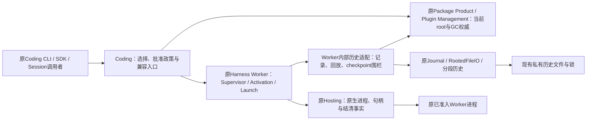
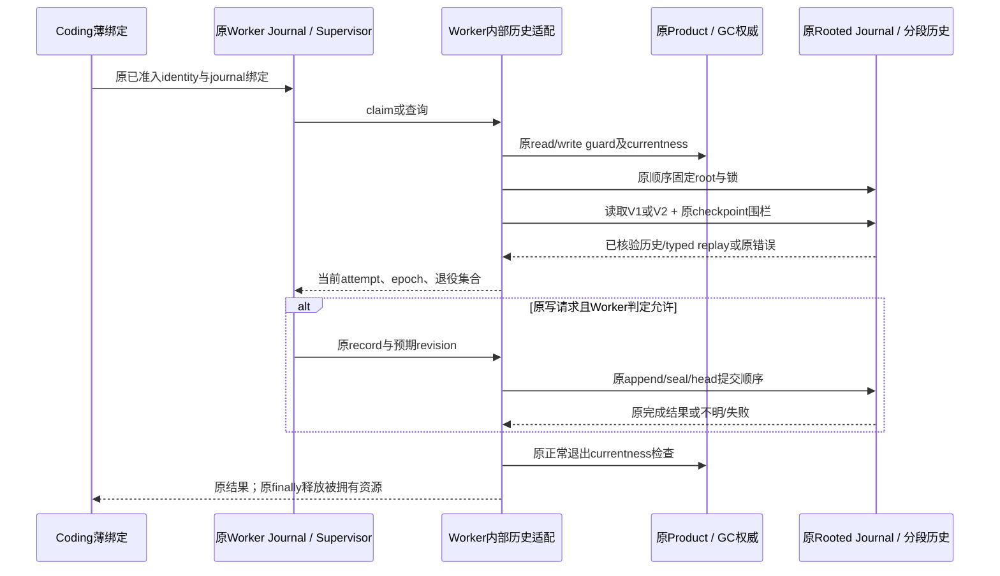

# H-COD-KD-004 R4.1：Worker历史职责归一

- Authority: accepted key design；设计起点事实、已接受合同与实施状态分开。
- Design status: accepted（R4五流存储、Rooted命令切面及原首片合同；R4.1接口盘点、兼容保留与成本合同）；用户2026-11-07接受图示职责方向，D1/R3/R4/R4.1技术合同经三视角复核，由实施owner内部接受，见[评审记录](worker-history-responsibility-convergence-review.md)。
- Implementation status: partial（A1–A15、A17）；指定历史/物理路径及A17原Session中的普通图与Worker关系操作已接通；各项有界技术接受和测试终态见[执行记录](../coding-responsibility-convergence-progress.md)，其余Worker、Product预检/清理及整个Goal仍未完成。
- Owner: Harness Worker、Journal、Package Product、Hosting各原职责owner；Coding提供领域政策与薄绑定。
- 需求：[COD-RESP-GOAL-002](../coding-responsibility-convergence-goal.md)。本专项是第一波，不替代整个Coding≤15K目标。
- 方法：archmethod本地干净master `0f9bd3ff51afabeaaf76cc38dff1ceb279b7d37e`。
- 起点源：A86实际未提交实物，已校验保存，HEAD本身不代表该实物。起点Worker110文件/38,751行；当前数量及全成本由执行记录维护。

## 1. 要解决的问题与实际边界

首个业务路径是：已有Worker声明受原批准约束→Supervisor记录一次attempt及状态变化→只读查询→关闭/重开后回放同一历史→原进程和资源结清后才允许下一attempt。重开查询不等于重启进程、发布切换或授予清理权。

本专项起点时，[WorkerSupervisorJournal](../../../../../src/loushang/harness/worker/journal.py)已拥有claim/transition/epoch、重复attempt和未结清前驱拒绝；[Supervisor](../../../../../src/loushang/harness/worker/supervisor.py)已拥有运行状态机。当时Coding的[525行子类](../../../../../src/loushang/coding/package_product_worker_supervisor_journal.py)覆写持久化和V2语义投影，不能把它误称为第二个Supervisor引擎。当时原[分段历史](../../../../../src/loushang/harness/worker/_segmented_history.py)已经共享，Coding对应18行只是兼容转发。

静态AST导入清点覆盖110文件：从该子类可达的C07文件为43个/18,156行；其中一个静态强连通簇32文件。包含local/lazy/TYPE_CHECKING导入，不代表运行时循环或全调用图，也不等于43文件都须搬迁。它揭示Supervisor写入围栏与五流checkpoint、V2 owner index、retention以及启动清理事实有共同依赖，不能仅搬一个525行类后留下Core→Coding反向调用。

| 设计起点事实 | 起点源码依据 | 对设计的约束 |
| --- | --- | --- |
| Supervisor与通用分段存储已存在 | Worker journal、`_segmented_history`、Coding history_segments转发 | 继续复用；不新建执行状态机、分段引擎或第二权威日志 |
| 五种历史各有语义 | `history_stream_snapshot`的固定stems：opt-in、receipt、activation、start-gate、supervisor | 分开记录与typed replay；checkpoint关联它们，不合成万能事件流 |
| 产品Journal覆写rooted scope和V2读取/追加 | `_exclusive/_load_unlocked/_load_v2_state/_append_unlocked` | 原GC gate、线程锁、目录/文件锁顺序、late identity及writer fence必须映射 |
| V2读取依赖checkpoint与确切deletion ledger | `history_read_v2._read_with_index` | 允许缺席仅适用于原retired seals，不能把缺文件当空历史 |
| checkpoint写入围栏不修复、不授予retire | `history_checkpoint.read_coding_worker_checkpoint_writer_fence` | 读取、checkpoint发布、owner切换和物理删除仍是不同权限 |
| checkpoint中混有产品约束 | `backup_topology_revision`的Coding前缀，以及原Product精确类型检查 | 需要保留领域校验与首错位置；不能把所有DTO原样搬进Core或放宽类型 |
| 批准、进程身份和物理结清已有owner | 原Worker activation/launch/gated_start及Hosting | history仅提供事实；不能凭stopped/closed或日志可读推断进程已经不存在 |

上述源码已作关键路径核查；31个history/base命名文件共9,806行只是进一步检查集合，不是已证明的迁移/删除量。

## 2. 系统环境（职责方向已接受）

用户明确接受本图职责方向并要求继续细化专项设计；本图不表示新增进程或已实现合同，方向接受不自动接受下文未定接口。



仍为现有本机调用/受控子进程。初始实现只沿原支持Profile；Windows保持原candidate与既有平台Adapter，不套Linux FD假设、不新增平台开放。嵌入式与托管入口消费同一Worker业务owner，AppService租户/协议与连接寿命不进入Worker历史内核。

## 3. 组件内部分工与依赖

| 职责 | 唯一owner与候选实现位置 | 明确不拥有 |
| --- | --- | --- |
| attempt状态、CAS、epoch与重启次数 | 原Worker journal/Supervisor，保持既有受支持接口 | 产品批准、checkpoint来源授权、进程物理删除 |
| 历史语义、五流回放与checkpoint一致性 | 原Worker内部的history实现组；需要拆模块时置于`harness/worker/history/` | 新独立服务、全局registry或任意workflow执行器 |
| 锁/文件读写、tail与发布 | 原Journal/RootedFileIO与已有Worker分段实现 | Worker批准或把未知提交当成功 |
| Product当前scope/store/root和GC/retention准入 | 原Package Product/Plugin Management；Coding只绑定其原实例并作领域选择 | 五流字节解析和第二GC权威 |
| 用户批准、编码插件/平台选择、产品命名约束 | Coding Profile/薄适配 | IO循环、checkpoint状态机或平台进程操作 |
| 子进程启动、身份查证、停止与句柄寿命 | 原Worker launch/session和Hosting | 从历史推断新的执行授权 |

history是Worker组件内部责任组，不提升为新顶层子系统；实现位置需服从实际职责，而不是把43个源文件换个前缀复制。通用物理IO不能再在新目录另写一遍。Harness根目录新增实现为0。

共享历史路径通过一个窄的已绑定root/身份访问合同协作，优先使用现有rooted binding与Package Product guard。确有缺口才补Worker内部端口，限定为：取得原root、scope/store；进入原read/write guard；在原位置检查currentness。不得传大Product/context，也不得把动态getter、guard或currentness提前冻结为构造时值。此端口不授予额外权限、不新增锁，仅保持原原子边界；确切签名与各旧读写时点须列入实施前合同表。

## 4. 关键决定与替代方案

1. **保留已有引擎，收敛历史适配。** 不选重写Supervisor，不选把Coding完整Product传入Core。优先在原Worker的既有storage覆写/注入点组合原历史与Journal，而不是另建StorageManager。
2. **先分清事实，后拆源文件。** 五种typed history、checkpoint、owner index、deletion ledger各有原语义；Writer fence与回放机制归Worker，原Product/GC/原生事实准入归其owner。Code→Core迁移不得留下Core import Coding。
3. **平台只在既有差异处适配。** POSIX与Windows保留各自事实、锁、ACL及恢复路径，不建立统一状态机掩盖它们的差异；能共享的记录/算法复用同体。
4. **领域约束不以搬迁消失。** 对有Coding前缀、精确类型或调用者扩展点的记录，比较“原类保留薄外观、继承/配置已有共享机制”和“共享类加必要兼容导出”。只能在实际字段/首错/类身份/旧pickle/公开导出映射成立后选定，不能先搬类再补兼容。已有RecordSchema/Journal codecs优先使用，不建另一套schema DSL。
5. **不以Checkpoint包办运行恢复。** committed记录、允许缺席与物理进程已结清不等价；保持原join与授权，重开不自动启动或重放外部副作用。
6. **首片交付完整Supervisor历史路径。** 覆盖原V1分段、V2 retained replay和checkpoint写入围栏，以及close/reopen/query/下一attempt判定。相关其它四流的必要读取合同必须一并闭合；payload启动/物理清理仍调用原owner，不为“完整”而在首片重写它们。

## 5. 组件交互及失败路径



| 关键场景 | 必须保持 |
| --- | --- |
| 状态/epoch/incomplete只读查询 | 不创建缺失Worker历史或Worker锁；GC guard仍用原`guard(require_write=False)`，不能承诺所有旁路协调文件均无IO，也不能换成`read_guard`或shared-lock Profile |
| 初次写入 | 原history/lock存在性一致检查、初始化empty target/head及失败后痕迹保持；不把缺lock一概修复 |
| V1/V2重开 | V2 owner/preparation/index选择依据和scope/store验证保持；旧typed replay的retired attempt/epoch不可重新使用 |
| checkpoint后的追加 | 原source prefix、高水位和attempt/epoch退休围栏先于提交；不得消费缓存的早期checkpoint替代原重读 |
| tail、seal/head或追加不明 | 原owner判据与error/code/优先级保持；查询见到字节不意味着原写入者可以盲重试 |
| GC或root代际改变 | 原guard及currentness读取时点保持，目录身份/权限检查不加强或降低，失败由原owner收束 |
| 停止/取消/关闭失败 | 原重试就绪集合是`stopped/process_settled`，`failed/fenced`尚不放行；保留原结清流程、句柄和重试凭据，不对原合法stopped新增Hosting查证门槛 |
| checkpoint/切换/retire | 五流固定关联与原锁顺序、独立确认、准备/发布/删除权威保持；查询不获得这些动作权限 |

## 6. D1：原scope与最小绑定合同

本节根据现有源码细化合同，不是已运行的新实现。原`CodingProductWorkerSupervisorJournal`构造时先检查POSIX、Product类型及product_id，再读state_root并交原基类resolve成固定path；这与操作中重读scope/store不同，不能一律提前或一律改成动态路径。

候选复用原Worker Journal的storage覆写点；新Worker内部rooted适配仍继承原state/CAS主体。Code外观保留原构造签名和产品准入，将同一完整path交适配构造。原内部钩子一一接续：`_exclusive/_load_unlocked/_append_unlocked`及`_last_revision_unlocked/_latest_for_key_unlocked/_claims_since_stop_unlocked/_attempt_retired_unlocked`；后三者与revision hook保留V2语义，不只返回current_attempts就结束。

若现有绑定不能表达以下合同，只补Worker内部窄访问端口；它不是新权威或公共服务：

```python
class WorkerHistoryAccess(Protocol):
    @property
    def scope_id(self) -> str: ...
    @property
    def store_id(self) -> str: ...
    def guard(self, *, require_write: bool) -> AbstractContextManager[object]: ...
    def assert_current(self) -> None: ...
```

Code绑定仅把上述属性/调用映射至原Product的policy.project_scope_id、epoch_runtime.registry.store_id、gc_gate.guard和assert_root_gc_authority_current；不取得新的系统能力。传入path仍按原构造时点确定，scope/store按原V2/checkpoint具体使用点读取，不由端口提前快照。端口对象不暴露完整Product、管理服务或任意查找。其余typed reader/fence合同仍属D2，未由本端口虚构补齐。

| 原位置/顺序 | 必须保持的响应与失败边界 |
| --- | --- |
| status/next_epoch/incomplete/attempts进入 | 先设置原ContextVar读标记；finally恢复；原通用状态方法及参数校验不重写 |
| `_exclusive`进入 | `gc_gate.guard(require_write=not read_only)`→原线程锁→assert_current；不能换原Product.pinned_state_root_gc_read，它没有同一GC guard且增加复核 |
| root pin | 对构造时path.parent按原flags open→fstat→可见lstat→原dir/UID/mode077/identity判定；不新增attributes、nlink、平台或额外currentness检查 |
| Rooted绑定与存在性 | 复用原RootedFileIO/bind；history-or-manifest与lock存在性、V2 owner缺lock的先后拒绝保持 |
| 文件锁/初始化 | 读请求无现有Worker锁时不创建；有锁或写请求沿原排他锁；仅原新建分支初始化empty target/head，不修复孤立lock/history |
| body | 临时保存原rooted/history/replay；读取仍是原strict raise-tail，不能套通用Journal默认repair策略 |
| body正常完成 | 原assert_current；随后清空临时引用、退出Rooted绑定/IO，正常退出才作可见root身份后验 |
| body/后验抛错 | finally仍清空临时引用并释放其拥有资源；不把正常路径后验挪入finally覆盖首错，保留close可覆盖原错误的上下文 |
| 最外层退出 | 原root FD finally close→退出线程锁→GC guard；不新增长期缓存、跨流锁或全局串行化 |

原`WorkerAttemptRecordV1.process_settled`表示`stopped/process_settled`；不等同全部terminal。原Supervisor失败结清先terminate→process.wait→session.close，再尝试持久化process_settled；追加失败仍留原未就绪事实。本次不借重构改变其重试集合或新增自动恢复权利。

## 7. 分步实现与全成本

第一交付先沿Supervisor记录—查询—重开这条路径切开读/写物理适配和产品选择。必要的typed replay、checkpoint-reader和其callee必须包含在同一可审查闭环，不能只移525行壳。后续依次归一其它四流writer、checkpoint/retention/cutover动作、payload/回收及平台适配；每一步仍是完整可用场景。

实施前补出函数级处置表：直接复用、原owner必要扩充、Code领域保留、必要公开兼容、实际退出。冻结原输入/输出/错误与受支持Python/CLI/持久合同。`38,751`、`18,156`与`9,806`均是不同检查集合，不相加、不当删除收益。纯迁移可以有明确必要成本，不能称重复消除；全部Codec/端口/兼容/接收方成本计入，最终整个Goal必须系统净减少。

### D2 首片依赖边界

已按实际符号固定26个关键位置及源码/AST指纹。下表给出拆分边界；行数重叠，不作收益。R3进一步选择下述完整读取依赖切面，不整文件迁走其余发布/删除动作。

| 实际位置 | 候选归属与拆分 | 必须继续闭合的依赖 |
| --- | --- | --- |
| Supervisor产品子类 | Code只留原构造准入/路径与绑定；scope、load/append和V2语义hook归Worker rooted适配 | 原模型/reader/fence绑定；不能在Core内部import Code |
| Supervisor语义base / replay / segment parser | Worker attempt/epoch/retry投影与原状态不变量 | 原`_MAX_BYTES/_MAX_RECORDS`当前从Code Journal导入，须消除此环并保持取值/限额合同 |
| stream snapshot值与capture/extension函数 | prefix/摘要/快照算法归Worker；原Product准入与已绑定root由薄适配表达 | 原exact snapshot类、五固定stems、scope及Rooted寿命 |
| checkpoint `_read_records/_anchor_for_records/read_*_writer_fence` | Worker的读取、已提交tip与写入围栏；不含retire授权 | 原checkpoint类型/codec、namespace校验、anchor及不修复模式 |
| V2 `_read_with_index/_read_sealed` | Worker校验manifest/head/prefix、checkpoint及确切ledger后回放 | 五种typed base及原prepared/index/ledger映射；缺段许可不扩大 |
| checkpoint发布/repair/rollback与Product preflight | 原权限决定与机械提交分开，动作按后续完整场景接管 | 不因为首片需要reader就把写入/删除能力塞进reader端口 |

#### 五流语义与读取接口

五流有各自的值类型与replay，按原固定顺序组合，不建立可注册任意stem的泛型引擎。共同字节处理继续使用Journal/RootedFileIO、原canonical函数和已共享分段实现；只迁移Worker特有的语义与一致性算法。

| 固定流 | Worker内保留的typed语义 | 复用与必要绑定 |
| --- | --- | --- |
| `worker-opt-in` | 最新decision、代际与kill-switch高水位、退休operation ID及原fold/parser | 绑定原公开decision类型；用户是否批准、选择哪个plugin仍由原入口决定 |
| `worker-activation-receipts` | issue sequence、fingerprint退休集合、retained记录及原严格decoder | 复用原Journal codec与Worker activation receipt；不把receipt签发准入移入reader |
| `worker-activation-state` | 原`_StateRecord`、CAS revision、retired attempt及原fold | 直接复用Harness activation-state模型；不重新定义C5状态 |
| `worker-start-gates` | 各attempt最新gate、retired attempt和原fold/parser | 绑定原gate值类型；Product base scope与记录Session scope仍不同，不要求二者相等 |
| `worker-supervisor` | attempt/key状态、epoch、claims与retired attempt及原parser | 复用原`WorkerAttemptRecordV1`、`_TRANSITIONS/_validate_history`；不改变重试就绪判据 |

首片收敛四组协作，内部模块可按这些职责拆分到`harness/worker/history/`，不再引入独立manager：

1. **值与投影。** 上述五流模型机制、snapshot/prefix、checkpoint/anchor、stream/index、preparation intent、prepared bundle、deletion ledger和可选no-effect archive的读取所需值机制。跨流opt-in→receipt引用闭合仍在Worker；它只证明历史引用，不证明原生进程不存在。
2. **已绑定读取。** 原`RootedFile`作为输入，沿原顺序读取owner→preparation及其全部artifact→checkpoint fence→ledger→manifest/head/segment→typed replay。prep reader的`None`、孤儿、缺项和摘要错误保持；Supervisor读取也必须验证其它四流artifact，不能只解自身base。持久文件名、五流顺序和容量值不改。
3. **Supervisor storage覆写。** 原Journal的七个hook配合D1访问合同，负责记录、查询和追加；V2 reader及checkpoint fence直接使用上一组共享机制，不从Core回调Coding的整段旧reader。一次操作内原临时引用和原锁边界保留。
4. **原动作入口。** Code保留Product精确准入、Coding前缀政策、选择与guard装配；checkpoint publish/repair/rollback、preflight/stage/commit/retire仍沿原owner及原权限。首片只把这些动作所需的公共值/读取依赖改为同一机制，不能为解除import顺手增加写/删权限。

实现时应把`history_checkpoint`的纯record/reader与Product动作、`history_stage_v2`的intent/reader与stage/rollback/preflight依赖拆开，避免reader导入writer再导回Code。收敛后的依赖必须为Code薄绑定→Worker history→原Worker/Journal/资源值能力；Harness history不得直接或延迟import Coding，亦不得靠整段Code算法回调绕过该约束。必要的公开类型绑定只能提供值构造、原codec和纯领域谓词，不持有Product/GC/Hosting或执行IO。

共享边界仍保留原精确类型判定。每个机制只接入所需的固定相邻值类型/原`JournalRecordCodec`，在装配时绑定，不增加全局type registry、万能HistoryContext或可运行任意动作的callback集合。prepared bundle仍对五种base的类型及顺序逐项精确验证，不能用“实现同一Protocol”放宽原`type(x) is T`。Core自身需要的结构类型只用于静态类型检查，不代替运行准入。

Supervisor parser当前按值导入的`16 MiB/4096`与start-gate的`32 MiB/4096`随其解析机制归相应Worker内部模块；Code旧私有名仅保留兼容引用。不把这些parser限额改成新的Product配置或运行期getter，不更改每条record/base现有独立容量限制。原storage读取Code局部限额的调用时点另行保留，不与parser的导入期取值混同。

#### 读取的失败次序和权限

`read_fence(rooted, scope_id, store_id)`对应原`read_coding_worker_checkpoint_writer_fence`：只读取原已提交tip，`settle_lag=False`。原head-changed分支读取uncommitted-tail中的committed视图后重读，保留原错误过滤；查询不得调用repair、rollback或advance-anchor。V2 `read_retained(rooted, stem)`沿原owner及prepared选择；`verify_precommit(rooted, stem, prepared)`仍要求尚无owner且不允许deletion debt，两个入口不能合并成自动选模式。

原reader使用`isinstance`区分receipt/activation的revision，其余取`last_revision`；该结果必须等于物理total revision。保留这个实际规则，不用统一“最大revision”替代。仅exact ledger中退休seal允许缺席；retained seal、active、head仍按原分支失败。上述逻辑不缓存跨操作的prepared、fence或currentness，亦不增加读全历史次数。

#### A2实现对共同base envelope的落实

五种base已复用原RecordSchema的字段遍历及同一个Worker内部base codec，原语义validator和相邻具体类仍各自负责。schema在具体公开dataclass装配时编译一次；所有这些dataclass字段都是现有wire字段，辅助字段不得自动视作兼容格式演进。receipt纯codec绑定仍按原调用时点取得限额与codec，其余两个V2 parser保留按值限额；不引入大context或任意IO回调。

共同编码按dataclass字段序读取属性，原字典字面量取属性顺序不同；原支持的具体不可变值已有旧源码字节/首错样本验证，不承诺任意有副作用getter或私有重绑定的轨迹等价，也不预支零性能开销。现有bytes→JSON→构造→canonical回验的次数不变；无额外物理IO。A2三视角实际代码范围与限制见[评审记录](worker-history-responsibility-convergence-review.md)，不表示整个D4已验收。


#### A3–A4实施对读取切面的落实

复合值使用已有RecordSchema和base envelope，保留各原decoder的独立容量、canonical及catch范围。NoEffect嵌套RetainedAttempt是投影，不要求其所有未来字段都是协议；明确固定原11个wire字段及原构造顺序。stream读取1MiB而编码无界的原行为不借迁移调整。产品no-effect限制仍是Code纯绑定，join不产生Hosting清理许可。

checkpoint读取实际接口在Worker内部`_checkpoint_history.CheckpointHistory`：构造仅接record/anchor/error具体类型。`read_records(rooted, scope_id, store_id, history?, max_record_bytes, max_segment_bytes, max_active_records)`返回原具体record tuple及原segmented值；`read_writer_fence`同限额且没有settle/repair参数。限额保持原4MiB/32MiB/4096默认值，Code调用时传原局部值，既有测试覆写合同不丢。没有新root获取、跨操作缓存或Product/GC回调；reader的副作用仅为原读操作。

原anchor机械操作也在同一已绑定历史适配，但其使用权由原调用者决定：`anchor_for_records(..., settle_lag)`只有显式True才沿原compare/write推进；`advance_anchor`仅保留原发布后机械更新。writer fence自身永远False。Product发布/repair/bootstrap/rollback与root guard仍在原owner，不能把适配有写方法解读为查询获得授权。Code原公开入口和所需私有兼容名留薄转发；A4时完整preparation/V2 reader与Supervisor storage尚未闭合；下文A5–A6已完成指定存储路径。


#### A5–A6实施：固定读取组合与Supervisor存储适配

`PreparationHistory`仅绑定prepared/intent/error三类，按原顺序核对全部artifact，并使用prepared已绑定的五个base/stream/可选archive值族。`RetainedHistoryReader`组合同一preparation、checkpoint适配与原ledger/result/error类，保留precommit与committed两个入口和各自deletion-debt规则；不接Code的整段reader或IO回调。文件名由Worker历史格式单源定义，Code薄导出；原公开DTO字段仍由Code声明，通用机制体退出。

`RootedSupervisorJournal`继承原WorkerSupervisorJournal，以D1的WorkerHistoryAccess和上述固定reader为输入，接管原七storage hook。Code的_CodingHistoryAccess只把四项接口映射至原Product；scope/store按使用点读取，path仍在构造期确定。原parser限额保持按值导入；原storage调用时Code局部限额由薄getter延续，作为已存在测试注入的兼容，不引入可选Product配置。Code facade仍作原POSIX/Product准入，并保留原公开类名/构造；未新增状态引擎或RootedIO。

十二个方法含独占scope在access映射后保持原AST；真正的root/锁/文件操作仍是原同体。初次装配会加载固定纯值族，未承诺零冷成本。原原生启动、批准、清理和进程结清owner不变。首条存储闭环及原要求的结清后下一attempt有本地联合证据，接收方所有类型/薄绑定成本完整计入；范围和接受见[代码评审记录](worker-history-responsibility-convergence-review.md)。

### D3 公开类型外观及兼容选择

R3选择**原Code公开dataclass字段/构造留薄外观，Worker提供机制mixin**。不选择直接alias所有Core类：那会改变公开类module、pickle路径和exact-type关系；也不靠修改Core类的`__module__`伪装旧名。公开异常类及错误字符串保留原映射，Core机制通过对应局部绑定构造原异常，不把错误统一包装成新异常。

Code外观保留原模块/类名、字段顺序/默认值/annotations、dataclass frozen/slots、签名、repr和公开导出。mixin无实例dict，继承的通用方法按原时点调用必要的纯Coding谓词；例如checkpoint的`coding-product-backup-types:`校验仍处于原短路判断位置，不能先跑摘要校验或把缺前缀放行。相邻公开值类由各自薄绑定提供，返回/重建仍为原公开类型，精确类型校验不改成接受任意子类。

共同机制只保留一份；Code不再留与mixin相同的validation/replay/IO方法体。普通值字段声明和原异常名是兼容表面，不是第二份持久事实。现有RecordSchema只复用其能够保持原字段/首错/排序的部分；原不同的canonical parser及跨字段判定不能为使用schema而改变接受集合。

| 兼容面 | 本次合同与实施验收 |
| --- | --- |
| 公开Python | 原imports、构造签名、精确返回类、dataclass字段、frozen/slots、repr及公开导出保持；不承诺旧私有MRO或函数源位置 |
| 旧磁盘数据 | 同一V1/V2 bytes由新路径读出同一值；新路径写出的bytes、ID、digest及文件名与原算法一致，无升级迁移 |
| 错误 | 校验顺序、类型/code/message及cause边界以原路径为准；多字段同时错误也须保持首错 |
| pickle | 保留原公开module/name及字段布局；固定旧fixture验证新reader，不把同进程对照说成旧安装环境证明；若实际存在更广支持面，随原支持范围补证，不新增pickle存储协议 |
| 平台 | POSIX保持原能力；原Windows仍调用原平台路径，纯值共享不将candidate提升为supported |

#### 已有小范围可行性证据

在产品树外对两个原真实值类型作了一次惯性原型：CheckpointV1和SupervisorKeyBaseV2保留原公开类外观，继承提取的共同class体；Coding namespace谓词仍由薄外观提供，调用保留在原布尔判定位置。原167条字段/首错/签名/fields/repr/frozen观察先从未改的原类固定；候选比较通过，pickle协议4/5均验证了旧数据到外观、新数据回原类的双向装载。before/after各1 passed，不合并为新增334项业务覆盖。

该原型仍借用原helper/type bindings，未提供可安装Core模块、完整五流type family或真实IO/授权路径；不能据此声称这些实现已经通过。R3在其有限证据上作出上述设计选择；实际Core依赖、exact-type family、旧版本读写与全部适配成本随D4实现核验，不预支净减或承诺所有Python反射属性保持。

进一步的机制mixin变体将原字段声明、dataclass构造与namespace谓词保留在Code公开外观，Worker基类只含机制方法、不含实例dict；同167预期及pickle对照通过，并保持这两个公开类自身的annotations。优先沿此方向草拟：Code留下必要兼容声明与纯领域条件，通用校验/回放/编解码仍由原owner组合现有能力。是否需要的静态字段协议、绑定类型及其代码成本均须计入D4，不用新registry或大context承载。

以上比较to_dict投影，不是直接证明所有canonical字节相同；反向pickle只是同进程回换两原类装载，不是旧安装环境或整个家族逆向兼容证明。独立数据视角已确认首个原型支持继续研究而不关闭整个D3；第二变体也只按上述限定范围报告，不把两次167观察累计为新覆盖量。

### D4 实施顺序、全成本与交付条件

D4分为设计时的成本口径/验收合同与实施后的替代证据。R2把“完整替代diff和真实端到端结果”写成任何实现之前的必要实物，混淆了设计就绪与实现验收；R3纠正此顺序。职责、接口、数据与失败合同经增量评审接受后即可编写实现；不要求先在产品树外复制一套完整Worker再搬回。没有实际结果仍不得宣布首片交付。

按依赖自底向上实施、按完整业务路径验收：

1. 提取五流所需值/投影机制和原公开薄外观，先用固定旧fixture、bytes/digest/首错对照证明兼容；Core模块真实导入不依赖Code。中间可运行、可审查，但仅值迁移不称Supervisor闭环完成。
2. 拆开checkpoint/preparation的纯读依赖与Product动作，接入同一共享五流reader及原writer fence；原Code公开read入口成为薄转发，旧读取循环随替代删除。原stage/commit/repair/retire消费同一值，不复制模型。
3. 将Supervisor storage覆写接到原七hook及D1绑定，完成V1/V2记录—查询—关闭/重开—原结清后下一attempt；确认原拒绝/未知结果、资源释放与平台路径。随后进行三视角代码评审，完整报告实际替代、保留和未完成范围。

成本从Goal冻结起点按实际物理源码统计：`Coding减少 = 原Coding - 当前Coding`；`系统净减少 = 原四生产根总行数 - 当前总行数`。必须同时列出Coding删除、各接收owner新增、Code薄外观/绑定、Core类型标注及codec适配；同一文件只计算一次。测试/文档单列、不充当生产代码收益。原38,751行Worker与43文件可达集合只表示检查范围，当前没有可信的首片净减预测。

迁移代码不是去重收益。若首次实际diff显示新端口/绑定比退出旧实现还复杂，应在相同职责内简化并复核，不为达标压缩格式、删除兼容或搬出统计根。不得以“首片只迁移”取消整个Goal的系统净减和Coding≤15,000行要求；也不为单次迁移强造一套重复算法来保证局部负数。整个Goal基线137,755/634,794保持不变。

本次不要求新测试矩阵或门禁。验收沿下节原测试及实际触及的记录兼容/异常反例进行；新发现的合同变化按其重要性回到设计，而不是由实现自行放宽。用户已接受系统环境和职责方向，本修订不改图示owner及外部交互；内部技术评审不能扩大该用户接受范围。


### R4增量：其余四流存储合同及A7实施切面

本段为R3之后已接受的技术设计增量。原三视角独立复核及运行视角codec澄清复核无未闭合阻断，实施owner于2026-11-07接受C5/opt-in切面；不撤销Supervisor路径，不改变§2用户已接受的系统环境/owner方向。R4设计起点四个Code文件共2,989行，其中政策/装配和存储混合，不能当作全量删除池。先实施C5与opt-in的完整读写路径，gate/receipt后续沿同一职责边界处置，整个Goal不因此缩小。

| 流 | 原机制直接复用 | 原有差异必须保留 | Code保留 |
| --- | --- | --- | --- |
| C5 activation-state | 原WorkerActivationStateJournal的绑定/锁/read-only合同、_StateRecord/CAS，现有C5 fold/project及固定V2 reader | 旧path构造；可选scope/store在构造期固定而非Product动态读取；缺owner时按原五文件顺序拒绝checkpoint；read-only replacement-owner hook；原strict/canonical/retired attempt与不同catch分支 | 原公开构造/类名、必要公开retained类型导出、固定值族装配；存储限额保留实际调用期测试覆写 |
| opt-in | 原PluginPackageGcReservationJournal、bind_private_journal、五流值/codec及V2 reader | current用guard，current_read_only/history用read_guard；V2锁create=False；V1写前孤儿/缺锁检查与只读共享锁；operation精确重试、退休ID/代际/kill高水位及retained receipt引用 | 原公开decision/projection DTO、选用的Policy DTO及纯codec/限额；构造/公开入口薄适配 |
| start-gate | 原bind_private_journal与typed gate fold、V2 reader | current/attempts仍是原guard(require_write=False)而非read_guard；current无新增退出currentness；append为写guard且原currentness位置保持；锁初始化与opt-in不完全同体 | local-worker-candidate产品准入与所选Code record/codec/限额；不能把审批判断迁入Core |
| receipt | 原Journal/Rooted、Worker activation receipt模型、typed decode及V2 reader | 签发先后、serialized admission、选中payload/native closure/discovery与Product授权保持；不能把纯历史搬迁扩大成新的receipt签发权 | 原选用/签发/产品推导/原生材料及装配政策；以后仅拆其历史IO与机械追加 |

不以一个flag表把这些Profile塞进万能Journal。C5在Worker内部存储适配继续继承原C5引擎，opt-in在Worker history实现自己的既有CAS/代际日志，均直接消费原Rooted/分段/codec而不复制底层。物理binding继续调用bind_private_journal或原C5基类；不新建目录pin、日志引擎、权限owner或跨流锁。

**A7接口与依赖。** C5/opt-in的原公开Code类留薄构造/绑定，机制分别置于history的activation/opt-in存储内部模块。C5接收既有固定RetainedHistoryReader；opt-in接收该reader及原projection/error值类，并保留原scope/store/gc_gate输入。projection仅作为原公开值构造，不另造有竞争字段/寿命的投影。实际record/policy/replay类型从已绑定五流值族取得，原isinstance/exact-type及具体构造不改成Protocol准入。Core不import Coding，也不调用Code整段reader；Code只可提供原纯RecordCodec和必要限额值选择，不能借此携入Product/GC/Hosting操作。C5和opt-in均复用原Codec对象，codec/format由Code薄纯值getter在原append参数求值点取得，不作构造期快照，也不把Code局部alias改为另一个Core global。C5先求path/codec/format/durability，最后才求bound_file sibling；opt-in先取target，再求codec/format。两条顺序分别保留，不能为共用append包装统一成同一形状。parser导入期限额与storage调用期限额继续分开。

**重复机制收敛。** 在现有CheckpointHistory中最小扩充三项已有重复操作：缺owner时按原五个文件stat的拒绝（只在原调用方判定owner缺席后调用）；对原checkpoint/anchor/segment异常保code和cause地翻译成调用方原异常；按原snapshot类型核对指定流prefix并返回已checkpoint revision。接口只接已绑定RootedFile、原scope/store、固定stream index、原异常构造与code，不接授权/查询回调。无checkpoint时各旧入口的0/None返回由各薄调用者保留。Supervisor与四流只复用真正相同的部分；其不同的V2源判断/错误文本/是否返回revision仍各自负责，不把一个流的更严策略套给另一个流。

**失败与寿命。** 读操作不创建原未允许的文件/锁，不修复/推进anchor，不缓存跨操作prepared/fence；CAS仍在原锁内先校owner/checkpoint/retired再追加。seal→append→head的既有顺序和不明追加债务保持。未取得owner时不把缺文件视作空；授权/启动/物理结清继续沿原owner，状态可读不获得新的运行权。frontier、optional owner、V2 retired replay及原catch/cause差异必须用真实源码/原测试核验。

**成本与交付。** A7起点为A6实际实物：Coding132,992行，接收history5,837行，全系统635,868行，Goal起点137,755/634,794不变。四流2,989行与本批两流1,261行只表示检查集合；不预支删除量。所有泛型/codec getter/绑定/兼容成本计入，先复用已有能力再加必要适配，并在本批退出原循环体。复用原C5/opt-in、分段/append-tail/V2/retire与消费者测试，只补新的公开projection/存储联合缺口；旧fixture不就地重造，不新增门禁/平台/付费试验。通过后做实际三视角代码评审并记录真实成本，整个15K及系统净减要求继续生效。


#### A7对R4的落实与兼容接缝

C5/opt-in存储分别落在Worker history的_activation_store/_opt_in_store，直接继承或调用原C5引擎、GC、bind_private_journal及已共享reader。Code留公开值/构造与pure codec/format/limit绑定；projection仍调用原Code类，不复制四字段。Code change的具体Policy输入类型通过泛型绑定与薄入口保留。C5原staticmethod有真实消费者直调，Code留下纯检查的静态兼容，Core内部用自己的_source_revision，不反调Code算法。

共同异常翻译以CheckpointHistory.translated_errors上下文实现，保持scope/store实参求值在原try区域内；只翻译原三类且保code/cause。原缺owner配置分支才调用同序五stat；prefix按固定stream与原snapshot类型，C5/receipt/gate返回int，opt-in返回None。没有新增修复、writer授权或跨操作缓存。receipt/gate仅这两项机械callee接共享，选用/签发政策及其它方法原AST不变。

本片原75条append-tail预期未改；故障注入改定位真正实现模块和原Code值源，避免为测试留下Code IO回调。定向曾发现receipt薄包装漏revision、已按原源码及旧测试恢复int；类型检查发现具体入口的替换关系也已通过Policy泛型/兼容静态入口解决，不靠ignore或更严准入。当前实际全成本、三视角与来源限制见[执行记录](../coding-responsibility-convergence-progress.md)和[评审记录](worker-history-responsibility-convergence-review.md)。

## 8. 验证、待关闭项与评审

复用原Worker journal/Supervisor、`test_package_product_worker_supervisor_segments`、`supervisor_checkpoint`、`supervisor_v2_route`、`supervisor_base_v2`、history read/checkpoint/cutover与已有IO兼容测试。按实际变化补旧首错/锁/缺失/取消/未知结果反例，不按文件数新建矩阵，不新设PR门禁、不跑付费模型。

R3冻结对象三视角增量复核均无实质设计阻断，实施owner接受首片设计并按D4开始分步实现；不是代码验收。当前处置为：

- D1：R2已给出原storage覆写映射、固定path/动态scope-store、原guard/锁/正常退出与finally表，以及必要时的最小绑定签名；三个独立视角增量复核通过，实施owner接受D1设计合同，实际替代证据仍随D4验收。
- D2：R3给出五流语义/固定顺序、完整读取依赖与纯读/动作切面；评审应核是否还有会迫使实现者发明的关键接口语义，而非要求预先写完所有函数。
- D3：R3选择原公开dataclass外观+共享机制mixin，规定exact-type、领域前缀及首错、旧格式/公开类/异常映射。原167观察只是有限输入，实际兼容验收继续随实现。
- D4：R3规定分步替代、全成本计账和交付条件；A1–A6已给出指定Supervisor存储路径的实际diff、联合场景、行数及三视角审查，本地技术接受见评审记录；其余writer/动作及整个Worker首波尚未完成。

三视角应分别核职责/复用、运行/失败、数据/兼容，并综合检查跨组件时点；内部技术评审不代替用户对重要架构工作件的评审。R3技术设计有实质缺口时先修订，设计接受后按D4实施，无需重复请求已获职责方向授权。全Coding15K工作仍包括后续波次，不能把本专项通过或完成写成整个Goal完成。

R1三份独立评审均认可方向可提交用户审阅，同时指出D1–D4尚未闭合，未假定缺失机制已实现。原R1对象SHA `a7948a4facda7e900e1769a4221ccc34fd89f5c00208ee0cf5b3aa6cb27348bd`与完整报告保存在产品树外。R2结构图未变，新增本节合同，明确查询不等于GC外围全无IO及原stopped允许重试，不能将该修订冒称R1原字节或三视角已经接受实施。

### A8细化：gate查询、追加与产品协调

R4原职责方向保持。gate通过原WorkerHistoryAccess四项端口接原GC/Product权威，固定reader接原五流值族；Code的四项映射在私有_worker_history_access内唯一实现，Supervisor与gate复用。原公开record/类名/构造、纯codec/format和存储调用期限额留Code，不把完整Product传Core。

查询/绑定/回放在Worker history的_start_gate_store内。current与attempts仍用原guard(require_write=False)，current只做入口currentness，attempts在返回前额外做原currentness。V1缺文件/孤儿锁/共享锁与V2锁create=False不统一成opt-in Profile；原parse/cause、canonical、revision/retired/manifest及prepared no-effect archive合并规则保持。读取不创建新目标/锁，不修复历史，不授予运行权。

追加拆成同一词法scope内的三步：Code先做原local-worker-candidate准入；Core的私有context进入原写guard→currentness→bound journal，原样完成checkpoint/V2/retired/前序记录与绑定检查；在原检查之后yield借入的RootedFile、history、原last_revision与checkpoint_revision，以及从本次原records取bool的has_records。不能用revision>0推断records非空：合法V2可有历史revision但current_records为空。next_revision仍为max(两个revision)+1，seal计数仍基于原last_revision。Code在这个scope内按原时点构造原activation journal，执行原initialized_read_only/必要load以及records存在时的原错误；然后直接调用Core机械record创建、seal→append→head，退出同一scope，不新增append退出currentness。中间位置为操作内短命私有值，不落盘、不缓存、不加第二把锁、不跨操作复用。Core不接受Code IO回调或整段reader，不调用Product activation政策；Code保留跨流协调但退出存储循环体。

record创建仍在activation协调之后，错误首序不前移；append仍先sibling target，后在原调用点读Code codec/format/durability，原限额与尾部未知结果不改。checkpoint源校验保int；旧静态纯检查入口保留薄兼容，复用同一Core机制。使用原固定record类型，不新建DTO/证据索引/恢复引擎。原rooted监督器Profile不改变。

本切面先以旧源独立捕获gate查询时序与历史不变，再复用原V2/检查点/base、append-tail、激活/启动消费者及Supervisor访问测试。真实业务协调不因存储迁移放宽；逐批报告全成本，内部评审只接受此范围，receipt、其它Worker动作和整个Coding≤15K/系统净减仍未完成。

A8实际接通上述同scope拆分，三视角代码审查无本片剩余阻断，由实施owner在授权下本地技术接受。原生产源/原期望及最终范围见执行与评审记录；不是整个Worker或整个Goal验收。


### A9细化：receipt历史存储与签发政策

沿R4保留receipt签发权威，不迁整个ProductReceiptOwner。Worker history的ReceiptHistory复用原bind_private_journal、分段append、CheckpointHistory、固定RetainedHistoryReader及原receipt codec/fold；Code保留公开record/构造、所选Product/Session/opt-in/native/discovery、nonce签发与reuse判定、serialized_admission、witness/material/derive及入口检查。共享原四项access，不再传完整Product或Code IO/reader回调。

issue的原GC写guard→currentness→opt-in current→derive顺序全留Code。只有derive通过后进入Core私有append-position context，持原bound journal/锁完成原checkpoint/V1/V2读取；yield借入rooted/history、原records/replay/checkpoints及独立last_revision/checkpoint_revision。Code在同一scope内按原session/plugin选择latest；同一decision/policy时原样return旧receipt，保持原位置退出且不生成nonce。否则在原检查之后生成max两revision+1及原nonce/receipt；Core随后才做原checkpoint fingerprint/退休集合检查、动态scope读取、原record创建与seal→append→head。位置不落盘/缓存，不跨操作使用，不新增GC/锁或统一签发器。V2 last_issue_sequence不能从retained_records长度推断。

公开批量查询先在Code做原Product类型检查与path选择，再由同一私有值绑定接Core原guard(False)→currentness→durable=False binding，无新增文件锁/退出currentness。默认retained_only=False在V2先按原错误拒绝，不能静默返回部分历史；显式retained_only才按原archive与retained合并/排序。单条查询仍先做原fingerprint检查。查询不授予运行权或修复历史。

保留scope/store求值边界：receipt调用_read_v2_state时先在caller求动态access属性，随后才进入helper原try；checkpoint fence则在原translated_errors区域内求属性，不把两者统一。V1 decode继续复用原decode_receipt_history；Code _decode_coding_worker_receipt_history仍是Windows消费者使用的纯codec/调用期限额薄包装，_parse_receipt_segment也是固定base纯绑定，均不可删或改成IO回调。Core storage用同一原Code codec/format/record类型及容量晚getter，append仍先target再读取这些值；catch/cause/容量/未知尾部不变。

先以冻结旧源独立捕获查询/签发时序和实际文件结果，验证缺opt-in/derive拒绝不触碰receipt日志、reuse不取nonce、V2全量拒绝与显式retained、双revision/退休指纹、call-time limits及尾债。复用原receipt V2/base/checkpoint、五流commit/retire、Windows纯codec消费者及test-facts Product路线；不新增平台/门禁/付费验证。原Code IO循环须退出，所有私有绑定/泛型/兼容成本计入，并经三视角代码复核。完整Worker/15K/系统净减目标保持未完成。

A9求值澄清：Core机械追加接原opt-in decision纯值，仅在原record kwargs位置读取decision_digest；不得在helper调用实参或fingerprint检查前取digest。原kwargs仍为journal_revision→动态scope→decision.decision_digest→receipt。Owner._load在V2只取原replay.retained_records；公开retained-only查询才合并archive/排序，不互相替换或新增去重。retained_only保持原truthiness，查询仍只校Product类型而不额外强加product_id==coding。


A9接收方去重：实际五种store已出现同一段“typed replay校验之后重读manifest→核active generation→用原空prefix+retained segments构造SegmentedHistory”。在现有RetainedHistoryReader增加私有机制history_from_retained(rooted, retained, *, stem, manifest_changed)，只复用这段物理重构；manifest_changed仅为原纯异常构造，直到原mismatch分支才调用，Supervisor原message/code/path也因此不提前取。各流原owner检查、typed replay/额外scope检查、catch区域及后续fold仍留各原store，调用前后不增读/缓存/锁。stem仍由固定五流调用者提供，不增加任意流注册或Profile flag。原四个相同V2 owner-presence stat移为同reader静态方法，store保同名staticmethod alias，只有FileNotFoundError代表缺席。Supervisor原通用_exists不强套此接口。此项单独计算相对迁移中间态的真实净减，不能拿来掩盖Goal系统总成本。

A9已按上述界面接通receipt指定存储与接收层共同重构，经三视角实际代码复核无本片剩余阻断，由实施owner在授权下本地接受。原Current、设计起点及最终全成本分列于执行记录；不接受整个Worker或整个Goal完成。


### A10细化：准备、发布与退休的Rooted命令

A10检查原stage/commit/retire三个Code文件共608行（混合Product入口、纯配置和机械命令），不把总数当全删预算。原Product wrappers的exact-type/coding/Linux准入、runtime quiescence→GC写guard→currentness→pinned root/Rooted bind、重新preflight及正常退出currentness保留在原Code路径，不能把Rooted命令误作新的发布/删除授权。preflight与retention的产品/原生/备份证据关联本批不搬，不反调Code整段reader或批准回调。

在现有PreparationHistory最小增加stage/rollback，责任从只读准备扩为同一非权威intent/artifact寿命；read保持只读，不选择owner。直接复用已有artifact编码、optional bytes与limit判断、原Rooted create_new/stat/read/unlink_owned，不新增事务引擎。stage先按原具体值族创建intent，再拒已有owner，缺intent才检查孤儿artifact，intent先于artifact落盘，最后原readback；重试只补同一intent的同一字节。rollback先拒owner，再按原顺序读intent/孤儿与可选archive；所有artifact先stat/read/stat与digest验证后收集inode，全部验证后才unlink，最后重验intent并按原身份删除。read/stage/rollback三个缺intent分支复用同一孤儿检查，stage/rollback共用同一owner-presence拒绝；不把read增加owner门槛。

新增Worker history内部HistoryPublication，只有同一固定RetainedHistoryReader值绑定，不持有Product/GC/Hosting或持久状态。commit/retire直接消费已有reader/preparation/ledger/retained reference closure；它是窄Rooted命令适配，不是调度/恢复/GC manager。两者相同的五流锁循环归同一私有方法，原固定顺序、exclusive/create=False及原异常code/cause保持；stage/rollback不新增这组锁。

commit先exact-type校prepared，再锁五流、序列化expected/read owner。已有owner只接受原精确字节；缺owner则先verify_precommit五流，核原receipt replay具体类与opt-in/receipt闭包，最后create_new唯一owner，再按原顺序读回五流。Rooted create_new后失败不推断回滚；同owner重试仍须readback而非见文件就成功。retire先锁五流并读五流before，随后read prepared，先精确ledger create/比较，再按原stream/seal顺序逐文件校size/hash、二次读字节并按inode unlink；head使用原seal-head字节。最后读五流after并比较before，保原removed与部分失败债务，重试续清不删除未列名的对象。

Code保留原公开函数/错误类及Product wrappers，Rooted primitives成为薄委托；公开prepared/intent/index/ledger类型与字节均沿原值族。原私有artifact/owner/unlink helper经源码导入核查无外部生产消费者时可退出，不保留Code IO回调。stage/rollback使用与原read相同的四个纯容量参数；Code在命令入口选择当前原数值，read本身仍沿原入口配置。retire将原三项物理容量和原Preparation read四项容量作纯值传入；commit保原index容量。默认值与调用前覆写保持，不新增用户可见配置，不承诺操作中任意热改Code私有全局变量。Reader内部原precommit/read的配置路径不改变，不强套命令配置。

复用原stage断点/rollback篡改与inode检查、commit缺锁/末流失败/发布前后未知结果、retire先ledger/首unlink后续跑、Product quiescence/guard/repreflight及GC消费者。只补原源码独立观察与尚缺的发布后lost-ack分支；不新建全平台/30秒矩阵、live调用或门禁。全部源/测试起点、真实去重与所有接口配置成本计账，经三视角代码复核后接受本切面，整个Worker与Coding15K/系统净减仍未达成。

A10按上述职责接通四个Rooted原语并退出Code旧体，三视角代码复核无本片剩余阻断，由实施owner内部接受。原Product wrappers/preflight/retention仍是本片既有权威/消费者，不因暂未迁移成为永久职责豁免；完整成本和未完成范围见执行记录。


### A11细化：payload物理寿命与修复协议整簇收敛

本批核Code payload 2,360行及registered repair相邻路径，不按行数假定可全删。沿已接受的Worker/Resources/Product职责方向，在Worker.payload私有子模块承接物理校验、单路径副本、具名修复记录及精确删除；不新增独立环境组件。Code保原公开DTO类名/字段/FQN与校验、Product/Session/receipt选用、GC/runtime quiescence、claim/settlement/native absence判据、lease/launch装配与所有授权/重查外层。Hosting的描述符封存和物理进程结清权威不迁入payload；文件可读或repair intent存在不授予删除/重启权。

复用比较：既有Journal write_all与Resources DescriptorReader/consume_file/路径canonical/JSON编码直接复用。Resources私有树读取会循环补读并按其树政策判定，原repair-file单次read+trailer、0600、UID、nlink 1/2及八字段前后比较不能强套；受控源发布器会预删staging/退出清理，Rooted create_new直接写调用者名字但登记operation cleanup、增加原regular检查/目录同步且托管FD；atomic_write才使用随机临时名。这些合同均不能直接代替原Worker具名staging债务及其关闭/失败顺序。故仅把原Worker特定元数据/续跑协议归位，不造第二日志/事务引擎或通用flag流程。单路径扫描/删除保原depth/成员/0700与0500/身份/顺序，不能强套更严格全树收集或不同删除算法。

Worker.payload分为纯值绑定/codec、共享repair journal、物理storage三个私有模块。纯值绑定只接原Code四种DTO构造类和原异常类，Core不import Code、不接Product/Session/IO回调；Protocol仅静态只读形状，原Code构造校验和exact/isinstance准入不放宽。Code保其原DTO声明和方法，必要私有helper保薄委托，registered等已有消费者不能因下沉失去名字。Core不保存跨调用FD或投影索引；借入的root/stage描述符仍由原caller或原词法scope关闭。

物理路径整体接通_write_payload/marker、repair-file读取、完整/空/未标记债务校验、remainder验证及删除、root/stage可见性。完整/未标记hash循环复用已有DescriptorReader/consume_file，在Resources增加最小exact-size摘要组合：只读原remaining上界，chunk 1MiB，截断错误在原位置抛出，trailer及前后metadata仍由原Worker caller按原顺序检查；零字节与部分read保持原语义，不偷读额外trailer。写入复用write_all并保原错误文本、0500转换、fsync与关闭顺序。单次repair-file读取不换成循环补读，不新增nlink/mtime/权限门槛。

四个repair格式共用一套具名read/publish/settle机械协议，仅配置原纯names/encoder/decoder/attempt accessor、原异常与错误文本/字节限额；无registry/调度或授权。read先原raw metadata读取，FNF返回None，其他OSError按原profile包cause；再decode/canonical/attempt绑定；双链接时只核原staging类型/身份。registered单链接还须拒已有staging，其他三型不增加这一条。保持raw metadata错误由原Payload异常抛出、registered后续解码由其原ValueError子类抛出的边界，不统一catch。

publish先读existing，匹配则按原settle重读，不同则原stale错误；缺失才在原时点编码body，仅unmarked保原写前长度拒绝。已有staging须字节相同且nlink=1，否则拒绝；新建则原EXCL/no-follow/0600→write_all→fsync→close。link时只抑制FileExistsError，fsync root后原readback并settle；失败保留原命名债务，不提前删stage。settle仍先重读相等，再stat，仅nlink=2时unlink staging/fsync。complete值仍原(plan, supervisor fingerprint) tuple，不造新公开DTO；字段/version/canonical字节/错误首序各由原纯codec保留。

所有外层Product/GC/claim/settlement逻辑原AST保留；Core内部互调不返回Code IO。Code薄口仅绑定原类/纯codec/配置，私有flags/常量可保持必要重导出，默认协议限额不变，不添加运行中热改私有global的承诺。所有旧体和四套重复机械发布须退出，本批目标是完整物理业务簇而非再挪几行写循环。

先从冻结旧源独立捕获四种DTO/tuple及repair读取/发布/settle、partial write/link/fsync未知结果和实际文件字节/权限，确保故障真实触发。复用既有Product test-facts、离线payload完整/空/未标记/registered repair与CLI消费者；不新设native/live/平台门禁或30秒矩阵。三视角设计与实际代码各审一次，全Code/接收方/系统物理行成本分别记账，不能把暂留领域协调当永久豁免。整个15K/系统净减与P2–P4保持未完成。


A11落实：实际物理簇已接通Worker.payload，四型repair read/publish/settle共用同一固定协议；Journal写循环与Resources摘要组合复用原能力。Code保原公开值与业务外层，物理旧体退出，三视角实际代码复核无本片阻断，由实施owner有界接受。源指纹、离线业务终态及全部成本见[执行记录](../coding-responsibility-convergence-progress.md)和[评审记录](worker-history-responsibility-convergence-review.md)；整个Goal仍active。

### A24：Payload十三入口的根借用职责归一

Design status: accepted focused R2；三独立设计视角核具体实物无阻断，由实施owner `/root`在原Goal授权内接受。Implementation status: implemented bounded local integration；三实际代码视角亦无本片具体阻断，实施owner接受实际两源及48项有限验证，详见评审记录。沿原Worker.payload与物理原语关系，无新增重要环境角色或用户待审图接受。

先拒绝R1整段迁移：十二恢复程序转移使Code减200、Core增299、系统增99行；两个所谓语义回调还会反向执行Code的Supervisor读取/GC/currentness与记录指纹，不能将没有直接Code import说成没有Code IO。原三处删除故障注入也不再命中。R1保留树外供分析，未进产品，不以A11接受为它背书。

R2直接复用原[PayloadStorage](../../../../../src/loushang/harness/worker/payload/_storage.py)，仅增open_root及内部普通scope；[Code payload](../../../../../src/loushang/coding/package_product_worker_payload.py)十三处预览、恢复review、完整/空/未标记修复、重开、intent查询及完整inventory共用该程序。Code原类型、quiescence/GC guard、claim/settled判据与三种partial程序原样保留；没有Supervisor回调、新_debt模块、第二文件系统、记录或恢复引擎。

原_offline先进入，scope随后在open实参位置取一次Path，在原可见根核验位置再次取Path；getter只为`lambda: product.state_root`，不提前缓存字段或执行Code物理IO。scope暂持原单个FD，不选择路径或签发权限。body/stage清理之后先close root，才由原_offline执行正常退出currentness；open失败不关闭未取得FD，可见检查失败仍关闭一次，body返回/失败/取消仍关闭一次，close失败保持原finally覆盖。普通__enter__/__exit__不抑制异常，也避免生成器将StopIteration转换成RuntimeError。每次调用新scope，不承诺该私有对象重入/并发使用。

原所有DTO自有字段/FQN/公开签名/codec/wire/文件名/上限、原Code实际删除调用与故障注入位置保持。registered原pinned root和materialize不同finally不强套；它们以及其它外层恢复、物化、启动协调仍须继续归位，不因本片成为永久Code例外。共享可见根校验现由Storage执行，不保证任意私有alias热重绑定或逐帧traceback相同。

具体两源全成本：Code1270→1199（−71），原Storage859→882（+23），系统净−48；包括scope字段/注解/导入全部接收成本。它消除十三份相同根生命周期骨架，不冒称十二恢复算法去重或完整Payload/P1完成。实施前原四函数11参数化节点通过；候选37项有限端口异常/两getter/逐AST及两显式源silent类型通过，不等原生环境或实际安装后回归。实际终态、三视角代码结论和全量计量见[评审记录](worker-history-responsibility-convergence-review.md)，完整15K/系统净减及P1–P4仍未验收。

### A12细化：checkpoint完整写入/恢复与五流快照接管

本批沿用户已接受的Worker/Journal/Resources环境与职责方向，不改变外部环境组件或任何授权权威。核当前Code checkpoint607行与stream_snapshot227行，共834行；保原公开checkpoint/snapshot类、字段/FQN、前缀判定及构造/纯类型绑定，不整包迁入Product或重造Reader。P2的新环境图仍待用户，此片不借该待评方向实施Session/Plugin改动。

选择在Worker history内部接入完整checkpoint命令（严格读、发布、一次完整追加修复、尾部rollback）和五流V1/V2快照/扩展核查。现有CheckpointHistory继续负责record/anchor/read/fence，现有RetainedHistoryReader继续V2证明，原_segmented_history仍是唯一head/segment写入与尾部恢复机制，Journal/Rooted保持原物理authority。新增内部命令/快照适配只组合这些真实组件，不建立第二checkpoint、事务或append引擎。

Code保原Product exact-type/id/attempt准入、registry runtime quiescence、GC读写scope、retention review取得与missing_proofs判断。Core命令不获取新的runtime/GC权限，也不接完整Product、retention读取或Code IO callback。既有_CodingHistoryAccess只最小增加state_root与pinned-state-read映射，与原assert_current/scope/store/guard同一薄端口实现；它直接连接原Product authority，不能包含扫描/reader算法。Core snapshot只消费这三个原root操作；checkpoint命令另按原时点消费scope/store。新Protocol只是静态形状，不放宽Product或值准入。

Code public命令在原_bound_checkpoint词法scope里委托Core；bound的原OS open→fstat/lstat private/UID/identity校验→Rooted.bind→正常退出assert_current→finally close保持，不能换成Product.pin对根的另一套检查。Core命令借Rooted和临时原review只读视图；review仍由Code按原GC/runtime顺序取得，不提前合并或重采样。Core候选通过原具体record_type.create返回Code原类；backup仅取原owner_revision，不把缺省/unsupported作为可伪造许可。

五流快照保原调用顺序：先V2 owner探测，不存在才回退V1；V2每流先已有lock shared/create=False，再RetainedReader、manifest、active和generation核对，以manifest封存元数据重建全prefix指纹。五流顺序固定，不能把retained长度当总revision。V1 capture逐流读后原Snapshot.capture，extension保原exact-prefix；V2 extension先实际snapshot==current再authenticated-prefix，均保all短路与不同V1返回False分支。原Product currentness、pin与bind次数/时点保持，不将多次root scope偷偷并成一次缓存。

checkpoint publish保原anchored-empty bootstrap唯一修复条件；strict read/fence不调用它。read后anchor settle_lag与其合法写入仅在原明确命令中发生；无record写anchor0、重复同review返回prior、candidate按原来源prefix验证后取scope/store、seen-set差分和hash。容量默认与调用前配置以纯值绑定传入，原read与writer各限额不被统一；不新增执行中修改私有globals的热切换合同。

发布保body容量→首空文件/head初始化→必要seal→append→commit head→advance anchor顺序；失败保原可观察未提交尾或落后anchor，不自动retry/rollback。repair只接受一份complete pending，重算candidate精确canonical行相等才commit/advance/readback；rollback只按原head丢尾，先anchor/extension证明、再rollback并复读相等，不以repair或read代替。原Candidate缺receipt/backup与source-rewritten的错误先后、segment错误转checkpoint cause、初始化FileNotFound差别及幂等返回都保持。

因RetainedReader已绑定CheckpointHistory，避免引入循环构造：纯CheckpointHistory不持有Snapshot service；内部命令在调用时接具体CheckpointHistory与已构造的Snapshot service，Snapshot service复用原RetainedReader。Code在原运行期lazy import点绑定原值族/reader，不在模块导入时开启IO或建立双向import。旧私有helper有消费者则薄委托/alias，无用重型体退出；实际故障注入定位新的物理owner，不为测试保Code算法或IO callback。

实施前在冻结旧源独立捕获发布/重复、anchor落后或bootstrap、append/head/anchor丢回执、完整追加repair与部分tail rollback、V1/V2快照精确前缀及读取顺序；保证命名故障确实触发，expected不能从新实现生成。复用原checkpoint/segment/V2 snapshot及真实Product checkpoint路径，保not-live/skip-host-runtime，不扩大native/平台/门禁。所有新类型、caps、绑定及薄壳全成本计入；834行只是分析池，系统净减不预支，完整Worker与Goal仍未完成。

A12身份求值澄清：publish/repair/rollback在Code原入口已捕获registry；命令的records/anchor/复读store_id须在原各调用点从该captured registry读取，不能提前snapshot一次、也不能一律走fresh Product registry。Code以一个只含该registry.store_id只读映射的薄identity view借入，Core不接registry的操作权或完整Product。candidate则在缺receipt/backup检查、source-extension证明及seen-set之后，按原create kwargs位置先动态scope、再通过_CodingHistoryAccess重新取得当前Product epoch registry.store_id。strict read没有该入口registry捕获，继续使用原逐点动态身份。两条路径不合并；类型/默认caps在原read与write各自调用期限额通道保留。实际代码审查须将原每次scope/store访问逐点对应，不以值恰好相同掩盖时点错误。


A12落实：上述命令与五流快照已接通原Worker History，Core不接Product大对象或Code IO。原Code值和四公开入口的Product/runtime/GC/review前缀保持；未使用的五个私有转发名经消费者核查后退出。V2 Reader以纯绑定getter在原V2路径解析，getter仅import/return固定Core Reader，不在V1回退强加载；运行期call-back不执行Code reader算法。设计与实际代码三视角均无本片剩余具体阻断，实施owner有界接受。真实成本、旧V1观察及实施后追加的旧源V2字面值对照、所有局限见[执行记录](../coding-responsibility-convergence-progress.md)与[评审记录](worker-history-responsibility-convergence-review.md)。整个Worker/Goal未完成，P2方向仍待用户。

### A13细化：Windows阶段树核验与三条退休路径的物理操作归一

沿原Worker/Resources/Hosting环境及已接受平台归属，不改变组件环境或权限边界，不借待评P2实施Session/Plugin代码。分析complete/partial/unlaunched retirement、stage review、Windows payload五文件共3,015行及原crash消费者；池大小不是可删预算。本批接通已有三条退休路径的树/成员核验、精确删除与marker字节合同，复用已在Harness的native句柄/ACL/receipt及有界IO。Product/备份/GC/NativeJob/Supervisor/Package lease历史判据、公开record/type/入口与其授权外围继续原路径；不因本片归一认定整个Windows生命周期完成。

选择Worker.payload内部Windows字节核验与阶段树删除两个有界模块：marker编码/验证、原ACL/attributes/stream及T5身份核对；完整树与partial树保两套不同proof规则，但共享parent查找、逐文件/目录精确删除和原T5→native(mode) identity桥接。完整与unlaunched两份同形成员删除算法变为一份；其多余成员/根intent错误仍由Code原具体角色抛出。crash沿原完整树路径，旧Code私有wrapper参数可以保留，但Code的root-intent IO callback只能在Code词法body执行，不传Core。

原WindowsPrivateDirectoryAcl、open_windows_*、delete_open_entry/flush/list/stat字节与平台行为保持，不复制ctypes或建新native backend。直接复用Resources supports_simple_windows_attributes的纯谓词；必须先按原顺序ACL→fstat→streams查询，之后才判attrs/nlink/type/stream，不能因抽函数先拒坏attrs而跳过原streams IO。Worker对streams是原any(non-default)规则（包括empty tuple原接受），不能强套Resources另一个只拒named-data-stream的目录策略或额外ACL/streams要求。

原checked-file循环与exact/trailer读取复用现有read_bounded_prefix/DescriptorReader/consume_file，仍分别读取maximum+1与size+1、1MiB chunk及EOF；before-size拒绝、after身份和visible身份检查的短路先后不变。若现有bounded helper默认overflow异常不匹配，只最小暴露其已有consume_file纯size_error投影，不复制第三套读循环；原负size exact helper应保持原拒绝且不读。payload写循环直接复用Journal write_all，原无进展OSError文本保留。marker canonical JSON只归Worker字节合同；intent exact-type与payloadSize/canonical路径/原错误cause保纯具体类型/错误绑定，不把Protocol用作运行期宽准入。

物理退休采用固定的借用scope：Core在原ACL内验证root→打开stage→核remaining proof→删payload/子目录/marker，在原root-delete-intent处理位置yield stage fd；Code执行原“extra member→read/write/read root-intent相等”段；正常退出才由Core close stage→删stage根，Code body失败仍按原finally close但不删根。stage缺席必须yield None并让Code直接返回，不执行root-intent或根删除，不能把正常返回混同为删除成功。此scope没有phase registry、事务manager、重试循环或持久新事实；它只是把原Code IO授权/记录留在原词法位置。

Full与partial的parent查找共享同体但按原error factory/code分配：partial parent/remaining校验用partial错误，实际file/directory delete仍是原共享full错误；unlaunched/crash也沿用原full物理错误。不能“为了统一”将所有错误映射为当前入口的域错误。目录比较保原[:2]与删除时live完整identity区别；file保digest或marker检查→第二次meta/visible→T5到mode桥接，不能按digest相同就跳过归属。

Code仅保领域policy/公开值及必要薄helper：_remove_remaining_stage wrapper与root-intent语义不变，有真实跨module消费者的私有名字薄委托/alias；无用重型体退出。公共domain函数及record/class AST应保持（低层helper/wrapper除外），Source/Code均不得保并行操作体。Core只借原root/stage FD、proof/intent窄只读字段与纯类型/error/caps，不接大Product、epoch registry或Code IO callback。检查/删除失败时已有意向与剩余成员按原状态留存，不能自动rollback、补成功receipt或扩大删除集合。

先用隔离旧实际源固定full/partial/unlaunched的调用顺序、错误类型/cause、缺stage、部分成员缺席、extra/marker/digest/identity变化、删除已发生却丢回执、root-intent失败等。Linux合成Windows句柄/ACL/元数据仅证明旧合同与控制流，不能冒称native Windows；现有纯record/retirement/recovery测试继续复用，保持原平台/live selectors，不开新gate或矩阵。三视角先审设计、后审实际代码。目标优先消除已确认重复，但最终接收方、类型与兼容壳均计账；若系统仍增，必须如实报告并继续整个Goal，不能挑局部净减冒称全系统目标已达。

A13评审澄清：payload本片只改纯_marker_bytes的归属与_write_all对既有Journal的复用；_verify_stage_marker、initial=False时原跳过ACL的行为、原stream/root/currentness/bound-request协调全部AST保持，不转调StageReview更严格的attrs/nlink/ACL profile。partial parent/remaining的“partial错误”仅指其自身显式raise；其共享require_direct/read_checked_file内部抛出的StageReviewError、ACL与native异常继续原样外逸，不包整段翻译。delete自身显式raise用Full StageRetirementError，内部marker/read/direct仍可抛StageReviewError；unlaunched/crash也保此混合层级，不统一为入口域错误。


A13落实：上述窄接口已接通原消费者。WindowsStageInspection只绑定原具体intent/error/容量，WindowsStageRetirement.complete及PartialWindowsStageRetirement.partial借用原scope；Core不接Product或Code IO。full/unlaunched/crash原完整成员删除同体退出Code；partial保原proof但共享parent/逐成员删除。现有Resources/Journal/native字节未改，公开值/领域授权外层及Code root-intent词法段保持。三独立实际代码评审均无本片剩余具体阻断，实施owner接受该有界归位；60+19旧行为对照与1,118项回归的局限、−621/+680/系统+59的全成本见执行记录。它不接受整个Worker、待用户审阅的P2环境或完整Goal，也不证明native Windows。

### A14细化：六流Windows语义基座复用原记录编解码

在原Worker History→Resources RecordSchema/Journal环境内，对Windows opt-in、receipt、Supervisor、C5、launch-intent、native-provisioning六种已存在的source-bound semantic base统一字节边界。六文件共1,704行是分析池；不整体搬文件，不把窗口状态重放当V2五流，不更改发布/准入/GC/恢复权威，不借待用户确认的P2方向实施装配。本片的可接受结果还必须包括Coding与系统生产源码实际净减少，不能再次仅用迁移量交付。

现有Worker History `_BaseWireMethods`已经通过Resources RecordSchema完成V2五流的精确字段、列表准入、canonical往返和容量边界；直接让上述六个原Code dataclass接入它，而不是建立第二个Windows JSON/Schema引擎。原Code类/FQN/构造字段、frozen/slots、语义校验、from_semantic_read与replay保持；新增基类无实例字段/字典/持久状态，schema只静态绑定原具体字段和纯嵌套编解码。Code保六种schema声明、原错误类/容量/消息差异。可复用原schema遍历来形成unsigned字典，但须保原完整字典值与键序，不把recordDigest纳入hash内容；嵌套引用的编码使用原to_dict，launch-intent解码仍原canonical_json_bytes→原from_bytes，不换成更宽from_dict。

只最小扩充原BaseWireMethods的消息/容量求值端口：其既有V2默认message/catch、output-bound差异不变；新source-bound digest profile只改变原有三处invalid消息的表达并提供unsigned投影，不自建parser/registry。原具体消息逐一保留，包括native-provisioning输出的`base exceeds capacity`而非`semantic base`；六原32MiB上限中launch-intent为16MiB，调用前修改私有_MAX_BASE_BYTES仍在原入口/原短路点求值，不提前把cap固化在import时。纯type/error/cap绑定可复用，不允许Code IO callback。

decode依次保raw exact-bytes→非空→容量→json.loads→exact dict/keys→原列表检查顺序→原构造参数顺序及嵌套decode→原__post_init__→canonical原字节相等。opt-in/receipt/Supervisor只捕TypeError/UnicodeError/ValueError；C5/provisioning另捕KeyError/RecursionError；launch-intent完整捕获原LaunchIntentError、KeyError、RecursionError、TypeError、UnicodeError、ValueError六类。各类不能因复用默认_BASE_ERRORS而扩大catch。缺key、未知key、nested malformed、bool/int、版本/排序/重复、canonical/no-LF及cause层级仍由原具体类按原规则拒绝。不新增strict JSON策略或deepcopy，不使原from_semantic_read/replay改变事实集合或先后。

encode保持原字段、nested/list形状、canonical_json_bytes与原输出容量/错误，不建立新wire version。schema字典内部遍历仅针对原固定dataclass字段，不承诺恶意subclass属性副作用或任意热改私有decoder；公开构造签名、dataclass fields/slots、frozen、pickle往返与返回原具体类须有旧源观察证据。原_unsigned_dict按字面键序输出，hash内容仍与旧值相同；原recordDigest读取不得进入unsigned编码，配置应从完整schema排除该字段后再encode而非先读再pop。

先冻结六型空与非空有效记录的wire/unsigned/pickle/签名和非法变体的实际异常链；旧源码路径守卫、独占expected，禁止从候选生成预期。候选验收覆盖六流base值及原semantic join、persisted bases、checkpoint/owner cutover、history reader实际消费者；现有V2五流codec及_BaseWireMethods的四个直接消费者（cutover、deletion ledger、preparation intent、no-effect proof）同时回归；尤其cutover保原1MiB读取上限与_wire_bound_output=False的无界编码差异，不因本片增补输出拒绝。此为既有受影响消费者闭包，非新增gate。保持原not-live/skip-host-runtime，Linux纯值不冒称native Windows或平台发布证明。不增PR门禁或矩阵；只同步已有C50/C54中实际依赖事实，所有旧条件保持。

三视角先审所选复用合同，实码后再审兼容/默认行为/全成本。若typed schema、容量、消息或适配全成本抵消删除收益，本片需收敛或换方案，不通过删能力、改指标或隐藏配置过关；整个Coding≤15K、系统比Goal基线净减与全部P1–P4仍是最终条件。


A14落实：六原Code类接入既有BaseWireMethods；只新增无实例状态的SourceBound profile与消息/cap端口，Resources schema原语及九个原默认consumer不改。旧十八重复wire方法退出，原字段/语义成员保留；六种catch/list/constructor顺序、调用期cap和unsigned先排除digest合同均经旧656观察与消费者回归核对。设计和实际代码三独立视角无本片具体阻断，实施owner接受该有界归一；本片Code−194/Core+31/系统净减163，完整Goal净减未达。方法反射位置会因继承改变；旧pickle跨版本读取补证与所有局限、终态见执行记录，不把Linux纯值当native Windows。

### A15细化：离线恢复事实、身份核验与历史源采集归一

沿原Worker History、Resources、Hosting和Package Product环境，分析Windows recovery inventory、history sources、GC history三个混合文件（1,757行）；从“读取已保留来源→合并恢复事实→查询/准入证明→source字节清单→既有GC结清核验→重读身份”完整消费路径接通。全部Product/runtime/GC/type/Currentness作用域、原历史退休分流与原Hosting Job观察留原权威；不增加恢复调度器、自动删除/修复、事实日志或GC裁决，不借P2尚待确认的新环境实施。

1. Worker History内部_windows_recovery承接平台恢复事实值、原三项纯身份/阶段校验和四来源attempt join；Code保原Coding公开类/函数/错误及参数语义的薄外观。原恢复attempt的18个字段及phase/debt属性属于Worker事实，公共机制应声明一次；Core定义中性frozen/slotted dataclass，Code以原FQN的无新字段dataclass子类兼容。原construct signature、dataclasses.fields/默认/相等/asdict/replace、无实例__dict__、frozen和原pickle前向加载须保；类的MRO、字段声明模块、Code.__annotations__/Code.__slots__声明元信息会因继承改变，不把这些私有反射当持久格式，也不谎称其全文等同。其它四个Code快照/引用/GC DTO及Product授权外层不改。

2. 纯校验profile只绑定原具体Code attempt type、原error类与code；保持exact tuple/type、initial分支、fingerprint/type的原短路顺序、原native release与terminal cleanup层级。不是根据retired/debt标签授予物理清理权。Core不持Product/会话/Hosting对象或Code IO callback。attempt join借入原已读取的四个dict和retirement ID集，仍按排序后的并集、各dict原last-wins及原None缺席规则构造原具体Code类；用固定字段映射消除十八处重复条件骨架，不建通用投影注册表。native.identity三键访问与kwargs字段顺序保持，错误不统一catch/重译。读取来源的先后、native_attempts None与显式空tuple的区别及前后currentness仍留原Code作用域。

3. Worker History内部_windows_sources承接原闭集名字判定与source物理采集，复用原Resources Windows open/list/stat/streams、原ACL与consume_file，不复制原生后端/读循环。Code仍给原精确名字/regex、排除集合、限额及原SourceFile构造器，GC require_settled不传成回调。Code保原ACL借用、acl.validate(root)以及两段原词法samestat(fstat(root), product.state_root.lstat())核验；Windows Product.state_root会执行原prepare_product_state_root，不能提前传Path或缓存。Core在第一段root核验后借root FD与ACL完成列before→名字/允许stage→排序筛选/数量→逐源读取及元数据/visible→yield(before,files)；Code在原位置调用原GC authority；正常恢复才由Core核after名字，Code随后按原第二段词法再次取得Product.state_root并核root，再关闭原ACL/root scope、再次currentness并构造原scope/store/revision快照。SourceFile构造仍在原fdopen退出前，不挪到关闭文件后；Code body失败不能执行after检查掩盖首错，缺源、坏ACL/stream、root/identity变更照原传播。

4. 单源仍os.fdopen托管同一descriptor，ACL→exact("::$DATA",) streams→before metadata→64KiB顺序读取→after五字段/dev/ino/size/mtime/ctime和visible核对，零文件允许、nlink不新增限制、按原字典/排序输出。已有consume_file以max_bytes=min(max_file_bytes, max_total_bytes-prior_total)及原同一纯ValueError factory承接“单文件或累计超限”的同义整数判据；读请求大小不随剩余预算缩短，不新增quota策略或修改Resources默认行为，出错文件的局部计数不可见，不是持久账本。限额按原调用前值绑定，不承诺执行中热改私有globals。原fdopen构造失败/异常close等继承行为不在本片悄悄增强成新清理合同。

Code的_known_names私有入口有真实consumer则保窄代理；其名字taxonomy、GC proof与Product策略不能变成第二套文件系统引擎。所有Core值、profile、映射、兼容壳计入全成本；优先用单一具体值基类避免复制字段再引入庞大Protocol。复用收益与迁移量分别计账，整个Goal系统仍需最终净减，不以本片部分归位接受15K或全部Worker。

先从隔离旧实际源独占捕获纯record/admission/join的有效/缺席/冲突/None/empty、属性与原pickle；再用真实POSIX字节/FD及合成Windows ACL/目录/stream端口核source读取、三个stage flags、单源/累计/数量上限、before/after metadata、可见性、GC首错及read/close失败顺序。旧源路径与命名断点须证明真实触发，expected不来自候选。合成仅证明旧合同和控制流，不冒称native Windows或实际Product准入；已有Windows恢复/GC/Source/准备/六基座/持久消费者及原Resources IO测试按原selectors回归。设计与实码各三独立视角，原C50/C54只同步实际依赖事实，不增检查条件/触发/矩阵。重要环境与权威未改变，技术接受只限本片，P2–P4及其它Worker继续保留。


A15接口细化：三项纯身份校验入口直接采用绑定原Code具体type/error/code的泛型profile bound-method别名，不保逐参数的Code重复包装。原公共入口名及静态/运行期参数、返回、exact-type与错误语义保留；方法定义的module/name/code反射位置归实际Worker owner，不冒称该层元信息全等。它不增加IO或新权威，不改变前述Product词法作用域。


A15落实：两内部模块已接通原消费者。18字段只在中性Core定义，Code保同FQN slotted/frozen子类；三项纯校验使用绑定原具体Code类型的泛型方法别名，不扩大运行期准入。两次有副作用的state_root及ACL/GC原词法块精确保留；source只借FD/ACL，复用原consume_file/native，未新增日志/恢复/GC manager。原24类/函数保持，pure body经显式类型/error归一及去docstring缩进后相同；固定join保原字段/三identity求值顺序。

实码三视角曾发现真实构造注解binding遗漏与POSIX探针平台范围问题，分别以同对象WorkerAttemptPhase重导出与Linux marker修复，再独立窄核关闭；不以原1,231项通过掩盖新缺口。旧构造注解与3份旧pickle前向证据、所有限制及最终1,232节点/类型终态见执行记录。本片Code−442/Core+558/系统+116，完整Goal的系统净减仍未达；实施owner仅有界接受该职责归一，不接受P2、native平台或整个Worker。18字段asdict参与现有语义摘要，基类后续加删/重排字段或改变状态含义属于兼容/版本变更，不能因为Code继承就静默改变旧合同。

## 9. R4.1：接口、兼容与全成本的收敛

本增量沿§2已获用户接受的职责方向，不新增系统组件、进程、日志或调用权限。R4既有合同继续有效；以下区分已实施接口、被否决候选和下一项待设计范围。R4.1增量经三视角静态复核，由实施owner `/root`内部接受，具体对象与澄清见[评审记录](worker-history-responsibility-convergence-review.md)；不把方向接受追认为后续波次已接受。

### 9.1 已实施的内部协作接口

| 合同及源码 | 调用者提供什么 | 原owner继续负责什么 |
| --- | --- | --- |
| [WorkerHistoryAccess](../../../../../src/loushang/harness/worker/history/_rooted_supervisor.py) | 原scope/store动态读取、`guard(require_write=...)`、`assert_current()`；构造路径单独传入 | 原Product/GC准入与currentness；Worker原journal/CAS、V2读取与写入围栏 |
| [HistorySnapshotAccess](../../../../../src/loushang/harness/worker/history/_snapshot_io.py) | `state_root`、`pin_state_read()`、`assert_current()` | 原Product根目录与GC读寿命；Worker五流snapshot/prefix算法 |
| [CheckpointCommandAccess](../../../../../src/loushang/harness/worker/history/_checkpoint_commands.py) | 扩展snapshot合同的scope/store；原review只读值及写命令的`captured_store` view另行传入，求值时点遵循A12合同 | 原Product保准入；该接口服务checkpoint read/publish/repair/rollback，stage/retire仍由原PreparationHistory/HistoryPublication及其准入调用者负责 |
| [SegmentedActivationJournal](../../../../../src/loushang/harness/worker/history/_activation_store.py) | 原path、成对可选scope/store及同一retained reader | 原WorkerActivationStateJournal的CAS/绑定寿命；不能强套Supervisor的动态属性端口 |
| [Coding绑定](../../../../../src/loushang/coding/_worker_history_access.py) | 将上述调用直接映射到原Product实例 | 无新缓存、持久索引、GC或状态权威 |

这些是Worker内部协作合同，不能因已出现多个类就再建立公共HistoryService、统一access大对象或反射式插件registry。五流reader、记录绑定和原Resources RecordSchema继续复用现有实现；不得在Coding与Core各留一份执行算法。三种access合同各有实际使用者，scope/store的构造时绑定与调用时重读也不同，不能为消除名称重复而改变求值时点。

### 9.2 时序、错误与重开合同

| 场景 | 决策与必须保持的边界 | 现有证据入口 |
| --- | --- | --- |
| 只读Supervisor查询 | 原GC guard→线程锁→currentness→Rooted/文件锁；不创建缺失Worker文件/锁，不改成“所有Product旁路都无IO” | [Supervisor访问对照](../../../../../tests/coding/test_worker_supervisor_access_compatibility.py)、§6 |
| 其它四流读写 | 各原guard、V1/V2选择、初始化与revision/checkpoint检查保留；不统一成Supervisor状态机 | [C5/gate/receipt路径](../coding-responsibility-convergence-progress.md)、§7–8 |
| append失败或结果不明 | 原错误类型/code/cause与已发生痕迹保留；冷读/查到记录不替写入者授权盲重试 | [追加对照](../../../../../tests/coding/test_worker_append_tail_compatibility.py)、[checkpoint命令对照](../../../../../tests/coding/test_worker_checkpoint_command_compatibility.py) |
| 重开与退休 | 由同一V1/V2 reader、checkpoint和确切deletion ledger恢复投影；缺段不能一律当空，不自动重启进程 | [重建测试](../../../../../tests/coding/test_worker_history_reconstruction.py)、§5–7 |
| 原生状态与历史不同步 | Hosting继续查证进程/Job/句柄，Worker继续结清；历史查询不补写成功、不获得删除权 | [恢复事实对照](../../../../../tests/coding/test_windows_recovery_value_compatibility.py)、A15 |
| source查询中GC/root改变 | Code原词法Product查询与GC检查时点保持；Core只借FD/ACL，失败后不新增成功后验覆盖首错 | [来源对照](../../../../../tests/coding/test_windows_history_source_compatibility.py)、A15 |

以上是原路径的合同，不是跨五流事务、断电恢复或Windows native运行证明。回退以一个完整代码切片恢复原调用链；本次未改wire版本，不依赖新旧双写、后台迁移或第二事实索引。若后续拟新增原未有的异常清理、并发写保证或恢复权利，须作为行为变更另行设计，不能夹入此次迁移。

### 9.3 否决A16字段继承候选，保留公开兼容表面

静态检查发现19个Code文件中的27个公开dataclass与16个Worker内部模块重复声明185行字段；其中19个字段还需保留产品具体嵌套类型绑定。这只是候选池，未修改产品源码、测试或旧fixture，不是已取得185行收益。

本轮**不实施该候选**。§7 D3明确保留原Code类自身的annotations，[既有公开值测试](../../../../../tests/coding/test_worker_history_public_values.py)也直接比较`cls.__annotations__`。将27类整体改成继承Core dataclass即使保持有效fields/签名，也会违反这个已接受合同；不能删除该断言、重录期望或用“私有反射”解释掉既有承诺。普通兼容字段声明不是第二套持久日志或执行算法。保留原Code字段、Core必要类型声明和机制mixin，不为百余行潜在收益引入schema生成器或新的类型注册体系。

A15的单独恢复attempt例外仅限`CodingWindowsWorkerRecoveryAttemptV1`：该项已单独设计/评审，保同FQN、有效dataclass字段/构造/旧pickle，同时明确声明层annotations/slots/MRO会变化。该例外不能扩散到其它27类。后续若真有公共API演进需求，应明确修订D3和消费者合同，不能以本次Goal的行数目标代替兼容决策。继承字段的构造器注解解析还依赖Code全局名字；A15曾出现并修复此问题，不能把签名字符串相同当作`typing.get_type_hints`可用的证明。

### 9.4 全成本与后续任务选择

| 口径 | Goal起点 | A15历史快照 | 当时差额 |
| --- | ---: | ---: | ---: |
| Coding生产源码 | 137,755 | 128,402 | 减少9,353；距≤15,000仍差113,402 |
| 四根生产源码 | 634,794 | 636,832 | 增加2,038；至少还需净减2,039才低于起点 |
| 新Worker history实现组 | 0 | 9,417 | 全额计入接收成本 |
| 新Worker payload实现组 | 0 | 1,962 | 全额计入接收成本 |

统计延续Goal的物理行和四生产根口径；接收方、薄壳、类型声明、配置、生成源均不排除。两个接收组不另加到四根总计，避免重复计账。R4.1为文档/候选取舍，当轮生产源码不变；最新计量见执行记录，不能把本表A15快照当作当前数量。完整P1–P4与15K验收继续有效，不将Coding下降等同系统去重。

R4.1选定下一项优先分析**已有Worker的“准入→待发布Session图→发布→失败释放”完整职责簇**，不再以孤立codec/字段继承作为主线。当时两种平台pending host与ordinary session composition合计1,701行（473+593+635），仅为真实分析起点，不是可删除预测。复用原`ProductWorkerActivationCoordinator`、`WorkerSupervisor`、`HostingManagedWorkerSessionAdapter`及Capability/Session装配能力；先逐项证明现有端口不足，再决定是否扩充原Worker/Session内部装配，禁止建立另一套协调器或把整套Code策略作为回调集合搬入Core。

该后续候选尚未达到实施就绪：POSIX V1与Windows V2 cleanup/debt、resume enrollment与effect-start、graph publication与release的时序不同。其专项必须先给出原权威/接口、借入与拥有寿命、失败/取消/释放重试、平台差异、公开兼容、删旧清单及接收全成本，再做三视角评审。当前只选定调查优先级，不借R4.1授权未设计的新协调或尚待用户评审的P2环境。若新工作件改变重要系统环境/组件边界，仍按用户原约定提交评审。

### 9.5 本轮验证及接受范围

本轮只核对实际源码/既有合同、计量和链接，不执行pytest或live/native试验，也不重跑已经通过且源码未变的A15回归。三视角分别核职责与复用、运行与失败、数据与兼容；对象应固定本修订SHA，发现闭合与真实接受写入[原评审记录](worker-history-responsibility-convergence-review.md)。用户已接受§2方向；R4.1技术接受只能归于实际技术owner，不制造用户对后续候选的接受记录。

## 10. A17：普通Session与Worker图关系归原Session装配

本增量design status为accepted（两纯图关系操作，三视角静态评审后由实施owner `/root`内部接受），implementation status为implemented（限定两关系操作，不含整个装配职责簇）；R4.1及已接受合同不变。它是上一节完整准入/发布/释放职责簇的首个必要依赖：把已经准入的Worker输入接回原普通Session图。原完整职责簇、两平台pending launch/cleanup与后续P2–P4仍须完成，不以本片替代它们。

### 10.1 实际缺口与已有能力

Coding的[Worker Session装配](../../../../../src/loushang/coding/package_product_worker_session_composition.py)当前635行：准入输入准备173行、普通图合成214行、合成结果复核125行，另有公开错误/值类。后两函数没有物理IO、原生启动或新授予批准：它们将Product已给定的ordinary/worker事实交原`ProductCompositionCompiler`、`ProductCapabilityProviderResolver`和`validate_session_capability_composition_closure`，再确认原普通事实未被替换。其核心关系是Session图关系，不是Coding查询语义。

现有[Session composition inputs](../../../../../src/loushang/harness/session/capability_composition_inputs.py)已拥有精确request→resolved对象、host/external闭包、fingerprint与prepared component合同；[Product composition assembly](../../../../../src/loushang/harness/session/product_composition_assembly.py)已负责已准入事实交共同compiler/resolver的装配。后者目前没有“保留原ordinary全部事实，加入一个已准入Worker并重新解析”的成品操作。不得为了迁移另外实现编译器、resolver、Graph runtime或并行的Session输入类型；只在原装配模块补足这项关系操作。

| 路径 | 原owner / 本片处置 |
| --- | --- |
| 选Coding query、准入receipt、取得trust、base policy与选定manifest | Code原prepare入口、receipt/Product与Capability owner保留，不把Product或Code IO传给共同装配 |
| ordinary+一个Worker重新compile/resolve并保持原事实 | 归原Harness Session的product composition assembly；直接调用原compiler/resolver/closure，不复制其算法 |
| Worker请求prepare、Graph bind/visible、prepared commit/abort | 原AgentProductSession、Graph Binder及prepared component合同，原路径已存在，不另建Host |
| Worker进程/C5发布/恢复与平台cleanup | 原Worker/Hosting/原pending平台路径；本片不迁移、不统一POSIX V1与Windows V2释放 |

系统部署、入口、事实权威和实际协作者集合不变：原Coding已调用同一Session、Capabilities和Worker组件；本片只把中性图关系从产品函数移入原Session装配。没有新系统组件、跨进程协议或新的P2会员/清理环境。

### 10.2 选择、接口与复用

选原`product_composition_assembly`内的私有无状态`_WorkerSessionComposition`配置对象，提供`compose`与`validate`两个关系操作。配置只包含预期product_id、需要复核的Worker consumer requirement、原错误类/错误前缀及两条原TypeError消息。它不是新生命周期owner、能力registry或可执行策略回调集合；原消息/前缀由Code给出，Harness默认不引用Coding。这里只服务原“一次加入一个Worker”的真实消费者，不扩成任意图融合框架或多个Worker调度器。

Code保两原公开函数及签名/返回注解/关键字参数，薄转调共同装配；原公开`CodingProductWorkerOrdinarySessionBinding`字段、annotations、构造、post-init领域证据校验、错误类/code与`__all__`保留。Code原173行prepare函数保留选定query、Product/owner/trust/receipt准入及deferred prepare；不得因为调用关系相连就整文件改名搬迁。共同装配不持Product、receipt owner、Coordinator、Hosting或Code IO callback，不新建持久状态。

不选直接套`ProductPluginCompositionAssembly`：其输入是Plugin selection/package/contribution admission，且只为in-process组件构造请求；已经有Worker owner/admission/trust的请求不能伪装成Plugin包再重授准入。不选复用ComponentHost的in-process激活状态机来替代Worker release：双方的reservation/cleanup debt与原生寿命不同。共同算法修复只需改原Session装配，Coding策略变化仅改参数/领域选择。

### 10.3 图关系、求值与失败合同

`compose`沿原顺序：输入类型/Workspace provider→Product、scope、policy、evaluated_at与单Worker请求形状→root/闭包不重叠→原ordinary closure→base model/workspace roots→trust同key一致→definitions唯一及原具体值→原compiler→原resolver→解析结果保持→最终closure→按capability排序重建request并返回原SessionCapabilityCompositionInputs。不同位置的失败不能提前合并；仍按原类型/code/message/cause首错，不新增“更严格”的拒绝条件。原compose从请求推导Worker ID，不能因validate使用Coding query requirement就让compose仅接受query。

`validate`保原“一个指定Worker addition”的严格关系：原ordinary product/scope/policy/time/owner snapshots不变，原trust保留且最多增一份，普通resource/catalog admissions、consumer entries/optional选择、provider roots/entries/prebound/optional decisions及host requirements按原集合/次序保持；Worker request.resolved与解析entry保持对象身份，普通request保原相等关系且package仍为原对象。不要把`is`放宽成`==`，也不把现有允许的相等request替换升级为全量`is`要求。

原三次重复closure调用可共用同一内部helper：host IDs仍精确为ModelInput与Workspace，host provider仍原workspace_binding.provider，调用时点不变。除此之外不概括成“最后校验一次”，不缓存或少跑原compiler/resolver，也不改变trust插入/遍历与constructor求值次序。所有原始输入保持不可变；失败不得触发prepare callback、进程启动、清理、receipt刷新或新admission。复杂度沿原线性扫描和一次compile/resolve，无新增历史读取、跨Session锁、后台查询；本片不作未经实测的性能提升承诺。

### 10.4 与发布、释放及恢复协同

合成输入仍由原Session在原preflight后调用Worker request.prepare_component，再由原Graph Binder发布visibility，之后原prepared.commit_after_graph_publication执行原C5发布/Resume seal；失败仍由原Session关闭/abort及原平台release处理。关系装配不能自己调用这些动作，也不能把合成成功解释为Worker已启动或图已发布。两平台pending源、provider host、resume与原Session/Graph实现的字节或AST应保持；新路径只替换两个纯关系函数主体。

下一平台切片还须明确原POSIX `stack.aclose`的finally结清与Windows仅正常close后settlement/失败V2 debt的差异、Hosting接管native profile后的close权限，以及取消未交付/恢复parent enrollment/发布失败后的凭据。这些义务不因本片纯图关系通过而消失，也不在本片偷加新的释放重试保证。

### 10.5 验证、成本与退出

实施前冻结原实际函数/source hash；用原compiler/resolver及owner-issued inert admission构造真实Session输入值，先从原Code函数独占捕获正常图、外Product/scope/policy/time、重叠root、trust冲突、definitions错误、解析被替换和多条件首错等观察。有效结果比较原fingerprint/roots/admissions、请求身份关系与prepare未调用；错误比较类型/code/message/cause。候选不能生成自己的expected。测试可构造非法冻结值用于关系边界，不把这种对照说成真实Product授权或native运行。

原Worker source catalog的native-mode图测试受既有host-runtime标记限制，不为本片解除标记或新增平台矩阵；补的是离线纯图关系验证，明确没有证明原生进程端到端。受影响共同compiler/resolver、Session component/graph及原离线Worker测试沿原selectors复用；Core cold import禁止Code依赖。先三视角审合同，再实施并三视角审实码；不重复与本片无关的A15 IO回归。

两个原函数339行是分析/迁移范围，不是可净删量。Code薄函数/策略配置、接收方新增/已有代码复用和closure去重全部计账；基线仍为Code137,755/系统634,794，本片设计起点128,402/636,832。交付时旧重型关系主体必须退出Code，实际duplicate closure机械体只留一份；不得另留Code fallback或第二图关系实现。若端口/配置成本抵消净删，明确归为必要职责迁移并继续真正重复池，不把Code下降称系统收益。按完整两函数与接收实现回退，不改任何wire/ID/事实格式，无新旧双写或迁移程序。

A17落实：两个Code公开函数已薄转调原Session私有配置；原Core18定义/Code另3定义AST与8协作者字节保持，按具体配置及closure展开后两算法体AST与旧值相同。三独立代码视角未见本片阻断；旧46观察、公开签名/解析hints与Core冷导入及受影响原消费者验证见执行记录。Code−292/Core+353/系统+61为职责归位成本，不是净删；当前Code128,110/系统636,893，完整Goal未验收。C51旧清单/内部例外漂移另按原已接受历史owner同步，不增加门禁，具体证据与终态见评审记录。

## 11. R4.2补件：待发布图路径的复用边界与后续设计输入

本节状态：accepted design inputs，三视角核查及currentness措辞澄清后，由实施owner `/root`于2026-11-08接受原能力对照与不可破坏的合同，见[评审记录](worker-history-responsibility-convergence-review.md)；尚未选定新的实现接口，不是完整pending协调的实施就绪声明。用户本次明确回复“接受方向，继续细化专项设计”，接受对象仍为§2的Worker历史职责方向；不扩大为[KD-008执行协调图](worker-product-runtime-convergence.md)或[P2装配环境](plugin-session-lifecycle-convergence.md)的接受。R4.1与A17已完成的设计/实现直接复用，不重新立项。

### 11.1 原owner及已有协作合同

| 实际入口或动作 | 必须直接复用的实现/合同 | 保留的产品差异与禁止的替代 |
| --- | --- | --- |
| 普通图与Worker图的关系 | 原Session [product_composition_assembly](../../../../../src/loushang/harness/session/product_composition_assembly.py)，A17已接通 | Code保留产品准入与公开外观；不再搬一次两个关系算法 |
| 候选准备、图绑定、发布后提交、失败中止 | 原[PreparedSessionWorkerCapabilityComponent](../../../../../src/loushang/harness/session/capability_composition_inputs.py)与[AgentProductSession](../../../../../src/loushang/harness/session/agent_product.py) | Session继续决定调用时点；不新增prepared registry、Graph Host或第二事务管理器 |
| C5准入、first effect、publish、retire、terminal、settlement/debt | 原[ProductWorkerActivationCoordinator](../../../../../src/loushang/harness/worker/product_activation.py) | Code提供原receipt/批准与身份；不能让日志reader发布C5或替代原生结清查证 |
| 进程启动及关闭 | 原[Worker session](../../../../../src/loushang/harness/worker/session.py)、Supervisor与Hosting adapter | 原平台profile和Hosting拥有实际资源；不由新图适配器再持另一份进程控制权 |
| Graph Provider、facet和释放回调 | 当前[provider_host](../../../../../src/loushang/coding/package_product_worker_provider_host.py)已组合原Capabilities binding与Worker facet proxy | 其续期/当前产品/候选核验仍含政策，不能整文件认定为通用重复体；后续只按具体机制与政策拆分 |
| 取消期间等待所属清理任务 | 原Harness `_await_cancellation_atomic`已转调Foundation的failure-first join | 两pending路径继续用同一能力；不用新shield循环或把caller取消等同清理完成 |

原prepared合同已提供`binding`、`receipt_fingerprint`、`worker_admission_fingerprint`、同步`commit_after_graph_publication()`及异步`abort_uncommitted() -> bool`。不新建同义接口。`require_current_activation()`未列入该通用prepared Protocol；但原Session的`require_current_capability_component_activations()`一旦被调用，就要求每个已发布prepared提供同步callable，缺失或异步均拒绝。保持该消费点要求，既不提前新增全体prepared构造期验证，也不改成缺方法就跳过。

原[PreparedCapabilityComponent](../../../../../src/loushang/harness/capabilities/component_host.py)虽然也有commit/abort，却绑定Plugin activation reservation、import realm及其持久生命周期；它不是可直接装入Worker C5的通用外壳。强套该对象会增加另一组准入/记录，不作为本专项的复用方案。

### 11.2 交互、资源与失败合同

1. 原Session调用`request.prepare_component(next_generation)`，进入对应平台pending host；原Product/receipt准入与平台恢复检查在原位置执行。准备失败不移交所有权，原pending host完成既有失败释放路径。
2. pending host沿原材料/launch request/profile、Coordinator、Supervisor、Hosting和query adapter构造路径取得同一attempt。`admission.begin_effect()`成功后才设置`effect_started`，原resume enrollment不得移到effect之后。
3. 准备成功只返回原prepared接口。原Graph Binder使facet可见后，Session才调用commit；Worker路径先核facet可见，再调用原Coordinator publish与resume seal。不能在prepare成功或Supervisor healthy时提前提交。
4. 原prepared的abort先retire facet，再经其同一`_WorkerAttemptRelease`串行释放；Graph dispose也调用这个release。只有释放回调成功返回才置`_released=True`；失败后保留原回调/锁和重试机会。不新增全局锁、队列、任务表或“已关闭即已结清”的捷径。
5. 若prepare本体与释放同时失败，原本体异常仍重抛，cleanup错误类型只按原平台消息加入note。释放内部的异常优先级另按下表保持，不由外层统一异常包装覆盖。

| 时点 | POSIX原路径 | Windows原路径 | 后续设计约束 |
| --- | --- | --- | --- |
| prepare前置检查 | generation、可选base currentness | generation、base currentness、原C5 recovered检查 | 不将平台差异替换成统一更严格准入 |
| resume parent enrollment | 先构造并可复用原Coordinator | 使用专门enrollment evidence/Coordinator，后续运行Coordinator另建 | 不把两个不同证据时点缓存成同一实例 |
| 取得native资源 | payload进入原context stack；gate、profile、host按原顺序登记 | 原payload/launch intent/provisioning；profile未被Hosting接管前有条件关闭 | 保原拥有与借用关系，不凭接口名字统一进入/退出方式 |
| Supervisor释放 | 原try/finally包含host close和failed/fenced结清 | healthy先核原Product witness；失效则fence，再处理failed/fenced结清 | 不新增查询门槛，也不删失效Product的原fence |
| stack关闭失败 | `finally`仍尝试原retire/terminal/V1 settlement；后者可能覆盖前错 | 成功关闭stack后才retire/terminal/V2 settlement；异常时按原条件记V2 debt | 不把任一平台行为伪称两平台共同保证；若要改须另作行为设计 |
| native结清凭据 | 原tree witness与构造时取到的host/boot identity | 原tree witness、native containment witness和原读取时点 | history可读、facet retired、进程退出都不能互相代替凭据 |

源码依据：[POSIX pending](../../../../../src/loushang/coding/package_product_worker_pending_host.py)、[Windows pending](../../../../../src/loushang/coding/package_product_worker_windows_pending_host.py)、上述provider host及原Session发布段。本表为静态事实核对，不是并发/取消或原生Windows运行证明。

### 11.3 接口选择与删旧合同还须落实什么

推荐先以既有prepared合同和上述原owner为边界，完成“准备至图释放”的整簇成本比较；不先创建`PendingWorkerManager`，也不把两整段prepare改成由大量Code IO回调驱动的模板。Core确需扩展时放原Worker/Capabilities/Session各自内部，逐项列出原接口不能表达的实际合同；物理历史仍调用原Journal/RootedFileIO，Product/GC与Hosting各保持原权威。

后续可实施方案必须一起给出：每项参数/方法及真实调用点、平台资源移交点、公开类型/签名/错误/旧数据的兼容范围、旧操作体退出清单、接收方与薄外观全成本、整片回退方式。当前没有这些替代实物，不预支删除量，也不将本节写成新接口已接受。不能以一个更大回调配置对象填补尚未设计的合同。

验证优先复用现有Worker candidate、resume、Session composition和平台标记下的原测试；只补尚无证据的publication失败、release失败后重试与取消交错。固定旧输入/输出和动作顺序后再替换，旧fixture不由候选重录。原native/host-runtime选择器保留，不增加CI矩阵、门禁或付费试验；本轮无产品修改，仅静态文档检查。

### 11.4 本轮实物与成本

2026-11-08重计，全部1,883生产文件逐项摘要等于A20实际manifest：Coding127,759行、四根636,962行；相比Goal起点分别减少9,996和增加2,168。距Coding≤15K仍需减少112,759行；系统至少再净减2,169行才低于634,794起点。这是代码差额，不是完成比例或工时预测。

本次对照集合为POSIX pending473、Windows pending593、provider host290、session composition343，共1,699行；与A17前“三文件1,701行”不是同一集合，不能相减计收益。Code保留成本、必要接收类型/协议/配置、生成实现和兼容薄壳全部纳入原四根账，不以迁移量抵扣系统增加。本轮产品收益为0，不重计A1–A20成果；完整P1–P4及15K/系统净减目标仍active。

起点16源、完整计量对照和本次评审对象保存在产品树外`p0-worker/design-r42/`，原报告不覆盖。三视角需分别核上述owner/真实复用、时序/失败、身份/兼容及成本；结论与接受范围写入[评审记录](worker-history-responsibility-convergence-review.md)。重要方向确认不能追认为未设计接口、KD-008/P2环境或完整Goal接受。

## 12. A29：Worker发现与附着观察归原Transcript

R2经职责/复用、运行/失败、数据/兼容三独立视角审查，实施owner `/root`在原Coding→Transcript内部关系内接受具体合同并接入。无新环境参与者、存储、GC/Worker授权、writer或Session关系；KD008/KD011待用户图审不变。方法沿本地clean master `0f9bd3ff51afabeaaf76cc38dff1ceb279b7d37e`。原件、R1/R2、候选/实际和验证保存在产品树外`p1-transcript-discovery`。

### 12.1 完整程序与已有能力

原`CodingWorkerTranscriptDiscoveryReader`的四个观察方法及整个附着身份/摘要捕获块退出Code，归原Transcript私有`_attached_discovery`。仍直接复用原Directory的summary/issues、`load_agent_transcript_file(read_only=True)`和原同一Conversation codec；不复制物理读取、decoder、发现目录或再建索引。Code保真实类/FQN、完整构造签名与原type/path/具体SessionManager检查、所有原状态赋值/codec绑定、GC身份属性及纯错误/动态容量绑定。Core无构造、第二状态或新的GC guard。

`TranscriptSourceReader`的same-user Linux store admission、严格committed-line/branch合同与本观察不同，不能因为名字相似而强套。它会改变原准入、平台和记录集合，本片选择原有等价Directory/稳定只读loader/codec能力。仍按原每次重查/完整规范化，不以此次搬迁声称降低历史读取成本或性能提升。

R1静态输入使用完整`ProductTranscriptSession[Any,Any]`，O-R1-01指出其多暴露写/生命周期接口。R2改为仅`get_header/get_entries/get_session_file`的私有只读Protocol，复用原Header/Record/Path类型；无runtime_checkable、代理、类型转换或新准入，Code具体运行检查和同一实际对象不变。Core不依赖Coding、Product GC、完整Session/profile或写入口；三视角窄复核已关闭该项。

### 12.2 时序、失败与数据

原constructor先校type/path与attached owner/file/header，之后才discovery/aliases/lstat；附着块仍设置原inode，再比较盘，再捕获source tuple和attached-v1。四方法及整个capture将纯error/limit hook还原后，整个AST同原；capture展开回Code后整个constructor AST同原，两个属性亦同。

原source集合在Directory listing前后各核一次；保持issues→唯一Session/metadata类型→locator/path/resumable/conflict的拒绝次序。附着current先核alias/source tuple/path，再按before inode→原read-only loader→header及两侧同codec规范化records→after inode→rediscovery；不加缓存、锁、重试或严格source admission。该loader的read_only=True不取会创建锁的文件锁，不能套上一片Approval snapshot的repair语义。

保原catch类/范围/首错与from cause，Code纯错误仅在原raise点构造原真实`CodingWorkerPolicySelectionError`及coding_worker_*值；原64MiB默认在每个旧load点从Code getter读取。JSON键、ensure_ascii/sort/separators、UTF-8、重复get_header次数及attached-v1 SHA字节不变。MRO/方法module/qualname/source、继承hint视图和Code私有loader-global patch接缝变化明示，不承诺任意子类副作用、旧安装/pickle或所有元信息全等。

### 12.3 全成本与验证

| 完整生产成本 | 迁前 | 实际 | 变化 |
| --- | ---: | ---: | ---: |
| Code reader | 251 | 95 | −156 |
| 原Transcript内部观察（窄类型/绑定全计） | 0 | 202 | +202 |
| 全Coding | 122992 | 122836 | **−156** |
| 四生产根 | 638351 | 638397 | **+46** |

原程序本来只有一份，本片是完整观察归位成本，不称系统净删。1909源相对A28仅一旧Code改变、一新Transcript源，另1907逐SHA同；距Coding15K仍107836，系统较634794起点仍增3603，完整P1–P4及数量条件未完成。

原82295整个业务11过/3.15s，覆盖真实发现歧义/缺失/读失败与attached正常append、tool规范化、resume、外部append、换文件/source及同ID副本。R1业务11和74371带见证13过/4.73s、97766两源类型均保历史；R2 51469在原wrapper/selector/磁盘runtime、沙箱外13过/9.55s，包含原11与实际模块/SHA/callee/公开合同、冷Core导入两节点；77796仅两显式候选源silent/no-incremental类型通过，不外推全图。

实际接入的对应终态与三视角代码结论见[评审记录](worker-history-responsibility-convergence-review.md)。原测试/断言未改，真实新继承callee由路径、两SHA与co_filename守卫，旧AST只用于形状/机械迁移对照，不冒充运行新实现。证据不穷举所有并发/权限/平台/断电/性能或旧安装；原Catalog十项与Session两项欠账不由此关闭。


## 13. A40：Windows recovery事实前置

原Worker.history的Windows recovery事实模块已接管完整纯crash阶段/转移/witness历史判据；
Code仍保原公开类型、两mode与typed薄入口，normal strict-history与Journal校验不混同。
机制、两源全成本（Code−63/系统+11）、实际114项及三视角有界接受统一见
[KD010 §17](windows-worker-semantic-convergence.md#17-a40恢复证明合同澄清与纯历史判据实际归位)。
这不接受尚待用户的A33 Product协调图，不提供native效果/授权或整个Goal完成证明。
