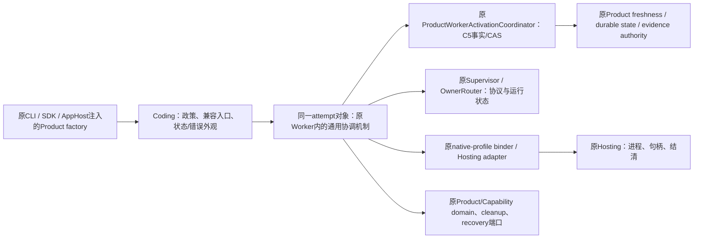
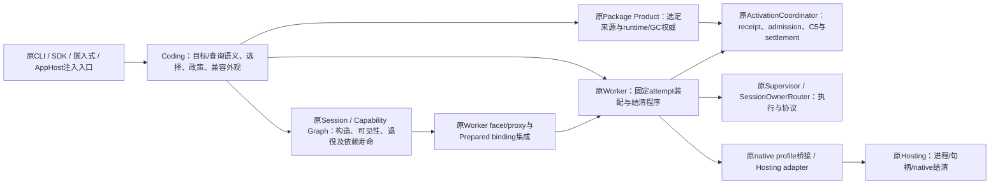
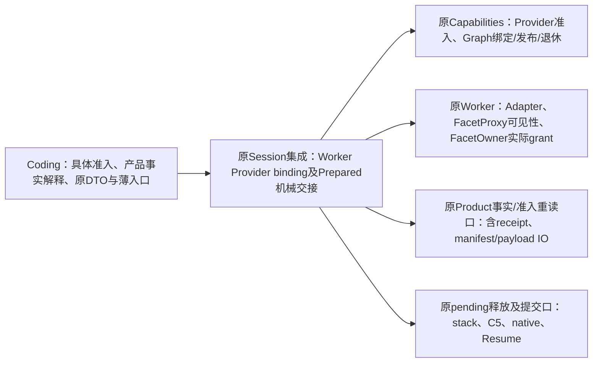

# H-COD-KD-008 R2.1：Product Worker 完整执行协调归一

- Authority: accepted joint responsibility direction and bounded implementation；历史候选仍按各节原状态保留。
- Design status: KD008联合职责方向已于2026-11-09获用户接受；本批具体合同经三视角代码评审获有界技术接受，其它后续接口不自动接受。
- Implementation status: partial；§22联合装配、§23 orphan/recovery取得、§24 Canary完整生命周期及§26完整单次query已接通并有界接受。其余binder/native-selected、offline/backup及整个Goal仍未完成，各节保原验证范围。
- Owner: 原Harness Worker机制、Coding Product政策/兼容与原AppHost Product factory合同协同。
- 用户评审：已接受原[评审卡A56](worker-product-runtime-review-card.md#a56当前可评审实物2026-11-09)职责方向并要求继续接通与验证；本批实际接受见§22，A44等历史拒绝不因此追认。
- 需求：[COD-RESP-GOAL-002](../coding-responsibility-convergence-goal.md)；前置：[Worker历史与A17图关系](worker-history-responsibility-convergence.md)。完整P1–P4及Coding≤15K保持；2026-11-09用户允许符合架构/复用准则的必要、适度系统增量，详见Goal现行成本准则，历史严格净减措辞不覆盖该修订。
- 起点：A17实际未提交实物，Coding128,110/系统636,893；目标Code文件1,323行。源码/21路径指纹另存树外，不能只从HEAD还原。
- 方法：archmethod本地干净master `0f9bd3ff51afabeaaf76cc38dff1ceb279b7d37e`。

2026-11-09现行成本口径已同步到上方需求；下文A1–A54的旧净减约束及候选拒绝作为当时历史保留，不代替最新用户准则。接口与异常等具体技术发现继续逐项处置，不因成本放宽自动销账。

## 1. 问题、真实支持义务与选择

原起点`coding/_product_worker_canary.py`同时放置领域状态/消息与完整Worker执行协调：525行运行对象、235行binder，以及Session/组件准入、默认Current、失败/回滚/恢复协作。§24已将固定生命周期归原Worker，Code的binding/准入与产品政策仍在。它已经调用原Coordinator、Supervisor、OwnerRouter、native-profile binder和Hosting adapter；这些原机制不能被新建的RuntimeManager或执行器替代。

静态搜查生产源码未找到其binder的其它直接调用者，**不足以证明该能力可删除**。[C5.4](../plugin/plugin-lifecycle-plc9c5-c54-linux-product.md)接受该显式Product入口，[AppHost G8](../../apphost/product-worker-join-g8.md#contract-model)允许外部注入的Product factory提供实现该attempt port的真实Canary。因此保留原导入、factory/attempt接口及行为，不能把整个类移到tests后称生产精简，也不能只保状态DTO而删除受支持的注入能力。

| 选项 | 判断 |
| --- | --- |
| 原样保留全部Code编排 | 兼容成本低，但产品层继续持通用启动/回收程序，不符合Goal职责收敛 |
| 据仓库内零调用直接删除 | 与G8外部注入及C5.4合同冲突，否决；测试不是唯一消费者判据 |
| 原Worker机制承接完整协调，Code保政策/投影与兼容薄外观 | 推荐；沿原能力组合，保同一真实attempt与公开类，不扩成新执行引擎 |

本片面向完整“缺省/选定→准入→启动/发布→失败回收→正常关闭/回滚/恢复”路径，不再只提取小字段或codec。普通Session的pending host仍有不同提交时点和平台cleanup合同；不因都调用Coordinator就强套Canary流程，后续完整装配簇继续收敛。

## 2. 环境与内部职责视图（候选）

仍是原本机/托管Product调用与原受控Worker进程，无新进程、服务、事实库或后台循环。下图显示原Canary同一运行对象的机制归属，不再实例化第二个“控制者”。新内部代码位置建议为`harness/worker/_product_composition.py`，不放Harness根目录、不加入公共Worker facade。

| 唯一职责 | 本片分工 |
| --- | --- |
| 产品身份、所选方法/插件/能力、允许的入口及Profile、消息与状态投影 | Coding原政策和兼容外观；不变成Kernel默认Coding配置 |
| 原顺序的准入、first effect、启动/发布、正常关闭/回滚/失败收束协调 | Worker内部机制；复用原Coordinator、Supervisor、Router与native binder |
| C5持久事实、CAS、kill-switch、receipt/attempt结清 | 原Coordinator及原注入store/authority/evidence，不新增账本 |
| Capability发布/围栏/撤销/ready投影、当前Product选择 | 原Product/Capability端口；Kernel依赖既有合同，不import Coding、不获得选择权 |
| 进程树/平台句柄、native containment、平台cleanup证据 | 原Hosting/native profile及注入cleanup owner；不以状态标签充当物理证明 |
| AppHost Session/opaque binding与factory寿命 | 原G8/Product/AppHost；不因移代码改变factory合同或默认激活 |

## 3. 实施接缝与兼容外观

机制作为原Canary对象的Worker内部基类/组合实现；Code真实`CodingProductWorkerCanary`保原FQN、显式构造签名和返回类型有关的薄方法外观。返回的真实对象仍为该Code类，没有Code对象再包一个持资源的Kernel控制器。原operation lock、closed/status和各注入引用仅一份、每attempt独立。

Code保原Status/Error实际类、字段/annotations/默认/frozen/slots、构造与公开`__all__`，不重复构建Core状态DTO或另一wire schema。三种Code端口名称可薄继承同一Worker内部协议，保原import/class身份与可用方法；方法定义位置/MRO变化须明示，不能假称全文反射一致。公共函数/构造/返回注解保持，原已不可解析的TYPE_CHECKING名字不能被谎称原本可解析；继承后不得新增缺失名字问题。

只用一份固定的内部Product配置，表达以下已有差异：product_id、允许entrypoints、原native profile选择、原错误前缀/显示名/正常close reason、原状态/异常类型、原Code attempt薄外观构造器、原纯Session fingerprint及start-gate类型解析。它不是通用可执行政策registry或任意workflow callback集合。类型构造器只构造原值/外观；fingerprint是原纯数据合同，不接IO。原domain/cleanup/recovery/authority callback继续作为已经存在的能力端口，不能用新的Code IO callback替代已在Kernel的算法。

原纯Session fingerprint函数及其domain bytes留Code，不能换成另一个Transcript hash或改canonical/长度前缀。两平台profile ID复用原Worker native bridge的既有定义/能力，Code保选择与兼容常量。公开binder薄传原参数，Kernel在原位置用原native binder能力；不得提前构造native profile、读取它的有副作用属性或打开大Product对象。

start-gate的确切Code类型在原selected分支晚绑定：类型解析仅import/return原类型与错误类，不能在模块顶层引入receipt→canary→gate的循环。原Code native-binder别名是既有Kernel能力的转发，不是保留一套Code执行体；原测试故障注入需指向实际调用位置，不能靠静态缓存绕过。

原Core Coordinator/Supervisor/Router/Hosting/state store不重写；公开Worker facade不扩大。原C50/C51/C54/C55中实际源码位置/具名friend消费者清单同步到真实owner，原场景、assertion覆盖、触发、平台和矩阵不得借迁移扩大；不能把行为检查改成只查“转发函数存在”。

### 固定配置与原调用点映射

| 配置/输入 | 具体绑定与读取位置 | 保持的边界 |
| --- | --- | --- |
| Product/entrypoints/Profile值 | 原`CODING_PRODUCT_ID`、原入口tuple及两个既有native ID；仍在原各短路点比较 | 缺policy/禁用路径不构造native/Coordinator；不增加新Profile/平台 |
| 诊断值 | 原`coding_worker`前缀、`Coding Worker`显示名及`coding_product_session_close` reason | 原code/message逐项相同；不加审计/正则策略 |
| Status类型 | 原实际`CodingProductWorkerCanaryStatusV1`，在原各status构造位置调用 | 同FQN/字段/默认/kwargs序与Code实际类，Core不另立DTO |
| Error类型 | 原实际`CodingProductWorkerCanaryError`，仅替原显式raise构造 | 原message/code/cause，未匹配外部异常不新增catch |
| attempt薄类 | 原Code真实Canary类，仅在原Current/missing receipt/selected返回点构造 | 保原公共构造参数和返回Code类；只初始化同一Kernel基类，不再分配第二持资源对象 |
| 三domain/cleanup/recovery合同 | Code名字可继承同一Worker内部协议，运行值仍是原注入对象 | 不新签发权限；方法可用，MRO/定义位置变化明确；不新增运行时结构拒绝 |
| 原Session fingerprint | 原Code纯函数，在原locator/resumable/revision检查后的比较点调用 | 不提前计算、不改变domain/JSON/长度前缀；不是IO callback |
| Gate类型解析 | 原selected校验之后、native try之前晚import/return原Gate及错误类型 | 保`type(gate) is Gate`，不提前触发receipt导入环；§8修复后的正确错误绑定为迁移基线 |
| native binder能力 | 原Worker两个binder；Code兼容别名在每次公开binder调用时传递，实际执行仍在原try位置 | 不静态缓存绕过原注入点；不复制native实现、不提前读profile属性 |
| 原显式执行参数 | policy/receipt、session discovery/validator、C5 authority/store/evidence/budget、Supervisor/request、current/Hosting、两平台材料、Capability reader、domain/cleanup/recovery、host/boot、gate | 维持原公开参数面；特别保Windows plan exact-type、native store不得与C5 store同对象、原identity逐项等值 |

配置只能绑定这些已声明值/合同；不能新增任意阶段动作hook。原binder的28个关键字参数不会藏入服务context，类型/默认/求值映射随原签名逐项核验；不在设计中把所有字面值都配置化成字符串registry。公共Code facade的类型名保在原namespace；Core新增方法只引用本owner可解析类型。原已存在的不可解析TYPE_CHECKING注解不是本片伪造的兼容保证，也不能因移动再增加一组缺失名字。

## 4. 原运行合同与顺序

| 路径 | 保持的程序与结果 |
| --- | --- |
| 缺policy/禁用/请求Current | 原短路与receipt/gate拒绝顺序；不创建Coordinator/native/Hosting/进程；原Current/degraded/unavailable投影 |
| 选定绑定 | typed Product/receipt→Session authority与locator→selected components/identity→晚绑定gate类型→原native binder→原Coordinator→Router/Hosting adapter→同一Code attempt |
| start | 持原每attempt operation lock；closed/ready/current/gate检查→evaluate→starting；admission.begin_effect后才置effect_started；原Supervisor start→adapter admit→C5 publish→domain.publish→ready，不能套普通Session“Graph可见后才C5 commit”的不同协议 |
| start取消/失败 | gate close在原位置；effect_started后才reclaim；domain_publish_started在调用publish前置位，部分发布失败仍撤销；保原required raise/optional degraded及cause，不新授自动重试 |
| normal close | 未关闭前保所有依赖；ready时domain fence→revoke/drain→retire_exact→Supervisor.shutdown；仅shutdown自身的原取消重抛/其它BaseException转fallback fence，后续protocol terminal→native close→cleanup→readiness/status→closed；不是全段统一catch |
| rollback | 原R1–R7：先持久latch未来启动，再围栏/撤销、退休exact attempt、fence树、protocol terminal、settlement/debt、readiness、issue_current；不把正常close改成全局rollback |
| recover | 原recovery authority返回原V1–V6有序证据元组；只按原合同核对，不新增自动重启、真实探测或恢复队列 |
| failed reclaim | 保原逐步best-effort及各段抑制边界；不要把整段包一个catch，也不把未证明的cleanup写成功 |

操作锁仍在相同await边界持有，不加跨Session/global锁。关闭失败保持原closed为False、原资源引用与清理凭据可重试；不提前清空profile/端口，也不凭status=closed断言进程树已无。原失败抑制、cancel/close覆盖首错等既有行为不在机械迁移中悄悄增强；如发现缺陷单列，不能新承诺旧源没有的保证。

**异常区段不能扩大。** `start`的gate可用性、selected组件检查、`coordinator.evaluate`、未准入的closed-decision分流及starting状态赋值均在原start大try之外，不能移入统一“失败降级/回收”catch。`_close_ready_attempt`的domain fence/revoke和C5 retire在shutdown的try之前，失败直接停止；只有`supervisor.shutdown`由原`except CancelledError: raise`/`except BaseException: await supervisor.fence`处理。fallback fence本身、protocol terminal、native.close、cleanup.settle及外层readiness/status也在该catch之外，各自失败仍在原位置停止并保引用，不补后续成功。不把正常close、rollback和逐段抑制的reclaim共用一个宽catch。

原cleanup version 1不传native witness，version 2在原点取得并要求witness，其它版本按原错误拒绝。原类型/布尔比较、opaque/摘要规则、kwargs/属性求值与错误顺序保持，不为统一schema加严。Code Status校验保持原AST，不在继承时改变bool/version等原接受集合。

## 5. 参数与故障边界

不能把原binder的显式参数收成未经说明的万能context/dict；Code薄参数面与Kernel窄合同分别可读。通用机制只借原policy/receipt、request、Supervisor/Router/native profile及原能力端口，不把Product runtime/epoch registry/任意服务发现交给Worker。type/status/error/profile构造是固定配置，不新增原始IO回调、线程、Task或持久对象。

继续用原WorkerBindingError、Product错误与cause；未匹配的外部异常不统一包装。状态code与公开message逐项保留，稳定reason不额外加regex/审计规则。额外的内部profile/薄外观函数帧不是性能提升；原每次历史/authority读取次数与C5操作次数不增加或缓存，性能只作结构说明，未跑前后负载时不声称数值收益。

## 6. 验证与完整成本

21路径实际起点冻结，含原Code、AppHost Product/Canary、两pending host、原Worker五机制及facade、原Linux/Windows/架构测试和G8/C54/C55合同。核心对照按完整Canary动作/返回Status/异常/cause/端口事件顺序，优先复用既有Linux离线context及真实Kernel Coordinator/Supervisor；补真正缺失的负分支。source hash/原方法来源守卫，旧expected独占捕获，不能从候选重录。

Code Status/Error/fingerprint保持原AST；公共Canary/Binder签名、实际返回Code类及public export、无Core→Coding导入、原store/journal/native实现未重写须分别核验。G8注入factory/原attempt port、Current缺省、正常close重试/required/optional/no-fallback和两种cleanup合同均留明确证据。原Windows native C55测试受OS/env/Profile标记限制，本机不去标记、不冒称Windows运行；可作纯端口/值对照，不扩大平台。

1,323行是调查范围，不是净删承诺。Code政策/compatibility薄壳、Kernel类型/协议/profile、原接收文件新增、源码位置配置、所有新生产源按Goal四根全计账；测试/文档另列。禁止原Code fallback或原重型体与Core并存，禁止把生产实现藏入tests/树外再称减少。预期主要是职责归位，未得实际diff不能预支系统净减。整个Coding≤15K保持；按2026-11-09用户修订，符合职责、复用和最小扩充准则的必要、适度系统增量可以接受，具体成本与收益仍须完整说明。

完整源码/切点与回退按整套薄外观+Worker机制保存；没有新wire、日志、双写或数据迁移。实际替换后做三视角代码评审，过关只接受该完整Canary兼容路径，不接受全部ordinary pending/托管/Continuity或整个Goal。

## 7. 当前与后续差距

当前1323行仍未迁移。技术评审若认为配置/薄壳成本失控，优先减少不必要通用性并复核接缝，不新增抽象平台执行器或将Code政策原样装进大callback对象。用户重要职责工作件评审按原约定记录，内部评审不能制造用户接受；尚待用户的P2新环境与此独立。

Canary与普通pending host的提交位置不同，当前不合并两生命周期；后者后续须按原graph/prepared合同复用可同体的Worker机制，不能因为本片迁移完成而留下同一机制的第二实现。真实Product选择、Method/Work/Goal托管及CLI/SDK其它波次仍在原Goal范围。

## 8. 独立既有缺陷：native binder异常名未绑定

原binder只在TYPE_CHECKING导入`CodingWorkerStartGateError`，运行时晚import只含Gate类型，后续except却引用该错误名。实施前离线探针73152已使用原真实Code/context和拒绝式假native binder复现：原TypeError被处理except时的NameError覆盖（1 passed/3.35s）；这不是Product回归通过，而是旧缺陷诊断。

建议先在**旧布局**的原晚import同时绑定原Gate错误类，不提前import或改catch集合；然后用typed WorkerBindingError、GateError、TypeError、ValueError及未匹配RuntimeError核消息/code/cause与原异常外逸。后四分支不再被NameError覆盖是明确修复，不冒称与坏旧源全文等价。其余start/close/cleanup缺陷不顺带改变。

该修复只恢复原已写明的except语义，既有Worker/Coding职责与组件不变，可独立完成；修复前源和诊断保留，后续大迁移以这份有界修复后的实际源为比较起点。它不等于本文大迁移或新职责图已经获用户接受。

G1落实：只在原晚import绑定GateError并移出TYPE_CHECKING；16个其它定义AST同，binder排除imports后AST同，原28参数/返回注解及完整import alias集合保持，另20冻结路径字节不变。六个离线拒绝分支43345通过（6/10.29s），原Canary/AppHost注入回归59023通过（47/10.65s），单源mypy10710通过。三视角G1实码窄核无具体阻断，实施owner仅接受该修复；1323→1322的一行是正常格式抵消，不记机制去重。完整执行协调迁移仍待重要职责工作件评审和实施合同/全成本兑现，见[评审记录](worker-product-runtime-convergence-review.md)。

## 9. 仓库外接缝试验：可兼容不等于已精简

2026-11-08，以修复后的1,322行实际Code源作只读基线，在产品树外试验§3的单对象继承接缝。仅覆盖两个模块的导入位置，原Coordinator、Supervisor、Router、native binder、Hosting adapter和原AppHost消费者仍来自实际工作树；没有替换产品源、创建第二attempt owner或变更CI。原型不是生产实现，不能把放在树外的机制计作Code精简收益。

| 全成本 | 原实际源 | 原型候选 | 候选变化 |
| --- | ---: | ---: | ---: |
| Code原入口/公开值/薄外观 | 1,322 | 339 | −983 |
| Worker新增内部机制、端口与固定配置 | 0 | 1,261 | +1,261 |
| 两者合计 | 1,322 | 1,600 | **+278** |

本候选保持原28参数binder、16参数构造器、公开返回注解、Status/Error/fingerprint主体及Code实际返回类，只有一份实例属性和原操作锁。除三端口Protocol外，Canary的MRO以及继承的`rollback_steps`/`recovery_steps`属性getter、`receipt_for_entrypoint`/`recover`/`close`的定义module、qualname和Code类自有成员集合也改变。未发现仓库消费者依赖这些方法的自有声明元数据，不证明外部没有此类合同；不承诺完整反射或未绑定方法pickle兼容，后续若有该支持合同需保对应薄声明或明确处理。逐步失败抑制试用标准库`suppress(BaseException)`替代原私有context manager，其余原owner机制不重写；真实六处with的BaseException抑制边界相符，无异常退出的返回值不同但这些with不消费它，不扩大为私有helper API或所有取消交错等价。

原47条Canary/AppHost离线测试与六个G1异常分支通过，另补四项源码位置/公开面/单实例/拒绝Coding的冷导入检查。57个独立节点由最终56通过及修正探针自身字段枚举后的单项通过组成，不把重复试验相加；两份显式原型源mypy通过（依赖silent，非全图证明）。没有原生Windows、跨进程/断电或性能负载证据；原生Profile/平台接受状态未改变。

**设计处置：原型可作为兼容接缝证据，暂不原样迁入产品。** 保留原Worker承接通用机制、Code保政策/兼容的职责方向，但先比较同一业务簇内的现有组合，明确能够退出的重复机制及接收成本，再选最小接缝。不能因Code单目录下降就忽略系统增加278行，也不能借降低公开兼容要求制造净减。候选中的13项固定配置、双层显式参数面和新Protocol逐项计账；如无法从真实共享路径抵消成本，应缩小抽象或保留当前产品特例，而非建更大的RuntimeManager。

用户本次回复接受的是KD-004的历史职责环境方向；该接受已在KD-004记录，不扩大为本候选的新执行协调图或P2环境接受。本节的技术试验与后续复核不替代用户对重要工作件的评审，整个Goal保持active及原验收范围。

## 10. R2联合重构：从单Canary搬迁改为完整attempt装配职责簇

### 10.1 复核事实与选项

KD010已完成后，实际Coding124345/系统638294，仍比Goal634794系统起点多3500。继续把每份Code体单独搬成Core mixin会累加接口成本；§9的−983/+1261（系统+278）原型明确不原样接入。本R2不改写该失败收益判断，也不把完整15K目标降为局部迁移量。

本轮对Coding与Harness/Hosting/AppHost/AppService/HarnessWork的20行以上函数做保控制形状、归一名称/文本的有限AST筛查，仅12组候选，均非已证明跨层大块同体；七个全仓单名称引用私有函数合计仅22行。名称/字符串归一不是语义证明，不能据此断言全系统无重复；它足以拒绝把“删除死helper/相同函数体”当成剩余109345行的主要路线。原始候选在产品树外responsibility-next，不据其直接删除支持。

改以完整attempt装配业务簇比较：

| 实际Code入口 | 行数 | 原特殊合同 |
| --- | ---: | --- |
| `_product_worker_canary.py` | 1322 | 原显式注入入口、Current缺省、C5先于domain发布、rollback/recovery/optional降级 |
| `package_product_worker_pending_host.py` | 473 | 普通Linux图准备、Graph可见后才commit C5、stack释放失败的finally仍尝试C5结清 |
| `package_product_worker_windows_pending_host.py` | 593 | Windows durable intent/native provisioning、Graph后commit C5、stack失败不假报settlement且记V2债 |
| `package_product_worker_operator_query.py` | 513 | 既有Session只读query、明令不调用模型；单次Graph→C5→query，最终dispose runtime |
| `package_product_worker_provider_host.py` | 290 | 原Provider准入/续期、graph visibility/retirement与同一release_once，原公开prepared值 |
| **调查池** | **3191** | 不是可删量或已证明去重量 |

A：仅装配§9单Canary原型，已有成本+278且仍留普通/查询机械程序，拒绝原样采用。B：把五文件搬进Core并以大context或阶段callback表重新执行，复杂度隐藏且可能成第二runtime，拒绝。C：按原组件职责联合设计，复用既有执行/资源/图组件，只让确有缺口的固定装配/结清程序归Worker及原Session集成，Code给领域选择和值；推荐进入具体候选比较，不因此接受尚未有成本证据的代码。

### 10.2 联合环境与子职责（待用户评审）

图表示职责/调用关系，不表示新进程或新的C5/Graph authority。保留原per-attempt实例及锁；任何共享程序不新增execution state machine、全局registry、第二日志/队列/恢复调度。Worker不反向调用Code服务定位器；Graph参与不改成Worker内部再建图。

| 职责 | 唯一owner与复用 | Code必须保留 |
| --- | --- | --- |
| 目标、查询symbol/result、coding.worker.query定义、默认关闭/所选Profile、approval/trust | Code产品政策，现有Capability/Package准入实际执行 | 领域内容/错误投影/旧公开入口，不能把coding默认埋Core |
| 当前manifest/runtime/receipt/native材料的权威 | 原Package Product及现有receipt/evidence读端口、原GC/Journal | 产品布局、选择与授权；不把完整Product/Session交给Worker |
| 每attempt机械装配、first effect、不同调用点的结清程序 | 原Worker内部固定方法；直接原Supervisor、Router、Hosting adapter、native bridge、Coordinator | 原调用点的领域接入，不能留Code fallback机制 |
| Graph prepare/commit/visibility/dispose、未结清子资源依赖 | 原Session construction/Graph/已有Prepared binding接缝 | 已选定Provider值与本产品contribution内容；不新建Graph manager |
| 进程/native资源释放与物理证明 | 原Hosting、native profile、cleanup evidence与Supervisor settle | 不用状态标签/函数返回代替真实结清 |

### 10.3 候选接口原则与禁止项

沿用原Core typed authority、request、receipt、Supervisor、profile、Hosting、Capability ports；先以真实消费者所需值形成窄契约，不把原28参数binder藏进context。只允许实际值/错误/status构造与政策输入的固定绑定；产品需要做选定来源/内容判定时，在Code原位置完成，不把原始IO/任意阶段动作函数集交给Core。持有资源的attempt对象只一份；不在Code与Core各保closed/effect/lock/reference。

优先将已有原owner用于实际装配：Coordinator负责admission/publish/retire/settlement，Supervisor负责start/shutdown/fence/settle，Host/profile负责自己的关闭，Graph负责可见性。缺的是这些原操作在原调用点的固定机械程序，而不是新执行器。候选可以有显式分立的Canary、普通准备和单次query结清程序，但不能把所有不同比较写成任意phase dispatcher或多个近似生命周期引擎。相同机械片段只有在参数、求值/异常边界和调用位置确实相同后才共享。

本R2尚未定义实施就绪API，命名/参数/类型全成本仍须原函数自由名和每个await/catch/资源保留点映射后确定；不以抽象愿景当现有能力。先完成整个3191行簇的候选替代与所有Code保留/旧体退出映射，再评估接收方成本；不得退回只迁一个短helper充数。

### 10.4 四条执行程序的差异必须原样保留

1. **Canary：** 保§4的原锁、evaluate在大try外、begin_effect后flag、Supervisor/admit→C5→domain；正常close/rollback/reclaim三种不同catch不合并。公开G8注入能力继续存在，default Current不启动。
2. **普通Linux：** base policy/generation检查在原点；resume parent可先enroll C5，payload/context→gate→profile→host→Supervisor顺序保；原stack LIFO释放顺序不重排。release的`finally`在stack失败时仍尝试原C5结清，原错误覆盖/notes不悄改。Graph真正提交后才C5 publish并seal resume parent。
3. **普通Windows：** 已有C5只读恢复预检在原点；selected→native plan→durable launch intent→provisioning store→profile顺序保。resume enrollment与最终cleanup Coordinator并非总是同一实例，不以“单权威”名义强合并。Supervisor启动后preparation由Hosting持有，close_unowned_profile只在原资格分支关闭；selection stale时先fence；stack或settlement失败按原点记V2 debt并保原notes，不套Linux finally报成功。
4. **单次operator query：** 必须先load既有Session，不新建或调用模型；next epoch探测/二次request绑定、graph构造后C5 publish、最后witness检查保持。嵌套finally中的Session.dispose→Supervisor→gate/profile/host→failed-process→C5→runtime.dispose顺序及首错/notes保持，不能用单ExitStack替换成不同错误合同。

Prepared provider原clock单调/过期、renewal候选/owner快照匹配、last_grant只在成功后前移、facet visibility/retired检查及release_once锁/成功flag是既有合同。标准Graph机制能替代的部分必须直接复用；领域candidate/clock/grant规则不因归位而扩大权限或改变过期集合。

### 10.5 全成本、验证和接受边界

具体候选应列每个原Code方法：保留领域/薄入口、直接采用已有owner、必要最小扩充、旧体退出；列全部Core协议、显式参数/类型工厂、Code兼容、声明/生成成本。预期收益不能由3191池大小给出。优先选择在整个业务簇中能抵消共享接口成本的方案；若仍仅为职责迁移，须明确其净增及为何不能直接复用，不能沿§9无限堆新通用性。Coding≤15K保持；系统成本按用户2026-11-09现行准则审查必要适度增量。

实施前原真实源码/回归/旧顺序证据冻结；复用原Canary/AppHost、普通Linux/Windows离线、operator query、Graph prepare/close-retry测试，不新建30秒矩阵/付费模型/PR gate或提高原Windows支持。候选须核真实消费者路径与实际运行，三视角先审具体合同再代码评审；原native Windows未运行不能冒称通过。

本R2为联合职责方案，按原用户“系统环境图等重要工作件需要我评审”约定，须提交图示方向评审。内部技术评审不制造用户接受；具体候选成本/接口未齐不先要求用户批准空方案。等待该重要方向期间可继续原已接受KD004/KD007其它独立职责，完整Goal保持active，不因某边界未接受而反复停滞。

## 11. R2三视角结论、R2.1澄清与原程序观察

三个独立视角分别核16份原源及五入口3191行后，无必须否决联合职责方向的具体冲突，结论均为“可提交用户重要图示评审”，**不是实施就绪或用户接受**。R2原冻结SHA256 `f1008d710610ad4df53249a3ea14e0e66456871f97aa4a866e080ccfb592a156`及原报告保存在树外p1-attempt-composition；本节是澄清/证据补件，不覆盖原评审对象。

| 候选必答项 | 采纳的评审约束 |
| --- | --- |
| 原Product效果接缝 | payload materialize、selected/plan、durable intent、store打开、receipt witness、既有Session/runtime打开、renewal candidate均有原owner和求值点；不能变成大context/任意阶段factory或提前缓存 |
| 四条程序 | 保分立发布/释放/异常边界。Linux stack失败仅是**仍尝试**原settlement，不保证真实证据足以写成；Windows失败记debt。operator gate.close失败会跳过随后profile/host内段，但外层C5/runtime finally仍执行，不能借“顺序一致”悄改成全段尽力清理 |
| 一个attempt/release事实 | 原release_once持同一async lock，成功后置released；失败/取消保凭据。Prepared commit没有新增一次性flag，原每次visible后可调用_commit；不加第二controller/状态副本 |
| 已有Graph接缝 | 直接消费PreparedSessionWorkerCapabilityComponent/FacetProxy/原Graph，但它们不是已经实现全部Worker生命周期的机制。ComponentHost reservation及ManagedWorkerProcess附件释放的flag时点不同，不能按同名release直接替换 |
| 领域授权与公开值 | 原Canary/G8外部注入、Pending/Prepared实际值/字段/签名、原指纹域及Provider clock/expiry/renewal/last_grant成功时点分别核验；query“只读”指业务结果，执行仍合法创建Worker、Graph/C5及runtime效果，不是无写入 |
| 具体成本 | 逐原方法列Code领域/薄适配保留、原owner直接复用、必要扩充和旧体退出；同算全部Core/兼容/参数/配置成本，不用3191调查池或原Canary57节点预支联合净减 |

**17806原程序有限观察：14 passed/4.73s，exit0。** 外部probe直接调用未改两平台的实际PendingHost.prepare，检原方法文件位置并守卫16源SHA；7场景×2：准备后显式commit/release、payload失败、start失败、Host清理失败、begin-effect失败、注入CancelledError、resume-enrollment后payload失败。原14份JSON以exclusive open建立，故障必须实际触发；完整1903生产源均未变。

此观察诚实区分原Code装配程序与模拟端口：Product/权限/native/C5外端口及Provider构造、人工Graph可见标记为确定性替身，原prepare方法及实际settlement/debt值校验执行。它固定调用/flag/错误notes而不证明真实C5授权、Graph提交、物理进程结清或native Windows；注入CancelledError不代表所有task取消交错。Canary、operator与Provider内部准入/续期仍需在具体候选补有界原程序证据，既有CLI路由替身和Windows author inert测试不能替代这些。原host/live/OS selector保持，不新增矩阵或门禁。

实施owner只综合接受本轮技术分析作为用户评图材料；图示方向、具体接口/全成本及实际迁移均未获新的接受。本轮生产代码精简实绩为0，Code124345/系统638294保持；完整Goal继续active，原15K/系统净减不变。

## 12. 联合候选的Provider与operator原程序补证

本节补齐§11已识别的两处原行为证据缺口，不定义或接受联合实施API。产品仍为A27实物：Code123062/系统638313，1907生产源逐SHA保持，精简新增收益0；完整15K与系统净减条件不变。重要联合图、具体接口与全成本尚未获用户/实施接受，不因原程序观察通过就安装候选。

### 12.1 冻结对象、方法和真实结果

五入口3191行原件、当前1907源指纹及观察脚本树外保存于 `p1-attempt-composition/r3-provider-operator-baseline`。88773经原managed wrapper、原not-live/skip-host-runtime、指定磁盘runtime及沙箱外执行，**68 passed/6.76s，exit0**。41组Provider、27组operator的JSON均在原程序执行及成功/失败类别断言后以exclusive open创建，不覆写期望；后续候选必须读取同一份固定结果。

**比较器边界：**现脚本的compare模式仍强制原源SHA并编译旧AST，仅可回放原程序对固定JSON，不能充当未来候选执行器。候选必须另有实际Core/Code入口的加载及执行witness，再读取同一份旧期望；不得仍执行旧AST并声称候选兼容。记录的异常类型名/message/code/notes与选取的cause/context链不证明异常FQN、完整对象身份、链边种类或traceback全等。

首轮42705的68失败源于树外探针使用async pytest函数，而本仓不加载pytest-asyncio；原程序尚未执行，故不是Product回归。保留首探针/XML，仅将探针入口改成仓库既有asyncio.run方式。修正后68全过，不倒写首轮绿或隐藏原记录。

Provider执行冻结的完整原 `prepare_coding_worker_provider_binding` AST；prepared方法与release_once使用实际原类。外部类型/authority、candidate、facet、graph与grant等叶端口是声明替身，并覆盖实际程序的正常/拒绝/故障分支；不能据此证明原具体DTO准入、真实权限/GC/Graph/native。原Code函数的来源路径与源SHA另核，探针没有修改Product模块globals或新建Core实现。

operator直接拼接原query函数中最内层cleanup finally、外层except与finally的完整AST，查询主体替换为确定性返回/失败端口。它证明这些原退出屏障的组合，未执行原Session发现/Writer加载、runtime构造、授权、Graph准备、真实query和C5物理结清。该片段观察不能替代完整operator业务测试或原native selector。

### 12.2 已观察到的具体设计约束

| 原程序事实 | 联合设计必须保留 |
| --- | --- |
| Provider可用原owner对同candidate续期，观察now=201、原窗口120..200，续签为201..281 | 不把原expires_at当成此Provider永远不可再用的时点；保原owner snapshot/candidate/epoch及续签结果核验 |
| grant或base-current失败后，170失败再用160成功 | last_grant_time只在实际facet grant成功后推进；不能在尝试开始先改时间或以失败时间拒绝重试 |
| owner/candidate/policy/epoch/续签结果改变、bool/倒退clock及零窗口在原点拒绝 | 不缓存到期后的candidate或owner，也不把bool当整数；保原首错和Code错误投影 |
| Graph发布前commit拒绝；发布后两次commit会调用原回调两次 | 不额外添加“一次性commit”flag；实际Graph visibility仍归原Facet/Graph，观察不签发可见性 |
| release失败/取消后可重试，成功后不再调用release；abort每次仍先retire | 同一个原async lock与成功flag，不复制Code/Core两份released；未成功不能清凭据 |
| operator的gate.close失败时profile/host内段不执行，外层C5及runtime仍进入 | 不把原嵌套finally改成全段尽力清理，不以更严格或更积极的清理改变首错/覆盖 |
| 原query错误遇C5清理失败，仅在原错误加note；runtime.dispose仍可覆盖外错 | 不统一吞异常、改成ExceptionGroup或把finally内覆盖误称原错一定保留 |
| Supervisor healthy/stopped/failed/fenced/其它状态选不同shutdown/fence/settle路径 | 继续原Supervisor权威，不能以共享close方法名称推断所有状态同义 |

41组Provider还包括初始candidate/native/spec/adapter拒绝、graph context错配、facet退役资格、commit空回调/回调失败及重复释放；27组operator包括Session缺席、多阶段失败覆盖和直接CancelledError注入。注入取消不是所有任务取消交错、物理进程死亡或跨进程证明。

### 12.3 下一具体候选的接受条件

已有“所有路径同一个退出流程”方案被这些观察排除，仍选择§10的分立固定程序与原owner直接复用。具体候选须覆盖整个五入口簇的退出/保留映射，给出所有Core参数/协议/兼容外观的实物全成本，再逐项对照§11两平台14份与本节68份原期望。新接口不能把Product IO搬成任意阶段回调表，也不能提前获取选定来源/launch intent/receipt witness。

这些观察完成的是设计输入，不是联合候选代码评审，更不是整个Goal验收。三独立视角仅核本补证的程序来源、断言和结论范围；重要图仍须用户审阅，未就绪接口不先提交空泛批准请求。原Canary有界验证沿历史证据保留，不将本68项与旧批重复累加成新的完整业务覆盖。

三独立视角均已核原件、程序来源、固定期望、真实XML及上述覆盖边界，无本补证范围内的具体阻断。实施owner `/root`接受其作为联合设计输入，未接受尚未形成的候选接口/实现、重要图或完整Goal。原被审补件保持冻结，比较器与异常反射范围按职责/数据意见补准确说明；没有修改原JSON或测试来取得不同结果。

## 13. R3七源具体候选：完成比较，拒绝安装

R3在树外给出五入口的实际替换、所有74函数/方法处分、两Core私有模块和显式接口。Canary保原真实Code构造/状态/入口/Status projection与binder，把固定操作置于原对象的Worker方法；Provider保原具体准入/事实解释及Prepared DTO，grant/Graph/单份release程序移入Worker；两pending与operator仅将同义publish、Supervisor/Host操作替换为共用函数。没有新的C5/Graph/日志/队列/持资源controller，但这不等于已完成整簇归位。

| R3完整生产成本 | 原件 | 候选 | 变化 |
| --- | ---: | ---: | ---: |
| 五Code入口 | 3191 | 2587 | −604 |
| Worker接收方（全部接口/类型/固定配置） | 0 | 858 | +858 |
| 总计 | 3191 | 3445 | **+254** |

相对旧单Canary的+278原型，Core少403而Code多保留379，系统只少净增24。三装配入口Linux/Windows/operator总计只减27，仍持原binder、stack/C5/native custody/debt及嵌套退出主体；不得把这些一概改名为领域。另有Code `_ActivationAdmissionLease`、`_stable_reason`、`_suppress_failures` 三份16行定义在候选中已无消费者却被错误列作policy/compatibility，必须列为退出债务。当前产品原运行体仍使用相应定义，**不能据候选无消费者直接删除产品旧定义**。

候选84476经原wrapper/selector及磁盘runtime、沙箱外在完整包shadow中取得130过/11.28s、exit0：68旧固定观察、1实际模块/公开/单状态检查、14旧Pending观察及47原Canary/AppHost节点。新probe读取候选Code并实际调用带路径/SHA守卫的候选Core helper，未使用旧AST冒充新实现；叶authority/Graph/native/Product/C5和operator主体的模拟限制仍在，不证明完整五入口授权、物理结清或原生Windows。类型为最终六源及一源窄复验分批silent通过；首shadow包名/空slots问题及保具体status返回的cast修复如实分列，首完整stdout/早期候选frame未独立冻结，不冒称全图绿。

`read_candidate`实际会在原点进入Product serialized admission、receipt witness及选定manifest/payload/currentness读取。它是领域事实/准入重读口，**不是无IO纯函数**；没有传raw FD/通用factory或任意phase表。不可预读/缓存，也不能用Product事实可得推导新的执行权限。Code public Protocol方法位置、Canary MRO/继承方法与private release resolved type变化保留明确兼容边界。

三个独立视角均未发现当前支持路径的具体运行/数据回归，但一致不建议原样安装整组R3。实施owner `/root`据职责退出不完整、Graph/Prepared半套交接和全成本综合拒绝安装，保留原型及固定观察；这不是新设“每片必须净负”规则，也不以native未验证新增门槛。详见[评审汇总](worker-product-runtime-convergence-review.md#r3具体候选评审与不采用决定)。

下一稿优先闭合 **Provider→原Session Worker Prepared component生产路径**：Code保真实DTO字段/FQN、具体准入与产品事实解释；Graph binding及commit/abort/retire/release机械合同应由同一原集成owner承担，仍使用原FacetProxy/visibility gate、同一release对象及原C5/Resume时点。现PreparedSessionWorkerCapabilityComponent只有协议，不能假称已有实现可直接套；Worker grant/事实重检与Session Graph交接须明确分界。不再以几个微helper替代完整生产路径，不造大Spec或phase引擎。此为下一候选方向，具体接口/成本与重要工作件仍待设计和评审。

产品保持A27 Code123062/系统638313，1907源指纹未变，本轮精简新增0。用户已接受完整Goal范围与15K目标，尚未达成/完成验收；重要联合图也未因本次内部评审获用户接受。

## 14. R4：完整Session Worker Prepared交接候选

**状态：候选，未安装；重要职责图待用户审阅。** 本节替代§13所述下一步的笼统方向，不接受被否决的R3七源组合，也不改变完整P1–P4与数量目标。方法仍沿本地clean master `0f9bd3ff51afabeaaf76cc38dff1ceb279b7d37e`；可校验原件、两源实物、固定旧观察、报告和XML保存在产品树外`p1-session-worker-prepared-r4`。原生产起点是A27工作树，不能只用HEAD替代其未提交实物。

### 14.1 既有组件之间的完整交接

真实生产者是`prepare_coding_worker_provider_binding`，直接Session composition及Linux/Windows pending均调用它；消费方为原`SessionCapabilityWorkerComponentRequest.prepare_component`及`AgentProductSession._prepare_candidate_session_graph`。后者已经负责准备、Graph bind、commit和失败逆序abort。缺口是生产者仍在Code建立Graph binding，并持Prepared的发布、撤销及同一释放程序。

不创建新架构组件、服务或Graph owner；新增位置是原Session集成内部私有`_worker_provider.py`，不是Harness根目录。Session协调原resolved Provider admission的复核/续期，实际Worker grant继续由原FacetOwner签发，FacetProxy与Binder继续决定可见性。Code保具体类型、产品/平台/所选候选的解释，原真实Error/Prepared dataclass、自有字段/默认/slots/frozen、公开签名及fingerprint domain bytes。

原`PreparedSessionWorkerCapabilityComponent`只是消费协议，没有可直接调用的实现。原ComponentHost承接in-process import realm/reservation，不能强套Worker的staged facet或C5合同。原`_PendingAuthorityRelease`为authority context-manager凭据，gated-start release为进程门；launch的artifact释放在操作前置flag，与本片成功后flag/失败重试不同。因此移动原`_WorkerAttemptRelease`，不新造统一清理框架。

### 14.2 窄接口、同一对象与顺序

私有工厂显式接收原resolved/receipt/binding、单方法grant authority、adapter/admission/generation、clock/release、初次candidate及具名重读口、base guard/renewing owner、原错误构造/前缀与hash domain，共16项。没有Context、阶段表或新DTO；返回原binding/facet及唯一release的临时三元组。Code仍构造原六字段真实Prepared对象，三生命周期方法只按原签名转发到同一Session集成的机械实现，无mixin/MRO变化、继承字段或第二状态。

`read_candidate`会执行原Product串行准入、receipt及选定manifest/payload的IO；只在原续期点调用，不称纯投影，不预读/缓存、不改成任意stage callback。`release_attempt`和commit沿原用途；Linux finally/C5、Windows debt/native custody、operator和Canary仍是后续收敛项，本片不能把它们全算领域或已经退出。

| 路径 | 保持的合同 |
| --- | --- |
| 准备与续期 | Code原type/spec/candidate/authority/binding联接及adapter current检查在原位置；初次grant先于facet创建。续期clock→candidate→snapshot→eligibility/admit→base current→实际grant；仅grant成功后推进last time |
| Graph | 同一个原facet及visibility gate、原fingerprint namespace与连接次序；context generation/product/dependencies原检查。原Binder拥有发布/退休，Session request的binding/fingerprint复核不改 |
| commit/current | visible后才调原commit，每次可调，不加commit-once；current仍核visible和唯一release flag，再核facet当前性 |
| abort/dispose | abort先retire，再同一release_once；dispose要求原facet且retired。async lock内await成功才置flag，失败/直接CancelledError保持可重试，不自动重试 |
| 失败保留 | 原Graph准备后的逆序abort及pending凭据保留不改；request内部错配abort若失败，对象尚未返回/append，后续Graph pending机制不覆盖该更早边界。保持原行为，不夹带新恢复承诺 |

原六字段普通冻结值是本片支持对象；薄转发会在helper进入前读取相关字段，不承诺任意自定义getter副作用全等。`_WorkerAttemptRelease`原Code私有名保alias但真实定义模块变为Session；字段注解文本保持不代表该私有resolved type身份不变，不承诺私有pickle/所有反射。Code实际公开类FQN、构造与字段仍保留。

### 14.3 全成本与验证边界

| 生产成本 | 原件 | 候选 | 变化 |
| --- | ---: | ---: | ---: |
| Code Provider host | 290 | 198 | −92 |
| Session集成（全部导入/类型/配置） | 0 | 206 | +206 |
| 系统 | 638313 | 638427 | **+114** |

若采用，Coding为122970，系统比Goal起点仍增3633；当前未安装，实际仍123062/638313。此候选只能因完整Prepared机械交接归位而选择，不能以−92称系统净删或完整Worker薄化；整项目标仍要求Coding≤15000及系统严格净减少。

原业务起点14825：`test_worker_source_catalog_pins_explicit_product_candidate`为1过/7原skip，18.42s。候选93175在完整包shadow中以原wrapper/not-live/skip-host-runtime及磁盘runtime、沙箱外得到**44过/7同原skip，63.58s，exit0**：41旧固定Provider观察、2实际公开/冷导入检查及同1原业务通过，不叠加起点。新probe执行候选Code体、真实Code三个薄方法及带路径/SHA/调用守卫的Session工厂和生命周期函数，读取旧JSON，不重录期望。公开检查核六自有字段/签名/slots/原release整类AST，冷Core导入不加载Coding。叶authority/facet/Graph为受控替身，原业务的7跳过保持；不声称完整授权/C5/native、全部Task.cancel、旧安装或性能证明。

40368两显式候选源mypy的silent-import/no-incremental检查通过；Ruff/format使用原pyproject配置通过，不外推全图类型或全仓绿色。技术视角的结论及重要图审状态见[评审汇总](worker-product-runtime-convergence-review.md)。完整Goal保持active；只有实际安装及代码评审接受后才更新生产精简数字。

A28独立内部交付后，§14候选及1907源证明仍是此前A27冻结对象，未改为已安装。当前实物已见[最新执行记录](../coding-responsibility-convergence-progress.md)；后续若用户接受此职责图，须先以当前基线重核依赖与安装实物，不能把旧“全树未变”的时点声明当作现在的源码状态。

## 15. A44：同一attempt生命周期子候选，归并既有KD008

Authority: technically supported candidate / user direction pending；不是新专项或已接受Target。
本节是§10联合设计的Canary执行子项，不恢复§9/§13已拒绝组合，也不把§14 Prepared及
Linux/Windows pending、operator原程序永久视作领域。方法仍为local clean master
`0f9bd3ff51afabeaaf76cc38dff1ceb279b7d37e`。

### 15.1 实物与职责

树外已给完整两源：Code原真实Canary保FQN/公开constructor与协程签名、Status/Error整类
及全部top-level binding/验证；原状态/错误数据字段没有搬或alias。完整constructor、start、
失败reclaim、rollback、recover、normal close及native witness程序归原Worker内部
`_product_attempt_lifecycle.py`。Code真实对象继承该实现，原字段/单锁/closed/status均同self，
没有第二持资源controller或新durable engine。原Coordinator/C5、Supervisor/Router、native、
domain/cleanup/recovery端口仍原对象；五Code钩子仅投影错误/prefix/reason/status及原recovery
期望晚读取，无厚Code IO callback或任意步骤表。原私有恒True抑制上下文直接用stdlib
`suppress(BaseException)`，保持六个原独立失败回收范围，不改原取消政策。

三public Code Protocol类保原class FQN并继承Core等价方法；其方法定义module/qualname/
pickle归属与MRO变化明确，不能与Status DTO旧字节兼容混称全反射不变。原readiness Literal
同形共享、Status九自身字段/slots/类型/字典输出不变。所有原具体业务/准入函数保持AST，
因此binder/native-selected验证仍有真实未退出机制，不能把保留的854行一概称领域/薄入口。

### 15.2 完整成本，不冒称联合净删

| 当前原Canary文件 / 接收方 | 原件 | 候选 | 变化 |
| --- | ---: | ---: | ---: |
| Code原文件 | 1322 | 854 | −468 |
| Worker内部完整执行程序/端口/类型/兼容 | 0 | 569 | +569 |
| **系统物理成本** | **1322** | **1423** | **+101** |

R1保三Code Protocol重复声明时系统+161，R2消重后+102，R3仅canonical文件名下import分组
少一空行为+101；原失败及各帧保留。与§9的广域binder/验证迁移覆盖不同，不能把+278与
+101之差称同覆盖优化收益。§14 Prepared候选另为Code−92/接收+206/系统+114；两稿独立
相加只会系统+215，这不是联合优化成果，不能据技术测试绿逐片安装并累加成本。

实际产品仍Coding **120999** / 系统 **638590**、1912生产源逐SHA同A43，本节交付精简
新增 **0**。若仅采用A44将系统升至638691，仍较Goal起点634794多3897；本轮没有这样做。
完整15K/系统严格净减及P1–P4范围保持。

### 15.3 真实树外验证与三视角

两个候选源经silent-import mypy/Ruff/format；R3仅import分类调整，程序AST保持。原程序
语句在声明的类型/纯诊断钩子/tuple读取/stdlib抑制变换下逆映射相同，仅是静态证明。
随后完整包shadow的真实两个普通文件覆盖进入原非live测试，加载路径/SHA及Core callable
位置先守卫，真实Core ctor19/start10/rollback3/recover2/close2及同self/原锁/注入引用均见证。

首45原节点为42过/3相对src/docs缺失失败；修实验cwd为完整shadow并保原断言，只复查
这三项，再加三项公开ABI/默认暗路/冷导入补证，6项全过。故45原节点分批通过、另3新节点，
不称首轮绿或重复加42。旧ABI/Status pickle先从实际原Code路径/SHA独占捕获（1节点通过）；
新候选只读原期望，公开签名、字段/slots/解析hints/原TYPE_CHECKING已有限制及各pickle协议
通过，cold子进程亦核两actor后运行dark路径。全部pytest在沙箱外、磁盘runtime，保not-live/
skip-host-runtime，未开Windows native/report、付费、模型或新增gate/平台。

原authority/Hosting/native多为受控端口，不能推真实进程/native结清、所有取消交错、旧安装
反射或全依赖类型图。设计及候选代码各三独立视角，无本片技术否决点；实施owner `/root`
已读三报告，只接受其保留为联合比较输入，**不批准单Canary正成本交付/生产安装**。

### 15.4 接受边界的纠正与下一联合工作

初试制把KD008误称其它待审方向；职责视角核§2/§3/§10.5指出正是同一Canary原实例基类/
三端口/StatusError方向。Root采纳，运行/数据另补记纠正原治理解释，原冻结报告不覆盖。
无新增actor只说明不另造图，不豁免已明确保留的用户重要方向评审。G-A44-01保持open，
技术结果不制造用户接受；须评审既有§10.2联合图，而非批准一项空方案。

下一步沿§10联合方向及§14现成Prepared实物，核当前依赖/真实callee、各旧体出口及完整
接收成本，再决定原owner的共同程序；不重做已冻结观察或恢复被拒的巨型配置/阶段表。
Source原像/候选/验证器/ABI/两批XML/六独立报告/治理澄清在树外
`p1-worker-session-lifecycle`，记录`technical-candidate-decision.json`；新重要图不另造，
用户评审卡只汇总同一方向与这份具体成本。未commit/push/新增门禁，Goal继续active。

## 16. A46：C5 Resume parent交接归原authority

本片是现存Code→Worker C5关系中的独立必要前置，已完成设计及实际代码三视角有界
接受；不采用§10/§15仍待用户评审的Canary、Graph/Prepared及Host联合装配方向。
原两pending调用点保留，未以内部技术接受代该重要图接受。

原`ProductWorkerActivationCoordinator`已拥有唯一state/CAS、parent记录和原
`enroll_resume_parent/resume_parent_snapshot/seal_resume_parent/evaluate`，但不提供
Code外层的ack丢失精确回读、幂等当前父封存及live-ready/fully-settled查证。现将这条
完整程序归同一Coordinator，新增`observe_or_enroll_resume_parent`、
`seal_current_resume_parent`、`require_resume_parent_settlement`及一个unknown-only
观察helper。默认中性RuntimeError可用，Product仅配置错误构造，不传IO或phase回调。
所有135个既有Core函数/方法AST保持，持久格式、ID/版本、原store/锁与native authority
不变，没有新实例、日志、状态holder、mixin或Harness根目录模块。

Code保真类/公开函数签名、原constructor和receipt/context/coordinator/RLock四字段、
同owner绑定与具体`CodingActivationAttemptV2`/effect-owner判定。完整native事实解释
退出Code，薄函数通过原类unbound实现调用，原primitive仍经实际self虚派发；仅实现原
primitive的proxy不需新增接口。后续Worker原生装配可以直接调用owner程序，不必把厚
Code登记/封存算法作为阶段回调借回；整簇其余IO/装配依赖仍须独立收敛。

原合同保持：None先返回；context首拒后查父；enroll只提交一次，ack失败读回missing
裸raise、open返回、sealed抛原already_sealed且ack留隐式context；seal的失败传播，
caller后续重试可观察sealed。bind先观察再取原锁；require_current锁内仅复制owner，
锁外snapshot→evaluate→原native逐项判据。published/ready且仍admitted可通过，不加
必须停止的更严要求；settled分支仍需原完整cleanup2证据，即使admission不再admitted。

| 实际两源成本 | 原行数 | 当前行数 | 变化 |
| --- | ---: | ---: | ---: |
| Code Resume bridge | 281 | 175 | −106 |
| 原Worker Coordinator | 3152 | 3307 | +155 |
| **系统** | **3433** | **3482** | **+49** |

这是完整职责归位成本，不是净去重；原15K/系统净减目标不降。先期mixin草稿的原始
未格式化+77只是被弃形状；它仍同一binding实例，不能误说成已有第二state owner，
也不将其与规范化后的+49差值冒称算法删量。

实际97过/8原host-runtime skip，24.16s（93原与4外置节点）；8个所选Host调用点按
原`--skip-host-runtime`跳过，不能称两pending Host/native运行通过。124组原观察放在
两个节点内，原调用程序加受控primitive对照、真实Core code/self及两actor路径/SHA
守卫，包含cause/context/suppress、None/proxy、live/settled与坏字段。ABI节点核原公开
签名/四字段/同锁/owner更换及返回Mapping身份；另1节点测三种Core默认中性错误。
原捕获2节点及补ABI捕获不累加。补ABI首用sealed做enroll被原正确拒绝，只修夹具为
open后捕获成功，原源码/失败XML和固定期望均保留；未靠改产品或重录旧结果通过。

原及实际两源mypy、实际Ruff/格式通过；全1927生产源相对A45仅两源变，其余1925逐
SHA同。当前Coding120850、系统640027。三位独立实际代码视角无本片剩余具体阻断，
实施owner `/root` 已阅读并有界接受；有限对照不证明并发压力、断电、原生平台或完整
Goal。原像/两稿/完整成本/旧期望/各XML/六报告保树外`p1-worker-resume-handoff`。

## 17. A47：载荷准备候选不独立接入

Authority: external prototype / deferred；不是已接受Target，未安装。沿原Worker
PayloadStorage、Supervisor、receipt和Product/GC权威试作完整Linux计划→物化→请求
绑定→后续查证；两个平台原同体identity投影合一。四源全成本Code−217/Core+326/
系统+109；主要是迁移，真实identity重复的删除不等于整个准备链净减。

设计取舍：Storage当前内聚于物理payload/debt/repair；候选新增nonce/epoch、所选
payload/native/owner/current-runtime读取、GC与Supervisor协调及未来validate_current，
已超出纯物理程序且触及§10.2/§10.4待用户重要方向。Supervisor绑定实际会回到原
Code opener执行currentness、state_root读取和Journal构造，是有副作用的owner工厂，
不能描述为纯值。原authority继承还带入未使用的serialized_admission/kill-switch合同。
没有新对象/日志/状态只排除了重复authority，不足以证明采用这组接缝或豁免用户图审。

Root保留候选作联合职责比较，不独立安装，也不另发一个identity小helper交付。后续
需把固定准备程序归合理的Worker协调职责，直接复用原物理Storage与真实原owner；
不得只给Storage改名或把Code IO装进大callback表。完整联合接口/费用尚未接受。
R1缺replace导入由类型检查及独立评审发现，R2仅补导入，四源mypy通过；没有候选运行
证明，新增generator委托、异常链、部分清理和动态读取仍须在具体采纳候选中核验。
原Code/Core实物未变；§10.5/§15.4的用户重要图保留和完整Goal条件不变。

## 18. A52：下一联合闭包收敛到普通 Session Worker

Authority: proposed R5合同输入；本节不接受新接口/成本或原重要图。Root读完职责/复用、
运行/失败、数据/兼容三独立审计，选择下一步一次构建ordinary Session的完整外置
候选，而非重开A51或独立安装A44/R4/A47子项。三报告审的是当前源与下一路径，
**不是尚未生成R5源码的设计/代码接受**。方法仍clean local master0f9bd3ff。

四个直接输入为provider_host290、session_composition343、Linux pending473、
Windows pending593，共1699混合行。三caller（直接Session输入及两pending）到原
Session消费全部须接通；如果迁后还回借Code payload/native/receipt/证据/恢复的
厚程序，须把它们列入真实闭包和成本，不能用1699当可删预算。七源对照另外包含
Canary1322/query159/capability151，总3331只是本次调查跨度。

原能力并非未用：两compose/validate已是A17薄转发，Compiler、Supervisor、C5、
Graph Binder/commit/abort都在使用。现有Supervisor/Coordinator没有整体接管两
pending的Product/平台/Graph协调；Session Prepared协议也不是完整生产者。原
in-process ComponentHost有import realm/STARTED→COMMITTED约束，不能因同名
commit/abort取代Worker facet/C5协议。不建并列Graph调度器或新发布状态日志。

### R5交接合同输入

| 阶段 | 保持的原owner与合同 |
| --- | --- |
| selected receipt与输入 | Product/GC/原Compiler保事实；Code保准入与query/native选择政策，不缓存未来current |
| 两平台资源取得/启动 | 原Resources、Worker、Hosting、C5；两个具名固定prepare/release程序，记录原stack/lease/gate/profile交接 |
| Provider/Prepared生产 | Session内部具体生产者复用原FacetProxy/binding；原Code Prepared六own字段/FQN与薄方法保留 |
| Graph发布与C5提交 | 原Session先Binder/当前性复核/visible再commit；原coordinator.publish及A46 parent seal在该点调用，不新增commit-once |
| grant续期与运行中授权 | 原Product/current-candidate与FacetOwner按原时点重验；这些IO/clock端口不称pure，grant成功才推进时钟 |
| abort/dispose与债务 | 同一release锁内成功才标记；失败/取消保重试；POSIX finally与Windows仅成功后结清/unknown debt分立 |

Canary的C5 publish→domain.publish/readiness仍单列，不能加publish-order flag套普通
Graph路径。Windows预enroll与实际cleanup coordinator也不是重复authority。重复
字段校验若跨compile/prepare/query权限或等待窗口，不能按字段名删除；私有helper
定义位置/traceback帧/热换点亦不自动升格为全部公共合同。原错误/数据/恢复及D3
own annotations支持面仍逐项验证。

Root已固定树外`a52-scope-and-reuse-audit/r5-handoff-contract-input.md`：要求一次
给完整可解析替代源码、旧体退出表及同formatter全成本，直接复用现存R4实物并
核当前消费者；所有新类型、接口、错误/兼容绑定与必要fixture维护都计。不得
用whole Product/context/Code阶段callback表藏旧程序，不把历史+114/+101相加当
联合优化。当前**R5源码尚无、接口未接受、净删量未知、实现未开始**。

本轮产品1932源逐SHA同A51收尾帧，Code120932/系统641090，新增精简0；无Product
或pytest执行，只静态源码/调用核查。429Code源当前计量、三报告、七原像及Root
路径决定保存树外。无引用私有定义仅7个/22行、16类残余codec615行与精确/结构
扫描都仅导航，不证明不存在更大语义重复或15K不可达。

原§10.2/§10.5及既有[评审卡](worker-product-runtime-review-card.md)继续为同一用户
重要方向保留项：现在可做外置联合接口/源码/全成本，未经用户接受不得安装该
方向，也不另造审批卡。完整P1–P4/Code≤15000与系统严格净减义务保持。

## 19. A53：完整 ordinary 联合源码已构建，R5 R2不采用

Authority: external design comparison/history；不是已接受Target/接口或产品实现。
A52要求的完整外置替代现已有七源可解析实物，三独立职责/运行/数据设计评审均已
完成，Root读全文后拒绝当前R2形状；不以更多测试换采用。重要用户方向仍待评审，
本轮没有安装产品，也不把原型源码审查写成实码安装验收。

### 实际退出与全成本

两pending原prepare/release完整顶层程序进入Worker两个固定程序，共享C5构造及
启动后交接。Session复用R4机制生产原FacetProxy/binding/Prepared；Code保真实公开
类、六own字段/FQN及原输入函数。两public pending输入函数AST同，14项own字段/
decorator/signature静态检查通过，session_composition逐字同原，不将其343行计
新删除。Code私有Release保原Code类名/继承Session机制，Core泛型factory构造该
Code subtype；私有MRO/方法位置变化明示，未验证旧pickle或运行resolved hints。

| 成本项 | Code差额 | 接收差额 | 系统差额 |
| --- | ---: | ---: | ---: |
| 两pending及Provider入口原体替代 | −664 | 0 | −664 |
| Code五个Launch/Activation/Provider适配器整文件 | +318 | 0 | +318 |
| Session原型机制整文件 | 0 | +210 | +210 |
| Worker两个固定程序、共用段、全部Protocol/类型/错误标签 | 0 | +619 | +619 |
| 合计 | **−346** | **+829** | **+483** |

同formatter系统+476，原格式差+7单列；原AST压行输出不计收益。全部imports/类型/
桥接/错误投影均已计，未维护fixture或CI。十个真实retained callee总3844行仍含
payload、intent/provisioning、evidence/事实IO，未称迁走或从Goal分母排除；也不能
将3844一概迁Worker，Product来源/GC/事实解释与Code真政策仍各有原owner。

### 静态构建与具体阻断

首R1有6项静态类型错误，并由Root发现Windows局部identity=identity遮蔽；原件与
问题记录保存，未运行/安装。R2以不同launch_identity外参及有源码依据的纯类型
cast、泛型release factory修正；七源镜像mypy（silent imports，非全依赖）、Ruff/
format/parse通过。没有Product/pytest/native或行为等价结论。

运行/数据两视角指出**未关闭的实质异常阻断**：新async共享Provider后段会先把
公开clock抛的StopIteration转成RuntimeError；外层release再失败时，cleanup note
挂到RuntimeError而非原cause，区别不只是traceback。不得以catch RuntimeError
反解cause、排除合法clock异常或放宽旧契约掩盖。源码反例为静态推导，未作运行
实验；拟议下一版不构成关闭。R2提前读取identity亦应改为原窄pending记录引用并
在原点读，不传whole PendingHost/context。

职责视角另指出真实往返：Worker→Code ProviderPolicy.prepare→Code公开Provider
入口→Session生产者。五适配器虽没有第二authority/Task/状态，却固化了厚Code IO
回借；与+483相比职责/简化回报不足。三视角不认为“所有原体仍Code”，亦没有
虚构一个现成整体API可替代。Root接受**拒绝当前形状**，而非只因单片必须净减
或未跑测试；不进入兼容试装/扩大矩阵。

### 下一版具体责任修订（未实现）

Session在原接收链上调用Worker两个固定native-prepare，Worker成功时明确交出
原Supervisor/request/profile/C5与同一释放/提交能力，返回前失败仍自己清理；
成功后由Session在自身try内直接生产Provider/Prepared，失败调用同一raw release
并保异常层。不得用仅成功metadata的opaque tuple藏失败资源，不加第二released
或Graph状态。Worker删除PreparedT/graph_generation/query常量及ProviderPolicy.prepare
反向依赖，Session保原Graph commit/abort/dispose及原release-on-success。

同时必须将物理materialize、intent/provisioning记录等机械体接回原PayloadStorage/
Resources/Journal，Code保产品准入和真实事实读取，不把整段IO永久包成具名port。
保POSIX finally与Windows V2成功/unknown debt、C5 Graph后publish/seal及原当前性
窗口。这是具体新稿输入，不是已存在/已接受接口；仍需一份完整源码和全成本，
不再只交付新helper或适配器，不预支下一版会净删。

原/两版候选/构建脚本、七源类型日志、成本、14结构检查、三评审、Root否决、
下一版交接输入与实际1932源帧在树外`p1-ordinary-worker-joint-r5`。本轮自建类型
镜像/缓存已核范围后清理，未碰其它run。产品全部源SHA保持A52，Code120932/系统
641090，本轮新增精简0；main本轮fetch后仍38d87db31，无需合并。完整Goal、P1–P4、
15K/系统严格净减与原§10.5用户保留项均不变。

## 20. A55：Session-led联合源码、异常反例关闭与新成本准则

用户2026-11-09明确：符合架构/设计、高内聚低耦合、职责分明且优先复用已有组件，
无法直接复用时允许必要、适度增加系统总行数。完整Coding≤15K与P1–P4保持，
系统严格净减不再是硬性完成条件；仍全计接收/兼容成本，不将移动当去重。该修订
已写回Goal，不能据此追认旧候选或KD008/A33重要职责图。

本轮在树外构建11源联合替代：原Session直接同Task await Worker native准备，
Worker交回原request/supervisor/raw release/延迟commit闭包，Session生产Prepared。
Worker不再经过Code ProviderPolicy回调Session，不新建Task/状态机/日志/Graph权威；
原Session消费343行逐字未变。POSIX仍finally尝试原结清，Windows仍在失败时记
unknown tree/native debt，不能强合并。pending借同record、在原操作点读identity。

载荷依赖同处联合候选：POSIX三个程序复用原PayloadStorage，Windows stage写入/
marker/flush/capture/close归原StageIO；complete同步运行于原stage/root/ACL仍存活
区间。guard、assert_current、supervisor factory、root_path及complete均是可能产生
效果的接口，不称纯政策；不缓存两次原state_root getter或提前关闭FD。

三独立职责/运行/数据视角均认可旧层间往返已退出，未发现需要退回R2的具体数据
反例。运行视角从真实handler AST提取原/R2/R3的最小控制流对照，cleanup成功与
失败共6观察：release各一次，原/R3的note在原StopIteration cause，R2在外层
RuntimeError。只关闭RT-R5-R2-01/DATA-R5-01这个局部反例，不证明完整取消/资源/
native行为。11源parse/Ruff/格式及silent-import mypy、45公开结构静态检查通过，
不冒称Product/pytest、pickle或ABI运行通过。

首评帧Code−555/接收+1450/系统+895；同formatter系统+888。后续独立R3.1副本
收窄PayloadReceiptAuthority为current_witness及四读方法，去掉未用C5写口继承，
并补上述效果寿命说明。全部业务函数去docstring AST同、其余9源字节同；最窄
1改动类型源mypy及11源parse/Ruff/format通过。R3.1成本Code−555/接收+1459/
系统+904，增9行为端口/说明成本，非新机制；未装产品、未计收益。

剩余intent/provisioning/evidence须区分Product选择/退休cleanup例外政策与物理/
事实联接。Root补核原Resources WindowsPrivateReceiptIO.write_private_receipt已含
拒绝已发对象、精确stage重试、write/flush/rename及最终字节readback；下一步直接
复用它，不再建发布/重读后端。该字节证明不能替代Product GC/root/currentness、
逻辑intent解码及领域reused/publication_changed错误。provisioning的CAS也已归原
Core Journal，不能把原344行全算重复IO或把全部retained源当必须机械迁移量。

三个报告与Root处置保树外p1-session-led-worker-r3，见[评审记录](worker-product-runtime-convergence-review.md#a55session-led源码三视角与窄权限修订)。技术结论为
继续完善同一联合原型；完整剩余职责闭包、具体采用及用户重要工作件仍未接受。
实际1932生产源全SHA同A54，Coding120932/系统641090，本轮生产精简0。

## 21. A56：Windows Product固定程序与完整orphan查询的下一边界

在A55同一联合原型上新增三Code源/一个Package Product内部模块的完整替代，前
十一源相对candidate-r3-1逐字不变。新程序不是通用阶段表或第二writer：Intent
read/inspect/commit归原Product的GC/currentness逻辑，直用同一Resources回执IO；
provisioning原load/CAS完整体归Product无构造/无状态基类，继续用同一实际Code
对象和原Native Journal；cleanup原registry→GC内runtime/native/C5采集→GC外构造
的外层程序归Product，返回原三事实，Code仍构造真实公开Review。

Code保原intent精确类型/receipt/request/lease绑定与真实record，provisioning原
constructor及两个政策hook、normal/enrollment/crash证据构造和所有验证方法均
AST不变。新普通类base/super、私有IO全局注入位置与方法来源变化如实披露，不能
用自身字段/FQN保持推导pickle/反射/任意子类ABI已经验证。

三个独立视角均未识别本四源具体阻断：Intent完整协调与同对象置备接管成立，
11项临时record绑定各对应原路径/名称、原IO、decoder、两迟读上限、错误和独立
4MiB写限额。已有WindowsRecords的锁定JSONL/revision合同与SourceCatalog的
竞争出版接纳合同不同，不能强套为immutable per-attempt文件程序；底层原IO
已经完整写入/flush/rename/readback，绝不重做。Product语义读回、GC/current及
已有published attempt必须拒绝的规则仍保留，未变成同值即成功或自动重放。

15显式源silent-import mypy/Ruff/format/parse与83结构检查通过。初稿2类型错误
促使去掉多余泛型DTO factory，Core改返回三事实；构建器缩进造成的未完成输出与
首稿保为历史，不作有效候选。8个树外提取类/完整方法的受控观察证明load/CAS
经新base仍用同一self/Product/runtime/request/receipt/Journal、原顺序和参数，
包括政策拒绝与CAS false；constructor及政策体被当作控制叶，未证明真实Product/
权限/物理IO/native/取消或公开ABI。源码与独立报告绑定review-object及r2-static
指纹，首稿输出移initial-static消除歧义。

本增量Code−65/Package Product+318/系统+253，联合总成本Code−620/接收+1777/
系统+1157，均含Protocol/config/factory/薄转发。按用户A55新准则，不能仅凭
正增量否决职责归位，也不能凭Code下降宣称全部增量适度或已消除重复。Root接受
这两个完整程序及明确局部引用/政策保持作为继续构建依据；未接受安装、完整查询
或用户重要职责图。

cleanup还回借Code的完整orphan runtime capture，不能说全部采集已薄。下一
接缝是原_review_under_gc_guard的完整顺序：current→recovery inventory→receipt
Journal/记录→receipt/runtime-id联接→fence→末current→native job absence→
原Review构造。必须结合其inventory实际callee处分：其中project_windows_recovery_attempts
与WindowsRecoveryAttemptV1早已在原Worker，receipt Journal也已复用原
WindowsReceiptRecords；原Code payload inventory还含真实目录/ACL/identity读取。
不能另包一层collector就称完整闭合，不能将这些已共享算法重写或将全部原文件
算删除预算。具体范围/原件另存树外p1-windows-worker-product-custody。

实际1932生产源仍全SHA同A55，Code120932/系统641090，本轮新增落地精简0；
完整Goal≤15K/P1–P4与原兼容/恢复合同未完成。按原约定，已用[原评审卡](worker-product-runtime-review-card.md#a56当前可评审实物2026-11-09)补齐当前源码与成本，供用户审阅联合职责方向，
不另造一套审批工作件。

## 22. A56：联合方向接受、实际接通与主线同步

用户于2026-11-09对原评审卡A56明确答复“接受职责方向，继续接通与验证”。原
联合方向不再待审；本批已审15源已备份原件后安装，并按实际项目import规则排序。
原Worker→Code→Session往返及对应厚体退出，Session同Task驱动native prepare并
接管返回后的Graph/Prepared交接；未返回的native失败仍由Worker原资源栈清理。
公开Code类仍自身持原dataclass字段，未以字段继承或假别名替代兼容。

Package Product接管Windows Intent完整read/inspect/commit与同对象provisioning
load/CAS、cleanup外层固定协调；原Resources staged writer/flush/rename/readback、
Journal和C5仍为唯一物理/事实权威，不新建存储或发布引擎。同步更新
[当前职责地图](../current-owner-map.md#ordinary-worker-preparation-and-windows-attempt-custody)。

最终源码全成本Code−629/接收+1776/系统+1147；其中−9/−1为import空行，其余为
前节−620/+1777/+1157的职责迁移，不能记为去重。协议、配置、适配和原公开类均
计成本；按用户最新准则接受本批明确职责及复用带来的必要增量，不由全球占比
推断“适度”，不把所有未来正增量预先接受。

最终原99+新增5项104过；15显式源码Ruff/format/mypy通过。原接收/架构26项
25过及C54 Map单失败分别保留，仅更新15条精确消费者import项后失败同节点1过，
其它扫描/断言不变，无目录豁免或新gate。三独立代码视角已补核实际源码、原件、
同节点XML及import-only修订，未见本片剩余阻断。Root在mypy正式exit0后作有界
技术接受；受控叶端口不证明完整Product准入/native/物理故障/全部取消或公开ABI。
详见[代码评审](worker-product-runtime-convergence-review.md#a56实际接通的代码三视角与终态)。

任务分支已先合入当时origin/main `cfbe1286f`；上游thinking支持沿原AppHost共同
Session control接入，Code仍为薄入口。同步后的原点Code121122/系统642259，
现Code120493/系统643406（1948源）；主线+190/+1169不记本片迁移。控制lane有
其它脏改动，保留不动，无commit/push。仍在Code的orphan/inventory与真实目录
查询是下一完整工作；A33/KD011未因此接受，完整Goal/P1–P4/15K尚未完成。

## 23. A57：完整Windows查询取得与同构reader复用

沿用户已接受的KD008方向，具体查询合同经原职责/复用、运行/失败、数据/兼容
三独立视角复核，无设计阻断，Root在原授权内接受实施。实际七源已接通，代码
评审及最终终态另见本节后续记录；不把设计评审当代码接受。方法仍为本地干净
master0f9bd3ff，不重问已经接受的方向，不涉及A33/KD011的其它待决设计。

原Package Product `_worker_windows_attempt`接管完整orphan/currentness联接与
recovery取得；原Worker StageIO接完整payload目录枚举。前者继续直接借原GC/
registry/fence与真实ReceiptJournal，后者借原Resources Windows native IO，原
Worker `project_windows_recovery_attempts`、receipt/state Journal及Hosting不重做。
没有新增生产文件、collector owner、记录库、阶段表、后台任务或恢复状态。

| 原场景 | 实际程序及保持的合同 |
| --- | --- |
| recovery取得 | first current→延迟退休import/read→payload原GC读取→intents→native→Supervisor→原Worker projector(record_type=Code真实类)→正常末current。native参数只有None才读，显式空tuple跳过；last-wins/sorted union/错误不变 |
| orphan联接 | caller保registry→GC顺序及repair原registry锁；GC内inventory→原ReceiptJournal构造/借根read→receipt/runtime-id/lease联接→fence→末current→native observation→Code真实Review。不吞Hosting OSError，不新增清理资格 |
| payload物理枚举 | 原root ACL/visible/streams、限额/大小写/regex、逐目录stat/open/identity/streams、原Code记录构造、finally close、第二listing与末visible检查整体归原StageIO；stage保crash LPAC残留，不套更严ACL/attributes/nlink/type检查 |
| retirement root | Product持current/root/ACL；继续延迟原StageInspection.require_direct与Code名称parser。StageReview direct错误、StageRetirement身份/名称错误及原样OSError各自保持；不套payload的root cause翻译 |

完整callee复核还发现native provisioning外层与payload外层具有完全相同的
GC→current→borrow root→reader→正常末current程序。两个真实消费者直接复用
同一`read_windows_product_worker_attempts`，各自平台/产品准入留Code；native
物理库存仍调用早已存在的Worker inspector。没有把最后这段重复体留在callback
里，也不为第二个reader再造协调类。第七源为发现该重复后在改动前补冻的原件，
早期六源/120项与19项结果不预支到最终七源。

Code保原公开数据类自身字段、方法、FQN、slots及签名，保产品准入、namespace/
限额/error/parser绑定和原repair政策。新factory只在原构造点创建这些真实类，
receipt reader只暴露records，不能issue写回。初步60结构检查核未改类/方法整段
AST及显式签名。factory函数引用的较早求值不声称任意重入module hotpatch或
全部反射ABI全等；实际有IO的读口与getter不标pure、不缓存authority。

实际七源成本Code−100/原接收+255/系统+155，含所有协议、factory和薄适配，
没有将迁移记作净去重。与初稿六源−99/+255/+156分开；最终数据与实际检查/代码
接受仍须收尾。完整Goal/P1–P4/≤15000未完成，不能将所有Windows查询称领域化。
树外`p1-windows-worker-query-convergence`保原件、设计三报告、原回归与真实源码。

A57最终代码接受：职责/复用、运行/失败、数据/兼容三独立视角已核实际七源、
原件/真实callee、XML及60结构观察，无剩余已识别生产阻断。RT-A57-C01仅11项
真实FD测试缺POSIX范围，已只加该test平台标记，另14项不skip；移新增marker/
doc后全测试AST同，25项窄补验exit0。Root已综合作本片有界接受，详见
[三视角终态](worker-product-runtime-convergence-review.md#a57实际查询程序与测试范围修订的三视角)。
最终145过、C54原失败同节点1过、7显式源码静态检查过；25为重复补验不累计。
Code120393/系统643561（1948源），本片−100/+255/系统+155，原生/完整ABI/
权限/并发断电等保证不外推。下一范围转完整Session/插件装配的大程序，原A35/
A51输入复用但不自动追认被拒形状；三个混合文件只是导航，不是删除预算。完整
Goal及Code≤15000仍未完成，无commit/push。

A58架构补正：全局DAG检查揭示前序普通Worker准备只为类型引用上层Product
manifest形成反向边。实际该值只原样交给原provisioning store；改opaqueSelectedT
并移除导入，全部执行体AST不变，Code具体准入仍上层负责。原DAG同节点通过，
无规则放宽，详见[KD009 §19](startup-session-assembly-convergence.md#19-a58恢复首输入提交与发布边界的完整候选)。

## 24. A61：在已接受联合方向内接通完整Canary生命周期

旧§15/A44保留当时“未采用/方向待用户”的真实历史，不倒写成早已批准。当前复核
明确了三项新条件：用户已接受原KD008联合职责方向（§22），覆盖G-A44-01原指的
同实例Worker基类安排；两ordinary和Provider已真实接通；用户新成本准则允许有
依据的必要适度增长。它们不自动批准具体旧实现，Root读三份当前采用复核后，按
原owner复用/全部成本重新作有界技术决定。

当前原Canary1322行仍逐字同A44原件，两完整候选亦逐字同已审R3。因此不重设计、
重录旧期望或重跑树外整批来争取接受，直接复用已审程序/ABI材料，并在实际接通后
验证当前真实路径。原五入口Code3191→接通前2587；本片后2119，Operator513及
剩余Canary binding/native-selected仍有工作，不称联合整簇或15K已完成。

[Worker内部生命周期程序](../../../../../src/loushang/harness/worker/_product_attempt_lifecycle.py)
现在执行原construct/start/failed-reclaim/rollback/recover/normal-close；Code保真实
Canary类/FQN与显式构造/协程签名、Status九ownfields/slots/Error、原binder与准入。
三个真Code Protocol继承Core等价方法；五Codehook只做错误/status/prefix/recovery
投影，无厚IO回调。原同self/操作锁与Coordinator/Supervisor/Router/native/domain/
cleanup/recovery引用保持，不新建controller、C5、日志或恢复调度。

普通Worker是native准备→Graph/Prepared handoff，C5在Graph后commit；本程序是
C5→domain发布/readiness，另有latch-first回滚、完整durable recovery及正常close
资格，不能为复用名称强套普通程序。它直接组合相同原权威，非第二状态引擎。
原evaluate在大try外、effect/publish标记、分立取消/一般错误、失败逐步抑制和正常
close不抑制的差别均保留；close只有成功才置closed，原失败依赖保留。

完整真实成本：Code1322→854（−468）、接收569、系统+101。Protocol/泛型/兼容与
Code投影均入账，不称系统去重。接通后119111/644241（1951生产源），其余1949
源逐SHA同原点。A56既有−629/+1776/系统+1147保持独立账；本片不重记其普通准备/
Provider收益，更不以五入口行数差隐藏全部接收成本。

当前实际48项通过：45原Canary/AppHost同节点及3项复用的外置ABI/dark/cold检查；
原golden/旧Status pickle逐字只读，未重造期待、未新增仓库测试入口/门禁。实际
Core调用constructor20/start11/rollback4/recover3/close3，各自检查同一Code实例/
lock/原注入引用，确实调用真实Core，不执行旧AST冒充候选。48的pytest摘要18.39s
与XML21.074s分列，不作性能比较。原架构4项43257exit0、两显式源mypy21726exit0，
Ruff/format两源通过。三个实际代码视角及Root已作有界接受，完整记录见执行记录；不预认全ABI或
native/全部取消/物理故障。KD011 R6仍独立待用户，不随本片接通。

原A44材料保持不变，当前采用、实际源/原件/旧ABI期待/同节点XML/真实Core见证及
报告在树外`p1-attempt-lifecycle-current-adoption`。未commit/push或新增平台/付费矩阵。

## 25. A62：完整 operator 原程序基线与下一候选边界

**状态：设计输入；没有新替代实现、接口或费用接受。** 沿已接受联合职责方向，
本轮核查原513行operator全体，而非再次迁一个finally helper。原函数SHA256
`f36fa09c634168587ea1c3a68abca80d79c8dc1b09e4a9b6b39e60761b287f89`，
相关13源、全1951生产源指纹、完整脚本、独占原观察及XML保存在树外
`p1-operator-query-current-intake`；旧§12的27项退出片段观察不覆盖本次完整路径。

外部试验直接调用未修改的真实query函数，包含Session发现、runtime/receipt、
epoch probe/必要二次request、native取得、C5 first-effect、Provider/Graph后独立
C5 publish、query、最后witness以及嵌套退出。实际**79项通过/4.79s，50834 exit0**。
首次启动因树外测试未加载原conftest而exit4，没有执行用例；显式加载原项目
conftest后按原wrapper、not-live/skip-host-runtime和磁盘runtime完成。79份JSON
只以exclusive open写原件，不覆盖旧期待，不增加仓库测试入口或门禁。

这是**完整原控制流与受控端口/值类构造**的观察：Product类型、V1 DTO、Agent/
Model、Session/Graph、C5/Hosting等均有替身，保原operator错误类与实际函数。
不证明真实typed admission、Writer加载、权限、原生进程或物理结清；中间getter
故障、全部kwargs身份、完整异常context/suppress及取消交错亦未覆盖。

职责与运行核查已确认以下具体选择约束；三视角完整结论及Root处分见执行记录：

| 下一候选须回答 | 当前源码与原观察给出的约束 |
| --- | --- |
| 哪些直接复用 | 原Supervisor/Hosting/native bridge/C5；原Session Graph、Provider grant/renewal/facet/release-once；原Product/payload/Journal权威。它们已经存在，不再复制 |
| 普通prepare能否替代 | 不能直接套。普通程序在已resolved输入下准备native、Graph commit处发布并用资源栈/另一cleanup Task；operator先启动/admit/describe再建图，完整prepare返回后才发布C5 |
| 释放是否可合并 | 原gate.close失败跳过profile/host/process-settle内段；payload退出后仍进外C5/runtime。profile失败仍尝试host及process-settle。不能改成所有回调都执行或首错聚合 |
| 错误归属 | payload退出可覆盖主错；外C5失败有主错时只加原note，无主错才抛；最后runtime.dispose仍可覆盖。effect标记必须保原字段求值时点 |
| 完整候选由谁驱动 | 优先考察原Session层的固定plain-async单次query协调。Worker不反向调用Session；不新增controller、第二authority或任意phase表。尚未选择具体新接口 |
| Code留下什么 | 公开入口/错误、Product及既有Session选择、Coding query wire/政策、query-only/no-model配置和必要薄绑定；不可把剩余中性取得/退出程序一概改称领域 |

Root先前考虑的Worker async-generator资源域不是已接受方案；优先保持plain
async异常边界，下一步须给出完整实际替代源、原体退出表及所有ports/适配全成本，
再作设计/代码评审。若接口变为厚IO回借或仅回调原中性体，应修订形状，不靠追加
矩阵取得采用。现行必要适度增量准则不等于任意搬迁均被接受。

三视角综合后的下一候选输入是保持`runtime.activate`至`dispose_runtime`的整个
plain-async错误域，不预先把最后dispose分回Code另一协程finally；新协程边界
可能先转换StopIteration而改变原notes/context。Code consumer适配宜同步返回
原query awaitable。普通Source缓存payload native材料，operator却在原点fresh
读取；不能伪造pending或提前缓存来强套接口。nonce两次、epoch二次绑定与300/
180秒两窗均保原；本次受控nonce相同，不是已证完整身份语义。

本轮产品源码未变，Code119111/系统644241/1951保持，新增代码精简为0；79项是
新基线证据，不是新实现回归或Goal完成率。A61接通与已归档证据保持，KD011 R6
仍独立待用户评审，不因本轮继续工作而被默认为接受。

## 26. A63：完整单次查询接通原Session

**当前：已接通三源，具体设计在三独立视角后由Root接受可逆验证；实际代码终审
及有界采用以本节末和执行记录为准。** 方法仍local clean master0f9bd3ff，沿用户
已接受KD008原联合职责关系，没有新增环境角色或重新提交空审批卡。

原Session私有`_query_selected_worker_once`接管原`runtime.activate`至最终
`dispose_runtime`的完整plain-async程序；Code只保原Product/symbol/path检查、
既有Session加载和runtime创建后委派。所有原native取得、C5 first-effect、
start/admit/describe、Graph返回后独立C5发布、query/witness及退出协调不再留
Code。不用ordinary资源栈或Canary.start强套不同生命周期，也不切成async
generator或另一cleanup Task。effect flag及原资源仍各一份局部变量。

| 具体接缝 | 责任与真实复用 |
| --- | --- |
| runtime与选择 | 借原PackageProductRuntimeBindingV1，activate后才开原receipt/issue。选定Source/Policy为原引用的raw tuple；None仍原错误，无新授权记录或Context |
| Source | 泛型传原payload/native实际类，借原ActivationInputs与`_coordinator`；原物化、epoch1探测/条件重绑、fresh native、gate/profile参数投影沿原调用点 |
| Worker执行与结清 | 原Supervisor/Hosting/native bridge/C5/Journal为实际owner；Session只固定组合，不造第二执行器、日志、锁、重试或恢复authority |
| 四Code语义 | bind_authority、prepare_inputs、create_session与同步返回原awaitable的query，保Coding wire、owner/provider、300/180窗口、query-only配置和原真实对象。没有start/Graph prepare/cleanup回借 |
| Graph | 原Session inputs/Provider/Graph/compiler/release_once直接复用。完整prepare返回之后才C5 publish，再原Consumer query与最后live witness，不绕图直接查Worker |
| 同构Source | 两真实Code适配共享原materialize与native字段投影，ordinary仍从payload取材料，operator仍fresh读；原ordinary三own字段/slots保持，新空slots非dataclass基类不藏字段 |

保原nested finally：Session先dispose再Supervisor；gate.close失败跳过其后内段，
profile失败仍走host/process-settle；payload退出后才外C5，已有主错时C5失败只
加原note，无主错才抛；runtime.dispose仍可覆盖。settle_c5/release_attempt全AST
同原，内清理/外handler及finally只按显式绑定诊断字面量对应。四Code hook均
同步，整个错误域内处理完原异常才跨Core协程，保原StopIteration转换位置。

全部生产成本：Code operator513→373、共同Source332→348，Code合计**−124**；
接收**320**，系统**+196**。所有协议、工厂、兼容和适配均计，不称系统去重。
实际Code**118987**/系统**644437**/1952源，其余1949旧生产源逐SHA不变。

实际34919 exit0，**88项通过/5.64s**：79不可重录原JSON对照、4共享Source参数/
返回/同异常与slots差分、5完整冻结原函数对实际新Code/Core异常图比较。后者
涵盖同步StopIteration加C5失败、runtime最终覆盖及StopAsyncIteration，比较
cause/context共享引用、notes/suppress，不提取finally冒充完整程序。79见证中
74进入真实新Core，5原前置拒绝未进入；profile resume事件不计作独立调用。

原架构4项59076 exit0/38.81s；实际三显式源mypy39347 exit0、Ruff/format通过。
原Session/CLI回归13684为59过/1原host skip/1原C54事实表失败；仅把operator
精确进口集合按实际归属6→3，全部扫描/断言/其余AST不变，同失败节点95823
exit0/1过19.33s。保首次失败，不重跑59或宣称首次全绿，不增加门禁/平台。

受控DTO/Session/Graph/C5/Hosting叶不是完整typed admission/native/物理结清
证明；private MRO/方法定义/故障查找有明确变化，不预认全反射/热patch/取消/
性能。完整原件SHA在构建/审查/最终Root核验链确认；异常图脚本未自带每轮旧件
SHA断言，不夸称其有该自守卫。所有原期待只读，下一步不重复这批已通过检查。
源码/原件/三设计与三代码视角、XML、原观察与终态在树外
`p1-operator-query-candidate`。完整P1–P4/≤15K仍未完成，KD011仍独立待用户。

三份实际代码视角均未发现本片剩余具体阻断。Root全文核报告、实际源、原期待和
已回收终态后，接受本三源及明确+196成本；运行报告读取时尚pending的类型/
existing结果由Root按上述真实终态关闭，不改写旧报告时点。正式处分为树外
`final-code-acceptance.json`，仅本片有界采用，不替代完整Goal验收或用户KD011图审。
