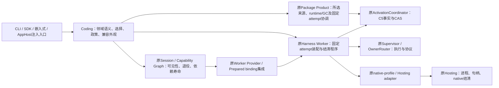

# KD008：Worker联合职责方向评审卡（A44补证）

- Authority: accepted responsibility direction review record；具体合同与接受范围见[主设计](worker-product-runtime-convergence.md)。
- Design status: 用户2026-11-09已答复“接受职责方向，继续接通与验证”；不再pending，不自动接受所有后续接口或整个Goal。
- Implementation status: partial；A56的15源实际接通及三视角代码接受见末节，A44等历史候选不追认采用。
- Owner: Coding产品政策与原Worker、Session/Capabilities、Package Product、Hosting各owner。
- 方法：本地clean archmethod master `0f9bd3ff51afabeaaf76cc38dff1ceb279b7d37e`。

2026-11-09成本准则修订：用户明确允许在职责清楚、高内聚低耦合、优先复用已有组件且确需扩充时适度增加系统总行数。本卡下文正成本比较保留为历史事实，不再单因正增量拒绝候选；具体采用仍须证明接口必要、旧厚体退出及兼容，原联合职责图的用户评审状态不因此自动改变。详见[Goal现行准则](../coding-responsibility-convergence-goal.md)。

以下A44至A56候选记录保留当时状态与成本；现行用户接受、实际实施与计量以末节为准。

本卡汇总既有KD008 §10.2联合图，纳入[A44具体子候选](worker-product-runtime-convergence.md#15-a44同一attempt生命周期子候选归并既有kd008)。不另立项目、不恢复被拒组合，也不将联合目标缩成单Canary搬迁。

## 请评审的职责方向

| 责任 | 建议归属 |
| --- | --- |
| 目标/查询语义、Profile选择、trust/approval政策、错误与状态投影、公开兼容入口 | Coding |
| 原调用点的准入、first effect、启动/发布、失败回收、正常关闭、回滚与恢复协调 | Harness Worker，直接复用原Coordinator/Supervisor/Router/native等对象 |
| Graph准备/提交/可见性/退役、Prepared交接和未结清依赖保留 | 原Session/Capabilities及其Worker集成 |
| 所选manifest/runtime/receipt的来源与授权事实、GC/Journal | 原Package Product与原事实owner |
| 进程/native资源、物理结清证据 | 原Hosting/native profile/cleanup owner |

运行对象、operation lock及状态引用仍每attempt一份。原C5、Graph和Hosting分别保权威，不新增执行引擎、日志、队列或恢复调度。Canary、普通Linux、普通Windows、operator的不同发布/释放时点继续分立，不能强套同一错误合同。

## 当前可评审的具体实物

A44已构建完整Canary生命周期替代：保原真实Code类、公开签名、Status/Error九自身字段与数据格式；固定执行程序在原Worker内部，五个Code钩子仅作纯政策/输出投影，三端口直接复用原能力。既有Code binder、native-selected验证及其余联合入口尚未完整退出，不能统称领域代码。

| 候选全成本 | Coding | 接收组件 | 系统 |
| --- | ---: | ---: | ---: |
| A44完整生命周期子项 | −468 | +569 | **+101** |
| 原§14 Prepared交接子项 | −92 | +206 | **+114** |
| 两稿独立相加的试算 | −560 | +775 | **+215** |

该相加不代表组合已验证或联合优化完成，原Prepared候选仍需按当前依赖重核。建议接受联合职责方向，继续整簇复用、旧体退出及全成本比较；**不将这些正成本切片逐个独立安装**。完整Goal仍要求Coding≤15,000行及系统源码严格净减少。

## 技术证据与未接受范围

A44设计及候选代码各经职责/复用、运行/失败、数据/兼容三独立视角；45项原Canary/AppHost检查分批通过，另3项公开ABI/旧Statuspickle/暗路与冷导入补证通过。原实际actor和候选Code/Core加载路径/SHA、真实Core callable、同self/单锁/注入引用均有见证，原测试断言未改。

首轮3项相对src/docs缺失失败已保留，修实验cwd后只重查3项，42项已过原节点不重跑。受控native/Hosting等叶子不证明原生Windows、物理结清、所有取消交错或旧安装方法pickle兼容；Status旧值与Protocol方法元信息变化分开说明。详见主设计§15及[三视角记录](worker-product-runtime-convergence-review.md#a44完整canary生命周期子候选及治理归并)。

A44补证时产品仍Coding **120,999行**、系统 **638,590行**，本补证新增生产精简 **0**；候选没有安装。

## 本次接受的边界

请求接受的是上图的联合职责方向，供下一轮具体联合接口/费用与实施选择使用。它不接受单Canary正成本交付、被拒的旧组合、所有后续接口或整个Goal完成。

这项用户评审来自此前明确约定“系统环境图等重要工作件需要我评审”，已记录于[主设计§10.5](worker-product-runtime-convergence.md#105-全成本验证和接受边界)。内部技术结论不能代替用户接受；没有新增另一张审批图或门禁。

A46补记：同一C5 authority已独立承接Resume parent完整登记/回读/封存/恢复证明，
未采用本卡待审联合图。A44的120999/638590是当时快照；当前实绩Code120850/系统640027，
本片Code−106/Core+155/系统+49属迁移成本，详见[接受边界](worker-product-runtime-convergence.md#16-a46c5-resume-parent交接归原authority)。
本卡职责方向仍待用户评审，不能由该独立前置反推接受。

A49计量补记（2026-11-09）：实际Code **120932行**、系统 **641090行**（1932源）。
相对原137755起点Code减16823，距15K仍105932，系统仍增6296。A48 AppHost寿命与
A49原managed批停为独立已审收敛，不意味着本卡Worker联合方向获得用户接受。
本卡请求仅为“联合职责方向”，不是安装A44/Prepared正成本子项或已接受具体联合接口；
表内候选成本为历史完整实物，不预支为当前实绩。下一轮须按当前源重核接口、复用及
整簇全成本，不逐个独立安装这些正成本候选；完整Goal与系统净减条件不变。

## A56当前可评审实物（2026-11-09）

请评审本卡原联合职责图的方向：Coding保编码政策、选择与真实公开值；Session
承接原Graph/Prepared交接；Worker承接固定native attempt与原清理；Package Product
承接GC/currentness下的Windows intent/置备读取等固定协调；原Resources/Journal/
C5/Supervisor/Hosting继续各自保唯一事实和物理资源权威。未增加新执行/恢复引擎。

现有15源完整联合候选已有三独立职责/运行/数据复核：原Worker→Code→Session
绕行退出，原StopIteration/cleanup反例由6局部观察关闭，载荷最小读口修订完成。
新增Intent完整read/inspect/commit及同一对象provisioning load/CAS已构建，原
writer及Journal直接复用，原DTO/构造/退休政策保持；15源类型/Ruff/parse、83
结构检查通过。另8个提取类/方法的受控观察只证明load/CAS同对象/参数/顺序，
不代表Product/native/物理IO或全部ABI验证。

| 当前未安装候选全成本 | Coding | 接收组件 | 系统 |
| --- | ---: | ---: | ---: |
| Session/Worker/payload与Windows Product程序联合 | −620 | +1777 | +1157 |

新成本按用户本轮准则审必要适度增量，迁移不称去重；实际产品仍120932/641090。
cleanup外层已归位，内层orphan/inventory查询仍待收敛；本卡不承诺已经全部领域化
或整个Goal完成。职责、接缝和三视角证据详见[专项§21](worker-product-runtime-convergence.md#21-a56windows-product固定程序与完整orphan查询的下一边界)。

接受本卡只确认上述联合职责方向，允许后续按有界已审合同接通、验证与逐项接受；
不会追认未完成接口、任意正成本或整Goal完成。该用户评审仍来自此前明确约定
“系统环境图等重要工作件需要我评审”，不是新增审批流程。

## A56用户接受与实际接通（2026-11-09）

用户已明确答复：**“接受职责方向，继续接通与验证”**。接受的是本卡原联合图及
A56职责方向；不会覆盖所有未来接口、A44等被拒候选、A33完整历史/KD011图或
整个Goal。以上各候选的“待审/未安装”按当时历史保留，不是现行状态。

对应15源已经实际接通，原厚程序退出；最终104相关测试通过，原C54单失败以
精确Map维护并同节点复验关闭，15源Ruff/格式/类型通过。实际源码三视角无本片
剩余已识别阻断，Root已作有界技术接受。完整边界见[专项§22](worker-product-runtime-convergence.md#22-a56联合方向接受实际接通与主线同步)。

当前Coding120493/系统643406，本片最终−629/+1776/系统+1147，其中10行为
导入格式；主线同步的+190/+1169另计。原物理owner直接复用，无新日志/执行/
恢复引擎；内层orphan/inventory尚未退出，整个Goal≤15000仍未达。后续沿此方向
继续完整查询链，不重复请求已接受的方向评审。

A57后续实绩：同一已接受方向下，完整orphan/recovery取得与payload物理枚举已归
原Product/StageIO，两实际inventory reader复用同GC借根程序，七源代码三视角及
有界接受完成。当前Code120393/系统643561，本片−100/+255/系统+155；145项过，
FD测试范围修正后的同25复验过。A56以上数字保原历史，不是最新计量；完整
Goal仍未完成，见[专项§23](worker-product-runtime-convergence.md#23-a57完整windows查询取得与同构reader复用)。
