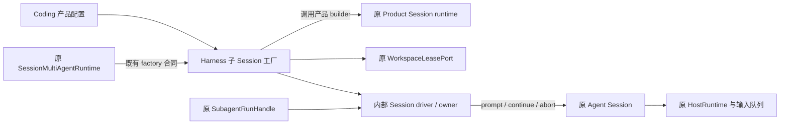

# 子 Session 创建、驱动与清理收敛

- Authority: normative — bounded implementation design。
- Design status: accepted；Implementation status: in-progress。
- 基线：`64d035620`；方法：本地干净 archmethod master `0f9bd3ff51afabeaaf76cc38dff1ceb279b7d37e`。
- 接受范围：用户明确授权“梳理并收敛通用子 Session 的创建、驱动和清理机制到 Harness，复用已有能力”。实施 agent 在该范围内完成下述职责、运行、兼容检查并接受具体接缝；不将其记为用户逐项评审接口，也不授权 Goal 子执行或持久化扩展。

## 事实与职责

基线已经有 Harness 的控制树、上下文计划、RunHandle、Session 装配合同、输入 facade、历史安装和结果投影。Coding 的工厂同时承担产品配置与通用创建/清理；私有 driver 直接调用原 Session 的 prompt/continue/abort，不另建 agent loop。

原关闭路径存在不一致：Coding runtime 关闭失败仍尝试释放 workspace；RunHandle 即使 dispose 失败也 commit_closed；Session runtime 提前移除句柄并忽略根释放时的错误。这与控制层“物理资源释放后才能 commit_closed”的既有合同冲突。迁移同时修正这些路径，失败后保留同一 owner 重试。

本次明确调整两项旧取舍：技术边界文档原要求两个真实 Product 才能提取通用 factory，本轮按用户明确下沉指令提取已知 Agent Session 接缝；当前仍只有 Coding 生产消费者，非 Coding 测试不冒充第二产品。run-handle 文档原允许清理失败也释放名额，本轮改为保留依赖和清理凭据；代价是故障未修复前容量仍被占用，收益是可针对同一资源显式重试，不产生脱离控制树的存活资源。

| 职责 | 收敛位置 | 复用与约束 |
| --- | --- | --- |
| 角色、工具精确身份、平台工具映射、模型、Coding 沙箱与持久策略 | `CodingSubagentFactory._build_child_runtime` | 仍调用原 Coding runtime builder；当前 persist=False 不变 |
| 创建流程、子 actor 审批绑定、workspace lease 寿命、Session 创建与历史安装 | `harness.session.subagent.AgentSessionSubagentFactory` | 实现既有 SessionSubagentFactory；复用 ActorBoundApprovalResolver、WorkspaceLeasePort、install_agent_forked_history |
| 已有 Agent Session 的轮次适配与资源 owner | 上述模块内部 driver | 复用 build_agent_session_input_facade、project_agent_round_result；直接调用 Session 的原 prompt/continue/abort/dispose |
| 控制树、寻址、轮次 task、关闭顺序、容量 | 原 `SessionMultiAgentRuntime` / `SubagentRunHandle` / `MultiAgentControl` | 不新增调度器、队列、registry 或持久状态 |

现有 `SessionSubagentDriver` 接受原始 round callback，并用 HostRuntime.run 包裹它，继续服务这种底层消费方式。完整 Agent Session 的 prompt 内部已进入 HostRuntime，不能再次包裹同一 Host，也不应另造 Host 绕开冲突。本次迁移的内部 driver 适配完整 Session，共用同一 SubagentRoundDriver 合同；两者不是两个执行内核。

## 创建与驱动合同

Product 注入同步 runtime builder，接收原 request、已选择的 cwd、子 actor 审批 resolver 和可选 workspace lease；返回原 Product runtime。工厂在返回后、下一个 await 前持有 runtime。builder 自身未成功返回时的内部半成品仍由 builder 负责；lease provider 在成功交付 lease 前负责自身失败/取消清理。不得用反射读取 Coding 私有配置或硬编码某 Product 工具。

factory 先取得必要的隔离 workspace，再绑定审批、构造 runtime、创建 Session、安装原上下文并返回原 SessionSubagentBinding。创建途中失败或取消沿同一 owner 逆依赖清理；失败原因为 error，清理失败为 cleanup_error，两者由 SessionSubagentCreationError 保留。原 SessionMultiAgentRuntime 留存 cleanup-only RunHandle；直接调用 factory 的消费者保留异常中的 owner 并重试 dispose。

首次输入仍暂存给首轮 prompt，后续 steer/follow 经原 input facade；每轮仍从新增消息投影结果，workspace snapshot 仍消费原端口。不中途替换角色、工具权限、none/all/last 历史语义；不建立来源账本或 Work。

## 关闭与重试

1. 树 owner 先封闭整个待关闭子树的新输入/子派生，原 plan_close_tree 仍按深度处理。
2. 原 RunHandle interrupt 并等待现有轮次结束，之后调用同一 driver.dispose。
3. driver 结束该 actor 的审批，关闭原 Product runtime，成功后才释放 workspace。每阶段只在成功后登记完成，重试不重复已完成阶段。
4. driver 的清理 task 被 owner 保留并 shield；一个等待方取消不取消实际清理。创建失败时同样交付 owner，不依靠局部变量存活。
5. dispose 失败不 commit_closed、不释放路径或容量、不删除 handle；下一次 close 重试。停止释放尚有未清理后代的祖先，保留其依赖。中断失败但轮次已经收敛且资源关闭成功时可关闭记录，并保留中断错误报告。
6. 根 Session dispose 遇到子清理错误抛出异常，原 before_release 后续步骤不运行。修复故障后同一入口继续清理；成功后才退订与标记 runtime disposed。

close_agent 保留原成功结果格式，失败时额外报告 cleanup_errors，避免“关闭零个”冒充清理成功。新的错误不会触发自动重发任务或后台无限重试。旧控制状态枚举、事件存储和持久格式不变；关闭失败后保留容量是纠正原资源归属的有意行为变化。

## 三视角检查与验证

本节为实施 agent 的三视角自查，不宣称独立 agent 评审。

| 视角 | 判断与验证义务 |
| --- | --- |
| 职责与复用 | Product 配置与 Harness 机制分离；通用工厂有非 Coding 测试消费者；继续使用原队列、RunHandle、审批和 lease 端口 |
| 运行与失败 | 创建失败/取消、runtime 关闭失败、workspace 释放失败、关闭等待方取消、后代失败阻止祖先和 before_release；同 owner 重试、不复执行 |
| 数据与兼容 | 角色、权限、平台工具、首轮 source、上下文继承、消息/结果与 workspace 引用维持；不修改旧记录格式、不启用持久子 Session |

验证复用既有 Harness Session / Multiagent / Tools、Coding Multiagent 与架构检查路由，新增断言进入原测试文件；不新增 PR gate、平台或 live 模型检查。实际结果与交付提交在完成后登记。
