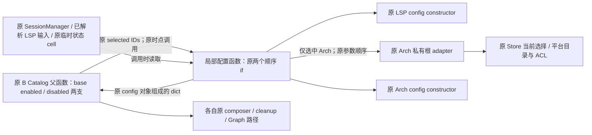
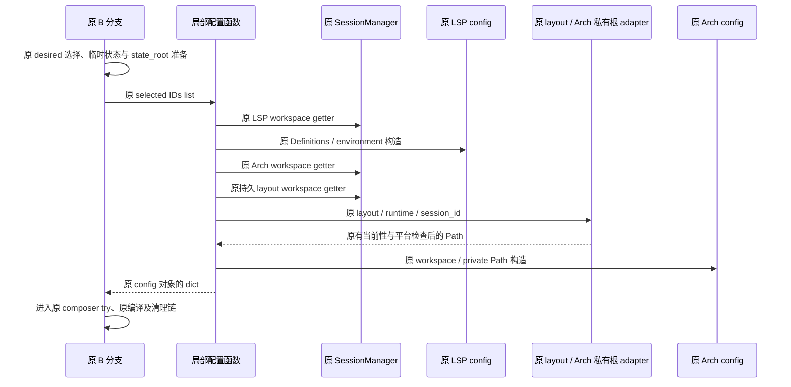

# D2-B1：B 同步 bootstrap 配置构造专项设计 R1.1

## 状态与范围

- Authority: accepted — 用户接受的既有 bootstrap 合同下内部实现收敛。
- Design status: accepted（R1.1）；用户在机制及独立启用说明后以“同意，请继续”授权实施。
- Implementation status: implemented；定向验证与三视角代码评审完成；远程交付状态以对应 PR 为准；未修改 gate。
- Owner: Coding bootstrap 的 Product 输入适配；Harness 既有装配、Store/目录/平台 owners 保持。本文位于 D2 协同记录下，不新增 Harness 组件。
- 基线：本地 main/HEAD `2490c9d54f06e9f1d88b23a050dce8b3cf185f83`，2026-11-05；方法为本地干净 archmethod master `0f9bd3ff51afabeaaf76cc38dff1ceb279b7d37e`。

继承 [D2 R2](composition-route-inputs.md)、[B1 盘点](composition-route-inputs-remaining.md)、[Current owner map](../current-owner-map.md)、[PLC7](plugin-lifecycle-plc7-contract.md)、[RCP5](resource-catalog-rcp5-contract.md)及 [ARD-008](../../decisions/accepted/ARD-008-workspace-upgrade-compatibility.md)。按保留职责/格式/授权的内部变更裁剪，不因多一个私有函数增加 ARD；若实际需要改变这些合同，先回到父级设计。

本切片只合并 `_prepare_package_product_catalog_projection` 内两个 B 同步分支的 LSP/Arch 配置构造表达式。兼容 `prepare_capability_plugins`、deferred LSP、desired 状态判定、三个 seed builder、composer、临时目录创建/清理和 Store/平台实现各保留原路径。收益限于减少同一 Product 输入规则的维护点，不声称减少 discovery、编译或磁盘访问次数。

## 1. Current 与证据

| 现状 | 固定源码依据 | 对设计的约束 |
| --- | --- | --- |
| 同一父函数内两个同步配置块相同 | [bootstrap](../../../../../src/loushang/coding/bootstrap.py#L1553) 1553–1580 与 1744–1771；两个 LSP constructor AST 相同，两个 Arch constructor AST 相同 | 可以复用原表达式；不能推导两条完整 bootstrap 等价 |
| 输入已由原分支选定 | 同文件 1500–1531、1687–1720 记录 desired selection、维护 enabled IDs；空集合不进入配置块 | helper 仅消费原选定 list，不重新捕获、排序、过滤或修改它 |
| 配置前已建立本分支临时状态 | 1533–1551、1722–1742；`arch_private_ephemeral_state` 为原外层 cell，后续还交接 cleanup | 保留原赋值和 owner；不把这些状态转给新 helper |
| 配置表达式有顺序与副作用 | LSP 先构造；Arch 先求 `workspace_root`，再求 temporary Path 或 prepare 私有根，然后构造配置 | 不把 Arch path 作为预先求好的 helper 参数 |
| 私有根准备有当前性与目录操作 | [private-data adapter](../../../../../src/loushang/coding/package_installation_private_data.py#L109) 109–173 校验安装/Session、捕获 selected manifest、准备私有目录；Windows 处理身份/ACL 后再次捕获 | 继续调用原 adapter、原参数、原阶段；不缓存 Path 或授权结果 |
| 原两个 composer try 仅从配置块之后开始 | bootstrap 1581–1608 和 1772–1811 | helper 调用仍在各原 try 之前，不扩大捕获范围或修复原清理语义 |

LSP 配置 constructor [173–229 行](../../../../../src/loushang/coding/lsp/_provider_api.py#L173) 自身负责路径、Definitions 与环境校验/正规化；Arch 配置 constructor [115–159 行](../../../../../src/loushang/coding/arch/_provider_api.py#L115) 负责路径与 quota。新函数不再复制这些规则。

## 2. 选定候选：原父函数内的一个局部函数

在原 `_prepare_package_product_catalog_projection` 的 guards/peer-tool 拒绝之后、两个分支之前定义一个私有局部函数，例如：

```python
def build_product_capability_configurations(
    selected_ids: list[str],
) -> dict[str, CodingLspPluginConfigV1 | CodingArchPluginConfigV1]:
    ...
```

该函数不是组件或公共扩展点，只有两个原调用位置。它按原两个顺序 if 构造一个新的局部 dict：先处理 `coding.lsp.default`，再处理 `coding.arch.default`；只有全部所需构造成功后，才返回原配置对象。两个调用方分别将返回值赋给原 `no_base_configurations` / `configurations`，随后继续调用各自原 composer。

沿用原词法上下文，显式记录六项捕获来源：`session_manager`、`resolved_lsp_definitions`、`resolved_lsp_environment`、`arch_private_ephemeral_state`、本次父调用的 `product_runtime` 和 `session_id`。函数在调用时读取这些原 cell；不使用默认参数冻结，不预先建立上下文 DTO、不克隆输入，也不存入 Session、Graph 或长期回调。原 module globals/构造器仍在调用时按原方式查找。

这里组织 Coding 插件 ID、配置类型与安装私有根政策，属于 Product 适配。目录/平台与 Store 原机制已共享；为两个调用再增加 Harness 配置 owner、通用 registry 或新 callback 协议没有依据。

| 相邻责任 | 拟议处理 |
| --- | --- |
| 选择 base/capability/external-data，记录 desired 与当前 Store 证据 | 原两个父分支保持 |
| 临时 state/private directory 的分配与 cleanup 凭据 | 原分支保持，新函数不持有资源责任 |
| 已选 IDs 到 Coding config 值的重复构造表达式 | 原 Coding 父函数内局部复用 |
| Arch Installation 目录、ACL、当前性与路径策略 | 原 `prepare_coding_product_arch_private_data_root` 保持 |
| 配置正规化、序列化与默认 quota | 原两 config 类型保持，不调用新的 to_dict 或转换层 |
| 准入、编译、activation、Session Graph、失败处理 | 原调用链与 guards/try 保持 |

完整系统环境沿用 D2 R2；下面仅展开内部调用关系，同进程、同步 Python 调用，不增加进程或连接：



## 3. 求值、数据与失败合同

1. 传入原 `enabled_capability_ids` list，不转成 set/tuple，不遍历重排、不新增 ID 校验或缺省选择。适用范围仅是两处可信内部调用；不借此开放另一种配置输入入口。
2. 每次调用建立新的 dict；键和插入顺序保持 LSP → Arch。未选中的插件不构造配置；原启用两个 if 的规则保持，不引入提前返回的部分 dict。
3. 两个 constructor 调用及 keyword 表达式逐项保留：LSP 原 workspace/Definitions/environment；Arch 原 workspace getter 后才判断 temporary state，并在持久分支以原 layout/runtime/session ID 调原私有根 adapter。保留 getter、目录准备与 constructor 的原次数，不缓存 cwd、manifest、Path、config 或 to_dict 结果。
4. 采用原显式 if/赋值，不改为生成器驱动构造。以原表达式向外逸出的异常为准，保留原 StopIteration/BaseException 实例，不新增翻译、重试、note 或捕获为业务错误；constructor/adapter 自身原有的异常转换保持。
5. helper 调用占据各原配置块的位置，仍在各自原 composer try 之前。它不 close、不 rollback、不删除目录、不接收 cleanup callback，也不改变两个分支不同的异常处理。原临时状态已经创建时发生配置失败，仍进入原外层异常路径；本切片不承诺原所有配置失败都已具备完整清理。

两插件均启用、持久 Arch 的顺序示意如下；temporary 分支直接使用原 temporary Path，跳过 layout/Store/private-root 操作：



任一步失败，后面的步骤不运行。例如 LSP 校验失败时，不执行后续 Arch 配置表达式，也不调用持久 Arch 私有根 adapter；此时原分支提前创建的临时目录仍可能已经存在。持久根准备失败时，不执行 Arch constructor 或 composer；Arch constructor 失败时，不进入 composer。helper 前已分配的临时目录或已完成的目录操作仍走原清理路径，不新增回滚承诺。新 helper 不成为二次授权、取消或恢复边界。

## 4. 选择与扩展边界

| 选项 | 判断 |
| --- | --- |
| 原父函数内一个局部函数，两个原位置调用 | 建议。可直接复用原表达式与 cell，少量接口，不移动外部副作用或 owner |
| module-level helper，传入 Session/runtime/配置/路径上下文 | 可行备选，但为本次两处复用增加参数与跨模块 seam；现无独立复用需要 |
| 提前计算 Arch Path 或建立配置快照再调用纯 builder | 会移动路径副作用/失败顺序、合并 getter 时点；不选 |
| 合并兼容、B、deferred 路线或新增通用配置组件 | 输入来源、私有根政策与 current check 时点不同，超出本切片 |
| 保留原两段代码 | 合理备选；若局部函数依赖继续增长或需要新 registry/callback 框架，重新评估复用收益 |

兼容路径及 deferred LSP 不调用新函数；不移动 imports、重命名公开入口、改 seed/schema/journal、收紧类型/权限或改变平台支持。该切片不以代码行数或性能阈值验收，不预留未来策略开关。

## 5. 验证与评审

下表保留接受时的验收要求；实际执行结果、主线既有测试配置修正及验证局限见[评审与实施记录](bootstrap-capability-config-review.md#实施与代码评审)。

| 场景 | 必须保持的观察 | 证据方式 |
| --- | --- | --- |
| 两个 B 分支的 LSP-only、Arch-only、两者启用 | 原 config 字段/默认值、dict 键序、getter 与构造次数、原 composer/Store 输入保持 | 对原两配置块做树外动态差分；以差异选择代表场景，复用原 bootstrap/B Store 用例 |
| temporary 与持久 Arch | temporary 不准备安装根；持久只在原位置调用原 adapter，参数/顺序保持 | 原调用轨迹与注入目录准备记录；原平台模块 AST/哈希保持，不改 Windows 机制 |
| LSP、workspace getter、layout/根、Arch 分别失败 | 同一异常对象和同一故障前缀，后续 constructor/composer 不运行；原 cleanup 轨迹保持 | ValueError、StopIteration 及取消类故障注入；不以返回值相等代替失败轨迹 |
| 原 composer 失败、临时状态清理失败 | 两 B 分支各自原捕获、cleanup 顺序及附注策略保持 | 原分支 AST/差分与已有 cleanup 用例；不在本切片补造统一清理 |
| 兼容、minimal、deferred LSP / Resume | 不新增或提前构造；原 current/manifest/Graph 参与集合保持 | 原源码对比、已有对应测试；不重复已交付的付费 Goal 试验 |
| 层次与格式 | 只有原 bootstrap 两块与一个局部函数变化，无新组件、格式、缓存或反向导入 | 原包事实/导入检查及局部 AST；不新增 PR gate |

现有定位依据：`tests/coding/test_bootstrap.py`、`tests/coding/test_hosted_session.py`、`tests/harness/resources/packages/test_plc9b_adversarial.py` 中原 B 构造路径；`tests/coding/lsp/test_provider_api.py` 和 `tests/coding/arch/test_plugin_provider.py` 的 config 用例。其存在不证明新的局部调用、所有 B 组合或异常轨迹已被覆盖；实施者须先核对适用用例，再补树外最小差分。没有要求全组合矩阵、全仓套件或 native/hosted 支持面扩张。

沿用既有三视角独立评审要求，核对职责与复用、运行与失败、数据/兼容/验证，另做综合一致性检查，见[评审记录](bootstrap-capability-config-review.md)。R1.1 重要图与合同经用户接受后已按此范围实施；代码评审无未关闭发现。此接受和交付限于 B1，不代表 D2 其他候选已接受或整体完成。
