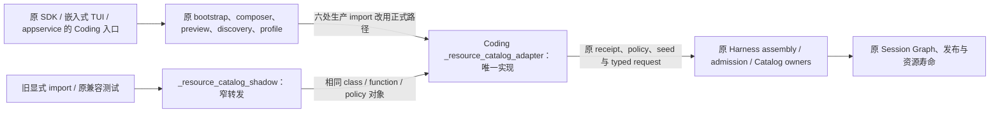

# E1：Coding Catalog 正式模块与兼容入口 R1.1

## 状态与范围

- Authority: accepted — 用户接受的审计 E1 内部模块迁移，不改变现有职责。
- Design status: accepted（R1.1）；用户明确“同意，请实施开发”接受本轮关系图与兼容范围。
- Implementation status: implemented；迁移、定向验证和三视角独立代码评审完成；远程交付状态以对应 PR 为准，gate 未改。
- Owner: Coding Product Catalog 输入适配；Harness Resource Catalog/Session/Resources owners 保持原责任。本文在 Plugin 审计下协同记录，不新增 Harness 组件。
- 源码基线：main `9f8c851b5c7cb4a8fce51c140e85bbc135454286`，2026-11-05；本地 Harness lane 的起点与其 tree 相同。
- 方法：本地干净 archmethod master `0f9bd3ff51afabeaaf76cc38dff1ceb279b7d37e`，按保留责任和合同的内部变更裁剪。不另设 ARD、公共 facade 或通用迁移框架；若发现持久身份或边界需要改变，先重新定界。

继承 [Plugin 审计 E1](convergence-audit.md)、[Current owner map](../current-owner-map.md)、[RCP5](resource-catalog-rcp5-contract.md)、[D2 已接受设计](composition-route-inputs.md)及 [ARD-008](../../decisions/accepted/ARD-008-workspace-upgrade-compatibility.md)。D2 本轮已在[范围结案](composition-route-inputs-remaining.md#本轮范围结案2026-11-05)明确处置；E1 不承担其余 seed 策略、清理和路线统一。

目的：生产调用指向职责清楚的正式模块；历史入口继续得到相同对象，不再保有第二份实现。收益是降低定位和维护成本，不承诺减少启动 I/O、编译次数、内存或运行耗时。

## 1. Current、调用者与约束

| 已核实事实 | 基线源码证据 | 设计含义 |
| --- | --- | --- |
| 文件名仍为 shadow，函数已使用正式名称 | [Coding adapter](../../../../../src/loushang/coding/_resource_catalog_shadow.py#L178) 的 prepare/build、策略常量、plan seed/completion；文件末 1085–1093 的三个旧别名 | 命名债务，不是存在两套 Catalog 执行引擎 |
| 六个生产文件导入旧模块 | [bootstrap](../../../../../src/loushang/coding/bootstrap.py#L63)、[_capability_plugin_composition](../../../../../src/loushang/coding/_capability_plugin_composition.py#L26)、[_product_capability_plugin_composition](../../../../../src/loushang/coding/_product_capability_plugin_composition.py#L79)、[plugin_local_discovery](../../../../../src/loushang/coding/plugin_local_discovery.py#L26)、[_invocation_product_profile](../../../../../src/loushang/coding/_invocation_product_profile.py#L7)、[package_product_preview](../../../../../src/loushang/coding/package_product_preview.py#L75) | 一次切片切换这六处 import，调用及 kwargs 保持 |
| 旧模块不只暴露 `__all__` | `__all__` 为八项；生产还显式导入 build/canonical/prepare seed/finalize seed/complete seed；[旧测试](../../../../../tests/coding/test_resource_catalog_shadow.py#L24)显式导入 `_owner_binding_covers`、旧 Error/build 别名 | 不能仅 `import *` 转发八项；须列出直接导入兼容面 |
| prepare 先消费 owner receipt，再调用 build；策略是原不可变实例 | adapter 84–158、178–210 | 不增加 wrapper 重算、替代 class 或复制 policy 对象；保留相同异常类型供调用者捕获 |
| 三处架构测试绑定实现的文件位置 | [type system](../../../../../tests/architecture/test_plugin_contribution_type_system.py#L60)、[RCP1](../../../../../tests/architecture/test_resource_catalog_rcp1_shadow.py#L114)、[RCP2](../../../../../tests/architecture/test_resource_catalog_rcp2_components.py#L29) | 实现搬移须等价迁移原路径库存；旧 shim 不能代替真正实现接受检查 |
| Harness shadow 仍参与未发布候选协调 | [generation](../../../../../src/loushang/harness/resource_catalog/generation.py#L568)调用[shadow runner](../../../../../src/loushang/harness/resource_catalog/shadow.py#L259)，管理候选与 lease | 不是本次 Coding 历史名字，不作全仓 shadow 替换 |

树外 `architecture-analysis/plugin-harness-audit-20261104/e1-catalog-module-20261105/source-manifest.json` 保存 AST 导入、字符串路径和 22 份命中源码/测试快照哈希。数量包含真实 Harness shadow 的文字命中，不能都解释为旧 Coding 模块消费者。仓内直接导入定位到六个生产文件和五个测试文件；三个架构文件另以源码路径检查实现。未证明仓外没有使用者。

## 2. 选定候选与环境关系

将原实现在同一 Coding 包内迁到 `_resource_catalog_adapter.py`；原 `_resource_catalog_shadow.py` 只保留明确导入与别名赋值。两者是同一 Product 适配的内部模块，不是新运行时组件。新实现不得反向导入旧 shim。

部署与外部交互保持：同一进程内 Python import 和原调用，不增加进程、网络、队列、持久账本或新装配方式。Coding 仍选择领域 policy/trust/roots；Harness 仍提供共享准入、编译、Catalog 与 Session 生命周期。此处不顺带拆分约 1100 行适配模块的内部职责。

| 方案 | 判断 |
| --- | --- |
| 正式模块承接原实现；旧模块窄转发 | 选定候选；让生产定位清楚，维持旧显式导入对象一致；增加一个很小的兼容模块 |
| 保持文件名，仅完善说明 | 可行低成本备选；不改变定位债务，若迁移成本明显超出理解收益则选此方案 |
| 直接改名并删旧路径/别名 | 不选；别名仍有调用，仓外依赖和回滚支持未被证明可退出 |
| 让新模块转发到原 shadow 实现 | 不选；生产实现仍归历史路径，形成长期反向依赖 |
| `sys.modules` 替换、动态代理、第二份实现或新通用 Catalog facade | 不选；增加身份/导入行为或新的 owner，没有实际需求 |

## 3. 对象、兼容与失败合同

### 单一实现及直接导入面

原函数体、类体、import 依赖顺序、policy/版本字符串、默认参数、`__all__` 八项及其顺序迁至新模块，不改算法、私有根政策或行为。原文件末三个旧别名仅归旧 shim；正式模块使用已有正式名字。旧 shim 显式重导出以下 14 项，全部引用新模块的原对象：

- 三个 `CODING_*_RESOURCE_CATALOG_SOURCE_POLICY` 常量（standard、base-disabled、read-only）。
- `CodingResourceCatalogSourcePolicy`、`CodingResourceCatalogAdmissionError`、`InitialResourceCatalogProductAdapter`、`ResourceCatalogInputReceipt`。
- `prepare_coding_initial_resource_catalog_adapter`、`build_coding_initial_resource_catalog_adapter`。
- `canonical_coding_resource_catalog_source_policy`、`prepare_coding_package_plugin_plan_seed`、`finalize_coding_package_plugin_plan_seed`、`complete_coding_package_plugin_selection_seed`。
- 已有私有测试 seam `_owner_binding_covers`。

另保留三个旧别名，使用赋值而非 wrapper/subclass：`CodingResourceCatalogShadowAdmissionError` → 正式 Error，`build_coding_initial_resource_catalog_shadow_adapter` → 正式 build，`prepare_coding_initial_resource_catalog_shadow_adapter` → 正式 prepare。旧 shim 的 `__all__` 保持原八项及顺序，因此 wildcard 不意外扩张；显式导入面共 17 项。保留 private seam 不将其提升为公共 SDK。

不转发原文件偶然导入的 `Path`、`time`、`Protocol` 等依赖或其他未被选定的私有实现细节，不用 `__getattr__` 自动暴露未来名字。源码搜索没有发现仓内通过旧模块名 patch 其 globals 的调用；未来测试如需注入，定位唯一实现或原协作者，不宣称 shim 的 module namespace 与正式模块是同一个 module 对象。

### 导入、异常与状态

两种路径无论先导入哪一个，选定名字在同进程内 `is` 相同；相同 policy 单例、默认参数、exception class 与 type check 关系保持。函数执行在新模块 globals 中，无第二次定义或每次访问构造；不通过手工加载文件副本得到第二套 class。shim 导入失败直接透传原依赖异常，不 fallback 到另一份实现；receipt 消费仍只发生于原 prepare 调用，导入不启动 Session 或准备目录。

模块迁移会改变本模块定义对象自然生成的 `__module__` 及 traceback 源码位置，属于本次明确的诊断差异；不承诺保持裸 `repr`/inspect/module-global monkeypatch 的旧行为。旧显式类型路径仍可解析到同一对象，但不据此承诺任意 pickle、热替换或新版本生成对象在旧二进制中的恢复。仓内未发现依赖该模块路径的持久编码；实施前再次核对 Resume/manifest/receipt 是否记录 Python 模块身份，若发现持久依赖则停止该窄迁移，先补兼容设计。

Catalog/Plugin 数据 ID、journal/manifest、policy revision、fingerprint、admission、current recheck、取消与 cleanup 均按原路径执行。rollback 是回退本次源码迁移的完整提交，不是删除 shim 或重新启用 legacy 数据源；不要求用户新建 workspace 或清空历史。

### 退出条件

本轮只退出旧模块的“生产实现位置”，不删除旧 import 路径、三个别名或 legacy 路线。后续删除需独立决定：确认支持消费者及回滚窗口、将相关测试改为验证新合同并提供兼容/迁移依据。仓内零命中、经过一段时间或缺少公开 `__all__` 本身都不足以证明可删。

## 4. 实施边界及原测试协同

实施为一次可回退切片：迁移实现/建立 shim → 同时改六个生产 import → 等价迁移三处实现路径库存 → 运行原相关检查及窄兼容探针。保留 `tests/coding/test_resource_catalog_shadow.py` 的路径、原用例和原行为断言，旧导入继续覆盖 shim；其他测试可继续旧导入，无需为了清零命中批量改名。

架构库存只替换本次实现角色的原文件位置：RCP1 原 exact consumer 集合以新实现路径替换旧路径；RCP2 原实现常量与 assembly direct-import exact set 指向新模块；type-system 原 closed kind 检查检查新实现。旧 shim 仅转发，不应以它“仍存在”掩盖新实现绕过规则。保留精确集合比较和原禁用断言，不加 allowlist 豁免、不移除检查。

此类源码角色等价迁移不扩张覆盖、触发或平台，不新增 gate。若原检查无法在该范围等价迁移，先解释新增导入边和实际职责，而非放宽断言。现有生成包依赖图按原脚本核对；同包内部换名不预设一定需要重生成，也不手改生成事实。

实施结果须补充一个指向正式实现的当前源码导航，并将旧路径标为兼容转发；固定基线的审计、旧设计 Current 表及历史证据继续引用原路径/行号，不批量改写历史。现有相对链接检查与人工核对即可，不新增 gate。

## 5. 验收与三视角评审

| 场景 / 重要性 | 必须观察的结果 | 证据与边界 |
| --- | --- | --- |
| 旧入口与正式入口同用（高，保护类型/策略身份） | 上述 17 项正确映射；三别名 identity、八项 wildcard 顺序、默认 policy `is` 保持 | 树外受控导入探针；两个先后顺序各用新 Python 进程；不增加 PR 测试矩阵 |
| 原 owner completion、receipt、Catalog 发布/刷新（高，已有行为） | 正常结果与拒绝原因、receipt 消费、编译次数、取消/失败回滚保持 | 复用 `test_resource_catalog_shadow.py` 原实际集成场景；AST 核对搬移前后函数/类体与模块级值，不只测 shim 自身 |
| 生产依赖和精确库存（高，防止检查落空） | 六生产入口只导入正式模块；正式模块不反向依赖 shim；三处原库存对应真实实现 | 原 architecture 用例、静态 import 图与字段/版本检查；无新 gate |
| 未取得依赖或原准入失败（中） | 原异常不翻译、不触发第二实现/目录操作/重试 | 静态导入链及既有拒绝场景；不为普通模块改名另建故障状态机 |
| 已有旧 Session/Plugin（高，升级约束） | 路径/身份/版本字段未变，不需要数据迁移 | 持久路径核对及复用实际相关 bootstrap/Resume 测试；不以名称迁移宣称所有托管/平台均验证 |

实施验收的具体证据落点：

- 原 Catalog 场景复用上表测试文件中的 owner completion、一次编译、失败发布及取消用例，记录实际选择的 node IDs 与结果。不要仅凭测试文件名宣称 receipt/Resume 已覆盖。
- 持久重开至少选用原 `tests/coding/test_workspace_storage_compatibility.py::test_ordinary_upgrade_reopens_legacy_workspace_and_transcript`（settings/package_v4 原参数），以及 `tests/coding/test_resume_bootstrap.py::test_resume_bootstrap_uses_current_plan_without_rewriting_original_header[legacy]`、`[changed]`。后者仅 Linux，必须记录真实平台及 skip；纯构造 history 的 comparison 用例不能替代持久 reopen。
- 旧 exported prepare（含其旧别名）目前没有直接生产/测试调用。当前 bootstrap 使用 `prepare_catalog_input_receipt` 后调用 build，不能把原集成结果算作该 prepare 的执行证据。树外窄探针以计数 receipt source 调用同一 prepare：核对一次 take、原 AttributeError/RuntimeError 转换，以及取走 receipt 后 build 拒绝不重新领取；配合完整函数/默认参数 AST 和 alias identity 核对。探针属于实施期证据，不新增产品测试矩阵或 gate。

设计阶段仅静态源码与场景走查，未 import 产品或运行 pytest/模型/native 试验。未要求新的全组合矩阵、全仓回归或恢复暂停的 Windows gate。后续 pytest 按工作区既有规则在 sandbox 外、保留 non-live/skip-host-runtime 等选择。

三视角独立评审分别覆盖职责/收益/复用、导入与运行失败、对象身份/兼容/验证；评审者读固定源码与合同，不读其他报告或作者结论；最后综合一致性，见[评审记录](catalog-adapter-module-review.md)。R1.1 关系图和兼容范围在设计评审后经用户接受，实施及代码评审证据续记于同一评审记录；不将设计评审结果代替实现验证。

## 6. 当前实现导航

用户接受 R1.1 后，唯一实现现位于 [Coding Catalog adapter](../../../../../src/loushang/coding/_resource_catalog_adapter.py)，旧 [shadow 模块](../../../../../src/loushang/coding/_resource_catalog_shadow.py)只保留兼容转发。§1、原审计及 D2 固定切点中的路径/行号是迁移前证据，继续保留；当前实现从本段进入。实施验证与三视角代码评审结果见[同一评审记录](catalog-adapter-module-review.md)。
