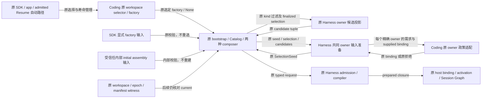
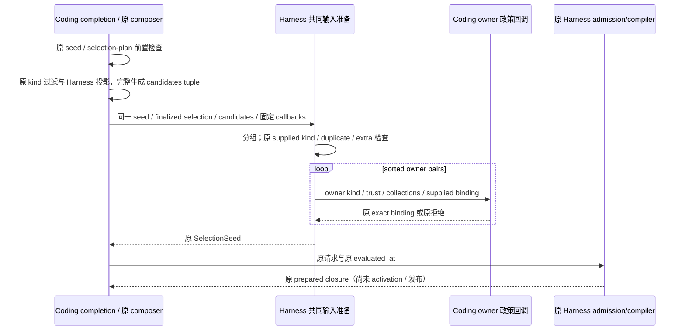

# D2：装配路线与共同输入准备专项设计 R2

## 状态与范围

- Authority: accepted — 限本文件第一切片；沿用既有路线和编译合同。
- Design status: accepted（第一切片）；2026-11-04 用户明确指令“实施 D2 第一切片：拆分共同输入准备与 Coding 策略”，承接 R2 环境/职责/交互合同；不据此接受更广泛的 bootstrap 合并。
- Implementation status: partial（D2 整体）；第一切片已完成，204 项直接回归与 33 项差分通过，三视角代码复核无未关闭发现。原架构检查的 1 项 main 既有清单失败已于 2026-11-05 校正并定向复核，完整跨包套件未跑完，详见评审记录。更广泛 D2 尚未实施，测试路由与检查范围未扩展。
- Owner: Coding 保留 Product 路线和政策；Harness Session assembly 承接共同输入准备，原 Capability/Plugin owners 保留准入和执行权威。
- 源码基线：main `ff29a80e422ba296f1cc3711c51ffc68163a6e65`；Harness HEAD `0e2aeeb056fd855a6988638e3eec8a77ca4eaf65`，完整 tree 相同，2026-11-04。
- 方法：本地干净 archmethod master `0f9bd3ff51afabeaaf76cc38dff1ceb279b7d37e`，不声明上游同步。

继承[审计 D2](convergence-audit.md)、[Current owner map](../current-owner-map.md)、[PLC7 单 composer 合同](plugin-lifecycle-plc7-contract.md)、[RCP5 资源合同](resource-catalog-rcp5-contract.md)及[升级兼容](../../decisions/accepted/ARD-008-workspace-upgrade-compatibility.md)。D1 的[账本装配](management-ledger-assembly.md)和[退役交接](session-owner-retirement-handoff.md)已交付，其实现不在本轮重做。

目标是明确路线决定的唯一来源和存续边界，并把已经跨路线共用的输入准备中，通用规则与 Coding 政策分开。源代码没有证明存在两套编译内核或运行中重复启动的存储路线；不从分支数量推导缺陷。本提案按保留原职责/授权/格式的内部实现重组评审；若实际涉及迁移路线权威、公开协议或恢复语义，应先升级对应共同父级决策。

## 1. Current：已经共用什么，真正混合在哪里

| 来源（范围固定于基线） | 已核实事实 | 本提案处理 |
| --- | --- | --- |
| `package_product_runtime.py::CodingFencedProductApplicationSelection.factory_for_session` 453–471、`_select_workspace_unlocked` 509–593 | 原 owner 在锁内选择 compatible/fenced workspace、保留旧工作区、对 fresh/B 执行原初始化/恢复/准入；平台、epoch 与外部 binding 当前性由原 owner 核对 | 保留现有 selector，不能把该调用描述为无副作用查询 |
| `bootstrap.py::_select_direct_coding_product_factory` 2832–2857、`_borrow_application_coding_product_factory` 3253–3279、`_build_with_package_product_selection` 3282–3297 | direct 创建并转交一 Session 的 owner；app 路径借用原应用 owner；选中的 factory 或 None 显式传入 `_create_agent_session` | 保留两种真实寿命和原失败清理；不是两个存储选择引擎，不合并成新的统一 owner |
| `_create_agent_session` 586–2795，特别是 730–850、982–1018 | 根据原 factory、组合集和输入检查互斥，B route 不构造默认 legacy materializer；但 None 还可能与注入的初始 assembly、minimal/no-package 形态共存 | 不引入从 None 推导的二元 route enum，不把每处 if 当成重复决定 |
| `_capability_plugin_composition.py::prepare_coding_capability_plugin_composition` 1331–1481；`_product_capability_plugin_composition.py` 219–473 | compatibility、B capability-only、B combined-base 三条准备路径已共用 `_finalize_selection`、`_assembly_request`、owner seed completion 和原 `prepare_product_plugin_composition` | 保留该共同内核；不建第三个 composer/runtime |
| `_resource_catalog_shadow.py::complete_coding_package_plugin_selection_seed` 910–1018 | 候选投影、owner/kind 分组、重复/多余绑定检查，与 Coding exact-boundary 检查和默认 owner 的创建混合。由 Catalog finalizer 及上述 composer 共同调用 | 保留 wrapper 原 kind 过滤及对既有 Harness 投影函数的调用；只将其后的结构准备归原 Harness assembly，领域政策留 Coding |
| Harness `product_composition_assembly.py` 579–833 | 已拥有 PlanSeed/SelectionSeed、严格 lineage 校验、typed requests、owner admission、编译与 host binding 的分阶段协议 | 扩充现有内部输入准备，不新增 owner、缓存、许可或持久记录 |
| Coding Session `_prepare_resource_refresh` 1232–1281、`_require_current_coding_runtime_selection` 1283–1408；bootstrap deferred LSP 2450–2570 | 活动代改变可要求 restart；当前 workspace/epoch、选定 manifest/selection 仍须核对；延迟 LSP 沿当前原 binding 检查后构造 | 刷新不是重新选择存储路线；不以“统一一次决定”为由缓存准入或跳过 current recheck |

源码：[选择与 owner](../../../../../src/loushang/coding/package_product_runtime.py)、[bootstrap](../../../../../src/loushang/coding/bootstrap.py)、[Catalog 输入适配](../../../../../src/loushang/coding/_resource_catalog_shadow.py)、[兼容 composer](../../../../../src/loushang/coding/_capability_plugin_composition.py)、[B composer](../../../../../src/loushang/coding/_product_capability_plugin_composition.py)、[Harness assembly](../../../../../src/loushang/harness/session/product_composition_assembly.py)、[Session 核对](../../../../../src/loushang/coding/session/agent_session.py)。树外 `architecture-analysis/plugin-harness-audit-20261104/d2-composition-route-inputs/source-evidence.json` 保存原文 SHA 和 AST 范围。

“存储路线”和“装配形态”是两个维度：前者是原 compatible/fenced owner 的选择；后者包括 base+capabilities、capabilities-only、Catalog 资源、minimal、内部预备 assembly、延迟 LSP 等。它们不是每个组合都合法，合法性仍由原入口政策核验。公开 `create_agent_session` 可显式接收 factory；initial assembly 则是受信任 `_create_agent_session` 的内部输入，不将它提升为公开 SDK 合同。两类显式输入都沿各自原路径，不重新解释成普通 workspace 自动选择。

## 2. 环境与组件关系

逻辑环境以本轮共同输入准备为黑箱。相邻组件虽可在同进程，也各保留权威。



部署与连接保持原状：SDK 嵌入式、TUI 或 appservice 的 Product 入口最终使用各自原 Coding runtime；不新增进程、网络、队列或跨入口状态。此处只设计最终同步 Python 交接，不重新设计 TUI/RPC/tenant 合同。

| 连接与变异来源 | 责任、信任与失败条件 |
| --- | --- |
| SDK/app/Resume → 原 selector | 同进程原调用。direct-owned 与 application-borrowed 寿命不同；Resume 是需 current admission 的激活步骤，不能由普通历史读取触发。原初始化/恢复、锁和平台分支保持 |
| 显式 factory / 内部 initial assembly → bootstrap | 前者是现有公开函数参数，后者是已有内部装配 seam；分别保持原互斥与政策校验。显式 factory 不再触发自动 selector，内部 assembly 不被重建，不把此旁路混入普通自动路径 |
| composer → 原候选投影 → 共同准备 | 原 wrapper 先核验 seed 类型与 plan 相等，继续按规范 kind 集合过滤并调用原投影函数，完整取得 candidate tuple 后才交接。原 seed/selection/包绑定/候选均为本次惰性数据，不是任意 RPC/JSON 新入口，不重新发现来源、加载插件或 resolve |
| 共同准备 → Coding 政策 | 可信 Product 回调只决定每个 owner 的 exact binding 及原错误；Coding 标签、允许 trust/collection、默认值和 consumer 边界仍归 Product。回调不因此成为新的 execution authority |
| composer → 原 Harness 编译 | 原 prepare/admit/compile 阶段与后续 activation/host binding 分离，后者仍需要原精确 owner 决策；共同准备返回值不代表执行许可或已发布 |
| 当前性核对 → 原 binding/witness | 原 workspace/epoch/manifest 事实来自原本地 Store、journal 和句柄；即使 seed 内容相同也保留核对。不缓存跨 Session/连接/工作区的“路线已批准”结论 |

### 路线决定如何贯穿

沿用已有显式链条：`ApplicationSelection → factory_for_session 返回值 → _create_agent_session(factory) → 原 Product runtime binding / legacy lifecycle → 原 Session witness 与 pinned selection`。这是同一受理过程内原对象的交接，不是要求 selector 全进程只能调用一次，也不新增持久 RouteResult。

new/fork/Resume、不同 workspace、owner replacement 等各有原重新准入时点；活动 Session 的 refresh/on-demand activation 则复用它持有的 binding，并按原逻辑核对当前性、保留 pinned generation 或拒绝。B 准入失败按原错误返回，不自动 fallback；None 也不能推出所有后续输入都属于 legacy。

## 3. 职责与首切片

| 责任 | 负责者 | 本轮变化 |
| --- | --- | --- |
| workspace 路线、平台/epoch/升级/Resume 准入、direct/app owner 寿命 | 原 Coding selector 和 bootstrap 包装 | 保持 |
| 选择哪些 Coding 插件、config、trust、provider、roots、组合集与 source policy | 原 Coding adapters/specs | 保持；`_assembly_request` 中 Coding Definitions/Provider 选择不是通用算法，原处保留 |
| finalized selection 的 owner 候选投影 | 原 Harness `prepare_owner_contribution_candidate`；Coding wrapper 保留原 kind 过滤和调用 | 机制已共享，原位置/顺序保持，无需再造投影函数 |
| owner 需求分组、supplied owner 结构核对、排序与 SelectionSeed 构造 | 原 Harness Session assembly 的内部准备函数 | 从既有 Coding completion 中收敛，不新建组件 |
| supplied owner exact-boundary 判断和缺省 owner 创建 | Coding completion 的窄政策回调；复用原 `_owner_binding_covers` | 从原混合循环中分离，条件和结果保持 |
| provenance、owner admission、provider admission、编译、activation 和 Graph 发布 | 原 Harness owners 与 Product 精确决策方 | 保持；不让输入准备替代后续独立检查 |
| runtime/verified handles/management leases、失败 custodian 与后续重试 | 原每条准备/Session 路径的 owner | 保持；共同准备不 close、rollback、转移句柄或创建关闭状态 |

首切片在现有 `harness/session/product_composition_assembly.py` 增加一个私有函数，例如：

```python
_complete_product_plugin_selection_seed(
    seed: ProductPluginPlanSeed,
    *,
    selection: PluginSelection,
    candidates: tuple[OwnerContributionCandidateEnvelope, ...],
    resolve_owner: ProductContributionOwnerResolver,
    reject: Callable[[OwnerCompletionRejection], Exception],
) -> ProductPluginSelectionSeed
```

这不是新 facade 或 author SDK。`resolve_owner` 是消费方定义的窄可调用协议，keyword 输入为 `owner_id`、`contribution_kind`、该 owner 的 `trust_classes: set[str]`、`collection_ids: set[str]` 及 `supplied_binding: ProductContributionOwnerBinding | None`，返回原 binding 或创建原 Coding 默认 binding。无需再造需求 DTO、来源注册表或通用 policy engine。

原 `complete_coding_package_plugin_selection_seed` 签名、类型/selection-plan 前置检查及异常文本保持；接着保留原 candidate tuple 表达式，实际使用 `PLUGIN_OWNER_CONTRIBUTION_KINDS` 过滤并调用既有 Harness 投影，再将原对象和 candidates 委托。新内部函数只用于这一个已验证调用位置，不新增 eager 校验、二次投影或提前 provenance 检查；原后续 admission 仍独立验证来源。Coding 原函数名和 import 入口保留；三个 composer、Catalog finalizer 与所有原 call sites 无需换装配路线。

这个边界同时符合现有 `test_plugin_contribution_type_system.py::test_contribution_kinds_have_one_canonical_closed_definition`：Coding 与 Harness 均实际消费同一规范 kind 集合，原断言不改。保留的是原 wrapper 的真实分类/投影调用，不是无用 import、占位文字、新增重复校验或另建 kind 枚举。共享投影函数本来就归 Harness，因此此处保留调用没有复制机制。

## 4. 数据与政策合同

共享结构规则与领域政策必须分开：

| 信息 / 判据 | 保持内容 |
| --- | --- |
| seed 与 selection | 原 `selection.plan != seed.plan` 值相等校验，不改为对象身份必须相同；返回仍携带原 selection、packages、bindings，不重新 resolve/finalize，也不构造新 plan |
| owner 需求键 | 按原 `(owner_id, contribution_kind)` 分组，即使 Product id 不同也不能重复 supplied pair；后续 admission 仍按原三元键处理，各阶段不能相互替代 |
| 集合与顺序 | wrapper 按原顺序完整投影 tuple；helper 每 owner 聚合 collection/trust 集合；supplied 输入顺序和原四项结构拒绝优先级保持；按 owner pair 排序调用政策，保持输出顺序和 supplied binding 对象身份 |
| Coding supplied binding | 原 `_owner_binding_covers` 精确检查 owner/kind/product=`coding`、trust/collection 集合、`allowed_requirement_bindings=("direct",)`、`consumer_scope="session"`、`consumer_refresh_boundary="sealed"`；不扩大为集合包含，也不临时补 revocation/TTL/policy_revision 等新拒绝条件 |
| Coding 默认 owner | 仍仅在 kind=`resource_item` 且 trust 集合恰为 `{coding-configured-published}` 时按原值创建；product=`coding`、原 ingress policy_revision 字符串、epoch=0、sorted trust/collections、direct/session/sealed。tool/command 或其它 trust 缺 owner 仍拒绝 |
| 错误 | wrapper 原 TypeError/ValueError 保持；结构 reject 只有 `invalid_package_resource_declaration`、`invalid_product_owner_binding_kind`、`duplicate_product_owner_binding`、`product_owner_binding_extra` 四种原 reason；Coding 回调保留 `product_owner_binding_boundary_mismatch` / `product_owner_binding_missing`。均返回原 CodingResourceCatalogAdmissionError、reasons、code 和文本 |
| 其它失败 | candidate 投影、原构造器、回调及后续 engine 原异常直接上传，不统一翻译，不返回半成品、不换身份盲重试 |

Coding reject adapter 将单个 reason 包成原单元素 tuple 后构造原异常；不能把 str 直接作为 Sequence[str] 传入导致按字符拆分。结构 helper 不知道 Coding 异常类、trust 标签或默认授权值。Product 回调保留原 supplied/default 分支，不改成一组被 Harness 隐式采用的宽松缺省。

验收须直接核对 supplied binding 及其 authority 对象身份，不能只比较 dataclass 值：`ProductContributionOwnerBinding.authority` 的 `compare=False` 会使值相等不足以证明使用的是原授权对象。默认 owner 则核对全部原 policy 字段和 TTL；这些身份检查不将原 plan 的值相等合同改成对象必须相同。

`ProductPluginSelectionSeed` 及后续 assembly 原构造器/lineage/admission 校验仍在原阶段执行。共同准备不调用 admit、compile、bind、Graph 或 owner close，不把返回的 policy/binding 当作任何来源已被执行授权。原后续再次投影候选及验证 provenance 保持，不以避免重复读取为由复用或缓存其授权结果；不把本切片描述为编译次数或启动耗时优化。

## 5. 顺序、失败与交互

必须按原 completion 顺序，而非只保持成功结果：

1. Coding wrapper 保留 seed 类型检查，再保留 selection 类型与 plan 值比较；不提前调用政策。
2. Coding wrapper 先完整生成原 owner candidates tuple，使用原 `prepare_owner_contribution_candidate` 和 `PLUGIN_OWNER_CONTRIBUTION_KINDS`。完成后共享 helper 才逐项核对 Resource/CatalogConsumer spec 并聚合需求；不能改为边生成边拒绝而改变异常前缀。
3. 按原 seed.owner_bindings 顺序检查 kind、重复 pair，再检查 supplied 多余键。所有这些完成后，才进入逐 owner 政策回调。
4. 按 sorted owner pair，传同一 supplied binding 或 None 及原集合给 Coding 回调；supplied mismatch、缺默认资格仍在原位置拒绝。该 callback 保留原 `_owner_binding_covers`，返回原对象或原构造结果。
5. 构造同一类型 SelectionSeed，原字段和原构造器检查保持。调用方继续原 request/admission/compile；外层原 exception handler/custodian 负责已取得 runtime/leases 的清理与失败凭据。



若在第 2/3/4/5 步失败，后续阶段不执行；已取得资源仍归外层原 owner。本 helper 不持新锁、创建线程/任务或捕获 BaseException，不增加关停标志。外层兼容 custodian 与 B runtime.close 的差异保留，不承诺跨路线统一回滚或任意 cleanup 失败都已修复。

## 6. 选择、兼容与首切片边界

| 选项 | 判断 |
| --- | --- |
| 新建 RouteSelector/RouteResult，并把 factory=None 都改为 legacy | 将存储与装配形态混为一谈，重复已有 owner，并可能误接注入/minimal 路径；不选 |
| 合并两 composer、所有 seed builder 及清理协议 | 把 B manifest/lineage/Resume、兼容 migration/leases 和 Product 政策揉在一起；未证明有等价输入，暂不选 |
| 只改名称或把 `_assembly_request` 原样包装进 Harness | 该方法已共用且含 Coding roots/provider 政策；不能据此获得新的通用职责，首切片不选 |
| 保留原路线和共同编译内核，将现有 owner completion 的结构部分归 Harness、政策归 Coding | 建议；真实跨路径调用已存在，接口只隔离现有变异，不建立新路线或授权机制 |
| 维持全部现状 | 合理备选；若评审证明回调复杂度高于职责收益，应保留而非强制下沉 |

该切片不修改 bootstrap/factory/select_workspace/current witness、两 composer/seed builder、Resume 协议、Graph 以及 D1 清理链。不重命名 shadow 模块或删除兼容入口；那些属于 E1/E2，需要独立退出依据。也不要求外部调用者换 workspace、重建 Session 或迁移既有 journal。

源码变化候选限于原 Harness assembly 模块、Coding completion 的原验证/投影入口及窄政策/reject helpers，并同步职责说明。既有检查/scanner/允许集合/工作流/平台保持；若实施揭示真实保护合同不允许该提取，先回到设计，不为让本方案通过而放宽 gate。公开接口、新持久路线状态、跨调用授权缓存、移动准入时点或统一两类 owner 寿命均超出本切片。

路线部分本轮的成果是明确已实现的选择与交接合同，而不是增加另一份状态。更广泛的 bootstrap 分支收敛只有在证明重复的选择或输入准备、并保留 current recheck 与原失败顺序后，才另选后续切片；首切片完成不等于 D2 全部完成。

## 7. 验证与评审计划

下表保留设计时确定的实施验收要求；首切片实际执行结果与验证局限见[评审记录](composition-route-inputs-review.md#第一切片实施与代码评审)，不把本表视为全部场景均已执行的证明。

| 场景 / 优先级 | 必须保持的可观察结果 | 原证据与补充方式 |
| --- | --- | --- |
| DI-1 compatible/B 自动选择、显式 factory；高，升级风险 | 自动路径保留原 owner、factory/binding 身份及互斥；显式 factory 沿原参数交接而不调用自动 selector。B 缺 manifest/准入失败不 fallback，peer materializer/configured legacy sources 原样拒绝 | `test_bootstrap.py` 的 Product reuse、missing-selected-manifest、peer materializer、legacy source 及 fenced-default-refusal 用例；原路由 AST/调用点对比，单独核对显式 factory 的旁路 |
| DI-2 minimal、内部初始 assembly、read-only child、deferred LSP；高，易误分类 | 内部 initial assembly 按原输入使用、不重建，维持其与 factory 互斥。其它合法输入组合延续原路径，不新增选择/发现/物化；原资源/工具集合、on-demand 时点和 current selection check 保持 | 原 minimal Catalog、composition sets、child scope、on-demand LSP 及 `test_resource_catalog_shadow.py` 私有 `_create_agent_session` 注入场景；不将该内部 seam 声称为公开 SDK 参数 |
| DI-3 owner 输入精确性；高，信任与集合边界 | supplied 对象身份、owner/kind 排序、跨 Product 重复 pair、extra、missing、边界不等与受限默认行为保持 | `test_resource_catalog_shadow.py` exact-boundary、cross-Product duplicate、unused-owner 用例；树外原函数/实现差分覆盖不同 owner、kind、trust/collections 与错误优先级 |
| DI-4 同一选择只完成/编译原次数；高，可重用性 | 原 selection/plan/字段、完整返回值、resolve/compile 次数保持，不再 resolve，不提前 admit | 原 `test_catalog_product_records_every_resolve_but_finalizes_and_compiles_once`；树外 candidate/binder/error/constructor 轨迹及字段/身份差分 |
| DI-5 helper 任一步失败；高，失败清理跨 owner | 不返回部分 seed；原下一阶段不执行，原 source/构造异常保持，已取得 runtime/lease 仍进入原 custodian/close，失败凭据可继续使用 | 原 bootstrap/Plugin 清理失败用例加树外逐阶段 fault-prefix 对比；现有用例覆盖不等于新回调顺序已证明 |
| DI-6 refresh/Resume/管理变更；高，当前性 | 原 generation pin/restart-required 和 workspace/epoch/manifest current recheck 保持；新 seed 不能代替当前准入 | 原 refresh rollback、pinned Plugin、Resume/current witness 用例；原源码完整 AST/哈希保持；不重复付费模型试验 |
| DI-7 层次与格式兼容；高，结构成本低 | Harness 无 Coding 反向导入，无新 facade/账本/格式/锁/路线缓存；两原 seed 类型与原 shared engine 保持；Coding 的原实际 kind 过滤保留 | 原 canonical kind definition、RCP2/PLC7/import DAG、文档与包事实检查；`test_plugin_contribution_type_system.py` 原断言和真实消费均保持，不扩 PR gate |

不预设性能阈值或可删行数；候选投影、分组和排序沿原方式，新增私有调用只隔离政策，未证明读取减少或跨 Product 实际消费者增加。树外验收不进入 PR gate，运行证据与设计评审分开。本机/模拟条件不能代替各平台原生部署验证。

设计由职责与复用、运行与失败、数据/兼容/验证三个独立 xhigh 视角核对，关注两轴模型、函数粒度、原政策与准入边界、源事实与真实测试覆盖，具体见[评审记录](composition-route-inputs-review.md)。R2 固定设计版本先提交用户，用户随后明确授权实施第一切片；本轮代码评审和验证记录追加于同一评审文件，更广泛 D2 不据此宣告完成。
