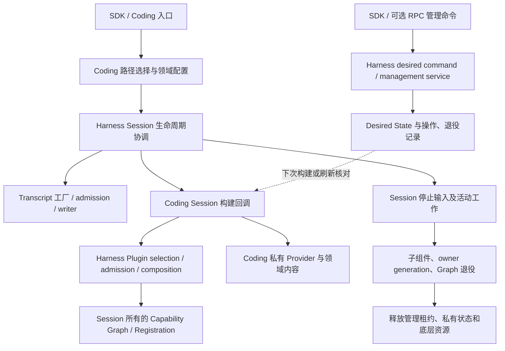

# Plugin 与 Harness 架构收敛审计 R1

## 状态与范围

- Authority: descriptive — source audit 与后续处置索引；不替代各专项已接受合同。
- Design status: 原审计完成；截至 2026-11-05，本轮已选范围完成处置，当前总表见 §9–§11。
- Implementation status: M1、M2、D1 两个切片、D2 两个切片及 E1 命名切片已合入 main；M1 固定源码的指定 Windows 补验已通过。明确保留项和条件性候选不计为未完成的必做开发。
- Owner: Harness / Coding architecture，执行审计：Codex。
- 日期：2026-11-04。产品源码基线：main `1120f9b1fe3b8610de76b60c115660dc9d0353d7`；审计分支起点 `b4b0a03fbd09e06342d18e86c79b0089f4668281` 的完整 tree 与该 main 相同。
- 方法：本地干净 archmethod master `0f9bd3ff51afabeaaf76cc38dff1ceb279b7d37e`。采用调用链、事实权威和运行失败检查，复用现有架构，不另建总体架构或平行交付计划。
- 用户任务：①启动 Session、加载插件、禁用插件、关闭 Session 四条链；②状态、持久化及清理负责人；③保留、合并、下沉、退出清单及兼容条件。

审计对象是上述路径涉及的 Coding 装配与 Harness Plugin、Resources、Capability Graph、Session、Transcript。对 Harness/Coding Python 源码做静态重复扫描，但没有逐一审查 Harness 的全部领域；不能把本报告解释为全库质量认证或运行时缺陷证明。

§1–§8 保留原审计及 M2 实施切点的历史事实，源码位置、测试结果和当时的“下一步”均按各节切点解释。§9–§11 是当前处置总表，核对基线为 main `66a74974989f7e4e957d7f0cc89a3cd0631dda22`；不能把历史候选清单继续当作全部待开发任务。

依据：[Plugin Architecture V2](architecture.md)、[Current Owner Map](../current-owner-map.md)、[Capability Graph](../capability-dependency-and-mount-lifecycle.md)、[CLA 收敛](../composition-lifecycle-authority-plan.md)、[升级兼容约束](../../decisions/accepted/ARD-008-workspace-upgrade-compatibility.md)。这些文档仍拥有各自的规范权威。

## 结论

存在可以直接定位的重复流程，以及需要收敛的跨层协调；没有证据支持“整个 Harness 应推倒”或“Plugin 另造了一套完整执行引擎”。优先问题是平台公共流程的复制、Product 装配中通用协调与领域策略交织，以及兼容路径缺少清晰退出条件。

多个账本不自动构成重复：期望状态、操作进展、活动实例、包内容、注册和对话事实分别回答不同问题。审计没有证明这些已由两个组件竞争写入同一语义事实。也没有依据给出全库冗余比例、可删除行数或当前启动性能收益。

## 1. 四条实际调用链

图中的箭头表示调用或所有权交接，不表示所有节点都在一个事务内。B 是已有 fenced Product 存储路径；兼容路径仍有独立入口条件。

### S1 创建 Session

1. `coding.bootstrap.create_agent_session_runtime` 选择 Product 配置，调用 `build_agent_product_session_runtime`；注入 `AgentSessionRuntime` 和原 `_create_agent_session` 构建回调。[入口](../../../../../src/loushang/coding/bootstrap.py)
2. `AgentProductSessionRuntime.create_session` 委托 `new_session`，经 lifecycle adapter / `new_session_operation` 到 `SessionLifecycleRuntime.new`；生命周期转换和当前 Session 切换由共享协调器负责。[运行时](../../../../../src/loushang/harness/session/product_runtime.py)、[Transcript 生命周期](../../../../../src/loushang/harness/session/transcript_lifecycle.py)、[协调器](../../../../../src/loushang/harness/session/lifecycle.py)
3. Transcript 工厂建立或打开对话记录，writer 生命周期负责取得写权；Coding 构建回调提供领域 Prompt、工具、LSP/Arch 配置和 Product 存储选择。[工厂](../../../../../src/loushang/harness/transcript/session_factory.py)、[Writer](../../../../../src/loushang/harness/transcript/writer_lifecycle.py)
4. `bootstrap._create_agent_session` 中 `package_product_runtime_factory` 决定使用 fenced Product 还是兼容 materializer；有 factory 时不会再选择默认旧 materializer。`prepare_package_product_catalog_projection` 还显式拒绝混用 Catalog 路径。

**判定：**存在多层 API，但本次没有发现第二套 Session 受理/转换引擎。真正复杂处是同一 bootstrap 同时承接多种存储与装配路线。应使路线选择更集中，而不是把所有入口绕过共享生命周期。

**失败边界：**Transcript 获取写权失败发生在 Session 可用之前；构建候选失败还需清理已取得的资源。创建失败不能通过换新库、清空状态或跳过 admission 来“修复”。本轮不重现运行时失败。

### S2 加载插件并发布能力

1. Coding 选择 base / LSP / Arch、默认启用及领域配置；`prepare_coding_package_plugin_plan_seed` 合并资源选择输入。[bootstrap](../../../../../src/loushang/coding/bootstrap.py)、[Catalog 适配](../../../../../src/loushang/coding/_resource_catalog_shadow.py)
2. 兼容路线 `prepare_coding_capability_plugin_composition` 和 Product 路线 `prepare_coding_product_capability_plugin_composition` 都调用共享 `prepare_product_plugin_composition`。后者校验 Definition、trust provenance 和 exact owner，再调用既有 assembly/admission。[兼容装配](../../../../../src/loushang/coding/_capability_plugin_composition.py)、[Product 装配](../../../../../src/loushang/coding/_product_capability_plugin_composition.py)、[共享装配](../../../../../src/loushang/harness/session/product_composition_assembly.py)
3. Session 装配使用 Graph Binder/Runtime 发布 Mount；注册使用原 registration 生命周期。Plugin descriptor、mount 和 registration 分别表示选择、能力实例和可撤销发布，不是三份相同事实。[Binder](../../../../../src/loushang/harness/capabilities/graph_binding.py)、[Graph 状态](../../../../../src/loushang/harness/capabilities/graph_runtime.py)、[Registration](../../../../../src/loushang/harness/runtime/registration.py)
4. 平台包物化位于既有 Store/lifecycle 层，不能由 Product 再复制包内容存储。[POSIX](../../../../../src/loushang/harness/resources/packages/plugin_lifecycle/posix_materialization.py)、[Windows](../../../../../src/loushang/harness/resources/packages/plugin_lifecycle/windows_materialization.py)

**判定：**已复用共同 admission / composition 内核；两个 Coding composer 的存在不能直接判为双引擎。两条路线承接不同存储/迁移前提，但共同收尾模式与选择输入值得统一。发现明确的平台流程复制，见 F1。

**失败边界：**验证、信任和 exact owner 失败发生在发布前；已构建未发布的候选需要原 owner 回滚。执行代码的授权与静态发现必须继续分离，不能以“减少层数”为由合并。

### S3 禁用插件

1. 本地 SDK `CodingPluginManagementCommandClientV1.submit_desired`、Coding RPC adapter 均调用 `submit_plugin_desired_command`；RPC handler 本身只绑定 Product 提供的 client，并不拥有管理状态。[SDK](../../../../../src/loushang/coding/plugin_management_command_sdk.py)、[Coding RPC](../../../../../src/loushang/coding/plugin_management_command_rpc.py)、[Harness RPC](../../../../../src/loushang/harness/host/rpc/commands/plugin_desired.py)
2. 共享函数将 disable 映射为 `installed_disabled`，携带 Product scope、operation identity 和 expected inventory revision，经 command application 进入 `PluginManagementService.submit`。[desired command](../../../../../src/loushang/harness/plugin_management/desired_command.py)、[application](../../../../../src/loushang/harness/plugin_management/application.py)
3. Service 在原 GC reference guard / journal lock 下重放操作、处理幂等，再写 accepted、提交 desired transition、交接 retirement 并推进结果；各阶段通过既有恢复逻辑衔接，并非多文件原子事务。[Service](../../../../../src/loushang/harness/plugin_management/service.py)、[Desired ledger](../../../../../src/loushang/harness/plugin_management/ledger.py)
4. 活动 Session 的租约保留原代。Coding `_prepare_resource_refresh` 检查管理变化，遇到 `restart_required` 记录诊断并拒绝该刷新；它不是立即卸载已经运行的 Plugin。[Session](../../../../../src/loushang/coding/session/agent_session.py)、[租约判断](../../../../../src/loushang/coding/_plugin_lifecycle.py)

**判定：**入口已有共同管理服务，不应再造“统一插件管理器”。desired 与 effective 的短暂差异是代际租约语义，不应简单当成冗余。对用户应分别解释“已禁用、当前 Session 仍固定原代、需要重启”。

**失败边界：**CAS 拒绝与操作结果不明不同；恢复应沿原 operation 查询/恢复，不换身份盲重试。禁用不等于删除包文件，也不意味着运行中副作用已撤销。

### S4 关闭 Session

1. `AgentProductSession.dispose` 先 `prepare_execution_release`，再进入 adapter/operations 的停止资源 watch、关闭 refresh、发送 shutdown 等流程；runtime 关闭执行准入并等待 backend。[Session](../../../../../src/loushang/harness/session/agent_product.py)、[operations](../../../../../src/loushang/harness/session/operations_runtime.py)、[runtime](../../../../../src/loushang/harness/session/runtime.py)
2. Coding `_dispose_session_runtime_profile` 先关闭借用父依赖的 deferred LSP，再处理 Worker tool lease，调用共享父实现；LSP 关闭抛错时保留原对象与依赖以便重试。[Coding hook](../../../../../src/loushang/coding/session/agent_session.py)
3. Harness 父实现停止模型调用/输出生产者、结清 output capture，撤销 owner generations，再调用原 Graph Binder dispose。Graph 将可见节点失效并保留待退役节点；`is_closed` 不等于没有 pending retirements。[共享 hook](../../../../../src/loushang/harness/session/agent_product.py)、[Binder](../../../../../src/loushang/harness/capabilities/graph_binding.py)
4. Coding 获取原 retirement receipts，核验 graph/owner/component 清理状态后 `release_management`、清理 private state；Session lease 的 close 还核对 owner-generation evidence 才释放 family。其后按原职责清理 sandbox / Product runtime 等资源，错误向上返回。[assembly](../../../../../src/loushang/coding/_capability_plugin_composition.py)、[lease](../../../../../src/loushang/coding/_plugin_lifecycle.py)

**判定：**关停存在多个协作 owner，不是重复关闭同一个对象的充分证据。已证实公共清理模式分散，但本轮没有证明双重释放或死锁。重构必须保留子组件先退役、失败凭据与依赖仍可重试的约束。

## 2. 状态、持久化与清理负责人

“唯一”指同一 scope / 同一对象的写入权威，不是全进程只能有一个该类实例。不同文件锁不能因名称相似就合并。下表是四条路径涉及的主要事实边界，不是磁盘上所有 JSONL 文件的穷举。

| 事实/资源 | 当前负责者与持久化 | 清理或恢复责任 | 审计判断 |
| --- | --- | --- | --- |
| 当前 Session 及切换 | Harness lifecycle coordinator / transition host；活绑定在内存 | 同协调器推进替换与失败候选退役 | 保留；Coding 不另存活绑定权威 |
| 对话原文、Model Input 与用量 | Harness Transcript Store/Factory；原 Transcript 记录 | Writer lifecycle/admission 维护写权与落盘，Session 调用关闭 | 保留；不迁到 Plugin 账本 |
| Plugin 期望安装/启用版本 | `PluginDesiredStateLedger`，Product layout 选文件 | 由 management command / migration coordinator 推进 | 保留，安装默认值不能覆盖已 remove 历史 |
| 管理命令身份、阶段、结果 | `PluginManagementService` 的 operation journal | Service 的查询、幂等重放和 recover | 保留；不是 desired 的副本 |
| 退役意图/退役集合 | `PluginRetirementIntentLedger` / `PluginRetirementSetLedger` | 原 management handoff 与 retirement coordinator | 保留领域事实；协调代码可收敛 |
| 活动实例、Session family 与租约 | `PluginInstanceRuntimeLedger`；Coding 持进程/Session lease | Coding 触发 release，实例 owner 记录退役 | 不以 Desired 状态代替实际释放 |
| owner generation 退役依据 | Coding `CodingOwnerGenerationEvidenceLedger` 与原 receipts | Coding Session hook 核对并提交；底层注册退役由各 owner 完成 | 候选下沉协调，不能双写 receipts 权威 |
| 包引用、清理任务与尝试 | `PluginPackageLifecycleLedger` | 原 cleanup/retirement 路径 | 与物理 Store 的删除结果区分 |
| 包内容、物化与 settlement | Harness package lifecycle / POSIX、Windows Store | 原 Store 处理验证、发布和删除，GC owner 调用 | 保留 Store；公共验证流程可合并 |
| GC reservation / reference fence | 原 reservation journal、epoch 与 reference gate | 原 GC coordinator 与 writer fence | 不能为了精简删除防重发布保护 |
| private-data confirmation / backup | 原确认、删除、备份各领域 owner | 独立授权后的原删除/备份路径 | 不随 disable 自动删除；本轮未穷举所有入口 |
| Plugin selection、preflight/admission | 原 selection / exact owner；原 decision journal 保留授权事实 | candidate 撤销与 owner 消费/回收 | 保留；授权不由 manifest 自授 |
| Mount 与 Consumer 可见性 | Session 单个 Graph Runtime，内存 snapshot | Graph Binder 失效可见性并重试 pending retirement | 保留；不是持久安装状态 |
| Tool/Command 等发布 | 原 RegistrationScope/Lease 和具体 owner | 原 owner dispose；Graph/Extension 协调调用 | 保留；不新建 Plugin registry |
| Resource 候选与刷新代际 | Resource Catalog/Loader 与原 Extension runtime | 原 owner 释放 source pins / registration generation | 不因各有 generation 就合并为一个时钟 |
| LSP、Workspace、sandbox、output captures | 具体 Provider/process/output owner；Session 持清理句柄 | 子组件先关、原依赖后放；失败仍保留重试凭据 | 保留；Product 只注入领域参数与实现 |
| 兼容输入、migration 与旧格式投影 | 原 migration journal 和 Coding 兼容桥接 | 正式状态驱动兼容投影；按升级/降级契约退出 | 有退出债务，尚不能直接删除 |

主要源码：[_plugin_lifecycle](../../../../../src/loushang/coding/_plugin_lifecycle.py)、[owner evidence](../../../../../src/loushang/coding/_plugin_owner_generations.py)、[instance runtime](../../../../../src/loushang/harness/plugin_management/instance_runtime.py)、[package lifecycle](../../../../../src/loushang/harness/plugin_management/package_lifecycle.py)、[Product runtime](../../../../../src/loushang/coding/package_product_runtime.py)、[资源装载](../../../../../src/loushang/harness/resources/_loader_pipeline.py)。Product layout 决定物理位置不等于 Product 重新实现各账本。

## 3. 发现与证据等级

### F1 已证实：平台公共流程被复制

POSIX `finish`（基线第 1226 行）与 Windows `finish`（1239 行）的 AST body 完全相同，函数各 72 行；两边 `_validate_receipt_at_root` 各 57 行也相同。它们都涉及完成条件、复用授权、错误映射和 receipt 返回。改变一次业务规则需同步两个平台，是直接维护成本。

候选：共同完成/receipt 校验算法放回现有 package lifecycle 的内部公共模块，平台文件保留句柄、路径、原子发布、权限与平台错误解释。不能把“AST 相同”当作底层调用和安全语义也相同；提取前需比较签名、异常类型、依赖函数、锁顺序和 native handle 寿命。

### F2 已证实：小型基础机制与资源事实转换散落

`_same_file_status` 在 runtime session_operations、transcript directory/session_catalog/jsonl_file、artifacts session_blobs、conversation indexes/stores 共 7 个文件中函数体相同，各 14 行。Resources 的 `_legacy_package_resource_facts_for` 与 `_package_resource_facts_for` 函数体亦相同，各 22 行。

候选：优先合并后者到原 Resource 层；前者先确认各存储域的状态语义，再复用已有 journal/filesystem 内部 helper。不要为十几行代码创建新的公共框架或跨域对象。

### F3 已证实结构负担，尚未证明重复权威：Coding 承担较重协调

`bootstrap.py` 3545 行；`_plugin_lifecycle.py` 2269 行；`_capability_plugin_composition.py` 2189 行；`package_product_runtime.py` 1996 行，均为物理行数，含声明和注释。长度不是缺陷判据。具体交织是：bootstrap 选择兼容/新存储并处理装配失败清理；Coding lifecycle 构建共用账本并协调 family/retirement；Session hook 把 graph 退役结果转换成管理租约释放资格。

候选：把与 Coding 内容无关的“绑定既有账本、取得/释放租约、提交原 retirement receipts、保留重试状态”逐项移到原 Harness owner 附近。保留 Coding 的路径/版本策略、默认 Plugin 集、LSP/Arch、工具及信任政策；不直接把整个 Coding 类搬下去。两处 lifecycle builder 包含可写/查询 binding 差异，不能为了消重让查询入口顺便 recover 或创建状态。

### F4 已证实理解负担：历史名与正式职责混用

`_resource_catalog_shadow.py` 已是生产初始 Catalog 适配；文件末尾明确保留 RCP4/RCP5 rollback alias。另有 fenced 与兼容路线并存。当前入口有互斥防护，不能据此声称它们在一次 Session 中必然重复运行。

候选：内部正式模块与职责对齐，旧 import 名只保留窄兼容转发；记录调用者和退出条件后再删旧别名。历史契约文档保留为历史，不继续扩成新的平行主文档。

### F5 待验证：反复读取是否构成当前性能问题

[历史 rollout 记录](plugin-default-route-rollout-decision.md) 记录过启动时大量 JSONL load 和重复 manifest capture，并明确要求保留 authority-sensitive recheck。该记录是 2026-10-01 的证据，不代表本基线仍有同等次数或耗时。本轮不把它升级为当前性能缺陷。

候选：后续只测真实启动/刷新/禁用各一次的读次数、调用位置和失效边界；若确有重复，复用同一次受保护操作中的已验证快照，不先建设全局缓存或跳过身份复核。

## 4. 保留、合并、下沉、退出清单

以下是原审计切点的建议，非当时已接受 Target 或已授权的代码变更。P1 表示原建议优先级，并非交付阻断。后续接受、实施与保留结果见 §9–§11；本表不再单独表示当前积压任务。

| ID / 顺序 | 处置 | 对象与建议归属 | 保持的合同 / 完成条件 |
| --- | --- | --- | --- |
| K1 | 保留 | ManagementService + desired/operation/instance/package 原 owner | 原命令、CAS、幂等、查询、恢复身份；不加统一状态账本 |
| K2 | 保留 | Session lifecycle + Graph Binder + Registration + Transcript | 各拥有不同事实和寿命；不以一个“万能 lifecycle”取代 |
| M1 / P1 | 合并 | POSIX/Windows 公共 finish/receipt 算法，放在既有 package lifecycle 内部 | 两个平台原异常、身份校验与发布机制不变； native 证据分别成立 |
| M2 / P1 | 合并 | Resource 事实转换到同一原内部 helper | 输入顺序、digest、source provenance 不变；原两调用点结果一致 |
| D1 / P2 | 下沉 | 原管理账本装配及退役协调中无领域内容部分，优先扩充现有 Harness owner | Coding 注入 layout/policy；原读/写边界、文件路径、journal 格式、锁次序不变；失败重试同一句柄 |
| D2 / P2 | 收敛 | bootstrap 路线选择和两 composer 的共同输入准备 | 一个显式选择结果贯穿装配；复用原 shared composition；不新增第三个 composer/runtime |
| M3 / P3 | 合并候选 | 文件状态比较/等待清理等 helper | 先证实同语义，再在原 substrate 内部复用；不扩大公共 API |
| E1 / P3 | 退出 | shadow 名称及已无调用者的内部 alias | 先规范生产命名，核对全部 import、回滚与支持范围；兼容转发过渡，不移动持久数据 |
| E2 / 后续 | 条件退出 | pre-B / legacy 与重复迁移桥接路径 | 需真实存量、支持版本和降级承诺的证据；原 workspace 能正常开 Session、Plugin choices/history 不丢；不能现在删除 |
| V1 / 证据先行 | 测量 | 当前启动/刷新的历史读取 | 原合同下实测后再决定快照复用；没有测量前不立性能项目 |

推荐第一切片 **M2**：范围最小、无平台调用差异、没有新增持久事实或组件；以原 Resource 层内部函数合并两处转换。M1 更有价值但触及发布安全，需先做小型专项设计及 POSIX/Windows 语义比对。D1/D2 在这之后处理，避免先创建一个更大的抽象层。

## 5. 兼容与验证边界

- 不修改现有 journal/manifest 路径、版本、身份或锁文件；不要求新 workspace，不清空用户选择、Transcript 或备份。
- 不移除 read-only binding，不让查询触发 recovery；不把“已 disable / graph closed / 包已删”互相替代。
- 保留 cancellation settle、清理失败重试、子组件依赖、shutdown 回调及原 operation 幂等身份。
- 不扩大 Worker 默认入口、平台支持、权限、trust、GC 删除范围或 PR gate。
- 源码证据映射已有测试：`tests/coding/test_plugin_lifecycle.py` 包含管理变更固定代、共享 Session lease、并发最后关闭、默认安装不复活 remove 历史；`tests/harness/plugin_management/test_management_service.py`、`test_desired_command.py` 和 `test_instance_runtime.py` 覆盖共享管理机制。本轮只查阅，未运行这些测试，不声称它们在本轮通过。
- 后续 M2 用原 Resources 测试检查顺序与来源；M1 必须保留两个平台各自的失败/句柄/原子发布验证。D1/D2 应覆盖构建半失败、查询无写入、并发禁用、关闭失败重试和旧状态重开；复用已有断言，缺少独立场景才补测试。

## 6. 审计复核与局限

由同一执行者按三个视角自查，不称为三位独立 agent 评审，也不代替用户对重要架构工作的评审：

| 视角 | 核对结果 | 保留的不确定性 |
| --- | --- | --- |
| 职责与复用 | desired 命令和 composition 已复用共同内核；复制流程可定位；领域策略不整体下沉 | D1 可抽取的最小接口还需专项设计 |
| 运行与失败 | 创建、发布、禁用、关闭的失败责任已分开；关闭失败的句柄和依赖应保留 | 未实际运行并发、取消或平台故障；不证明无死锁 |
| 数据与兼容 | 多账本按事实区分；新旧路线有显式选择约束；保留旧状态/回滚合同 | 未调查用户存量，不能宣布 legacy 可删除 |

证据方式：静态读调用点、函数体 AST 对比、源文件行数与 SHA256 清单；不 import 产品、不启动 Session、不调用模型、不访问外部仓库。AST 扫描只比较 Harness/Coding 中跨度至少 13 行的函数体，忽略签名、所属对象、import 与被调函数语义，结果只作候选定位，不计算冗余占比。原始证据保留于产品树外审计归档，报告内源码链接可直接复核。

本切点扫描 Harness 777 个 Python 文件、328079 个物理行，Coding 426 个文件、145973 行；共发现 33 组跨文件相同 AST body 候选，其中也包含接口转发函数。该统计含空行/注释和不同职责模块，既不是插件代码总量，也不是可删除量。体量仅用于确定审计范围，F1/F2 的具体调用语义才是收敛判断依据。

文档验证：`scripts/ci/check_docs.py` 的 9 项静态文档断言通过，两个变更 Markdown 的仓库相对链接检查通过；`git diff --check` 通过。未执行 pytest、跨平台运行、性能测量或付费模型试验。

本轮完成用户要求的四条调用链、事实负责人表和处置清单；没有实施候选重构，没有做独立多 agent 评审或运行时验收。下一步应先接受具体切片及其兼容条件，再进入代码变更。

## 7. M2 专项独立审核后的方案收敛

本节记录后续独立审核对 M2 的限定，不将该审核扩大为整个 Harness 审计的独立认证。审核对象是本报告 M2 加会话中的四项具体修改提案；产品源码仍是原基线。

独立审核者：`resource_facts_independent_review`，按用户要求以 xhigh 推理执行，未继承主执行者会话上下文，独立查阅源码与方法。结论：原提案收窄后可实施，未发现阻止最小方案实施的架构问题；尚非实现验收。完整报告归档于产品树外 `architecture-analysis/plugin-harness-audit-20261104/resource-facts-independent-review.md`。

### 源码证据

两处 per-kind 转换的参数 AST 和函数体 AST 均相同：`_loader_pipeline.py:335` 的 `_legacy_package_resource_facts_for` 与 `_catalog_input_preparation.py:226` 的 `_package_resource_facts_for`。两者各 22 行，构造相同的 `LegacyPackageResourceCandidateFact`；摘要从原 `revision_ref` 读取，缺失时保持 `None`。这证明规则重复，不证明两条完整 discovery 链等价。

### 修订后的最小方案

1. 在原 `_catalog_input_receipt.py` 内定义私有 per-kind 纯转换函数，两个原调用模块导入复用，删除各自的重复实现。
2. Descriptor 类型仅通过 `TYPE_CHECKING` 引入，保留 future annotations。转换执行时只访问已有对象属性，不加入 discovery、文件读取、授权、排序、去重或发布行为。
3. 保持两个聚合器及其四类资源的排列顺序；保持 Catalog preparation 当前的 `object/getattr`。不捆绑可选的 `_SourceDiscovery` 类型收紧。
4. 保持 `__all__`、公开接口、Receipt 字段与指纹实现及原加载/准备入口的行为。删除的是本次已核对调用者的两个私有重复函数；新增 helper 不作为公共接口。

第三项修订的原因：`tests/architecture/test_resource_catalog_rcp0_baseline.py` 精确记录 `_loader*` 导入边及 `.skills` 读取位置；原提案若引入 `_SourceDiscovery` 并改成直接属性访问，会需要同步这两份事实库存。库存更新本身不等于扩展 PR gate，但不是这次字段转换去重的必要范围。保持聚合器可避免夹带这项改动。

### 验证范围

复用现有 `test_loader_pipeline.py` 的 receipt 交接、prepare 不发布 legacy snapshot、preview 不执行 Extension 等断言；这些断言有价值，但 preview 与 prepare 相等不能单独证明它们与 legacy discovery 的候选事实一致。

实施时复用已有真实包资源场景，结合搬移前后 AST 等价和调用参数核对验证转换未变。现有直接候选断言并未完整覆盖四类混排、非零 root order、重复与无 revision；这是证据范围，不为精确搬移新增边界组合测试矩阵。若实施改变聚合、排序、过滤或字段计算，应在既有集成场景补有意义的候选事实断言，不仅测试新 helper 的逐字段实现。运行原 RCP0 源码库存检查，确认库存无须变化；不扩 gate、不修改基线使错误通过。

跨入口只比较 `package_resource_candidates` 及该部分的既有指纹贡献，不要求整个 Receipt 或完整 `input_fingerprint` 全等：原 pipeline 的 Receipt 构造未提供 `context_file_facts`，而 prepare 会观测这些事实。该合法差异不属于本切片；完整指纹应分别验证各入口重构前后保持原行为。

该切片没有启动提速或读取次数下降承诺。若实施中出现导入环、指纹变化或其他精确库存变化，应先查清依赖和行为，不以“只是重构”为由修改保护条件。

## 8. M2 实施与验证

用户在独立方案审核后明确授权修复并进行代码评审。实际变更仅涉及三个 Resource 源文件：

- `_catalog_input_receipt.py` 接收原 `_package_resource_facts_for` 的转换体；描述符及 `Sequence` 仅在 `TYPE_CHECKING` 下导入。
- `_catalog_input_preparation.py` 删除本地重复实现，导入上述私有函数；聚合器及 `object/getattr` 保持原状。
- `_loader_pipeline.py` 删除另一份重复实现，四类聚合调用改为同一私有函数；原类别顺序、聚合入口和发现过程不变。

源文件合计增加 42 行、删除 63 行，净减少 21 行；该数字仅描述本切片 diff。没有新增组件、模块、公共 API、存储事实或测试门禁。

验证结果：

- Ruff（三源文件）：通过。
- mypy `--follow-imports=silent`（三源文件）：通过；不代表完整依赖树类型检查。
- 沙箱外首次执行聚焦 pytest：`test_loader_pipeline.py`、`packages/test_roots.py` 与 `test_resource_catalog_rcp0_baseline.py`，保留 `-m 'not live' --skip-host-runtime`，结果 **37 passed / 1 failed**。
- 唯一失败是 `test_rcp0_discovery_and_projection_caller_inventory_is_exact`：现有 `SessionToolController.render_execution_prompt` 的 `get_resource_bundle` 调用未列入精确库存。
- 基线复核：以原测试的纯 AST 收集器，比较当前源码与将三个变更文件替换为 main 原文的结果；上述 mismatch 完全一致，测试文件与 main 原文亦相同，证明该库存差异是基线已有，不是本次新增。未声称在 main 运行过 pytest。
- 同一静态对比确认 `_loader*` 导入库存与 `.skills` 读取库存无变化；没有修改库存、断言或测试文件来掩盖失败。

原始静态对比证据保留在产品树外 `architecture-analysis/plugin-harness-audit-20261104/resource-facts-baseline-comparison.json`。

实施后的独立 xhigh 代码评审由 `resource_facts_independent_review` 完成：未发现本次引入的正确性、类型、依赖或库存回归问题，本切片可交付。评审独立比对完整转换函数、两个聚合器、三个 Receipt/Fact 类、导出和运行时产品导入集合，并固定三个源文件的 SHA256；未重跑 pytest，不声称全量回归通过。完整报告归档于产品树外 `architecture-analysis/plugin-harness-audit-20261104/resource-facts-code-review.md`。

实施责任人据此接受本切片的内部重构结果；只涵盖原字段转换的共享，不扩大其余候选方案的接受范围。上述是实施切点的本地证据，提交与远程交付状态以承载此变更的 PR/Git 记录为准；既有库存失败如实保留。

## 9. 当前总表：已交付范围

以下交付均已在上述 main 基线的 Git 历史核对。各专项的评审与验证边界仍以原记录为准，不因汇总而扩大为全库、全平台或全故障模式通过。

| 原审计项 | 本轮实际交付 | 交付与证据 |
| --- | --- | --- |
| M2 Resource 事实转换 | 两个原调用点复用原 Receipt 模块的私有转换函数；聚合与发现职责保留 | [PR #854](https://github.com/zhnt/loushang/pull/854)；§7–§8 保留当时的独立评审与既有库存失败证据。该精确调用库存后来在 PR #869 修正，没有倒改历史结果 |
| M1 平台共同流程 | 共享 receipt、finish/reuse/publication 协调、树遍历验证和 file sinks；原平台句柄与原生操作留在 Adapter | [PR #854](https://github.com/zhnt/loushang/pull/854)、[PR #859](https://github.com/zhnt/loushang/pull/859)、[PR #863](https://github.com/zhnt/loushang/pull/863)；[平台专项](materialization-platform-adapter.md)、[树验证](materialization-tree-validation.md)、[file sinks](materialization-file-sinks.md) |
| D1 通用装配与退役协调 | 两阶段管理账本构造归既有 Harness owner；exact-owner 退役报告算法归内部 Harness Session 集成 | [PR #865](https://github.com/zhnt/loushang/pull/865)、[PR #867](https://github.com/zhnt/loushang/pull/867)；[账本装配评审](management-ledger-assembly-review.md)、[退役交接评审](session-owner-retirement-handoff-review.md)；不是整体 Product 生命周期迁移 |
| D2 共同输入准备与 B1 配置 | Harness 共同 owner 输入准备与 Coding 窄政策分离；原两个 B 调用位置复用一个局部配置函数 | [PR #869](https://github.com/zhnt/loushang/pull/869)、[PR #871](https://github.com/zhnt/loushang/pull/871)；[第一切片评审](composition-route-inputs-review.md)、[B1 评审](bootstrap-capability-config-review.md)、[D2 范围结案](composition-route-inputs-remaining.md#本轮范围结案2026-11-05) |
| E1 生产命名 | 生产代码使用正式 Catalog adapter 模块；旧路径改为兼容转发 | [PR #872](https://github.com/zhnt/loushang/pull/872)；[专项设计](catalog-adapter-module.md)、[代码评审](catalog-adapter-module-review.md)；54 项聚焦测试及三视角独立代码评审已有记录，不代表兼容别名已删除 |

M1 补验是交付后证据收尾：[一次性 Windows 原生执行](materialization-platform-evidence.md#7-一次性-actions-执行验收与入口退出2026-11-05)在固定源码、Windows Server 2022 x64、Python 3.11.15 下，原 27 项与 1 项树外 partial-delete retry 场景共 **28 passed / 0 skipped**。两次 dispatch 中首轮在启动器准备阶段失败，实际原生测试只执行一次；不把首轮写成测试通过。临时远程分支已删除，main 工作流及 required checks 未变，没有留下新的持续门禁。

## 10. 当前总表：明确保留

保留表示已有职责或兼容合同有依据，不表示等待全部合并。下表没有新增组件或改变既有权威。

| 项 | 保留内容与理由 | 重新开启条件 |
| --- | --- | --- |
| K1 / K2 事实与寿命 owner | desired、operation、instance、package、Session、Graph、Registration、Transcript 各答不同问题；不合成统一账本或万能生命周期 | 证实两个 owner 竞争写入同一事实，或出现可复现的交接缺陷 |
| D1 Product 与资源政策 | Product layout/policy、证据与标签、锁、fenced B 装配及 runtime leases、Graph 清理与 family release 仍由原 owner 负责；本轮只搬移已核对的共同构造和报告算法 | 定位新的同语义重复协调，明确可在既有 owner 内收敛的边界；不能仅因仍有 Coding 包装而立项 |
| D2 路线、seed 与清理差异 | 沿用唯一 selector、共同 pipeline；保留身份/信任不同的 seed、清理凭据、deferred LSP 当前性检查和短 recheck 表达式 | 按 D2 结案记录，提供规则漂移、竞争权威或真实共同消费者的证据 |
| E1 兼容入口 | 旧模块转发及 17 个可访问名称、其中 8 个 `__all__` 导出继续保留；正式生产调用已迁移 | 有支持版本、外部调用者与回滚证据，能证明移除不会破坏已有使用；本轮不承诺删除 |
| M1 原生边界 | 平台句柄、权限、原子发布、删除与原生错误仍受各平台职责约束；共享算法不要求消除所有平台文件 | 出现同语义重复且能保留平台失败、身份和清理合同 |

## 11. 当前总表：条件性候选与结案

这些项目没有因出现在原审计或专项排除项中而成为必做开发；本轮不为凑“全部收敛”启动它们。

| 候选 | 当前处置 | 启动所需依据 |
| --- | --- | --- |
| M3 文件状态比较、等待清理 helper | 未启动；先保留原实现 | 具体调用点同语义与维护收益，且能在原 substrate 内复用，不新增公共抽象负担 |
| E2 pre-B / legacy 退出 | 不删除；继续维持兼容 | 真实存量、支持版本、降级/回滚与旧 workspace 连续使用证据，以及单独接受的退出范围 |
| V1 历史读取成本 | 未启动测量或优化；无当前性能收益声明 | 真实业务性能问题或明确测量需求；旧 rollout 读次数不能当作当前瓶颈证明 |
| M1 树 abort/delete 算法进一步共享 | 不在已交付共享范围内，不列为当前缺陷 | 具体重复与平台等价证据、独立兼容边界；已有 partial-delete retry 补验不能替代新算法设计 |
| M1 file close 结果未知等失败机制修复 | 未纳入本轮；不据排除项断言已有产品故障 | 可复现缺陷或明确合同需求，再针对真实失败路径设计和验收 |

本轮已选范围至此结案：完成项已有交付证据，保留项已有理由，条件性候选已有重新开启条件。处置归档由执行审计的 Codex 整理，只记录既有切片及其边界，不新增架构合同或一次全审计三位独立评审；各切片已有独立评审仍只覆盖各自固定输入。

本次只整理总表与索引，沿用已有源码、差分、测试、PR 和原生证据，不重跑 Goal、模型或模块回归。结案不表示 Harness 所有领域已审计、所有平台 profile 已验证、legacy 可退出或性能项目已经完成。后续以真实业务需求、已复现问题或上述新证据决定下一项工作。
