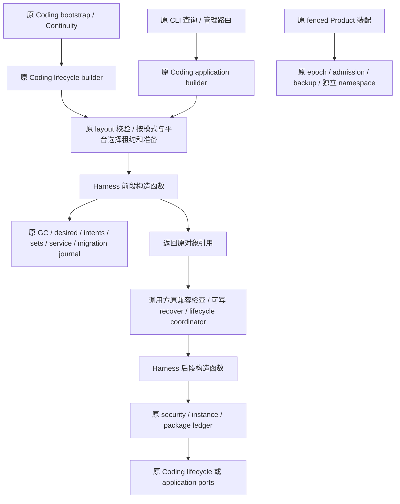

# D1 首切片：Plugin 管理账本装配共享设计 R2

## 状态与范围

- Authority: accepted — 内部装配专项，不改变已接受的账本、命令或恢复权威。
- Design status: accepted；R2 经三视角复核后，用户以“请开始实现和开发”授权按该范围实施。
- Implementation status: implemented；受影响场景验证和三视角代码评审完成，远程交付由对应 PR 记录。M1/M2 已交付部分不重新实现。
- Owner: Harness plugin_management；Coding 保留 Product 装配及政策。
- 源码基线：main `00d9424826b349241341168e30a864a63bb38f11`，2026-11-04。
- 方法：本地干净 archmethod master `0f9bd3ff51afabeaaf76cc38dff1ceb279b7d37e`，仅声明本地版本。

继承[收敛审计 D1](convergence-audit.md)、[PLC9A1 管理合同](plugin-lifecycle-plc9a1-contract.md)、[现有负责人图](../current-owner-map.md)与[升级兼容](../../decisions/accepted/ARD-008-workspace-upgrade-compatibility.md)。按内部实现重组处理：共同对象本就归 Harness，本切片移动的是重复的构造关系，不转移持久权威、不新建管理器或第三条 Product 路线。保持既有公开 Coding builder 签名和返回类型。

## 1. 实施前基线与具体问题

| 入口 / 位置 | 原构造与副作用顺序 | 本切片界限 |
| --- | --- | --- |
| `build_coding_plugin_lifecycle`，`coding/_plugin_lifecycle.py:1022–1114` | 校验 Coding layout、取得原 startup 租约；必要时准备私有根；构造 GC gate/desired/intents/sets/service/migration journal；检查 migration epoch 和 runtime version；management.recover；构造 migration coordinator；选择 security、构造 instance/package ledger；Coding owner evidence；返回 Coding lifecycle | 仅合并两段账本构造；全部 Product 和恢复步骤留原点 |
| `build_coding_plugin_management_application`，`:1117–1212` | 可写且 Linux/Windows 才取得原租约，准备私有根；read_only 选 strict load policy；构造相同前段；兼容检查；可写才 recover；构造相同后段；返回原 command/query ports | read_only 继续不取得 startup 租约、不准备目录、不 recover；不把 load policy 当成新的权限系统 |
| `application.py` | 已有 command adapter、query projector 与 `PluginManagementApplicationPorts`；它们不负责构造 ledger/service，已有合同禁止在该模块构造它们 | 复用这些原类型；不把装配函数塞入 application.py |
| `package_product_runtime.py::open_coding_package_product_state` | fenced B 路线有 epoch/parent identity、current admission、backup type 与 before_recovery 检查；service 可选择自己的默认 retirement 路径 | 不接入首切片，不为了更多调用者把该差异塞成 factory 的 mode |
| Continuity | 通过原 `build_coding_plugin_lifecycle` 传入专用 security journal | 保留原覆盖对象和委托入口，不新建 Continuity 装配路线 |

源码：[Coding lifecycle](../../../../../src/loushang/coding/_plugin_lifecycle.py)、[CLI 路由](../../../../../src/loushang/coding/plugin_management_cli.py)、[fenced Product](../../../../../src/loushang/coding/package_product_runtime.py)、[原应用端口](../../../../../src/loushang/harness/plugin_management/application.py)。函数范围、源码 SHA 与调用信息在产品树外 `architecture-analysis/plugin-harness-audit-20261104/d1-ledger-assembly/source-evidence.json`。

上述位置与顺序对应实施前基线。重复的是依赖图构造，不是出现了两套不同的账本权威。当时两个 builder 均复用原 Harness 类，未定位到可直接替代它们的 Harness 装配函数。构造器含 Path.resolve、路径不同性检查、GC gate 的共享锁状态取得等原行为，不能称为严格无 I/O/无副作用的纯函数。

## 2. 环境与职责



该图描述两个原入口复用同一构造规则，不表示它们共用一个运行实例。每次调用仍构造原调用需要的对象；不按路径缓存或混用 read_only/可写对象。物理部署是原进程及原 Product 私有 namespace，没有新增进程、网络、日志或锁文件。

| 责任 | 本切片后唯一负责者 |
| --- | --- |
| 路径解析、scope/startup ID、平台和版本政策、是否读模式 | 原 Coding 包装及 layout |
| startup/pre-fence 租约、私有目录/权限、原失败释放 | 原 Coding 包装与既有 helpers |
| 账本依赖图构造、同图 GC gate/desired/intents/sets 等对象复用 | Harness 内部 assembly 函数；不成为 ledger 的写入 owner |
| 兼容检查、management.recover 的发起时点 | 原两个 Coding 包装；实际恢复仍由原 ManagementService 执行 |
| command/query 投影和各账本操作、锁、序列、编码 | 原 Harness 组件 |
| owner generation evidence、migration coordinator 的 Product 参数、Session family/退役协调 | 原 Coding owner；属于 D1 后续候选，本切片不移动 |

## 3. 最小机制：保留中间屏障的两段构造

新增一个聚焦的 `harness/plugin_management/assembly.py` 内部模块。Coding 直接导入两个构造函数，第一切片不扩根 facade 或 author SDK。它不依赖 Coding、CLI、RPC、settings 或 Product layout 类型；沿用原具体 ledger/service 与 JournalLoadPolicy 类型。

已实现的内部接口（不作为根 facade 或 author SDK 导出）：

```python
def bind_plugin_management_core(
    *,
    gc_reservations_path: str | Path,
    desired_state_path: str | Path,
    operation_journal_path: str | Path,
    retirement_intents_path: str | Path,
    retirement_sets_path: str | Path,
    migration_journal_path: str | Path,
    load_policy: JournalLoadPolicy | None = None,
) -> PluginManagementCoreBindings: ...

def bind_plugin_runtime_ledgers(
    core: PluginManagementCoreBindings,
    *,
    instance_runtime_path: str | Path,
    package_lifecycle_path: str | Path,
    startup_id: str,
    security_acceptances: PluginInstanceSecurityRetirementJournal | None = None,
) -> PluginRuntimeLedgerBindings: ...
```

`PluginManagementCoreBindings` 是 frozen/slots 的短期引用组：gc_reservations、desired、intents、retirement_sets、management、migration_journal、原 load_policy。`PluginRuntimeLedgerBindings` 只含 security、instances、packages。两者没有 journal/version、全局注册、ready 状态、close/rollback、自动恢复或权限授予，不是新的运行时 owner。

第一段按原顺序构造六个对象：GC gate → desired(gate) → intents → sets(intents) → service(desired/intents/sets) → migration journal。所有显式路径原样传给原构造器，不推导固定文件名，不预做新的归一化/全图校验，不触发 snapshot 或 recover；原构造器的检查与状态取得继续发生。

第二段沿原 `security_acceptances or for_instance_runtime(...)` 的选择规则，先选 security，再构造 instance，最后 package。instance 的 operation journal 路径取原 `core.management.operation_journal_path`，不重新派生文件名；注入同一 core 的 desired/intents/sets/gate，package 注入同一 desired/instance/sets/gate，不因路径相同重建或重新寻找对象。后段从 core 原样取得 load_policy，防止同图前后混用策略；保留 None，让原构造器选择各自默认，不以新的默认政策替代它。

原 lifecycle builder 传入 resolved_startup_id 和原 security 覆盖对象；application builder 继续使用原 boot ID 与默认 security 选择。原 `PluginManagementApplicationPorts` 及 lifecycle 返回值不改，source 投影原对象仍直接传给原 projector。

## 4. 正常与失败顺序

| 阶段 | lifecycle | application 可写 | application read_only |
| --- | --- | --- | --- |
| 前置准备 | 原类型校验、hold、必要时 prepare | 原类型校验、原平台条件下 hold、必要时 prepare | 原类型校验；无 hold/prepare |
| 前段构造 | load_policy=None | load_policy=None | 原 `JournalLoadPolicy(partial_tail="raise", create_lock=False)` |
| 原兼容屏障 | 原 supported epoch=1 与 `version("loushang")` 检查 | 同原检查 | 同原检查，拒绝不支持版本 |
| 原恢复 | management.recover | management.recover | 不 recover |
| 原 coordinator | 用原 journal/desired/command adapter，保留第二次 version 调用及原顺序 | 不创建 | 不创建 |
| 后段构造 | 原 startup/security | 原 boot ID/default security | 同一 strict load_policy |
| Product 收尾 | 原 owner evidence，返回原 lifecycle | 返回原 ports | 返回原 ports，查询路由使用原 queries |

不把 version 查询提前、缓存或改到 Harness，也不在第二段中暗加 compatibility/recover。两段函数是受信任装配接缝；返回的引用组不证明兼容或恢复已通过，原调用方必须按上表使用。不为此新增一次性 permit/token 或第二状态机。

失败保留原异常类型、顺序和边界：前段构造或兼容失败时不运行 recover/后段；recover 失败时不创建后段；后段任意构造失败不返回半成品 ports。已发生的 journal 恢复不回滚。两个原包装保持 try/except BaseException，只有本次取得 startup lease 才调用原 release；hold 本身继续处在原位置。已有进程租约被复用时，不借新引用组关闭前一 owner 的租约。成功 application 的原进程级租约保留方式不改，不在局部 factory 返回时自动 close。

read_only 只描述原装配和公开查询路径的行为：不新建目录/锁、不修复尾部、不恢复、不追加账本。JournalLoadPolicy 是加载政策，不是命令授权凭据；既有 ApplicationPorts 仍含 commands 字段，不能把构造 strict 对象宣称为类型上禁止写入。公开查询路由仍只使用原查询适配，状态缺失/部分尾按原检查或投影结果处理。

## 5. 选择、兼容与成本

| 方案 | 判断 |
| --- | --- |
| 保持两份装配，或只在 Coding 内合并一个 helper | 改动小，但通用依赖图仍留在 Product；未完成本切片的职责收敛目标 |
| 一个 factory 加 read_only/route 标志，包办 hold/兼容/recover/全部账本 | 易移动原屏障和平台/版本政策；fenced B 还需要更多例外，不选 |
| 两段内部构造，返回原引用，由原调用方跨屏障继续 | 采用；显式保留原时点，复用原组件，不建立第二 owner |

不新建 path schema 或复制 Coding layout；函数使用现有显式 Path/str 参数。额外两个固定大小引用组只在本次构造期间存在，空间 O(1)，不复制历史，不承诺启动提速、跨账本原子快照或更强恢复能力。

原文件名、路径、journal 格式、load policy、锁顺序、startup 身份及公开 builder 保持。fenced Product、legacy/B 路线选择、退役交接和 owner evidence 的后续下沉须另行核对，不把本设计接受当作整项 D1 完成。

现有 `test_plugin_lifecycle_plc9_baseline.py::test_plc9_keeps_one_desired_state_writer_and_exact_composition_sites` 冻结了 7 个 DesiredStateLedger 构造位置，其中包括两个 Coding builder。实现会将这两个位置等价迁移成 `assembly.bind_plugin_management_core` 的一个位置，即总数 7→6；其他 5 个现有位置及 ManagementService 内两个实际 mutation 调用不变。只维护该既有事实集合，不改 `_call_sites` 算法、不删断言、不用注释保留旧构造、不泛化允许目录，也不新增门禁条件。原两个包装的委托与原参数/顺序由静态差分、代码审查和原调用场景证明。

## 6. 验证与评审

实施复用原 lifecycle、management CLI、enablement migration、Continuity 及 Harness ledger/service/application 测试；只选择受影响范围，不重复模型或平台物化矩阵。设计阶段只读源码，产品测试属于随后实施验收。

- 查询不存在 namespace 与已有目录缺少锁：目录/文件列表不变；原只读路径不恢复、修复或取得 startup 租约。
- 不支持 migration epoch / finalized 最低版本：在原位置拒绝，recover、后段构造及 Product 选择不发生。
- 可写启动与管理：原 pre-fence 注册先于状态使用；原 management recover 时点和原进程租约保留/释放方式不变。
- Continuity security 覆盖、不同 startup ID、source projector：原对象/参数按身份保持；全部 ledger 关联同一 core，原 GC gate 不分叉。
- 构造、compat/recover、后段分别失败：原异常和归自己取得的 lease 释放保持；不回滚已恢复记录、不返回半成品。
- 原 mutation owner 与精确构造库存：只迁移原两个构造点，验证 old wrappers → shared factories → 原具体 owner 的实际调用，不扩 gate。
- Linux/Windows 及其他平台既有 hold 条件不变。read_only 不代表 fenced admission 方式；对这条旧路线的验证不能算作 fenced B、全部平台原生或 D1 全部完成。

额外参数/顺序/失败轨迹留在产品树外本地验收，不增加 PR 断言、job、平台或恢复暂停路线。冻结设计与三视角报告分别记录，设计一致性不代替实现验收或用户对重要工作件的接受。

三视角发现、修订与复核见[评审记录](management-ledger-assembly-review.md)。

## 7. 实施与验收记录

2026-11-04，新增 [Harness assembly](../../../../../src/loushang/harness/plugin_management/assembly.py)，两个原 Coding builder 均已委托两段构造。原中间兼容/恢复屏障、两次 lifecycle version 查询、Product 参数及 BaseException 清理保持；原 constructor 库存仅将两个 Coding 位置合并为一个 Harness 位置，总数 7→6，其余扫描和断言未改。

- 集中离线回归首次为 229 passed、5 skipped、1 failed；失败来自测试临时根在组可写工作区下，触发 Continuity 既有祖先权限检查。仅该用例换用私有 `/tmp` 根后 1 passed，未改产品、用例或安全检查，亦未降低 64MiB 容量预检。
- 树外 82 个装配等价性场景全部通过：对比基线/当前包装的调用顺序、参数、同图对象身份、strict/None policy、security 覆盖、只读路径及分阶段 BaseException 与 owned/borrowed lease 清理。Linux/Windows/macOS 条件是内存模拟，不等于各平台原生验证。
- Ruff、两份实现的 mypy、当前包依赖图检查通过；AST 比较确认仅两个原 builder 改变，公开签名、原 prepare 与异常 handler 保持。库存测试整份 AST 在反向迁移位置字面量后与基线相同。
- 三位独立 reviewer 对固定实现分别完成职责与复用、运行与失败、数据与兼容代码评审，均无实质性发现；报告指纹和验证边界见评审记录。

本地验收只覆盖首切片。没有新增 PR gate、平台矩阵或公共配置，不宣告 fenced B 装配、退役协调或整项 D1 收敛完成。
