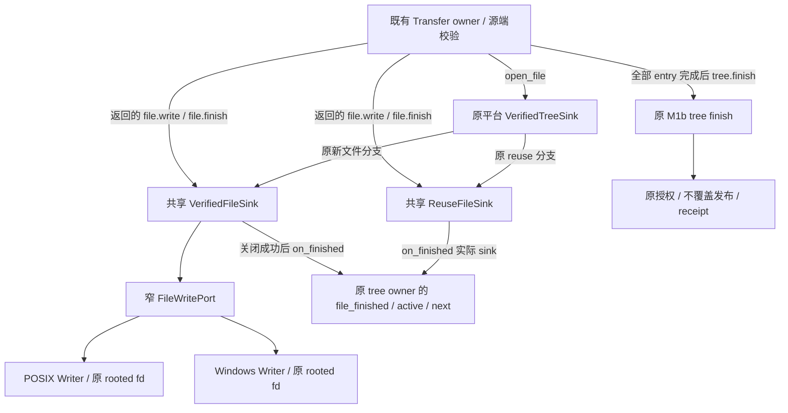

# M1c：文件写入与复用 sink 共享设计 R2

## 状态与范围

- Authority: accepted — 用户评审 R2 后同意继续，范围为既有 package lifecycle 内部协作，不增加公开或持久合同。
- Design status: accepted；R1 经三位独立 xhigh 评审，R2 定向复核后提交用户，用户回复“同意，继续”并授权实施。冻结评审版本及接受证据见评审记录。
- Implementation status: locally-implemented；共享普通/reuse sink 与两个平台 Writer 已实现，三视角代码评审无实质问题。聚焦回归和树外差分验收通过；Windows native 仍待验证。
- Owner: Harness package lifecycle。
- 源码基线：main `8b7e0358cbe79425757544154d5b36766771a410`，2026-11-04。
- 方法：本地干净 archmethod master `0f9bd3ff51afabeaaf76cc38dff1ceb279b7d37e`；采用职责复用、运行失败、数据兼容三个视角。这里只声明本地方法版本。

继承[平台 Adapter 设计](materialization-platform-adapter.md)、[已交付树核验](materialization-tree-validation.md)、[PLC9B 合同](plugin-lifecycle-plc9b-contract.md)和[升级兼容](../../decisions/accepted/ARD-008-workspace-upgrade-compatibility.md)。选择内部实现变更路径；未改变 Product、Store、Transfer 或 journal 的权威，不新建 ARD 或通用文件系统框架。

目标：把两平台相同的目标文件消费与完成规则各保留一份。原生句柄操作由平台负责，源端与目标端独立校验继续存在。设计由实际正常/失败调用链驱动，不以相同行数直接判断可替换性。

## 1. Current 与差异证据

行号固定于上述基线。原源码、类范围与 SHA 清单位于产品树外审计归档 `architecture-analysis/plugin-harness-audit-20261104/m1c-file-sinks/source-evidence.json`。

| 对象 | 已核实事实 | 本切片处置 |
| --- | --- | --- |
| POSIX `_ReuseFileSink` 1470–1520；Windows 1484–1534 | 无文件写入：消费传入 bytes，累计大小与摘要；finish 置 closed/finished 后回调原 tree owner。两份仅 owner 类型注解不同 | 一个共享 ReuseFileSink，通过完成回调协作；不加入 native Writer |
| POSIX `_PosixFileSink` 1391–1467；Windows `_WindowsFileSink` 1404–1481 | write 同序：先确认打开、接受 bytes、增加计数、拒绝超长，再处理短写，全部写完才更新摘要 | 一个共享 VerifiedFileSink 拥有该流程 |
| 两份普通文件 finish | 两者先 fstat，再比较字节/摘要/初始身份/单链接；Windows 另拒绝 reparse。分别 fsync / windows_flush_file，随后 close 成功才设置 finished 并通知 owner | 共享完成顺序；原生观察、flush、close 留两个平台 Writer |
| `_file_finished`、`open_file` | 原 tree owner 检查 callback 参数就是 `_active_file`，清空 active 并增加 `_next_entry`；同一时刻仅一个活动 file sink | 原 owner 继续独占 manifest 顺序与推进；callback 必须收到实际返回的 sink 对象 |
| `PackageVerifiedTreeTransferOwner.transfer` | 源端自己累计/校验字节和摘要，再调用 destination.finish；源端错误会 destination.abort，外层 Exception 路径会 sink.abort | 保持：源端和目标端是不同信任边界，不因两次 hash 就删掉任一检查 |
| 普通 file abort 与 tree abort | file abort 尽力 close、抑制 OSError 后忘记 descriptor；tree abort 决定清理哪些原 owned 路径 | 仅移动 file 的原关闭行为到 Writer；tree 删除、GC、授权后保留策略另行处理 |

源码：[POSIX](../../../../../src/loushang/harness/resources/packages/plugin_lifecycle/posix_materialization.py)、[Windows](../../../../../src/loushang/harness/resources/packages/plugin_lifecycle/windows_materialization.py)、[原传输合同](../../../../../src/loushang/harness/resources/packages/plugin_lifecycle/tree_transfer.py)。Reuse 并不免除现有 `_prepare` 与 finish/reuse 流程对发布树、settlement 和授权的检查；共享 ReuseFileSink 不能单独授予复用权。

## 2. 环境与协作



物理部署仍是原进程、原 Store 锁及 pinned root 内的同步 transfer。没有远程调用、新线程、后台任务或共享可写注册器。原 `_create_file_sink` 创建并记录受保护文件身份后，把该已开 fd 交给平台 Writer；Writer 构造不增加 open、dup、stat 或修改访问模式。共享类不接收 fd、路径或原生 HANDLE。

共享类放在 package lifecycle 内一个聚焦的 `_file_sinks.py`；两个 Writer 留在原平台模块。原 Store、tree owner 及公开 `PackageVerifiedTreeFileSinkPort` / `PackageVerifiedTreeSinkPort` 继续存在。共享 file sink 直接满足原 write/finish/abort 合同，不增加第二套传输接口。

## 3. 状态与内部接口

| 状态/资源 | 唯一负责人 |
| --- | --- |
| 普通 file 的 entry、计数、摘要、finished | 共享 VerifiedFileSink；不保留另一份平台计数或 finished |
| reuse 的 entry、计数、摘要、closed/finished | 共享 ReuseFileSink；它不持有目标文件句柄 |
| 已打开 fd、初始原生身份、物理 closed 状态 | 对应平台 Writer；共享层通过端口使用，不双写 descriptor |
| `_active_file`、`_next_entry`、文件/目录身份图 | 原 VerifiedTreeSink；不移到共享 file sink |
| root pin、锁、manifest/receipt、授权与发布状态 | 原 owner、journal 和 M1b 流程；本切片不接管 |

以下为已实现的内部结构，不是新增公开 API：

```python
class FileWritePort(Protocol):
    def require_open(self) -> None: ...
    def write(self, view: memoryview) -> int: ...
    def identity_matches(self) -> bool: ...
    def flush(self) -> None: ...
    def close(self) -> None: ...
    def abort(self) -> None: ...

# 两类分别接收类型准确的完成回调；原 tree owner 的联合类型可接受它们。
# VerifiedFileSink(entry=entry, writer=native_writer,
#                  on_finished=self._file_finished)
# ReuseFileSink(entry=entry, on_finished=self._file_finished)
```

`write` 只调用原 os.write 一次、返回实际计数；公共流程拥有 memoryview 短写循环与“不前进”判据。`identity_matches` 在同一原 fd 上 fstat 一次，比较原身份和单链接，Windows 再检查 reparse；它只折叠这些原无副作用比较，不含 entry、摘要、授权或 flush 决策。fstat 失败必须抛出，不能折叠成 False。

`flush` 分别调用原 os.fsync / windows_flush_file；`close` 仅在 os.close 成功返回后将 descriptor 置 None。`abort` 沿原规则尽力关闭，抑制 OSError 并置 None。端口不建立新的“关闭一定成功”或可安全重试关闭保证。

完成回调接受共享 sink 自身；不包一层不同身份的 façade，也不以 entry/path 代替对象身份。原 `_file_finished` 继续验证 `sink is self._active_file`。私有旧类名如需保留，仅作 import alias；调用点可改用共享类，不能留下两套生命周期。

## 4. 关键顺序与失败合同

### 普通文件

1. `__enter__` 保持原样返回自身，不新增打开检查；`write`/`finish` 才按原错误文本拒绝物理已关或 finished。
2. `write` 保留 isinstance(chunk, bytes)，接受既有 bytes 子类，不改成支持 bytearray。空块不写 OS，但仍经过原打开、计数及摘要更新流程。
3. 先增加计数，超出 entry 大小时在任何该块 native write 前报原 artifact_identity_changed；不回滚计数。
4. 在原 OSError 捕获范围内执行短写循环；write 不前进仍产生 OSError 并映射原 root_untrusted。只有整块写完才 digest.update。部分写入失败后的计数包含整块，摘要不含该块；不得据此宣称支持继续写或重试整块。
5. `finish` 在内容比较前调用 identity_matches，因此保持原 fstat 的 I/O 时点；允许在 Adapter 内提前折叠纯身份/link/reparse 比较。这个观察在 flush 的 OSError 映射范围之外；观察抛错不能静默变成 mismatch 或 root_untrusted。
6. 字节数、摘要或原生身份检查不通过时，沿原消息报 artifact_identity_changed，不 flush、不推进 owner。
7. 共同 try 只包 flush、close：依次成功后，Writer descriptor 已 None，才设共享 finished，再调用原 owner。OSError 仍映射原 root_untrusted；callback 不纳入该映射范围。
8. flush/close 抛错时 finished 不设、callback 不发生；context 的原 abort 再尽力关闭。close 已产生副作用却抛错时，残留整数不证明还拥有可安全重试的句柄；本设计保留原尽力清理，不增强恢复承诺。若要修复这项机制，须另行设计和故障证据。

### 复用文件

原 tree owner 已决定可复用后才构造 ReuseFileSink。write 仍先查 closed、校验 bytes、增加计数、超长拒绝，再累计摘要；finish 比较内容成功后先置 closed 与 finished，再回调原 owner。它不读发布文件、不追加 settlement、不发布、不删除内容。

两种 sink 都保留：回调抛错时已完成的本地 flags 不撤回、不再次通知；带异常离开 context 或未 finished 时执行 abort。file abort 不代替 tree owner 清空 active 或推进下一项；外层 transfer/tree context 继续处理失败。同步使用约束不扩成同一 sink 的并发 write/finish/abort 支持。

## 5. 选择与兼容

| 选项 | 判断 |
| --- | --- |
| 只抽计数/摘要 helper，保留两份普通 write/finish 决策树 | 改动小，但相同的短写、异常和通知顺序仍会分叉，未实现本切片目标 |
| 一个 mode 很多的通用 stream/owner 框架 | 把无句柄 reuse 与有句柄写入混为同一状态机，增加配置和失败组合，不选 |
| 两个共享 sink，加一个窄写端口与两个平台 Writer | 已采用；普通与 reuse 各保留原状态语义，平台只实现原生操作，callback 复用原 owner |

不把写端口塞进 M1a root pin 或 M1c 读取端口：对象寿命和权限不同。没有新的 journal、持久状态、public export 或 Product 配置；现有 error code/消息、manifest/receipt/路径、root/锁/授权与源端校验保持。普通文件比原 sink 多一个短寿命 Writer 对象，并持有完成回调；新增空间为每活动文件 O(1)，不整文件复制，仍使用原 digest、计数和现有 chunk 的 memoryview。没有实测耗时收益或新的耐久性承诺。

建议按同一设计实施：先合并 reuse 并核对实际 callback 身份；再接入普通 sink 的公共流程与平台 Writer；检查两者组合及原 Transfer/Tree finish/abort 的失败链。tree abort、`_remove_owned_tree`、GC 删除以及文件关闭失败的机制修正不在这个接受范围内。

## 6. 验证与评审条件

| 场景 | 必须证明的行为 / 证据范围 |
| --- | --- |
| 新树、exact reuse、dependency alias reuse | 原 Store 与 Transfer 的输入、receipt 和授权顺序不变；不能只测 helper 的摘要结果 |
| 类型、空块、超长、短写及不前进 | 原时点、计数/摘要更新和异常映射；未知数据不因抽象而被接受 |
| size/digest/身份/link/reparse 失败与 fstat 抛错 | fstat 仍在内容核验前；失败不 flush、不通知，观察错误边界不被扩大 |
| flush、close、callback 分别失败 | 原状态与 callback 次数；特别是 callback 前已关闭、callback 后失败不回滚或重通知 |
| file context 与外层 tree abort | 关闭与通知的对象一致；保持原 active/next、父依赖与删除策略 |
| 平台 native | 分别保留 POSIX 和 Windows 原生打开/访问/flush/close 证据，mock 不能替代 Windows；原暂停路线不恢复 |
| 库存与兼容 | 真正 OS 调用点按原角色核对，不扩大允许集合、不删断言、不通过改名藏调用；原 Transfer/FileSink public 合同保持 |

复用既有两平台 materialization、PLC9B 和统一 Plugin 架构用例；额外失败轨迹只在产品树外作本地验收。新增 PR 门禁或断言条件不在授权内。设计阶段不重复先前模型/动态规划/大矩阵验证，不运行产品测试或声称原生平台已通过。

三视角核查重点：①端口是否把公共决策重新藏回平台；②finish 的 native 观察和异常优先关系；③callback 对象与原 owner 类型/active 身份；④原库存和 private alias 的真实消费者；⑤可复用与实际可发布不能互相代替。

## 7. 实施结果

共同规则位于 `_file_sinks.py`，两个平台只新增各自 FileWriter 并在原 open_file/_create_file_sink 接线；旧私有类名保留为共享类的 import alias。原 tree owner 其余方法及所有其他保留定义经 AST 对照保持相同，原 Transfer、GC、授权与删除没有改动。

三份源码的 Ruff、mypy 通过；实际加载当前工作树的聚焦 Store/Transfer/架构合同回归 153 passed、27 Windows-native skipped；产品树外 68 项差分与 owner 身份验收通过。它们不代表 Windows native 或性能验收；完整代码评审、版本哈希和验证限制见下文评审记录。

独立评审、综合修订和证据边界见[评审记录](materialization-file-sinks-review.md)。
