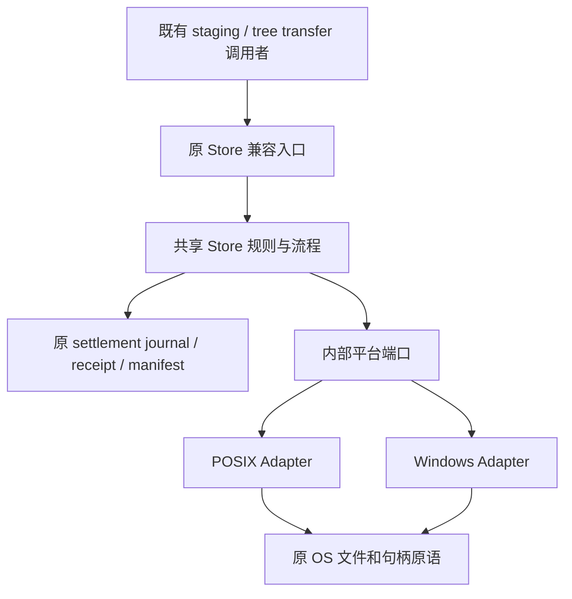

# 包物化平台 Adapter：共享流程与内部接口 R2

## 状态与目标

- Authority: normative for implemented M1a/M1b；M1c [读取/核验](materialization-tree-validation.md)及[文件写入/复用](materialization-file-sinks.md)按其专项范围接受与实施，其余候选仍待设计。
- Design status: M1a 在 R2 三视角复核后由用户授权实施；后续继续开发授权内的 M1b 经三个原 reviewer 定向设计核查、由实施 scope owner 接受。M1c 读取/核验和文件写入/复用的专项 R2 均获用户接受并授权实施；tree abort/删除收敛未覆盖。
- Implementation status: M1a/M1b 已本地实现，范围见 §7/§8；M1c 读取/核验与文件写入/复用均已本地实现并经三视角代码审查，结果见专项记录。POSIX 与共享逻辑已验证；固定源码的 Windows Server 2022 x64/Python 3.11 原生补验已通过，见[证据记录](materialization-platform-evidence.md#7-一次性-actions-执行验收与入口退出2026-11-05)。本工作区先前的 M2 与本设计无关。
- Owner: Harness package lifecycle。
- 源码基线：main `1120f9b1fe3b8610de76b60c115660dc9d0353d7`；M2 未修改本设计涉及的平台文件。
- 方法：本地干净 archmethod master `0f9bd3ff51afabeaaf76cc38dff1ceb279b7d37e`。

目标是让公共规则与控制流程在既有 Harness package lifecycle 内拥有一份实现，OS Adapter 只提供必须依赖平台的物理能力。不以重复类名或重复函数体直接决定抽象，也不把两份完整 Store 原样包装成两个 Adapter。

依据：[收敛审计 M1](convergence-audit.md)、[Plugin 架构](architecture.md)、[原平台发布合同](plugin-lifecycle-plc9b-contract.md)。本设计不改变安装、信任、授权、GC 或 Product 策略。

## 1. 复用现有接口

现有 `staging.py` 已定义 `PackageDependencyStagingPort`、`PackagePluginRootStagingPort`；`tree_transfer.py` 已定义 `PackageVerifiedTreeSinkPort`、文件 sink 及 root materialization ports。它们继续作为上层调用边界，不新增平行的 Store/Transfer API。

本设计增加的只是 Store 内部平台端口；原 POSIX/Windows 类继续兼容已有构造及调用方式，通过组合委托共享实现。Product 在原装配点选择适配器，共享流程不散布 `sys.platform`、`isinstance(platform_root)` 或 OS 分支。也不建立插件注册器或全局平台服务定位器。



共享实现与两个 Adapter 均属于既有 package lifecycle，图中不是新增独立运行时组件。Dependency/root 仍是逻辑角色，不能与 POSIX/Windows 物理平台轴混成四套完整算法。

M1a 只需一个共享 receipt 核验函数及两个薄平台适配实现，不新建完整共享 Store 大类。原 RoleStore 保留配置、线程锁、journal 和公开入口；Adapter 借用固定配置及原 pin/tree 原语，不成为第二个 owner。现有 pinned-root 可通过窄委托满足内部端口，不再包装出一套根生命周期。

## 2. 先冻结 receipt 校验所需的最小平台接口

以下为已授权 M1a 的内部合同，实现位于 `_materialization_shared.py`，不作为公开 SDK API。别名对应原 `_Identity` 和 `_validate_existing_tree` 已返回的内存形状，不改变任何持久格式：

```python
from contextlib import AbstractContextManager
from typing import Protocol

# PackageVerifiedTreeManifestV1 复用原 tree_transfer 定义；
# NativeIdentity 复用原 store_settlements 中的 tuple[int, int] 别名。
from .store_settlements import NativeIdentity

RelativeParts = tuple[str, ...]
IdentityMap = dict[RelativeParts, NativeIdentity]
ObservedTree = tuple[NativeIdentity, IdentityMap, IdentityMap]


class PackageStorePinnedRootPort(Protocol):
    @property
    def identities(self) -> tuple[NativeIdentity, ...]: ...

    def validate_tree(
        self,
        final_name: str,
        manifest: PackageVerifiedTreeManifestV1,
    ) -> ObservedTree: ...


class PackageStorePlatformPort(Protocol):
    def pin_root(self) -> AbstractContextManager[PackageStorePinnedRootPort]: ...
```

接口所属：Store 内部公共合同，不能由某个平台模块定义后让另一平台反向依赖。拟与共享 Store 实现一起放在现有 package lifecycle 内的聚焦内部模块；只有发生依赖需要才拆 contract 文件，不新建框架包。实际源码符号保持内部使用，不增加公开导出。

### 接口合同

- Adapter 构造时绑定原 owner 已选择的 Store 根、完整预期祖先链身份与原构造级访问模式；`pin_root()` 不接受操作级权限参数或任意绝对路径，不扩大根范围。
- pin 在同一次操作中固定原祖先链与根身份；context manager 拥有这些原生句柄，正常或异常退出均按原顺序释放。共享层不接触 fd/HANDLE，也不把 tuple 解释成授权。
- 明确区分两个维度：本次 `operation_read_only` 仅决定原 owner lock 与 journal 方法；原 owner 的 `construction_read_only` 决定原生句柄访问模式。Windows `pin_root()` 始终保持 `writable=not construction_read_only`，包括可写 MaterializationStore 的只读核验；不能用本次 operation 参数重算 writable。POSIX 保持原 `_PinnedPosixRoot.open` 映射，不引入新的 writable 模式。只读 Store 仍保持原访问限制及原方法集合，不为验证添加新公开入口。
- `operation_read_only=True` 继续使用不创建 owner lock、不修复 journal tail 的原读取路线；该属性不等于句柄一定以只读权限打开。Adapter 不执行 journal 修复、目录创建、迁移或发布；是否取得何种锁由原 RoleStore 决定。
- `validate_tree` 直接委托 receipt 当前使用的原平台树验证，完成原路径、内容和身份检查；只返回同次验证所得的身份值。M1a 不暴露尚未使用的 expected-tree/map 输入或单独 `validate_visible`：原树验证内部已经核对可见根，今后若其他用例确需这些参数再评审扩展。
- 返回值只在原 pin/操作范围内作为观察依据，不跨操作缓存；共享层照旧用原 journal 核对授权。文件身份不等于跨进程可复用能力。
- 保留现有 `PackagePhysicalStagingError` 与错误码；平台内部只规范化自己的 OS 失败，不吞掉共享授权错误。不做“失败后换另一 Adapter”或弱校验 fallback。
- context manager 不抑制业务异常；固定根关闭仍按原代码反序关闭句柄，并抑制原先被抑制的 `OSError`。当前实现随后清空句柄列表，不具有已确认全部关闭或可重试关闭的保证。本切片既不增强也不弱化这项既有行为；owner-lock 退出异常的原覆盖关系也保持，若需改善应另列行为变更。
- pin 持有祖先链与 Store 根句柄；原树验证会在返回前关闭树 fd。因此不承诺授权核对期间一直持有树 fd，也不新增整树原子快照或对任意外部写入的免疫能力。

第一切片不需要写文件、rename 或 delete，因此不提前把它们加到这个接口；后续确有用例时扩展一个具备完整生命周期合同的内部操作端口，不能用 `execute(op, **kwargs)` 承接一切。

## 3. 公共规则与平台差异

| 责任 | 共享层 | OS Adapter |
| --- | --- | --- |
| receipt 对应 Store / root 或 dependency 引用类型 | 唯一校验规则 | 不再重复校验算法 |
| settlement 查找、read-only journal 方法选择、授权核对 | 调用原 journal，维持原参数和次序 | 不持有另一份业务授权账本 |
| 根与祖先链 pin、可见路径重新核对 | 管理调用范围 | 复用原 pinned-root 与平台原语 |
| 文件树实际访问与原生身份 | 使用原观察结果核对 journal | no-follow / reparse、权限与目录遍历的实际操作 |
| manifest 内容规则、摘要规则 | 可证明平台无关的部分逐步共享，复用原 transfer | 只保留安全读取和句柄操作必需差异 |
| finish / reuse / 完成条件 / 错误映射 | 后续收敛到同一流程 | 不保留两份 finish 决策树 |
| 新树发布 | 共享层拥有授权与发布的顺序 | 执行平台 pin、flush、关闭/重命名、物理复核 |
| abort / cleanup | 共享层拥有状态与何时可清理的规则 | 按原生身份删除并释放资源，不能按路径盲删 |

平台差异有源码依据：POSIX `_PinnedPosixRoot.open` 使用根 `/`、descriptor-relative 打开和 uid/mode 检查；Windows `_PinnedWindowsRoot.open` 使用 drive anchor、writable 模式及 Windows 目录约束。POSIX `_settle_new_tree` 有原目录 flush/no-replace rename；Windows 使用 `windows_rename_at`。两平台都在授权/rename 前关闭 staging descriptor，这是共同点。不能只替换一个 rename 函数就宣称两者发布寿命等价，也不能统一宣称平台都具有 POSIX fsync 的保证。

## 4. 第一切片运行流程

两平台原 receipt 校验入口保持构造限制、类型检查、锁和错误边界所在位置。顺序明确为：原入口拒绝/类型检查 → 线程锁 → 原 durable owner lock → Adapter pin → 共享核验 → 根 close → durable lock 退出 → 线程锁释放。owner lock 进入失败仍释放线程锁并按原逻辑映射错误；不把取锁放进共享函数或 Adapter。

原入口的 operation_read_only 决定锁及 journal 分支，Adapter 使用构造时绑定的原生访问模式：

1. 原 owner 取得和核对固定根；共享流程检查 receipt 的 Store identity 与逻辑角色。
2. 按原 `read_only` 选择 `read_settlements_for_receipt` 或 `settlements_for_receipt`；无记录继续报原 collision。
3. 从原 settlement 取得 final name 与 manifest，调用 pinned root 的 `validate_tree`。
4. 将返回身份与原 receipt 交回原 journal 的对应 `read_authorizes` / `authorizes`；不匹配报原 collision。
5. 成功返回原 receipt，退出原 pin 范围。保持原异常及句柄释放语义。

不缓存、排序或去重 settlement，不改变原 `settlements[0]` 选择规则；不把第一切片扩成 journal schema、恢复策略或包删除修正。

## 5. 分阶段尽可能下沉

1. **M1a：receipt 校验公共流程 + 上述平台接口。** 先证明两平台原路径等价，移除两份 57 行重复控制流程。原锁的取得与根 pin 次序不变。
2. **M1b：共享 verified sink 生命周期及 finish/reuse。** 使用已有 sink/transfer 合同；拆清“物理树就绪→原 journal 授权→不可覆盖发布→发布后身份复核”。平台端口必须精确描述 Windows 句柄关闭与 POSIX flush 的边界，并保留授权后/rename 后失败时的原重试清理状态，不能封装成隐含 journal 写入的 `commit()`。
3. **M1c：继续合并树校验、文件 sink、abort 中证实平台无关的部分。** 共同内容规则留共享层，原生读写和安全访问留 Adapter；按实际差异扩端口，不要求每个同名方法都保留两个实现。

M1c 的读取/核验切片已按其专项交付；后续[文件写入与复用设计](materialization-file-sinks.md)R2 经用户接受后已本地实施，仅细化共同 file sink 与原生 Writer 的协作，不包含 tree abort 或删除流程的收敛。

最终期望是“一个共享流程 + 薄平台实现”；阶段划分用于控制迁移风险，不是允许把重复流程永久留在 Adapter。后续切片的接口细节仍须结合失败序列设计，当前不将其当作已冻结合同。

## 6. 验证、兼容与待评审项

- 保持所有原 Store 构造器、公开 staging/sink 合同、路径、manifest、receipt、journal、错误码与 Product 选择策略。
- 共享流程用可控平台端口验证授权顺序、只读 journal 方法选择、身份不符及无 settlement；Adapter 分别复用原平台验证覆盖，避免为每个委托方法复制测试。
- 分别核验 POSIX/Windows 的祖先替换、符号链接/reparse、权限、关闭失败及身份变化；Linux 通过不能替代 Windows native 证据。不新增或扩展 PR gate，复用现有平台检查路线。
- 精确源码库存必须随实际调用点等价迁移：若 M1a 将 `_Pinned*.open` 从 `_RoleStore._validate_receipt` 移到原平台文件内的 Adapter `pin_root`，同步 `test_unified_plugin_architecture.py` 中这两处 path_read 的位置及 owner 关联，保持原调用数量、授权边界和 exact 检查。不能通过增加第三个例外、扩大允许集合或自动接受扫描输出来规避审核。
- `test_plugin_lifecycle_plc9b_contract.py` 当前要求两个平台源码各包含 `settlements_for_receipt`；该逻辑共享后，应将该项改为核验共享实现仍调用原 journal 且两个平台确实委托到它的等价断言。不能删除断言、保留空注释凑字符串或降低验证强度；这属于原覆盖随代码位置迁移，不是扩展 gate。M1a 不改 `open_sink` 的库存；只有 M1b 实际迁移后才处理对应位置。
- 验证复用现有 `tests/harness/resources/packages/test_plc9b_posix_materialization.py` 和 Windows 对应文件：精确 receipt 重开、内容/身份变化、partial tail 无修复、只读访问限制。共享流程的合作顺序若缺少证据，在本地用可控端口验证，不自动新增 required check 或平台矩阵。
- 交付要求绑定变更后的具体源码版本：POSIX 取得相关运行结果，Windows 复用原 `windows-shell-compatibility.yml` materialization/native 路线取得非跳过结果。未取得 Windows native 证据时只能报告“实现/本地验证完成，Windows 待验证”；现有 macOS local-exec job 不代表本专项已验证，也不为此新增 gate。
- M1b 必须专门覆盖授权已写但 rename/复核失败、abort 期间已有授权或已发布、句柄清理失败重试等原状态；不把未落地的理想事务语义写成现有保证。
- 待专项审核：接口是否已经足够窄；是否保留所有原锁/pin 次序；共享异常映射与原 journal 调用是否完全一致；公开兼容壳是否足够薄；M1b 是否需要另一窄操作端口而不是扩展只读核验端口。

R2 三视角复核与发现处置见[评审记录](materialization-platform-adapter-review.md)。设计审核不代表跨平台实现等价已经证明；实现后的范围和证据另见下节。

## 7. M1a 本地实施

用户在三视角复核后明确要求“实施开发”。本切片只完成 receipt 核验，不改 finish、staging 发布、abort、GC 或任何持久格式。

- [_materialization_shared.py](../../../../../src/loushang/harness/resources/packages/plugin_lifecycle/_materialization_shared.py)：两个窄 Protocol、原身份别名及共享 `validate_receipt_at_root`。共享流程只使用原 journal，不持有 fd，也不按平台分支。
- [POSIX](../../../../../src/loushang/harness/resources/packages/plugin_lifecycle/posix_materialization.py) / [Windows](../../../../../src/loushang/harness/resources/packages/plugin_lifecycle/windows_materialization.py)：原 RoleStore 组合薄 Adapter，锁和错误映射保留原位；Adapter 只负责原 pin/open→yield→finally close；现有 pinned-root 通过 `validate_tree` 委托原树校验。
- Windows 的 Adapter 在构造时绑定 `construction_read_only`，没有操作级模式输入；原可写 Store 的 read-validation 不改变原生访问模式。
- 两处 path_read 精确库存只移动到各自 Adapter 的 `pin_root`，owner 和计数不变。原两平台源码必须包含 settlement 调用的断言改为共享实现仍调用原 journal、两平台实际导入并调用共享函数的等价断言。没有修改工作流、触发器、平台矩阵或 required check。

验证：

1. 原 POSIX/Windows materialization 文件、PLC9B 合同测试和精确 path_read 库存：**87 passed / 27 skipped**。跳过项是本 Linux 机器上原 Windows-native 标记，不能计为 Windows 通过。
2. 产品树外本地验收六个聚焦案例：**6 passed**。四例是无需 native 的 Windows Adapter 构造访问模式与正常/异常退出关闭验证；两例用真实 POSIX 物化 receipt 验证物理校验发生在授权拒绝前、两种 journal 模式选择正确且原 journal 字节不变。案例保留于审计归档 `local-acceptance/`，不进入原 Harness 的递归 PR 测试收集。模拟测试不替代 Windows native。
3. 三个 M1a 源文件 Ruff、mypy `--follow-imports=silent` 通过；未声称全依赖树类型检查。
4. 插件统一架构文件的其余检查：**54 passed / 1 deselected**；deselected 是第 1 项已通过的精确库存检查，不重复运行。

代码评审指出：若把新增六例留在 `tests/harness`，会增加原递归收集下的门禁条件。没有把一般实施授权解释成扩门禁批准，已将其移至产品树外并恢复原 POSIX 测试文件；产品内只保留两处覆盖等价的架构检查迁移。

代码评审与进一步架构检查结果记录在评审记录中。Windows 原有 native 路线尚未在变更后的源码上取得结果；当前只能报告“M1a 本地实现/验证完成，Windows native 待验证”，不能声明已完成跨平台交付。

## 8. M1b 完成与发布流程的实施边界

用户在 M1a 本地交付说明后再次要求开发，继续推进 M1b。该切片将原两份 finish 决策树及发布授权顺序放入既有共享模块；不改文件传输、prepare 时的复用选择、abort 删除和 GC，不把本地验证当作两平台发布完成。

内部端口 `PackageVerifiedTreeCompletionPort` 只提供四个操作：

- `observe_reused_tree() -> ObservedTree`：按原顺序重检根可见性与现有树；不操作 journal。
- `prepare_new_tree() -> ObservedTree`：原平台的目录 flush/内容与身份检查、关闭 staging fd、commit probe、重检 staging 路径及目标不存在检查。必须返回原 staging identity 及原目录/文件身份图；不写授权、不 rename。
- `publish_authorized_tree() -> None`：只允许在原 journal `authorize` 成功返回后调用；先按原时点设置 sink `_authorized=True`，再执行原平台 rename、设置 `_renamed=True`、原 flush 与发布后身份复核、receipt probe。它不是另一个授权服务，不能自行写 journal。
- `complete_and_close() -> None`：原 `_finished=True` 后原 `_close_handles`，不重排错误传播或提前标记成功。

现有平台 sink 通过结构类型满足此接口，不再新建持有业务状态的 Adapter。所有完成/授权/rename 标志仍由原 sink 独占，供原 abort 判断；公共函数只接收一次调用的原角色、名称、manifest、receipt、身份、journal 及进度值，不保存第二份可变生命周期状态，也不新增持久记录。原 `finish()` 先保留 `_require_open()` 再委托共享函数，后者统一检查活动文件和 manifest 完整性。

共享函数执行顺序：

1. 不完整树拒绝仍在原异常映射之外。
2. 复用时观察原树、查 exact authority；仅原 alias 分支可做 dependency reuse 检查并追加本次 receipt 的授权；其它未授权情形维持原 collision。
3. 新树先 prepare，再由公共函数调用原 journal `authorize`，成功返回后才能调用 publish。保留 `settlements` 与授权的原字段，不排序、不缓存或追加第二份事务日志。
4. 原 `PackagePhysicalStagingError` 继续原样传播；journal 错误和其它原 finish 捕获的异常维持 root-untrusted 映射。成功后的 `complete_and_close` 在这一映射范围之外，与原 close 失败语义一致。

| 失败位置 | 保留的原状态与行为 |
| --- | --- |
| prepare/commit probe/授权调用抛错 | 不调用 publish；`_authorized` 未设，原 abort 按原身份清理 staging；不推断 journal 追加一定未发生 |
| authorize 返回后 rename 抛错 | `_authorized=True`、`_renamed=False`；沿原错误码及 abort 分支处理 |
| rename 后 flush/复核/receipt probe 抛错 | `_authorized=True`、`_renamed=True`；原 abort 不删除已授权发布树，后续沿原 journal 证据核对 |
| 完成后 close 抛错 | `_finished` 已设；保持原关闭状态及传播，不声称原实现具备更强的关闭重试保证 |

两平台差异维持原代码：POSIX 原目录 fsync 和 FileExistsError→collision 映射；Windows 原生 rename 与 reparse 安全访问；两者均在授权前关闭 staging fd。外层共享流程不能用统一的弱 rename/裸路径访问替代它们。

验证复用原 POSIX/Windows 物化文件与原合同/库存检查；原授权调用位置迁移时等价调整已有源码断言，不增加 gate。额外的授权前/rename 后故障调用轨迹只在产品树外做本地验收。实施前的 M1a 三源快照已留存于审计归档，可分开核查 M1b 实际 diff；M1a 未完成的 Windows native 证据继续保留。

### M1b 实施结果与验证

三个原 xhigh reviewer 分别从职责、运行、数据视角核查本节窄设计，均认为无实施阻断；scope owner 在已有继续开发授权内接受该切片，不扩展到 M1c。

已在原 `_materialization_shared.py` 实现 `PackageVerifiedTreeCompletionPort` 与 `finish_verified_tree`。两平台 sink 保留原 `finish()` 入口并直接满足结构类型端口；原 `_settle_new_tree` 按 journal 授权边界拆为 prepare/publish，授权只在共享流程中发生。没有引入新的状态对象、Store owner、事务记录或平台弱 fallback。

- 原两个平台的 prepare 前缀及 publish 后缀，经逐语句 AST 对照与 M1a 快照一致；原 `abort` 函数 AST 一致。共享函数拿到的目录/文件身份图是原对象，未在 commit probe 之前提前快照。
- 原平台物化、PLC9B 合同及完整相关插件架构回归：**141 passed / 27 Windows-native skipped**，本轮在沙箱外执行。原合同中的平台授权调用要求等价迁移为共享授权与两平台真实 finish 委托关系；原 path_read 库存无需再次移动。
- 产品树外 `local-acceptance/test_completion_failures.py`：**10 passed**，覆盖新树授权结果不明时不发布、rename/probe 失败标志、close 错误不改写、exact/alias 复用不重发布、不完整传输不触及原生操作和授权。它只说明受控端口的合作合同，不证明 native OS 行为。
- 三源 Ruff、聚焦 mypy `--follow-imports=silent` 通过。没有新增产品测试、required check、工作流或平台矩阵。

M1b 代码三视角复核见评审记录；原始设计和代码报告、M1a 快照、分割 AST 证据及源码 SHA 均保存在产品树外审计归档 `m1b/`。Windows 对应版本 native 证据仍待取得；原有本地记录不能证明已完成跨平台交付，也不代表已提交或发布。
