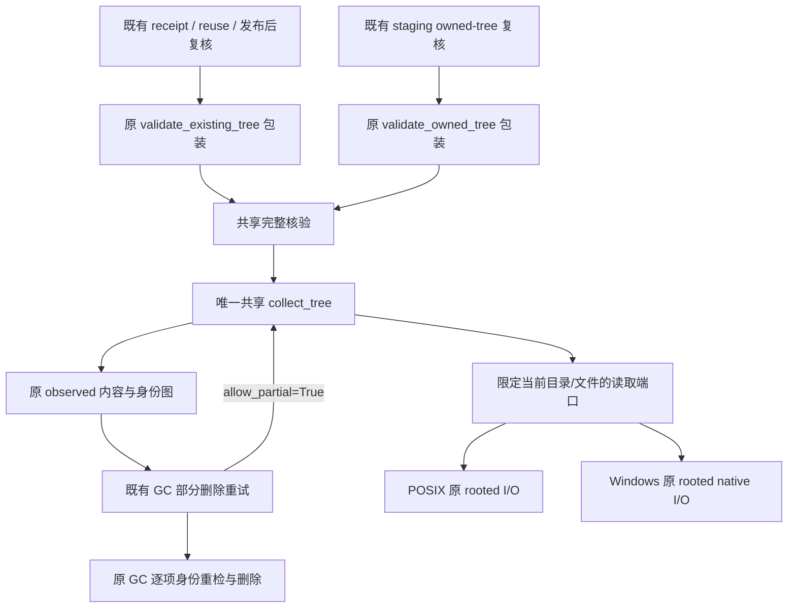

# M1c：文件树核验共享流程与平台读取接口 R2

## 状态与范围

- Authority: accepted — 用户明确要求按 R2 实施，接受范围限本专项的内部读取与核验收敛，不改变现有公开或持久合同。
- Design status: accepted；R1 经三个 xhigh agent 独立初评，R2 修订后原评审者复核关闭设计发现；实施授权为“请你按照R2开发实施”。
- Implementation status: locally-implemented；共享 scanner 与两个平台读取 Adapter 已落地并完成三视角代码审查，验证记录见评审记录。Windows native 与 partial retry 验收仍待补充；M1a/M1b 不重新开发。
- Owner: Harness package lifecycle。
- 源码基线：main `f8e46275565cf33f6ca945cb1b60200767162847`；2026-11-04 静态核查。
- 方法：本地干净 archmethod master `0f9bd3ff51afabeaaf76cc38dff1ceb279b7d37e`。采用职责、运行失败、数据兼容三个视角；没有重跑平台或模型试验。

目标：把两份文件树遍历、成员/身份/大小/摘要核验收敛成一份公共流程，通过现有 Store 内部的薄平台读取 Adapter 使用原 OS 操作。收益是规则有唯一实现，而非只减少若干 helper。不得用一个返回“已验证”的大平台方法继续隐藏两套相同决策树。

继承：[Plugin 架构](architecture.md)、[收敛审计](convergence-audit.md)、[M1a/M1b 设计](materialization-platform-adapter.md)、[升级兼容](../../decisions/accepted/ARD-008-workspace-upgrade-compatibility.md)。本次只细化既有 package lifecycle 的内部协作，不建立新顶层组件或公共文件系统框架。

## 1. 差异清单与处置

下面行号固定于源码基线；函数体 AST 相同只证明文字结构，不证明所有被调平台操作可以替换。

| 对象 | POSIX / Windows 事实 | 处置与原因 |
| --- | --- | --- |
| `_validate_tree_contents` | 第 1726 / 1746 行，各 24 行，函数体 AST 相同：期望成员表、收集、完整成员集合、大小和摘要比较 | 本切片统一为共享完整核验函数 |
| `_collect_tree` | 第 1752 / 1772 行，112 / 103 行；公共递归规则被 OS 枚举、stat、open、read、close 交织 | 本切片共享遍历和策略；平台只提供限定根的枚举/读取/原生身份 |
| `_validate_owned_tree` | 第 1703 / 1723 行，各 21 行，AST 相同；树根身份检查、调用内容核验及错误转换 | 保留原入口与异常边界，内部调用共享核验；不单为其短包装增加抽象 |
| `_validate_existing_tree` | 第 1571 / 1585 行，44 / 48 行；完整祖先链前后复核、树身份和 collision 映射相近，但 Windows open 有原 writable 模式 | 保留原 root/pin 与访问模式；只替换内容核验内部，不再新增根 owner |
| `_read_existing_tree_file` | 第 1617 / 1635 行，84 / 86 行；这是校验后的单成员读取，包含再次打开、父身份、读取上限、发布路径复核 | 本切片保留；它与整树 scanner 的读取合同不同，不强行一起抽取 |
| `_PosixFileSink` / `_WindowsFileSink` | write/digest/计数相同；finish 的 Windows reparse 检查与 flush 原语不同，关闭后才通知 owner | 已盘点，后续 M1c 写入子切片再设计；本次不移动 write/flush/close 状态 |
| 两份 `_ReuseFileSink` | 字节计数、摘要、完成通知及 abort 规则相同，owner 注解对应不同原 sink | 后续可共享；不为它先造完整 owner/stream 框架 |
| abort / `_remove_owned_tree` | 有相同的身份保护与清理次序，但 native 删除、reparse 和句柄操作不同 | 本次不移动删除流程或改善原错误抑制；扫描器被 GC 复用，相关观察合同必须保留 |

源码：[POSIX](../../../../../src/loushang/harness/resources/packages/plugin_lifecycle/posix_materialization.py)、[Windows](../../../../../src/loushang/harness/resources/packages/plugin_lifecycle/windows_materialization.py)、[原平台原语](../../../../../src/loushang/harness/resources/packages/plugin_lifecycle/windows_quarantine.py)。原始函数范围、AST 对比、源码 SHA 保留在产品树外审计归档 `m1c/source-evidence.json`。

## 2. 调用者与运行环境



物理位置仍为同进程、原 Store 私有目录。原 RoleStore 保有线程锁、journal owner lock、root pin，调用期间不释放锁后另起“扫描任务”。Adapter 借用当前已经打开的 tree fd，根 wrapper 不 dup、不接管、不提前关闭该 fd；目录/文件子句柄由产生它们的 context manager 所有。共享层既不接收 fd/HANDLE，也不能选择任意绝对路径。

重要接缝：两平台的 `delete_settlement` 已调用 `_collect_tree(..., allow_partial=True)`，分别位于基线第 711 / 716 行。GC 在扫描前已经按原流程写 tombstone，扫描后还比较现存文件内容并逐项重检身份再删除。改用共享 scanner 会影响这条路径的观察结果，不能只做安装成功测试，也不能改名声称 GC 完全不受影响；本次保持其授权、tombstone、实际删除和恢复策略不变。

## 3. 共享规则与平台职责

| 共享层唯一负责 | 平台 Adapter 必须保留 |
| --- | --- |
| 从 manifest 推导允许文件与中间目录集合 | POSIX scandir 生命周期；Windows 原 listdir-at 的名称捕获 |
| 深度优先遍历、prefix 拼接、原发现顺序 | 原 component 检查、no-follow / reparse 拒绝、stat 和 rooted open |
| 陌生目录、陌生文件、非单链接文件、非目录/普通文件拒绝 | scanner 新开 Windows 子目录保持 writable=False；借入的 GC/owned 根保持原访问模式、原生身份及安全限制 |
| 预期目录/文件身份匹配，子目录打开后再次匹配 | 具体句柄的 fstat、link count、Windows reparse 复核 |
| 64KiB 流式读取、计数、超长立即拒绝及摘要计算 | 最多读取请求字节的原 OS read，不整文件复制，不绕回路径重开 |
| 文件读取后再次核对身份/链接数；记录原观察图 | 原子句柄作用域、原 close 及 close 错误优先关系 |
| full / partial 集合规则，完整模式的期望大小/摘要比较 | 不读取 journal、不授予授权、不删除文件、不修改任意 sink 状态 |

Windows 在列出名称后逐项 stat，拒绝 reparse 再交给公共流程；POSIX 在枚举时校验单组件名称后 stat。公共层不新增 case folding、路径规范化、跨平台身份解释或排序。树核验仍是连续观察，不承诺对外部写入者的整树原子快照。

## 4. 最小内部读取合同

以下是已实现内部合同的示意，不是公开 API。类型复用 `store_settlements.NativeIdentity`、`_materialization_shared.IdentityMap` 及原 manifest/entry。一个不可变的临时 entry 观察值只是 stat 的中立投影，不进入 journal、不成为授权或新文件索引。

```python
@dataclass(frozen=True)
class TreeEntryObservation:
    name: str
    kind: Literal["directory", "file", "other"]
    identity: NativeIdentity
    link_count: int


class TreeFileReadPort(Protocol):
    def read(self, max_bytes: int) -> bytes: ...

    def identity_and_links(self) -> tuple[NativeIdentity, int]: ...


class TreeDirectoryReadPort(Protocol):
    def identity(self) -> NativeIdentity: ...

    def entries(
        self,
    ) -> AbstractContextManager[Iterator[TreeEntryObservation]]: ...

    def open_directory(
        self, name: str,
    ) -> AbstractContextManager[TreeDirectoryReadPort]: ...

    def file_reader(
        self, name: str,
    ) -> AbstractContextManager[TreeFileReadPort]: ...
```

这两个端口是当前已固定目录/文件上的能力，不是全局 FS Adapter。新合同及共享 walker 放在原 package lifecycle 的聚焦内部模块，具体 Adapter 留原平台模块；复用 M1a/M1b 的原 owner 与已有外层 sink/transfer 合同。不把整棵树 materialize 成观察列表后再校验，不建立注册器或独立服务。

只读端口使用 `file_reader`，有意区别于既有 `tree_transfer.open_file` 的 verified writer 合同。现有精确库存不区分接收者类型地识别 `.open_file`，若复用该名字会把读端口误记为新增 writer 入口。本设计不修改识别器、不增加 token 例外或放宽 owner/count；实际 rooted OS helper 的访问仍须照原证据核对与等价迁移，不能通过重命名隐藏真实 OS 访问。

### 生命周期与检查时点

1. `entries()` 保留原枚举方式：POSIX 持有 scandir 到退出；Windows 直接复用原 `windows_listdir_at`，在捕获 names tuple 时就对全部名称完成原 component 检查，不能延迟到逐次 next；只有 metadata stat 逐项、惰性观察，不能预先 stat 全部成员。不得排序或提前读取文件内容。
2. `TreeEntryObservation` 的 name 是平台原语确认过的单个组件；`other` 保留到共享层按原“不支持类型”路径拒绝。Windows reparse 继续由 Adapter 在原相应检查点直接拒绝，不把它伪装成普通目录/文件。
3. 对目录先在共享层核对允许集合和预期身份，再 open。共享层立即读取子句柄 identity，与原 entry 观察比较后再递归；返回后先关闭子句柄，之后继续父枚举。
4. 对文件先核对 manifest 成员、link_count 和预期身份，陌生成员不得调用 `file_reader` 或读取内容，陌生目录不得调用 `open_directory` 进入递归。随后才调用原安全内容 open；共享层用 64KiB 块读取、更新计数/摘要，超长仍在该块读完后拒绝，不顺带改变原读取上限语义。允许性判断之前仍保留枚举/stat；Windows `windows_stat_at` 自身会取得、观察并关闭属性句柄，不能据此声称陌生成员从未发生任何 native handle open。
5. `identity_and_links()` 在原读取后时点执行，返回同一已打开文件的身份/链接数。Windows 在返回前保留原 late reparse 检查；不在公共层凭两整数推断原生访问安全。
6. 枚举器、子目录和文件 context manager 均不抑制业务异常，按原 finally 关闭；保持原 close 异常可覆盖此前错误的语义，不新增一套重试句柄库。原 tree fd 仍由外层包装最终关闭，避免双重关闭。
7. root 适配不添加 fd duplication、打开根或 stat 的副作用。共享 walker 不自动重新 pin 根、写 journal 或切换平台；可见根的前后核对保持原 wrapper 调用点。

## 5. 唯一扫描器与两种校验语义

共享 `collect_tree` 接收当前 directory port、原 expected entry 表、可选原身份图及既有 `allow_partial` 值；返回与旧函数同形的 observed 文件 `(byte_count, digest)` 表、目录身份图和文件身份图。平台原 `_collect_tree` 可保留为兼容薄委托，不能保留自己的递归或共同成员/摘要判据。

共享 `validate_tree_contents` 建立原 expected 表，以完整模式调用同一个 scanner，再执行原成员全集及每项大小/摘要核对。原 `_validate_existing_tree` / `_validate_owned_tree` 保留 root/树身份和错误转换，只把内容核验委托到这里。这样没有两份公共算法，也不必同时移动所有异常包装。

| 条件 | 完整核验 | 既有 GC partial 观察 |
| --- | --- | --- |
| 期望文件已缺失 | 完整包装拒绝成员集合差异 | 允许；不伪造该文件的 observed 记录 |
| 预期身份图中目录/文件已缺失 | scanner 拒绝集合差异 | 允许；只返回仍存在的身份 |
| 空的非根目录 | 原规则拒绝 | 允许，便于继续删除已部分清空目录 |
| 原 manifest 未允许的成员 | 原规则拒绝，未知文件不读 | 同样拒绝；partial 不是任意内容许可 |
| 仍存在的文件身份或 link_count 改变 | 原规则拒绝 | 同样拒绝 |
| 仍存在文件的大小/摘要 | 完整包装逐项核对 | 保留 GC 调用者原逐项比较；scanner 仍计数、计算摘要及限制超长 |
| 根目录为空且 expected 为空 | 保持原根的允许语义 | 保持原语义 |

`allow_partial` 不新增为公共 SDK 配置，也不允许完整核验调用者任意降级；实现必须核对所有调用者，GC 不存在的文件不能被“补成验证通过”。外层原 root/owner 锁与 tombstone 时点不变；失败不回滚或删除原授权事实。

## 6. 失败路径与兼容约束

| 触发 | 所有权与返回要求 |
| --- | --- |
| 枚举/stat/component/reparse 拒绝 | 退出枚举器及已打开的子句柄；不返回不完整结果，不尝试弱路径 fallback |
| 陌生目录/文件或身份不匹配 | 保持先检查再调用内容读取/递归端口；此前原有属性 stat 不等于允许读取未知内容 |
| 子目录在 stat 与 open 间替换 | 子句柄身份立即复核，失败不进入递归；按原外层包装映射 |
| 文件读取超长、digest 变化或读取后身份/链接变化 | 先按原 finally 关闭，整次核验失败；不接受部分摘要，不缓存这次 observed |
| close 本身失败 | 保留原异常覆盖和资源所有权；不虚称全部已释放或可重试关闭 |
| published-tree 包装内扫描异常 | 保持原 `package_publication_collision`；root 前后可见性异常仍为原 `package_publication_root_untrusted` |
| owned-tree 包装内扫描异常 | 保持原 root-untrusted 映射及已有显式错误透传 |
| GC partial 扫描拒绝 | 维持原 GC 调用者的错误/重试结果；不继续凭不完整图删除、不撤回 tombstone、不把 foreign identity 当作已删 |

不改变 journal/manifest/receipt 的格式、字段、路径、版本、授权者，原两平台 Store 构造器、公开方法、M1a/M1b 两个端口均保持。文件树读取端口不扩充 M1a 的只读 receipt pin 口，以免把不同寿命对象塞进一个万能接口。

时间复杂度仍以成员数和读取字节数计；每次只保留一个文件块、原深度优先句柄链及原结果图。保持原 names tuple / scandir 差异，不为“统一”复制整树或重复完整扫描；不宣称已有耗时收益或新的遍历深度/物理时限保证。

## 7. 迁移与验证方案

1. 先以原两平台源码和调用者固定行为，落实只读内部端口；新增临时数据类型不进入 public facade 或 journal codec。
2. 将完整包装与 collector 公共规则一次收敛，原 wrapper 只包当前 tree fd 并委托；对比前后原语调用顺序，不能只看共享 helper 的输出相等。
3. 复用原 POSIX/Windows materialization 回归，重点保留 sparse foreign member 不扫描、hardlink、相同字节不同身份、reparse、根/祖先替换、exact/alias reuse、发布后 receipt 复核及 GC 部分删除重试。
   已定位 POSIX `test_posix_store_gc_retries_after_partial_file_removal` 的直接重试场景；静态检索尚未在现有 Windows 对应文件找到同形“删一项后失败再重试”的 native 案例，不能把成功 GC/absence replay 或 POSIX 结果当作这份证据。Windows partial retry 作为实施后的专门本地/native 验收项保留；新增验证若会进入 PR 门禁，仍需单独批准或留在产品树外，不自动增加 gate。
4. 架构库存按实际新 OS 调用点等价迁移，角色/数量/授权要求保持；不能删安全断言、留注释凑字符串或扩大允许集合。新的本地判据若会增加原 PR 门禁条件，留在产品树外验收，不默认扩门禁或恢复暂停路线。
5. 产品树外可控端口验收：未知成员不进入 `file_reader`/`open_directory` 或内容读取，但保留 Windows 属性 stat；Windows 捕获 names 时先完成全部 component 检查，metadata 则在迭代期间观察；字节/身份校验先后、异常退出句柄关闭顺序；同一树 full 拒绝而 partial 接受的缺失成员情况；partial 对陌生成员仍拒绝。它们不能替代平台 native 证据。
6. 对应版本需分别取得既有 POSIX 与 Windows native 结果；Windows 暂停安排保持，缺证据就明确待验证，不把 Linux 或模拟 Adapter 通过作为 Windows 通过，不修改 PR gate。

本切片已按 R2 实施：共享规则位于 `_tree_validation.py`，原两平台模块保留读取 Adapter、root/owner 包装与原生 helper；原 `_collect_tree` 与 `_validate_tree_contents` 仅作薄委托。AST 核对确认两平台原有其余顶层函数与类均未修改。三位原 reviewer 对实际源码独立审查，无需修复的代码发现；详见评审记录。

文件 sink、reuse sink 和 abort 删除的后续共享仍需另按实际收益与生命周期设计。本次没有完成 Windows native、性能测量或整个 materialization Store 的收敛，也未改变暂停的验证路线和 PR 门禁。

三视角发现、修订与复核结论见[评审记录](materialization-tree-validation-review.md)。
