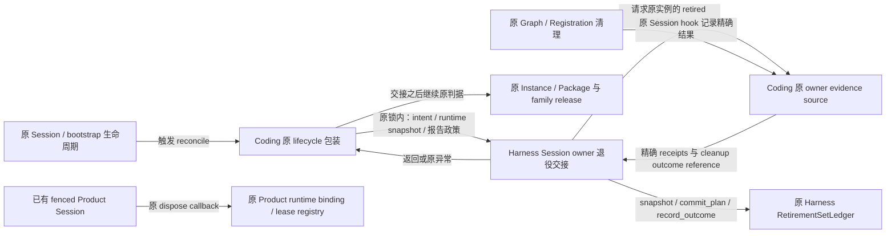
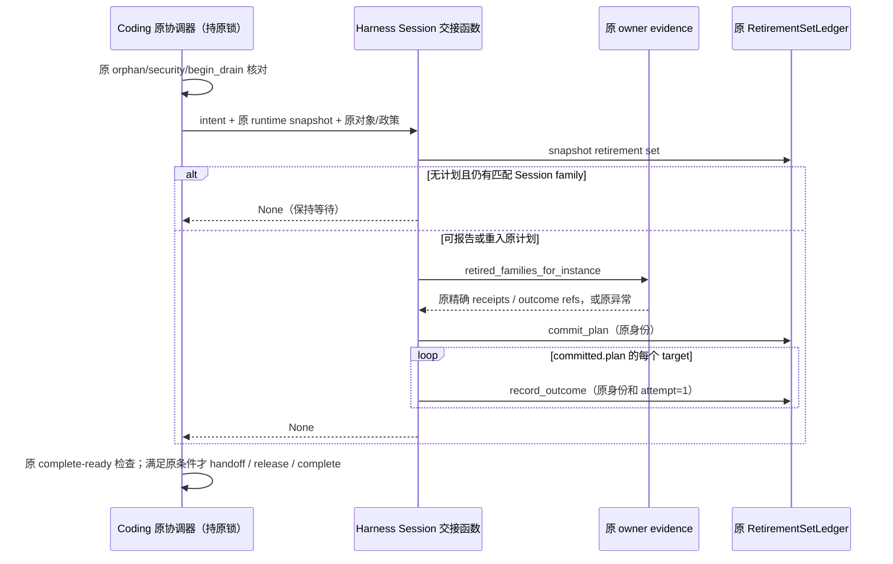

# D1 第二切片：Session owner 退役交接设计 R2

## 状态与范围

- Authority: accepted — 现有合同下的内部协作，不改变账本或运行时释放权威。
- Design status: accepted；R2 三视角复核完成后，用户以“确认，继续”接受该范围并授权实施。冻结设计与接受证据见评审记录。
- Implementation status: locally-implemented；内部交接函数与原 Coding 委托已实现，聚焦回归、树外差分/实际 journal 验收及三视角代码评审完成。
- Owner: Harness Session integration；Coding 保留领域策略与原生命周期发起点，Harness plugin_management 保留原持久事实权威。
- 源码基线：main `886c1b2f73a61b0ab6c14bf62a4c8682776d7807`；Harness 集成 HEAD `4dcfd8bcf1545c59060a639e8d17568567e154ae` 与 main 的完整 tree 相同，2026-11-04。
- 方法：本地干净 archmethod master `0f9bd3ff51afabeaaf76cc38dff1ceb279b7d37e`；仅声明本地版本。

继承[收敛审计 D1](convergence-audit.md)、[已交付账本装配](management-ledger-assembly.md)、[PLC2 原合同](plugin-lifecycle-plc2-contract.md)、[现有负责人图](../current-owner-map.md)和[升级兼容](../../decisions/accepted/ARD-008-workspace-upgrade-compatibility.md)。不因审计建议就认定存在运行时错误或双写权威。本切片将原有 Session 凭据到退役记录的通用交接规则放在 Harness 内部；原 Product 策略、存储、关停顺序、异常与重试合同保持。没有增加 Architecture Scope、公开端口或新持久权威，按内部实现重组评审；若评审证明涉及已接受的责任或安全边界变更，应先升级对应共同父级决策，不能以内部提取名义绕过。

## 1. 为什么先收窄这一切片

退役证明、资源关闭、family 释放和包清理是不同工作。共享规则不意味着应再建统一退役管理器。原代码已有 Graph/Registration 清理、失败保留、Instance/Package 检查及 fenced runtime release；本轮不替代它们，也不将整个 CodingPluginLifecycle 搬入 Harness。

| Current，位置固定于基线 | 已核实事实 | 本切片选择 |
| --- | --- | --- |
| `coding/_plugin_lifecycle.py::_ensure_owner_retirement_plan`，551–640 | 检查原 retirement set；未封计划且仍有匹配 Session family 时等待；读取全部已退役 family 的精确凭据，生成有序 targets、commit_plan，再按原身份补齐 outcomes | 唯一提取主体：原控制流与派生规则进入 Session 内部交接函数 |
| 同文件 429–498、642–693、`CodingPluginSessionLease.close` 912–924 | 原 Product 跨账本 coordination lock 包住 reconcile / release；先孤儿核对、security reconcile、begin_drain，再交接；成功 set 后仍需 direct-host 清理交接、零租约和 Instance 完成；lease 最后才退出进程句柄并置 closed | 原处保留；函数不 acquire/release family，不拥有锁，不宣布 Instance 已退役 |
| `coding/_plugin_owner_generations.py::retired_families_for_instance`，265–292 | 有 prepared/published 未退役 family 时拒绝；返回同一实例已退役 family，按 family_id 排序，每个保留 receipts 和 retirement_outcome_reference | 作为原证据源使用；不改 journal、不改读取/校验，不另存一份证据 |
| `coding/_capability_plugin_composition.py`，839–970；Coding Session dispose，2241–2372 | runtime evidence close、graph/owner/component 状态核对、管理 lease 释放和临时目录清理分阶段；失败对象及标志用于后续重试；deferred LSP 先关闭 | 原处保留；不为本切片新增另一份关停进度 |
| `harness/plugin_management/retirement_sets.py` | 原 collecting/retiring/succeeded 等聚合、严格记录、幂等与恢复；管理 Service 只负责 open_set 交接 | 保留原组件，不把 Session 交接塞进该账本或 Service |
| `tests/architecture/test_unified_plugin_architecture.py::test_plc2_retirement_set_is_exact_inert_and_opened_by_one_authority` | 对整个 plugin_management 包扫描：open_set 只有 Service 原位置，commit_plan / record_outcome 的调用集合为空 | 新调用放在职责相符的 Harness Session 集成层；不修改或放宽本检查 |
| fenced Product：`PackageProductRuntimeBindingV1.dispose_runtime` 1417–1425、Coding `_CodingSessionProductRuntimeRelease` 806–819 | 已通过原 callback/lease registry 释放原 Product runtime；回调成功后才置 disposed。Coding wrapper 先 release 再 close selection，失败仍可重试 | 沿用已有机制，无需为 fenced 路线伪造 Session family 或接入本函数 |

源码：[Coding lifecycle](../../../../../src/loushang/coding/_plugin_lifecycle.py)、[owner evidence](../../../../../src/loushang/coding/_plugin_owner_generations.py)、[Coding Session](../../../../../src/loushang/coding/session/agent_session.py)、[组合对象](../../../../../src/loushang/coding/_capability_plugin_composition.py)、[fenced wrapper](../../../../../src/loushang/coding/package_product_runtime.py)、[Harness runtime binding](../../../../../src/loushang/harness/package_product/product_runtime.py)。原文、精确 AST 范围与 SHA 位于产品树外 `architecture-analysis/plugin-harness-audit-20261104/d1-retirement-coordination/source-evidence.json`。

没有定位到能直接替代此方法的现有共享交接函数。已有 ledger APIs 能实现各原子步骤，却不拥有“等待 Session family、把已退役 receipts 形成完整计划、重入补齐 outcomes”的调用规则；这才是本轮收敛对象。收益是把该规则及其派生算法放到领域中立的集成位置，不承诺减少总代码行数或启动耗时。

## 2. 环境与物理边界

下图以本切片交接机制为黑箱；外部相邻组件即使位于同一 Python 进程，也保留各自权威。

| 环境关系 | 发起者、信息与权限 | 物理实现、失败影响 |
| --- | --- | --- |
| C → H | 原可信 Product 调用方传同一 intent/runtime 快照、同一 retirement ledger、原证据源与固定内部政策；只用于可写生命周期路径 | 同进程同步调用，无 RPC、任务队列或后台线程；不扩 SDK/CLI/RPC 输入 |
| H ↔ E | 只读原已退役 family 及其凭据；不执行 cleanup，不把来源自报变成新的 kernel 验证 | 原 Coding evidence JSONL/原锁和恢复策略；源拒绝或读取失败原样上传 |
| H → R | 只经原 ledger 方法校验、封计划、记录原精确结果；写权来自原生命周期装配与外层锁 | 原本地文件路径、Journal、锁、编码与幂等规则；计划和多条 outcome 不在一个事务内 |
| C → I | 调用方继续原 direct-host handoff、cleanup attempt、Instance completion 与 family release 检查 | 同一进程/原 workspace namespace；失败不能被 H 的正常返回覆盖 |
| fenced F → B | 保持原 epoch/admission/registry authority，不依赖 H | 本轮不改各平台原实现；只检查共存边界，不新增跨平台承诺 |

原 coordination lock 的取得位置与覆盖范围保持，包括并发最后关闭、启动恢复和普通 reconcile。函数不新建锁，也不声称单一锁使全部参与文件或其他 writer 具有跨账本事务。断电/多进程安全仍由原合同约束；不新增更强承诺。

## 3. 子职责与内部接口

实现为一个 Harness Session 内部模块 `harness/session/_plugin_retirement.py`。它属于已有 Session 集成职责，不提升为独立 runtime component，不放进保持惰性的管理账本包，也不导出 Session 根 facade。直接使用原 RetirementSetLedger、Intent、InstanceRuntimeInventorySnapshot、Target/Plan/Outcome 及 Registration receipt 类型。类型用途的外部协作类型优先 TYPE_CHECKING，避免扩大运行时导入。

| 职责 | 负责者 | 明确不负责 |
| --- | --- | --- |
| 停止工作、实际关闭 Graph/Registration/子组件、保留失败句柄 | 原 Harness Session / 具体 owner 与 Coding hook | 交接函数不关闭、重试或删除这些资源 |
| family 证据收集、prepared/published/retired 记录及真实性检查 | 原 Coding evidence ledger 与调用 hook | 不迁移格式、路径、前缀或写入权威 |
| 等待未封计划的活动 Session family；完整 targets 派生与幂等报告顺序 | Harness Session 内部函数 | 不成为新的证据源、计划审批器或 cleanup executor |
| 记录一致性、严格编码、幂等/CAS 与聚合状态 | 原 Harness RetirementSetLedger | 不直接启动 Session runtime 或决定 Product shutdown |
| Product 报告标签/原错误映射、外层锁、host/package/family 收尾 | 原 Coding lifecycle 包装 | 不复制共享派生算法，不在成功交接后跳过原收尾判据 |

内部函数：`report_exact_owner_retirement(intent, runtime_snapshot, *, retirement_sets, owner_evidence, policy) -> None`。参数为本次原调用已经取得的对象，不重新装配账本，不缓存，也不将 runtime snapshot 标成原子完整事实。

证据读取采用结构化只读协议：`owner_evidence.retired_families_for_instance(instance_revision_ref)` 返回原 family 对象的 tuple。函数仅消费每项的 `receipts: tuple[OwnerGenerationRetirementReceipt, ...]` 和 `retirement_outcome_reference: str | None` 两个只读属性；不复制为新持久实体，不接受 dict/任意 JSON，不新增来源发现。原 source 对 pending evidence 的拒绝及排序仍实际执行，不以扁平 `retired_receipts_for_instance` 替代而丢失逐 family outcome。“只读协议”仅限制交接函数不调用证据写入 API；原 source 仍使用原 journal lock 和 `partial_tail="repair"` 加载政策，读取可能执行原尾部修复。它不是无 I/O 的投影，也不是可接入公开 read_only 查询的新端口。

`policy` 是 frozen/slots 的内部无状态报告值，只有 `closure_namespace`、`outcome_namespace`、`success_result_code` 和一个 `unavailable_error(reason) -> Exception` factory；reason 仅有 `set_unavailable`、`plan_unavailable`、`outcome_unavailable`。Coding 显式绑定原 `coding-owner-closure`、`coding-owner-retired`、`coding.owner.exact_retired`，factory 按原分支生成原 CodingPluginLifecycleError 的原消息和 code。不新增用户配置、默认策略、插件扩展点或运行中切换；不做 eager 读取/校验改变原失败时点，error factory 仅在对应原错误分支调用。原 ledger/source 异常及 KeyError 等错误原样传播，不做宽泛翻译。

`CodingPluginLifecycle._ensure_owner_retirement_plan` 保留原方法与调用位置，薄委托上述函数，传原 `self.retirement_sets` / `self.owner_evidence`。其余生命周期函数保持原样。函数/两个只读协议/政策值是内部模块组织，不是四个新组件；不建立持久状态、关闭标志、重试调度器、额外 journal 或对象注册表。

## 4. 数据身份与实际顺序

| 数据 / 关系 | 原权威与保持要求 |
| --- | --- |
| retirement_id → intent/set | 原 management handoff 与 RetirementSetLedger；函数不 open_set，也不绕过源 intent 校验 |
| instance → 多个 Session families → 每 family 多个 exact receipts | 原 Instance ledger 与 Coding evidence；不将 Session 关闭数量等同 owner 已清理，不丢 family outcome |
| target 身份 | 原 `PluginOwnerRetirementTargetV1.create`；输入仍为 owner_reference、owner_generation_reference、retirement_handle、contribution_ids；不按 contribution_id 合并不同 owner generation |
| closure / plan 身份 | targets 按 target_id 排序；摘要保持 `sha256(repr(tuple(target_ids)).encode("utf-8"))`，closure 为原 namespace 加冒号和摘要；用原 Plan.create，全部派生规则不改 |
| outcome 身份 | 原 `sha256(repr((retirement_id, target_id)).encode("utf-8"))`；operation_id/idempotency_key 都使用原 outcome namespace 加冒号及摘要，attempt=1，disposition=succeeded，result_code 原值，原 cleanup outcome reference |
| 状态区别 | ledger set succeeded 仅表示其 exact targets 已报告成功；不等于零 family、实际删除、Instance RETIRED 或 fenced runtime 已释放 |

本函数复制原方法的顺序：

1. 查询原 set；不存在时产生原 Product 错误。仅在 **plan is None 且有匹配实例的 open session_membership family** 时返回等待；既有 plan 不新增这一等待条件。
2. 调用原 evidence source，保留它对未退役 family 的拒绝；按其原返回顺序展开 receipts，逐项创建原 target，排序但不新增去重、过滤、快照或预校验。
3. 用原 closure 派生方式构造原 plan 并 `commit_plan`。检查返回的 committed.plan，缺失时产生原错误；后续遍历 **committed.plan.targets**，而非另建目标集合。
4. 按原 owner/generation/handle 三元组寻找逐 family cleanup outcome；缺少映射仍沿原错误传播，值为 None 时产生原 Product 错误。逐项使用原身份 `record_outcome`；不因为重入而生成新 operation 或增加 attempt。
5. 返回 None。原 caller 再调用 `_complete_ready_retirement`，并由原 Instance/Package 判据决定后续；函数正常返回也可能只是第 1 步等待，不发明 ready 标志供调用方误用。

## 5. 关键场景、失败与验证边界

| 场景 / 重要性与难点 | 预期与保持机制 | 验证依据（实际结果见 §8） |
| --- | --- | --- |
| RC-1 运行中禁用；多 Session 逐个关闭。高：防提前释放 | 活动 Session 固定原代；未封计划时等待全部相关 family 退出，再报告 exact owners；原零租约判据继续生效 | 原 `test_explicit_disable_or_remove_never_self_heals_and_pins_active_session`、`test_retirement_waits_for_every_session_owner_generation`；后者是未发布 owner 的低层 assembly，实际断言空 targets/outcomes，只证明 family 等待与空计划路径 |
| RC-2 并发最后关闭。高：锁覆盖敏感 | 原 release+reconcile 锁覆盖、调用次序、family/target/outcome 身份不变；不增加另一把锁 | 原 `test_concurrent_last_session_close_linearizes_exact_retirement` 有两个非空 owner targets/outcomes，但未逐条断言 family outcome reference；下述树外关联验收，并静态核对原 caller/锁体 |
| RC-3 只封 plan / 部分 outcomes 落盘后失败。高：非事务交接 | 失败上抛，已落盘记录不回滚、不生成新身份；下次原 reconcile 重新提交同一 plan/outcomes，原 ledger 幂等验证；append 结果未知不在本轮加强保证 | 树外基线/实现差分轨迹与定点故障注入；复用原 `test_retirement_sets.py` 幂等/聚合测试。现有单元不直接证明完整 wrapper 中断续跑 |
| RC-4 prepared/published evidence、坏记录、缺 set/outcome。高：错误不冒充成功 | source/ledger 原验证仍执行；仅三个原显式错误分支由 Product factory 保持类型/消息/code，其他错误原样传播 | 原 owner evidence 重开/冲突测试；树外分支/异常顺序差分；不弱化现有检查 |
| RC-5 子图/owner 清理失败、或 runtime release 失败。高：依赖寿命；提取不触碰此链 | 保留原 owner/句柄、状态和依赖；不记录实际清理成功、不提前释放；后续 dispose 沿原凭据重试 | 原 `test_product_owner_cleanup_failure_keeps_runtime_lease_until_exact_retry`、`test_product_session_runtime_release_failure_retains_lease_until_retry` 及 LSP 关停场景；只作保留回归，不称为新修复 |
| RC-6 启动孤儿核对、无 owner 的空计划。高：恢复身份 | 原正向进程死亡锁证据在 wrapper 原先执行；空目标沿原 ledger 可 succeeded，仍不等于 Instance 完成 | 原 `test_startup_lock_fault_injection_requires_positive_orphan_evidence`、`test_empty_owner_plan_succeeds_without_claiming_instance_retirement` |
| RC-7 fenced 与兼容路线共存/已有 workspace 重开。高：升级兼容 | fenced 沿原 runtime callback/registry，不取得 legacy family、不接管 evidence journal；不改选择、epoch、admission 或路径 | 原 Product lease 失败重试及普通升级场景；静态对比 fenced 装配和路由未改 |

RC-1/2 的非空关联验收在产品树外使用至少两个 family、不同 receipts 与不同 cleanup outcome references，对比基线/实现：首个 family 释放后不封新计划，最后释放后 targets 全量，逐 target outcome 仍对应其原 family reference；再结合 RC-3 的部分结果后重入，核对完整记录而非只比较数量。实际执行结果见 §8，原测试源码和静态评审不替代运行证据。该定点验证不加入 PR gate、平台矩阵或模型试验。

同步函数不创建 async task 或吞取消。调用方原 async dispose 的取消原子性由现有 owner 保持；函数可能传播 BaseException，外层原错误/清理逻辑继续负责，不能称为跨账本全回滚。原 coordination lock 在凭据与账本 I/O 期间继续占用；不承诺降低锁等待。空间仍随本次 families/receipts/targets 增长，无跨调用 cache，没有测量前不宣称性能改善。

## 6. 选择与协同边界

| 选项 | 比较与决定 |
| --- | --- |
| 保持原方法全部位于 Coding | 零提取风险，也可合理保留；但通用 Session retirement 交接仍与 Product 身份标签混合。若共享接口成本大于收益，应选此项而非强行下沉 |
| 新建统一 retirement manager，接管 Graph、evidence、family、Package 与 fenced lease | 新增多个清理/状态权威，混淆两条路线；不选 |
| 在 plugin_management/Service/RetirementSetLedger 中执行整个交接 | 混入 Session-specific membership 与证据来源，违反当前管理包不主动 commit_plan/record_outcome 的职责合同；不选，不改检查为该方案让路 |
| Harness Session 内部函数复用原账本，Coding 保留 Product 报告政策与薄入口 | 采用；实际搬移的仅是原 `_ensure_owner_retirement_plan`，两条路线各自的释放机制、持久事实与失败语义不动 |

D1 首切片 assembly 不增字段、不装配新 owner。原 evidence ledger 不重命名或迁移；相关 class/消息中的 Coding 标签属于当前兼容合同，按原值保留。外层 `_recover_inactive_session_families`、host cleanup/Instance completion、`release_session_family_and_reconcile`、`CodingPluginSessionLease.close`、Session dispose 和两种 composer 均不随本轮搬迁。D2 路线选择继续独立评估。

实施只需一个内部模块、原方法薄委托与必要的静态导入整理；实际函数和本地类型命名可微调，不能临时发明新的锁/权限/持久字段或放宽验证。若需新增来源、跨进程调度或统一两类租约，应重新评审范围。现有架构 scanner/调用集合/断言、PR gate、工作流和平台矩阵均保持；额外故障轨迹保留树外本地验收。

## 7. 评审与接受

设计和代码分别以职责与复用、运行与失败、数据与兼容三个独立视角，复核共同场景及与首切片、既有管理惰性和 fenced release 的协同。每个 reviewer 独立读取固定版本与源码，不能为缺失机制补造解释；报告区分事实错误、设计缺口和建议，并注明未运行产品测试。三视角结果及修订处置记录于[评审记录](session-owner-retirement-handoff-review.md)。

用户此前明确要求“系统环境图等重要工作件需要我评审”。R2 完成独立评审后提交用户，用户回复“确认，继续”，据此接受本切片环境图和关键合同并开始实施。该接受只覆盖本切片，不接受后续 D1/D2 候选或宣告整项 D1 完成；设计与实际验收分别记录。

## 8. 实施与验收记录

2026-11-04，实际实现为 [Harness Session 内部交接函数](../../../../../src/loushang/harness/session/_plugin_retirement.py) 及原 Coding 方法的薄委托。Coding 另保留固定报告 policy 和三个原错误分支的 factory；原 evidence、账本、Graph/Session dispose、锁、family release、host cleanup 和 fenced runtime 均未修改。没有新增 public facade、持久格式、用户配置、测试断言或 PR gate。

- 原退役/租约/owner evidence/Instance/Package 与受影响架构检查：**121 passed，392.20 秒**。包括并发最后关闭、子 owner 清理及 Product runtime release 失败后的原租约重试、管理包惰性、依赖 DAG、Session barrel 和现有精确构造库存。
- 树外分支及故障轨迹：**25 passed**，覆盖等待、空计划、已封计划仍有 family、无关 family、direct-host、不存在 set/plan/outcome、缺映射 KeyError、重复凭据、pending source，以及 13 个 source/constructor/commit/report 故障位置；新旧调用前缀与异常类型、消息、code 和故障对象身份一致。
- 树外真实 ledger/family 交接：**7 passed，19.32 秒**。每次均为两 family、三 receipts、不同 family outcome refs；首个关闭后保持无 plan，最后关闭后逐 target 对应原 family outcome，最终 Instance RETIRED。覆盖正常完成与 plan 前后、outcome 前后六种定点失败；用新 ledger reader 冷读已写前缀，再沿原 family/operation 身份续跑，重复关闭/reconcile 不增记录。基线与实现的退役集合、owner evidence、Instance、Package 四份完整 JSONL 字节一致；属于受控故障后重入，不是断电或任意 append 结果未知的证明。
- 树外夹具初次构造遗漏 InstanceRevisionRef.plugin_id，另一处使用了不合法的手写 workspace scope；分别补齐字段、改用原 resolver 后继续验收。产品源码、原用例、安全检查和验收断言没有为这些夹具错误放宽；已通过的 25 项轨迹不重复执行，后续仅运行 7 个真实存储场景。
- Ruff、两份实现的 mypy、包依赖事实及文档静态检查通过。AST 对照确认原有定义中只有 `_ensure_owner_retirement_plan` 改变，原外层锁/调用顺序和其它类、函数保持；产品测试、工作流及 gate 文件没有改动。
- 三位原 xhigh reviewer 独立审查固定实际实现，职责与复用、运行与失败、数据与兼容均无发现。固定源码、报告指纹和加载来源证据见[评审记录](session-owner-retirement-handoff-review.md)。

运行证据来自本机 Linux、显式使用 Harness lane src 的离线环境。没有执行付费模型、全仓回归、Windows/macOS 原生矩阵、断电、性能或并发进程故障试验。本切片本地验收完成，远程交付由对应 PR 记录；不把共享算法正常返回扩大为所有清理已完成。
