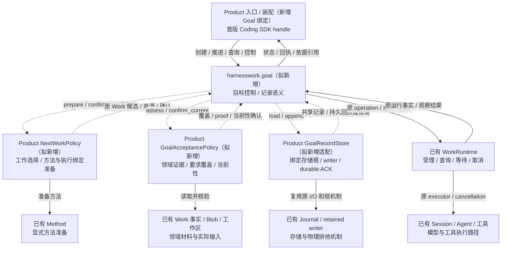
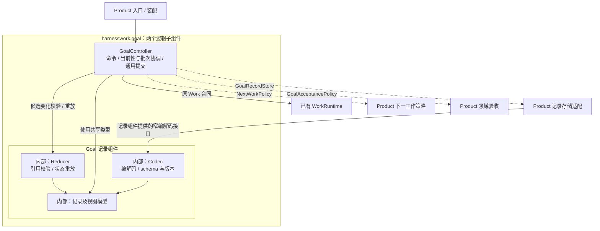

# HarnessWork Goal：环境与子组件 R1

- Authority: normative — 用户认可并授权实施的最小业务闭环 R3.2 子系统视图。
- Design status: accepted for reviewed local SDK scope；Implementation status: implemented and verified locally for the stated profile。
- Owner: HarnessWork；Product 拥有领域策略、验收和物理装配。
- 依据：[最小业务闭环架构](../../goal-method-work/minimum-loop-architecture.md)；需求 GM-01…08 不变。
- 方法：本地干净 archmethod master `0f9bd3ff51afabeaaf76cc38dff1ceb279b7d37e`。
- 设计父提交：`93c8b9e45671682fad1ccc72645520e1624faf92`；源码基线 `d1f418de53c58040a590683a0c499ff3de50e50d`。
- 用户已同意 Codec 属于记录组件内部、按真实适配职责决定桥接；环境/白盒专项评审已完成，用户随后要求开始开发；实现及复核结果见[实施记录](implementation.md)。

## 1. 研究对象及范围

`harnesswork.goal` 是 HarnessWork 的可选目标协作能力。它保存目标和要求版本，
协调多批原 Work，处理控制命令，并在领域证明及原执行事实支持下提交完成决定。
本文件只拥有该模块的环境与内部拆分；共同父级架构仍拥有完整业务、状态、准入、
持久/未知、输入和关闭合同，不另建一份状态机或演进协议。

首版是 Linux 本地 SDK、显式 Method、每次 advance 最多一批；组件同处已有 SDK
进程。图中按逻辑责任划界，不表示独立部署、线程、安全隔离或已有产品实现。
模型服务和工具进程通过原执行域参与，Goal 没有直接模型/工具调用边。

下图及内部模块说明保留设计时的“拟新增”标签；本地首版的实际 API、执行及
用户手工验证状态以[实施记录](implementation.md)为准，未实施范围不因此升级。

## 2. Goal 系统环境图

环境图以整个 `harnesswork.goal` 为黑盒。其直接协作者只有 Product 入口/装配、
下一工作策略、领域验收、物理记录适配及原 WorkRuntime。后三个 Product 适配
对象通过 Goal 定义的合同注入；图中指向它们的虚线是运行期调用，不是共享包
import Coding/Method。外围节点表示间接环境路径。

Product 取得并持有 Session、Work 和记录 writer，再借给 Goal；Goal 不拥有释放
这些物理资源的权限。原 Work 仍拥有 operation→run 解析及运行终态。环境连接
不授予额外权限，也不要求普通 SDK/Work 启用 Goal。

## 3. 功能映射与组件收敛

| 功能簇 | 主责组件 | 关键协作者与排除项 |
| --- | --- | --- |
| 目标命令、当前版本/epoch、一次推进及通用完成提交 | GoalController | 使用记录组件验证 Goal 变化；调用原 Work 和注入策略，不解释测试/AST/Method |
| 批次意图、dispatch receipt、原 operation 关联及 unknown 闸门协调 | GoalController | 原 Work 提供运行事实；记录组件检查引用及互斥，不复制执行状态权威 |
| 记录格式、版本、引用不变量、纯状态重放 | Goal 记录组件 | 内含模型、Reducer、Codec；不读物理库、运行 Work 或判断业务 proof 真假 |
| 要求覆盖的业务真实性、方法来源和材料当前性 | Product 策略/验收适配 | 由原三个协作合同交接；不属于记录组件或独立通用验收引擎 |
| 序列号写入前提、原存储根/lease 和持久 ACK | Product 存储适配 | 调用记录组件的窄编解码接口；不复制 Goal 状态机 |

收敛决定：保留 **GoalController、Goal 记录组件** 两个逻辑子组件；记录模型、
Reducer 和 Codec 合并为记录组件内部模块。它们共同随记录语义及演进变化，
没有独立执行或资源生命周期，不分别提升为同级架构组件。三个协作接口及其
交换类型是合同，不是额外的运行组件；无需为每个数据类型或每条环境边建组件。

## 4. 内部组件图

图中内部模块只解释职责，不冻结 Python 文件数量或导入路径。Codec 的实现属于
记录组件；该组件允许对存储适配暴露窄的 encode/decode 功能，使适配能够复用
同一格式，不意味着把 Codec 提升为独立组件或允许导入其私有实现。具体 Python
入口待实现时按这一组件边界选择，当前不存在可调用的 Goal 公共 API。

GoalController 与记录组件的区分是编排与纯记录语义：前者取得原 Work/策略事实、
检查当前 basis 和完成前提；后者检查已有记录的结构、序号、引用、版本及状态
变化。记录组件没有 I/O，不在重放时查询 Work/Blob 或重新执行领域验收；历史
状态与当前有效性仍按父级架构区分，单独重放只能提供 not_checked 的领域状态。

## 5. 直接协作与适配责任

环境中存在连接不自动要求桥接组件。需要解释两侧语义、转换协议/身份、映射
错误或协调资源寿命时，才保留明确适配职责；只有转发的地方使用原合同。

| 连接 | 当前选择 | Owner / 适配内容 |
| --- | --- | --- |
| Goal → WorkRuntime | 直接协作，不新增 Goal–Work 桥 | Controller 使用原 accept/wait/cancel/query/get_run_for_operation；意图与 unknown 属于 Goal，运行事实仍归 Work |
| Goal → Method | 经 Product NextWorkPolicy，不直接 import Method | Product 准备 Method、转换为原 Work 候选并准备 executor/resolver 绑定；prepare 不暗中执行或 accept |
| Goal → 领域证据 | 经 Product GoalAcceptancePolicy | Product 使用已绑定 reader 解读材料、测试和文件约束，返回覆盖及 opaque proof；Core 不解码领域内容 |
| Goal → Journal / writer | 经 Product GoalRecordStore | 使用记录组件的格式，适配原物理绑定/序号前提/错误/持久回执；物理排他、耐久及关闭仍由 Product 和原机制负责 |
| Goal → Session 生命周期 | Product 入口/装配协调 | 不增加共享 Session 桥；原执行器负责执行，Product 负责受控输入、创建/关闭和 cleanup owner |

首版不新增统一 Bridge、适配注册中心或转发 Work 的第二执行端口。上述三个
Product 适配各有现存的领域/存储差异，不合并为一个笼统“集成组件”。未来若
出现真实、产品无关的 Goal–Work 差异，可在 HarnessWork 内按证据另行设计；
本文件不预建这个组件，也不以“桥接”命名允许共享层依赖 Coding/Method。

## 6. 关键交互及失败责任

1. **读取**：Controller 调 Store.load；Product 物理适配核验 root/lease，通过
   记录组件的 Codec 解码后返回共享记录；Controller 调同一记录组件重放并
   校验历史。不在物理适配内实现第二份状态机；坏尾、未知必要语义按原合同拒绝。
2. **提交**：Controller 先取得 Work/策略事实并核验 basis，由记录组件校验拟
   追加变化，再通过 Store 以 expected_sequence 追加并取得 durable ACK。Codec
   校验格式不能充当持久成功或领域满足；异常仍 fence，不发布虚假成功状态。
3. **派发**：候选 basis_N 不变；只有同命令精确 intent 的 N+1 ACK 可形成
   dispatch receipt；实际 accept 仍由原 Work 承担。明确 not_submitted 与已受理
   互斥；无证明的空 Work 查询仍不能解除 unknown。
4. **完成**：Product 判断实际要求/材料当前性；Controller 核对当前要求/epoch、
   原 Work 和完整覆盖；记录组件校验决定的记录关系。任一方的成功不能替代其他
   责任：Codec 能解码、Work completed、Blob available 都不足以决定目标完成。
5. **关闭**：沿用 R3.1 fence → 自有命令/回调/reader/finally 静止 → 原 Work
   收束 → Product dispose Session → retire Controller → writer-last。纯记录模块
   没有需要关闭的执行任务、独立 writer 或资源 owner；失败保留原 cleanup owner。

## 7. 追溯与评审边界

| 关注点 | 父级依据 | 本视图应检查的证据 |
| --- | --- | --- |
| GM-01/06 记录与重开 | 架构 §5/8/9 | Codec/Reducer 内聚于记录组件；唯一格式与状态语义；物理适配/持久 ACK 不混同 |
| GM-02/03/07 复用执行 | 架构 §4/6 | 环境边映射到原 Work 或三个真实 Product 合同；没有因画图新建执行端口/队列 |
| GM-04/05 完成与控制 | 架构 §7/9 | Controller/记录组件/领域验收各守责任，版本、receipt、unknown 及关闭静止点未削弱 |

本视图连同父级协同修订作为固定工作件独立评审；旧 R3.1 报告仅覆盖其固定版本，
不能自动当作本图已审。三视角关注职责/粒度与复用、运行/失败交接、数据/演进。
不重开用户已接受的业务与首例领域范围，不声称实施、真实模型或故障验证通过。
固定对象及实际结论见[评审记录](../../goal-method-work/minimum-loop-review.md)。

实现补充：NextWorkPolicy 的同步只读 confirm_resume 落实父级已接受的恢复前
方法/项目/材料复核；不增加运行组件或新端口。原 Work 运行事实、纯记录语义与
Product 物理/业务责任保持，具体源码和证据见实施记录，main 状态另行说明。
