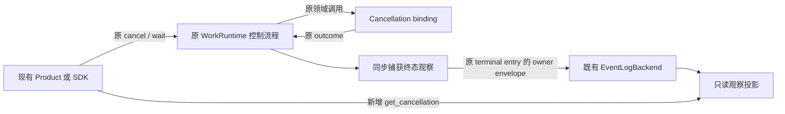

# HW-KD-001：Work 取消结果的记录、查询与回放

## 状态与阶段边界

- Authority: proposed — focused design and candidate observable contract。
- Design status: draft；Implementation status: partial（本地观察切片，未合入）。
- 修订：R4.2，2026-10-25；在 R4.1 上补已复现的 cancellation_not_driven 观察原因。
- Owner：HarnessWork；领域 execution/cancellation binding 与 Product 为参与者。
- Current 基线：`11b854951125d3437fea9f43f65a9788af620933`。
- 方法咨询：本地干净 master `0f9bd3ff51afabeaaf76cc38dff1ceb279b7d37e`。
- 用户在第一阶段交付建议后要求“继续”，本轮按该范围实施观察切片；未据此接受完整 Goal 架构或恢复其他 Goal 开发。重要架构工作件仍保留用户评审。

本阶段仅新增取消观察的记录、查询和回放，承接
[支撑清单](../../goal-method-work/support-capabilities.md) SC-06/08、S4/S6。
遵守 [HarnessWork 架构](../README.md)和[迁移承诺](../migration-ledger.md)。
R3 的 runtime 全局故障隔离、新协调者与 Channel 故障适配不是本阶段前置；这不等于
已解决它们试图处理的风险。旧候选/原始评审保留为历史，不删除原取消/恢复需求。

## 1. 目标、可验证要求与非目标

| ID | 第一阶段要求 | 判断依据 |
| --- | --- | --- |
| CO-01 | 记录 run 终态裁决时已观察到的取消信息 | 明确领域报告、runtime 归约及未知，不能从 cancelled 推断收尾 |
| CO-02 | 正常 append 确认后，查询和日志回放一致 | 使用同一不可变记录，随原 terminal entry 单次写入，不另建日志 |
| CO-03 | 每个已有终态只冻结一份观察，不改变取消控制 | 沿用原驱动、超时、wait/cancel 返回及异常；不承诺所有 waiter 的过程错误一致 |
| CO-04 | 旧日志和未确认结果保守解释 | 旧/不完整为 unknown，坏 v1 明确报错，append 异常不返回伪造观察 |
| CO-05 | 保留兼容和权限边界 | WorkRun/WorkEvent shape、业务 payload、Channel wire 和 facade 兼容 |
| CO-06 | 故障策略有证据、有 owner、有边界 | 不盲目重试，不以实验推出 fsync、自动恢复或强收尾保证 |

适用一个 owner event loop、一个 WorkRuntime writer 及原 Memory/JSONL backend。
本阶段不新增公共 Work 状态、取消协调 task、通用 publication_fault、跨进程租约、
自动 journal 修复/重开重试、运行恢复、全 runtime 取消或 Channel 控制/查询入口。
也不保证外部效果撤销、断电不丢失或所有取消竞态已修复。

## 2. 实验与决策依据

在产品树外，使用基线真实 journal/backend 和 WorkRuntime，注入进程内文件/索引
故障；未改产品代码、未联网。运行时实验按工作区规则在沙箱外执行。

| 实验 | 实际结果 | 可以支持的结论 |
| --- | --- | --- |
| 写前抛错 | 内存与冷读各只有原记录 | 对该注入点可确认没有新增记录；不能将所有 I/O 异常都这样解释 |
| 半条 JSON 后抛错 | 内存仍只有原记录，默认冷读 JournalFileError | 默认严格策略不应被静默放宽；已有 partial_tail=repair 在副本中恢复了原完整前缀 |
| 完整记录关闭后、ACK 前抛错 | 内存 1 条，冷读 2 条且生命周期合法 | 返回异常不证明未写入；冷读在该单 writer、静态文件场景中可识别可见记录 |
| journal 成功、内存索引更新前抛错 | 同上 | 旧内存 query/checkpoint 不能证明物理文件没有该条 |
| 对后两种情况盲目重试相同 entry | 文件变成 3 条，WorkRunReplayError | 不能把参考实现的普通追加重试直接当作严格 Work 日志的安全策略 |
| settled/unsupported/failed，分别并发两次显式 cancel | 每组一次 terminal；有 binding 时只调用一次；终态发布点可读原 outcome | 这几条受控路径已能取到观察，无证据要求第一阶段先重写取消协调 |
| executor 自取消，配置了本会 failed 的 binding | binding 未调用，CancelledError 原参数保留 | 新观察不能为了补数据而新增领域取消副作用 |
| domain 超时后，binding 捕获 task cancellation 并有效返回 settled | terminal 前确有真实报告，但原流程仍 Failed/WorkCancellationTimeoutError | 超时归约与已观察到的领域报告是两个维度，不能抹掉报告或用它覆盖原失败 |

原始 `probe_r4.py`、结果 JSON 与源码哈希在产品 Git 外保留。它们不是产品实现，
也不是 OS 磁盘满、断电、多 writer、所有超时/迟到竞态的证明。尾行修复只作用于副本；
产品 Work backend 默认 JournalLoadPolicy 未变。取消实验用 5 秒作为实验失控保护，
没有将其或历史 30 秒等待上限变为产品合同。

### 失败策略的比较与分期

| 候选 | 可解决的问题与成本 | R4 处置 |
| --- | --- | --- |
| A 只补观察；保留原失败传播，不自动重试 | 最小增量；未知时观察不可用，不能修复旧 writer/控制流程的风险 | 第一阶段选择；不声称获得“未知提交后安全继续”的新保证 |
| B journal owner 停写后冷读、核对，必要时显式修复/恢复索引 | 可处理部分已复现故障；需要单 writer、文件身份、完整 entry 比较及恢复授权合同 | 后续按真实需要设计，优先复用原 journal；不因此自动重放 Work 或外部动作 |
| C run 发布限制或 R3 全 runtime 隔离、清理 | 影响既有执行、API/订阅及 Channel；须有必须停止业务推进的场景驱动 | 不作为第一阶段前置，保留为候选，不以“有未知提交”直接接受 |

局部停写/核对不等于允许同一 journal 的其他 run 无条件继续追加；是否恢复写入由
日志 owner 决定。候选 A 保留现有失败行为，不偷偷把 B 或 C 作为已实现能力。

## 3. 架构协同与职责

| Owner | 继续拥有 | 本阶段增量/禁止事项 |
| --- | --- | --- |
| HarnessWork Runtime | 唯一 Work 生命周期、现有取消驱动及 operation→run 解析 | 捕获并冻结观察；只新增观察发布/查询，不增加协调者或控制策略 |
| Cancellation binding | 当前 invocation/资源的 abort/等待及 outcome | 端口不变；报告范围仍依实际 binding，不泛化为整棵后代或 Session 静止 |
| EventLogBackend / journal | append/query/subscribe、既有耐久/读取/修复策略 | 同一日志内增加 owner envelope；不新增自动重试、fsync 或错误恢复服务 |
| 观察 projector | 只读取消观察 | 复用 run replay 校验；不成为第二个状态机或权威索引 |
| Product / 未来 Goal | 装配、业务验收、当前控制权限 | 消费观察；unknown/异常不能成为重新发送取消、自动恢复或目标完成的依据 |
| Method / Harness / Channel / Work facade | 原有语义、执行底座、协议及兼容 | 无新的反向依赖；旧 work 转发新符号；本阶段无需改 Channel 调用路径 |



父架构的强收尾 Target 不变。Current unsupported 仍可归为 cancelled，现有 Session
adapter 只等 wait_for_idle；本专项不关闭这些差异。这里的 settled 是“binding 在终态
裁决前报告了 settled”，不是 R3 曾提出的“协调者还确认 join 了 execution task”，更不是
外部效果已撤回。R3 从未被接受或实现，没有实际 v1 数据需按旧候选语义迁移。

## 4. 记录形状和版本合同

领域输入仍用 WorkCancellationOutcome；候选新值 WorkCancellationRecord 含
operation_id、run_id、session_id、status、reason_code、reported_status、basis、
observed_sequence 和 source_event_id。Record 不可变，不包含任意 Exception/正文。

| status | 含义 |
| --- | --- |
| not_requested | 当前 owner 未进入取消，或新 terminal 显式记录未进入；不是从 completed 猜测 |
| pending | 活体已有取消过程，但尚无已确认 terminal 观察；不是收尾承诺 |
| settled / unsupported / failed | 原控制流程在 terminal 裁决点的取消归约，同时保留实际报告来源 |
| unknown | 旧格式、不完整历史，或未显式驱动领域取消的 executor 自中断，或已有 binding 尚未被驱动 |

reported_status 只捕获 binding 真正有效返回的三种值；不能用 cancellation_task.result()
直接认定为“领域报告”，因为原 wrapper 会把异常/无效返回合成 failed。应在原 port
返回/异常分支同步捕获来源标签，不增加 await、超时或领域调用。runtime 自身超时等
归约原因也只在原分支做观察标注，不改变原错误优先级。实际选择的 outcome/原因须
一起捕获，不能让另一 waiter 后写的来源标签污染当前 terminal 已选定的归约。
reported_status 的截止点为原 terminal 观察冻结时刻：即使报告是在超时分支的 task
收尾期间才返回，只要此前已实际取得也保留；它不证明按时、正确或完成全部收尾。
本阶段不增加精确时钟或“报告及时性”字段，归约原因和报告分别陈述，不据报告
逆推超时没有发生。观察描述裁决时刻，不是每个
cancel waiter 最终收到的所有异常的汇总；之后的进程内变化不回写已终态 run。

### 唯一物理位置

不改 EventLogEntry 的固定外层字段。operation marker 在
`EventLogEntry.payload._harnesswork.cancellation_observation_version`；terminal 记录在
`EventLogEntry.payload._harnesswork.cancellation`。两者与业务 payload 为兄弟项。

```json
{"entry_type":"operation","sequence":0,"payload":{"kind":"Probe","domain":"example","payload":{},"_harnesswork":{"cancellation_observation_version":1}}}
{"entry_type":"event","sequence":3,"payload":{"kind":"WorkRunCancelled","delivery_hint":"immediate","payload":{},"source_event_ref":null,"_harnesswork":{"cancellation":{"version":1,"status":"unsupported","reason_code":"no_capability","reported_status":null}}}}
```

例子仅省略 entry 的 identity/time，不是完整 fixture；sequence 1/2 的前序事件应存在。
serializer 的 owner metadata 参数由 Runtime 私有路径提供；不能从用户 spec/WorkEventFact
取这个 envelope。业务任意层级同名 key 原样保留，无保留 key 迁移或全量深冻结要求。
WorkEvent shape/payload 不携新元数据，原 Channel wire 不变；raw 日志仍能看到它。

### 解析优先级

先执行原 run replay，身份/顺序/terminal-last 非法仍报原错误。之后：

| 条件 | 结果 |
| --- | --- |
| operation 无 owner key，或合法 owner object 无版本字段 | legacy_unrecorded unknown；不采信 terminal 中孤立的看似 v1 对象 |
| owner key 非 object，或版本非精确正 int（包括 bool） | WorkCancellationReplayError |
| operation 版本 >1 | unsupported_version unknown，不解码其 terminal 对象 |
| operation v1，无 run terminal（operation.kind 与 terminal 同名也仍是 operation） | 独立历史 incomplete_history unknown；当前 owner 可依据活体记录给 pending/not_requested |
| operation v1，有 terminal 但对象缺失/非 object/版本不为精确 int 1 | WorkCancellationReplayError；terminal=2 也属与 op1 不匹配 |
| v1 已知字段/组合不符合下表 | WorkCancellationReplayError，不降级为成功 |

未知附加字段可忽略，getter 只输出白名单；新增 status/reason 枚举需新版本。

| 原流程的终态观察 | status / reason_code / reported_status | run terminal |
| --- | --- | --- |
| 未进入取消 | not_requested / none / null | Completed 或普通 Failed；不得有 Cancelling |
| binding 有效报告 settled / unsupported | 对应 status / domain_reported / 对应实际报告 | Cancelled |
| 显式取消而无 capability | unsupported / no_capability / null | Cancelled |
| binding 有效报告 failed | failed / domain_failure / failed | Failed |
| domain 异常 / 无效返回 | failed / domain_exception 或 invalid_return / null | Failed |
| 原 domain 等待超时，收尾时可能取得有效迟到报告 | failed / domain_timeout / null 或截至冻结点的实际 settled、unsupported、failed | Failed；报告不覆盖原超时与异常 |
| 原 execution 等待超时成为终态归约原因 | failed / execution_timeout / 先前有效报告或 null | Failed |
| 无显式取消的 executor 自中断 | unknown / executor_interrupted / null | Cancelled；不新增 binding 调用，保留原异常 |
| 已显式请求，binding 存在但原流程在创建 cancellation task 前中断 | unknown / cancellation_not_driven / null | Cancelled；原 unsupported 归约不变，不能称为 no_capability |

除第一行外须有 Cancelling。最后一行来自实施反例：Cancelling entry 写入后 append 抛错，cancel 尚未创建领域
task；原 executor 随后返回，旧流程仍可追加 Cancelled。warm 观察不可用，停止后
合法冷读应为 unknown，而不是误称没有 binding。写前失败造成的无 Cancelling
历史仍按原 lifecycle replay 拒绝。该枚举在首次交付前纳入尚未发布的 v1；R4.1
快照不改写，不声称兼容已部署的旧候选数据。

以上记录均是原流程已确定的终态事实；不能为凑合法
组合改变原取消行为。若某个既有路径不能由这些组合诚实表达，须先报告反例并调整
本候选/另开控制设计，不能合成成功或悄悄加入协调重构。历史基线实验只覆盖有限示例；新增实现的实测范围见
[实施记录](cancellation-observation-implementation.md)，不能从有限样本推出全量竞态兼容。

## 5. 发布与查询：只确认观察，不替换控制

1. 在原 terminal 裁决点、现有 outcome 归约完成后，以不含 await 的代码复制观察。
   只加来源标签与 immutable snapshot；原 cancellation_task、超时、wait/cancel 行为不变。
2. 观察写入**同一条** terminal entry；成功 append 返回后才把观察记为 committed。
   不提前发布“已记录”消息，不另写一个 result journal，也不在终态后补事件。
3. terminal listener 通知前，先提交原 terminal flag 和 committed 观察，使重入 getter
   能看到同一结果，且 context.publish 不能在 terminal 后再追加。这是原 Runtime 的
   发布顺序修正，不引入取消协调 task 或新的公共 Work 状态。
4. 新 getter 不能仅依据 WorkRun.status 或可变 _RunState.cancellation_outcome 给出最终
   结果。历史用原日志；活体终态用已确认的不可变观察，未确认不能伪装为 committed。

候选 API：`WorkRuntime.get_cancellation(run_id) -> WorkCancellationRecord`；
`project_work_cancellations(entries) -> tuple[WorkCancellationRecord, ...]` 按 operation
首次出现顺序返回，输入须是从各 operation 起完整的单 writer 历史。它复用 run replay
和同一解码器。terminal 的 basis=journal、source_event_id/sequence 指原终态；live 的
pending/not_requested 标 basis=live，不能冒充持久结果。未知 run 仍报 UnknownWorkRunError。
operation→run 继续用原解析，不新建权威映射。

### 每个 Record 的依据字段

以下 sequence 均为**该 run** 的已读/已确认最后一条 entry.sequence，不是全 journal
的 EventPosition.offset，也不使用另一 run 的末事件。先以 operation 建立身份、验证
该 run 的完整前缀，再构造记录；operation-only 的合法截点为 0、event_id=null。

| 构造情形 | basis / reason | observed_sequence / source_event_id / reported_status |
| --- | --- | --- |
| 支持 v1 的合法 run terminal（包括 executor_interrupted unknown） | journal / terminal 中的原因 | 指向该 terminal 的 sequence/event_id；report 取该不可变记录 |
| legacy_unrecorded、unsupported_version 或 incomplete_history unknown，无论有无旧 terminal | journal / 对应 unknown 原因 | 该 run 已校验历史最后一条的 sequence/event_id；report=null。此来源只说明读取截点，不证明取消结果 |
| 当前 owner 的 live pending | live / in_progress | 该 run 最近成功 append 的 sequence/event_id；report=null，表示尚未公开终态观察，不表示 port 尚未报告 |
| 当前 owner 的 live not_requested | live / none | 同上；只有 operation 时为 0/null，report=null |

Runtime 在 backend.append 成功返回后、listener 通知前更新这个逐 run 确认截点；
不能使用 append 前先递增但尚未确认的内存 sequence。任一 append 抛错时走 §6 的
观察不可用，不返回一个猜测截点。run A 只有 operation 而 B 已完成时，A 仍是 0/null。
无 operation 的片段不是 unknown，应按原 replay 拒绝。

相同完整历史在独立 projector 与 Runtime 的历史读取模式生成相同 Record；当前
owner 附带的 live pending/not_requested 是额外运行期事实，与离线 unknown 的 basis
有意不同。任一结果只是当次快照，不保证读取后没有新追加，不授予历史控制权限。

健康路径 cancel/wait 仍只控制本实例 _states；历史 run 可读不意味着可取消。
本实例持有的终态才适用 cancel 原样返回。旧控制方法不会因新增 getter 获得更多权限。

## 6. append 异常与后续恢复的边界

第一阶段没有 R3 的 WorkPublicationError、全 runtime API fence、自动 cancel/cleanup，
也不为查询功能重写原错误传播。为了避免新 getter 伪造观察，原 Runtime 的**所有**
backend append（operation/domain fact/全部 lifecycle）一旦抛错，只增加观察不可用标记，
随后原异常原样传播。这个标记不是写入隔离，不能被描述为已经停写或停止了执行。

- 新 get_cancellation 看到该标记，报 WorkCancellationObservationUnavailable，固定说明
  “取消观察暂不可确认。”；不暴露异常 cause，不返回基于内存猜出的成功。独立的
  日志 projector 仍可对已停止写入后的冷读结果做校验。
- 原 accept/cancel/wait/get_run/active_runs/订阅/dispose 和 Channel adapter 行为不改。
  它们目前不具备 R3 拟议的全面故障隔离；旧控制接口返回值不升级为新的持久确认。
- 原流程在未知提交后是否还会写入、是否出现错误终态等风险仍须明确保留；本阶段
  不宣称修复它们，也不提供安全自动重试。调用方不能把旧内存 query 的缺条目当成
  “可安全重发”的证据。
- 纯本地预校验错误、尚未调用 backend.append 时，可按原输入错误处理；进入 backend
  后不能用异常类型猜测未写入。读到半行按原 JournalLoadPolicy 报错，不静默 repair。
- 不从本阶段的观测标记自动清除/恢复写入。后续候选 B 必须先停止相应 journal 的
  writer、核实实际文件及完整 entry 内容；索引可落后，不能单看 cached query。
- 原实验的“显式 repair 后重写成功”不证明真实恢复可无条件重放，更不能据此重新
  运行 Work、领域取消或外部工具。恢复权限、文件身份和幂等合同另行接受。

因此，第一阶段正常提交的一致性可验证；异常时明确“本观察不能确认”，而不是
承诺运行已隔离。若实际消费者要求“无日志确认就必须停止全部业务动作”，应提供
具体场景评审 B/C 或控制合同，不把它藏在本阶段实现里。

## 7. 兼容、接受与实施验证

| 范围 | 本阶段承诺 |
| --- | --- |
| 原控制/执行/异常 | 不新建 coordinator，不改触发/超时/返回规则；自取消不新调用 binding |
| WorkRun / WorkEvent / Channel | shape/payload/wire 维持；新增 journal owner envelope 不进入 WorkEvent 转发 |
| 旧日志→新 reader | 无版本/记录为 unknown；不重写或猜 not_requested |
| 新日志→旧 reader | 只加 owner payload 字段，原外层/kind/状态不变；需真实旧 reader golden 验证 |
| 新旧 writer | 不自动恢复旧 run，不混用 writer；已有日志原耐久性不因字段增加升级 |
| 根包与 work facade | 新 record/projector/可选 query port 按原转发规则导出，原符号身份保持 |
| accepted Target | 强收尾、完整恢复及已知 Current 差异不关闭；本专项仍为候选 |

R4.1 已完成三视角设计复核。本轮实施中发现的 R4.2 增量和实际实现接受受影响
三视角复核；这不等于完整 Goal 架构已接受。R3 的全部运行控制改造不进入开发清单。

| 验证 | 第一阶段验证要求（执行证据另列） |
| --- | --- |
| V1 原取消四路径及正常完成 | 对照原测试保留状态/异常/调用次数；观察区分报告、归约和自中断未知 |
| V2 领域异常、无效返回、两类超时、迟到与并发 | 来源标签真实；domain_timeout 后真实 settled/unsupported/failed 与无报告 null 都可表示；保留原 Failed/超时异常，不让另一个 waiter 标签或冻结后变化改写记录 |
| V3 listener 重入与 terminal-last | append ACK 后再公开观察，terminal flag 先于 terminal 通知，无终态后补写 |
| V4 版本/允许元组/坏日志 | 按 §4 正反断言；operation-only、Started/Cancelling 中断、legacy/future 未终态、多 run 交错的依据字段明确；未来版本 unknown，坏 v1 报错 |
| V5 全 append 异常与查询 | 观察标记覆盖 operation/domain/lifecycle；原异常传播，新 getter 报不可确认，不虚构停写/收尾 |
| V6 旧 reader、facade、mutable 业务 map、Channel | owner envelope 不被业务注入；旧行为不靠新增协调/故障 API 才成立 |
| V7 日志实验复核 | 保存注入位置/源哈希；不把副本修复或示例通过当作生产恢复保证 |

§2 是此前基线隔离实验；本轮新增实现、实际检查和局限另列于[实施记录](cancellation-observation-implementation.md)，未扩展 CI 门禁。
验证 owner 为 HarnessWork；原 binding 报告范围由领域 owner 核实。后续恢复/控制
增强另有明确驱动和专项，不预建全局服务。

## 8. Current 证据与评审记录

- [WorkRuntime](../../../../../src/loushang/harnesswork/runtime.py)：原取消、终态和 append 调用点。
- [类型](../../../../../src/loushang/harnesswork/types.py)、[端口](../../../../../src/loushang/harnesswork/ports.py)。
- [backend](../../../../../src/loushang/harnesswork/event_log.py)、[run replay](../../../../../src/loushang/harnesswork/run_projection.py)。
- [journal](../../../../../src/loushang/harness/journal/jsonl.py)、[策略](../../../../../src/loushang/harness/journal/types.py)。
- [原取消测试](../../../../../tests/work/test_runtime.py)、[原 journal 测试](../../../../../tests/harness/journal/test_jsonl.py)：本轮未跑 pytest，实验直接调用基线实现。

固定快照、实验与三视角处置见[专项评审记录](cancellation-observation-review.md)。
完整 Goal 架构的用户接受未发生；本地观察切片实施不扩大为 Goal 主体开发授权。
