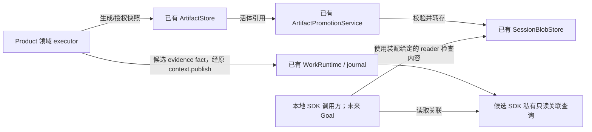
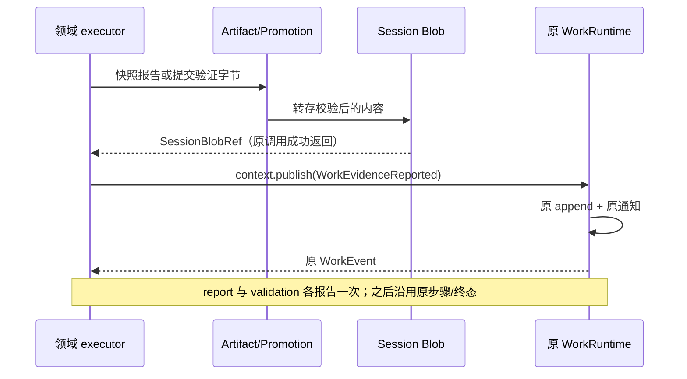

# HW-KD-002：Work 产物证据的交接与读取

## 状态与范围

- Authority: proposed — focused design and candidate integration contract。
- Design status: draft；Implementation status: not-started。
- 修订：R2.2，2026-10-25；Owner：HarnessWork 中立引用合同；Product 领域适配与 Harness Artifact 为协作者。
- Current 基线：`372cde4ade0fe026076c8fa5e8b4486774b09cc3`，已包含取消观察交付。
- 方法：本地干净 archmethod master `0f9bd3ff51afabeaaf76cc38dff1ceb279b7d37e`。
- 用户要求继续上一答的专项设计、三视角及用户评审流程；本轮不实现新产品功能。

承接[支撑清单](../../goal-method-work/support-capabilities.md) SC-06/11、S5；遵守
[HarnessWork owner 边界](../README.md)及[兼容承诺](../migration-ledger.md)。
本专项先选择本地 SDK 装配、一个明确的 Session Blob authority 和单 writer Work 日志。
它不依赖 Goal 存储格式、规划器或入口设计已经接受。
单 writer 是 Product 装配/使用前提，不是 backend 强制保证：现有 Work JSONL 使用
locking=False，没有拒绝第二个进程的 writer lease。Product 对每个日志路径只绑定
一个写入 owner；无法排除并发 writer 的场景不受本专项支持，不据此前提新增锁服务。

## 1. 场景与可验证要求

一次 Work 的 report 步骤生成报告，validation 步骤验证该报告并生成结果。领域适配
将报告和结果保存为持久 Blob，再发布关联事实；清理临时 run、重开日志与 Blob store
后，调用方能找到两份证据并重新检查内容。验证结果的内容应说明所验证的报告摘要。
如何解释 passed、覆盖哪些业务要求，仍由领域/未来 Goal 决定。

| ID | 本阶段要求 | 边界 |
| --- | --- | --- |
| EH-01 | 证据绑定到确切 Work 运行与日志位置 | operation/run/session/sequence 来自 Work entry envelope，不采信 payload 中的自报运行身份 |
| EH-02 | 复用现有内容版本与寿命转换 | 只采用 SessionBlobRef；临时 RunArtifactRef 先经已有 promotion，不把本地路径当持久引用 |
| EH-03 | 历史关联与当前可读性分开 | projector 无文件 I/O；实际可读性复用受授权 SessionBlobStore 的完整 inspect/read_bytes |
| EH-04 | 完整、缺失、损坏和忙碌分别处理 | 沿用 available/missing/corrupt；BlockingIOError 原样交调用方，不据忙碌判损坏 |
| EH-05 | 不重复建设执行或存储 | 复用 WorkEventFact、原 journal 和现有 Blob；不加 WorkRuntime 协调、第二索引或原始字节日志 |
| EH-06 | 标准路径显式加入 | 先交付一个真实 SDK 领域装配；旧 Work、Method 及无产物路径继续使用，不假设所有工具自动产证据 |
| EH-07 | 不把证据可用当作目标完成 | 快照可读、当前代码适用、测试通过、要求满足和用户批准是不同判断 |

不在本阶段新增统一产物管理、文件变化监听、验收引擎、Goal 自动推进、通用迁移或
跨存储事务；不修改队列、权限体系、取消驱动、CI 门禁及 Transcript bundle 格式。

## 2. Current：已存在什么，实际缺什么

| 事实 | 已定位的现有 owner | 本专项复用方式 |
| --- | --- | --- |
| RunArtifactRef 是 Harness ArtifactRef 的别名，有摘要、大小、媒体类型；store read 校验对象身份与摘要 | [store](../../../../../src/loushang/harness/artifacts/store.py)、[references](../../../../../src/loushang/harness/artifacts/references.py) | 活体快照来源；不能通过重新构造同值 ref 获得原 store 的读权限 |
| RunLease.close 清理临时 run；ArtifactStore 不提供通用冷启动重建接口 | [RunLease](../../../../../src/loushang/foundation/runtime_scope.py) | 不能把 run-local manifest 当持久证据仓库 |
| promotion 已校验临时内容并复制为 SessionBlobRef；持久 store 支持重开、摘要核验及健康检查 | [promotion](../../../../../src/loushang/harness/artifacts/promotion.py)、[SessionBlobStore](../../../../../src/loushang/harness/artifacts/session_blobs.py) | 原样复用，不再设计新转存、摘要算法、路径布局或健康状态机 |
| Work 有另一种同名 ArtifactRef，主要是描述字段；标准 runtime/projector 未实现产物交接 | [Work types](../../../../../src/loushang/harnesswork/types.py)、[runtime](../../../../../src/loushang/harnesswork/runtime.py) | 不与 Harness ref 强制合并，也不把预留字段当作已实现能力 |
| WorkStepDeviation.evidence_refs 已有字符串字段、plan projection 反序列化及步骤 deviation/metadata 投影；所查 Work/Method/Coding 标准路径无其生产者，亦未建立到 Blob 的解析合同 | [Work types](../../../../../src/loushang/harnesswork/types.py)、[plan projection](../../../../../src/loushang/harnesswork/plan_projection.py) | 保留偏离说明到证据的旧关联边，不把它误称为已实现的持久 Blob 交接；与新报告并存，口径见 §4 |
| executor 可发布自定义事实，Work 提供运行身份、顺序、日志和订阅 | [ports](../../../../../src/loushang/harnesswork/ports.py)、[event log](../../../../../src/loushang/harnesswork/event_log.py) | 关联使用普通领域事实，不新增生命周期事件或执行端口 |
| Transcript 会收集指定消息/命令中的 Blob；bundle/clone 只处理其识别的引用 | [Session artifact integration](../../../../../src/loushang/harness/transcript/session_artifacts.py)、[bundle](../../../../../src/loushang/harness/transcript/export/bundle.py) | 不能声称新增 Work 日志引用会自动进入 Transcript 导出/克隆 |

实际缺口是明确的领域交接格式、解码/关联视图和一个调用既有能力的装配场景，
不是 Artifact/Blob 持久化、校验或重开能力缺失。上述 Current 为静态核查；§7 另列实测。

## 3. 职责与组件交互

| Owner / 组件 | 继续拥有 | 候选增量 |
| --- | --- | --- |
| Product 领域 executor/适配器 | 产物生成、验证语义、失败策略和资源绑定 | 快照/转存、核对本次 Session authority、发布证据报告；不替 Work 发终态 |
| Harness Artifact / SessionBlobStore | 字节、摘要、物理位置、配额、读权限、寿命与删除 | 无新存储机制；按原 capability 装配 |
| HarnessWork kernel | 唯一 operation/run 生命周期、顺序和 journal | 本阶段候选不改 runtime 或 WorkExecutionContext；接收既有 WorkEventFact |
| HarnessWork 合同维护者 | 中立 artifact/evidence refs 与运行关联边界 | 维护候选关联合同；不把领域 role 或产物含义收入 core，不因本场景直接新增公共 API |
| Product / SDK 私有证据集成 | 尚未实现的具体交接与消费 | 先以私有编解码/查询接入真实任务；复用原 run replay，不拥有字节或新的执行状态 |
| Method / 未来 Goal / UI | 方法要求、目标要求及验收或呈现 | 引用事件和 Blob；不由 role、completed 或 available 自动判目标完成 |



reader 由 Product 根据已选 workspace 和 Session 装配，不能根据日志里的路径、URL 或
外来 session id 临时选择任意仓库。Work 内只保存引用，不镜像 Blob manifest。
`WorkOperation.session_id` 是逻辑会话身份；Blob authority 必须通过现有
`session_blob_authority_id` 映射比较，不能直接比较 legacy logical id 与物理键。
仅本候选的标准 adapter/projector 拒绝没有非空逻辑 Session 的证据报告，不为匿名
Work 自动创建 authority；原 WorkRuntime 受理匿名 Work 的行为不变。
Product composition owner 同时负责 Work 日志、listener/subscriber 的读取范围和 Blob
reader 的装配授权；有权读取日志就能看到其中完整引用元数据，不等于获得任意 Blob
authority 的读权。新 projector 不成为访问控制代理，也不替既有权限 owner 降权或提权。

该分工遵守[Current owner map](../../harness/current-owner-map.md)的 Product-owned
exclusions：role/report/validation 的词义、产物用途及最终验收仍由 Product 定义。
共享中立引用关联不等于共享领域词汇；尚无多 Product 使用依据时，不提前提升公共
core 编解码/查询服务。若将来共享，需按原边界规则提供多个真实 Product 的依据或
另行接受边界记录，不能把两个样例当成两个 Product。



## 4. 候选数据与查询合同

候选 kind 为 `WorkEvidenceReported`，是领域报告而非 kernel 担保或保留生命周期。
标准路径显式采用该 kind；现有任意领域事实仍可发布，不能通过新增查询扩大控制权限。
其 WorkEvent.payload 只增加一个嵌套 evidence 对象，避免顶层 step_id/plan_id 意外影响
既有 run 与 plan projection。operation 与事件同名也不能把 operation 解码成证据。

本协议 v1 的 **WorkEvent.payload 顶层键必须精确为 `{evidence}`**。私有 helper 从
参数新建该对象，不平铺 evidence、不合并用户字典或 context.step_payload；标准
adapter 在 publish 前拒绝额外顶层键，不静默剥离。新查询在原 lifecycle replay 后，
对已识别 v1 也执行同一形状校验，违规报 EvidenceReplayError，不返回成功记录。
该限制只属于本协议，不为所有领域事实增加 kernel 保留键或新的发布准入。

需特别核对的既有投影读取键为 plan_id、step_id、method_id、error、deviation、
step_index、audit_policy、planned_constraint、plan_facts、step_facts、step_title。
run projection 会读取其中前三个；plan projection 还读取其余字段。这些顶层键
可能污染只读的步骤/计划元数据，但不能改掉 entry envelope 的 run_id/operation_id。
绕过标准 adapter 直接发布任意 fact 仍可能污染原通用投影；本专项没有修复该既有
行为，也不把新查询的报错说成旧 reader 已获得防护。

```json
{"evidence":{"version":1,"role":"report","reported_step_id":"report","blob":{"sessionId":"session-1","blobId":"<sha256>","logicalName":"report.json","kind":"report","mediaType":"application/json","disclosure":"private","sizeBytes":13,"sha256":"<sha256>","createdAt":1.0,"source":"run-artifact:<id>"}}}
```

这是省略真实摘要的形状示意，不是可直接解码 fixture。Blob 使用现有 manifest
编码，保留已保存的完整元数据；不能删改 source/时间等字段后假装仍是 store 拥有的同一引用。
这些描述字段不携带存储 root，但 source/logicalName 是调用方提供的标签，不声称其
绝不包含敏感内容。采用本格式的事实会经现有 Work listener、raw query、subscription
原样可见；private 是原 Blob 的披露标签，不会自动脱敏这些元数据。第一阶段仅限
有权读取本地日志/Session 的 SDK，不默认把此装配用于远程 Product 或新增远程展示。

候选私有纯函数的表达为 `work_evidence_fact(blob, role, reported_step_id=None) -> WorkEventFact`，
名称用于说明机制，不是本轮拟发布的 root/facade API。
它编码格式，不自行读取文件、转存、检查业务结论或证明 producer 持有 Blob。
领域适配必须先完成实际读取/转存，并核对 operation Session 与目标 authority。
Product adapter 对步骤自报值负责：临近发布时直接读取当前 WorkExecutionContext.step_id，
不用用户 payload、此前缓存值或最终 WorkRun.current_step_id 代替。纯编码函数仍不是
kernel 校验器；即使同样取值，publish 也没有校验它，不能据此提升为强步骤归属证明。

候选私有查询表达为 `project_work_evidence(entries) -> tuple[WorkEvidenceRecord, ...]`。
Record 含 envelope 的 operation_id/run_id/session_id/sequence/event_id，以及 role、
reported_step_id、SessionBlobRef。记录身份使用 `(run_id, sequence)`；event_id 用于
追踪，不假定原 replay 已校验所有历史 event_id 的全局唯一性。不给证据再造一套主键。

| 字段/条件 | 解码规则 |
| --- | --- |
| 输入 | 从 operation 起的完整单 writer 历史快照；先调用原 project_work_runs 校验身份/顺序/终态后无事件，再解码选中的 event entry |
| 结构与字段存在性 | payload.evidence 必须是 object。先识别 version；v1 的 version/role/reported_step_id/blob 四个键全部必需。reported_step_id 可显式 null，缺键不等同 null，按坏 v1 报错 |
| v1 事实载荷顶层 | WorkEvent.payload 只能含 evidence，额外顶层键一律拒绝；evidence 内部扩展规则不放宽本条，EventLogEntry 的外层元数据不受此规则替换 |
| 无标准事件 | 空 tuple 只表示“未记录本合同的证据报告”；不证明没有产物、无需验收或目标完成 |
| version | 精确正整数，bool 不接受；1 按本表，未来版本抛专用 UnsupportedVersion，坏已知版抛 EvidenceReplayError；不自动降级为空或成功 |
| role | 非空、至多 128 字符、无控制字符的领域标签；report/validation 是本场景约定，不自动触发验收逻辑 |
| reported_step_id | null 或非空 str；只是领域从当前 context 取得的步骤报告，不是 kernel 验证过的执行归属证明 |
| blob | 复用 SessionBlobRef.from_manifest_entry 的严格字段/类型/摘要合同；其 session_id 必须等于事件逻辑 Session 的现有 authority 映射 |
| 扩展与来源 | evidence 附加字段可忽略，输出只取白名单；blob 嵌套对象仍按已有严格解码，不把外层宽容错误扩展到嵌套格式 |
| 输出顺序 | 按输入事件顺序；同一 Blob 多次报告保留各自位置、角色与运行关联，不按摘要覆盖事实 |

旧第三方可能使用同名领域 kind；源码零命中不证明生态零冲突。新的 projector 是
显式调用，不装入 Runtime 启动或通用 run 查询；不符合本合同的同名数据只让新的
查询明确失败，不使旧日志加载、执行或一般查询失效。协议命名需在实施评审再核对。

不为获得“更强 step 归属”偷偷改发布端口或复制步骤状态机。将来若验收必须依靠
kernel step 证明，应按真实使用场景独立接受 owner metadata/端口合同；目前只保证
Work envelope 的运行关联，并诚实标明 reported_step_id 的证据等级。
Goal 验收禁止单独依赖 reported_step_id，也不能用通用投影的 current_step_id 替它
背书。要求覆盖由 Goal/Method 要求侧绑定到已受理的工作批次；证据通过运行引用及
领域内容验证支持该要求。若某项验收必须证明实际步骤归属，而现有证据不足，应
保留缺项/请求判断或另补合同，不能把字段同名相等自动当作要求已满足。

### 与既有 deviation.evidence_refs 的关系

两者并存，职责不同：WorkEvidenceReported 报告“此运行的此日志位置提供一份具体
持久内容引用”；WorkStepDeviation.evidence_refs 表达“此偏离说明引用哪些支持材料”。
旧字符串没有全局 URI/Blob 格式，不能按路径、摘要或同名字串猜测并读取内容。

消费偏离或要求覆盖的 Product/未来 Goal 同时读取原偏离投影和新报告，不静默忽略
旧 evidence_refs。确需把旧引用解析到新报告时，由该 Product 的显式私有绑定解析到
既有 `(run_id, sequence)` 及受授权 Blob；没有映射的字符串保留为 unresolved 支持
材料，不能把“未解析”当作“无材料”或“已验证”。这里不假定已有通用 resolver。

同一材料被新报告和偏离说明同时引用时，保留两处用途/来源，但不因此重复生成
报告事件或计为两份独立证明；验收依据要求和具体材料关系，不按引用条数计分。
同 Blob 的不同报告仍保留原事实，完整 ref 归属照常核对；本阶段不迁移旧字符串、
不改 WorkStepDeviation 类型，也不新建全局证据登记/去重服务。

## 5. 可读性、寿命与部分失败

投影只返回历史报告。当前 owner 通过装配的 SessionBlobStore.inspect 或 read_bytes
校验原引用；inspect_metadata 仅是预览，不能作为“摘要验证通过”的证据。
SessionBlobHealth 是当次观测，不回写 Work terminal，不缓存成永久 available。
初始化 store 时发生 manifest/IO 错误，以及 inspect 时的 BlockingIOError，继续作为
原错误返回；调用方不能把查询失败伪装成无证据、missing 或成功。
原 store 的默认 authority 锁可能阻塞等待；本合同仅说明实际抛出 BlockingIOError
时如何传播，不承诺锁竞争立即返回 busy 或有固定延迟。首个消费场景若要求有界
响应，须在原 store/Product 调用边界明确其策略，不在这里默加超时或取消机制。

| 场景 | 结果与责任 |
| --- | --- |
| 活体 run 清理 | 先转存再关联；Session 字节仍由原持久 owner 保存，不依赖原 ArtifactStore 对象继续存在 |
| 工作区文件后来改变 | 已保存快照仍可 available；不自动证明报告或测试适用于最新工作区。领域验证结果应绑定其验证的报告摘要；Goal 将来判断适用性 |
| Blob 对象丢失/被改写 | 沿用 inspect 的 missing/corrupt；报告仍存在。不能因此重跑 Work 或自动删除别的引用 |
| 转存失败 | 本场景证据为必需，原异常传播，原 executor/Work 失败规则处理；不发伪造关联。其他领域可选择证据可选，但不能冒称满足本场景 |
| report 成功后 validation 转存超出配额 | 保留已存/已报告的 report；沿用原 quota 异常及 Work failed，不捏造 validation 记录，不删除 report 或自动扩大配额 |
| Blob 成功，fact append 失败 | 字节可能已保存，事件可能没有/已写但未 ACK；保留字节，不盲重发、不跨 store 回滚/删除共享摘要对象，沿用原异常与日志策略 |
| 只完成 report，验证失败或 run 取消 | 已报告的证据仍可读，运行仍 failed/cancelled；不把部分证据组合成通过，也不追加终态后事件 |
| Session 删除、换 workspace 或只导出 Transcript | 不承诺引用持续有效。现有删除可使源 Blob 丢失；新 Work 关联不自动进入 bundle/clone，也不按路径回退查找其他 authority |

Session Blob 配额和原 journal 耐久性原样保留。字节先于日志可能留下无 Work 关联的
Blob，按现有 Session 生命周期/配额处理；不自动提高配额或新增 GC 服务。共享摘要
内容不意味着所有 metadata 引用等价，不用另一份同摘要 ref 绕过 manifest 归属检查。
持久归属按 SessionBlobRef 的完整字段值相等判定，包括 created_at/source，没有
近似时间容差。复用现有 manifest 编解码并保留其数值，不重算时间或规范化标签；
真正改变一个可表示浮点单位的时间值，也不是原 ref。不能因摘要相同就放宽比较。
日志可见不等于断电耐久；使用缓存 query 也不能证明未知 append 未写入。核对持久
历史须由 Product 确认该路径的写入 owner 均已停止，再按原日志策略冷读；不能把
没有锁冲突当成已排除其他 writer。多个 writer 可能产生重复/交错及各自缓存分歧，
原 replay 能拒绝部分非法历史，但不能保证检测所有并发写入。本专项不重开写入
或恢复外部动作，也不宣称具备多 writer 检测/隔离机制。

是否应有证据由要求侧提供，不能从空 tuple 或 completed 反推可选。Goal/Method 与
领域消费 owner 在本批工作受理前明确需要哪些材料、支持哪些要求和缺失时的处理；
这些期望的表示随计划准入/验收合同另行设计，不把预留 expected_artifacts 字段当作
已强制执行。本场景明确要求 report 与 validation；其他领域的可选策略不能在失败
后把原本必需的证据改为可选，相关补充责任也列入 Goal 决策提纲。

## 6. 取舍、兼容与实施切片

| 选项 | 判断 |
| --- | --- |
| 沿用 run-local ref/工作区路径，Goal 自己找文件 | 不选：寿命与 authority 不符，重开无法靠原对象证明身份 |
| 新产物仓库、全局索引或强事务服务 | 不选：已有转存/持久校验足够，缺少额外成本的场景依据 |
| 原 Blob + 显式领域 fact + Product/SDK 私有查询 | 本轮选择的候选：先解决真实 SDK 消费，执行/字节 owner 不变；承认步骤为领域报告、Session 范围和两次写的失败边界 |
| 直接发布通用 codec/projector 和 facade API | 暂不选择：底座能组合不证明共享 API 有真实复用需求；有多个实际 Product 或明确接受的边界依据后再提升 |

实施建议先确定一个真实 SDK 消费任务：调用方需要从本次 Work 找到报告及验证结果，
读取两者并识别缺失/损坏，而不是只证明可以追加一条通用事件。在这一处集成中，
确有必要才增加私有编解码/查询；不因完成本设计就必须新增产品模块或公共 facade。
本轮实验尚不是已接入生产 Product 的证明。先通过本场景，不先改全体
工具、SessionTurnExecutor、Channel 或 Method compiler，也不填充所有预留验收字段。
首个消费任务由具体 Product composition owner 选择并负责：实施前说明真实调用方、
原输入/执行入口、有权 reader/subscriber、材料要求及成功/缺失/损坏判据；HarnessWork
owner 核对引用和运行边界。私有代码可位于该 Product 的适配器；同时依赖领域与 Work
类型时遵守该 Product 的 integrations.harnesswork 边界，示例放对应 Product 的 examples。
确切路径随消费任务选定，不把领域适配放进 harnesswork core，也不增加到 legacy work、
Channel 或 Product 的反向依赖；没有具体消费任务时只保留实验，不强行增加产品模块。
不为可逆 example 脚本新增单元测试；必要合同验证放在真实生产 helper/projector 的测试。

旧 reader 应仍按原 Work 事件结构处理新增领域 kind；新标准查询对无事实的旧日志
返回空，对坏标准格式明确报错。旧 WorkRun/WorkEvent shape 与 Blob wire schema
不变；采用本协议的调用方会多收到一种领域事件，不能声称事件流完全没有变化。
Transcript 旧 bundle/clone 的既有路径继续保留；新增 Work 证据的跨 workspace 迁移
另有明确需求时再设计，不能宣称本阶段已支持 Goal/Work 的便携恢复。

## 7. 当前实验与计划验证

产品树外 `probe_existing_handoff.py` 使用真实基线 WorkRuntime、两步执行、
ArtifactStore.snapshot_file/put_bytes、promotion、JSONL 和 SessionBlobStore；未改产品。
实际结果：2 份引用重开可读，run-local 清理后仍可读；源文件修改不影响已保存快照；
篡改为 corrupt、删除为 missing；外 Session ref 未被接受为 available。
另注入 evidence append 写前/写后抛错：原 OSError 身份保留，冷读分别 0/1 条报告，
Blob 均保留且没有自动重试。这是既有能力组合实验，不是候选 codec/projector 已实现。

| 验证 | 实施时应有的断言（尚未执行新产品测试） |
| --- | --- |
| EV1 正常与重开 | 真实报告→验证→转存→关联；重开关联和原字节；验证结果引用正确报告摘要 |
| EV2 身份与边界 | legacy logical Session 映射、空/外 Session 拒绝、多 run 真正交错；adapter 直接取当前 context.step_id，不因错误自报或投影 current_step_id 就判要求满足 |
| EV3 坏格式与兼容 | op 同名不解码；version bool/未知版本/坏 blob/evidence 内扩展/重复内容；v1 顶层额外键含全部 11 个投影读取键及展平情况在标准 adapter 发布前拒绝，新查询也拒绝坏记录；必需键/null/空 str/错误类型/round-trip；原 lifecycle 错误优先，旧 reader/facade 保持 |
| EV4 寿命和健康 | run 关闭、同摘要不同 metadata、manifest round-trip、真实相邻浮点值及 source 变化被拒绝、源文件变化、Blob 缺失/损坏、busy/初始化失败；预览不能代替摘要验证 |
| EV5 部分失败 | 证据必需的领域失败、report 成功后 validation promotion 配额耗尽、两阶段 append 故障、取消/部分报告；不越过 terminal-last、不盲重试、不删共享 Blob |
| EV6 既有路径 | 原 Method/Work、无标准证据、Transcript bundle/clone 保持；不把新 Work 关联冒充已便携导出 |
| EV7 偏离材料并存 | 旧 deviation.evidence_refs 原样投影；与新报告同时出现或指向同一材料时保留用途、不重复登记/计为独立证明；未知字符串不猜路径/摘要，明确 unresolved；空报告不能反推领域无需证据 |

本地实验无网络/模型，按规则从首次就在沙箱外运行；未验证断电、多 writer 或 hosted
入口。三视角评审针对固定修订，用户评审前不把候选合同记为 accepted 或开始实现。
源码、脚本哈希和实验结果保存在产品 Git 外；汇总见[专项评审记录](evidence-handoff-review.md)。
