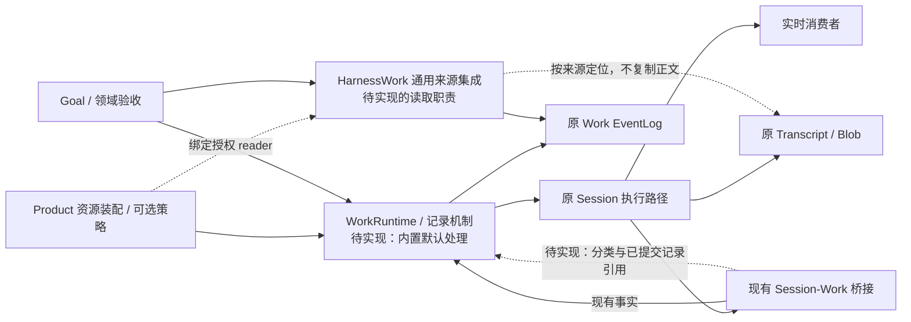
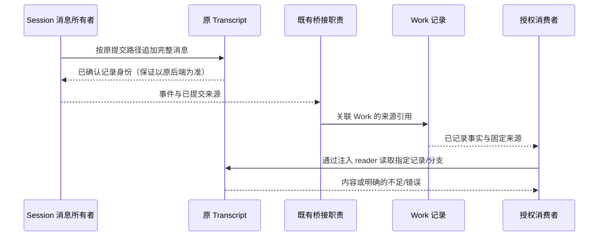

# HW-KD-003：Work 事实留存、重放与 Transcript 共享合同

## 状态与范围

- Authority: normative — focused design；Design status: accepted；Implementation status: partial。
- 修订：R3.1，2026-10-28。Owner：HarnessWork 事实合同；共同父级 Loushang architecture 协调 Harness、Coding/Product 与 Goal 的义务。
- Current 基线：本地 main `5eadeb91ccee4e69618d99cf531f94739c76a453`。§2 保留该基线的盘点；2026-10-29 第一切片已实现默认记录合同及确认查询，来源交接仍未实现，见 §11。
- 方法咨询：本地干净 archmethod master `0f9bd3ff51afabeaaf76cc38dff1ceb279b7d37e`。本文不复制方法规范。
- 共同父级决定：[ARD-019](../../decisions/accepted/ARD-019-work-facts-and-transcript-sharing.md)。继承 [HarnessWork](../README.md)、[Harness owner map](../../harness/current-owner-map.md)、[Goal 组件](../goal/README.md)、[证据交接](evidence-handoff.md)与[升级兼容](../../decisions/accepted/ARD-008-workspace-upgrade-compatibility.md)的既有边界。
- 用户于 2026-10-29 回复“可以，需要更新文档吗？”，接受已评审 R3.1 的架构语义及所列实施前条件。接受范围与证据见 ARD-019 的接受记录；接受登记后用户授权继续实施；第一切片及验证见[实施记录](../../../plans/2026-10-29-work-recording-defaults.md)，尚未合入 main。

## 1. 需求与非目标

用户提出 Work 可带参数选择审计、保存和事实重放，并要求先明确每类事实的归属及同机 Transcript 共享方式。

从职责推导本设计：Work 记录一次被接受的工作实际发生了什么，并支持解释结果。因此先确定需要证明的问题和对应事实，再确定留存方式。身份、生命周期、实际结果与必要依据构成最小记录；消息与产物已有权威来源就引用；进度展示不自动成为持久事实。重放能力由已记录的事实及可读来源决定，不是独立开关。

R2 收敛 R1：B/A/D 仅保留为事实表阅读标签；撤回“新模式默认全量执行审计 A”的推荐；配置收束为装配层存储能力和每个 Work 的记录合同；增加三种读取用途及性能验证边界。不建设通用策略引擎，也不因本稿提前新增缓存、索引或物化视图。

R3 按用户“harnesswork 应该能支撑缺省处理，product 配置策略”调整：**HarnessWork 提供通用默认记录、投影和读取处理；Product 可选择策略并提供资源与领域补充。** 普通 Work 不要求 Product 自写记录合同、事件分类器、codec 或读取器。R2 将默认合同交给 Product 的表述由本修订替代；资源根、业务审计含义及目标验收仍归原 owner。

R3.1 根据固定 R3 的独立评审补齐：活体状态与追加确认的区别、必要交接与取消的组合结果、旧 reader 能力边界和来源留存的实施前义务。默认机制与 Product 策略的分工不变。

| ID | 要求 | 对应合同 |
| --- | --- | --- |
| FR-01 | 能分辨运行事实、消息原文、领域证据和展示诊断，避免同源正文反复保存 | §3 事实表、§5 事件边界 |
| FR-02 | Work 可以表达记录需求；不破坏原执行、权限、Method 或 Goal 完成判据 | §4 参数与受理、§7 失败 |
| FR-03 | 重放声明说明恢复什么、依赖什么、缺失意味着什么 | §2、§3、§6 |
| FR-04 | 同机多 Work/读取者复用原 Transcript，维持单会话单写者和原授权 | §5、§6 |
| FR-05 | 旧调用、旧日志和匿名/非 Session Work 继续可用 | §8 兼容 |
| FR-06 | 存储位置、保留周期与删除仍由 Product 决定，底座只约束能力与真实性 | §4、§5 职责 |
| FR-07 | 当前状态、指定追溯与完整审计按各自所需范围读取，快照不冒充重新验收 | §6.3/6.4 |
| FR-08 | HarnessWork 提供无需自定义策略即可使用的默认处理，Product 配置差异而不复制通用机制 | §4、§5 |

首个设计范围为 Linux 本地、同一 OS 用户、有权访问原存储的 SDK 场景。跨用户共享、远程日志服务、AppHost Goal 路由、跨库事务、通用 GC、完整事件时间线复制、崩溃后的自动续跑均不在本轮。

## 2. 术语与 Current 证据

本专项的“保存”分为运行期保留和进程退出后留存；文件追加可见不等于断电耐久。“审计”指依据事实解释执行过程，不等于 Method 的业务审计步骤或权限执行。“重放”须带明确对象：

| 对象 | 含义 | Current |
| --- | --- | --- |
| 历史事件 | 再次交付已捕获事件 | Work query/subscribe 已支持；按已有位置与过滤条件读取 |
| Work 状态 | 重建身份、运行/计划/步骤/取消观察 | 现有 projector；未完成历史可派生为 orphaned |
| Session 上下文 | 从消息、分支、压缩等记录构造模型上下文 | 原 Transcript/Session 负责，不从 Work 消息副本恢复 |
| Goal 历史状态与当前验收 | 重放目标决定；另核要求版本、证据、源码当前性 | Goal 记录与 Product 验收分别负责；Work completed 不等于 Goal completed |
| 再执行/续跑 | 再次产生工具或模型副作用 | 不是日志重放能力；仍须单独恢复合同及原受理路径 |

Current 核查入口：

| 证据 | 来源及结论 |
| --- | --- |
| E1 | [Work types](../../../../../src/loushang/harnesswork/types.py)、[runtime](../../../../../src/loushang/harnesswork/runtime.py)：operation/run 身份、生命周期、受理前去重；append 后更新确认位置并交付监听者；无通用逐 Work 留存参数 |
| E2 | [event log](../../../../../src/loushang/harnesswork/event_log.py)、[journal profile](../../../../../src/loushang/harness/journal/types.py)：内存与 JSONL 后端；JSONL 初次加载后内存查询；PROCESS_LOCAL_JOURNAL 不提供锁、flush、fsync 保证 |
| E3 | [Session Work](../../../../../src/loushang/harnesswork/integrations/session.py)、[Agent 桥接](../../../../../src/loushang/harnesswork/integrations/agent_session.py)：audit_policy 透传；消息/工具/审批/诊断映射为领域事实；source_event_ref 使用运行事件 ID，非持久 record_id |
| E4 | [run projection](../../../../../src/loushang/harnesswork/run_projection.py)、[plan projection](../../../../../src/loushang/harnesswork/plan_projection.py)、[cancellation projection](../../../../../src/loushang/harnesswork/cancellation_projection.py)：纯事实重建；取消 unknown 保守处理；不重做执行 |
| E5 | [Transcript kinds](../../../../../src/loushang/harness/transcript/kinds.py)、[conversation types](../../../../../src/loushang/harness/conversation/types.py)、[usage](../../../../../src/loushang/harness/transcript/model_usage_types.py)：消息、模型输入/结果/用量、分支与压缩有原记录；未提供完整 Work/Goal 用量归属 |
| E6 | [事件路由](../../../../../src/loushang/harness/session/agent_event_router.py)：已提交消息有 source_record_id 传播路径；尚未形成标准 Work→Transcript 引用合同 |
| E7 | [writer lease](../../../../../src/loushang/harness/transcript/writer_lease.py)、[store admission](../../../../../src/loushang/harness/transcript/store_admission.py)、[只读快照](../../../../../src/loushang/harness/transcript/jsonl_file.py)：根＋会话排斥第二 writer；读取前后核验文件状态；读策略跳过不完整尾部，拒绝非法完整记录 |
| E8 | [Coding 证据](../../../../../src/loushang/coding/adapters/_work_evidence.py)、[Blob store](../../../../../src/loushang/harness/artifacts/session_blobs.py)：事件保存引用，原 store 验归属/摘要；偏离 evidence_refs 是支持关联，不是第二份证据 |
| E9 | [Coding Goal](../../../../../src/loushang/coding/adapters/goal.py)、[Goal controller](../../../../../src/loushang/harnesswork/goal/controller.py)：多批 Work 复用所属 Session；Goal 读取原 Work 并调用领域验收；物理资源由 Product 装配 |

Current 的额外限制：`runtime._finish_completed` 在 terminal append 前更新内存 run，原 `get_run` 可在追加失败后看到 completed；`_append_entry` 的错误标记只使取消观察不可确认，不是通用状态确认机制。新合同不能把原 getter 或取消 unknown 自动升级为日志确认，已接受的新处理合同见 §6.5。

以上为静态核查，不是本轮并发、掉电或性能试验。标准桥接的事实集合不等于任意自定义 executor 自动具备的能力。

## 3. 事实类型—权威存储—留存要求—重放保证

本表是核心合同。Current 列只描述基线；“Target 留存”只约束显式选择新合同的 Work。旧调用保持原行为。

阅读标签：**B 必需运行事实**、**A 执行审计事实**、**D 展示/诊断事实**，不对应三个开关、三个持久子系统或互斥事件枚举。同一事件可同时携带结果和进度，适配器须保留实际结果，不能按名称整条删除。领域按要回答的问题指定额外必要依据，D 不承担生命周期或完成证明；原文和 Blob 不另建副本。

| ID / 事实类型 | 生产者 → 权威记录 | Current | Target 留存要求 / 寿命 | 重放保证与缺失语义 |
| --- | --- | --- | --- | --- |
| F01 工作受理、输入描述、operation/run/session 身份 | Work → Work operation entry | 已存；输入描述不是完整可重新执行快照 | B；活体必有，持久模式保留到 Product 删除；敏感正文按既有授权保存或明确引用，不自行改写输入 | 重建身份与关联、历史去重；记录缺失/冲突不伪造 run；不承诺日志删除后的永久去重 |
| F02 有效记录合同、版本与必要来源要求 | HarnessWork 缺省处理＋可选 Product 策略，Work 校验 → 同一次受理记录 | 无通用记录合同选择 | 新合同 B；与 F01 一起冻结；最小可解释描述，不复制完整配置/策略树 | 知道哪些事实本应存在；旧记录标 legacy/未声明，不凭缺项推断关闭审计 |
| F03 Run/Plan/Step 生命周期及实际关联 | Work → Work event log | 已有 | B；所使用的生命周期必须完整记录，不采样、不合并终态 | 重建状态及顺序；缺终态只能不完整/orphaned，不能补成成功 |
| F04 取消观察与来源 | Work＋领域取消适配 → 原取消记录 | 已有 | B；保留版本、来源及原 outcome，不只留 cancelled | 重建已确认观察；旧格式/失败/未确认依原合同 unknown；不重做取消或证明副作用撤回 |
| F05 动作冻结、策略判断、审批请求/决定、工具执行结果 | 原 Harness 执行/审批路径 → Work 桥接审计事实 | 标准桥接已有；Transcript 非这些过程事实的完整替代品 | 实际工作结果及必要依据不可省；细粒度审批/执行过程属 A，由具体审计问题确定必要记录/原生引用 | 在实际来源具备时解释批准与执行；未采集不等于没有发生；权限和审批仍照常执行 |
| F06 Agent/Task 边界、工具调用身份与原消息关联 | Session 桥接 → Work 关联事实；正文属 Transcript/原内容存储 | 已存部分正文与工具结果，稳定引用未补齐 | 需要消息来源的 Work 将关联列 B；更细过程属 A；引用随 Work 留存 | 重建 Work 与 Session 事实关系；不能凭时间邻近或同名工具猜归属 |
| F07 完整消息、工具结果正文 | Session → Transcript；大内容 → 原 Blob | Transcript 已存；Work 又有正文副本 | 新合同用引用替代重复正文；源记录和内容由 Product 协调保留，不默认永久保留 | 读取原消息及上下文；来源缺失/损坏/无权时引用不可验证，不能从摘要或 stream 拼出权威替代物 |
| F08 模型输入、调用结果、用量 | 模型调用集成/Session → Transcript 原记录 | 已有 invocation/input 关联；无完整 Work/Goal 归属合同 | 原账本不复制；规划来源或预算核验需要的关联列本次 B | 原调用可追溯；跨 Work/子执行归属缺失则范围不完整，不能给出“全 Goal 用量”保证 |
| F09 产物与验收材料引用 | Product executor → WorkEvidenceReported；字节 → SessionBlobStore | Coding 私有 v1 已有 | 领域声明必需时列 B；引用与所需 Blob 的保留期须配套 | 重建证据关联，另核字节/当前性；available、role 或 completed 不自动等于通过 |
| F10 Method 要求、计划与偏离说明 | Method 准备＋Product 绑定 → Work 元数据/事件；原方法仍属 Method | 部分元数据与 deviation 投影已有；不等于所有约束已执行 | 适用的计划/步骤身份属 B；审计所需约束与偏离属 A 或领域必需 | 解释选用的契约与实际步骤；未产生偏离记录不证明没有偏离；evidence_refs 不重复计作证据 |
| F11 文本增量、累计消息快照、工具进度 | Session/工具 → 原实时事件通路 | 桥接逐条落 Work，delivery_hint 不控制落盘 | D；新默认保持实时展示，Work 不持久复制累计快照；逐片诊断仅显式选用 | 未保留时不承诺逐片回放；最终消息可从其权威来源读取，不能伪装为原流式时间线 |
| F12 队列状态、重试/压缩进度等诊断 | 原运行 owner → 实时事件/可选 Work 诊断 | 标准桥接已记录部分事件 | D；被审计依赖的特定事实须先提升为必需，不能按事件名字盲删 | 可解释已记录过程；队列快照不是重启后重投输入的权威，也不证明没有重试 |
| F13 目标要求版本、计划修订、完成决定 | Goal 记录组件＋Product 领域依据 → Goal Journal 和所引用原事实 | 已有本地闭环 | 保持 Goal 的原记录合同；Work 策略不能删除 Goal 必需依据或另建状态权威 | Goal 历史重放与当前有效性分别判断；关联材料不足不能维持 current 完成声明 |
| F14 分支、压缩检查点、会话元数据 | Session/Transcript → 原 Transcript | 已有 | 随原会话留存和上下文策略；Work 只引用所需分支/截点 | 恢复该分支上下文；不把后来的默认 head 当成本次工作的原始上下文 |

未识别的领域事实不默认降为 D。新合同首轮保持其原记录行为；只有生产者/适配器明确分类并经消费者检查后才能排除。泛化过滤器不能仅看 `kind` 前缀丢弃自定义证据。

F05 的 Work 记录是关联到本次运行的审批/执行观察，不是第二套授权权威。已有原生 Approval/Worker 等日志继续由原 owner 管理，具体动作及原 journal 关联遵守
[ARD-007](../../decisions/accepted/ARD-007-resume-native-effect-correlation.md) 的适用范围；本稿不把完整原生记录复制进 Work，也不承诺基线桥接已经携带所有操作者身份与原 journal 引用。
不采集额外审计事实不能保证日志没有敏感数据：B 的输入与证据、原 Transcript 仍可能含正文；隐私和披露策略继续由原 owner 决定。

## 4. 两层配置与受理合同（已接受语义，非现有 API）

HarnessWork 提供版本明确的默认处理；Product 使用缺省值即可运行普通 Work，按需要配置策略。记录合同是 HarnessWork 根据默认行为、有效策略和实际能力得到的结果，不要求每个 Product 手写一份。Work 核心不解释业务审计问题，也不根据任意用户表达式计算事件集合。

| 层次 | 谁配置什么 | 约束 |
| --- | --- | --- |
| 装配层：资源与策略 | Product 绑定原 executor/event_log；按需要提供授权 reader、存储根/保留寿命及可选记录策略 | 未提供策略时使用 HarnessWork 缺省处理。首轮同一 Runtime 一种后端；逐 Work 不临时切库；不自动创建机器全局目录 |
| 工作层：可选差异 | 普通 Work 继承装配结果；特定 Work 可提出允许范围内的额外记录/追溯要求，领域适配只补业务依据 | HarnessWork 生成并冻结有效合同，能力不足受理前拒绝；不可削减必要事实、提权或扩大 Product 允许范围；不另设 `replay=true` |

### 4.1 HarnessWork 的缺省处理

| 通用责任 | 不提供 Product 自定义策略时的 Target 行为 |
| --- | --- |
| 受理、运行与取消事实 | 保存 F01/02/03/04 和 executor 已通过原 publish 提交的领域结果/事实；无领域策略也可正常运行 |
| 自定义领域事实 | 原样按既有 JSON/身份/序号规则记录，不依未知 kind 擅自过滤；只有原领域 owner 解释其含义 |
| 标准 Session 桥接 | HarnessWork 维护通用映射：保留调用边界、实际工具结果/审批观察，分离已识别的纯展示更新；Product 不复制此分类器 |
| 消息来源 | 已绑定授权来源能力且该记录已确认时，标准桥接提供稳定引用；没有该能力时维持原内联事实，不丢最终内容，不自动创建 Transcript |
| 投影与读取 | 原运行/计划/取消投影和历史查询可直接使用；新通用来源读取处理位于 HarnessWork 集成边界，复用 Harness 公共读取能力，不要求 Product 自写通用解码/查询 |
| 特定业务证据 | Product 只补方法、领域结果、验收依据和业务解释；例如 Coding 私有 evidence v1 保持原 owner，不因缺省处理一并提升为公共机制 |

“缺省可用”指无需自定义记录策略，而不是零资源绑定：既有 WorkRuntime 仍需要 executor/resolver 和 event_log。文件后端由 Product 显式选择，内存后端不承诺冷读；普通无 Session Work 不强制依赖 Transcript。

默认不能自动序列化任意 executor 返回对象。Current 的通用执行返回值不构成已持久化的 typed result；本轮只保证已发布事实和运行终态，领域需保存额外业务结果时使用原 publish/证据路径。默认 completed 表达 Work 生命周期，不证明业务要求满足。

默认事实留存并非“自动具备一切审计”：标准桥接可保留它实际观察到的审批事实；原 journal 的权威、操作者身份完整性与领域验收仍须原 owner 提供。Method 的 audit_policy 不复用为存储开关。

### 4.2 Product 策略与有效合同

策略只配置现有通用行为允许的差异，例如是否要求持久事实、要求哪些已有来源交接、是否保留标准桥接已识别的展示诊断。Product 可提供运行级默认策略；每 Work 的覆盖只能在 Product 允许范围内提出要求。必要事实及领域声明必需依据是下限，冲突明确拒绝，不使用含糊的“最后配置胜出”。

处理顺序固定：选择兼容版本 → 使用 HarnessWork 默认 → 应用 Product 策略及允许的 Work 差异 → 校验下限和实际能力 → 记录有效合同再执行。策略在本次受理后冻结，配置变化只影响以后受理的 Work；已冻结运行不得被异步改写。

三个具体例子：临时工作要求活体身份和结果，可以用内存；需要事后追溯的工作要求持久运行事实与指定来源；需要 Goal 冷读验收的工作还须有领域指定的规划/验证/评审依据。这些是合同实例，不是必须实现的三个公共 profile 或模式注册表。

受理流程保持短：使用已绑定资源和可选策略 → HarnessWork 生成并校验有效合同 → 合同身份/版本及必要描述随 operation 记录成功 → 使用原 executor 执行。追加失败或结果不明不启动本次 executor，不盲重试。

领域适配负责解释“哪些证据足够”，并在终态前确认本次必要交接；Work 只检查通用记录/交接结果，不解析领域 payload 判断验收。Goal 的最终完成仍由既有领域验收及通用提交检查决定。受理前能力检查不能代替运行后证据核验。

兼容激活与默认策略分开：未选择新语义版本的旧构造入口继续原后端/桥接行为；Product 可在装配时一次显式选择新版本，之后不传自定义策略的普通 Work 即使用 HarnessWork 新默认。不能要求每个 Work 都 opt-in，也不能以新默认之名自动改变旧订阅合同。首个真实 Coding SDK 是默认能力的消费验证，不是通用逻辑的实现 owner。不增加策略 DSL、模式注册中心或每 Work 后端工厂；版本/策略参数的确切 API 待实现前冻结。

每次运行的合同冻结；不能因日志变大而削减必要事实。Product 可用记录策略选择标准映射支持的诊断留存；它是通用策略的一项可选差异，不是新的诊断系统。不在首个切片建设可配置诊断限额框架；持久细节路径仍需明确上限和不完整语义，不能影响必要事实交付。

原文引用要求来源装配与寿命可用，匿名/非 Session Work 可保持原内联事实，不强制创建 Transcript。保留和删除仍归 Product；不能满足受承诺保护的引用时，拒绝普通清理或显式终止相应留存承诺。不新增跨库引用计数、GC 或授权目录参数。

## 5. 组件协作与事件边界

| Owner | 新合同中的责任 | 不承担 |
| --- | --- | --- |
| Product 装配与领域适配 | 绑定资源，按需配置策略及允许覆盖范围，解释业务问题并确认领域依据，协调保留寿命 | 编写每个普通 Work 的记录合同、复制通用分类/codec/状态机 |
| HarnessWork Runtime / 记录机制 | 提供默认处理，校验/合成并冻结有效合同，保存权威 Work 事实与顺序，按合同投影/回放 | 业务审计解释、Product 的策略选择/保留天数、模型/工具重执行、Transcript 物理根选择 |
| HarnessWork 现有 Session→Work 集成职责 | 维护通用事件分类与已提交来源交接；提供通用来源解码/读取协作，复用 Harness 公共能力 | 新建 Session、代替 Session 提交消息、解释 Goal 验收 |
| Harness Session/Transcript/Blob | 保持原写入、上下文、读取、归属和内容生命周期机制 | import HarnessWork，代做 Work/Goal 决策 |
| Goal 与 Product 验收 | 声明其所需事实，检查版本/证据/当前性后完成 | 因 Work completed 或日志可读跳过业务验收 |

不增加常驻“审计服务”“重放服务”或“共享 Transcript 服务”。codec、合同记录校验和 projector 属于原记录组件内部；只有跨 Session 事件与 Work 来源语义的转换保留在既有桥接职责。新增领域事实由原领域适配解释，Work 核心不维护领域事件名称全集。

下面是**已接受的 Target 关系图**，不是已实施状态。实线显示既有事实路径；虚线显示需补齐的分类与引用交接。图中存储为不同权威，不能推导它们同事务。

新模式中：实时展示先由原 Session 事件通路提供；持久 Work 事件序号、checkpoint、`query/subscribe` 继续只描述已保留 Work 日志。过滤发生在领域事件转为需记录 Work fact 之前，不能先分配一个 Work 序号再静默丢弃它，也不能把纯实时片段伪装成已确认 WorkEvent。

现有 Work 订阅者若需要所有流式片段，继续使用兼容模式；迁移后必须显式消费原实时通路。重连后只恢复合同保留的事实和最终消息，无法恢复的片段需如实说明。具体 Channel/TUI 适配尚未核验，故禁止全局默认切换。

## 6. 同机 Transcript 共享与来源合同

### 6.1 共享对象与写入责任

共享的是原存储中的多个会话，不是把全机器会话合为一份文件。一个 Goal 的多批 Work 可以沿用一个 Session；不同进程可读取该会话；不同会话可分别持有 writer。相同存储根＋会话只允许一个 writer，Product 名称不划分这个锁。

该 Transcript lease 不为 Work EventLog 提供多 writer 保护。原 Work JSONL 仍要求 Product 绑定单一写入 owner；缓存查询也不是其他进程写入后的实时视图。共享 Transcript 不扩大 Work log 的并发承诺。

Product 配置原存储和 admission state 的一致绑定；相同路径文本、复制目录、相同 conversation_id 或同一 OS 用户身份，都不能代替物理身份与授权检查。只读使用原读取入口，不调用默认持久化的 Session.open 来冒充 reader，不删除锁或补造 admission 身份。

已有低层稳定读取在文件变化时失败，且可能跳过不完整尾部。新来源读取不能将“解码了一个前缀”当作读到指定截点：必须确认要求的记录、祖先链和内容完整。忙碌/变化是暂不可确认，缺记录是来源不足，两者不一律判损坏。

### 6.2 逻辑来源模型

以下字段语义已接受；具体持久 schema、Python API 和公共 facade 尚未冻结。

| 来源要素 | 谁提供与检查 | 约束 |
| --- | --- | --- |
| 存储绑定标识 | Product 保存稳定逻辑绑定并注入 reader；原 admission 校验物理根 | 引用只选择装配允许的绑定，不能携带任意路径/URL 触发开库；跨进程重开需原绑定，不能只靠进程内对象地址 |
| conversation_id | 原 Transcript header；reader 验证 | 与 Work 的 Session 关联由适配器核对，不能靠目录名猜测 |
| record_id 或明确记录集合/范围、分支截点 | Session 提供已提交事实；读取方检查 parent 链与包含关系 | 不使用“读取最新消息”代替固定来源，不只用时间区间匹配 |
| invocation/input 关联 | 原模型调用记录提供；领域消费核查 | 只有相应事实已确认时才声称模型规划来源或用量归属完整 |
| 内容身份与格式 | 原记录身份/codec；需固定内容的证据复用已有摘要机制 | 未知版本显式不可解释；摘要不代替读权限，实际内容不可得不算可验证 |

消息已写入 Transcript 且其提交返回后，桥接才能发布对应 Work 来源引用；运行事件 ID 仍可用于诊断，但不得当作 record_id。没有持久消息的事件不伪造引用，继续按原领域事实分类保存。

无跨库原子性：消息提交成功但 Work 引用失败时，保留原消息，不为修复关联再次调用模型/工具；Work 侧返回原追加错误，新合同确认视图同时按 §6.5 不可确认，所需证明不得称已交付。受理记录可见、Work 终态可见、Transcript 可读、Blob 可读分别检查，不能相互替代。

完整 Goal 的冷读仍需要原 Goal 记录、Work 事实、所需 Transcript/Blob 与领域当前性判断。共享 Transcript 不使普通 Work 自动具备 Goal，也不扩大已接受 Goal 的组件数量。

### 6.3 三种读取用途

这是已接受的读取合同区分，不新增三个组件或冻结三个 API 名称。Current 中 Work 已有活体状态及历史投影，通用 query 仍返回日志；Product 的 Goal 查询可能调用领域验收。本节是尚未实现的 Target 增量，不能偷偷弱化现有查询的保证。

| 用途 | 调用方明确的问题 | 所需材料与返回保证 | 不包含的承诺 |
| --- | --- | --- | --- |
| 当前状态 | 这个 Work 现在在哪一步、已有何结果？ | 已有 Runtime 的活体观察或加载后的历史投影，说明来源/观察位置；需要确认记录时采用 §6.5，不能直接把原 get_run 当成成功追加的投影 | 不重读全部 Transcript/Blob；不重新核验工作区，不据历史完成标 current 有效 |
| 指定事实追溯 | 本次结果、审批或规划依据是哪条事实？ | 限定 operation/run、所需引用及固定截点；读取原记录和必要祖先/校验材料，说明已核与不足范围 | 不为一个引用逐条重开整份历史，不无条件检查无关 Work；所需依赖确实覆盖全历史时如实报告范围 |
| 完整审计 | 在给定范围与截点内，所要求的执行链是否完整？ | 按明确的审计问题核对选定 Work、全部必要关系与原材料，返回覆盖、缺失和未知 | 不承诺重现未记录片段、不自动证明 Goal 达成、不重执行副作用 |

“完整”相对于选定审计问题、范围及记录合同，不能表示机器上所有行为均被捕获。
Goal 当前验收仍是独立的业务操作，使用后两类读取能力核查其必要依据，并检查当前要求/源码；不是第四套存储或把完整审计改名为完成验收。

若增加便宜的 Goal 状态展示，必须显式标注“历史/已记录状态，当前有效性未检查”。既有承诺会 assess 的 query 不得直接换成该快照；提交完成仍走原确认路径。

### 6.4 性能约束与最小验证

性能方向由读取用途推导，而非先指定缓存算法：

- 活体状态读取复用原 Runtime 状态；该路径不扫描 Transcript、不打开 Blob、不做领域验收。冷启动的必要重建成本单列，不能与热查询混淆。
- 一次指定追溯按原存储/会话分组读取引用，复用本次读取的同一稳定截点；避免 N 个引用各自全量打开同一来源。若既有 reader 只能加载整份文件，明确其成本，先复用一次读取，不预建新持久索引。
- 在无并发变更、无错误的验证场景，同一次读取操作对同一内容至多做一次必要的完整核验；后续操作仍按原合同复核。跨调用缓存不是本轮前提，尤其不能把旧验收长期当作当前有效。
- 新合同不向 Work 重复追加流式累计消息正文；具备来源能力时结果正文留原权威来源，引用承载必要身份；无该能力时按 §4.1 保留最终内容内联。来源缺失不能为了省 I/O 而跳过核验。

实施验证分开测热状态、冷重建、单 Work 追溯和范围审计，控制相同输入、事实集合及消费断言；记录文件打开次数、读取字节、重复核验次数、写入字节、耗时和峰值内存。逐步增加历史长度与同源引用数，检查一次追溯是否退化成重复全量读取。
上述是结构性约束及测量计划，不是实测高性能结论；暂不规定未经需求支持的毫秒门槛，不新增 PR 性能 gate。若固定读取合同仍不能满足真实任务，再依据测量比较索引或缓存方案。

### 6.5 活体观察、记录确认与追加失败

原 get_run/control 的返回保持既有活体观察语义，不因启用新合同而自动获得持久确认保证。新合同若声明“状态已记录”“合同完整性已确认”，依据必须是成功 ACK 的事实截点，或 writer 已停止后重新加载并校验的静止历史；ACK 的耐久程度仍取决于原后端，不据此声称 fsync。

进入 backend 的任一 append 抛错后，HarnessWork 记录机制须将使用该 backend 的 owner 的新确认视图标为不可确认，可附最后成功 ACK 的截点。不能以活体 completed、已分配序号或后来某次成功 append 清除此前的不确定；普通领域校验失败、尚未调用 backend 的参数错误不属于这一标记。该标记是 owner 内的观察依据，不新增 Work 生命周期终态或另一份持久日志。

原始 getter/日志诊断仍可提供明确标注的观察，不能供新确认/验收入口假装依据完整。Product 不应自己发明确认包装来补这个缺省行为；确认判据及错误标记归 HarnessWork。

这不宣称原 writer 已停止、执行已取消或外部成功已撤回，也不在本稿引入全 Runtime 故障隔离。追加结果未知不自动重发；不能由本实例 cached query 缺条目推断磁盘未写。Product 确认同一 Work journal 所有相关 writer 已停止后，才按原日志政策冷读核对。写前失败与写后未 ACK 的历史可以不同；冷读只确认可见记录，不自动恢复执行或证明外部副作用。

受控冷读得到的历史视图与原 owner 的不可确认活体视图分别标明来源；不恢复旧 owner 的写入来“试试看”。后续是否安全重试或创建关联修复工作仍由原执行/领域恢复规则决定，不新建 reconciliation 服务。

## 7. 关键场景与失败结果

| 场景 | 本合同要求的结果 | 责任方 |
| --- | --- | --- |
| 使用最小记录合同的临时 Work 正常结束 | 内存必要事实与活体查询保留；退出后不承诺历史；原权限检查照常 | Product＋Work |
| 需要冷读验收却选择内存后端 | 受理前明确不满足，不启动执行；不暗中创建全局存储 | Product＋Work |
| 写入合同/operation 失败或结果不明 | 不启动本次执行；保留原状态供核对，不生成新身份盲重试 | Work＋原后端 |
| 工具已成功但必需事实追加失败 | 外部成功与记录失败分别呈现；旧活体状态不代表确认成功，新确认视图按 §6.5 不可确认；不重发副作用 | 执行域＋Work＋Product |
| Transcript 成功、来源引用失败 | 原记录保留；要求来源的验收不通过；不重做副作用补日志 | 桥接＋领域消费 |
| 必需来源在 Work 终态之后才到达 | 不向终态 Work 追加；领域需在终态前等待所需交接，超时按不满足处理；后续修复另走关联工作 | executor/桥接＋Work |
| 取消与工具成功交错 | 保留实际结果、取消观察及来源；不把取消推成副作用撤销 | 原取消 owner＋Work |
| 只读时仍有 writer 追加 | 读取改变时返回暂不可确认；不得凭不完整前缀完成验收；由消费方在明确截点重新读取 | Transcript reader＋消费方 |
| 第二进程打开同会话 writer | 原 lease 拒绝；读历史走只读，独立执行用独立会话/已有 fork | Session/Product |
| 原 Blob/消息被删或损坏 | 历史决定可展示，当前依据不足；不能继续凭旧成功声明 current | 原 store＋领域验收 |
| 已选的额外诊断路径达到限额 | 按该路径已有/专项合同停止或显式截断；必要事实不静默丢失；不因此要求所有 Work 新建限额框架 | Product＋诊断 owner |
| 状态快照显示曾经完成，但源码/证据已变化 | 展示已记录状态，不声称重新验收；当前完成判断仍走原领域核验 | 状态消费者＋Goal 验收 |

各错误称谓是语义分类，不新增产品异常类型；与原取消 unknown、Blob missing/corrupt、Transcript 错误类型的实际映射须在后续实现合同中复核。

### 7.1 必要交接、取消与收尾

标准 Session 来源交接由 HarnessWork 集成在原 executor 的执行范围内完成；Product 仅配置来源要求和原执行路径支持的等待/超时策略。领域专用交接由原领域 executor 负责。默认不创建跨终态的后台发布任务，不新增等待队列或固定秒数；原调用结束时确认交接已完成，不能把“未来可能到达”当作正常完成的依据。

| 组合场景 | Work 与合同观察结果 | 等待/资源 owner |
| --- | --- | --- |
| 无取消，必要交接成功 | executor 正常结束，按原 Work 终态规则发布；仍需成功追加才能确认 | 标准来源由共享集成，领域来源由其 executor |
| 无取消，必要交接失败、到期或执行结束时缺失 | executor 报失败，沿原异常路径形成 failed；日志确认正常时显示必要交接不足，不伪装 completed 或合同满足 | 发起交接的原 owner 结束等待、撤订阅及收尾；通用路径不交给 Product 重写 |
| 等待中取消已由原控制层受理 | 继续原取消裁决（包括 unsupported/failed），不由留存层另造优先级；交接不足单独可见，settled 不等于来源完整，外部效果也不因此撤回 | 原取消路径结束执行；共享集成/领域 executor 在退出清理本次等待和订阅 |
| 交接超时与已受理取消重叠 | 沿原 Work 控制状态裁决；保留已有事实，未完成交接显示不足；不另发第二终态 | 同上，Product 不接管通用收尾 |
| 任一组合同时发生 backend append 异常 | 原控制观察仍可见；新合同确认按 §6.5 不可确认，优先于“已确认不足/完成”的声明；不强写补偿记录 | 记录 owner 保留确认边界；执行/资源 owner 按原路径收尾 |
| 终态后来源才完成 | 原来源内容可保留，但不再 publish 到旧 run；不改旧终态；必要修复走新的关联工作 | 交接 owner 关闭旧发布入口并回收迟到任务/订阅，不由 Product 再建调度器 |

取消等待不等于底层 I/O 已停止。若原资源清理未收尾，原 owner 保留必要句柄与清理凭据并按既有机制继续收尾；不能提前释放依赖或靠迟到回调向终态 Work 补写。§7 的结果表不新增旧底座尚未保证的强取消能力。

## 8. 演进与兼容

1. 首轮显式 opt-in，旧调用的 operation、WorkEvent、Transcript 格式与默认捕获不变；新合同若需新字段须有明确版本，不能宣称新旧格式全同。旧日志不重写、不压缩掉已有片段，不重编号。
2. 没有新合同标记的历史按原规则投影。不能给旧历史补写“未采集”或假造新来源；未知新合同版本不得假装已验证完整性。
3. 新合同需版本化合同描述与来源语义；不把这些字段平铺为 plan_id/step_id 等既有投影保留键。具体序列化入口及旧 reader 行为必须先验证再冻结 schema。
4. 新 reader 读取旧正文事件与新来源引用时保持出处，不把同源正文和引用当作两份独立证据；不按字符串相似度跨历史猜引用。
5. 启用前核验 Work query/subscribe、Channel 重连、TUI 展示及领域消费者是否依赖流式历史。未经核验消费者保留兼容模式。回退只影响新 Work；已采用新格式的历史须由支持该版本的 reader 读取，旧二进制不能凭回退参数恢复已省略的正文。
6. 不新增跨库迁移、通用引用计数或清理服务。原 Transcript bundle/clone 也不自动包含 Work 的所有证据，禁止借本设计扩大其承诺。

启用新持久格式前必须冻结 reader 能力/失败范围矩阵：新 reader×旧/新历史、旧 reader×新历史、混合历史、未知合同版本、回退后新 Work。可解码生命周期不等于理解新合同；不能允许未理解来源语义的入口宣称完整审计或当前验收。基线 reader 可能忽略 payload 内的新版本；仅添加版本字段不能约束已发行旧二进制。须以选定 schema 实测并决定是否允许混写、在哪个入口拒绝以及失败限于单 Work 还是整份日志，未确定前不得启用新格式。

## 9. 验证追溯与待定项

以下 EV 是后续验证合同，不是新增测试文件、已通过测试或 PR gate。本轮完成源码核查与场景走查。

| ID | 对应要求 | 必须验证的断言 |
| --- | --- | --- |
| EV-01 | FR-01/03 | 同一业务分别使用旧模式和新模式，B/取消投影等价；不逐片回放时明确能力差异，最终消息按原身份可读 |
| EV-02 | FR-02 | 最小记录合同不跳过权限/审批；具体合同的必要依据不能被关闭；需要冷读＋内存装配在副作用前拒绝 |
| EV-03 | FR-02/03 | 受理追加失败不启动 executor；terminal append 写前/写后抛错时旧 get_run 可能完成、新确认视图均不可确认；受控冷读按实际历史区别结果，不重发副作用 |
| EV-04 | FR-03 | 删除/损坏/未知版本/部分尾部/未到截点分别不被误判为完整来源，Goal 不误报 current |
| EV-05 | FR-04 | 两进程同会话第二 writer 被拒绝；只读者可读静止截点，读中变化明确失败；不同会话的 writer 不互相冒用身份 |
| EV-06 | FR-04 | 错库、错会话、错分支、越权路径及运行 event_id 冒充 record_id 被拒绝；原 Blob 引用按原 store 核验 |
| EV-07 | FR-05 | 旧 JSONL/默认调用、匿名 Work、非 Session executor、自定义事实继续可用；新 reader 不重复计证据 |
| EV-08 | FR-01/05 | 新模式展示正常；Work 持久序号与订阅游标不混入未记录片段；依赖旧 stream 的消费者不被默认切换 |
| EV-09 | FR-06 | 启用的诊断路径不静默删必要事实；源记录删除后消费者只保留历史判断，不能保留不成立的当前保证 |
| EV-10 | FR-07 | 热状态读取零 Transcript 扫描/零 Blob 打开，不执行 assess；旧 assess 型查询不被弱化；冷开成本独立记录 |
| EV-11 | FR-07 | 无并发/错误时，同一次追溯合并同源读取、避免相同内容重复完整核验；增加同源引用数不产生每引用一次的全量重开 |
| EV-12 | FR-02/07 | 新领域在 Product 适配中声明并交付具体结果/依据，Work 核心不新增领域 kind 分支；完整审计声明明确范围及不足 |
| EV-13 | FR-08 | 新语义版本中仅绑定 executor/event_log、不传自定义策略即完成默认受理、记录、查询与投影；匿名及自定义事实不丢失 |
| EV-14 | FR-08/02 | Product 可配置允许差异，Work 覆盖不能削减必要事实或越过能力；运行中策略变化不改写已冻结合同 |
| EV-15 | FR-08/05 | 标准 Session 桥接无 Product 分类/codec 实现即可工作；缺少来源能力时保留内联最终内容，显式要求来源时受理前拒绝不满足的装配 |
| EV-16 | FR-02/03/08 | 必要交接成功/缺失/超时、等待中取消、追加异常与取消重叠分别符合 §7.1；无终态后发布，未完成清理凭据保留在原 owner |

实施前仍须关闭：

| 待定项 | Owner | 关闭条件 |
| --- | --- | --- |
| 缺省处理、可选策略及来源的确切 API/schema、版本/旧 reader 协商 | HarnessWork＋Product，Loushang architecture 协调 | 固定新版本的默认行为与覆盖下限；用无自定义策略的真实 SDK consumer 验证，通用机制不留在 Coding 私有层 |
| Product 存储绑定标识及保留承诺如何持久表达 | Product＋Transcript owner | 明确原已核验资源的重开绑定、冻结承诺的可读位置、到期/提前终止与非预期缺失的不同结果；走查正常重开、逻辑名误绑定、期限届满、受保护期间删除、终止后重开；不复制 admission 权威 |
| 新模式桥接及现有订阅者的迁移范围 | Session/Work 适配、Coding/Channel/TUI 各 owner | 逐一核对所需事件；保留不支持新模式的旧路径 |
| 三种读取用途与既有入口的对应 | Product＋Work/Transcript reader owner | 区分已记录状态和当前验收；用 EV-10/11 证明访问范围，遇到实际读取瓶颈再设计加速机制 |

这些是已接受设计保留的实施前细化义务；架构语义已接受，确切格式与接口未冻结，不能因此称为完整实施规格。实现差异见 §11。

## 10. 评审与接受记录

固定 R3 已完成三个独立 xhigh agent 的三视角评审，运行视角两项语义阻断经 R3.1 修订及原评审者复核关闭；另两路确认无新增阻断。用户已于 2026-10-29 接受该语义范围并保留实施前条件，详见[独立评审与关闭记录](fact-retention-replay-review.md)。下表仅保留 R2 的单一实施 agent 自审历史，不替代此次独立报告或用户接受。

| 视角 | 发现与处置 | 结论及局限 |
| --- | --- | --- |
| 职责与复用 | R1 四维配置及默认全量 A 可能过重；§4 收束两层、使用具体合同，领域解释留 Product；B/A/D 只作分析标签 | 不再预设策略框架，新增领域不要求核心识别新事件名；具体合同未冻结 |
| 运行与失败 | 预检不能证明最终有事实；Product 适配确认必要交接，Work 保持机械检查。快状态可能掩盖过期验收；§6.3 保留原完成核验，并显式区分观察与有效性 | 已走查快照→追溯→验收及追加失败路径；未执行运行验证 |
| 数据与兼容 | 引用可能把写放大转为读放大；§6.4 合并本次同源读取，不预设跨调用缓存。旧默认不变，新格式不能伪称兼容所有旧 reader | EV-10/11 明确结构性成本验证；格式协商与消费者迁移仍待实施前细化 |

接受范围：本专项 R3.1 的架构语义由共同父级 ARD-019 第 1–8 条及接受记录明确；不改变 Goal 双组件、Work 单引擎或 Transcript 单写者边界。接受不等于实施就绪或交付完成，§9 的细化与验证义务继续有效。

文档验证使用已有 `scripts/ci/check_docs.py` 静态检查、全部本次变更文档的仓库链接检查和 `git diff --check`。未新增 CI 门禁，未执行产品测试、模型调用或性能实验；独立技术评审不代表实现验证。

本轮重点核查：HarnessWork 默认处理是否真的无需 Product 复制通用逻辑；策略覆盖是否有明确下限与冻结点；内联回退、稳定引用、旧入口是否相容；三种读取用途是否避免削弱当前验收或夸大性能。

## 11. 已接受 Target 与 Current 的差异

以下只比较 ARD-019 于 2026-10-29 接受的语义，不把待冻结 API 名称或未选择方案列为已接受要求。§2 为原源码盘点；以下 Current 另纳入 2026-10-29 `feat/work-recording-defaults` 的第一切片，尚未合入 main。

| 能力 | Acceptance / 分类 | Current | 已接受 Target 与关闭依据 | Owner |
| --- | --- | --- | --- | --- |
| 共享缺省处理与策略冻结 | accepted / partial | 已有 v1 published_facts 默认合同、Product 持久要求及单 Work 下限校验；Session 新来源默认仍待实施 | HarnessWork 默认可用，Product 可配置差异；EV-02/13/14 | HarnessWork |
| 来源交接与同机复用 | accepted / partial | Transcript/Blob、单会话 writer、只读路径已有；Work 桥接仍复制正文，无标准持久来源合同 | 默认桥接与通用 reader 归共享层，内联回退、原授权和保留义务明确；EV-01/04/05/06/15/16 | HarnessWork 集成、Harness、Product |
| 新合同记录确认视图 | accepted / implemented（v1 切片） | 新 get_recording 按 ACK/loaded 返回记录状态，追加错误持续使 owner 确认不可用；旧 get_run 保持活体观察 | §6.5 的 ACK/受控冷读依据及错误后不可确认；EV-03 | HarnessWork 记录机制 |
| 读取用途与兼容激活 | accepted / partial | v1 混合格式及旧 reader 已验证，热确认读取不扫描日志；来源追溯、完整审计和桥接迁移待实施 | §6.3/6.4 与 §8；旧入口不降级，EV-07/08/10/11/12 | HarnessWork、Product 消费方 |

共通实施前义务仍见 §9；关闭以上差异需要实现与对应证据，不以本接受记录代替测试。第一切片的 API/schema、旧 reader/混合历史矩阵与离线验证已落实于[实施记录](../../../plans/2026-10-29-work-recording-defaults.md)。整体保持 partial；§9 的来源持久绑定、迁移和读取义务未因此关闭。
