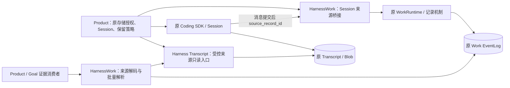
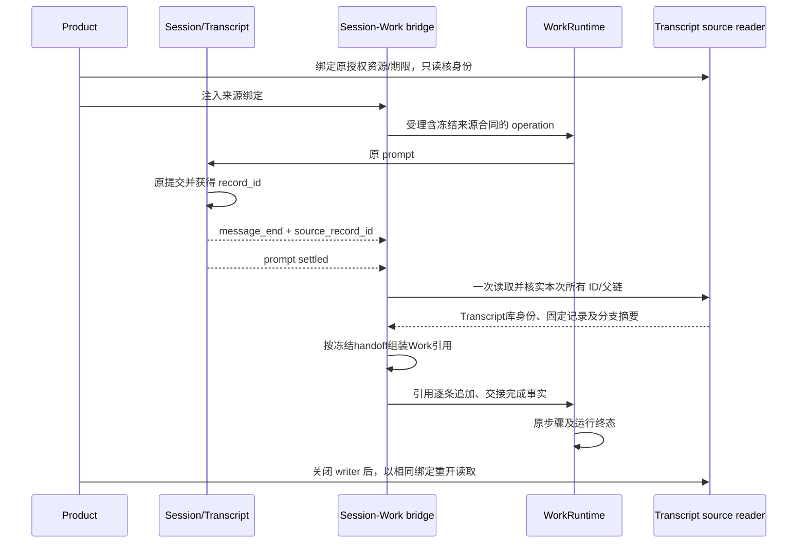

# HW-KD-004：Work → Transcript 稳定引用与重开读取

- Authority: accepted；Design status: accepted；Implementation status: implemented (incremental reference slice)。
- Revision: R2.2，2026-10-29。Owner：HarnessWork 集成；参与：Harness Transcript、Coding/Product。共同父级：Loushang architecture。
- 已接受边界：ARD-019 / HW-KD-003 R3.1；第一切片 ea4a4ad56 及 RF-01 收尾修复。方法：本地干净 archmethod master 0f9bd3ff51afabeaaf76cc38dff1ceb279b7d37e。
- 用户授权：先收尾第一切片，再实现 Transcript 引用闭环。本文细化该已接受范围，不改变 Goal/Work/Method 归属。已由三视角独立评审关闭，实施 agent 按该授权记录接受；若需越出原边界再提交用户。

## 1. 结果与范围

同一 Linux 用户、有权访问的原 Coding SDK Session 产生消息，Work 记录明确来源；关闭原 writer 后，另一个 reader 通过 Product 原绑定读取固定记录并验证分支内容。继续复用原 Transcript、原 JSONL/codec/分支图、store admission 和 Blob 权威。

本切片先增量记录引用，保留全部旧正文、流式事实、query/subscribe；不替换/裁剪任何已发布内容。因此沿用 recording v1 published_facts，不暗改 v1 默认。新增来源事实是共享 Session 集成自己的版本化事实，底座不识别领域 kind 全集。消除正文重复是后续迁移，不以本切片声称写放大已经解决。

不做：跨用户/机器共享、自动新建 Session、绕过 admission、跨库事务、全局引用计数/GC、自动重新执行、完整模型用量归属、附件字节验证器、AppHost、默认 Channel/TUI 切换、缓存或新持久索引。

## 2. Current 事实

- AgentEventRouter.handle 在 message_end 时 await append_message 后把 source_record_id 交给 dispatch；RuntimeEvent 已有 session_id/source_record_id。运行 event_id 是诊断身份，不能作为记录 ID。
- SessionTurnExecutor 在原 prompt 执行范围订阅运行事件，finally 退订。SessionWorkRuntime 拥有单 Session 的 Work 并发闸门；通用 bridge 在 HarnessWork。
- 现有桥接保存 ContentDelta / TaskCompleted / AgentInvocationCompleted 等内联正文；没有稳定 Transcript 来源合同。
- TranscriptStoreAdmission.inspect 只检查已知库，不初始化；返回物理 binding，持有 owner 后可 check/close。原写入 owner 在短 admission 后释放锁，Session 生命周期继续持有自身 writer lease。
- Transcript 现有 RootedFileIO 支持已持有根 fd 下的稳定只读；ConversationJsonlRecordCodec、AgentTranscriptProfile、ConversationRepository 已提供解码与严格父链验证。来源读取必须使用这些原机制，不从 Work 正文重建 Transcript。
- 原只读 decoder 可跳过未完成尾部；因此调用方仍须核实所有引用目标及其祖先存在，不能把可读前缀当作完整交付。

## 3. 组件与系统环境



- HarnessWork 记录组件：继续 v1 合同及 ACK 确认，不感知 Transcript 物理路径。来源事实 codec 属于集成的内部记录模块，不另立组件。
- HarnessWork Session 集成：负责绑定描述冻结、捕获已提交 ID、原执行范围内完成必要交接、来源事实解码及同源批量读取。Product 不复制这些逻辑。
- Harness Transcript 受控只读入口：复用原 admission、描述符读取、codec 和父链；提供库身份与固定记录内容验证。它属于既有 Transcript 读取职责，不是独立服务。
- Product：提供明确 root/state_root/文件名/conversation、授权 reader 与保留截止时刻；管理其关闭和清理。Goal 仍解释业务要求，记录可读不等于目标完成。

## 4. 资源、身份与保留合同

### 4.1 绑定

公共读取对象 `TranscriptSourceReader` 由 Product 注入精确 session_file、conversation_id、原 store_state_root 和读取大小上限。只允许原已登记的库；不调用 Session.open/new，不初始化目录或 admission。引用绝不携带路径/URL作为开库指令。

每次读取在 Harness 内构造并保留 admission owner，inspect 原事实，借其已验证根 fd 创建 RootedFileIO，以描述符读取配置的直属文件，再 check 原绑定。结束先清理 file IO，再关闭 admission；失败时 owner 和凭据保留在 reader，aclose 可重试。所有 native 调用复用 settled_io；在调用前把 admission/file IO 登记到 reader 的存活 owner，取消不能提前释放 native I/O 仍在使用的依赖。reader 的关闭拒绝新读，等待已接纳调用结束。可重试清理失败沿原 ledger 重试；结果未知的 fd close 依原机制保持不可确认，不承诺重试一定释放，也不再次关闭可能已复用的 fd。

库身份是原 admission 已验证事实的版本化不透明指纹，包含原 incarnation（v1 operation / v2 family/member）、root/parent 与原 store key。它只用于与冻结引用比较，不能替代原 admission 或授予权限；不另存 admission 副本或另发库身份。Token 的生成/解释由 Transcript owner 内部负责。

首次 `WorkTranscriptSource.bind(reader, binding_id, retained_until)` 经 `reader.inspect_identity()` 只读验证已准入库身份并冻结 Product 配置的预期 conversation_id，得到不可变描述；这不是文件或 header 已验证。新 Session 原有延迟写入可能尚无 JSONL，绑定阶段不要求文件存在，不创建它。已有文件的内容/会话核验也统一延后到实际 read；每次交接和跨进程解析必须 read 真实文件/header/目标及祖先，缺失或错 header 不回退身份观察；Product 提供稳定逻辑 binding_id，重开时重建同一授权 reader，必须匹配原库身份与会话。跨库复制/重建库/把逻辑名改绑另一个根不能冒充原来源。同一已登记库内、同 conversation 且字节完全相同的文件替换允许通过；库身份不宣称提供文件 inode 的历史身份。文件名由 Product 原 Session 元数据恢复，不由日志 payload 指定。

### 4.2 保留

retained_until 为 Product 明确选择的 UTC 截止时刻，不由 HarnessWork 猜测或默认永久保留。普通未绑定来源的 Work 无需填写此策略。绑定后本切片要求消息交接，不设置“绑定了却可以悄悄丢引用”的可选开关。

该承诺随 Work 的受理描述冻结。截止前 Product 必须保留原 Transcript 及原 admission；首个消费场景使用任务专属运行目录，无普通逐 Session 自动清理入口。全任务清理只在截止后执行。本切片不提供提前终止接口；提前外部删除判为来源不足，不冒称正常到期。扩展到已有自动清理 Product 前，须将保留检查接到该 Product 原清理 owner，不能只凭标签声称受保护。

截止后解析返回 retention_expired（即使文件仍在），与截止前 missing/corrupt 不同。不新建全局保留账本；承诺保存在原 Work operation，路径映射仍属 Product 原持久元数据/配置。新 Product 配置不能缩短旧 Work 的冻结期限来伪造符合承诺。

## 5. 持久格式与 API 范围

### 5.1 来源合同

标准 Session 适配在受理前生成 `operation.payload._harnesswork_transcript`，拒绝调用方已有同名键；校验非空 session_id 与绑定 conversation_id 一致。它是桥接版本化补充合同，不改变 Work recording v1 的四字段 schema：

```json
{"version":1,"binding_id":"coding-run","store_identity":"...","conversation_id":"...","retained_until":"...UTC...","handoff":"committed_messages","handoffs":[{"handoff_id":"0:0","step_index":null,"step_id":null,"prompt_index":0}]}
```

共享 adapter 从标准 executor 的 turn/turns/follow_up_messages 和实际 spec 冻结 handoffs，IDs 在一个 Work 内唯一：无 step 为 0:prompt_index，有 step 为 step_index:prompt_index。覆盖裸 accept_operation 默认单 prompt、submit_turn 的全部 follow-up、submit_plan 每一步的所有 prompt；不得从首 turn 推断后续步骤数量。不能从标准 executor 冻结范围的来源装配在受理前拒绝。引用/完成事实只允许清单内 handoff_id；step字段是领域报告，不升级为 kernel 证据。

与 operation 同次追加、同一 ACK；append 失败不执行。本切片来源绑定是 Product 装配选项，绑定来源时同时显式启用 recording_version=1。无来源装配继续原内联行为，不假造合同/引用。已有 Method/WorkRunSpec 参数语义保持。

### 5.2 引用事实

`WorkTranscriptReferenced` 的 payload 仅有嵌套 `transcript_source` 对象，包含精确 version=1、binding_id/store_identity/conversation_id、handoff_id、record_id、branch_digest。Work envelope 提供 operation/run/session 身份；source_event_ref 只保留原运行 event_id 作诊断。不平铺 plan_id/step_id 等保留键，不把领域自报步骤变成 kernel 证明。

record_id 自身就是本引用的分支截点；不读取当前默认 head，不重复保存 head_id。摘要属于 Harness Transcript 读取合同，Work 集成只记录和比对结果，Product 不复制算法。

v1 摘要固定如下：使用一次受控读取的原始 UTF-8 JSONL 字节；原 decoder 校验后，首个非空物理行是 header，带提交换行的非空记录行按原 recordId 对应。只去除每行终止 LF，保留 CR、空白和未知 envelope 字段；Source v1 仅支持 LF/CRLF 分隔，bare-CR 分隔明确拒绝（原通用 decoder 更宽）；尾部无 LF 的记录跳过，不作为引用目标。JSON再编码不参与摘要。header 也须有提交 LF；记录原始行按原 decoder 的顺序与已解码 records 配对（跳过空行及未提交尾行，计数不符拒绝），不为计算摘要再次解析 JSON。令 H=SHA-256，H0=H(b"loushang.transcript.branch/v1\0" + header_line_bytes)，L(r)=H(raw_record_line_bytes)，D(r)=H(b"loushang.transcript.record/v1\0" + (D(parent) 或 H0 的32字节值) + L(r))。branch_digest 为 D(r) 的小写64位hex。父链按原严格 ConversationRepository 验证，无父链/重复ID/环拒绝。未知字段变化及规范化重写都改变摘要；允许追加新分支，不允许用重编码后的同语义内容冒充原字节。未来算法变化必须新版本，不能随当前codec实现漂移。

读取对象只返回 Transcript 的库身份、固定记录和 v1 分支摘要；binding_id、期限、handoff 与 Work事件由 HarnessWork 组装。单次批量读取内，祖先遍历遇到已算摘要即停止，再反向计算未处理链；每个不同祖先最多解析/哈希一次，不出现每引用一次完整祖先扫描，不保留跨调用缓存。

引用语义只证明原记录及父链，附件仍是原 Blob 引用，字节可读性/摘要由原 Blob reader 与领域验收核验。本切片不能把 record verified 写成附件完整或 Goal 验收通过。

### 5.3 交接完成

每次正常返回的 prompt 在 Work executor 内，按当前冻结 handoff_id 收集本次 message_end 及其 source_record_id。ID 是待核对定位信息，不是通用持久ACK证明（某些Transcript可返回staged ID）；实际持久目标及父链核对成功才发引用。ID 缺失、错会话或零消息均为必要交接失败。消息提交事件只收集轻量 ID/诊断身份，不在每个消息事件中重开文件。

prompt 返回后一次读取该来源，核实全部记录与父链，生成引用；逐条经原 context.publish 追加成功后发布 `WorkTranscriptHandoffCompleted`（嵌套 handoff，列出 handoff_id、此次去重后的 record_id 集合；step 领域报告通过冻结交接清单关联），然后才结束该 prompt 执行。prompt 返回时停止本组收集并冻结 ID 快照；交接读取期间后续 message_end 仅走旧事件投影，不改变已冻结集合。多 prompt/多 step 各有自己的交接，每轮结束清空当前集合；重放不把同一来源 record_id 的跨组引用算为独立证据。每组只有一份完成事实；重复引用/重复完成/未知组拒绝，完成集合须精确匹配本组引用，且非空。少一整组、仅部分引用、只有引用无完成均报告缺项。failed/cancelled 的未执行组同样标为未交付，但不据此重写原终态。完成事实只报告桥接当次观察集合已交接，不证明全 Session/机器的消息完整审计。

消费者接收原 get_recording 或共享冷投影产生的 WorkRecording 以及对应范围 entries；核对 run/operation/session、ACK sequence 截点后解析合同、引用及 handoff，不以 cached query 越过不可确认 owner。冷投影是原记录 reducer 的只读公共入口，无 executor、无写入，继承停 writer/新开 backend 前提。明确返回记录解析结果/交接覆盖，不从 Work completed 单独推导来源齐全。批量解析先核版本、Work 身份、绑定与 deadline，再每个来源读取一次，随后校验目标、父链摘要和 handoff 覆盖。未知格式/版本拒绝对应请求，不能当作无引用。

## 6. 关键交互与失败



| 场景 | 结果与责任 |
| --- | --- |
| 无来源能力 | 原内联事实保留；无来源完整保证 |
| 绑定过期/错会话/能力不足 | 受理前拒绝，不调用 prompt |
| 消息未提交或来源目标/祖先不存在 | 必要交接失败，原 Work 异常路径 failed；不回退正文冒充已交接 |
| 读取中并发变化/权限失败/损坏/未知格式 | 明确来源错误，消费者不能宣称可验证；不盲重试，不改变原 Transcript |
| Transcript 已写、Work 引用追加失败 | 保留原消息、不重新调用模型；新确认视图按 KD-003 不可用 |
| 取消发生在 prompt 或读取交接中 | 使用下述阶段取消协作；原 Work 继续裁决最终结果；native I/O settled 后才释放依赖，不新发第二终态，不在终态后补引用 |
| 部分引用已追加后失败/取消 | 已有引用可追溯，但未完成的 handoff 不能算齐全 |
| 缺少交接完成、但有历史 completed | 新消费者报告覆盖不足，不重发执行；旧 reader 仍只投影生命周期 |
| 截止前外部删除 / 截止后读取 | 分别来源不足 / retention_expired，均不伪装验收通过 |
| 清理报错 | 保留 reader 原 owner 与句柄凭据，aclose 重试；Product 不释放其仍被使用的依赖 |

### 6.1 阶段取消协作

共享 SessionTurnExecutor 按原 run_id 隔离内部 cancel_requested 和 handoff_idle（初始已置位）。cancel_and_wait 在任何 await 前设置 cancel_requested；保留原 Session abort/wait_for_idle 行为，并等待 handoff_idle，绝不等待整个 executor task，避免 executor 异常收尾反过来等待取消 driver 的环路。若原 Session 不支持取消，保持 unsupported 裁决；WorkRuntime 会按原规则取消并等待 executor，底层 native I/O 仍须 settled。

取消检查同时读取 canonical WorkRuntime context 的只读 cancellation_requested，它直接观察原 _RunState 在 cancel 受理时同步设置的标记；不等 driver 调度、不复制权威。该观察是 context 的附加可选能力，不扩大旧 WorkExecutionContext 结构协议的必需成员；标准 Session 装配使用 canonical context，自定义旧 context 仍由原 driver 标记兜底，不能宣称同等同步受理保证。直接 cancel、wait 被取消及 dispose 都沿原受理路径生效。执行路径在 before_turn hook 前后、prompt 返回后、进入读取前、读取返回后、每次发布前、after_turn hook 后及下一 prompt 前检查原 context 已受理取消或本地 cancel_requested。取消一旦受理，禁止开始下一 prompt/新来源读取或继续发布引用；阶段检查走原 CancelledError 路径，不能正常返回使未完成步骤被记作 WorkStepCompleted。已有引用保留，未完成组不发布完成声明。

读取前清除 handoff_idle；在 finally 中、原 settled_io 已结束后置位；取消 driver 可等待这个阶段事件但不取得整个执行任务的所有权。正常读取结束也检查取消后才发布。发布仍走原同步 context.publish，已接受取消不能在无 await 的单次发布中间插入；对可重入发布监听设置取消的情况，下一次发布前也复查。原 Work 最终等待 executor 结束，再按原 outcome 裁决。订阅在 executor finally 退订，并释放该 run 的协作状态；同一公共 executor 直接被 WorkRuntime 多次使用也不能把已取消标记带到后续 run。

这同时收敛原共享 executor 的 follow-up 缺口：即使未启用来源，取消后也不得再启动后续 prompt；不改变 kernel 的取消结果优先级。原取消超时仍可结束等待或取消任务，但不构成提前释放尚未 settled 的 native 资源的许可。需要分别注入 prompt 中、两 prompt 间、读取中、读取后发布前以及清理失败的取消；明确覆盖 executor 已就绪但 cancellation driver 尚未运行的窗口和受理后立即取消。

不添加固定 30 秒等待或新队列。原 prompt/取消策略仍有效；来源读取一次失败即返回本次错误。若需要可取消后台读取、跨进程恢复或重试策略，另据真实场景比较，不在此补造承诺。

## 7. 兼容与验证

旧调用无新来源字段/事实；启用引用的调用仍保留全部原事实，所以旧 reader 可继续投影，但不能声称理解来源保证。引用 codec 严格拒绝 bool 版本/未知字段/未知版本；补充合同未知版本按对应请求失败，生命周期读不变。未来正文裁剪另定 capture/版本和消费者迁移。

验证：
1. 真实 Coding SDK Session（离线受控模型流）提交消息→标准桥接→Work JSONL→关闭→新进程只读同一引用；不是只拼装 JSON 的 mock。
2. 两步骤、末步两次 prompt，删除最后整组仍保留 completed 时报告缺项；重复/未知组拒绝、失败/取消剩余组未交付。同 Session 多批 Work、一次多个引用只读一份来源；固定旧分支在新 head 追加后仍可读取；同源引用不重复计证据。
3. 错库、复制/替换库、错会话、运行 event_id 冒充记录 ID、缺祖先/摘要不符/未知版本/部分尾部/权限失败分别拒绝。
4. 来源取消、引用 append 写前/写后异常、部分引用与缺失 handoff；不产生终态后发布，原取消测试不回退。
5. 留存截止前缺失、到期、配置缩短旧期限、提前清理不受支持；API 不提供对受保护来源的普通删除动作。
6. Reader 不创建 Session、锁文件或 admission；与原 writer 并存读取，第二 writer 原拒绝行为保持；清理失败可重试且依赖保留。
7. 文本消费闭环完成；附件只验证引用归属边界，完整附件验收仍使用原 Blob 能力。
8. 固定基线 reader 冷读 legacy→来源v1→回退混合历史，比较全部事件及Run/Plan/取消投影；未知来源版本拒绝对应解析。固定摘要测试向量覆盖未知envelope/payload、CRLF/空白及拒绝 bare-CR、共享祖先、部分尾部，算法不依赖当前codec规范化。

未声称性能已达标：记录同源读取次数、读取字节、不同祖先的遍历及哈希次数，冷热成本分别列出；无吞吐门槛、无新增 PR gate。实现后同步 KD-003 gap ledger，只关闭已验证的引用切片，不宣称流式裁剪/完整审计全部完成。


R2 修订关闭方向：逐prompt预期集合（OW2-01/DR-01/TRF-02）；明确取消协作（TRF-01）；原字节摘要算法（DR-02）；同库相同字节替换允许（DR-03）；reader返回边界（OW2-02）；新增来源事实兼容与遍历成本（DR-04）。以上为 R2 历史修订方向；R2.1 已经原三位 reviewer 固定版本复核关闭，实施时的 R2.2 协同变更与代码亦已三视角复核，见 §8 和交付记录。

R2.1：TRF-01 的阶段检查同步读取原取消受理状态，关闭 driver 调度窗口；补充 LF/CRLF 来源格式范围，bare-CR 明确拒绝。

## 8. 接受记录

2026-10-29，实施 agent 按用户“先收尾第一切片，再实现 Transcript 引用闭环”的授权接受本专项范围。三名独立 xhigh reviewer（职责与复用、运行与失败、数据与兼容）复核固定 R2.1 SHA-256 `cba9b3a644f3a4b9c3733a111ce098bdc6887282280d92c3d989f148b808c2b7`，所有设计阻断关闭。此为 agent 内部接受，不冒称用户逐项评审；实现验证仍待完成。

R2.2 实施协同：真实 SDK 证实原 Session 延迟首消息创建 JSONL，绑定改为独立 TranscriptSourceIdentity（原库身份＋预期会话），记录验证仍只发生于实际 read；取消协作按 run_id 隔离以兼容公共 executor 复用。原三视角实施复核包含此调整。

实现、独立评审关闭及可复现命令见 [Transcript 引用切片交付记录](../../../plans/2026-10-29-work-transcript-references.md)。
