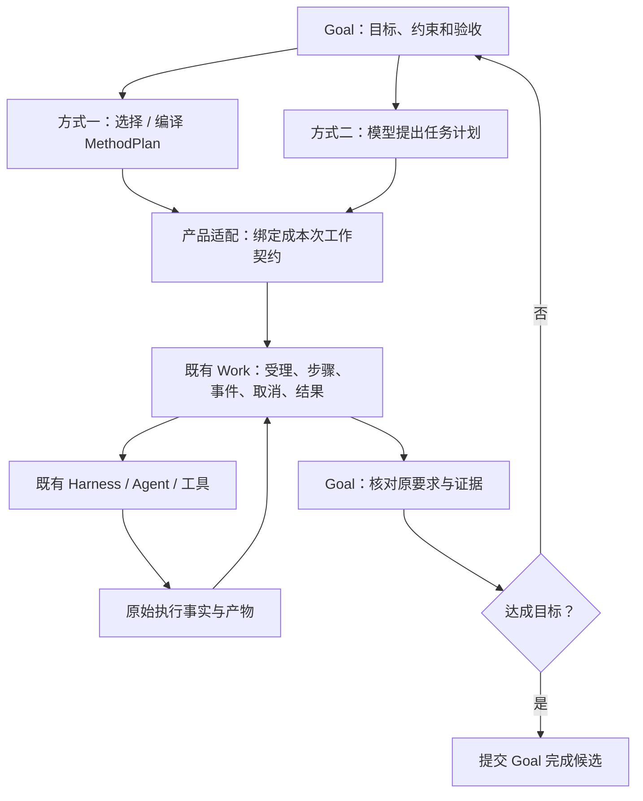

# Goal、Method、Work 协作方案与输入边界

## 状态与用户决定

- Authority: proposed — candidate integration design；Design status: proposed。
- Implementation status: not-started；Owner: Loushang architecture / Product composition。
- 基线：本地 main `2de1359c31d540913df11a7f4705f5a1b54624ba`；未核验远端。
- 方法：本地干净 archmethod master `0f9bd3ff51afabeaaf76cc38dff1ceb279b7d37e`。
- 2026-10-24：用户要求先解释新增机制与旧行为的差别，并先设计清楚 Method/
  Work 兼容及模型规划两种推进方式。此次仅授权设计；功能开发继续暂停。

本文补正 [ARD-018 首轮候选](../architecture/decisions/proposed/ARD-018-goal-reuse-existing-runtime.md)
的业务协作缺口，不继承废弃实现。首轮三视角意见针对旧候选；本协作方案尚未复评，
不能称为已接受设计。下文分别标明 Current 与推荐方案。

## 1. 先区分旧行为与新增要求

main 已支持图文、steer/follow-up、持久消息、图片 Blob、消息图片复制/导出及原工具
审批。未重新执行测试，不据静态核对宣称整个产品无缺陷；本次评审也没有复现这些
旧功能的运行错误。

| 议题 | main 之前的行为 | 为什么候选会涉及它 | 本次取舍 |
| --- | --- | --- | --- |
| 输入与完成先后 | 普通回合结束后仍可接新消息；没有持久 Goal complete 声明 | Goal 若判断“完成”，必须说明这一判断覆盖哪些要求；判断期间追加要求会使旧候选过期 | Goal 必需的窄集成：完成决定与新要求有明确顺序；不重写普通消息队列 |
| 队列落盘等待 | 同步 steer/follow-up 经 preflight 后进入现有队列，普通 User 在既有消息路径持久化 | “原文图片在任何处理前保存”的要求强于原行为，扩展/preflight 之前须有 raw ACK | 排队可先返回，处理前确认保存；持久受理与仅排队的回执区别表达。作为独立 Session 增强，不设为所有 Goal 启用的强制前置 |
| 原文图片转移 | 既有消息的 SessionImagePart 被既有收集/重写/导出器识别 | 新候选把 raw 放入隐藏 ExtensionData/Blob，会新增原收集器不认识的引用 | 旧消息图片不重做；raw 新格式单列数据设计和验收 |
| 旧版本往返 | 已有格式按既有兼容路线读写 | 新 Goal/raw 记录被旧 writer fork/export 后，未知 JSON 的保留不保证隐藏 Blob 与关联完整 | 校验新增格式的支持矩阵；不泛化为旧输入功能故障，也不承诺任意版本自动迁移 |
| 用户授权 | 既有会话/工具沿原 host identity、approval、sandbox 执行 | Goal 增加 set/resume/预算修改等控制动作，需要分清用户控制、模型建议及扩展输出 | 复用可信入口与原权限；补 Goal 操作权限表，不建立另一套工具审批 |
| 未知写入查询 | 固定 User 已有准确 record 的查询；ExtensionData 有固定 ID 提交但无同构只读查询接口 | 新控制/关联记录可能已落盘但 ACK 丢失；不能靠再写一条猜测 | 只为新增记录定义必要对账；不宣称旧存储整体不可靠 |

“Goal 必需集成”“独立的原始输入留存增强”“既有行为回归”分开列项，不用一个
输入测试计数推算完整 Goal 进度。原文保存及确认后关联仍是本线程保留要求，不因
单列就删除；其实现不应拖入 Goal 的目标策略组件。

## 2. 概念和权威：四者协作

| 概念 | 回答的问题 | 持有的权威 |
| --- | --- | --- |
| Goal | 最终要达成什么，哪些要求未满足，继续/暂停/完成 | 目标原文、要求 revision、控制、预算策略、最终验收结论 |
| Method | 这类工作有哪些角色、阶段、约束、产物和验收要求 | 可复用方法定义、选择、编译、MethodPlan；不执行或保存 Work 生命周期 |
| 模型规划 | 针对这一次目标，下一批工作如何安排 | 计划建议、局部策略和重新规划建议；不授予执行许可或改写目标 |
| Work / HarnessWork | 哪个计划/任务被接受执行，实际做了什么，怎样结束 | operation/run/step、事件顺序、产物和偏离事实、取消与终态 |
| Harness / Agent / AI | 如何执行已准入工作 | 会话、队列、调用、工具、审批、取消、原始用量及模型输入事实 |

Current：`loushang.work` 是 `loushang.harnesswork` 的 symbol forwarding 兼容入口。
当前应复用 HarnessWork，而不是给 Goal 再造 run/step/event log。Method 也已明确
“规定什么必须成立，模型决定怎样达到”，所以 Method 和模型自主性并不互斥。

推荐关系：**Goal 管目标，两种方式产生工作计划，Work 承担实际履约，Harness 执行。**

以上是拟议协作图，不代表已有 Goal 实现。规划和验收需要的模型调用也经原
Harness 执行并计入 Goal 消费，不能成为预算之外的旁路。

## 3. 两种方式共用执行路径

### Method 方式

1. 用户显式选择适用方法；产品调用现有 Method selection/compiler/projection。
2. 产品将方法步骤、目标约束和领域能力绑定为 run-specific WorkRunSpec。
3. 复用现有 SessionWorkRuntime.submit_plan / WorkRuntime.accept 与原执行器。
4. 模型在方法约束内决定局部实现；不能静默删除必须的阶段、gate 或验收要求。
5. 产物/偏离记录在原 Work 事件中；Goal 读这些事实核对最终要求。

例如“按缺陷修复方法解决登录失败”，Method 规定诊断、修复、验证要求，模型
决定查哪些文件和如何修复，Work 记录此次各步骤和结果。

Current 限制：MethodProjection 的部分 gate/expected_artifact 字段仍为预留；已有
submit_plan 能顺序执行已绑定步骤，不等于所有 Method 约束已被自动强制验证。
产品适配器须显式解释/校验所选方法合同，不能只把方法文本拼进 prompt 就称完成。

### 模型规划方式

1. 不要求选择 Method。模型依据完整 Goal、当前证据和资源约束提出有限任务计划。
2. 产品校验计划仍覆盖目标且未扩大权限/预算，再由 Work 受理。
3. 执行、取消、记录和产物查询走相同 Work/Harness 路径。
4. 新证据需要改变安排时提出显式下一批计划，不能改写已接受 Work 的历史。

例如“调查登录故障并修复”，模型先提出排查，再依据结果提出修复/验证批次。
这不是另一套 agent loop；只是工作计划的来源不同。需要时某个任务也可选用 Method。

## 4. Goal 与 Work 的关系、重新规划和恢复

推荐 **一个 Goal 关联多个 WorkRun；一个 WorkRun 绑定固定 Goal 要求版本和计划快照**。
多个 run 不意味着并发；首版推进可以串行，既有子代理仍由原 owner 管理。

Current 的 WorkRunSpec.steps 是受理时固定的顺序步骤，WorkPlanRevision/WorkInput
在架构中仍有未实现部分。因此首版不假装已有动态修改运行中步骤的 API：

- 已接受计划继续按其冻结快照执行；允许的局部策略不改变方法合同。
- 需要实质改计划时，先停止/结清当前批次，在下一 WorkRun 绑定新快照，并记录
  对前一批次和证据的引用。未知效果未结清时不自动重做该任务。
- Goal pause 阻止新受理并请求原 Work cancel/settle；已终态 cancelled 的 Work
  不被 resume 复活。Goal resume 在当前授权下根据已确认事实提交剩余工作。
- Work 重开后已有 incomplete→orphaned 投影，它不是已自动恢复运行；恢复策略
  由当前 Goal/产品适配结合原事实决定，不重建旧 Task 或重放未知工具效果。

Goal 保存目标控制和关联引用，Work 保存执行生命周期，Transcript/AI 保存原调用
及用量。这几类权威不同，不互相复制原始日志或独立重新计算相同事实。
Goal→Work 的受理桥使用固定 operation_id：先记录启动意图，再调用原受理，最后
关联实际 run。中途失败按 operation_id 查询原 Work，不能再分配 ID 重启；已有
DuplicateWorkOperationError/get_run_for_operation 是复用基础，不等于已经提供跨
存储原子事务。确切对账/未知结果的最小增量属于待定集成合同，不能写成 Current。

## 5. 完成与用户追加要求

Work completed 表示这批被接受的工作执行完；Goal complete 表示目标要求得到满足。
前者是后者的证据之一，不能自动等同。模型“做完了”同样只是完成候选。

例如已完成“修复功能”，但用户在最终验收前又要求“同时支持 Windows”：旧结果
不能覆盖新增要求。这里只需定义 Goal 的要求版本/输入水位和一次最终决定的顺序，
不要求把普通 steer/follow-up 重新实现。完成决定之后收到的输入作为后续工作受理，
不能偷偷改写已完成目标；完成决定之前受理的新要求必须让旧候选失效。
这项并发合同仍需设计确切排序点，不能用“提交前检查一下”冒充已解决。

额外 raw 留存策略若启用：原队列可先持有待处理输入；raw 完整落盘确认前，不进入
会改变内容或产生副作用的处理。仅入队与持久受理是两种回执。clear 必须能使尚在
保存的输入不再被随后重新交付。这是严格存储要求的后果，不是 Goal 自动推进的
普遍前置；具体原队列协作增量仍待独立设计。

## 6. 放置和依赖约束

- Goal 核心通过中立“规划/执行/结果观察”端口协作，不 import Method 或 Work 类型。
- Work 集成适配器可放在 `harnesswork.integrations`，依赖 Harness 的中立 Goal 端口；
  Method 选择/编译及领域绑定留在 Product composition/integration。
- 模型规划由产品适配现有 Harness 模型调用，不建设 Goal 自有 provider/工具执行器。
- Harness base 不反向依赖 HarnessWork；Method core 不依赖 Work；旧 Work 兼容入口
  不改语义。无 Goal 的现有 Method/Work 使用路线继续可用。
- 不为两种方式建设两个 WorkRuntime、重复的取消状态机或独立预算原账。

这些是候选放置约束，尚未接受；需要与既有
[Method](../architecture/method/README.md)、[Work](../architecture/work/README.md)
和 [HarnessWork](../architecture/harnesswork/README.md) 的边界一起复评。

## 7. 设计完成前仍需关闭的具体问题

1. Goal 核心与上述端口的最小接口、唯一装配及 interrupt/close 顺序。
2. Goal/Work 固定 operation_id 的受理、恢复和对账；旧 run 终态不复活。
3. 规划、执行、验收、retry/compaction/child 的统一预算归属及原派发撤权。
4. 新要求与最终完成的确切排序点；普通消息行为保持原路线。
5. 独立 raw 格式、处理前确认、User 后关联及类型化转移/兼容合同。

复评先检验两种方式是否真正共用 Work，以及这些增量是否已有 owner。当前只改设计
文档，不开始实现、不新增门禁、不恢复自动开发，也不把此稿写成评审已通过。
